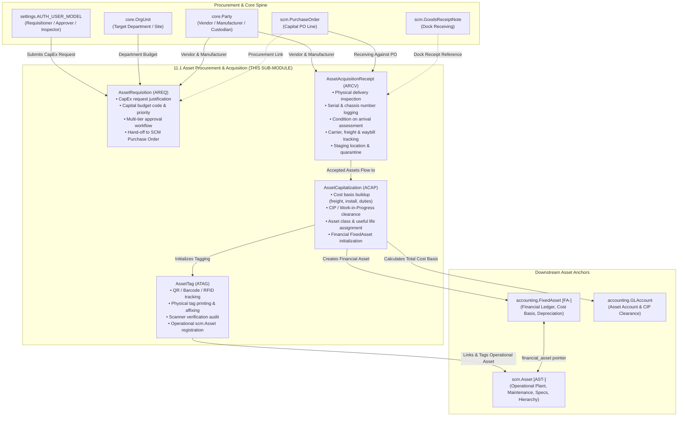

# Research — Sub-module 11.1: Asset Procurement & Acquisition (Module 11 — Asset Management System, `assets`)

- **Sub-module:** 11.1 Asset Procurement & Acquisition
- **Module:** 11 Asset Management System
- **Target app:** `apps/assets` (package: `apps/assets/models/AssetProcurement/`)
- **Research date:** 2026-11-08
- **Phase:** Phase 1 Research Catalog
- **Output file target:** `.claude/tasks/research-assets-11.1.md`

---

## 1. Executive Summary & Domain Architecture

Sub-module 11.1 delivers the foundational **Asset Procurement & Acquisition** capabilities for NavERP's **Asset Management System (`apps/assets`)**. As the initial sub-module of Module 11, it establishes the operational and financial bridge between enterprise capital expenditure (CapEx) procurement and long-term asset lifecycle management.

In enterprise asset management, acquiring physical plant, heavy machinery, fleet vehicles, IT infrastructure, and facilities differs fundamentally from procuring consumable inventory:
1. **Capital Expenditure (CapEx) Planning & Multi-Tier Approvals:** Asset purchases involve significant financial commitments that require capital budget validation, ROI justification, depreciation planning, and multi-tiered executive or department authorization prior to issuing purchase commitments.
2. **Specialized Vendor Evaluation & Capital Quotation (RFQ):** Capital asset purchasing requires evaluating total cost of ownership (TCO), supplier warranties, rigging/freight costs, installation terms, and post-commissioning maintenance SLAs rather than unit prices alone.
3. **Physical Asset Intake & Condition Inspection (Receipt):** When heavy equipment, vehicles, or delicate IT hardware arrives, receiving is not merely updating a stock ledger. It requires physical unboxing, condition inspection, damage verification, packing list matching against capital purchase orders, and logging serial numbers/chassis numbers.
4. **Asset Capitalization & Cost Basis Determination:** Before an asset is placed in service, all acquisition-related expenditures (base price, ocean/freight shipping, rigging, import customs/duties, installation labor, and initial calibration) must be capitalized into the asset cost basis, assigning asset classes, estimated salvage values, useful life, and initiating depreciation schedules in the financial ledger.
5. **Physical Tagging & Operational Master Record Creation:** Every physical asset must be assigned a globally unique machine-readable tag (QR code, Code 128 barcode, UHF RFID EPC, or NFC tag), physically affixed with industrial nameplates, verified in the field, and registered with operational operational anchors (`scm.Asset`) linked to financial depreciation ledgers (`accounting.FixedAsset`).

### Architectural Data Flow & Spine Integration

---

## 2. Repo State Checked First

### 2.1 Existing Module Status & Rollover
- **Module 10 (Business Intelligence - `apps/bi`):** 100% complete. All 19 sub-modules (10.1 through 10.19) are built, verified, tested, and active in `LIVE_LINKS` in `apps/core/navigation.py`.
- **Module 11 (Asset Management System - `apps/assets`):** Brand-new app. No prior migrations, models, or views exist under `apps/assets`.
- **Sub-module 11.1:** First sub-module of Module 11. This run scaffolds `apps/assets/` according to the mandatory backend package structure (`models/`, `forms/`, `views/`, `urls/`), wires `config/settings.py` and `config/urls.py`, and implements 11.1.

### 2.2 Spine Entities Verified to Exist (grep evidence)
- **`apps/core`:**
  - `core.Tenant` (Multi-tenant isolation anchor) -> `apps/core/models/Tenant.py`
  - `core.Party` & `core.PartyRole` (Vendors, Manufacturers, Custodians) -> `apps/core/models/Party.py`
  - `core.OrgUnit` (Department, Plant, Cost Center, Site) -> `apps/core/models/OrgUnit.py`
  - `core.Document` (Attachment repository for invoices, photos, spec sheets) -> `apps/core/models/Document.py`
  - `core.AuditLog` (Immutable audit logging) -> `apps/core/models/AuditLog.py`
- **`apps/scm`:**
  - `scm.PurchaseOrder` & `scm.PurchaseOrderLine` [PO-] -> `apps/scm/models/ProcurementManagement/PurchaseOrders.py`
  - `scm.GoodsReceiptNote` & `scm.GoodsReceiptNoteLine` [GRN-] -> `apps/scm/models/ProcurementManagement/GoodsReceiptNotes.py`
  - `scm.PurchaseRequisition` [PR-] -> `apps/scm/models/ProcurementManagement/PurchaseRequisitions.py`
  - `scm.Location` -> `apps/scm/models/InventoryManagement/Locations.py`
  - `scm.Asset` [AST-] -> `apps/scm/models/AssetManagement/Assets.py` (Operational maintainable asset master built in SCM 4.13; Module 11 extends it by string FK `scm.Asset`, maintaining separation between operational and financial records).
- **`apps/accounting`:**
  - `accounting.FixedAsset` [FA-] -> `apps/accounting/models/FixedAssets/FixedAssetsRegister.py` (Owns financial depreciation, acquisition cost, salvage value, accumulated depreciation, GL accounts).
  - `accounting.GLAccount` -> `apps/accounting/models/GeneralLedger/Accounts.py` (Asset, Accumulated Depreciation, Depreciation Expense, and Construction-in-Progress accounts).

---

## 3. Commercial Market Leaders Surveyed

We surveyed 8 leading enterprise asset management (EAM), fixed asset management, and hardware asset management (HAM) platforms:

1. **IBM Maximo (IBM Maximo Application Suite / MAS)**
   - *Positioning:* Global benchmark in capital-intensive asset lifecycle management (utilities, manufacturing, transit).
   - *Key Capabilities:* Capital project requisitioning, PO and vendor receipt tracking, direct conversion of received line items into serialized asset numbers, asset hierarchy initialization, and pre-commissioning checklists.
   - *Reference:* `https://www.ibm.com/products/maximo/asset-management`

2. **SAP S/4HANA Asset Management (SAP EAM)**
   - *Positioning:* Integrated ERP asset lifecycle standard.
   - *Key Capabilities:* Capital expenditure (CapEx) requisitioning, Asset under Construction (AuC/CIP) tracking, automatic creation of asset master records from Purchase Orders and Goods Receipts (MIGO), cost basis capitalization (freight, installation, tariffs), and GAAP/IFRS depreciation profile setup.
   - *Reference:* `https://www.sap.com/products/scm/asset-management.html`

3. **Infor EAM / HxGN EAM**
   - *Positioning:* Specialized operational asset management suite with strong capital and procurement workflows.
   - *Key Capabilities:* Requisition approval matrices, capital equipment receiving inspection, automated barcode/QR assignment, vendor warranty capture upon receipt, and commissioning workflow transitions.
   - *Reference:* `https://hexagon.com/products/hxgn-eam`

4. **ServiceNow Hardware Asset Management (HAM)**
   - *Positioning:* Leading IT & enterprise hardware asset lifecycle automation suite.
   - *Key Capabilities:* Service catalog hardware requests, multi-stage approval tiers, stockroom receiving with mobile barcode scanning, asset tagging, automated configuration item (CI) and asset record generation, and ERP financial capitalization hand-off.
   - *Reference:* `https://www.servicenow.com/products/hardware-asset-management.html`

5. **Oracle Cloud Asset Management & Fusion Financials**
   - *Positioning:* High-volume enterprise financial and operational asset management.
   - *Key Capabilities:* Mass asset additions from Payables invoices and PO receipts, capital project CIP capitalization, multi-component cost allocation (freight, duties, installation), and automated asset number generation.
   - *Reference:* `https://www.oracle.com/erp/financials/asset-management/`

6. **IFS Cloud Asset Management**
   - *Positioning:* Unified industrial asset design, procurement, and operations platform.
   - *Key Capabilities:* Engineering-to-procurement handover, capital quotation evaluation, supplier delivery inspection, serialization, and asset tagging prior to release to work centers.
   - *Reference:* `https://www.ifs.com/solutions/enterprise-asset-management`

7. **UpKeep Asset Operations Management**
   - *Positioning:* Modern mobile-first maintenance and asset tracking platform.
   - *Key Capabilities:* Asset intake forms, purchase order linkage, digital asset receipt logging, instant QR code generation, and mobile camera barcode scanning for rapid onboarding.
   - *Reference:* `https://www.onupkeep.com/`

8. **Asset Panda**
   - *Positioning:* Highly configurable cloud fixed asset tracking and intake platform.
   - *Key Capabilities:* Custom asset intake workflows, initial condition grading, physical label generation (barcode/QR/RFID), and supplier documentation attachment.
   - *Reference:* `https://www.assetpanda.com/`

---

## 4. Feature Catalog (Sub-module 11.1 Scope Only)

### 4.1 Purchase Requisition & Approval
- **CapEx Requisition Form & Justification:** Dedicated request workflow capturing asset type, business justification, estimated cost, target deployment site/department, requested delivery date, and technical specifications.
  - *Seen in:* IBM Maximo, SAP EAM, Infor EAM, ServiceNow HAM
  - *Priority:* `table-stakes`
  - *Spine:* `AssetRequisition` model; links to `core.OrgUnit`, `core.Party`, `settings.AUTH_USER_MODEL`.
- **Capital Budget Code & Validation:** Associates requests with corporate capital budget accounts or project numbers, verifying funding availability.
  - *Seen in:* SAP EAM, Oracle Cloud, Infor EAM
  - *Priority:* `table-stakes`
  - *Spine:* `budget_code`, `estimated_total_cost` on `AssetRequisition`.
- **Multi-Tier Approval Matrix:** Configurable status progression (`draft`, `pending_approval`, `approved`, `rejected`, `ordered`, `received`, `cancelled`) with approval timestamp, approver attribution, and rejection reason tracking.
  - *Seen in:* ServiceNow HAM, IBM Maximo, IFS Cloud
  - *Priority:* `table-stakes`
  - *Spine:* `AssetRequisition.status`, `approved_by`, `approved_at`, `rejection_reason`.

### 4.2 Vendor Selection & RFQ Integration
- **Supplier & Manufacturer Designation:** Captures designated supplier, original equipment manufacturer (OEM), proposed model, and warranty terms during the requisition stage.
  - *Seen in:* IBM Maximo, Infor EAM, ServiceNow HAM
  - *Priority:* `common`
  - *Spine:* Links to `core.Party` (with role checks) and free-text model/manufacturer specifications.
- **SCM Procurement Hand-Off:** Seamless linkage from approved asset requisition to `scm.PurchaseRequisition` or `scm.PurchaseOrder` [PO-].
  - *Seen in:* SAP EAM, Oracle Cloud, Infor EAM
  - *Priority:* `table-stakes`
  - *Spine:* Optional string FK `purchase_order` to `scm.PurchaseOrder` and `po_number` reference.

### 4.3 Purchase Order & Physical Receipt
- **Physical Asset Receiving & Staging:** Intake record documenting physical arrival of capital equipment at the receiving dock or staging location.
  - *Seen in:* IBM Maximo, ServiceNow HAM, SAP EAM
  - *Priority:* `table-stakes`
  - *Spine:* `AssetAcquisitionReceipt` model; links to `scm.PurchaseOrder`, `scm.Location`, `core.OrgUnit`.
- **Serial & Identification Number Capture:** Captures manufacturer serial numbers, chassis numbers, engine numbers, or MAC addresses during intake.
  - *Seen in:* ServiceNow HAM, IBM Maximo, UpKeep
  - *Priority:* `table-stakes`
  - *Spine:* `serial_number`, `model_number` on `AssetAcquisitionReceipt`.
- **Condition on Arrival Assessment:** Structured inspection grading (`excellent`, `good`, `fair`, `damaged`, `defective`) with inspection notes and photo/document attachment support.
  - *Seen in:* Asset Panda, Infor EAM, UpKeep
  - *Priority:* `differentiator`
  - *Spine:* `condition_on_arrival`, `inspection_notes`, `inspected_by`, `inspected_at`.
- **Freight, Carrier & Waybill Tracking:** Captures carrier name, tracking number, bill of lading (BOL), and customs documentation for international or freight shipments.
  - *Seen in:* SAP EAM, Oracle Cloud
  - *Priority:* `common`
  - *Spine:* `carrier_name`, `tracking_number`, `bill_of_lading`.

### 4.4 Asset Capitalization & Depreciation Setup
- **Cost Basis Buildup & Capitalization Event:** Aggregates purchase price, freight/shipping charges, import customs/duties, rigging/installation fees, and initial testing/calibration costs into a verified `total_cost_basis`.
  - *Seen in:* SAP EAM, Oracle Fusion Assets, Infor EAM
  - *Priority:* `table-stakes`
  - *Spine:* `AssetCapitalization` model; tracks itemized cost components.
- **CIP (Construction in Progress) Clearance:** Supports assets built or assembled over time, accumulating expenditures in CIP before formal capitalization.
  - *Seen in:* SAP EAM, Oracle Cloud, IFS Cloud
  - *Priority:* `common`
  - *Spine:* `is_cip_conversion`, `cip_account` (FK to `accounting.GLAccount`).
- **Depreciation Parameter Configuration:** Prepares financial depreciation attributes: asset class, useful life in months, estimated salvage value, depreciation method (`straight_line`, `declining_balance`, `units_of_production`), and placed-in-service date (`in_service_date`).
  - *Seen in:* SAP EAM, Oracle Cloud, Infor EAM
  - *Priority:* `table-stakes`
  - *Spine:* Configures fields and directly creates or links to `accounting.FixedAsset` [FA-].
- **Financial FixedAsset Synchronization:** Generates or updates `accounting.FixedAsset` in Module 2 without re-declaring financial ledgers.
  - *Seen in:* SAP EAM, Oracle Cloud
  - *Priority:* `table-stakes`
  - *Spine:* String FK `fixed_asset` to `accounting.FixedAsset`.

### 4.5 Asset Tagging & Registration
- **Physical Tag Generation & Format Support:** Assigns and formats unique machine-readable tag codes supporting QR Code, Code 128 Barcode, UHF RFID, and NFC.
  - *Seen in:* ServiceNow HAM, Asset Panda, UpKeep, Infor EAM
  - *Priority:* `table-stakes`
  - *Spine:* `AssetTag` model; `tag_format`, `tag_code`, `tag_type`.
- **Tag Lifecycle & Affixation Workflow:** Tracks tag status progression (`pending_print`, `printed`, `affixed`, `verified`, `damaged_reissued`, `retired`) with affixation location description (e.g., "Left motor casing near power switch").
  - *Seen in:* ServiceNow HAM, Asset Panda
  - *Priority:* `differentiator`
  - *Spine:* `AssetTag.status`, `affixed_by`, `affixed_at`, `physical_location_description`.
- **Scanner Verification & Field Audit:** Records scanner verification event confirming tag readability and accuracy before handing the asset over to active operations.
  - *Seen in:* ServiceNow HAM, Infor EAM
  - *Priority:* `common`
  - *Spine:* `verified_by`, `verified_at`, `scanner_device_id`.
- **Operational Master Record Registration:** Creates or binds the tagged record to `scm.Asset` [AST-] in the plant register, ensuring physical tracking, work orders, and maintenance schedules can immediately target the asset.
  - *Seen in:* IBM Maximo, Infor EAM, SAP EAM
  - *Priority:* `table-stakes`
  - *Spine:* String FK `operational_asset` to `scm.Asset`.

---

## 5. Recommended Build Scope (11.1 Pass — 4 Models)

To fulfill the requirements of Sub-module 11.1 while maintaining modularity, tenant isolation, and strict spine integration, we recommend the following **4 tenant-scoped models** (using verified collision-free 4-letter prefixes):

### 1. `AssetRequisition` [NUMBER_PREFIX = "AREQ"]
- **Role:** Capital expenditure request, justification, budget validation, and multi-tier approval.
- **Fields:**
  - Standard: `tenant` (CASCADE), `number` (AREQ-YYYYMM-XXXX), `title` (CharField 200), `description` (TextField), `business_justification` (TextField).
  - Classification: `asset_category` (CharField 100), `priority` (`low`, `medium`, `high`, `urgent`), `estimated_cost` (DecimalField 16,2), `currency` (FK `accounting.Currency` SET_NULL null=True), `budget_code` (CharField 64 blank=True).
  - Proposed Specs & Vendor: `proposed_vendor` (FK `core.Party` SET_NULL null=True), `proposed_manufacturer` (CharField 120 blank=True), `proposed_model` (CharField 100 blank=True), `required_delivery_date` (DateField null=True).
  - Target Placement: `target_org_unit` (FK `core.OrgUnit` SET_NULL null=True), `target_location` (FK `scm.Location` SET_NULL null=True).
  - Lifecycle: `status` (`draft`, `pending_approval`, `approved`, `rejected`, `ordered`, `received`, `cancelled`, default `draft`).
  - Approval Tracking: `submitted_by` (FK `settings.AUTH_USER_MODEL` SET_NULL null=True), `submitted_at` (DateTimeField null=True), `approved_by` (FK `settings.AUTH_USER_MODEL` SET_NULL null=True), `approved_at` (DateTimeField null=True), `rejection_reason` (TextField blank=True).
  - SCM Hand-off: `purchase_order` (FK `scm.PurchaseOrder` SET_NULL null=True), `created_at`, `updated_at`.

### 2. `AssetAcquisitionReceipt` [NUMBER_PREFIX = "ARCV"]
- **Role:** Physical dock and staging receipt, serial number capture, delivery logistics, and arrival condition inspection.
- **Fields:**
  - Standard: `tenant` (CASCADE), `number` (ARCV-YYYYMM-XXXX), `title` (CharField 200).
  - SCM / Vendor Links: `requisition` (FK `AssetRequisition` SET_NULL null=True), `purchase_order` (FK `scm.PurchaseOrder` SET_NULL null=True), `vendor` (FK `core.Party` SET_NULL null=True).
  - Physical Identification: `manufacturer` (CharField 120 blank=True), `model_number` (CharField 100 blank=True), `serial_number` (CharField 100 blank=True), `quantity_received` (PositiveIntegerField default=1).
  - Logistics & Shipping: `received_date` (DateField default=timezone.now), `carrier_name` (CharField 100 blank=True), `tracking_number` (CharField 100 blank=True), `bill_of_lading` (CharField 100 blank=True), `receiving_location` (FK `scm.Location` SET_NULL null=True).
  - Condition & Inspection: `condition_on_arrival` (`excellent`, `good`, `fair`, `damaged`, `defective`, default `good`), `inspection_notes` (TextField blank=True), `inspected_by` (FK `settings.AUTH_USER_MODEL` SET_NULL null=True), `inspected_at` (DateTimeField null=True).
  - State: `status` (`pending_inspection`, `accepted`, `quarantined`, `rejected`, `capitalized`, default `pending_inspection`), `created_at`, `updated_at`.

### 3. `AssetCapitalization` [NUMBER_PREFIX = "ACAP"]
- **Role:** Financial capitalization event, cost basis buildup, CIP clearance, and initialization of financial and operational assets.
- **Fields:**
  - Standard: `tenant` (CASCADE), `number` (ACAP-YYYYMM-XXXX), `title` (CharField 200), `asset_name` (CharField 255).
  - Intake Link: `acquisition_receipt` (FK `AssetAcquisitionReceipt` SET_NULL null=True), `requisition` (FK `AssetRequisition` SET_NULL null=True).
  - Cost Buildup: `purchase_cost` (DecimalField 16,2 default=0), `freight_cost` (DecimalField 16,2 default=0), `installation_cost` (DecimalField 16,2 default=0), `customs_duties_cost` (DecimalField 16,2 default=0), `other_initial_costs` (DecimalField 16,2 default=0), `total_cost_basis` (DecimalField 16,2 default=0, derived/stored).
  - Capitalization & CIP: `is_cip_conversion` (BooleanField default=False), `cip_gl_account` (FK `accounting.GLAccount` SET_NULL null=True), `asset_gl_account` (FK `accounting.GLAccount` SET_NULL null=True).
  - Depreciation Configuration: `depreciation_method` (`straight_line`, `declining_balance`, `units_of_production`, default `straight_line`), `useful_life_months` (PositiveIntegerField default=60), `salvage_value` (DecimalField 16,2 default=0), `in_service_date` (DateField default=timezone.now).
  - Downstream Links: `fixed_asset` (FK `accounting.FixedAsset` SET_NULL null=True), `operational_asset` (FK `scm.Asset` SET_NULL null=True).
  - Lifecycle: `status` (`draft`, `approved`, `capitalized`, `reversed`, default `draft`), `capitalized_by` (FK `settings.AUTH_USER_MODEL` SET_NULL null=True), `capitalized_at` (DateTimeField null=True), `created_at`, `updated_at`.

### 4. `AssetTag` [NUMBER_PREFIX = "ATAG"]
- **Role:** Machine-readable identifier registry (QR, barcode, RFID, NFC), physical labeling workflow, and operational scanner verification.
- **Fields:**
  - Standard: `tenant` (CASCADE), `number` (ATAG-YYYYMM-XXXX), `tag_code` (CharField 64, unique per tenant).
  - Technology Format: `tag_format` (`qr_code`, `barcode_128`, `rfid_uhf`, `nfc`, `metal_plate`, default `qr_code`).
  - Target Asset Association: `operational_asset` (FK `scm.Asset` SET_NULL null=True), `capitalization` (FK `AssetCapitalization` SET_NULL null=True).
  - Affixation Details: `physical_placement` (CharField 255 blank=True, e.g. "Front panel next to serial plate"), `affixed_by` (FK `settings.AUTH_USER_MODEL` SET_NULL null=True), `affixed_at` (DateTimeField null=True).
  - Verification & Audit: `is_verified` (BooleanField default=False), `verified_by` (FK `settings.AUTH_USER_MODEL` SET_NULL null=True), `verified_at` (DateTimeField null=True), `scanner_device_id` (CharField 64 blank=True).
  - Lifecycle: `status` (`pending_print`, `printed`, `affixed`, `verified`, `damaged_reissued`, `retired`, default `pending_print`), `notes` (TextField blank=True), `created_at`, `updated_at`.

---

## 6. Sibling Sub-module Boundaries (Parked for Later)

To maintain strict modularity and prevent scope creep, the following capabilities are explicitly mapped to sibling sub-modules in Module 11:
- **11.2 Asset Inventory & Tracking:** Physical verification audits, cycle counts, room-to-room transfers, tool check-in/check-out, GPS tracking, and lost/stolen asset reporting -> Sub-module 11.2.
- **11.3 Asset Classification & Categorization:** Deep parent-child asset taxonomies, ABC criticality scoring, technical custom specification schemas -> Sub-module 11.3.
- **11.4 Depreciation & Financial Management:** Periodic monthly depreciation runs, impairment write-downs, asset revaluation, and GAAP/tax reporting -> Sub-module 11.4 (orchestrating with `accounting.FixedAsset`).
- **11.5 Maintenance & Repair Management:** Preventive maintenance scheduling, repair work orders, parts BOM consumption -> Sub-module 11.5 (orchestrating with `scm.MaintenanceWorkOrder`).
- **11.8 Warranty & Insurance Management:** Detailed warranty claims, insurance policy tracking, and payout reconciliation -> Sub-module 11.8.
- **11.9 Asset Disposal & Retirement:** Disposal authorization, scrap salvage, secondary market resale, and certificate of destruction -> Sub-module 11.9.

---

## 7. Deferred Items & Integrations
- **Live Industrial RFID Fixed Gate Reader WebSocket Telemetry:** Real-time TCP/IP socket listeners connected to warehouse dock RFID portals are deferred to mobile/IoT tiers; tags are generated, managed, and audited via standard web UI and scanner inputs.
- **Automated ERP Vendor Electronic Data Interchange (EDI 850/856):** B2B EDI transmissions for capital asset dispatch advice are handled via standard SCM procurement channels.
- **Direct Thermal Transfer Label Printer Spooler Daemons:** Direct ESC/POS or ZPL raw network socket printing is deferred; the system renders clean, printable CSS/HTML and SVG QR/barcodes suitable for standard and thermal label printing.
