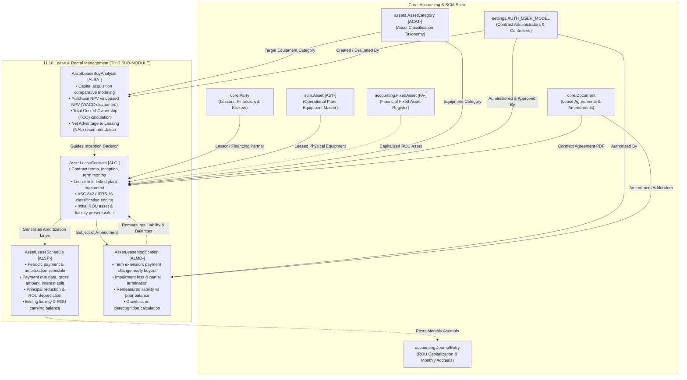

# Research — Sub-module 11.10: Lease & Rental Management (Module 11 — Asset Management System, `assets`)

- **Sub-module:** 11.10 Lease & Rental Management
- **Module:** 11 Asset Management System
- **Target app:** `apps/assets` (package target: `apps/assets/models/AssetLeaseRental/`)
- **Research date:** 2026-11-10
- **Phase:** Phase 1 Research Catalog
- **Output file target:** `.claude/tasks/research-assets-11.10.md`

---

## 1. Executive Summary & Domain Architecture

Sub-module 11.10 delivers the **Lease & Rental Management** governance, valuation, and accounting compliance engine for NavERP's **Asset Management System (`apps/assets`)**. Operating at the intersection of capital asset operations and financial accounting standards (ASC 842, IFRS 16, and GASB 87), Sub-module 11.10 provides comprehensive lifecycle control over leased and rented equipment, fleet machinery, tooling, and facility assets.

In modern enterprise operations, leasing represents a major vehicle for asset financing. Regulatory standards (ASC 842 under US GAAP and IFRS 16 internationally) mandate that almost all leases must be recognized on the balance sheet as **Right-of-Use (ROU) Assets** with corresponding **Lease Liabilities**, replacing legacy off-balance-sheet operating lease accounting. Sub-module 11.10 equips NavERP with institutional-grade administration, automated classification, actuarial amortization schedules, remeasurement/modification governance, and strategic Lease vs. Buy financial modeling.

### Foundational Pillars:
1. **Lease Contract Administration & Master Agreements:**
   Comprehensive contract abstraction capturing commencement, inception, and possession dates, base terms, renewal options, purchase option terms, early termination penalty clauses, lessor profiles (`core.Party`), linked plant equipment (`scm.Asset`), master lease agreement (MLA) schedules, payment structures, and document attachments (`core.Document`).
2. **Automated Dual-Standard Classification (ASC 842 & IFRS 16):**
   Algorithmic evaluation of the five statutory criteria (ownership transfer, bargain purchase option, lease term $\ge 75\%$ of economic life, present value of payments $\ge 90\%$ of fair market value, specialized nature with no alternative use) to definitively classify agreements as **Operating Leases** or **Finance / Capital Leases** and calculate initial ROU Asset and Lease Liability balances based on the Incremental Borrowing Rate (IBR).
3. **Actuarial Payment & Amortization Schedules:**
   Automated generation of period-by-period payment schedules calculating gross payments, liability interest accretion, principal balance reduction, straight-line or asset-specific ROU depreciation, and ending carrying amounts. Provides seamless integration points with `accounting.JournalEntry` and accounts payable disbursements.
4. **Lease Modification, Remeasurement & Impairment Governance:**
   Formal audit-trailed workflows for contract amendments, scope changes, term extensions, early terminations, payment adjustments, and asset impairment events. Automatically computes remeasured liability adjustments and gain/loss on derecognition.
5. **Lease vs. Buy (LvB) Decision Modeling & NPV / TCO Analytics:**
   Capital budgeting tool comparing outright cash purchase or debt financing against operating/finance lease options. Computes discounted cash flows using corporate WACC / hurdle rates, after-tax Total Cost of Ownership (TCO), and Net Advantage to Leasing (NAL) to provide objective acquisition recommendations.

---

### Architectural Data Flow & Spine Integration

---

## 2. Repo State Checked First

### 2.1 Existing Module Status & Sibling Live Links
- **Module 10 (Business Intelligence - `apps/bi`):** 100% complete (10.1 through 10.19 built, tested, green).
- **Module 11 (Asset Management System - `apps/assets`):**
  - **11.1 Asset Procurement & Acquisition (`apps/assets/models/AssetProcurement/`):** Complete (`AssetRequisition` [AREQ-], `AssetAcquisitionReceipt` [ARCV-], `AssetCapitalization` [ACAP-], `AssetTag` [ATAG-]).
  - **11.2 Asset Inventory & Tracking (`apps/assets/models/AssetInventoryTracking/`):** Complete (`AssetAudit` [AAUD-], `AssetMovementLog` [AMOV-], `AssetCustodyLog` [ACHK-], `AssetIncidentReport` [AINC-]).
  - **11.3 Asset Classification & Categorization (`apps/assets/models/AssetClassification/`):** Complete (`AssetCategory` [ACAT-], `AssetModel` [AMOD-], `AssetCriticalityAssessment` [ACRT-], `AssetSpecificationTemplate` [ASPC-]).
  - **11.4 Depreciation & Financial Management (`apps/assets/models/AssetDepreciation/`):** Complete (`CapitalizationPolicy` [ACTH-], `AssetDepreciationSchedule` [ADEP-], `AssetRevaluation` [AREV-], `AssetTransfer` [AXFR-]).
  - **11.5 Maintenance & Repair Management (`apps/assets/models/AssetMaintenance/`):** Complete (`AssetMaintenanceRequest` [AMRQ-], `AssetMaintenanceSchedule` [AMSC-], `AssetServiceContract` [ASVC-], `AssetMaintenanceLog` [AMLG-]).
  - **11.6 Asset Performance & Utilization (`apps/assets/models/AssetPerformance/`):** Complete (`AssetDowntimeLog` [ADWN-], `AssetOeeRecord` [AOEE-], `AssetEnergyReading` [AENG-], `AssetPerformanceScorecard` [APSC-]).
  - **11.7 Reliability & Predictive Maintenance (`apps/assets/models/AssetReliability/`):** Complete (`AssetFailureMode` [AFMA-], `AssetConditionAssessment` [ACAS-], `AssetTelemetryReading` [ATEL-], `AssetCalibrationRecord` [ACAL-]).
  - **11.8 Warranty & Insurance Management (`apps/assets/models/AssetWarrantyInsurance/`):** Complete (`AssetWarranty` [AWAR-], `AssetWarrantyClaim` [AWCL-], `AssetInsurancePolicy` [AINS-], `AssetInsuranceClaim` [AICL-]).
  - **11.9 Asset Disposal & Retirement (`apps/assets/models/AssetDisposal/`):** Complete (`AssetDisposalRequest` [ADSP-], `AssetResaleListing` [ARSL-], `AssetTradeIn` [ATRD-], `AssetScrapSalvage` [ASCR-]).
  - **11.10 Lease & Rental Management (`apps/assets/models/AssetLeaseRental/`):** THIS SUB-MODULE to build.

### 2.2 Core Spine Verification (grep check confirmed)
- `apps/core`: `Tenant`, `Party` (lessors, financiers), `Document`, `AuditLog`, `User`.
- `apps/accounting`: `FixedAsset`, `JournalEntry`, `FiscalPeriod`.
- `apps/scm`: `scm.Asset` [AST-] (equipment master).
- `apps/assets`: `AssetCategory` [ACAT-], `AssetRequisition` [AREQ-].

---

## 3. Commercial Market Leaders Researched

We surveyed 8 commercial market-leading enterprise lease accounting and equipment administration platforms:

### 1. Nakisa Lease Administration
- **Market Profile:** Enterprise-grade lease accounting engine designed for Fortune 1000 multinational asset and equipment fleets.
- **Key Capabilities:**
  - Automated dual-reporting compliance under both ASC 842 and IFRS 16.
  - Multi-tiered equipment schedule aggregation under Master Lease Agreements (MLAs).
  - High-volume contract modification engine with automated liability remeasurement.
  - Direct ERP integration posting ROU asset recognition and monthly interest/amortization journal entries.

### 2. FinQuery (formerly LeaseQuery)
- **Market Profile:** Market leader in accounting-led lease subledger compliance and audit readiness.
- **Key Capabilities:**
  - Automated present value calculations discounting payment streams via Incremental Borrowing Rate (IBR).
  - Built-in 5-criteria statutory lease classification wizard (Operating vs. Finance/Capital).
  - Comprehensive disclosure reporting (weighted average lease term, weighted average discount rate, maturity analysis).
  - Full audit trail tracking user edits, classification overrides, and accounting policy changes.

### 3. LeaseAccelerator
- **Market Profile:** Specialized enterprise equipment and IT asset lifecycle lease management platform.
- **Key Capabilities:**
  - Native Lease vs. Buy (LvB) financial modeling comparing cash, debt financing, and leasing using corporate WACC.
  - Automated End-of-Term (EOT) decision workflows (buyout, return, extend, swap).
  - Equipment return tracking and condition assessment logs to prevent automatic penalty extensions.
  - Lessor portfolio exposure analytics and concentration risk management.

### 4. Visual Lease
- **Market Profile:** Hybrid platform balancing operational lease administration with technical accounting compliance.
- **Key Capabilities:**
  - Critical milestone tracking (renewal notification deadlines, buyout option windows, termination notice cutoff dates).
  - Integrated document repository linking clauses directly to financial schedule parameters.
  - Operating expense (OPEX) and CAM reconciliation tracking for facility and equipment leases.
  - Role-based lease approval workflows and financial delegation of authority.

### 5. Trullion
- **Market Profile:** AI-driven modern lease accounting platform with automated document parsing.
- **Key Capabilities:**
  - Automated extraction of key lease metadata (commencement date, payments, escalation clauses, residual guarantees).
  - Real-time audit trail linking original PDF contract highlights directly to journal entries and schedule rows.
  - Side-by-side parallel ledger generation for statutory vs. management reporting.
  - Automated remeasurement upon CPI/index escalation or amendment execution.

### 6. PowerPlan
- **Market Profile:** Mission-critical fixed asset and lease accounting system for capital-intensive industries (utilities, energy, heavy manufacturing).
- **Key Capabilities:**
  - Seamless unification between capital fixed asset registers and leased asset schedules.
  - Regulatory rate-base accounting and tax depreciation integration for leased capital assets.
  - Complex multi-component lease accounting (separating lease components from non-lease service components).
  - Severe impairment testing and ROU asset write-downs.

### 7. SOFT4Lessee
- **Market Profile:** ERP-embedded lease accounting solution for Microsoft Dynamics ecosystem.
- **Key Capabilities:**
  - End-to-end lease amortization schedules with automated split between interest expense and liability reduction.
  - Partial termination handling with proportionate ROU asset derecognition and gain/loss calculation.
  - Automated lease reclassification upon contract modification.

### 8. SAP S/4HANA Contract and Lease Management (RE-FX)
- **Market Profile:** Tier-1 global ERP lease management module for comprehensive real estate and plant equipment leasing.
- **Key Capabilities:**
  - Integration with plant maintenance (PM) work orders and asset accounting (FI-AA).
  - Detailed condition type configuration (base rent, maintenance fees, turnover rents).
  - Direct integration into cash management and automated payment run processing.

---

## 4. Synthesized Feature Catalog for Sub-module 11.10

### 4.1 Feature Mapping to NavERP.md Bullets

#### Bullet 1: Lease Contract Administration
- **Master Lease Agreement (MLA) & Contract Inception:** Capture contract number, MLA reference, lessor (`core.Party`), contract title, inception date, commencement date, expiration date, base lease term in months, possession date, and status lifecycle (`DRAFT`, `PENDING_APPROVAL`, `ACTIVE`, `MODIFIED`, `EXPIRED`, `TERMINATED`, `BUYOUT`). *(Table-stakes)*
- **Equipment & Asset Association:** Link to physical plant equipment (`scm.Asset`) or fixed asset (`accounting.FixedAsset`) and classification category (`assets.AssetCategory`). *(Table-stakes)*
- **Financial Terms & Payment Parameters:** Base payment amount, payment frequency (`MONTHLY`, `QUARTERLY`, `SEMI_ANNUAL`, `ANNUAL`), payment timing (`ADVANCE`, `ARREARS`), compounding frequency, and currency. *(Table-stakes)*
- **Borrowing Rate & Valuation Parameters:** Incremental Borrowing Rate (IBR) / discount rate %, initial direct costs, lease incentives received, and estimated fair market value of leased asset. *(Table-stakes)*
- **End-of-Term Options & Critical Dates:** Renewal option terms, bargain purchase option price, early termination notice deadline, return notification window, and residual value guarantee. *(Common)*
- **Non-Lease Component Separation:** Option to track non-lease components (maintenance, insurance) bundled within periodic payments. *(Differentiator)*

#### Bullet 2: Operating vs. Finance Lease Classification (ASC 842 / IFRS 16)
- **5-Point Statutory Classification Engine:** Automated evaluation of the standard criteria:
  1. Transfer of ownership to lessee at end of term? (Yes/No)
  2. Purchase option reasonably certain to be exercised? (Yes/No)
  3. Lease term $\ge 75\%$ of asset economic useful life? (Calculated)
  4. Present value of lease payments $\ge 90\%$ of asset fair market value? (Calculated)
  5. Specialized nature with no alternative use to lessor? (Yes/No) *(Table-stakes)*
- **Classification Result:** Automated assignment of `FINANCE` (Capital) vs. `OPERATING` lease classification under ASC 842 and IFRS 16. *(Table-stakes)*
- **Initial Valuation Engine:** Calculation of:
  - Initial Lease Liability = Present Value (PV) of remaining lease payments discounted at IBR.
  - Initial Right-of-Use (ROU) Asset = Initial Lease Liability + Initial Direct Costs - Lease Incentives Received + Prepaid Lease Payments. *(Table-stakes)*
- **Classification Override & Documentation:** Justification note and authorization log when manual override of automated classification is required. *(Common)*

#### Bullet 3: Lease Payment & Amortization
- **Automated Actuarial Schedule Generation:** Generates period-by-period schedule lines covering the entire lease term. *(Table-stakes)*
- **Period Breakdown Calculation:**
  - Beginning Liability Balance
  - Gross Periodic Payment
  - Liability Interest Expense = Beginning Liability $\times$ Periodic Discount Rate
  - Principal / Liability Reduction = Gross Payment - Interest Expense
  - Ending Lease Liability
  - ROU Asset Depreciation / Amortization
  - Ending ROU Asset Carrying Value *(Table-stakes)*
- **Payment Execution & Status Tracking:** Status of schedule lines (`SCHEDULED`, `ACCRUED`, `PAID`, `CANCELLED`), invoice number, payment reference, and actual payment date. *(Table-stakes)*
- **Financial Ledger Integration Hook:** Linkage to `accounting.JournalEntry` for initial ROU asset capitalization and monthly accrual runs. *(Common)*

#### Bullet 4: Lease Modification & Termination
- **Contract Amendment Workflows:** Formal tracking of lease modifications with effective date, modification type (`TERM_EXTENSION`, `PAYMENT_CHANGE`, `PARTIAL_TERMINATION`, `FULL_TERMINATION`, `IMPAIRMENT`, `DISCOUNT_RATE_CHANGE`). *(Table-stakes)*
- **Liability Remeasurement & ROU Adjustment:** Calculation of prior vs. revised lease liability; adjustments posted directly to ROU Asset carrying value. *(Table-stakes)*
- **Gain / Loss on Derecognition:** Automated calculation of gain or loss upon early termination or partial scope reductions. *(Common)*
- **Impairment Recognition:** Recording of ROU asset impairment losses due to physical casualty, technological obsolescence, or idle equipment status. *(Common)*
- **Approval & Justification:** Multi-tier authorization with approving officer (`AUTH_USER_MODEL`), formal justification, and addendum document attachment (`core.Document`). *(Table-stakes)*

#### Bullet 5: Lease vs. Buy Analysis
- **Capital Acquisition Modeling Tool:** Standalone analysis entity evaluating target asset acquisition scenarios. *(Table-stakes)*
- **Purchase Scenario Parameters:** Purchase price, down payment percentage, borrowing interest rate, loan term, salvage value at end of useful life, annual maintenance/insurance tax costs. *(Table-stakes)*
- **Lease Scenario Parameters:** Lease term months, periodic lease payment, upfront fees, purchase option fee at lease end, lessor-covered maintenance flag. *(Table-stakes)*
- **Financial Hurdle & Valuation Metrics:**
  - Corporate Discount Rate / WACC %
  - Corporate Marginal Tax Rate %
  - Net Present Value (NPV) of Outright Purchase / Debt Financing
  - Net Present Value (NPV) of Lease Financing
  - Total Cost of Ownership (TCO) Comparison
  - Net Advantage to Leasing (NAL) = NPV(Buy) - NPV(Lease)
  - Clear Decision Recommendation (`BUY`, `LEASE`, `NEUTRAL`) *(Common / Differentiator)*
- **Status & Approval Workflow:** Status (`DRAFT`, `EVALUATED`, `APPROVED`, `REJECTED`) with reviewing officer sign-off. *(Common)*

---

## 5. Recommended Build Scope for Sub-module 11.10

We recommend a clean **4-model architecture** under `apps/assets/models/AssetLeaseRental/`:

### Model 1: `AssetLeaseContract` (`apps/assets/models/AssetLeaseRental/AssetLeaseContracts.py`)
- **Auto-number Prefix:** `ALC-` (e.g., `ALC-00001`)
- **Key Fields:**
  - Multi-tenancy: `tenant` FK (`core.Tenant`)
  - Identifiers: `contract_number` (auto-numbered), `title`, `master_lease_agreement_ref`
  - Parties & Roles: `lessor` FK (`core.Party`, limit to supplier/vendor roles), `created_by` FK (`AUTH_USER_MODEL`), `approved_by` FK (`AUTH_USER_MODEL`, null=True)
  - Asset Associations: `asset` FK (`scm.Asset`, null=True, blank=True), `category` FK (`assets.AssetCategory`, null=True, blank=True), `fixed_asset` FK (`accounting.FixedAsset`, null=True, blank=True)
  - Key Dates: `inception_date`, `commencement_date`, `expiration_date`, `first_payment_date`, `early_termination_notice_date` (null=True)
  - Term & Terms: `lease_term_months` (int), `economic_life_months` (int)
  - Financial Terms: `payment_amount` (Decimal), `payment_frequency` (`MONTHLY`, `QUARTERLY`, `SEMI_ANNUAL`, `ANNUAL`), `payment_timing` (`ADVANCE`, `ARREARS`), `discount_rate_pct` (Decimal, IBR), `fair_market_value` (Decimal), `initial_direct_costs` (Decimal), `lease_incentives` (Decimal), `residual_value_guarantee` (Decimal), `purchase_option_price` (Decimal, null=True)
  - Classification Criteria (Booleans): `transfer_of_ownership`, `has_purchase_option`, `is_specialized_asset`
  - Calculated Classification: `classification` (`OPERATING`, `FINANCE`), `classification_overridden` (bool), `classification_notes` (text)
  - Initial Capitalization Balances: `initial_lease_liability` (Decimal), `initial_rou_asset_value` (Decimal)
  - Current Balances: `current_lease_liability` (Decimal), `current_rou_asset_carrying_value` (Decimal)
  - Status Lifecycle: `status` (`DRAFT`, `PENDING_APPROVAL`, `ACTIVE`, `MODIFIED`, `EXPIRED`, `TERMINATED`, `BUYOUT`)
  - Notes & Audit: `notes`, `created_at`, `updated_at`

### Model 2: `AssetLeaseSchedule` (`apps/assets/models/AssetLeaseRental/AssetLeaseSchedules.py`)
- **Auto-number Prefix:** `ALSP-` (e.g., `ALSP-00001`)
- **Key Fields:**
  - Multi-tenancy: `tenant` FK (`core.Tenant`)
  - Parent Contract: `lease_contract` FK (`AssetLeaseContract`, related_name='payment_schedules', on_delete=CASCADE)
  - Schedule Line: `schedule_number` (auto-numbered), `period_number` (int, e.g. 1..N)
  - Payment Information: `due_date`, `payment_amount` (Decimal)
  - Amortization Split: `beginning_liability` (Decimal), `interest_expense` (Decimal), `principal_reduction` (Decimal), `ending_liability` (Decimal), `rou_depreciation` (Decimal), `ending_rou_asset_value` (Decimal)
  - Execution Status: `status` (`SCHEDULED`, `ACCRUED`, `PAID`, `CANCELLED`)
  - Payment Reference: `payment_reference` (char, blank=True), `paid_date` (date, null=True), `notes` (text, blank=True)
  - Timestamps: `created_at`, `updated_at`

### Model 3: `AssetLeaseModification` (`apps/assets/models/AssetLeaseRental/AssetLeaseModifications.py`)
- **Auto-number Prefix:** `ALMD-` (e.g., `ALMD-00001`)
- **Key Fields:**
  - Multi-tenancy: `tenant` FK (`core.Tenant`)
  - Parent Contract: `lease_contract` FK (`AssetLeaseContract`, related_name='modifications', on_delete=CASCADE)
  - Identifiers: `modification_number` (auto-numbered), `modification_type` (`TERM_EXTENSION`, `PAYMENT_CHANGE`, `PARTIAL_TERMINATION`, `FULL_TERMINATION`, `IMPAIRMENT`, `DISCOUNT_RATE_CHANGE`)
  - Dates: `request_date`, `effective_date`
  - Balances Before & After: `prior_lease_liability` (Decimal), `revised_lease_liability` (Decimal), `liability_adjustment` (Decimal), `prior_rou_asset_value` (Decimal), `revised_rou_asset_value` (Decimal), `rou_asset_adjustment` (Decimal)
  - Accounting Impact: `gain_loss_on_modification` (Decimal, default=0), `impairment_loss_recognized` (Decimal, default=0)
  - Terms Changed: `revised_term_months` (int, null=True), `revised_payment_amount` (Decimal, null=True), `revised_discount_rate_pct` (Decimal, null=True)
  - Authorization: `requested_by` FK (`AUTH_USER_MODEL`), `approved_by` FK (`AUTH_USER_MODEL`, null=True), `status` (`DRAFT`, `SUBMITTED`, `APPROVED`, `REJECTED`, `EXECUTED`)
  - Justification: `justification` (text), `notes` (text), `created_at`, `updated_at`

### Model 4: `AssetLeaseBuyAnalysis` (`apps/assets/models/AssetLeaseRental/AssetLeaseBuyAnalyses.py`)
- **Auto-number Prefix:** `ALBA-` (e.g., `ALBA-00001`)
- **Key Fields:**
  - Multi-tenancy: `tenant` FK (`core.Tenant`)
  - Identification: `analysis_number` (auto-numbered), `title`, `description` (text)
  - Target Equipment: `target_asset_name` (char), `category` FK (`assets.AssetCategory`, null=True, blank=True), `expected_useful_life_years` (Decimal)
  - Purchase Option Assumptions: `purchase_price` (Decimal), `down_payment_pct` (Decimal), `loan_interest_rate_pct` (Decimal), `loan_term_years` (Decimal), `estimated_salvage_value` (Decimal), `annual_maintenance_cost_buy` (Decimal), `annual_insurance_tax_buy` (Decimal)
  - Lease Option Assumptions: `lease_term_months` (int), `monthly_lease_payment` (Decimal), `upfront_lease_fees` (Decimal), `end_of_lease_purchase_option` (Decimal), `lessor_covers_maintenance` (bool, default=True), `annual_maintenance_cost_lease` (Decimal)
  - Financial Parameters: `discount_rate_wacc_pct` (Decimal), `corporate_tax_rate_pct` (Decimal)
  - Financial Results (Calculated):
    - `npv_purchase_option` (Decimal)
    - `npv_lease_option` (Decimal)
    - `tco_purchase_option` (Decimal)
    - `tco_lease_option` (Decimal)
    - `net_advantage_to_leasing` (Decimal) = NPV(Purchase) - NPV(Lease)
    - `recommendation` (`BUY`, `LEASE`, `NEUTRAL`)
  - Workflow: `status` (`DRAFT`, `COMPLETED`, `APPROVED`, `REJECTED`), `evaluated_by` FK (`AUTH_USER_MODEL`), `approved_by` FK (`AUTH_USER_MODEL`, null=True), `evaluation_notes` (text)
  - Timestamps: `created_at`, `updated_at`

---

## 6. Sibling Deferrals & Future Backlog

- **Automated AI/OCR Lease PDF Parsing:** Automatic ingestion and OCR extraction of lease agreement clauses into contract fields deferred to future AI document pipeline pass.
- **Direct Variable CPI / Inflation Indexation Stream:** Automated real-time streaming updates from central bank CPI indexes for dynamic rate escalation deferred to central economic data feed integration.
- **Cross-Border Multi-Currency Hedging Subledger:** Currency forward contract allocation against foreign currency lease liabilities deferred to Treasury module pass (`apps/treasury`).
