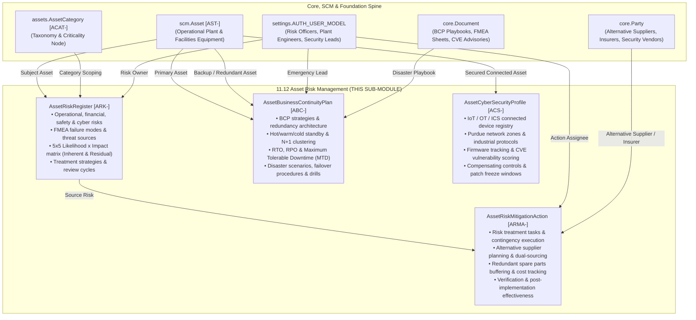

# Research — Sub-module 11.12: Asset Risk Management (Module 11 — Asset Management System, `assets`)

- **Sub-module:** 11.12 Asset Risk Management
- **Module:** 11 Asset Management System
- **Target app:** `apps/assets` (package target: `apps/assets/models/AssetRisk/`)
- **Research date:** 2026-11-11
- **Phase:** Phase 1 Research Catalog
- **Output file target:** `.claude/tasks/research-assets-11.12.md`

---

## 1. Executive Summary & Domain Architecture

Sub-module 11.12 delivers the **Asset Risk Management** intelligence and operational resilience engine for NavERP's **Asset Management System (`apps/assets`)**. Converging physical Enterprise Asset Management (EAM) with the international risk standards **ISO 31000** (Risk Management), **ISO 55000 / ISO 55001** (Asset Management), **ISO 22301** (Business Continuity Management), and **IEC 62443 / NIST SP 800-82** (Security for Industrial Automation and Control Systems), Sub-module 11.12 safeguards critical physical infrastructure against equipment breakdowns, supply chain disruptions, geopolitical embargoes, black swan disasters, and industrial cyber attacks.

Modern industrial, utility, healthcare, and commercial facilities rely heavily on interconnected Operational Technology (OT), Supervisory Control and Data Acquisition (SCADA), Programmable Logic Controllers (PLCs), smart IoT sensors, and high-capital manufacturing lines. When a single critical asset fails unexpectedly or is compromised by an OT cyber intrusion, consequences cascade rapidly: factory floor shutdowns costing upwards of $250,000 per hour, acute environmental releases, severe safety hazards, breach of customer delivery SLAs, and long lead-time supply chain bottlenecks.

Sub-module 11.12 unifies asset risk governance across five core operational pillars:
1. **Risk Identification & Assessment:**
   Comprehensive risk registers capturing operational, financial, safety/health, environmental, cybersecurity, regulatory, geopolitical, and reputational risk factors. Structured assessment using Failure Mode and Effects Analysis (FMEA) and 5x5 Likelihood x Impact matrices to derive objective Inherent and Residual Risk Priority scores.
2. **Business Continuity Planning (BCP):**
   Critical asset redundancy strategies (hot standby, warm standby, cold standby, N+1 clustering, reciprocal agreements), Recovery Time Objectives (RTO), Recovery Point Objectives (RPO), Maximum Tolerable Downtime (MTD), disaster scenario playbooks (power loss, natural disaster, ransomware), and periodic disaster recovery drill validation.
3. **Cybersecurity for Connected Assets (OT/IoT/ICS):**
   Purdue Enterprise Reference Architecture (PERA) network segmentation zoning (Level 0 through Level 4), IoT/OT hardware identification, industrial communication protocols (Modbus, OPC UA, PROFINET, BACnet, MQTT), firmware version control, Common Vulnerabilities and Exposures (CVE) / CVSS scoring, compensating firewall controls, and maintenance patch-freeze blackout windows.
4. **Geopolitical & Supply Chain Risk:**
   Sourcing concentration tracking, single-source dependency identification, vendor geopolitical exposure and sanctions screening, critical spare parts inventory lead-time buffering, and pre-qualified alternative supplier mapping.
5. **Risk Mitigation & Contingency:**
   Actionable risk treatment workflows (Mitigate, Transfer, Avoid, Accept), contingency emergency response plans, capital engineering controls, insurance policy risk transfer alignment, and post-remediation effectiveness evaluations.

---

### Architectural Data Flow & Spine Integration

---

## 2. Leading Commercial Products in this Domain

To design an industry-standard, resilient solution, we surveyed eight leading commercial software platforms across Enterprise Asset Management (EAM), Asset Performance Management (APM), Integrated Risk Management (IRM/BCM), and Industrial OT Cybersecurity:

1. **IBM Maximo (Maximo Application Suite - Health & Predict / APM):**
   - *Overview:* The enterprise benchmark for capital-intensive industries (utilities, energy, manufacturing, transit), deeply embedded in ISO 55000 asset management.
   - *Key Capabilities:* Asset health and risk scoring combining failure probability with consequence-of-failure; Failure Modes and Effects Analysis (FMEA); automated maintenance prioritization based on risk matrices; integration of operational risk with capital replacement planning.
2. **IFS Cloud EAM & Copperleaf Technologies:**
   - *Overview:* Gartner Leader in enterprise asset management, enhanced by Copperleaf's specialized Asset Investment Planning (AIP) software.
   - *Key Capabilities:* Value-based decision-making under ISO 55000 and ISO 31000 frameworks; monetary quantification of operational risk (cost of failure vs cost of mitigation); predictive risk modeling demonstrating risk trajectories if asset overhaul is deferred.
3. **Claroty (Continuous Threat Detection & xDome):**
   - *Overview:* Global leader in Cyber-Physical Systems (CPS) protection for industrial OT, healthcare IoT, and smart building automation.
   - *Key Capabilities:* Comprehensive OT asset discovery across Purdue Levels 0–3; continuous firmware baseline monitoring; industrial protocol inspection (Modbus, DNP3, CIP, Ethernet/IP); CVE vulnerability mapping with industrial contextual risk scoring; compensating security control guidance when immediate patching would cause downtime.
4. **Armis Centrix (Asset Intelligence & Security):**
   - *Overview:* Agentless device intelligence platform providing continuous attack surface management for IT, OT, and IoT.
   - *Key Capabilities:* Complete physical and connected asset visibility; device behavioral baselining; detection of unauthorized firmware changes; network segmentation and micro-segmentation enforcement; vulnerability prioritization based on exploitability and asset operational criticality.
5. **Nozomi Networks (Vantage & Guardian):**
   - *Overview:* Operational technology (OT) and critical infrastructure cybersecurity and anomaly detection specialist.
   - *Key Capabilities:* Real-time industrial protocol parsing; asset vulnerability assessment without disruption; process anomaly detection; Purdue model network zone visualization; automated alerts on outdated or compromised firmware.
6. **MetricStream (Enterprise Risk Management & CyberGRC):**
   - *Overview:* Premier Integrated Risk Management (IRM) platform aligned with ISO 31000, COSO, and NIST frameworks.
   - *Key Capabilities:* Dynamic risk registers with multi-dimensional scoring (likelihood, impact, velocity, vulnerability); risk appetite thresholds; heat map matrix visualizations; automated KRI (Key Risk Indicator) tracking linked to physical operations.
7. **Fusion Framework System (Fusion Risk Management) / Castellan:**
   - *Overview:* Premier cloud platform for enterprise Business Continuity Management (BCM) and Operational Resilience (ISO 22301).
   - *Key Capabilities:* Asset dependency mapping; Business Impact Analysis (BIA) defining Recovery Time Objectives (RTO) and Recovery Point Objectives (RPO); disaster recovery scenario modeling; contingency failover playbooks; continuity exercise and disaster drill tracking.
8. **Mitratech Alyne / DNV Synergi Life:**
   - *Overview:* Comprehensive operational risk, barrier management, and technical asset integrity software used heavily in high-hazard industries (offshore, maritime, energy).
   - *Key Capabilities:* Bowtie risk analysis and critical barrier management; supply chain vulnerability and sourcing concentration screening; contingency and emergency response coordination; corrective action tracking with verification workflows.

---

## 3. Competitive Feature Matrix & Deep-Dive

Mapping researched industry capabilities directly against the five **NavERP.md** feature bullets for Sub-module 11.12:

### Feature Bullet 1: Risk Identification & Assessment
*NavERP.md: "Risk Identification & Assessment — Operational, financial, regulatory, and reputational risk registers."*

| Feature Capability | Commercial Benchmark | Priority | NavERP Implementation Plan |
|---|---|---|---|
| **Multi-Category Risk Register** | MetricStream, Mitratech, IBM Maximo | Table-Stakes | Centralized register (`ARK-#####`) supporting 8 risk categories: Operational, Financial, Safety & Health, Environmental, Cybersecurity, Regulatory, Geopolitical/Supply Chain, and Reputational. |
| **Asset & Category Binding** | IBM Maximo, IFS Cloud | Table-Stakes | Direct FK to `scm.Asset` (specific machine) and `assets.AssetCategory` (fleet/class level). |
| **5x5 Matrix & Scoring Engine** | ISO 31000 standard, MetricStream | Table-Stakes | Standardized 1–5 scoring for Likelihood and Impact; automated calculation of Inherent Risk Score (1–25) and Residual Risk Score (post-mitigation). |
| **Risk Level Classification** | MetricStream, Fusion | Table-Stakes | Auto-derived risk levels: `Low` (1–4), `Medium` (5–9), `High` (10–14), `Critical` (15–25) with theme-compliant badge styling. |
| **FMEA Failure Mode & Threat Modeling** | IBM Maximo, DNV Synergi Life | Common | Structured fields for Threat Source (e.g., equipment failure, cyber attack, weather, supplier insolvency) and FMEA Failure Mode description. |
| **Financial Exposure Quantification** | IFS / Copperleaf, MetricStream | Common | Quantitative monetary exposure field (`financial_exposure_amount`) for potential loss estimation. |
| **Governance & Review Cadence** | ISO 31000, Mitratech | Table-Stakes | Assigned Risk Owner (`settings.AUTH_USER_MODEL`), review frequencies (monthly, quarterly, annually), and next review date tracking. |

### Feature Bullet 2: Business Continuity Planning
*NavERP.md: "Business Continuity Planning — Critical asset backup strategies, redundancy planning, and disaster recovery."*

| Feature Capability | Commercial Benchmark | Priority | NavERP Implementation Plan |
|---|---|---|---|
| **Centralized BCP Register** | Fusion Framework, Castellan | Table-Stakes | Dedicated entity (`ABC-#####`) for asset business continuity plans linked to primary operational assets. |
| **Redundancy Strategy Architecture** | Castellan, IBM Maximo | Table-Stakes | Categorized redundancy types: `Hot Standby` (instant switchover), `Warm Standby` (rapid start), `Cold Standby` (stored spare), `N+1 Cluster`, `Reciprocal Agreement`, `Mobile Replacement Unit`, or `Single Point of Failure` (no backup). |
| **Backup Asset Association** | IBM Maximo, Fusion | Table-Stakes | Secondary FK to `scm.Asset` representing the designated redundant/backup equipment. |
| **Resilience Target Metrics (RTO/RPO/MTD)** | ISO 22301 standard, Fusion | Table-Stakes | Precision decimal fields: Recovery Time Objective (RTO in hours), Recovery Point Objective (RPO in hours), and Maximum Tolerable Downtime (MTD in hours). |
| **Disaster Scenarios & Playbooks** | Castellan, Mitratech | Common | Scenario classification (power outage, fire/explosion, natural disaster, cyber attack/ransomware, hardware loss, hazmat release) with failover and failback step-by-step procedures. |
| **Disaster Drill & Exercise Tracking** | ISO 22301, Fusion | Common | Drill frequency, last drill date, next scheduled drill date, and drill outcome status (`Passed`, `Passed with Deficiencies`, `Failed`). |

### Feature Bullet 3: Cybersecurity for Connected Assets
*NavERP.md: "Cybersecurity for Connected Assets — IoT device security, network segmentation, and firmware update management."*

| Feature Capability | Commercial Benchmark | Priority | NavERP Implementation Plan |
|---|---|---|---|
| **OT/IoT Device Profile Register** | Claroty, Armis, Nozomi | Table-Stakes | Dedicated entity (`ACS-#####`) linking connected industrial assets to cybersecurity profiles. |
| **Device Identification & Addressing** | Armis, Claroty | Table-Stakes | Captures Device Type (PLC, SCADA, RTU, IoT sensor, HMI, Gateway, VFD), IP Address, and MAC Address. |
| **Purdue Model Network Segmentation** | IEC 62443 standard, Claroty, Nozomi | Table-Stakes | Network zoning: `Enterprise IT` (Level 4), `DMZ` (Level 3.5), `Supervisory SCADA` (Level 3), `Control PLC` (Level 2), `Process I/O` (Level 1), `Isolated Air-Gap` (Level 0). |
| **Industrial Protocol Identification** | Nozomi, Claroty | Common | Tracking communication protocol: Modbus TCP, OPC UA, EtherNet/IP, PROFINET, BACnet, DNP3, MQTT, HTTPS REST, Proprietary. |
| **Firmware Lifecycle Management** | Claroty, Armis | Table-Stakes | Active firmware version, latest available firmware, and update status (`Up to Date`, `Update Available`, `Critical Patch Pending`, `End of Life / Unsupported`). |
| **CVE Vulnerability & CVSS Scoring** | Claroty, Armis | Common | Tracking known CVE identifiers, overall CVSS base score (0.0–10.0), and vulnerability severity level. |
| **Compensating Security Controls** | IEC 62443, Claroty | Common | Documenting non-patch compensating controls (e.g. read-only hardware switches, strict firewall micro-segmentation, deep packet inspection). |
| **Maintenance Patch-Freeze Windows** | Armis, IBM Maximo | Differentiator | Blackout window tracking (`patch_freeze_until`) preventing disruptive updates during active production campaigns. |

### Feature Bullet 4: Geopolitical & Supply Chain Risk
*NavERP.md: "Geopolitical & Supply Chain Risk — Sourcing concentration, sanctions screening, and alternative supplier planning."*

| Feature Capability | Commercial Benchmark | Priority | NavERP Implementation Plan |
|---|---|---|---|
| **Sourcing Concentration Identification** | Mitratech, MetricStream | Table-Stakes | Categorized under `AssetRiskRegister` with risk category `geopolitical_supply_chain` identifying single-source components and foreign dependency. |
| **Alternative Supplier Planning** | SAP Ariba, Mitratech | Table-Stakes | Integrated into `AssetRiskMitigationAction` with direct FK to `core.Party` representing qualified backup vendors and secondary manufacturers. |
| **Critical Spare Parts Buffering** | IBM Maximo, IFS Cloud | Common | Strategic spare buffer plans and critical spares inventory SLAs documented directly on BCP and mitigation actions. |
| **Geopolitical & Sanctions Exposure** | MetricStream, Diligent | Common | Capturing country of origin, regional stability risk, export controls, and sanction exposure notes in risk assessments. |

### Feature Bullet 5: Risk Mitigation & Contingency
*NavERP.md: "Risk Mitigation & Contingency — Insurance coverage, spare asset strategies, and emergency response plans."*

| Feature Capability | Commercial Benchmark | Priority | NavERP Implementation Plan |
|---|---|---|---|
| **Actionable Mitigation Action Plan** | ISO 31000, MetricStream, IBM Maximo | Table-Stakes | Dedicated entity (`ARMA-#####`) tracking specific risk treatment tasks linked to the parent risk. |
| **Action Treatment Typology** | ISO 31000, Mitratech | Table-Stakes | Action types: `Engineering Control`, `Redundancy Addition`, `Firmware/Security Patch`, `Insurance Transfer`, `Supplier Diversification`, `Spare Parts Buffer`, `Procedure & Training`, `Preventive Inspection`. |
| **Cost & Financial Budget Tracking** | IFS / Copperleaf, SAP | Table-Stakes | Capturing `estimated_cost` vs `actual_cost` for financial impact tracking. |
| **Action Assignment & Schedule** | MetricStream, IBM Maximo | Table-Stakes | Assigned action owner (`settings.AUTH_USER_MODEL`), target completion date, and actual completion date. |
| **Post-Treatment Effectiveness Evaluation** | ISO 31000, DNV Synergi Life | Common | Structured evaluation rating (`Pending Evaluation`, `Highly Effective`, `Partially Effective`, `Ineffective`) verifying residual risk reduction. |

---

## 4. Spine Entity Mapping & Verified As-Built Reuses

Per project rules (lessons L28/L29), we verified existing master tables in the codebase before defining foreign keys:

1. **`scm.Asset` (`apps/scm/models/AssetManagement/Assets.py` [AST-]):**
   - *Status:* Verified as-built.
   - *Role in 11.12:* The primary physical plant asset, production line, or facility machinery subject to risk assessment, business continuity redundancy, OT cybersecurity profiling, and risk mitigation.
2. **`assets.AssetCategory` (`apps/assets/models/AssetClassification/AssetCategories.py` [ACAT-]):**
   - *Status:* Verified as-built.
   - *Role in 11.12:* The taxonomy node to which category-wide risk profiles and criticality policies apply.
3. **`core.Party` (`apps/core/models/Party.py`):**
   - *Status:* Verified as-built.
   - *Role in 11.12:* Standardized representation of external entities:
     - Alternative equipment suppliers and component fabricators for supply chain diversification.
     - Industrial cybersecurity vendors and penetration testing firms.
     - Asset insurance underwriters and risk syndicates.
4. **`core.Document` (`apps/core/models/Document.py`):**
   - *Status:* Verified as-built.
   - *Role in 11.12:* Digital attachments for disaster recovery playbooks, FMEA technical sheets, CVE vendor advisories, and risk audit reports.
5. **`settings.AUTH_USER_MODEL` (`apps/accounts/models/User.py`):**
   - *Status:* Verified as-built.
   - *Role in 11.12:* Risk owners, plant emergency coordinators, OT cybersecurity analysts, and mitigation action assignees.

---

## 5. Recommended Build Scope: 4 Tenant-Scoped Models

To deliver complete, production-grade coverage for Sub-module 11.12 within the strict 1–4 model rule, we recommend the following four tenant-scoped entities under package `apps/assets/models/AssetRisk/`:

### Model 1: `AssetRiskRegister` (Prefix: `ARK-`)
- **Purpose:** Centralized operational, financial, safety, regulatory, and reputational risk identification, evaluation (5x5 matrix & FMEA), residual scoring, and risk treatment strategy.
- **Key Fields:**
  - `number`: Auto-generated identifier (`ARK-#####`).
  - `title`: Short descriptive title of the risk (e.g., "Main Turbine Bearing Catastrophic Failure Risk", "SCADA Network Ransomware Exposure", "Single-Source German PLC Spare Supply Interruption").
  - `asset`: ForeignKey to `scm.Asset` (nullable) — specific physical asset at risk.
  - `category`: ForeignKey to `assets.AssetCategory` (nullable) — asset taxonomy category.
  - `risk_category`: Choice (`operational`, `financial`, `safety_health`, `environmental`, `cybersecurity`, `regulatory`, `geopolitical_supply_chain`, `reputational`).
  - `threat_source`: Choice (`equipment_wear`, `operator_error`, `cyber_attack`, `extreme_weather`, `supply_chain_disruption`, `vendor_insolvency`, `regulatory_mandate`, `utility_grid_failure`).
  - `failure_mode`: Short text describing the mechanical/functional/digital failure mode.
  - `description`: Comprehensive explanation of risk triggers, vulnerability paths, and consequences.
  - `inherent_likelihood`: PositiveSmallIntegerField (1=Rare, 2=Unlikely, 3=Possible, 4=Likely, 5=Almost Certain).
  - `inherent_impact`: PositiveSmallIntegerField (1=Insignificant, 2=Minor, 3=Moderate, 4=Major, 5=Catastrophic).
  - `inherent_risk_score`: PositiveIntegerField (1–25, calculated automatically as Likelihood x Impact).
  - `inherent_risk_level`: Choice (`low`, `medium`, `high`, `critical`).
  - `residual_likelihood`: PositiveSmallIntegerField (1–5, post-mitigation assessment).
  - `residual_impact`: PositiveSmallIntegerField (1–5, post-mitigation assessment).
  - `residual_risk_score`: PositiveIntegerField (1–25, calculated automatically).
  - `residual_risk_level`: Choice (`low`, `medium`, `high`, `critical`).
  - `risk_owner`: ForeignKey to `settings.AUTH_USER_MODEL` (nullable) — responsible manager.
  - `treatment_strategy`: Choice (`mitigate`, `transfer`, `avoid`, `accept`).
  - `financial_exposure_amount`: DecimalField(max_digits=14, decimal_places=2, default=0.00) — estimated potential monetary loss.
  - `status`: Choice (`identified`, `assessed`, `treating`, `monitored`, `closed`).
  - `review_frequency`: Choice (`monthly`, `quarterly`, `semi_annually`, `annually`).
  - `next_review_date`: DateField — next scheduled risk evaluation date.
  - `last_reviewed_at`: DateTimeField(null=True, blank=True).

### Model 2: `AssetBusinessContinuityPlan` (Prefix: `ABC-`)
- **Purpose:** Manages business continuity planning (BCP), critical asset backup and redundancy architecture, disaster recovery RTO/RPO targets, emergency playbooks, and disaster simulation drill tracking.
- **Key Fields:**
  - `number`: Auto-generated identifier (`ABC-#####`).
  - `title`: Plan title (e.g., "Primary Power Cogeneration Failover Plan", "Assembly Line 1 Robot Cell Disaster Recovery", "SCADA Server Cold-Standby BCP").
  - `primary_asset`: ForeignKey to `scm.Asset` (nullable) — mission-critical operational asset.
  - `backup_redundant_asset`: ForeignKey to `scm.Asset` (nullable) — secondary/redundant asset.
  - `redundancy_type`: Choice (`hot_standby`, `warm_standby`, `cold_standby`, `n_plus_one_cluster`, `reciprocal_agreement`, `mobile_replacement`, `none_single_point_of_failure`).
  - `recovery_time_objective_hours`: DecimalField(max_digits=6, decimal_places=2, default=4.00) — RTO target.
  - `recovery_point_objective_hours`: DecimalField(max_digits=6, decimal_places=2, default=1.00) — RPO target.
  - `maximum_tolerable_downtime_hours`: DecimalField(max_digits=6, decimal_places=2, default=24.00) — MTD limit.
  - `disaster_scenario`: Choice (`power_grid_outage`, `fire_explosion`, `flood_natural_disaster`, `cyber_attack_ransomware`, `critical_hardware_loss`, `hazmat_contamination`).
  - `failover_procedure`: TextField — step-by-step instructions for switching operations to the redundant unit.
  - `failback_procedure`: TextField — step-by-step restoration instructions once the primary unit is repaired.
  - `alternate_facility_site`: CharField(max_length=255, blank=True) — fallback plant, warehouse, or disaster recovery site.
  - `critical_spares_required`: TextField(blank=True) — mandatory spare components and SLA delivery guarantees.
  - `emergency_lead`: ForeignKey to `settings.AUTH_USER_MODEL` (nullable) — incident commander.
  - `drill_frequency`: Choice (`quarterly`, `semi_annually`, `annually`).
  - `last_drill_date`: DateField(null=True, blank=True).
  - `next_drill_date`: DateField(null=True, blank=True).
  - `drill_result`: Choice (`not_tested`, `passed`, `passed_with_deficiencies`, `failed`).
  - `status`: Choice (`draft`, `active`, `under_review`, `deprecated`).

### Model 3: `AssetCyberSecurityProfile` (Prefix: `ACS-`)
- **Purpose:** IoT / OT / ICS connected device registry, Purdue model network zoning, firmware baseline tracking, industrial protocols, CVE vulnerability risk scoring, and maintenance patch-freeze windows.
- **Key Fields:**
  - `number`: Auto-generated identifier (`ACS-#####`).
  - `asset`: ForeignKey to `scm.Asset` — physical connected machine or controller.
  - `device_type`: Choice (`plc_controller`, `scada_server`, `rtu_remote_terminal`, `iot_sensor`, `hmi_touchscreen`, `network_switch_gateway`, `vfd_drive`, `smart_meter`, `robotic_cell`).
  - `ip_address`: GenericIPAddressField(null=True, blank=True).
  - `mac_address`: CharField(max_length=50, blank=True).
  - `network_zone`: Choice (`enterprise_it`, `dmz`, `supervisory_scada`, `control_plc`, `process_io`, `isolated_airgap`).
  - `firmware_version`: CharField(max_length=100) — installed active firmware.
  - `latest_available_firmware`: CharField(max_length=100, blank=True).
  - `firmware_update_status`: Choice (`up_to_date`, `update_available`, `critical_patch_pending`, `end_of_life_unsupported`).
  - `protocol_used`: Choice (`modbus_tcp`, `opc_ua`, `ethernet_ip`, `profinet`, `bacnet`, `dnp3`, `mqtt`, `https_rest`, `proprietary`).
  - `exposure_level`: Choice (`air_gapped`, `isolated_vlan`, `monitored_dmz`, `internet_facing`).
  - `known_vulnerabilities_cve`: TextField(blank=True) — CVE IDs and vulnerability summaries.
  - `cve_risk_score`: DecimalField(max_digits=4, decimal_places=1, default=0.0) — CVSS base score 0.0–10.0.
  - `compensating_controls`: TextField(blank=True) — firewall micro-segmentation, physical isolation, read-only switches.
  - `last_vulnerability_scan_date`: DateField(null=True, blank=True).
  - `security_posture_status`: Choice (`secure`, `attention_required`, `vulnerable`, `compromised`).
  - `patch_freeze_until`: DateField(null=True, blank=True) — production blackout window during which patching is blocked.

### Model 4: `AssetRiskMitigationAction` (Prefix: `ARMA-`)
- **Purpose:** Tracks actionable risk treatment plans, contingency response execution, alternative supplier onboarding, spare buffer strategies, and verification of risk reduction.
- **Key Fields:**
  - `number`: Auto-generated identifier (`ARMA-#####`).
  - `title`: Action title (e.g., "Install Automatic Transfer Switch for Generator", "Onboard Secondary Valve Supplier in North America", "Apply Siemens S7 Firmware Security Patch").
  - `risk`: ForeignKey to `AssetRiskRegister` — parent risk being mitigated.
  - `action_type`: Choice (`engineering_control`, `redundancy_addition`, `firmware_security_patch`, `insurance_transfer`, `supplier_diversification`, `spare_parts_buffer`, `procedure_training`, `preventive_inspection`).
  - `description`: Detailed description of the remediation task and technical deliverables.
  - `assigned_to`: ForeignKey to `settings.AUTH_USER_MODEL` (nullable) — responsible engineer or specialist.
  - `alternative_supplier`: ForeignKey to `core.Party` (nullable) — secondary supplier for dual-sourcing / supply chain resilience.
  - `target_completion_date`: DateField — required deadline.
  - `actual_completion_date`: DateField(null=True, blank=True).
  - `estimated_cost`: DecimalField(max_digits=12, decimal_places=2, default=0.00).
  - `actual_cost`: DecimalField(max_digits=12, decimal_places=2, default=0.00).
  - `priority`: Choice (`critical`, `high`, `medium`, `low`).
  - `status`: Choice (`planned`, `in_progress`, `completed`, `verified_effective`, `deferred`, `cancelled`).
  - `verification_notes`: TextField(blank=True) — post-completion engineering validation observations.
  - `effectiveness_rating`: Choice (`pending_evaluation`, `highly_effective`, `partially_effective`, `ineffective`).

---

## 6. Sub-Module Boundaries & Scope Allocations

- **Included in Sub-module 11.12:**
  - Operational, financial, cyber, and geopolitical risk registers with 5x5 Likelihood x Impact scoring.
  - Business continuity plans, redundancy classification (hot/warm/cold), RTO/RPO/MTD, and disaster drill logs.
  - OT/IoT cybersecurity device profiles, Purdue model network zones, firmware lifecycle, and CVSS scores.
  - Risk mitigation action tracking, alternative supplier linking, spare buffers, and effectiveness validation.
- **Already Built in Sibling Sub-modules (Reused by FK / context):**
  - Physical Asset Register & Maintenance: `scm.Asset` (4.13 / Module 11 core asset).
  - Taxonomy & Categories: `assets.AssetCategory` (11.3).
  - Regulatory Compliance & Permits: `assets.AssetComplianceFramework`, `AssetPermitLicense` (11.11).
  - Asset Warranty & Insurance: `assets.AssetInsurancePolicy` (11.8).
  - Asset Criticality Scoring: `assets.AssetCriticalityAssessment` (11.3).
- **Deferred to Future Modules:**
  - Mobile Field Technician Risk Inspections: Allocated to Sub-module 11.13 Mobile Asset Management.
  - Enterprise-wide AI Anomaly Detection for Predictive Failure: Allocated to Module 23 AI & Intelligent Automation.
  - Corporate General Ledger Insurance Settlement Bookings: Handled by Module 2 `accounting`.

---

## 7. Conclusion & Sign-Off

This research catalog establishes the authoritative operational, data modeling, and architectural foundation for Sub-module 11.12 Asset Risk Management. The four recommended models (`AssetRiskRegister`, `AssetBusinessContinuityPlan`, `AssetCyberSecurityProfile`, and `AssetRiskMitigationAction`) fully satisfy the five NavERP.md feature bullets without overlapping existing capabilities or exceeding the 1–4 model limit.

Ready for Phase 2: Planning & Specification (`todo` agent).
