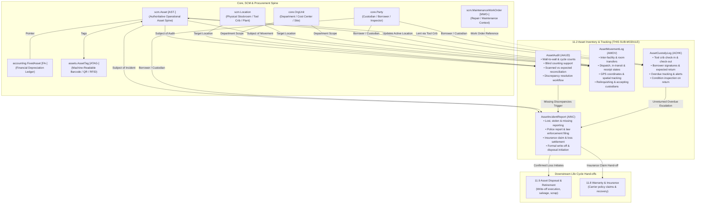

# Research — Sub-module 11.2: Asset Inventory & Tracking (Module 11 — Asset Management System, `assets`)

- **Sub-module:** 11.2 Asset Inventory & Tracking
- **Module:** 11 Asset Management System
- **Target app:** `apps/assets` (package: `apps/assets/models/AssetInventoryTracking/`)
- **Research date:** 2026-11-08
- **Phase:** Phase 1 Research Catalog
- **Output file target:** `.claude/tasks/research-assets-11.2.md`

---

## 1. Executive Summary & Domain Architecture

Sub-module 11.2 delivers the **Asset Inventory & Tracking** engine for NavERP's **Asset Management System (`apps/assets`)**. Operating directly on top of the operational asset master spine established in SCM 4.13 (`scm.Asset` [AST-]), 11.2 provides enterprise custody tracking, physical verification audits, inter-facility/room-to-room movement logs with GPS coordinates, tool crib check-in/check-out lending, and missing/stolen asset incident governance.

In enterprise asset management, keeping an accurate real-time inventory of physical machinery, rolling stock, tools, IT hardware, and plant infrastructure is distinct from tracking consumable warehouse stock:
1. **Asset Register & Master Operational Intelligence:** Assets are durable capital items requiring individual identification. Rather than re-declaring a parallel asset table (prohibited by architectural rules L28, L29, L36, L37, and `NavERP-ERD.md`), 11.2 extends `scm.Asset` by string foreign key, associating assets with machine-readable tags (`AssetTag` [ATAG-]), current operational locations, departments, and accountable custodians.
2. **Physical Verification & Scheduled Audits:** Enterprises must perform periodic wall-to-wall physical audits and cyclical sample counts to identify discrepancies, eliminate "ghost assets" (assets recorded on books but physically missing or scrapped), verify tag legibility, and support external financial compliance.
3. **Location & Movement Tracking:** Physical assets move between facilities, buildings, floors, rooms, tool cribs, and remote job sites. Tracking inter-facility relocations, carrier shipments, custody hand-offs, and GPS coordinates ensures chain-of-custody integrity and prevents unauthorized transfers.
4. **Tool Crib & Custody Lending (Check-In/Check-Out):** High-value diagnostic equipment, specialized power tools, calibration instruments, and fleet vehicles are lent to technicians, contractors, and project teams for specific work orders or shifts. Tracking checkout timestamps, expected return dates, overdue alerts, and condition inspections upon return enforces accountability and eliminates tool loss.
5. **Lost, Stolen & Damaged Beyond Repair Incident Governance:** When physical assets disappear or suffer catastrophic damage, structured incident reporting is required to initiate internal investigations, file police reports for theft/burglary, submit insurance claims with estimated loss values, and initiate financial write-off or disposal workflows.

### Architectural Data Flow & Spine Integration

---

## 2. Repo State Checked First

### 2.1 Existing Module Status & Rollover
- **Module 10 (Business Intelligence - `apps/bi`):** 100% complete. All 19 sub-modules (10.1 through 10.19) built, verified, tested, and active in `LIVE_LINKS` in `apps/core/navigation.py`.
- **Module 11 (Asset Management System - `apps/assets`):** Scaffolding initialized in Sub-module 11.1 (`apps/assets/models/AssetProcurement/`). Sub-module 11.1 completed with all 4 models (`AssetRequisition`, `AssetAcquisitionReceipt`, `AssetCapitalization`, `AssetTag`), verified, tested, and active.
- **Sub-module 11.2:** Second sub-module of Module 11. Target package folder: `apps/assets/models/AssetInventoryTracking/`.

### 2.2 Spine Entities Verified to Exist (grep evidence)
- **`apps/scm`:**
  - `scm.Asset` [AST-] -> `apps/scm/models/AssetManagement/Assets.py` (Operational maintainable asset master built in SCM 4.13. Module 11 extends it by string FK `'scm.Asset'`, maintaining separation between operational and financial records).
  - `scm.Location` -> `apps/scm/models/InventoryManagement/Locations.py` (Physical warehouses, stockrooms, tool cribs, and yard staging areas).
  - `scm.MaintenanceWorkOrder` [MWO-] -> `apps/scm/models/AssetManagement/WorkOrders.py` (Repair jobs and tool checkout context).
- **`apps/core`:**
  - `core.Tenant` -> `apps/core/models/Tenant.py` (Multi-tenant isolation anchor).
  - `core.Party` & `core.PartyRole` -> `apps/core/models/Party.py` (Employees, technicians, contractors, custodians, borrowers).
  - `core.OrgUnit` -> `apps/core/models/OrgUnit.py` (Department, plant, facility, cost center).
  - `core.Document` -> `apps/core/models/Document.py` (Incident photos, police reports, audit checklists).
  - `core.AuditLog` -> `apps/core/models/AuditLog.py` (Immutable historical change logs).
- **`apps/accounting`:**
  - `accounting.FixedAsset` [FA-] -> `apps/accounting/models/FixedAssets/FixedAssetsRegister.py` (Owns financial depreciation, acquisition cost, salvage value, accumulated depreciation, GL accounts).
- **`apps/assets`:**
  - `assets.AssetTag` [ATAG-] -> `apps/assets/models/AssetProcurement/AssetTags.py` (Machine-readable tags: QR codes, barcodes, RFID EPCs).

### 2.3 Prefix Collision Verification
All candidate prefixes checked via repository-wide regex search:
- `AAUD`: 0 matches across `apps/`
- `AMOV`: 0 matches across `apps/`
- `ACHK`: 0 matches across `apps/`
- `AINC`: 0 matches across `apps/`

---

## 3. Commercial Market Leaders Surveyed

We surveyed 8 leading enterprise asset management (EAM), computerized maintenance management (CMMS), and hardware asset management (HAM) platforms:

1. **IBM Maximo Application Suite (MAS)**
   - *Positioning:* Premier global benchmark in industrial asset lifecycle management and storeroom operations.
   - *Key Capabilities:* Count Books application for periodic physical counts and reconciliation, Issues and Transfers application (Usage Type: TRANSFER) with mobile scanning, rotating tool tracking (tools tracked individually by serial number or asset ID), tool crib checkouts against work orders, and shipment receipt acknowledgment.
   - *Reference:* `https://www.ibm.com/products/maximo/asset-management`

2. **SAP S/4HANA Asset Management / SAP Intelligent Asset Management (IAM)**
   - *Positioning:* Global ERP standard for enterprise physical asset inventory and plant maintenance.
   - *Key Capabilities:* Physical inventory document generation for fixed assets, blind vs guided cycle counts, variance calculation against the asset register, inter-plant asset transfer orders, mobile offline asset verification, and scrapping/write-off integration for unaccounted assets.
   - *Reference:* `https://www.sap.com/products/scm/asset-management.html`

3. **Infor EAM / HxGN EAM**
   - *Positioning:* High-performance asset management suite with specialized materials and tool tracking.
   - *Key Capabilities:* Cyclical stocktakes by storeroom/location with barcode scanning, configurable installation parameters for handling asset-tracked item discrepancies (strict lock vs logging vs warning), tool crib check-outs to technicians with return due date tracking, and equipment relocation history.
   - *Reference:* `https://hexagon.com/products/hxgn-eam`

4. **EZOfficeInventory (EZO)**
   - *Positioning:* Modern cloud leader in asset tracking, tool crib operations, and physical audit workflows.
   - *Key Capabilities:* Check-in/check-out with user custody, expected return dates, overdue alerts, chain-of-custody transfers between users without returning to base first, scheduled cycle counts vs wall-to-wall audits, mobile barcode/QR scanning, location transfers with transit states, and lost/damaged incident reporting.
   - *Reference:* `https://www.ezofficeinventory.com/`

5. **ServiceNow Hardware Asset Management (HAM)**
   - *Positioning:* Industry standard for IT and enterprise hardware asset lifecycle automation.
   - *Key Capabilities:* Mobile inventory audits with single/multi-scan barcode/RFID verification, automated creation of Asset Remediation Tasks for missing assets, Hardware Transfer Orders (Draft, Requested, Shipped, Received), Loaner Asset management (reserve, allocate, deploy, reclaim, overdue tracking), and Missing -> Lost / Stolen lifecycle workflows triggering security, insurance, and write-off tasks.
   - *Reference:* `https://www.servicenow.com/products/hardware-asset-management.html`

6. **Asset Panda**
   - *Positioning:* Configurable cloud fixed asset tracking and compliance platform.
   - *Key Capabilities:* Flexible check-in/out workflows with digital signatures, mobile audits with GPS coordinate stamping, asset transfer logs with room/floor/building hierarchies, and lost/stolen incident reporting with insurance claim and police report tracking.
   - *Reference:* `https://www.assetpanda.com/`

7. **Oracle Fusion Cloud EAM & Oracle Assets**
   - *Positioning:* Enterprise cloud asset tracking, location management, and physical inventory.
   - *Key Capabilities:* Physical inventory count schedules, physical inventory tags, count entry and discrepancy reconciliation, inter-department/inter-facility asset transfers with approval routing, and retirement transaction processing for lost or damaged equipment.
   - *Reference:* `https://www.oracle.com/erp/financials/asset-management/`

8. **UpKeep CMMS**
   - *Positioning:* Mobile-first maintenance and asset operations management system.
   - *Key Capabilities:* Barcode/QR asset lookup, tool and equipment checkout to technicians/work orders, return condition tracking, identifying "ghost assets" via audit logs, and loss/damage incident reporting.
   - *Reference:* `https://www.onupkeep.com/`

---

## 4. Feature Catalog (Sub-module 11.2 Scope Only)

### 4.1 Asset Register & Master Data
- **Operational Registry Extension & Unified Query:** Extends `scm.Asset` [AST-] with unified inventory intelligence, combining operational status, machine-readable tags (`AssetTag`), active physical location, custodian, and last audit verification timestamp.
  - *Seen in:* IBM Maximo, SAP EAM, ServiceNow HAM, EZOfficeInventory
  - *Priority:* `table-stakes`
  - *Spine:* Extends `scm.Asset` via string foreign key without duplicating columns.
- **Multi-Level Spatial Hierarchy:** Tracks asset location down to facility/site (`scm.Location`), department (`core.OrgUnit`), and specific building, floor, room, or bin/shelf.
  - *Seen in:* Infor EAM, Asset Panda, ServiceNow HAM
  - *Priority:* `table-stakes`
  - *Spine:* `scm.Location`, `core.OrgUnit`, and granular spatial text fields.
- **Accountable Custodian Assignment:** Binds each asset to an accountable person or team (`core.Party`), ensuring every asset has clear ownership.
  - *Seen in:* EZOfficeInventory, ServiceNow HAM, Asset Panda
  - *Priority:* `table-stakes`
  - *Spine:* String FK to `core.Party`.

### 4.2 Physical Verification & Audits
- **Scheduled & Ad-Hoc Audit Runs:** Supports wall-to-wall physical inventories, cyclical sample counts, spot checks, and annual compliance audits.
  - *Seen in:* IBM Maximo (Count Books), SAP EAM, Infor EAM, EZOfficeInventory
  - *Priority:* `table-stakes`
  - *Spine:* `AssetAudit` model; `audit_type` (`wall_to_wall`, `cycle_count`, `spot_check`, `custodian_verification`).
- **Blind Counting Support:** Hides expected asset lists from field auditors to prevent confirmation bias and ensure rigorous physical verification.
  - *Seen in:* SAP EAM, Infor EAM
  - *Priority:* `differentiator`
  - *Spine:* `AssetAudit.is_blind_count` flag.
- **Scanned vs Expected Verification:** Aggregates verification statistics: expected assets in scope, total assets physically scanned, matched assets, missing assets, and unexpected assets found in wrong locations.
  - *Seen in:* ServiceNow HAM, EZOfficeInventory, Asset Panda
  - *Priority:* `table-stakes`
  - *Spine:* `expected_asset_count`, `scanned_asset_count`, `matched_asset_count`, `missing_asset_count`, `discrepancy_count`.
- **Discrepancy Reconciliation Workflow:** Formal status progression (`draft`, `scheduled`, `in_progress`, `completed`, `reconciled`, `cancelled`) with supervisor sign-off and reconciliation actions (triggering location updates, custodian reassignment, or missing asset incident reports).
  - *Seen in:* IBM Maximo, SAP EAM, ServiceNow HAM
  - *Priority:* `table-stakes`
  - *Spine:* `AssetAudit.status`, `reconciliation_action`, `reconciled_by`, `reconciled_at`.

### 4.3 Location & Movement Tracking
- **Inter-Facility & Internal Relocation Transfers:** Manages equipment movement between warehouses, plants, buildings, floors, or rooms with formal transfer requests.
  - *Seen in:* ServiceNow HAM (Transfer Orders), IBM Maximo (Issues & Transfers), SAP EAM
  - *Priority:* `table-stakes`
  - *Spine:* `AssetMovementLog` model; tracks `from_location`/`to_location`, `from_org_unit`/`to_org_unit`, and `from_room_bin`/`to_room_bin`.
- **Chain-of-Custody Hand-off:** Formally captures relinquishing custodian (`from_custodian`) and accepting custodian (`to_custodian`).
  - *Seen in:* EZOfficeInventory, Asset Panda, Infor EAM
  - *Priority:* `table-stakes`
  - *Spine:* Links to `core.Party`.
- **Transfer Logistics & In-Transit State:** Multi-step status progression (`draft`, `requested`, `dispatched`, `in_transit`, `received`, `rejected`, `cancelled`) with carrier name, tracking number, dispatch date/time, and receipt verification.
  - *Seen in:* ServiceNow HAM, IBM Maximo, EZOfficeInventory
  - *Priority:* `common`
  - *Spine:* `status`, `carrier_name`, `tracking_number`, `dispatched_by`, `received_by`.
- **GPS Coordinates & Geolocation Stamping:** Captures latitude, longitude, and geographic address snapshot at the time of movement or field transfer.
  - *Seen in:* Asset Panda, EZOfficeInventory, UpKeep
  - *Priority:* `differentiator`
  - *Spine:* `gps_latitude`, `gps_longitude`, `gps_address` on `AssetMovementLog`.
- **Condition on Receipt Inspection:** Structured condition assessment upon destination arrival (`good`, `fair`, `damaged`) to identify transit damage immediately.
  - *Seen in:* Infor EAM, ServiceNow HAM
  - *Priority:* `common`
  - *Spine:* `condition_on_receipt`, `notes`.

### 4.4 Check-in/Check-out Management (Tool Crib & Lending)
- **Tool Crib Checkout & Equipment Lending:** Short-term borrowing of tools, mobile diagnostic gear, instruments, or fleet vehicles to employees or contractors.
  - *Seen in:* EZOfficeInventory, Infor EAM, UpKeep, ServiceNow HAM (Loaner Management)
  - *Priority:* `table-stakes`
  - *Spine:* `AssetCustodyLog` model; `action_type` (`checkout`, `checkin`, `custody_transfer`, `extension`).
- **Attendant & Borrower Accountability:** Captures crib attendant (`crib_attendant`), borrower (`borrower` FK `core.Party`), and electronic signature/acknowledgment of liability.
  - *Seen in:* EZOfficeInventory, Asset Panda, Infor EAM
  - *Priority:* `table-stakes`
  - *Spine:* `borrower`, `crib_attendant`, `borrower_signature_acknowledged`.
- **Expected Return Dates & Overdue Alerts:** Tracks checkout timestamp, expected return date, actual return timestamp, and highlights overdue loans.
  - *Seen in:* EZOfficeInventory, ServiceNow HAM, UpKeep
  - *Priority:* `table-stakes`
  - *Spine:* `checkout_date`, `expected_return_date`, `actual_return_date`, `status` (`active_loan`, `returned`, `overdue`, `damaged_returned`, `unreturned_lost`).
- **Pre- and Post-Loan Condition Inspection:** Compares asset condition at checkout (`checkout_condition`) vs return (`return_condition`) with inspection notes to detect operator abuse or wear.
  - *Seen in:* Infor EAM, EZOfficeInventory, UpKeep
  - *Priority:* `differentiator`
  - *Spine:* `checkout_condition`, `return_condition`, `condition_notes`.
- **Operational Linkage (Work Orders & Projects):** Associates tool loans with maintenance work orders (`scm.MaintenanceWorkOrder`) or project codes to track equipment usage against jobs.
  - *Seen in:* IBM Maximo, Infor EAM, UpKeep
  - *Priority:* `common`
  - *Spine:* `work_order_reference`, `project_reference`.

### 4.5 Lost, Stolen & Missing Asset Handling
- **Structured Incident Reporting:** Formal intake for assets lost in the field, stolen via burglary/theft, missing after physical audits, or damaged beyond repair.
  - *Seen in:* ServiceNow HAM, EZOfficeInventory, Asset Panda, UpKeep
  - *Priority:* `table-stakes`
  - *Spine:* `AssetIncidentReport` model; `incident_type` (`lost`, `stolen`, `missing_in_audit`, `damaged_beyond_repair`, `vandalism`).
- **Investigation & Severity Tracking:** Severity grading (`low`, `medium`, `high`, `critical`), assigned investigator, and narrative investigation findings.
  - *Seen in:* ServiceNow HAM, Asset Panda
  - *Priority:* `common`
  - *Spine:* `severity`, `investigator`, `investigation_findings`.
- **Law Enforcement & Police Report Filing:** Captures police report status, report number, precinct/department, and filing date for criminal theft/vandalism.
  - *Seen in:* Asset Panda, EZOfficeInventory
  - *Priority:* `differentiator`
  - *Spine:* `police_report_filed`, `police_report_number`, `police_precinct`, `police_filing_date`.
- **Insurance Claim Lifecycle:** Captures insurance carrier, claim number, estimated loss value, claimed amount, and settled payout amount.
  - *Seen in:* Asset Panda, SAP EAM, Oracle Fusion Assets
  - *Priority:* `table-stakes`
  - *Spine:* `insurance_claim_filed`, `insurance_carrier`, `insurance_claim_number`, `estimated_loss_value`, `insurance_claimed_amount`, `insurance_settled_amount`.
- **Disposal & Write-Off Initiation:** Hand-off from confirmed loss/theft to write-off authorization, updating asset status and notifying financial depreciation ledgers.
  - *Seen in:* ServiceNow HAM, SAP EAM, Oracle Assets
  - *Priority:* `table-stakes`
  - *Spine:* `status` (`reported`, `under_investigation`, `confirmed_lost`, `recovered`, `write_off_pending`, `written_off`, `closed`), `write_off_authorized_by`, `write_off_date`.

---

## 5. Recommended Build Scope (11.2 Pass — 4 Models)

To fulfill the requirements of Sub-module 11.2 while maintaining strict modularity, multi-tenant isolation, and core spine integration, we recommend the following **4 tenant-scoped models** under `apps/assets/models/AssetInventoryTracking/` (using verified collision-free 4-letter prefixes):

### 1. `AssetAudit` [NUMBER_PREFIX = "AAUD"]
- **Role:** Scheduled cycle counts, wall-to-wall physical inventory audits, blind counting, scanned verification against registered assets, and discrepancy reconciliation.
- **Fields:**
  - Standard: `tenant` (CASCADE), `number` (AAUD-YYYYMM-XXXX), `title` (CharField 200, e.g. "Q4 Wall-to-Wall Plant Audit").
  - Classification & Type: `audit_type` (`wall_to_wall`, `cycle_count`, `spot_check`, `custodian_verification`, default `cycle_count`).
  - Scope: `target_location` (FK `scm.Location` SET_NULL null=True blank=True), `target_org_unit` (FK `core.OrgUnit` SET_NULL null=True blank=True), `asset_category` (CharField 100 blank=True).
  - Personnel: `lead_auditor` (FK `settings.AUTH_USER_MODEL` SET_NULL null=True blank=True), `supervisor` (FK `settings.AUTH_USER_MODEL` SET_NULL null=True blank=True).
  - Schedule & Execution: `scheduled_date` (DateField), `started_at` (DateTimeField null=True blank=True), `completed_at` (DateTimeField null=True blank=True).
  - Count Metrics: `is_blind_count` (BooleanField default=False, help_text="Hide expected asset lists from field counters to prevent confirmation bias"), `expected_asset_count` (PositiveIntegerField default=0), `scanned_asset_count` (PositiveIntegerField default=0), `matched_asset_count` (PositiveIntegerField default=0), `missing_asset_count` (PositiveIntegerField default=0), `discrepancy_count` (PositiveIntegerField default=0).
  - Status Progression: `status` (`draft`, `scheduled`, `in_progress`, `completed`, `reconciled`, `cancelled`, default `draft`).
  - Discrepancy Reconciliation: `discrepancy_notes` (TextField blank=True), `reconciliation_action` (`pending_review`, `no_action_needed`, `location_updated`, `incident_initiated`, `custodian_reassigned`, default `pending_review`), `reconciled_by` (FK `settings.AUTH_USER_MODEL` SET_NULL null=True blank=True), `reconciled_at` (DateTimeField null=True blank=True), `notes` (TextField blank=True), `created_at`, `updated_at`.

### 2. `AssetMovementLog` [NUMBER_PREFIX = "AMOV"]
- **Role:** Inter-facility, room-to-room, or site transfers with custody hand-off, approval, dispatch, receipt, and GPS/room updates.
- **Fields:**
  - Standard: `tenant` (CASCADE), `number` (AMOV-YYYYMM-XXXX), `title` (CharField 200).
  - Asset Anchor: `asset` (FK `scm.Asset` CASCADE related_name="movement_logs").
  - Movement Classification: `movement_type` (`relocation`, `inter_facility_transfer`, `room_reassignment`, `department_transfer`, `repair_dispatch`, `temporary_deployment`, default `relocation`).
  - Source Hierarchy: `from_location` (FK `scm.Location` SET_NULL null=True blank=True, related_name="outgoing_asset_movements"), `from_org_unit` (FK `core.OrgUnit` SET_NULL null=True blank=True, related_name="outgoing_asset_movements"), `from_room_bin` (CharField 100 blank=True, help_text="Specific source building, floor, room, or bin").
  - Destination Hierarchy: `to_location` (FK `scm.Location` SET_NULL null=True blank=True, related_name="incoming_asset_movements"), `to_org_unit` (FK `core.OrgUnit` SET_NULL null=True blank=True, related_name="incoming_asset_movements"), `to_room_bin` (CharField 100 blank=True, help_text="Specific destination building, floor, room, or bin").
  - Custody Hand-off: `from_custodian` (FK `core.Party` SET_NULL null=True blank=True, related_name="relinquished_asset_movements"), `to_custodian` (FK `core.Party` SET_NULL null=True blank=True, related_name="accepted_asset_movements").
  - Geolocation (GPS): `gps_latitude` (DecimalField max_digits=9 decimal_places=6 null=True blank=True), `gps_longitude` (DecimalField max_digits=9 decimal_places=6 null=True blank=True), `gps_address` (CharField 255 blank=True).
  - Shipping & Logistics: `carrier_name` (CharField 100 blank=True), `tracking_number` (CharField 100 blank=True), `dispatch_date` (DateTimeField null=True blank=True), `received_date` (DateTimeField null=True blank=True), `dispatched_by` (FK `settings.AUTH_USER_MODEL` SET_NULL null=True blank=True, related_name="dispatched_asset_movements"), `received_by` (FK `settings.AUTH_USER_MODEL` SET_NULL null=True blank=True, related_name="received_asset_movements").
  - Lifecycle & Condition: `status` (`draft`, `requested`, `dispatched`, `in_transit`, `received`, `rejected`, `cancelled`, default `draft`), `condition_on_receipt` (`good`, `fair`, `damaged`, default `good`), `reason` (TextField blank=True), `notes` (TextField blank=True), `created_at`, `updated_at`.

### 3. `AssetCustodyLog` [NUMBER_PREFIX = "ACHK"]
- **Role:** Tool crib operations, equipment lending, borrower signatures/custody, expected return dates, overdue alerts, and return condition inspection.
- **Fields:**
  - Standard: `tenant` (CASCADE), `number` (ACHK-YYYYMM-XXXX).
  - Asset Anchor: `asset` (FK `scm.Asset` CASCADE related_name="custody_logs").
  - Action & State: `action_type` (`checkout`, `checkin`, `custody_transfer`, `extension`, default `checkout`), `status` (`active_loan`, `returned`, `overdue`, `damaged_returned`, `unreturned_lost`, default `active_loan`).
  - People: `borrower` (FK `core.Party` SET_NULL null=True blank=True, related_name="asset_custody_loans", help_text="Employee or contractor receiving equipment"), `borrower_name` (CharField 120 blank=True), `crib_attendant` (FK `settings.AUTH_USER_MODEL` SET_NULL null=True blank=True, related_name="managed_asset_loans").
  - Operational Context: `purpose` (CharField 200 blank=True), `work_order_reference` (CharField 64 blank=True, help_text="Optional Maintenance Work Order number or task reference"), `project_reference` (CharField 100 blank=True).
  - Timeline & Tracking: `checkout_date` (DateTimeField default=timezone.now), `expected_return_date` (DateField null=True blank=True), `actual_return_date` (DateTimeField null=True blank=True).
  - Condition Inspection: `checkout_condition` (`excellent`, `good`, `fair`, default `good`), `return_condition` (`excellent`, `good`, `fair`, `damaged`, `inoperable`, blank=True), `condition_notes` (TextField blank=True).
  - Acknowledgment & Notes: `borrower_signature_acknowledged` (BooleanField default=True, help_text="Borrower electronically acknowledged custody and liability"), `notes` (TextField blank=True), `created_at`, `updated_at`.

### 4. `AssetIncidentReport` [NUMBER_PREFIX = "AINC"]
- **Role:** Incident reporting (lost, stolen, damaged beyond repair), investigation findings, insurance claim reference, police report number, and write-off / disposal initiation.
- **Fields:**
  - Standard: `tenant` (CASCADE), `number` (AINC-YYYYMM-XXXX), `title` (CharField 200).
  - Asset Anchor: `asset` (FK `scm.Asset` CASCADE related_name="incident_reports").
  - Classification & Severity: `incident_type` (`lost`, `stolen`, `missing_in_audit`, `damaged_beyond_repair`, `vandalism`, default `lost`), `severity` (`low`, `medium`, `high`, `critical`, default `medium`).
  - Lifecycle: `status` (`reported`, `under_investigation`, `confirmed_lost`, `recovered`, `write_off_pending`, `written_off`, `closed`, default `reported`).
  - Chronology & Location: `incident_date` (DateField default=timezone.now), `last_known_location` (FK `scm.Location` SET_NULL null=True blank=True, related_name="asset_incidents"), `location_details` (CharField 255 blank=True).
  - People: `reported_by` (FK `settings.AUTH_USER_MODEL` SET_NULL null=True blank=True, related_name="reported_asset_incidents"), `custodian_at_loss` (FK `core.Party` SET_NULL null=True blank=True, related_name="custodian_asset_incidents"), `investigator` (FK `settings.AUTH_USER_MODEL` SET_NULL null=True blank=True, related_name="investigated_asset_incidents").
  - Law Enforcement: `police_report_filed` (BooleanField default=False), `police_report_number` (CharField 100 blank=True), `police_precinct` (CharField 120 blank=True), `police_filing_date` (DateField null=True blank=True).
  - Insurance Claims: `insurance_claim_filed` (BooleanField default=False), `insurance_carrier` (CharField 120 blank=True), `insurance_claim_number` (CharField 100 blank=True), `estimated_loss_value` (DecimalField max_digits=16 decimal_places=2 default=0), `insurance_claimed_amount` (DecimalField max_digits=16 decimal_places=2 default=0), `insurance_settled_amount` (DecimalField max_digits=16 decimal_places=2 default=0).
  - Narrative & Findings: `incident_description` (TextField), `investigation_findings` (TextField blank=True), `resolution_action` (`pending`, `recovered`, `replacement_sourced`, `written_off`, `unresolved_closed`, default `pending`).
  - Write-Off Initiation: `write_off_authorized_by` (FK `settings.AUTH_USER_MODEL` SET_NULL null=True blank=True, related_name="authorized_asset_write_offs"), `write_off_date` (DateField null=True blank=True), `write_off_notes` (TextField blank=True), `created_at`, `updated_at`.

---

## 6. Sibling Sub-module Boundaries (Parked for Later)

To ensure strict modularity and avoid scope creep, related enterprise capabilities are mapped to their respective sibling sub-modules:
- **11.1 Asset Procurement & Acquisition:** CapEx requisitions, dock receiving, capitalization, and physical tag printing -> Sub-module 11.1 (`apps/assets/models/AssetProcurement/`).
- **11.3 Asset Classification & Categorization:** Deep parent-child taxonomies, ABC criticality scoring, custom attribute schemas -> Sub-module 11.3.
- **11.4 Depreciation & Financial Management:** Periodic monthly depreciation runs, impairment write-downs, asset revaluation, and GAAP/tax reporting -> Sub-module 11.4 (orchestrating with `accounting.FixedAsset`).
- **11.5 Maintenance & Repair Management:** Preventive maintenance scheduling, repair work orders, parts BOM consumption -> Sub-module 11.5 (orchestrating with `scm.MaintenanceWorkOrder`).
- **11.6 Asset Performance & Utilization:** OEE, runtime hours, uptime/downtime logging, energy consumption -> Sub-module 11.6.
- **11.7 Asset Reliability & Condition Monitoring:** IoT sensor telemetry, vibration analysis, diagnostic checklists -> Sub-module 11.7.
- **11.8 Warranty & Insurance Management:** Comprehensive insurance policy tracking, insurer premium management, detailed claims adjudication -> Sub-module 11.8.
- **11.9 Asset Disposal & Retirement:** Scrap salvage, secondary market auction, hazardous material recycling, certificates of destruction, and fixed asset retirement posting -> Sub-module 11.9.

---

## 7. Deferred Items & Integrations
- **Real-Time Cellular/GPS Satellite Telemetry Beacons:** Continuous real-time geo-fencing and GPS streaming from cellular IoT trackers are deferred; movements capture point-in-time GPS coordinates and addresses upon mobile dispatch/receipt scans.
- **Automated Police Department CAD / NCIC Electronic Data Interchange:** Automated B2G police reporting transmissions are deferred; incident reports capture official precinct numbers and filing dates.
- **Direct Electronic Insurance Carrier Claims Gateway (ACORD API):** B2B direct electronic insurance claim submissions are handled manually with claim reference tracking; claim IDs, claimed amounts, and settled payouts are tracked directly.
