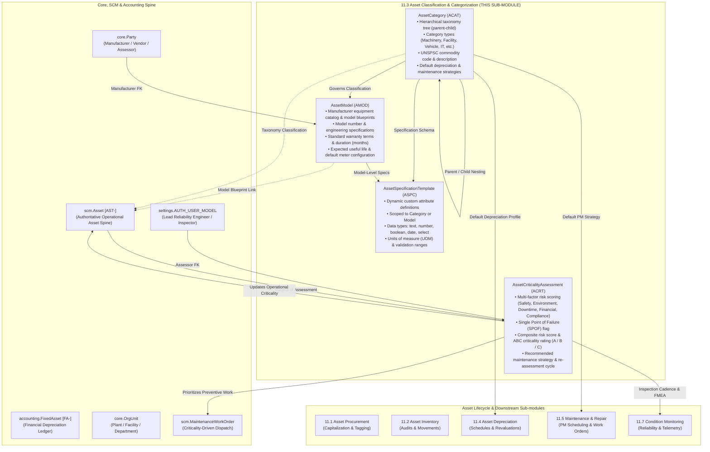

# Research — Sub-module 11.3: Asset Classification & Categorization (Module 11 — Asset Management System, `assets`)

- **Sub-module:** 11.3 Asset Classification & Categorization
- **Module:** 11 Asset Management System
- **Target app:** `apps/assets` (package: `apps/assets/models/AssetClassification/`)
- **Research date:** 2026-11-08
- **Phase:** Phase 1 Research Catalog
- **Output file target:** `.claude/tasks/research-assets-11.3.md`

---

## 1. Executive Summary & Domain Architecture

Sub-module 11.3 establishes the foundational **Asset Classification & Categorization** architecture for NavERP's **Asset Management System (`apps/assets`)**. Operating in concert with the operational asset master spine established in SCM 4.13 (`scm.Asset` [AST-]) and the financial ledger (`accounting.FixedAsset` [FA-]), 11.3 provides enterprise asset taxonomy trees, manufacturer model catalogs, multi-dimensional risk and criticality scoring, lifecycle stage governance, and dynamic technical specification templates.

In enterprise asset management (EAM), physical plant, heavy machinery, production cells, fleet vehicles, IT infrastructure, and facilities cannot be treated as flat inventory lists. They require standardized multi-tier categorization, technical specification schemas, engineering risk scoring, and manufacturer model governance:
1. **Asset Hierarchy & Taxonomy:** Enterprises manage complex assets organized into multi-level classification trees (e.g., `Plant & Facilities` → `HVAC Systems` → `Chillers` → `Centrifugal Chillers`). Aligning categories with international commodity taxonomies such as **UNSPSC** (United Nations Standard Products and Services Code) ensures procurement interoperability, spend classification, and standardized accounting capitalization rules.
2. **Asset Type & Model Management:** Assets share common manufacturer engineering blueprints. An asset model (e.g., *Caterpillar 320 GC Hydraulic Excavator* or *Trane CenTraVac CVHE Chiller*) standardizes technical specifications, operating meter types, expected useful life cycles, manufacturer warranties, and replacement cost baselines across all deployed instances.
3. **Criticality & Risk Classification (ABC Analysis & FMEA):** Not all assets present equal risk when they fail. Commercial leaders employ multi-attribute consequence analysis evaluating Personnel Safety, Environmental Release, Production Downtime / Bottleneck Loss, Repair & Replacement Cost, and Regulatory Compliance, combined with Single Point of Failure (SPOF) flags. This derives an objective composite score and ABC rating ($A$ = Mission-Critical, $B$ = Important, $C$ = Non-Critical) that directly drives preventive maintenance scheduling, spare parts stocking, and SLA escalation.
4. **Asset Lifecycle Stage Tracking:** Managing the journey of an asset from procurement capitalization, commissioning, active service, scheduled maintenance, standby/idle, through to decommissioning and disposal. Coordinating operational statuses (`scm.Asset`) with financial fixed asset statuses (`accounting.FixedAsset`) ensures cross-departmental alignment without state drift.
5. **Custom Attributes & Dynamic Specifications:** Different equipment classes require radically different technical parameters (e.g., chillers track refrigeration tonnage, refrigerant type, and COP; transformers track primary/secondary kVA and winding insulation; pumps track flow rate GPM and head pressure). Providing dynamic specification templates with strict typing, units of measure (UOM), and validation bounds fulfills the architectural commitment made in SCM 4.13 (`# A real user-defined-field engine is 11.3's Custom Attributes`).

### Architectural Data Flow & Spine Integration



---

## 2. Repo State Checked First

### 2.1 Existing Module Status & Rollover
- **Module 10 (Business Intelligence - `apps/bi`):** 100% complete (10.1 through 10.19 built, tested, green).
- **Module 11 (Asset Management System - `apps/assets`):**
  - Sub-module 11.1 (`apps/assets/models/AssetProcurement/`): Complete with `AssetRequisition`, `AssetAcquisitionReceipt`, `AssetCapitalization`, `AssetTag`. Verified, tested, and active.
  - Sub-module 11.2 (`apps/assets/models/AssetInventoryTracking/`): Complete with `AssetAudit`, `AssetMovementLog`, `AssetCustodyLog`, `AssetIncidentReport`. Verified, tested, and active.
  - **Sub-module 11.3 (Asset Classification & Categorization):** Target package folder is `apps/assets/models/AssetClassification/`.

### 2.2 Spine Entities Verified to Exist (grep evidence)
- **`apps/scm`:**
  - `scm.Asset` [AST-] in `apps/scm/models/AssetManagement/Assets.py`: The canonical operational asset master. Includes `parent` (self-FK), `category` (CharField 120 matching `FixedAsset.category`), `manufacturer`, `model_number`, `serial_number`, `tag_code`, `specifications` (TextField), `criticality` (CRITICALITY_CHOICES), `status` (STATUS_CHOICES), `meter_name`, `meter_unit`, `warranty_expires_on`.
    - *Note from Assets.py lines 154-157:* `Capacity, voltage, rated output — free text on purpose. A real user-defined-field engine is 11.3's 'Custom Attributes'; inventing half of one as a 4.13 table would be a schema everyone then has to migrate off.`
  - `scm.Location` in `apps/scm/models/InventoryManagement/Locations.py`: Warehouse and plant locations.
  - `scm.MaintenanceWorkOrder` [MWO-] in `apps/scm/models/AssetManagement/WorkOrders.py`: Work orders that consume criticality ratings.
- **`apps/core`:**
  - `core.Tenant` in `apps/core/models/Tenant.py`: Multi-tenant isolation anchor.
  - `core.Party` & `core.PartyRole` in `apps/core/models/Party.py`: Manufacturer, vendor, technician, inspector.
  - `core.OrgUnit` in `apps/core/models/OrgUnit.py`: Plant, department, cost center.
  - `core.Document` in `apps/core/models/Document.py`: Technical spec sheets, operator manuals, CAD schematics.
- **`apps/accounting`:**
  - `accounting.FixedAsset` [FA-] in `apps/accounting/models/FixedAssets/FixedAssetsRegister.py`: Financial depreciation ledger.

### 2.3 Prefix Collision Verification
Repository-wide regex audit executed for all candidate prefixes across all apps:
- `ACAT`: **0 matches** across `apps/` (Completely clear for `AssetCategory`)
- `AMOD`: **0 matches** across `apps/` (Completely clear for `AssetModel`)
- `ACRT`: **0 matches** across `apps/` (Completely clear for `AssetCriticalityAssessment`)
- `ASPC`: **0 matches** across `apps/` (Completely clear for `AssetSpecificationTemplate`)

All four candidate prefixes (`ACAT`, `AMOD`, `ACRT`, `ASPC`) are strictly 4-letter uppercase, start with 'A', and are collision-free.

---

## 3. Commercial Product Feature Breakdown

We analyzed 8 commercial market leaders in Enterprise Asset Management (EAM), Asset Performance Management (APM), and IT/Plant Asset Classification:

### 3.1 IBM Maximo (Maximo Application Suite - EAM / Manage)
- **Hierarchical Classification System:** Multi-tier taxonomy tree (Classification ID, Description, Parent Classification) organized by asset domain (`FACILITIES`, `PRODUCTION`, `FLEET`, `IT`). Full hierarchical path resolution (e.g., `FACILITIES \ HVAC \ CHILLER \ CENTRIFUGAL`).
- **Use With Mapping:** Classifications explicitly declare where they can be applied (`ASSET`, `LOCATION`, `ITEM`, `WORKORDER`).
- **Specification Engine (Attributes):** Attributes attached to classifications. Strongly typed (`ALN` - Alphanumeric, `NUMERIC`, `TABLE`, `YORN` - Boolean, `DATE`). Attributes specify Unit of Measure (UOM), domain value validation lists, display order, and mandatory/required flags. Child classifications inherit attributes from parent nodes with local overrides.
- **Asset Hierarchy:** Plant functional hierarchy with parent-child asset nesting, assembly roll-ups, and cost aggregation.
- **Asset Health & Criticality:** Maximo Asset Health Insights scores asset criticality (1-100 or 1-5 scale) based on consequence of failure across Health, Safety, Environmental, and Production Downtime. Drives Reliability-Centered Maintenance (RCM) strategies.

### 3.2 SAP PM / SAP S/4HANA EAM (Plant Maintenance)
- **Technical Object Hierarchy:** Multi-level functional structure: Functional Locations (FLOC) representing installation spaces, Equipment (EQUI) installed within locations, and Sub-equipment/Assemblies/BOM components.
- **Classification System (CA-CL):** Class Type `002` (Equipment) and `003` (Functional Location). Classes arranged in hierarchical inheritance trees. Characteristics (`CT04`) specify technical parameters with data types (CHAR, NUM, DATE, CURR), units of measure, single/multi-value selection, value ranges, and required flags. Characteristic values stored dynamically per technical object.
- **Equipment Categories:** High-level categorization (e.g., `M` for Machines/Mechanical, `E` for Electrical, `F` for Fleet/Vehicles, `P` for Production Devices, `I` for Instrumentation).
- **Equipment Models & Construction Types:** Equipment linked to Material Master / Model records defining manufacturer part number, standard bill of materials, and catalog engineering specifications.
- **ABC Criticality Analysis:** Strategic ABC indicator (`A` = Critical / Bottleneck, `B` = Important, `C` = Non-Critical). Evaluated through multi-factor risk matrices evaluating personnel safety, environmental risk, operational downtime, and repair cost.

### 3.3 Infor EAM / HxGN EAM (Hexagon)
- **Equipment Profiles & Classes:** Equipment classes govern default preventive maintenance schedules, failure codes, and inspection checklists.
- **Equipment Models:** Centralized equipment catalog storing manufacturer name, model number, standard warranty terms (duration in months, operating hours ceiling), expected useful life, and engineering specifications.
- **Risk & Criticality Matrix (RCM Scoring):** Rigorous multi-attribute scoring matrix evaluating five core consequence categories:
  1. *Personnel Safety & Health*
  2. *Environmental Impact & Emissions*
  3. *Operations & Production Throughput Loss*
  4. *Direct Financial / Maintenance Cost*
  5. *Quality & Regulatory Compliance*
  Computes a total Risk Priority Number (RPN) or Criticality Score mapped into Criticality Ranks ($1-5$ or $A-C$).
- **User-Defined Fields (UDF) & Custom Fields:** Category-level attribute schemas with regex validation and mandatory rules.

### 3.4 ServiceNow EAM & ITAM
- **Model Categories:** Structural bridge mapping physical asset classes to Configuration Item (CI) classes, defining whether an asset belongs to Industrial Machinery, Facilities, Clinical/Healthcare, Fleet, or IT Hardware.
- **Asset Models (`cmdb_model`):** Manufacturer catalog records defining model name, model number, standard warranty duration, depreciation profiles, and technical specs.
- **Normalization Engine & UNSPSC:** Automatic normalization of messy manufacturer and model strings. Maps model categories directly to UNSPSC (United Nations Standard Products and Services Code) 8-digit commodity hierarchy (Segment, Family, Class, Commodity).
- **Lifecycle Stage Governance:** Standardized enterprise lifecycle model (`Draft` → `In Stock` → `In Transit` → `In Service` → `Under Maintenance` → `Idle` → `Retired` → `Disposed`) with granular sub-states.

### 3.5 Oracle Maintenance Cloud / Oracle EAM
- **Asset Taxonomy:** Multi-level asset groups and hierarchical categories.
- **Asset Hierarchy & Relationships:** Parent-child asset nesting supporting cost roll-up, failure propagation, and work order dispatching.
- **Asset Models & Engineering Templates:** Standardized equipment models with preconfigured engineering operating limits, warranty templates, and required meters.
- **Criticality Assessment Matrix:** Standardized risk assessment evaluating failure probability, operational severity, safety risk, and single point of failure (SPOF) status. Computes ABC Criticality Index and assigns default maintenance strategies (RCM, Condition-Based, Time-Based PM, Run-to-Failure).
- **Descriptive Flexfields (DFF):** Dynamic attributes attached to asset categories for engineering specifications.

### 3.6 UpKeep CMMS & Asset Operations
- **Category Hierarchy:** Multi-tier category structure for plant, facility, and equipment organization.
- **Model Templates:** Standardized model cards storing manufacturer specifications, attached user manuals, and warranty expiration defaults.
- **Custom Specification Fields:** User-defined fields attached per category (Text, Number, Date, Dropdown, Checkbox) with custom UOMs.
- **Criticality Ratings:** Criticality tiers (Critical, High, Medium, Low) that drive automated work order priority and technician SLA routing.

### 3.7 MaintainX
- **Hierarchical Category Trees:** Flexible category grouping with color-coded badges and nested sub-categories.
- **Asset Model Library:** Equipment models with manufacturer part numbers, standard operating manuals, and pre-assigned maintenance procedure templates.
- **Custom Attributes:** Category-level technical specifications (Voltage, Horsepower, CFM, Refrigerant Type) validated at data entry.
- **Asset Criticality:** Priority tiering determining maintenance frequency, spares reservation priority, and downtime alerting.

### 3.8 Asset Panda
- **Custom Taxonomy & Category Trees:** Unlimited depth parent-child category hierarchies.
- **Dynamic Field Builder:** Category-driven custom field engine with text, numeric, date, dropdown, formula, and file attachment types.
- **Model Profiles:** Reusable equipment profiles defining standard specs and warranty defaults.
- **Lifecycle Workflows:** Configurable status transition rules preventing illegal state jumps (e.g. Disposed → In Service).

---

## 4. Comprehensive Feature Catalog

Mapped strictly to the five feature bullets of **NavERP.md Sub-module 11.3**:

```
11.3 Asset Classification & Categorization
├── 4.1 Asset Hierarchy & Taxonomy
├── 4.2 Asset Type & Model Management
├── 4.3 Criticality & Risk Classification
├── 4.4 Asset Lifecycle Stage Tracking
└── 4.5 Custom Attributes & Specifications
```

### 4.1 Asset Hierarchy & Taxonomy
- **Multi-Level Category Hierarchy:** Self-referential tree structure (`parent` foreign key) enabling nested classifications (e.g., `Plant Equipment` → `Rotating Machinery` → `Pumps` → `Centrifugal Pumps`).
- **Category Types:** High-level categorization covering standard enterprise domains:
  - `machinery` (Production Machinery & Industrial Equipment)
  - `facility` (Building Infrastructure, HVAC, Electrical, Plumbing)
  - `vehicle` (Fleet, Rolling Stock, Heavy Mobile Equipment)
  - `it_hardware` (Servers, Networking, Laptops, Datacenter)
  - `tooling` (Precision Tools, Molds, Jigs, Test Instruments)
  - `furniture` (Furniture, Fixtures & Office Equipment - FF&E)
  - `infrastructure` (Pipelines, Transmission Lines, Roads, Civil Works)
  - `other` (General Assets)
- **UNSPSC & Commodity Coding:** Standard 8-digit UNSPSC commodity code and description mapping (e.g., `UNSPSC 40151503` for *Centrifugal pumps*) for standardized spend analytics, CapEx reporting, and cross-ERP interoperability.
- **Default Financial & Maintenance Policy Inheritance:** Categories define default financial depreciation methods (straight-line, declining-balance, none), default useful life (in months), and default maintenance strategies (preventive-calendar, preventive-meter, condition-based, run-to-failure).
- **Hierarchy Depth Validation & Loop Prevention:** Recursive validation ensuring category trees do not contain circular parent references and enforcing depth bounds (max 10 levels).

### 4.2 Asset Type & Model Management
- **Centralized Manufacturer Model Catalog:** Manufacturer equipment blueprints representing specific makes and models (e.g., *Caterpillar 320 GC*, *Trane CVHE-500*, *Siemens S7-1500 PLC*).
- **Manufacturer Identification:** Foreign key to `core.Party` (with role `manufacturer` or `supplier`) plus manufacturer model number and series name.
- **Standard Warranty Templates:** Standard manufacturer warranty terms:
  - Warranty duration in months (e.g., 12, 24, 36, 60 months)
  - Coverage scope (`full_parts_labor`, `parts_only`, `powertrain_only`, `limited`)
  - Terms and conditions summary
- **Expected Useful Life & Salvage Benchmarks:** Engineering life expectancy (months / years) and typical residual value percentage to assist CapEx planning and capitalization setup.
- **Operating Meter Baseline:** Default meter type and unit (e.g., `running_hours` in `hours`, `odometer` in `km`, `cycles` in `counts`) automatically propagated to new assets instantiated from this model.
- **Estimated Replacement Cost:** Standard replacement cost baseline in workspace currency, enabling repair-vs-replace decision analysis on work orders.
- **Model Lifecycle Status:** Commercial status (`active`, `phased_out`, `discontinued`, `draft`) indicating whether new asset requisitions can select this model.

### 4.3 Criticality & Risk Classification
- **Multi-Factor Consequence Analysis:** Formal engineering risk assessment evaluating 5 consequence dimensions on a 1–5 severity scale (1 = Negligible, 5 = Catastrophic):
  1. *Safety & Health:* 1 (Minor first-aid) to 5 (Potential fatality / severe occupational hazard).
  2. *Environmental Impact:* 1 (Zero release) to 5 (Major toxic release / EPA violation).
  3. *Operational Downtime & Throughput Loss:* 1 (No impact / idle standby) to 5 (Entire plant stoppage / bottleneck line down).
  4. *Direct Financial & Repair Cost:* 1 (<$1,000) to 5 (Catastrophic equipment loss >$250,000).
  5. *Regulatory & Compliance Exposure:* 1 (Internal variance) to 5 (Loss of operating license / major legal citation).
- **Single Point of Failure (SPOF) Assessment:** Boolean flag indicating whether the asset operates with zero redundancy/standby unit. A SPOF automatically escalates asset criticality.
- **Composite Risk Score Calculation:** Deterministic scoring engine aggregating consequence dimensions (5 to 25 scale) with SPOF escalation weighting.
- **ABC Criticality Rating:** Standardized tiering:
  - `A` (*Critical / High Consequence* — Score $\ge 20$ or SPOF with high impact): Requires daily/weekly preventive inspections, dedicated spare parts inventory, strict maintenance SLAs, and immediate supervisor escalation.
  - `B` (*Important / Medium Consequence* — Score $12–19$): Standard preventive maintenance schedule, normal work order dispatch priority, standard parts stocking.
  - `C` (*Non-Critical / Low Consequence* — Score $< 12$): Run-to-failure or basic corrective maintenance, minimal stocked spares.
- **Recommended Maintenance Strategy:** RCM maintenance strategy recommendation:
  - `rcm_predictive` (Predictive & Condition-Based Monitoring)
  - `rigorous_pm` (Time / Meter-based Rigorous Preventive Maintenance)
  - `standard_pm` (Standard Routine Servicing)
  - `run_to_failure` (Run to Failure / Corrective Maintenance)
- **Review Cycle & Recertification:** Configurable assessment re-evaluation interval (e.g., 12, 24, 36 months) with `next_assessment_due` tracking.
- **Operational Master Sync:** Approved assessments provide the authoritative source of truth that synchronizes with `scm.Asset.criticality` (`critical`, `high`, `medium`, `low`).

### 4.4 Asset Lifecycle Stage Tracking
- **Multi-State Lifecycle Alignment:** Seamless coordination between:
  - Operational lifecycle states (`scm.Asset.status`: `planned`, `in_service`, `under_maintenance`, `standby`, `idle`, `retired`, `disposed`)
  - Financial capitalization states (`accounting.FixedAsset.status`: `cip`, `active`, `disposed`)
  - Procurement states (`assets.AssetCapitalization.status`: `draft`, `capitalized`, `transferred`, `disposed`)
- **Lifecycle Transition Rules:** Controlled status progression ensuring assets cannot bypass prerequisite stages (e.g., an asset cannot transition from `planned` directly to `retired` without capitalization, and `disposed` assets cannot receive open maintenance work orders).
- **Lifecycle Stage Defaults by Category:** Categories establish standard initial warranty duration, expected life cycle, and disposal/salvage policies.

### 4.5 Custom Attributes & Specifications
- **Dynamic Specification Template Engine:** Enables administrators to define strongly typed technical attributes and engineering parameters for any `AssetCategory` or `AssetModel`.
- **Supported Data Types:**
  - `text` (String / Alphanumeric, e.g. "Refrigerant R-134a", "NEMA Enclosure 4X")
  - `number` (Numeric value with precision, e.g. "480", "150.5")
  - `boolean` (Yes / No flag, e.g. "Explosion Proof", "Variable Frequency Drive")
  - `date` (Calendar date, e.g. "Pressure Vessel Recertification Date")
  - `select` (Dropdown choice list from predefined comma-separated or JSON options)
- **Unit of Measure (UOM) Standard:** Normalized engineering units (e.g., `V`, `kW`, `HP`, `PSI`, `bar`, `GPM`, `RPM`, `CFM`, `m3/h`, `ton`, `kg`, `degC`, `A`, `Hz`).
- **Validation Bounds & Rules:** Optional minimum and maximum numerical bounds, regex pattern constraints for strings, and allowed options list for dropdowns.
- **Mandatory & Filterable Flags:**
  - `is_required`: Must be supplied when registering or updating an asset of this category/model.
  - `is_filterable`: Indexed and surfaced as an operational filter in asset registers.
- **Display Ordering & Grouping:** Ordered sequence for rendering on technical specification tabs and inspection cards.

---

## 5. Recommended Build Scope for NavERP 11.3

To balance comprehensive commercial EAM capabilities with NavERP's modularity standards (1–4 models per sub-module), we recommend **4 models** for Sub-module 11.3 in package `apps/assets/models/AssetClassification/`:

```
apps/assets/models/AssetClassification/
├── __init__.py
├── AssetCategories.py                # AssetCategory [ACAT-]
├── AssetModels.py                     # AssetModel [AMOD-]
├── AssetCriticalityAssessments.py     # AssetCriticalityAssessment [ACRT-]
└── AssetSpecificationTemplates.py     # AssetSpecificationTemplate [ASPC-]
```

### 5.1 Model 1: `AssetCategory` [ACAT-]
- **Purpose:** Enterprise asset taxonomy tree, category types, UNSPSC commodity codes, and default depreciation / maintenance policy profiles.
- **Base class:** `TenantNumbered` (`NUMBER_PREFIX = "ACAT"`)
- **Fields:**
  - `code` (CharField 32, db_index=True) — Unique category identifier (e.g. `HVAC-CHL`, `PUMP-CENT`)
  - `name` (CharField 150) — Full category name (e.g. "Centrifugal Water Chillers")
  - `parent` (ForeignKey `"self"`, null=True, blank=True, on_delete=SET_NULL, related_name="children") — Recursive parent category
  - `category_type` (CharField 24, choices=CATEGORY_TYPE_CHOICES, default="machinery")
    - Choices: `machinery`, `facility`, `vehicle`, `it_hardware`, `tooling`, `furniture`, `infrastructure`, `electrical`, `piping`, `other`
  - `unspsc_code` (CharField 16, blank=True) — 8-digit UNSPSC commodity code (e.g. `40151503`)
  - `unspsc_title` (CharField 150, blank=True) — UNSPSC commodity description
  - `default_depreciation_method` (CharField 20, choices=DEPRECIATION_METHOD_CHOICES, default="straight_line")
    - Choices: `straight_line`, `declining_balance`, `double_declining`, `sum_of_years`, `none`
  - `default_useful_life_months` (PositiveIntegerField default=60) — Standard accounting & operational life
  - `default_maintenance_strategy` (CharField 24, choices=MAINTENANCE_STRATEGY_CHOICES, default="preventive_calendar")
    - Choices: `preventive_calendar`, `preventive_meter`, `condition_based`, `predictive`, `run_to_failure`
  - `default_criticality` (CharField 10, choices=CRITICALITY_CHOICES, default="medium")
  - `description` (TextField, blank=True)
  - `display_order` (PositiveIntegerField default=10)
  - `is_active` (BooleanField default=True)
- **Status / Badge CSS:**
  - `STATUS_CSS`: `active → badge-green`, `inactive → badge-muted`
- **Validation:** Circular parent loop detection in `clean()` (max depth 10 levels).

### 5.2 Model 2: `AssetModel` [AMOD-]
- **Purpose:** Manufacturer equipment model catalog, technical blueprints, standard warranty templates, and operating meter baselines.
- **Base class:** `TenantNumbered` (`NUMBER_PREFIX = "AMOD"`)
- **Fields:**
  - `model_number` (CharField 64, db_index=True) — Manufacturer model number (e.g. `CAT-320GC`, `CVHE-500`)
  - `name` (CharField 200) — Commercial model name / series
  - `category` (ForeignKey `"assets.AssetCategory"`, on_delete=PROTECT, related_name="models")
  - `manufacturer` (ForeignKey `"core.Party"`, null=True, blank=True, on_delete=SET_NULL, related_name="asset_models")
  - `manufacturer_name_fallback` (CharField 120, blank=True) — Fallback if party not selected
  - `description` (TextField, blank=True)
  - `standard_warranty_months` (PositiveIntegerField default=12) — Standard warranty duration
  - `warranty_coverage_type` (CharField 24, choices=WARRANTY_COVERAGE_CHOICES, default="full_parts_labor")
    - Choices: `full_parts_labor`, `parts_only`, `powertrain_only`, `limited`, `no_warranty`
  - `expected_useful_life_months` (PositiveIntegerField default=60)
  - `default_meter_name` (CharField 40, blank=True) — e.g. "Running Hours", "Odometer", "Stroke Count"
  - `default_meter_unit` (CharField 16, blank=True) — e.g. "h", "km", "cycles"
  - `estimated_replacement_cost` (DecimalField max_digits=14, decimal_places=2, default=0)
  - `model_status` (CharField 20, choices=MODEL_STATUS_CHOICES, default="active")
    - Choices: `active`, `phased_out`, `discontinued`, `draft`
  - `technical_specifications` (TextField, blank=True) — Baseline engineering specs overview
  - `is_active` (BooleanField default=True)
- **Status / Badge CSS:**
  - `active → badge-green`, `phased_out → badge-amber`, `discontinued → badge-red`, `draft → badge-slate`
- **Helper methods:** `display_manufacturer`, `formatted_replacement_cost`

### 5.3 Model 3: `AssetCriticalityAssessment` [ACRT-]
- **Purpose:** Multi-factor engineering risk assessment, failure consequence scoring (Safety, Environment, Downtime, Financial, Compliance), SPOF detection, and ABC criticality rating.
- **Base class:** `TenantNumbered` (`NUMBER_PREFIX = "ACRT"`)
- **Fields:**
  - `title` (CharField 200) — Assessment title (e.g. "Annual Criticality Audit - Chiller #2")
  - `asset` (ForeignKey `"scm.Asset"`, on_delete=CASCADE, related_name="criticality_assessments")
  - `assessor` (ForeignKey `"core.Party"`, null=True, blank=True, on_delete=SET_NULL, related_name="asset_assessments")
  - `assessment_date` (DateField default=timezone.now)
  - `safety_impact` (PositiveSmallIntegerField default=1, validators=[1..5])
    - Scale: 1 (Negligible) to 5 (Fatality / Major Hazard)
  - `environmental_impact` (PositiveSmallIntegerField default=1, validators=[1..5])
    - Scale: 1 (Zero release) to 5 (Major toxic release / EPA breach)
  - `operational_downtime_impact` (PositiveSmallIntegerField default=1, validators=[1..5])
    - Scale: 1 (No impact) to 5 (Full plant stoppage / Bottleneck line)
  - `financial_impact` (PositiveSmallIntegerField default=1, validators=[1..5])
    - Scale: 1 (<$1k) to 5 (Catastrophic repair >$250k)
  - `regulatory_compliance_impact` (PositiveSmallIntegerField default=1, validators=[1..5])
    - Scale: 1 (Minor internal) to 5 (Revocation of license to operate)
  - `is_single_point_of_failure` (BooleanField default=False) — True if no standby/backup unit exists
  - `composite_score` (PositiveSmallIntegerField default=5) — Auto-calculated sum/weighted score (5..30)
  - `abc_rating` (CharField 1, choices=ABC_RATING_CHOICES, default="C")
    - `A` = Critical / Essential ($Score \ge 20$ or SPOF with High Impact)
    - `B` = Important / Semi-Critical ($Score = 12..19$)
    - `C` = Non-Critical / Standard ($Score < 12$)
  - `recommended_strategy` (CharField 24, choices=STRATEGY_CHOICES, default="standard_pm")
    - Choices: `rcm_predictive`, `rigorous_pm`, `standard_pm`, `run_to_failure`
  - `assessment_status` (CharField 16, choices=STATUS_CHOICES, default="draft")
    - Choices: `draft`, `reviewed`, `approved`, `superseded`
  - `review_cycle_months` (PositiveIntegerField default=12)
  - `next_assessment_due` (DateField null=True, blank=True)
  - `findings_and_mitigation` (TextField, blank=True)
- **Status / Badge CSS:**
  - Status: `draft → badge-slate`, `reviewed → badge-info`, `approved → badge-green`, `superseded → badge-muted`
  - ABC Rating: `A → badge-red`, `B → badge-amber`, `C → badge-slate`
- **Business Logic:**
  - `calculate_composite_score()` auto-sums consequence dimensions and adds 5 points if `is_single_point_of_failure` is True.
  - Automatically derives `abc_rating` from composite score.
  - On approval, updates `scm.Asset.criticality` (`critical` if A, `high`/`medium` if B, `low` if C).

### 5.4 Model 4: `AssetSpecificationTemplate` [ASPC-]
- **Purpose:** Dynamic custom attribute definitions and technical specification schemas scoped to Asset Categories or Models.
- **Base class:** `TenantNumbered` (`NUMBER_PREFIX = "ASPC"`)
- **Fields:**
  - `attribute_key` (CharField 50) — Machine-readable slug (e.g. `rated_voltage`, `cooling_capacity_tons`)
  - `display_name` (CharField 120) — Human-readable label (e.g. "Rated Operating Voltage")
  - `category` (ForeignKey `"assets.AssetCategory"`, null=True, blank=True, on_delete=CASCADE, related_name="spec_templates")
  - `model` (ForeignKey `"assets.AssetModel"`, null=True, blank=True, on_delete=CASCADE, related_name="spec_templates")
  - `data_type` (CharField 16, choices=DATA_TYPE_CHOICES, default="text")
    - Choices: `text`, `number`, `boolean`, `date`, `select`
  - `unit_of_measure` (CharField 24, blank=True) — e.g. "V", "kW", "PSI", "GPM", "RPM", "ton", "kg", "degC"
  - `allowed_choices` (TextField, blank=True) — Comma-separated choice values for `select` type
  - `default_value` (CharField 200, blank=True)
  - `min_value` (DecimalField max_digits=14, decimal_places=4, null=True, blank=True) — Numeric lower bound
  - `max_value` (DecimalField max_digits=14, decimal_places=4, null=True, blank=True) — Numeric upper bound
  - `is_required` (BooleanField default=False)
  - `is_filterable` (BooleanField default=True)
  - `display_order` (PositiveIntegerField default=10)
  - `description` (CharField 255, blank=True)
  - `is_active` (BooleanField default=True)
- **Status / Badge CSS:**
  - `active → badge-green`, `inactive → badge-muted`
- **Helper methods:** `get_choices_list()`, `validate_value(raw_value)`

---

## 6. Anti-Patterns & Lessons Applied

Incorporating codified engineering lessons from `.claude/tasks/lessons.md`:
1. **L7 & L8 (Context Variable Contracts & Content Assertions):**
   - Explicitly pin every context variable in the contract:
     - Categories: `categories` (list), `category` (detail/edit), `parent_choices`
     - Models: `models` (list), `model_obj` (detail/edit), `category_choices`, `manufacturer_choices`
     - Criticality: `assessments` (list), `assessment` (detail/edit), `asset_choices`, `assessor_choices`
     - Templates: `spec_templates` (list), `spec_template` (detail/edit)
   - Ensure detail and smoke test assertions check rendered IDs and identifiers, never relying solely on HTTP 200.
2. **L11 (Integer FK List Filter Parsing):**
   - Ensure all query parameters for foreign keys (`?category=`, `?model=`, `?asset=`) are verified with `.isdigit()` before calling `.filter(category_id=...)` to prevent ValueError 500s on crafted or malformed input.
3. **L28 & L29 (Spine Verification & String FKs):**
   - Operational asset references strictly use string foreign keys: `"scm.Asset"`.
   - Core parties use `"core.Party"`.
   - Accounting fixed assets remain in `"accounting.FixedAsset"` without re-declaring duplicate depreciation tables.
4. **L33 (Theme.css Color-Named Badges Only):**
   - Under no circumstances use semantic badge classes like `badge-success`, `badge-danger`, or `badge-warning`.
   - Use ONLY color-named classes defined in `theme.css`: `badge-green`, `badge-red`, `badge-amber`, `badge-info`, `badge-muted`, `badge-slate`.
5. **L36 & L37 (Prevent Parallel Schemas):**
   - `AssetCategory` provides the enterprise categorization hierarchy that `scm.Asset.category` plain text points to, without breaking existing CharField compatibility.
   - SCM 4.13 operational assets remain the single source of truth for plant operations.

---

## 7. Downstream Module Integration & Hand-offs

The four models built in 11.3 seamlessly interface with existing and upcoming modules:

1. **SCM 4.13 Maintenance Management (`apps/scm`):**
   - `AssetCriticalityAssessment` [ACRT-] feeds directly into maintenance work order prioritization (`scm.MaintenanceWorkOrder.priority`) and technician dispatching. High-criticality assets ($A$-rating) trigger expedited SLAs.
   - `AssetModel` [AMOD-] populates default meter configurations (`meter_name`, `meter_unit`) and warranty expiration alerts on `scm.Asset`.
2. **Sub-module 11.1 (Asset Procurement & Acquisition):**
   - `AssetCapitalization` reads `AssetCategory.default_depreciation_method` and `default_useful_life_months` when initializing asset records and fixed asset cost bases.
3. **Sub-module 11.2 (Asset Inventory & Tracking):**
   - `AssetAudit` counts can be filtered and reconciled by `AssetCategory` and `AssetModel`.
4. **Sub-module 11.4 (Depreciation & Financial Management):**
   - Category-level depreciation parameters establish baseline capitalization rules for GL depreciation schedules and GAAP/IFRS tax asset classes.
5. **Sub-module 11.5 (Maintenance & Repair Management):**
   - Category and model maintenance strategies (`AssetCategory.default_maintenance_strategy`) determine preventive maintenance frequencies and inspection checklist templates.
6. **Sub-module 11.7 (Asset Reliability & Condition Monitoring):**
   - Failure Modes and Effects Analysis (FMEA) and vibration/temperature threshold monitoring are scoped by `AssetCategory` and `AssetSpecificationTemplate`.

---

## 8. Summary of Research

- **Sub-module:** 11.3 Asset Classification & Categorization
- **Products Surveyed:** 8 leaders (IBM Maximo, SAP PM/EAM, Infor/HxGN EAM, ServiceNow EAM, Oracle Maintenance Cloud, UpKeep, MaintainX, Asset Panda).
- **Core Domain Entities:**
  1. `AssetCategory` [ACAT-] — Multi-level taxonomy, UNSPSC codes, policy defaults.
  2. `AssetModel` [AMOD-] — Manufacturer models, blueprints, warranty terms, meter baselines.
  3. `AssetCriticalityAssessment` [ACRT-] — Multi-factor failure impact scoring, SPOF flag, ABC ratings.
  4. `AssetSpecificationTemplate` [ASPC-] — Dynamic technical specs, UOMs, validation bounds.
- **Prefix Collision Check:** `ACAT`, `AMOD`, `ACRT`, `ASPC` verified 100% collision-free.
- **Output File Written:** `.claude/tasks/research-assets-11.3.md`
