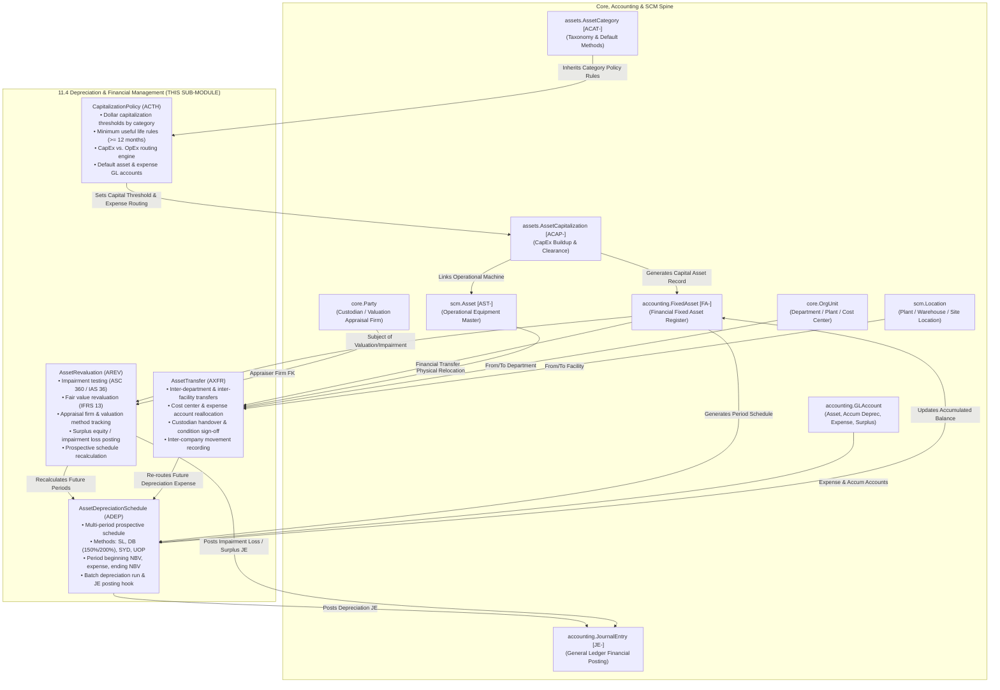

# Research — Sub-module 11.4: Depreciation & Financial Management (Module 11 — Asset Management System, `assets`)

- **Sub-module:** 11.4 Depreciation & Financial Management
- **Module:** 11 Asset Management System
- **Target app:** `apps/assets` (package: `apps/assets/models/AssetDepreciation/`)
- **Research date:** 2026-11-09
- **Phase:** Phase 1 Research Catalog
- **Output file target:** `.claude/tasks/research-assets-11.4.md`

---

## 1. Executive Summary & Domain Architecture

Sub-module 11.4 delivers the **Depreciation & Financial Management** backbone for NavERP's **Asset Management System (`apps/assets`)**. Operating in tight coordination with the financial fixed asset register (`accounting.FixedAsset` [FA-]), the general ledger (`accounting.JournalEntry` [JE-], `accounting.GLAccount`), the operational asset master spine (`scm.Asset` [AST-]), and capitalization buildup (`assets.AssetCapitalization` [ACAP-]), 11.4 transforms basic fixed asset accounting into a comprehensive enterprise financial lifecycle management system.

In enterprise asset management (EAM) and corporate fixed asset accounting, equipment, plant, fleet, facilities, and IT infrastructure require continuous financial stewardship across their operational lifecycle:
1. **Depreciation Schedule & Methods:** Assets depreciate differently based on engineering usage, economic obsolescence, and statutory accounting standards. Commercial enterprises require multi-period schedules across four core calculation engines:
   - **Straight-Line (SL):** Equal cost amortization across useful life periods.
   - **Declining Balance (DB / DDB):** Accelerated front-loaded expense using 150% or 200% factors on declining net book value.
   - **Sum-of-the-Years'-Digits (SYD):** Accelerated amortization based on remaining-life digit fractions.
   - **Units-of-Production (UOP):** Activity-based depreciation calibrated to operational throughput, runtime hours, or output units.
   Depreciation schedules must be tracked period-by-period with automated journal entry generation (`Dr Depreciation Expense / Cr Accumulated Depreciation`) in the authoritative accounting ledger (`apps/accounting`).
2. **Asset Valuation & Revaluation (ASC 360 / IAS 36 & IFRS 13):** Physical assets undergo economic shifts over multi-decade lifespans:
   - **Impairment Testing & Write-downs:** When an asset's carrying value exceeds its recoverable amount due to physical damage, market obsolescence, or regulatory bans, an impairment loss is recognized immediately against income.
   - **Upward Revaluation:** Under IFRS revaluation models, qualifying classes (e.g. land, buildings, specialized processing facilities) may be written up to fair market value, crediting equity Revaluation Surplus.
   - **Prospective Schedule Recalculation:** Following a revaluation or useful life revision, future periodic depreciation is automatically re-computed prospectively over the remaining life periods.
3. **Asset Transfer & Cost Allocation:** Modern enterprises operate matrix structures where equipment frequently moves across departments, plants, projects, and subsidiaries. Financial asset transfers must maintain strict auditability, reroute future depreciation expense lines to the recipient organizational cost centers (`core.OrgUnit`), update asset GL accounts, and record inter-company or inter-facility custody transitions without disrupting continuous depreciation schedules.
4. **Capital vs. Expense Determination (Capitalization Policy):** Clear governance distinguishes balance sheet capital expenditures (CapEx) from income statement operating expenses (OpEx). Commercial leaders configure rule-based capitalization threshold policies by asset category, setting minimum dollar thresholds (e.g., $2,500 standard, $500 IT hardware) and minimum useful life criteria (e.g., $\ge 12$ months). Qualifying purchases are routed for capitalization, while sub-threshold purchases are systematically flagged for immediate P&L expensing (low-value assets / minor equipment).
5. **Fixed Asset Reporting & Compliance:** Organizations require verifiable audit rolls for external auditors (Big 4 / GAAP / IFRS), asset roll-forward reports (Beginning Book Value + Additions - Disposals + Revaluations - Depreciation = Ending Book Value), forward-looking 12–60 month depreciation expense projections for budgeting, and reconciliation schedules.

---

### Architectural Data Flow & Spine Integration

---

## 2. Repo State Checked First

### 2.1 Existing Module Status & Rollover
- **Module 10 (Business Intelligence - `apps/bi`):** 100% complete (10.1 through 10.19 built, tested, green).
- **Module 11 (Asset Management System - `apps/assets`):**
  - **11.1 Asset Procurement & Acquisition (`apps/assets/models/AssetProcurement/`):** Complete with `AssetRequisition` [AREQ-], `AssetAcquisitionReceipt` [ARCV-], `AssetCapitalization` [ACAP-], `AssetTag` [ATAG-].
  - **11.2 Asset Inventory & Tracking (`apps/assets/models/AssetInventoryTracking/`):** Complete with `AssetAudit` [AAUD-], `AssetMovementLog` [AMOV-], `AssetCustodyLog` [ACHK-], `AssetIncidentReport` [AINC-].
  - **11.3 Asset Classification & Categorization (`apps/assets/models/AssetClassification/`):** Complete with `AssetCategory` [ACAT-], `AssetModel` [AMOD-], `AssetCriticalityAssessment` [ACRT-], `AssetSpecificationTemplate` [ASPC-].
  - **Sub-module 11.4 (Depreciation & Financial Management):** Next unbuilt sub-module. Package folder target is `apps/assets/models/AssetDepreciation/`.

### 2.2 Sibling Navigation Links (`LIVE_LINKS` Evidence)
Verified in `apps/core/navigation.py`:
- `"11.1"`: `Purchase Requisition & Approval`, `Vendor Selection & RFQ`, `Purchase Order & Receipt`, `Asset Capitalization & Depreciation Setup`, `Asset Tagging & Registration`.
- `"11.2"`: `Asset Register & Master Data`, `Physical Verification & Audits`, `Location & Movement Tracking`, `Check-in/Check-out Management`, `Lost, Stolen & Missing Asset Handling`.
- `"11.3"`: `Asset Hierarchy & Taxonomy`, `Asset Type & Model Management`, `Criticality & Risk Classification`, `Asset Lifecycle Stage Tracking`, `Custom Attributes & Specifications`.
- `"11.4"`: Not yet registered; to be added upon completion of Phase 3 Integration.

### 2.3 Spine Entities Verified to Exist (grep evidence)
Verified classes in repo:
- **`apps/accounting`:**
  - `accounting.FixedAsset` [FA-] (`apps/accounting/models/FixedAssets/FixedAssetsRegister.py:6`): Financial fixed asset register. Has `acquisition_cost`, `salvage_value`, `useful_life_months`, `method`, `accumulated_depreciation`, `asset_account`, `accumulated_account`, `expense_account`, `custodian`, `location`.
  - `accounting.GLAccount` (`apps/accounting/models/GeneralLedger/GLAccounts.py:5`): Financial chart of accounts.
  - `accounting.JournalEntry` [JE-] (`apps/accounting/models/GeneralLedger/JournalEntries.py:5`): Authoritative financial journal entry header.
  - `accounting.Currency` (`apps/accounting/models/GeneralLedger/Currencies.py:6`): Multi-currency ledger support.
  - `accounting.AssetDisposal` [DISP-] (`apps/accounting/models/FixedAssets/AssetDisposals.py:5`): Fixed asset disposal and retirement records.
- **`apps/scm`:**
  - `scm.Asset` [AST-] (`apps/scm/models/AssetManagement/Assets.py:50`): Operational equipment master with tag code, serial number, runtime meters, and maintenance profiles.
  - `scm.Location` (`apps/scm/models/InventoryManagement/Locations.py:10`): Physical warehouse and plant locations.
- **`apps/core`:**
  - `core.OrgUnit` (`apps/core/models/OrgUnit.py:5`): Corporate departments, plants, divisions, and cost centers.
  - `core.Party` (`apps/core/models/Party.py:5`): Independent appraisal firms, vendors, custodians, technicians.
- **`apps/assets`:**
  - `assets.AssetCategory` [ACAT-] (`apps/assets/models/AssetClassification/AssetCategories.py:7`): Asset taxonomy categories and default depreciation parameters.
  - `assets.AssetCapitalization` [ACAP-] (`apps/assets/models/AssetProcurement/AssetCapitalizations.py:10`): CapEx acquisition buildup and clearing to fixed assets.

### 2.4 Prefix Collision Audit
Repository-wide regex audit executed across `apps/` for all candidate prefixes:
- `ADEP`: **0 matches** across `apps/` (Completely clear for `AssetDepreciationSchedule`)
- `AREV`: **0 matches** across `apps/` (Completely clear for `AssetRevaluation`)
- `AXFR`: **0 matches** across `apps/` (Completely clear for `AssetTransfer`)
- `ACTH`: **0 matches** across `apps/` (Completely clear for `CapitalizationPolicy`)

All 4 candidate prefixes (`ADEP`, `AREV`, `AXFR`, `ACTH`) are strictly 4-letter uppercase, start with 'A', and are 100% collision-free.

---

## 3. Commercial Leaders Surveyed

We analyzed 8 commercial market leaders specializing in fixed asset depreciation, valuation adjustments, asset transfers, and capitalization governance:

### 3.1 Sage Fixed Assets (Depreciation, Tracking & Planning)
- **Positioning:** The standard enterprise solution for North American fixed asset depreciation and corporate tax accounting.
- **Source Link:** https://www.sage.com/en-us/products/sage-fixed-assets/
- **Key Capabilities Analyzed:**
  - Multi-book depreciation architecture supporting up to 7 depreciation books per asset (Internal GAAP, Federal Tax MACRS, Alternative Minimum Tax AMT, State Tax, Local Book, Custom Books).
  - 50+ built-in depreciation methods including Straight-Line (Half-Year, Mid-Quarter, Modified Half-Year conventions), Declining Balance (150%, 200% with automatic switch to Straight-Line when optimal), Sum-of-the-Years'-Digits, and Units-of-Production.
  - Asset Transfer engine tracking inter-department, inter-facility, and general ledger segment moves, with transfer reports preserving historical depreciation and re-routing future expense allocations.
  - Capital vs. Expense screening tools allowing organizations to establish capitalization cost thresholds by asset class.

### 3.2 Bloomberg Tax Fixed Assets (formerly BNA Fixed Assets)
- **Positioning:** Comprehensive enterprise fixed asset management and complex tax compliance platform.
- **Source Link:** https://pro.bloombergtax.com/fixed-assets/
- **Key Capabilities Analyzed:**
  - Enterprise asset roll-forward reporting tracking beginning balance, acquisitions, disposals, transfers, revaluations, and period depreciation expense.
  - Partial and complete asset transfer functionality across corporate entities, cost centers, and plants, with automated reconciliation of transfer-in and transfer-out balances.
  - Impairment write-down module accommodating ASC 360 / IAS 36 guidelines with prospective recalculation of future periodic depreciation.
  - Capital expenditure tracking comparing project acquisition invoices against corporate capitalization threshold limits.

### 3.3 Microsoft Dynamics 365 Business Central Fixed Assets
- **Positioning:** Cloud ERP fixed asset management with integrated general ledger depreciation books.
- **Source Link:** https://learn.microsoft.com/en-us/dynamics365/business-central/fa-manage
- **Key Capabilities Analyzed:**
  - Depreciation Books configuring whether transactions post directly to G/L or remain in asset sub-ledgers.
  - Revaluation Journals segregating upward adjustments (`Appreciation` posted to Revaluation Reserve) from downward adjustments (`Write-Down` / Impairment posted to P&L Impairment Loss).
  - Fixed Asset Allocation Keys distributing depreciation expenses across multiple dimensions, departments, or cost centers according to percentage shares.
  - Fixed Asset Reclassification Journals facilitating asset transfers between posting groups, departments, and plant facilities.

### 3.4 SAP S/4HANA Asset Accounting (FI-AA)
- **Positioning:** Global Tier-1 ERP asset accounting engine governing enterprise physical and financial assets.
- **Source Link:** https://help.sap.com/docs/SAP_S4HANA_ON-PREMISE/financial-accounting/asset-accounting-fi-aa
- **Key Capabilities Analyzed:**
  - Parallel Valuation Areas (commercial balance sheet, tax depreciation, group IFRS, cost-accounting valuation).
  - Manual and automated revaluations via transaction `ABAW` and inflation revaluation runs `AR29N` adjusting base cost and re-computing prospective depreciation.
  - Asset Transfer transactions: Intra-company transfer (`ABUMN`) between cost centers or asset classes, and Inter-company transfer (`ABT1N`) across distinct company codes with inter-company balancing entries.
  - Low-Value Asset (LVA) management supporting statutory capitalization thresholds (e.g. § 6 Abs. 2 EStG) with immediate write-off or collective pool depreciation.

### 3.5 Oracle NetSuite Fixed Assets Management (FAM)
- **Positioning:** Cloud ERP native fixed asset suite automating depreciation schedules, asset transfers, and revaluations.
- **Source Link:** https://www.netsuite.com/portal/products/erp/financial-management/fixed-assets-management.shtml
- **Key Capabilities Analyzed:**
  - Automated generation of monthly depreciation schedules projecting period beginning book value, depreciation expense, accumulated depreciation, and ending book value.
  - Multi-method support: Straight-Line, Declining Balance, Sum-of-the-Years'-Digits, and Asset Usage.
  - Asset Revaluation enabling adjustments to asset cost basis, residual/salvage value, and remaining useful life with prospective schedule updates.
  - Asset Transfer workflow updating department, class, location, and subsidiary attributes while maintaining continuous depreciation continuity.
  - Asset Type capitalization threshold rules automatically screening AP vendor bills to suggest asset creation vs. direct expensing.

### 3.6 Netgain NetAsset (NetSuite SuiteApp)
- **Positioning:** Advanced fixed asset accounting engine built natively for NetSuite.
- **Source Link:** https://www.netgain.tech/products/netasset
- **Key Capabilities Analyzed:**
  - Monthly automated batch depreciation posting directly to the General Ledger.
  - ASC 360 / IAS 36 Impairment testing workflow evaluating undiscounted future cash flows and fair value write-downs.
  - Mid-life asset adjustment engine supporting life extensions, salvage adjustments, and method switches.
  - Capitalization policy rules automating the conversion of qualifying AP bills into fixed assets while directly booking sub-threshold items to expense accounts.

### 3.7 Bassets eDepreciation
- **Positioning:** High-performance specialized fixed asset depreciation calculation software.
- **Source Link:** https://www.bassets.net/
- **Key Capabilities Analyzed:**
  - Fast depreciation calculation across thousands of assets with Straight-Line, 200% DB, 150% DB, SYD, and UOP.
  - Transfer tracking detailing date, source department/location, recipient department/location, and transfer reason.
  - Impairment adjustments recording write-down amounts, appraisal documentation, and revised depreciation streams.
  - Comprehensive depreciation projection reports forecasting expenses 1 to 5 years into the future.

### 3.8 Asset Panda Fixed Asset Depreciation
- **Positioning:** Flexible cloud asset tracking and depreciation platform.
- **Source Link:** https://www.assetpanda.com/solutions/fixed-asset-tracking/
- **Key Capabilities Analyzed:**
  - Real-time book value tracking calculated from acquisition cost, salvage value, and elapsed lifespan.
  - Cost center and department tagging with transfer audit logging.
  - User-configurable depreciation rules by asset classification.

---

## 4. Feature Catalog (Sub-module 11.4 Only)

The feature catalog is organized directly under the 5 bolded feature bullets of `NavERP.md` (lines 1750-1756):

### 4.1 Depreciation Schedule & Methods
- **Straight-Line (SL) Amortization Engine** — Calculates equal periodic depreciation: $\text{Period Deprec} = \frac{\text{Cost} - \text{Salvage}}{\text{Useful Life Periods}}$. · seen in: *Sage, NetSuite, SAP, Bloomberg, Bassets, BC* · priority: `table-stakes` · spine: reuses `accounting.FixedAsset`, creates `AssetDepreciationSchedule` · `buildable now`.
- **Declining Balance & Double Declining Balance (DB / DDB)** — Calculates accelerated front-loaded depreciation: $\text{Period Deprec} = \text{Book Value} \times \frac{\text{Acceleration Factor}}{\text{Useful Life Months}}$, with 150% and 200% factors, capped at depreciable base. · seen in: *Sage, SAP, NetSuite, Bloomberg, Bassets* · priority: `table-stakes` · spine: reuses `accounting.FixedAsset`, creates `AssetDepreciationSchedule` · `buildable now`.
- **Sum-of-the-Years'-Digits (SYD) Calculation** — Calculates accelerated depreciation using diminishing digit fractions: $\text{Fraction} = \frac{\text{Remaining Life}}{\sum \text{Digits}}$, ensuring higher expense in earlier operating years. · seen in: *Sage, NetSuite, Bloomberg, Bassets* · priority: `common` · spine: reuses `accounting.FixedAsset`, creates `AssetDepreciationSchedule` · `buildable now`.
- **Units-of-Production (UOP) Calculation** — Calculates activity-based depreciation calibrated to operational throughput: $\text{Period Deprec} = (\text{Cost} - \text{Salvage}) \times \frac{\text{Period Units}}{\text{Total Estimated Units}}$. · seen in: *Sage, SAP, NetSuite, Bassets* · priority: `common` · spine: reuses `accounting.FixedAsset`, creates `AssetDepreciationSchedule` · `buildable now`.
- **Multi-Period Prospective Depreciation Schedule** — Automatically pre-calculates and projects period-by-period depreciation lines across the asset's active lifecycle, tracking beginning NBV, scheduled expense, accumulated balance, and ending NBV per fiscal period. · seen in: *NetSuite, NetAsset, Bloomberg, Bassets* · priority: `table-stakes` · spine: new table `AssetDepreciationSchedule` · `buildable now`.
- **Batch Depreciation Run & GL Journal Posting** — Executes periodic batch processing that computes scheduled depreciation across all active assets and posts balanced journal entries into `accounting.JournalEntry` (`Dr Depreciation Expense / Cr Accumulated Depreciation`) with audit tracking. · seen in: *Sage, SAP, NetSuite, Dynamics 365 BC* · priority: `table-stakes` · spine: reuses `accounting.JournalEntry`, `accounting.GLAccount` · `buildable now`.

### 4.2 Asset Valuation & Revaluation
- **Impairment Testing & Write-Down (ASC 360 / IAS 36)** — Identifies when an asset's carrying value exceeds its recoverable amount, recording a downward impairment adjustment directly to income statement Impairment Loss. · seen in: *NetAsset, Bloomberg, SAP, Dynamics 365 BC* · priority: `table-stakes` · spine: new table `AssetRevaluation`, reuses `accounting.JournalEntry`, `accounting.GLAccount` · `buildable now`.
- **Upward Fair Value Revaluation (IFRS 13 Revaluation Model)** — Restates asset carrying value up to assessed fair market value, crediting equity Revaluation Surplus. · seen in: *SAP (ABAW), Dynamics 365 BC (Appreciation), NetSuite* · priority: `common` · spine: new table `AssetRevaluation`, reuses `accounting.JournalEntry`, `accounting.GLAccount` · `buildable now`.
- **Valuation Methodology & Appraisal Governance** — Captures formal valuation methodology (Independent Appraisal, Market Comparable, Discounted Cash Flows, Depreciated Replacement Cost), accredited appraisal firm / appraiser name, appraisal certificate date, and valuation justification. · seen in: *Bloomberg, Sage, SAP* · priority: `common` · spine: new table `AssetRevaluation`, reuses `core.Party` · `buildable now`.
- **Prospective Depreciation Schedule Recalculation** — Dynamically adjusts remaining future depreciation lines prospectively from the revaluation effective date based on newly established net book value, revised remaining useful life, and revised salvage value. · seen in: *Sage, NetSuite, SAP, NetAsset, Bassets* · priority: `table-stakes` · spine: integrates `AssetRevaluation` with `AssetDepreciationSchedule` · `buildable now`.

### 4.3 Asset Transfer & Cost Allocation
- **Inter-Department Transfer & Custody Handover** — Transfers operational custody and financial responsibility between organizational departments, capturing transfer reason, handover inspection condition, and sign-offs. · seen in: *Sage, NetSuite, SAP, Bloomberg, Asset Panda* · priority: `table-stakes` · spine: new table `AssetTransfer`, reuses `core.OrgUnit`, `core.Party`, `scm.Asset` · `buildable now`.
- **Inter-Facility & Plant Location Movement** — Tracks physical movement across plants, warehouses, and functional locations with source/destination verification. · seen in: *SAP (ABUMN), Dynamics 365 BC, Sage* · priority: `table-stakes` · spine: new table `AssetTransfer`, reuses `scm.Location`, `core.OrgUnit` · `buildable now`.
- **Cost Center Reallocation & Expense Routing** — Automatically updates future depreciation expense account routing and department cost centers so that subsequent depreciation runs debit the recipient cost center without manual journal reallocations. · seen in: *Sage, Bloomberg, SAP, Dynamics 365 BC* · priority: `table-stakes` · spine: new table `AssetTransfer`, reuses `accounting.GLAccount`, `core.OrgUnit` · `buildable now`.
- **Inter-Company / Inter-Entity Movement** — Transfers asset ownership across distinct legal entities or subsidiaries within the tenant, updating financial ownership and recording inter-company clearing references. · seen in: *SAP (ABT1N), NetSuite, Bloomberg* · priority: `common` · spine: reuses `accounting.FixedAsset`, `accounting.JournalEntry` · `buildable now`.

### 4.4 Capital vs. Expense Determination
- **Category-Based Capitalization Thresholds** — Enforces minimum dollar-value acquisition limits (e.g. $2,500 standard machinery, $500 IT hardware, $0 building additions) and minimum useful life criteria (e.g., $\ge 12$ months) to qualify for balance sheet capitalization. · seen in: *Sage, NetSuite, SAP (LVA), Bloomberg* · priority: `table-stakes` · spine: new table `CapitalizationPolicy`, reuses `assets.AssetCategory`, `accounting.Currency` · `buildable now`.
- **Immediate Expensing Workflow (Low-Value Assets / Minor Equipment)** — Automatically screens incoming acquisition records or requisition items against threshold rules, routing sub-threshold purchases directly to operating expense GL accounts (e.g., Minor Equipment Expense) rather than capitalizing into fixed assets. · seen in: *SAP, NetSuite, Sage, NetAsset* · priority: `table-stakes` · spine: new table `CapitalizationPolicy`, integrates with `assets.AssetCapitalization`, `accounting.GLAccount` · `buildable now`.
- **Threshold Policy Exception Management** — Provides structured workflow for authorized finance controllers to approve capitalization exceptions or policy overrides with mandatory business justification. · seen in: *Bloomberg, NetSuite* · priority: `common` · spine: new table `CapitalizationPolicy` · `buildable now`.

### 4.5 Fixed Asset Reporting & Compliance
- **Audit-Ready Fixed Asset Register (Roll-Forward Schedule)** — Comprehensive reporting showing Beginning Net Book Value, Additions (Capitalizations), Disposals, Transfers In/Out, Revaluations / Impairments, Period Depreciation Expense, and Ending Net Book Value. · seen in: *Sage, Bloomberg, SAP, NetSuite, Bassets* · priority: `table-stakes` · spine: composite view and export over `accounting.FixedAsset`, `AssetDepreciationSchedule`, `AssetRevaluation`, `AssetTransfer` · `buildable now`.
- **Multi-Year Depreciation Projections (12–60 Months)** — Generates forward-looking monthly and annual depreciation expense forecasts by department, asset category, and GL account for corporate financial planning and budgeting. · seen in: *Sage, Bloomberg, Bassets, NetAsset* · priority: `common` · spine: built from `AssetDepreciationSchedule` · `buildable now`.
- **Tax vs. Book Depreciation Reconciliation** — Compares standard financial straight-line depreciation against accelerated tax depreciation (e.g., Section 179 / MACRS guidelines) or revaluation adjustments for compliance audit readiness. · seen in: *Sage, Bloomberg, SAP* · priority: `common` · spine: view and report queries · `buildable now`.

---

## 5. Recommended Build Scope (This Pass — 4 Models)

To fully fulfill the 5 NavERP.md feature bullets without architectural over-engineering or second-ledger violations (L29), we recommend exactly **4 tenant-scoped models** organized under package `apps/assets/models/AssetDepreciation/`:

### Model 1: `AssetDepreciationSchedule` [ADEP-]
- **Purpose:** Manages multi-period prospective depreciation schedules and execution history across Straight-Line, Declining Balance (150%/200%), Sum-of-Years'-Digits, and Units-of-Production methods, connecting directly to `accounting.JournalEntry` for GL posting.
- **Prefix:** `ADEP` (verified collision-free)
- **Key Fields & Choices:**
  - `asset` — FK to `accounting.FixedAsset` (financial asset record)
  - `operational_asset` — FK to `scm.Asset` (optional operational machine link)
  - `fiscal_year` — PositiveIntegerField (e.g., 2026)
  - `fiscal_period` — PositiveIntegerField (1 through 12, or 13 for year-end adjustment)
  - `schedule_date` — DateField (target posting date for the period)
  - `method` — CharField (`straight_line`, `declining_balance_150`, `double_declining_200`, `sum_of_years`, `units_of_production`)
  - `cost_basis` — DecimalField(16, 2) (gross asset carrying basis)
  - `beginning_book_value` — DecimalField(16, 2) (NBV at start of period)
  - `depreciation_amount` — DecimalField(16, 2) (calculated periodic expense)
  - `accumulated_depreciation` — DecimalField(16, 2) (cumulative depreciation after this period)
  - `ending_book_value` — DecimalField(16, 2) (NBV at end of period)
  - `units_produced` — DecimalField(16, 2, default=0) (actual usage units for UOP)
  - `total_estimated_units` — DecimalField(16, 2, default=0) (lifetime capacity units for UOP)
  - `status` — CharField (`scheduled`, `posted`, `skipped`, `reversed`)
  - `journal_entry` — FK to `accounting.JournalEntry` (null=True, blank=True, posted GL entry)
  - `expense_account` — FK to `accounting.GLAccount` (debit account for depreciation)
  - `accumulated_account` — FK to `accounting.GLAccount` (credit contra-asset account)
  - `posted_at` — DateTimeField (null=True, blank=True)
  - `posted_by` — FK to `settings.AUTH_USER_MODEL` (null=True, blank=True)
  - `notes` — TextField (blank=True)
- **Justified by:** Bullets 1 & 5 (SL, DB, SYD, UOP calculations; period schedules; GL batch posting; audit trail).

### Model 2: `AssetRevaluation` [AREV-]
- **Purpose:** Manages asset fair value adjustments, impairment testing (ASC 360 / IAS 36), upward revaluations (IFRS 13), appraisal documentation, and prospective depreciation recalculation triggers.
- **Prefix:** `AREV` (verified collision-free)
- **Key Fields & Choices:**
  - `asset` — FK to `accounting.FixedAsset`
  - `operational_asset` — FK to `scm.Asset` (optional)
  - `revaluation_type` — CharField (`downward_impairment`, `upward_revaluation`, `fair_value_adjustment`, `useful_life_revision`)
  - `valuation_date` — DateField
  - `valuation_method` — CharField (`independent_appraisal`, `market_comparable`, `discounted_cash_flow`, `depreciated_replacement_cost`, `management_assessment`)
  - `appraiser_name` — CharField(150, blank=True) (certified appraisal engineer)
  - `appraiser_firm` — FK to `core.Party` (null=True, blank=True, appraisal company)
  - `pre_revaluation_cost` — DecimalField(16, 2)
  - `pre_revaluation_accum_deprec` — DecimalField(16, 2)
  - `pre_revaluation_nbv` — DecimalField(16, 2) (carrying net book value prior to adjustment)
  - `fair_market_value` — DecimalField(16, 2) (newly appraised recoverable value)
  - `adjustment_amount` — DecimalField(16, 2) (difference: positive = surplus, negative = impairment)
  - `revaluation_surplus_account` — FK to `accounting.GLAccount` (equity surplus for upward revaluations)
  - `impairment_loss_account` — FK to `accounting.GLAccount` (P&L loss for downward impairments)
  - `revised_useful_life_months` — PositiveIntegerField (null=True, blank=True)
  - `revised_salvage_value` — DecimalField(16, 2, null=True, blank=True)
  - `status` — CharField (`draft`, `approved`, `posted`, `cancelled`)
  - `journal_entry` — FK to `accounting.JournalEntry` (null=True, blank=True)
  - `reason` — TextField (justification, economic trigger, or damage description)
  - `approved_by` — FK to `settings.AUTH_USER_MODEL` (null=True, blank=True)
  - `approved_at` — DateTimeField (null=True, blank=True)
- **Justified by:** Bullet 2 (Fair value assessment, impairment testing, upward/downward revaluations, prospective recalculation).

### Model 3: `AssetTransfer` [AXFR-]
- **Purpose:** Governs inter-department, inter-facility, and inter-company asset relocations, reallocating expense GL routing and department cost centers for subsequent depreciation runs.
- **Prefix:** `AXFR` (verified collision-free)
- **Key Fields & Choices:**
  - `transfer_type` — CharField (`inter_department`, `inter_facility`, `inter_company`, `cost_center_reallocation`)
  - `fixed_asset` — FK to `accounting.FixedAsset`
  - `operational_asset` — FK to `scm.Asset` (null=True, blank=True)
  - `transfer_date` — DateField
  - `effective_date` — DateField (date from which expense reallocation takes effect)
  - `from_department` — FK to `core.OrgUnit` (related_name="transfers_out")
  - `to_department` — FK to `core.OrgUnit` (related_name="transfers_in")
  - `from_location` — FK to `scm.Location` (null=True, blank=True, source plant/warehouse)
  - `to_location` — FK to `scm.Location` (null=True, blank=True, destination plant/warehouse)
  - `from_custodian` — FK to `core.Party` (null=True, blank=True, related_name="transfers_custodian_from")
  - `to_custodian` — FK to `core.Party` (null=True, blank=True, related_name="transfers_custodian_to")
  - `from_expense_account` — FK to `accounting.GLAccount` (null=True, blank=True, current depreciation expense GL)
  - `to_expense_account` — FK to `accounting.GLAccount` (null=True, blank=True, destination depreciation expense GL)
  - `asset_condition` — CharField (`excellent`, `good`, `fair`, `poor`, `damaged`)
  - `reallocate_future_depreciation` — BooleanField(default=True) (whether future schedules update expense GL)
  - `status` — CharField (`draft`, `pending_approval`, `approved`, `in_transit`, `completed`, `cancelled`)
  - `transfer_reason` — TextField
  - `approved_by` — FK to `settings.AUTH_USER_MODEL` (null=True, blank=True)
  - `approved_at` — DateTimeField (null=True, blank=True)
- **Justified by:** Bullet 3 (Inter-department transfers, inter-company movements, cost center reallocation, custody handover).

### Model 4: `CapitalizationPolicy` [ACTH-]
- **Purpose:** Formalizes capitalization threshold policies, defining dollar-value limits and minimum useful life criteria by asset category, governing CapEx capitalization vs. immediate P&L expensing workflows.
- **Prefix:** `ACTH` (Asset Capitalization THreshold, verified collision-free)
- **Key Fields & Choices:**
  - `name` — CharField(150) (e.g. "Standard Machinery Capitalization Policy", "IT Equipment Policy")
  - `asset_category` — FK to `assets.AssetCategory` (null=True, blank=True; blank = global tenant default)
  - `category_type` — CharField(24, blank=True, choices matching `AssetCategory.CATEGORY_TYPE_CHOICES`)
  - `threshold_amount` — DecimalField(16, 2, default=2500.00) (minimum acquisition cost to capitalize)
  - `currency` — FK to `accounting.Currency` (null=True, blank=True)
  - `min_useful_life_months` — PositiveIntegerField(default=12) (must be $\ge 12$ months)
  - `default_capitalization_account` — FK to `accounting.GLAccount` (target Fixed Asset balance sheet GL)
  - `default_expense_account` — FK to `accounting.GLAccount` (target operating expense GL for sub-threshold purchases)
  - `immediate_expensing_allowed` — BooleanField(default=True) (automatic expensing for sub-threshold items)
  - `requires_exception_approval` — BooleanField(default=False) (flag if sub-threshold capitalization needs CFO sign-off)
  - `effective_from` — DateField
  - `effective_to` — DateField (null=True, blank=True)
  - `status` — CharField (`active`, `inactive`, `draft`)
  - `description` — TextField(blank=True)
- **Justified by:** Bullet 4 (Threshold rules, capitalization policies, immediate expensing workflows).

---

## 6. Belongs to Sibling Sub-modules (Parked, Not Scoped Here)

To maintain strict boundary discipline and prevent scope creep:
- **Capital Expenditure Requisitions & PO Receipt Buildup:** Handled in **11.1 Asset Procurement & Acquisition** (`AssetRequisition`, `AssetAcquisitionReceipt`, `AssetCapitalization`).
- **Physical Barcode / RFID Tagging & Wall-to-Wall Cycle Audits:** Handled in **11.2 Asset Inventory & Tracking** (`AssetAudit`, `AssetCustodyLog`, `AssetMovementLog`).
- **Asset Hierarchy, Taxonomy Trees, ABC Criticality Scoring & Specifications:** Handled in **11.3 Asset Classification & Categorization** (`AssetCategory`, `AssetModel`, `AssetCriticalityAssessment`, `AssetSpecificationTemplate`).
- **Preventive Maintenance Schedules, Work Orders & Spare Parts:** Belongs to **11.5 Maintenance & Repair Management** (`scm.MaintenanceWorkOrder`, preventive maintenance plans).
- **Runtime Meter Utilization, OEE & Energy Monitoring:** Belongs to **11.6 Asset Performance & Utilization**.
- **IoT Vibration Telemetry, Sensor Feeds & FMEA Reliability:** Belongs to **11.7 Asset Reliability & Condition Monitoring**.
- **Equipment Warranties & Insurance Policy Claims:** Belongs to **11.8 Warranty & Insurance Management**.
- **Asset Decommissioning, Salvage Sale & Gain/Loss Accounting:** Handled by existing **2.6 Fixed Assets** (`accounting.AssetDisposal`) and downstream **11.9 Asset Retirement & Disposal**.

---

## 7. Deferred (Later Passes / Integrations)

- **Automated IRS MACRS / Tax Table Cloud Feed Integration:** Live automated synchronization of federal and state tax recovery percentages deferred to an external tax compliance service plugin.
- **Automated Document AI Capitalization Screening:** Real-time optical character recognition (OCR) parsing vendor invoices for line-by-line capitalization threshold screening deferred to AI Document Processing.
- **Complex Multi-GAAP Currency Translation Adjustments:** Automated dual-ledger multi-currency asset re-evaluations under hyperinflationary accounting (IAS 29) deferred to future multi-entity accounting expansions.
