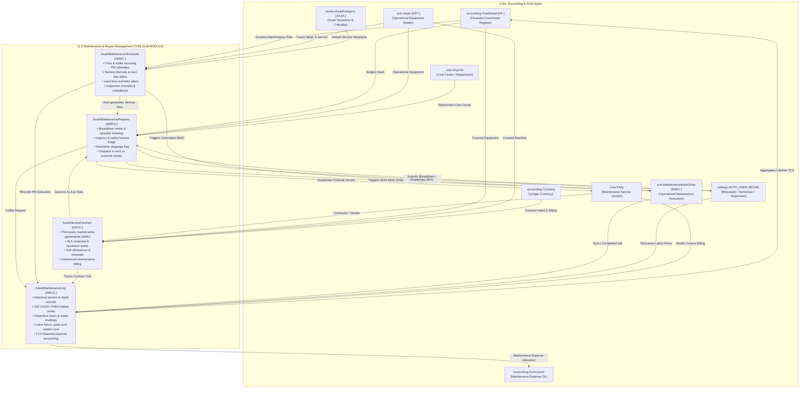

# Research — Sub-module 11.5: Maintenance & Repair Management (Module 11 — Asset Management System, `assets`)

- **Sub-module:** 11.5 Maintenance & Repair Management
- **Module:** 11 Asset Management System
- **Target app:** `apps/assets` (package target: `apps/assets/models/AssetMaintenance/`)
- **Research date:** 2026-11-09
- **Phase:** Phase 1 Research Catalog
- **Output file target:** `.claude/tasks/research-assets-11.5.md`

---

## 1. Executive Summary & Domain Architecture

Sub-module 11.5 delivers the **Maintenance & Repair Management** capability for NavERP's **Asset Management System (`apps/assets`)**. Operating in tight coordination with the financial fixed asset register (`accounting.FixedAsset` [FA-]), the general ledger (`accounting.GLAccount`, `accounting.JournalEntry`), the operational asset master spine (`scm.Asset` [AST-]), the SCM maintenance execution engine (`scm.MaintenanceWorkOrder` [MWO-]), and external service vendors (`core.Party`), Sub-module 11.5 bridges operational equipment reliability with enterprise asset governance, vendor contract management, and total cost of ownership (TCO) financial accounting.

In modern Enterprise Asset Management (EAM) and Computerized Maintenance Management Systems (CMMS), physical equipment (manufacturing lines, plant machinery, mobile fleet, HVAC systems, electrical infrastructure, IT hardware) requires end-to-end lifecycle maintenance stewardship across five interconnected operational pillars:
1. **Preventive Maintenance (PM) Scheduling & Service Calendars:**
   Transitioning maintenance from reactive firefighting to proactive reliability. PM schedules establish recurring service obligations driven by time intervals (calendar days, weeks, months), meter milestones (operating run hours, mileage, cycle counts), or condition parameters. Service calendars project future maintenance windows with advance lead-time reminders, preventive task checklists, and mandatory compliance controls.
2. **Maintenance Request Intake & Breakdown Dispatch:**
   Providing a streamlined, permission-friendly intake gateway where machine operators, custodians, department employees, or shift supervisors report equipment anomalies, safety hazards, or sudden breakdown stoppages. Incoming requests are screened, triaged by urgency/priority, and systematically dispatched to internal technicians or external maintenance service contractors.
3. **Spare Parts & Inventory Consumption Control:**
   Controlling maintenance bills of materials (BOM), spare parts wear-and-tear tracking, and maintenance material expense allocation. When repairs occur, parts consumption is captured and costed directly to the asset's historical maintenance ledger.
4. **Maintenance History & Execution Logs (TCO & Service Records):**
   Capturing an authoritative, audit-ready service ledger for every asset: root-cause failure codes (ISO 14224 / FMEA failure modes), actual downtime minutes, technician labor hours, parts consumed, and vendor invoice costs. This historical service log feeds asset reliability metrics and enables finance to capture the full Total Cost of Ownership (TCO).
5. **Vendor & Service Contract Maintenance (AMC / SLA Management):**
   Governing outsourced maintenance agreements, annual maintenance contracts (AMC), OEM warranty extensions, and third-party Service Level Agreements (SLAs). The system monitors vendor response times, resolution guarantees, included maintenance visits, contract expiration dates, and outsourced service expenditures.

---

### Architectural Data Flow & Spine Integration



---

## 2. Repo State Checked First

### 2.1 Existing Module Status & Rollover
- **Module 10 (Business Intelligence - `apps/bi`):** 100% complete (10.1 through 10.19 built, tested, green).
- **Module 11 (Asset Management System - `apps/assets`):**
  - **11.1 Asset Procurement & Acquisition (`apps/assets/models/AssetProcurement/`):** Complete with `AssetRequisition` [AREQ-], `AssetAcquisitionReceipt` [ARCV-], `AssetCapitalization` [ACAP-], `AssetTag` [ATAG-].
  - **11.2 Asset Inventory & Tracking (`apps/assets/models/AssetInventoryTracking/`):** Complete with `AssetAudit` [AAUD-], `AssetMovementLog` [AMOV-], `AssetCustodyLog` [ACHK-], `AssetIncidentReport` [AINC-].
  - **11.3 Asset Classification & Categorization (`apps/assets/models/AssetClassification/`):** Complete with `AssetCategory` [ACAT-], `AssetModel` [AMOD-], `AssetCriticalityAssessment` [ACRT-], `AssetSpecificationTemplate` [ASPC-].
  - **11.4 Depreciation & Financial Management (`apps/assets/models/AssetDepreciation/`):** Complete with `CapitalizationPolicy` [ACTH-], `AssetDepreciationSchedule` [ADEP-], `AssetRevaluation` [AREV-], `AssetTransfer` [AXFR-].
  - **Sub-module 11.5 (Maintenance & Repair Management):** Target unbuilt sub-module. Package folder target is `apps/assets/models/AssetMaintenance/`.

### 2.2 Sibling Navigation Links (`LIVE_LINKS` Evidence)
Verified in `apps/core/navigation.py`:
- `"11.1"`: `Purchase Requisition & Approval`, `Vendor Selection & RFQ`, `Purchase Order & Receipt`, `Asset Capitalization & Depreciation Setup`, `Asset Tagging & Registration`.
- `"11.2"`: `Asset Register & Master Data`, `Physical Verification & Audits`, `Location & Movement Tracking`, `Check-in/Check-out Management`, `Lost, Stolen & Missing Asset Handling`.
- `"11.3"`: `Asset Hierarchy & Taxonomy`, `Asset Type & Model Management`, `Criticality & Risk Classification`, `Asset Lifecycle Stage Tracking`, `Custom Attributes & Specifications`.
- `"11.4"`: `Depreciation Schedule & Methods`, `Asset Valuation & Revaluation`, `Asset Transfer & Cost Allocation`, `Capital vs. Expense Determination`, `Fixed Asset Reporting & Compliance`.
- `"11.5"`: Not yet registered; to be added upon completion of Phase 3 Integration.

### 2.3 Spine Entities Verified to Exist (grep evidence)
Verified classes in repo:
- **`apps/accounting`:**
  - `accounting.FixedAsset` [FA-] (`apps/accounting/models/FixedAssets/FixedAssetsRegister.py:6`): Financial fixed asset register.
  - `accounting.GLAccount` (`apps/accounting/models/GeneralLedger/GLAccounts.py:5`): Financial chart of accounts for maintenance expense routing.
  - `accounting.JournalEntry` [JE-] (`apps/accounting/models/GeneralLedger/JournalEntries.py:5`): Authoritative financial journal entry header.
  - `accounting.Currency` (`apps/accounting/models/GeneralLedger/Currencies.py:6`): Currency master for maintenance contracts and vendor billing.
- **`apps/scm`:**
  - `scm.Asset` [AST-] (`apps/scm/models/AssetManagement/Assets.py:50`): Operational equipment master with tag code, serial number, and runtime meters.
  - `scm.AssetSparePart` (`apps/scm/models/AssetManagement/Assets.py:676`): Equipment spare parts BOM relationships.
  - `scm.MaintenancePlan` [PM-] (`apps/scm/models/AssetManagement/MaintenancePlans.py:70`): Plant equipment PM plans.
  - `scm.MaintenanceWorkOrder` [MWO-] (`apps/scm/models/AssetManagement/MaintenanceWorkOrders.py:81`): Operational maintenance execution order.
  - `scm.Location` (`apps/scm/models/InventoryManagement/Locations.py:14`): Physical warehouse, maintenance shop, and plant locations.
- **`apps/core`:**
  - `core.OrgUnit` (`apps/core/models/OrgUnit.py:5`): Corporate departments, plants, maintenance workshops, and cost centers.
  - `core.Party` (`apps/core/models/Party.py:5`): Maintenance service vendors, OEM contractors, external appraisal/inspection entities.
- **`apps/assets`:**
  - `assets.AssetCategory` [ACAT-] (`apps/assets/models/AssetClassification/AssetCategories.py:7`): Asset taxonomy categories.
  - `assets.AssetCriticalityAssessment` [ACRT-] (`apps/assets/models/AssetClassification/AssetCriticalityAssessments.py:9`): Risk and criticality rankings.

### 2.4 Prefix Collision Audit
Repository-wide regex audit executed across `apps/` for candidate prefixes:
- `AREQ`: **Already used** by `apps/assets/models/AssetProcurement/AssetRequisitions.py` (Rule L30: No prefix collisions!).
- `AMRQ`: **0 matches** across `apps/` (Completely clear for `AssetMaintenanceRequest`).
- `AMSC`: **0 matches** across `apps/` (Completely clear for `AssetMaintenanceSchedule`).
- `ASVC`: **0 matches** across `apps/` (Completely clear for `AssetServiceContract`).
- `AMLG`: **0 matches** across `apps/` (Completely clear for `AssetMaintenanceLog`).

All 4 selected candidate prefixes (`AMRQ`, `AMSC`, `ASVC`, `AMLG`) are strictly 4-letter uppercase, start with 'A', and are 100% collision-free.

---

## 3. Commercial Leaders Surveyed

We analyzed 9 commercial market leaders specializing in enterprise asset management (EAM), computerized maintenance management systems (CMMS), service agreements, and industrial plant maintenance:

### 3.1 IBM Maximo Application Suite (Maximo Manage / EAM)
- **Positioning:** The global enterprise gold standard for asset lifecycle management, work order dispatch, and preventive maintenance.
- **Source Link:** https://www.ibm.com/products/maximo
- **Key Capabilities Analyzed:**
  - **Service Requests:** Self-service request intake portal allowing any enterprise employee to submit an issue ticket against an asset or location, which supervisors review, prioritize, and convert into formal Work Orders.
  - **Preventive Maintenance (PM):** Generates work orders based on calendar schedules (elapsed days/months), asset meter readings (hours/cycles), or condition triggers. Supports floating vs. fixed scheduling baselines.
  - **Service Contracts:** Comprehensive contract management module managing warranties, labor rate agreements, master service agreements (MSAs), and SLA response times for third-party service providers.
  - **Failure Hierarchy & Asset History:** Classifies repairs using structured failure codes (Problem, Cause, Remedy - PCR), tracking technician labor hours, parts consumed, and total repair expenses against the asset's permanent history card.

### 3.2 SAP S/4HANA Asset Management (formerly SAP PM / Plant Maintenance)
- **Positioning:** Tier-1 ERP industrial maintenance engine managing technical objects, maintenance notifications, and cost settlement.
- **Source Link:** https://www.sap.com/products/erp/s4hana/asset-management.html
- **Key Capabilities Analyzed:**
  - **Maintenance Requests & Notifications:** Fiori-based "Create Maintenance Request" allowing end-users to report anomalies, breakdown downtime, and safety risks. Planners screen, approve, and convert notifications into Maintenance Orders.
  - **Maintenance Plans:** Time-based, performance/counter-based, and multi-strategy maintenance calendars automatically scheduling maintenance calls and inspection tasks.
  - **Service Contract Integration:** Connects technical objects to Service Contract Management in SAP S/4HANA Service, validating warranty entitlements, labor coverage, parts inclusion, and vendor SLAs.
  - **Technical Completion & Cost Settlement:** Logs breakdown downtime duration, actual labor hours, spare parts issued, and settles maintenance expenses directly into general ledger cost centers (`CO-OM`).

### 3.3 Hexagon EAM (formerly Infor EAM / HxGN EAM)
- **Positioning:** Leading enterprise asset and reliability platform for manufacturing, facilities, energy, and transportation.
- **Source Link:** https://hexagon.com/products/hexagon-eam
- **Key Capabilities Analyzed:**
  - **Work Requests:** Web and mobile portal for rapid request submission with photo attachments, urgency ratings, and automated routing rules based on asset department and equipment type.
  - **PM Schedules & Task Patterns:** Multi-frequency recurring schedules, meter-driven triggers, seasonal maintenance patterns, and compliance checklists.
  - **Contract & SLA Management:** Administers external contractor agreements, tracking vendor service response SLAs, warranty validation, and outsourced billing against purchase orders.
  - **Failure Analysis & Equipment History:** Captures failure codes, downtime logging, parts consumption, technician notes, and historical repair costs for reliability analysis.

### 3.4 Limble CMMS
- **Positioning:** Highly rated, intuitive cloud and mobile CMMS focused on work request portals, PM automation, and parts tracking.
- **Source Link:** https://limblecmms.com/
- **Key Capabilities Analyzed:**
  - **Digital Work Request Portal:** QR-code enabled ticketing system allowing non-licensed operators to submit maintenance issues with priority, symptoms, and voice/photo attachments.
  - **PM Scheduling Automation:** Calendar-based and meter-based preventive maintenance scheduling with automated reminders and completion rate tracking.
  - **Spare Parts & Inventory Control:** Real-time parts consumption logging on repair tasks, linking parts directly to preferred suppliers and tracking minimum reorder thresholds.
  - **Vendor Management:** Tracks external service providers, contractor work orders, and third-party service expenditures.

### 3.5 MaintainX
- **Positioning:** Modern mobile-first front-line workflow and CMMS software for maintenance, safety, and operations.
- **Source Link:** https://www.getmaintainx.com/
- **Key Capabilities Analyzed:**
  - **Work Request & Dispatch:** Real-time request intake, technician direct dispatch, priority tagging, and mobile chat collaboration.
  - **Preventive Maintenance Checklists:** Standardized recurring inspection checklists with mandatory photo verification, e-signatures, and calendar recurrence rules.
  - **Vendor Work Order History:** Coordinates external contractors, tracks vendor responsiveness, and maintains vendor-specific repair logs.
  - **Asset Maintenance Profiles:** Complete digital audit trail of past repairs, parts used, labor hours logged, and failure patterns per asset.

### 3.6 Fiix CMMS by Rockwell Automation
- **Positioning:** Cloud-based, AI-powered computerized maintenance management system optimizing industrial asset reliability.
- **Source Link:** https://www.fiixsoftware.com/
- **Key Capabilities Analyzed:**
  - **Work Order & Request Management:** Centralized dashboard for triaging breakdown tickets, dispatching technicians, and scheduling emergency repairs.
  - **Nested PM Scheduling:** Multi-tier preventive maintenance schedules (e.g., 30-day inspection nested inside a 90-day comprehensive overhaul) triggered by time or meter counters.
  - **Service Contract Tracking:** Tracks vendor agreements, service warranties, contractor hourly rates, and outsourced job costs.
  - **Parts Consumption & MRO:** Tracks spare parts consumed per work order, updating asset repair costs and equipment maintenance history.

### 3.7 UpKeep Maintenance Management
- **Positioning:** Asset operations management platform combining CMMS, enterprise asset tracking, and team collaboration.
- **Source Link:** https://www.upkeep.com/
- **Key Capabilities Analyzed:**
  - **Request Intake Portal:** Web, mobile, and QR code request intake with custom forms, priority levels, and manager approval queues.
  - **Preventative Maintenance Schedules:** Automated calendar recurrence (days/weeks/months) and meter triggers generating recurring maintenance jobs.
  - **Third-Party Vendor Tracking:** Assigns work orders to outside contractors, tracking external labor costs, invoice numbers, and SLA compliance.
  - **Downtime & Repair Logs:** Logs asset downtime, technician wrench time, parts replaced, and maintenance cost rollups.

### 3.8 IFS Ultimo EAM
- **Positioning:** Comprehensive European and global EAM platform renowned for maintenance management, safety, and contract administration.
- **Source Link:** https://www.ultimo.com/
- **Key Capabilities Analyzed:**
  - **Maintenance Requests & Triage:** Multi-channel request logging with automated severity triage and workflow dispatching.
  - **Contract Management & SLAs:** Manages supplier maintenance contracts (AMC), OEM warranties, SLA response and resolution deadlines, and preventive maintenance visit quotas.
  - **Periodic Maintenance Plans:** Calendar, counter, and event-driven maintenance plans with standard task templates.
  - **Cost Settlement & Failure History:** Detailed maintenance cost allocation (internal labor, external vendor services, spare parts) and root cause failure analysis.

### 3.9 Tractian AI CMMS
- **Positioning:** AI-driven CMMS and condition monitoring platform bridging predictive telemetry with automated work order dispatch.
- **Source Link:** https://tractian.com/
- **Key Capabilities Analyzed:**
  - **Anomaly-Triggered Work Orders:** Automatically creates maintenance tickets when vibration or thermal sensor thresholds are breached.
  - **PM Compliance & Schedule Adherence:** Tracks planned vs. unplanned maintenance ratios and preventive schedule compliance.
  - **Failure Event Analysis:** Links repair history to specific machine failure modes, tracking post-repair verification and asset downtime.

---

## 4. Feature Catalog (Sub-module 11.5 Only)

The feature catalog is organized directly under the 5 bolded feature bullets of `NavERP.md` (lines 1757-1763):

### 4.1 Preventive Maintenance (PM) Scheduling
- **Time-Based Recurring Service Calendars** — Configures recurring maintenance intervals (every N days, weeks, months, or years) with automatic projection of `next_due_date` and advance lead-time notifications. · seen in: *IBM Maximo, SAP, Hexagon EAM, Limble, MaintainX, Fiix, UpKeep, Ultimo* · priority: `table-stakes` · spine: new table `AssetMaintenanceSchedule`, reuses `accounting.FixedAsset`, `scm.Asset` · `buildable now`.
- **Meter-Based Service Triggers** — Establishes maintenance triggers calibrated to equipment run hours, odometer mileage, or production cycles (e.g. oil change every 500 operating hours), comparing against `scm.Asset.meter_reading`. · seen in: *Maximo, SAP, Hexagon EAM, Fiix, UpKeep, Limble* · priority: `table-stakes` · spine: `AssetMaintenanceSchedule`, reuses `scm.Asset` · `buildable now`.
- **Condition-Based & Seasonal Maintenance Windows** — Supports condition-triggered maintenance schedules and seasonal shutdown servicing rules (e.g., pre-winter boiler servicing, annual plant shutdown overhauls). · seen in: *SAP, Maximo, Hexagon EAM, Tractian* · priority: `common` · spine: `AssetMaintenanceSchedule` · `buildable now`.
- **Standard Service Task Checklists** — Embeds standardized step-by-step inspection protocols, safety procedures (LOTO - Lockout/Tagout), and compliance sign-offs directly inside the maintenance schedule definition. · seen in: *MaintainX, Limble, Fiix, UpKeep* · priority: `table-stakes` · spine: `AssetMaintenanceSchedule` · `buildable now`.
- **PM Compliance & Overdue Status Tracking** — Monitors schedule adherence, classifying schedules as `Active`, `Due Soon`, `Overdue`, or `Paused`, ensuring statutory safety inspections are not missed. · seen in: *Tractian, Fiix, Limble, Maximo* · priority: `table-stakes` · spine: `AssetMaintenanceSchedule` · `buildable now`.

### 4.2 Work Order Creation & Dispatch
- **Self-Service Maintenance Request Intake** — Employee and custodian portal for reporting machine faults, leaks, strange vibrations, or physical damage with urgency rating and photo evidence. · seen in: *SAP (Notifications), Maximo, Limble, UpKeep, MaintainX, Ultimo* · priority: `table-stakes` · spine: new table `AssetMaintenanceRequest`, reuses `accounting.FixedAsset`, `scm.Asset`, `settings.AUTH_USER_MODEL` · `buildable now`.
- **Breakdown Downtime Stoppage Flag** — Explicit boolean indicator identifying critical breakdowns where an asset is non-operational, halting production and requiring emergency dispatch. · seen in: *SAP, Hexagon EAM, MaintainX, Fiix* · priority: `table-stakes` · spine: `AssetMaintenanceRequest` · `buildable now`.
- **Supervisor Screening & Triage Workflow** — Structured workflow for maintenance managers to review, validate, approve, reprioritize, or reject incoming requests. · seen in: *SAP, Maximo, Hexagon EAM, UpKeep, Limble* · priority: `table-stakes` · spine: `AssetMaintenanceRequest` · `buildable now`.
- **Technician & Vendor Dispatching** — Dispatches triaged requests either to an internal certified technician (`settings.AUTH_USER_MODEL`) or to an approved external maintenance contractor (`core.Party`), with optional link to `scm.MaintenanceWorkOrder`. · seen in: *Maximo, Hexagon EAM, MaintainX, UpKeep* · priority: `table-stakes` · spine: `AssetMaintenanceRequest`, reuses `core.Party`, `scm.MaintenanceWorkOrder` · `buildable now`.

### 4.3 Spare Parts & Inventory Control
- **Spare Parts BOM Association** — Links operational equipment to required replacement components, referencing `scm.AssetSparePart` and catalog parts. · seen in: *Maximo, SAP, Hexagon EAM, Fiix, Limble* · priority: `table-stakes` · spine: reuses `scm.AssetSparePart`, references `AssetMaintenanceLog` · `buildable now`.
- **Parts Consumption Tracking per Service Job** — Captures the itemized list, quantity, and cost of spare parts and consumables used during maintenance execution. · seen in: *Limble, Fiix, MaintainX, UpKeep, SAP, Maximo* · priority: `table-stakes` · spine: captured in `AssetMaintenanceLog` · `buildable now`.
- **Parts Cost Accumulation into Asset Repair Cost** — Automatically aggregates replacement parts expenses into the total job repair cost and updates the asset's cumulative maintenance expenditure. · seen in: *SAP, Maximo, Hexagon EAM, Fiix, UpKeep* · priority: `table-stakes` · spine: `AssetMaintenanceLog`, updates `accounting.FixedAsset` · `buildable now`.
- **Reorder Point Alerts (Inventory Warehouse Seam)** — Triggers reorder point notifications when parts stock falls below safety levels (seam to Module 5 Inventory / SCM 4.4 Warehouse Management). · seen in: *Limble, Fiix, SAP, Maximo* · priority: `common` · spine: delegated to Module 5 / SCM 4.13 · `integration/later`.

### 4.4 Maintenance History & Logs
- **Comprehensive Asset Service Ledger** — Immutable historical audit trail of all completed maintenance, inspections, repairs, and overhauls across an asset's multi-decade lifecycle. · seen in: *IBM Maximo, SAP, Hexagon EAM, MaintainX, Fiix, UpKeep, Ultimo* · priority: `table-stakes` · spine: new table `AssetMaintenanceLog`, reuses `accounting.FixedAsset`, `scm.Asset` · `buildable now`.
- **Failure Code Taxonomy (ISO 14224 / FMEA)** — Standardized failure classification (Mechanical Wear, Electrical Short, Hydraulic Leak, Software/Sensor Fault, Thermal Overload, Operator Error, Structural Corrosion) to facilitate root-cause analysis. · seen in: *IBM Maximo, SAP, Hexagon EAM, Tractian, Fiix* · priority: `common` · spine: `AssetMaintenanceLog` · `buildable now`.
- **Downtime Duration & Meter Recording** — Captures actual equipment downtime hours and machine meter readings at the time of repair, enabling MTBF (Mean Time Between Failures) and MTTR (Mean Time To Repair) analytics in 11.6. · seen in: *Maximo, SAP, Tractian, UpKeep, MaintainX* · priority: `table-stakes` · spine: `AssetMaintenanceLog` · `buildable now`.
- **Labor Hours & Multi-Cost Accounting Breakdown** — Itemizes technician wrench time (hours and labor rate), spare parts cost, external vendor invoice cost, and total job cost, with posting into general ledger maintenance expense accounts (`accounting.GLAccount`). · seen in: *SAP, Maximo, Hexagon EAM, Ultimo* · priority: `table-stakes` · spine: `AssetMaintenanceLog`, reuses `accounting.GLAccount` · `buildable now`.

### 4.5 Vendor & Contract Maintenance
- **Third-Party Service Agreement & AMC Management** — Formalizes annual maintenance contracts (AMC), OEM warranty extensions, and master service agreements with specialized equipment contractors. · seen in: *IFS Ultimo, IBM Maximo, Hexagon EAM, SAP, Fiix* · priority: `table-stakes` · spine: new table `AssetServiceContract`, reuses `core.Party`, `accounting.FixedAsset`, `scm.Asset` · `buildable now`.
- **SLA Response & Resolution Tracking** — Encapsulates contractual Service Level Agreements (e.g. 4-hour on-site response guarantee, 24-hour breakdown resolution window) with breach monitoring. · seen in: *IFS Ultimo, IBM Maximo, Hexagon EAM* · priority: `common` · spine: `AssetServiceContract` · `buildable now`.
- **Preventive Maintenance Visit Quotas** — Tracks contracted routine inspection visits (e.g., 4 quarterly HVAC visits included per contract year) and counts visits consumed against the quota. · seen in: *IFS Ultimo, Maximo, Hexagon EAM* · priority: `common` · spine: `AssetServiceContract` · `buildable now`.
- **Contract Expiration & Renewal Governance** — Monitors contract validity dates, providing advance alerts for upcoming contract expirations (e.g. 30/60 days prior) and auto-renewal terms. · seen in: *IFS Ultimo, Maximo, Hexagon EAM, Fiix* · priority: `table-stakes` · spine: `AssetServiceContract` · `buildable now`.
- **Outsourced Maintenance Cost & Billing Terms** — Manages contract values, payment currencies, and billing cadence (monthly, quarterly, annual, per-visit) for vendor reconciliation. · seen in: *SAP, Maximo, Ultimo* · priority: `table-stakes` · spine: `AssetServiceContract`, reuses `accounting.Currency` · `buildable now`.

---

## 5. Recommended Build Scope (This Pass — 4 Models)

To fulfill the 5 NavERP.md feature bullets without architectural redundancy or second-ledger violations (L29), we recommend exactly **4 tenant-scoped models** organized under package `apps/assets/models/AssetMaintenance/`:

```
apps/assets/models/AssetMaintenance/
├── __init__.py
├── AssetMaintenanceRequests.py     # [AMRQ-] Maintenance request intake & breakdown dispatch
├── AssetMaintenanceSchedules.py    # [AMSC-] Preventive maintenance service calendars
├── AssetServiceContracts.py        # [ASVC-] Third-party maintenance contracts & SLAs
└── AssetMaintenanceLogs.py         # [AMLG-] Historical service ledger, failure codes & repair costs
```

---

### Model 1: `AssetMaintenanceRequest` [AMRQ-]
- **Purpose:** Manages incoming maintenance issue tickets, breakdown notifications, and operator request intake, triaging by priority and dispatching to internal technicians or external service vendors.
- **Prefix:** `AMRQ` (verified collision-free)
- **Key Fields & Choices:**
  - `title` — CharField(255) (e.g., "Main Hydraulic Pump Pressure Drop", "CNC Spindle High Vibration")
  - `fixed_asset` — FK to `accounting.FixedAsset` (financial asset record, null=True, blank=True)
  - `operational_asset` — FK to `scm.Asset` (physical equipment master, null=True, blank=True; at least one asset link required)
  - `requester` — FK to `settings.AUTH_USER_MODEL` (employee/operator reporting the issue)
  - `department` — FK to `core.OrgUnit` (null=True, blank=True, requesting department/cost center)
  - `request_type` — CharField (`breakdown_repair`, `preventive_inspection`, `safety_hazard`, `calibration`, `facility_upkeep`)
  - `urgency` — CharField (`low`, `medium`, `high`, `critical`)
  - `is_breakdown` — BooleanField(default=False) (True if machine has suffered complete stoppage/downtime)
  - `downtime_started_at` — DateTimeField(null=True, blank=True) (timestamp of stoppage)
  - `symptom_description` — TextField (detailed explanation of observed failure/defect)
  - `triage_notes` — TextField(blank=True) (supervisor assessment notes)
  - `assigned_technician` — FK to `settings.AUTH_USER_MODEL` (null=True, blank=True, internal assignee)
  - `assigned_vendor` — FK to `core.Party` (null=True, blank=True, external service contractor)
  - `service_contract` — FK to `AssetServiceContract` (null=True, blank=True, if covered under active AMC)
  - `dispatched_work_order` — FK to `scm.MaintenanceWorkOrder` (null=True, blank=True, linked SCM work order)
  - `status` — CharField (`submitted`, `triaged`, `assigned`, `in_progress`, `resolved`, `rejected`, `closed`)
  - `resolution_summary` — TextField(blank=True)
  - `resolved_at` — DateTimeField(null=True, blank=True)
  - `resolved_by` — FK to `settings.AUTH_USER_MODEL` (null=True, blank=True)
- **Status Badges (color-named only):**
  - `submitted`: `badge-info`
  - `triaged`: `badge-slate`
  - `assigned`: `badge-amber`
  - `in_progress`: `badge-amber`
  - `resolved`: `badge-green`
  - `rejected`: `badge-red`
  - `closed`: `badge-muted`
- **Actions:** `triage`, `dispatch`, `resolve`, `close`, `reject`.
- **Justified by:** Bullet 2 (Work Order Creation & Dispatch — breakdown reports, request intake, technician assignment).

---

### Model 2: `AssetMaintenanceSchedule` [AMSC-]
- **Purpose:** Defines recurring preventive maintenance service calendars, interval rules (time, meter, condition), checklists, and automated service reminders across the enterprise asset fleet.
- **Prefix:** `AMSC` (verified collision-free)
- **Key Fields & Choices:**
  - `name` — CharField(255) (e.g., "500-Hour Hydraulic Fluid & Filter Change", "Quarterly HVAC Chiller Inspection")
  - `fixed_asset` — FK to `accounting.FixedAsset` (null=True, blank=True)
  - `operational_asset` — FK to `scm.Asset` (null=True, blank=True; at least one asset link required)
  - `asset_category` — FK to `assets.AssetCategory` (null=True, blank=True, taxonomy class template link)
  - `schedule_type` — CharField (`time_based`, `meter_based`, `condition_based`, `seasonal_shutdown`)
  - `frequency_interval` — PositiveIntegerField(default=30) (e.g. 30, 90, 365, 500)
  - `frequency_unit` — CharField (`days`, `weeks`, `months`, `years`, `runtime_hours`, `cycles_count`)
  - `meter_trigger_threshold` — DecimalField(16, 2, null=True, blank=True) (meter increment or target reading)
  - `lead_time_days` — PositiveIntegerField(default=7) (advance days to generate reminder/request)
  - `last_service_date` — DateField(null=True, blank=True)
  - `last_service_meter` — DecimalField(16, 2, null=True, blank=True)
  - `next_due_date` — DateField(null=True, blank=True)
  - `next_due_meter` — DecimalField(16, 2, null=True, blank=True)
  - `assigned_technician` — FK to `settings.AUTH_USER_MODEL` (null=True, blank=True, default lead technician)
  - `preferred_vendor` — FK to `core.Party` (null=True, blank=True, service contractor)
  - `service_contract` — FK to `AssetServiceContract` (null=True, blank=True, governing service agreement)
  - `service_checklist` — TextField(blank=True) (standard step-by-step procedure and safety guidelines)
  - `is_mandatory` — BooleanField(default=True) (statutory/compliance required)
  - `is_active` — BooleanField(default=True)
  - `status` — CharField (`active`, `overdue`, `paused`, `completed`, `retired`)
  - `notes` — TextField(blank=True)
- **Status Badges (color-named only):**
  - `active`: `badge-green`
  - `overdue`: `badge-red`
  - `paused`: `badge-amber`
  - `completed`: `badge-info`
  - `retired`: `badge-muted`
- **Actions:** `activate`, `pause`, `generate_request`, `record_completion` (rolls over `last_service` and recalculates `next_due`).
- **Justified by:** Bullet 1 (Preventive Maintenance Scheduling — time-based, meter-based, and condition-based calendars).

---

### Model 3: `AssetServiceContract` [ASVC-]
- **Purpose:** Governs third-party vendor maintenance agreements, annual maintenance contracts (AMC), OEM warranty extensions, SLA performance guarantees, and outsourced maintenance visit quotas.
- **Prefix:** `ASVC` (verified collision-free)
- **Key Fields & Choices:**
  - `contract_number` — CharField(100, unique=True) (vendor external reference or internal contract identifier)
  - `title` — CharField(255) (e.g., "Siemens Medical Imaging Comprehensive AMC", "Otis Elevator Full Maintenance Agreement")
  - `vendor` — FK to `core.Party` (service contractor / OEM provider)
  - `fixed_asset` — FK to `accounting.FixedAsset` (null=True, blank=True)
  - `operational_asset` — FK to `scm.Asset` (null=True, blank=True; null allowed if contract covers multiple assets)
  - `contract_type` — CharField (`comprehensive_amc`, `labor_only`, `parts_and_labor`, `on_call_support`, `oem_warranty_extension`)
  - `start_date` — DateField
  - `end_date` — DateField
  - `contract_value` — DecimalField(16, 2, default=0.00) (total annual/contract fee)
  - `currency` — FK to `accounting.Currency` (null=True, blank=True)
  - `billing_frequency` — CharField (`monthly`, `quarterly`, `semi_annual`, `annual`, `per_visit`)
  - `sla_response_hours` — PositiveIntegerField(default=4) (maximum guaranteed emergency response hours)
  - `sla_resolution_hours` — PositiveIntegerField(default=24) (target breakdown resolution hours)
  - `pm_visits_included` — PositiveIntegerField(default=4) (contracted scheduled visits per year)
  - `pm_visits_completed` — PositiveIntegerField(default=0) (tally of executed visits)
  - `coverage_terms` — TextField(blank=True) (scope of covered components, inclusions, and exclusions)
  - `auto_renew` — BooleanField(default=False)
  - `status` — CharField (`draft`, `active`, `expiring_soon`, `expired`, `terminated`)
  - `contact_person` — CharField(150, blank=True)
  - `contact_phone` — CharField(50, blank=True)
  - `contact_email` — EmailField(blank=True)
  - `notes` — TextField(blank=True)
- **Status Badges (color-named only):**
  - `draft`: `badge-slate`
  - `active`: `badge-green`
  - `expiring_soon`: `badge-amber`
  - `expired`: `badge-red`
  - `terminated`: `badge-muted`
- **Actions:** `activate`, `record_visit`, `renew`, `terminate`.
- **Justified by:** Bullet 5 (Vendor & Contract Maintenance — third-party service agreements, SLA tracking, outsourced billing).

---

### Model 4: `AssetMaintenanceLog` [AMLG-]
- **Purpose:** Acts as the authoritative historical maintenance ledger, recording completed repairs, ISO 14224 / FMEA failure codes, breakdown downtime duration, labor wrench time, parts consumed, and financial repair costs.
- **Prefix:** `AMLG` (verified collision-free)
- **Key Fields & Choices:**
  - `fixed_asset` — FK to `accounting.FixedAsset` (financial asset record, null=True, blank=True)
  - `operational_asset` — FK to `scm.Asset` (physical equipment master, null=True, blank=True; at least one asset link required)
  - `maintenance_request` — FK to `AssetMaintenanceRequest` (null=True, blank=True, source request)
  - `maintenance_schedule` — FK to `AssetMaintenanceSchedule` (null=True, blank=True, source PM schedule)
  - `service_contract` — FK to `AssetServiceContract` (null=True, blank=True, governing vendor contract)
  - `work_order` — FK to `scm.MaintenanceWorkOrder` (null=True, blank=True, linked SCM work order)
  - `service_date` — DateField
  - `completion_date` — DateTimeField(null=True, blank=True)
  - `maintenance_type` — CharField (`corrective_repair`, `preventive_service`, `emergency_breakdown`, `calibration`, `inspection`, `overhaul`)
  - `failure_code` — CharField(32, choices: `mechanical_wear`, `electrical_short`, `hydraulic_leak`, `software_fault`, `operator_error`, `corrosion`, `thermal_overload`, `lubrication_failure`, `normal_wear`, `other`)
  - `downtime_hours` — DecimalField(8, 2, default=0.00) (total production stoppage hours)
  - `meter_reading` — DecimalField(16, 2, null=True, blank=True) (meter at time of service)
  - `lead_technician` — FK to `settings.AUTH_USER_MODEL` (null=True, blank=True)
  - `service_vendor` — FK to `core.Party` (null=True, blank=True, external contractor)
  - `labor_hours` — DecimalField(8, 2, default=0.00) (total labor hours spent)
  - `labor_cost` — DecimalField(16, 2, default=0.00) (internal technician cost allocation)
  - `parts_consumed_summary` — TextField(blank=True) (itemized spare parts and consumables used)
  - `parts_cost` — DecimalField(16, 2, default=0.00) (total spare parts value consumed)
  - `vendor_invoice_cost` — DecimalField(16, 2, default=0.00) (third-party billed invoice amount)
  - `total_cost` — DecimalField(16, 2, default=0.00) (calculated total: labor + parts + vendor)
  - `expense_account` — FK to `accounting.GLAccount` (null=True, blank=True, maintenance expense GL)
  - `root_cause_analysis` — TextField(blank=True) (engineering post-mortem findings)
  - `action_taken` — TextField (work performed, procedures executed, tests conducted)
  - `status` — CharField (`draft`, `in_review`, `approved`, `posted`)
  - `approved_by` — FK to `settings.AUTH_USER_MODEL` (null=True, blank=True)
  - `approved_at` — DateTimeField(null=True, blank=True)
- **Status Badges (color-named only):**
  - `draft`: `badge-slate`
  - `in_review`: `badge-amber`
  - `approved`: `badge-info`
  - `posted`: `badge-green`
- **Actions:** `submit_for_review`, `approve`, `post_to_financials`.
- **Justified by:** Bullets 3 & 4 (Maintenance History & Logs — service records, failure codes, labor hours, parts consumed, TCO repair expenses).

---

## 6. Belongs to Sibling Sub-modules (Parked, Not Scoped Here)

To maintain strict boundary discipline and prevent scope overlap:
- **Capital Expenditure Requisitions & Capitalization Buildup:** Handled in **11.1 Asset Procurement & Acquisition** (`AssetRequisition`, `AssetAcquisitionReceipt`, `AssetCapitalization`).
- **Physical Barcode / RFID Tagging & Wall-to-Wall Audits:** Handled in **11.2 Asset Inventory & Tracking** (`AssetAudit`, `AssetCustodyLog`, `AssetMovementLog`).
- **Asset Hierarchy, Taxonomy Trees & Criticality Scoring:** Handled in **11.3 Asset Classification & Categorization** (`AssetCategory`, `AssetModel`, `AssetCriticalityAssessment`).
- **Depreciation Schedules, Valuation Adjustments & Transfers:** Handled in **11.4 Depreciation & Financial Management** (`AssetDepreciationSchedule`, `AssetRevaluation`, `AssetTransfer`, `CapitalizationPolicy`).
- **Uptime/Downtime Analytics, MTBF, MTTR & OEE Productivity:** Belongs to **11.6 Asset Performance & Utilization** (calculates performance metrics from 11.5's `AssetMaintenanceLog` downtime data).
- **IoT Vibration Telemetry, Sensor Feeds & Real-Time Condition Monitoring:** Belongs to **11.7 Asset Reliability & Condition Monitoring**.
- **Equipment Warranties & Insurance Policy Claims:** Belongs to **11.8 Warranty & Insurance Management**.
- **Asset Decommissioning, Scrap Sales & Disposal Accounting:** Handled by existing **2.6 Fixed Assets** (`accounting.AssetDisposal`) and downstream **11.9 Asset Retirement & Disposal**.
- **Warehouse Bin Stock Replenishment & Physical Spare Parts Ledger:** Managed by **Module 5 (Inventory)** and **SCM 4.4 (WMS)**.

---

## 7. Deferred (Later Passes / Integrations)

- **IoT Telemetry Live Auto-Trigger:** Real-time MQTT/HTTP webhook integration converting continuous machine sensor readings directly into emergency maintenance requests deferred to 11.7 / IoT Hub.
- **Mobile QR Code Scan-to-Request PWA:** Dedicated progressive web application for floor operators scanning physical machine QR tags to file maintenance tickets deferred to mobile frontend release.
- **Automated Vendor AP Bill OCR Matching:** Optical character recognition (OCR) matching vendor maintenance invoices directly against `AssetServiceContract` and `AssetMaintenanceLog` deferred to AI Document Processing.
