# Research — Sub-module 11.6: Asset Performance & Utilization (Module 11 — Asset Management System, `assets`)

- **Sub-module:** 11.6 Asset Performance & Utilization
- **Module:** 11 Asset Management System
- **Target app:** `apps/assets` (package target: `apps/assets/models/AssetPerformance/`)
- **Research date:** 2026-11-09
- **Phase:** Phase 1 Research Catalog
- **Output file target:** `.claude/tasks/research-assets-11.6.md`

---

## 1. Executive Summary & Domain Architecture

Sub-module 11.6 delivers the **Asset Performance & Utilization** capability for NavERP's **Asset Management System (`apps/assets`)**. Operating in direct continuity with the physical and financial fixed asset registers (`accounting.FixedAsset` [FA-], `scm.Asset` [AST-]), the maintenance and repair execution engine (`assets.AssetMaintenanceLog` [AMLG-], `assets.AssetMaintenanceRequest` [AMRQ-], `scm.MaintenanceWorkOrder` [MWO-]), and corporate cost centers (`core.OrgUnit`), Sub-module 11.6 provides enterprise asset performance management (APM), overall equipment effectiveness (OEE), operational uptime/downtime accounting, utility energy tracking with greenhouse gas ($CO_2e$) carbon accounting, and multi-dimensional asset performance benchmarking.

In modern industrial facilities, manufacturing plants, utility grids, and capital-intensive enterprises, maximizing asset return on investment (ROI) requires continuous monitoring across five foundational pillars:
1. **Uptime & Downtime Tracking:**
   Capturing discrete equipment stoppage events with precision timestamps, duration calculations (minutes and hours), root-cause failure classifications, financial downtime hourly cost rates, and industry-standard reliability metrics: Availability %, Mean Time Between Failures (MTBF), and Mean Time To Repair (MTTR).
2. **OEE & Productivity Metrics:**
   Measuring Overall Equipment Effectiveness ($OEE = \text{Availability} \times \text{Performance} \times \text{Quality}$) across production runs, shifts, and machine cells. Decomposing production losses across the classic "Six Big Losses" (unplanned breakdowns, setup/changeovers, minor stops/idling, reduced speed, process defects/scrap, and startup reject losses).
3. **Utilization Rate Monitoring:**
   Tracking actual running operating hours vs. planned available capacity hours vs. total calendar hours. Pinpointing idle time bottlenecks (operator shortage, material starvation, waiting for tooling, cleaning) to unlock "hidden capacity" without requiring new capital expenditures.
4. **Energy Consumption Tracking:**
   Logging multi-utility consumption (electricity kWh, natural gas, diesel fuel, heavy oil, steam, industrial water) per asset, monitoring peak demand load (kW) and power factor ($\cos \phi$), calculating Specific Energy Consumption (SEC / energy intensity per operating hour or unit produced), and converting consumption into Scope 1 and Scope 2 Greenhouse Gas (GHG) carbon footprint emissions ($kg CO_2e$).
5. **Performance Benchmarking & KPIs:**
   Synthesizing longitudinal asset scorecards across evaluation periods (daily, monthly, quarterly). Computing a 0–100 weighted Asset Performance Index (API) composite score, assigning letter-grade performance tiers (World-Class Grade A, Strong Grade B, Needs Tuning Grade C, Critical Risk Grade D), ranking equipment against peers in the same asset category or department, and tracking performance trajectories.

---

### Architectural Data Flow & Spine Integration

```mermaid
flowchart TD
    subgraph SPINE["Core, Accounting, SCM & Assets Sibling Spine"]
        FA["accounting.FixedAsset [FA-]<br/>(Financial Fixed Asset Register)"]
        AST["scm.Asset [AST-]<br/>(Operational Machinery & Meter Spine)"]
        MWO["scm.MaintenanceWorkOrder [MWO-]<br/>(Maintenance Work Order)"]
        AMRQ["assets.AssetMaintenanceRequest [AMRQ-]<br/>(Operator Breakdown Tickets)"]
        AMLG["assets.AssetMaintenanceLog [AMLG-]<br/>(Historical Maintenance & Failure Codes)"]
        ACAT["assets.AssetCategory [ACAT-]<br/>(Asset Taxonomy & Criticality)"]
        AMOD["assets.AssetModel [AMOD-]<br/>(Manufacturer Model & Nominal Speed)"]
        ORG["core.OrgUnit<br/>(Plant / Workshop / Cost Center)"]
        PARTY["core.Party<br/>(Energy Utility / OEM Contractor)"]
        USER["settings.AUTH_USER_MODEL<br/>(Operator / Reliability Engineer)"]
    end

    subgraph SUB_11_6["11.6 Asset Performance & Utilization (THIS SUB-MODULE)"]
        ADWN["AssetDowntimeLog [ADWN-]<br/>• Stoppage start/end timestamps & duration<br/>• Planned vs unplanned stoppage category<br/>• ISO 14224 root cause & failure mode<br/>• Hourly downtime loss cost calculation<br/>• MTBF / MTTR event attribution"]

        AOEE["AssetOeeRecord [AOEE-]<br/>• Production run / shift OEE accounting<br/>• Availability %, Performance %, Quality %<br/>• Ideal cycle time & nominal speed<br/>• Total units, good units, scrap & rework<br/>• Six Big Losses breakdown minutes"]

        AENG["AssetEnergyReading [AENG-]<br/>• Multi-utility meter logging (kWh, gas, fuel, steam)<br/>• Peak electrical demand (kW) & power factor<br/>• Energy intensity / SEC (kWh/hr, kWh/unit)<br/>• Scope 1 / Scope 2 GHG carbon footprint (kg CO2e)<br/>• Energy tariff utility expense allocation"]

        APSC["AssetPerformanceScorecard [APSC-]<br/>• Periodic scorecard (Month/Quarter/Rolling)<br/>• Operating vs idle vs planned capacity hours<br/>• Capacity utilization % & asset intensity %<br/>• Composite Health / Performance Index (0-100)<br/>• Peer category ranking & benchmark grading (A-D)"]
    end

    %% Downtime Links
    FA -->|Financial Asset| ADWN
    AST -->|Operational Equipment| ADWN
    AMRQ -->|Originating Breakdown| ADWN
    AMLG -->|Maintenance Log Resolution| ADWN
    MWO -->|Corrective Work Order| ADWN
    USER -->|Logged By / Operator| ADWN

    %% OEE Links
    FA -->|Equipment Target| AOEE
    AST -->|Production Machine| AOEE
    AMOD -->|Rated Nominal Speed| AOEE
    ORG -->|Manufacturing Cell| AOEE
    USER -->|Shift Supervisor| AOEE

    %% Energy Links
    FA -->|Subject Asset| AENG
    AST -->|Metered Equipment| AENG
    PARTY -->|Utility Provider / Carrier| AENG
    ORG -->|Department Cost Center| AENG

    %% Performance Scorecard Rollup
    FA -->|Subject Asset| APSC
    AST -->|Operational Equipment| APSC
    ACAT -->|Peer Cohort Taxonomy| APSC
    ORG -->|Department Hierarchy| APSC
    ADWN -.->|Aggregates Outage Hours & Failures| APSC
    AOEE -.->|Aggregates Mean OEE %| APSC
    AENG -.->|Aggregates Total Energy & Carbon| APSC
```



---

## 2. Repo State Checked First

### 2.1 Existing Module Status & Rollover
- **Module 10 (Business Intelligence - `apps/bi`):** 100% complete (10.1 through 10.19 built, tested, and green).
- **Module 11 (Asset Management System - `apps/assets`):**
  - **11.1 Asset Procurement & Acquisition (`apps/assets/models/AssetProcurement/`):** Complete with `AssetRequisition` [AREQ-], `AssetAcquisitionReceipt` [ARCP-], `AssetCapitalization` [ACAP-], `AssetTag` [ATAG-].
  - **11.2 Asset Inventory & Tracking (`apps/assets/models/AssetInventoryTracking/`):** Complete with `AssetAudit` [AAUD-], `AssetMovementLog` [AMOV-], `AssetCustodyLog` [ACUS-], `AssetIncidentReport` [AINC-].
  - **11.3 Asset Classification & Categorization (`apps/assets/models/AssetClassification/`):** Complete with `AssetCategory` [ACAT-], `AssetModel` [AMOD-], `AssetCriticalityAssessment` [ACRA-], `AssetSpecificationTemplate` [ASPT-].
  - **11.4 Depreciation & Financial Management (`apps/assets/models/AssetDepreciation/`):** Complete with `CapitalizationPolicy` [ACAP-], `AssetDepreciationSchedule` [ADEP-], `AssetRevaluation` [AREV-], `AssetTransfer` [ATRF-].
  - **11.5 Maintenance & Repair Management (`apps/assets/models/AssetMaintenance/`):** Complete with `AssetMaintenanceSchedule` [AMSC-], `AssetMaintenanceRequest` [AMRQ-], `AssetMaintenanceLog` [AMLG-], `AssetServiceContract` [ASVC-].
  - **11.6 Asset Performance & Utilization (`apps/assets/models/AssetPerformance/`):** Target unbuilt sub-module. Package folder target is `apps/assets/models/AssetPerformance/`.

### 2.2 Sibling Navigation Links (`LIVE_LINKS` Evidence)
Verified directly in `apps/core/navigation.py`:
- `"11.1"`: `Purchase Requisition & Approval`, `Vendor Selection & RFQ`, `Purchase Order & Receipt`, `Asset Capitalization & Depreciation Setup`, `Asset Tagging & Registration`.
- `"11.2"`: `Asset Register & Master Data`, `Physical Verification & Audits`, `Location & Movement Tracking`, `Check-in/Check-out Management`, `Lost, Stolen & Missing Asset Handling`.
- `"11.3"`: `Asset Hierarchy & Taxonomy`, `Asset Type & Model Management`, `Criticality & Risk Classification`, `Asset Lifecycle Stage Tracking`, `Custom Attributes & Specifications`.
- `"11.4"`: `Depreciation Schedule & Methods`, `Asset Valuation & Revaluation`, `Asset Transfer & Cost Allocation`, `Capital vs. Expense Determination`, `Fixed Asset Reporting & Compliance`.
- `"11.5"`: `Preventive Maintenance (PM) Scheduling`, `Work Order Creation & Dispatch`, `Spare Parts & Inventory Control`, `Maintenance History & Logs`, `Vendor & Contract Maintenance`.
- `"11.6"`: Not yet registered; to be added upon completion of Phase 3 Integration.

### 2.3 Spine Entities Verified to Exist (grep and import evidence)
Verified classes in repository via Django environment import test:
- **`apps/accounting`:**
  - `accounting.FixedAsset` [FA-] (`apps/accounting/models/FixedAssets/FixedAssetsRegister.py`): Financial fixed asset register with useful life, acquisition cost, and depreciation parameters.
  - `accounting.GLAccount` (`apps/accounting/models/GeneralLedger/GLAccounts.py`): Financial chart of accounts for energy utility expenses and downtime losses.
  - `accounting.JournalEntry` [JE-] (`apps/accounting/models/GeneralLedger/JournalEntries.py`): General ledger journal headers.
  - `accounting.Currency` (`apps/accounting/models/GeneralLedger/Currencies.py`): Currency master for tariff and financial loss valuations.
- **`apps/scm`:**
  - `scm.Asset` [AST-] (`apps/scm/models/AssetManagement/Assets.py`): Operational equipment master with tag code, serial number, model number, specifications, and runtime meter fields (`meter_name`, `meter_unit`, `meter_reading`).
  - `scm.MaintenanceWorkOrder` [MWO-] (`apps/scm/models/AssetManagement/MaintenanceWorkOrders.py`): Operational work order execution engine.
- **`apps/core`:**
  - `core.OrgUnit` (`apps/core/models/OrgUnit.py`): Corporate departments, plants, manufacturing lines, workshops, and cost centers.
  - `core.Party` (`apps/core/models/Party.py`): Energy utility providers, service contractors, OEM vendors.
- **`apps/assets`:**
  - `assets.AssetCategory` [ACAT-] (`apps/assets/models/AssetClassification/AssetCategories.py`): Asset taxonomy categories for cohort benchmarking.
  - `assets.AssetModel` [AMOD-] (`apps/assets/models/AssetClassification/AssetModels.py`): Asset make/model master with manufacturer specifications and nominal rated speeds.
  - `assets.AssetCriticalityAssessment` [ACRA-] (`apps/assets/models/AssetClassification/AssetCriticalityAssessments.py`): Risk, safety, and business criticality ratings.
  - `assets.AssetMaintenanceRequest` [AMRQ-] (`apps/assets/models/AssetMaintenance/AssetMaintenanceRequests.py`): Originating operator breakdown tickets.
  - `assets.AssetMaintenanceSchedule` [AMSC-] (`apps/assets/models/AssetMaintenance/AssetMaintenanceSchedules.py`): Preventive maintenance calendar schedules.
  - `assets.AssetMaintenanceLog` [AMLG-] (`apps/assets/models/AssetMaintenance/AssetMaintenanceLogs.py`): Historical repair ledger, ISO 14224 failure codes, and downtime hours.

### 2.4 Prefix Collision Audit
Repository-wide search executed across all `apps/**/*.py` files for candidate prefixes:
- `ADWN`: **0 matches** across `apps/` (Completely clear for `AssetDowntimeLog`).
- `AOEE`: **0 matches** across `apps/` (Completely clear for `AssetOeeRecord`).
- `AENG`: **0 matches** across `apps/` (Completely clear for `AssetEnergyReading`).
- `APSC`: **0 matches** across `apps/` (Completely clear for `AssetPerformanceScorecard`).

All 4 selected candidate prefixes (`ADWN`, `AOEE`, `AENG`, `APSC`) are strictly 4-letter uppercase, start with 'A' (consistent with Module 11 `assets` convention), and are 100% collision-free.

---

## 3. Commercial Leaders Surveyed

We analyzed 9 commercial market leaders specializing in enterprise asset performance management (APM), industrial IoT machine monitoring, overall equipment effectiveness (OEE), power/energy monitoring, and reliability analytics:

### 3.1 GE Digital APM (formerly Meridium / Predix APM, now GE Vernova)
- **Positioning:** The industrial benchmark for asset performance management, reliability-centered maintenance, and power plant/heavy manufacturing APM.
- **Source Link:** https://www.gevernova.com/software/asset-performance-management
- **Key Capabilities Analyzed:**
  - **APM Reliability & Outage Tracking:** Systematic logging of equipment stoppages, tripping events, and forced outages. Provides automated calculation of Availability %, MTBF (Mean Time Between Failures), and MTTR (Mean Time To Repair).
  - **Downtime Root Cause Analysis (RCA):** Deep classification of failure modes, identifying chronic equipment stressors, separating mechanical breakdowns from human or supply disruptions.
  - **Operational Performance Intelligence & OEE:** Connects plant operating parameters with production targets, highlighting micro-stoppages, speed degradation, and thermal performance losses.
  - **Thermal Performance & Energy Efficiency:** Evaluates whether energy-intensive assets (turbines, boilers, compressors, large pumps) are burning excess fuel or drawing surplus electrical power relative to design baselines, quantifying GHG emissions and fuel waste.

### 3.2 IBM Maximo Application Suite (Maximo Health, Predict & Monitor / Maximo APM)
- **Positioning:** Enterprise APM suite combining IoT telemetry, AI condition monitoring, and asset health/reliability scorecards.
- **Source Link:** https://www.ibm.com/products/maximo
- **Key Capabilities Analyzed:**
  - **Asset Operational State Tracking:** Real-time logging of asset states ("Up" vs. "Down"), calculating accumulated outage hours against operational shift calendars.
  - **Reliability Engineering Metrics & MTBF Cards:** Native calculation cards showing rolling MTBF, MTTR, and failure frequency trends month-over-month.
  - **Composite Asset Health & Criticality Scoring:** Multi-factor health scoring (0–100 index) combining historical breakdown frequency, maintenance cost ratios, and operational telemetry.
  - **Energy & Degradation Correlation:** Correlates mechanical wear (bearing friction, electrical winding insulation degradation) with anomalous power draw, preventing catastrophic failure and reducing energy waste.

### 3.3 MachineMetrics
- **Positioning:** The industry-leading industrial IoT and machine monitoring platform purpose-built for real-time machine uptime, OEE, and capacity optimization.
- **Source Link:** https://www.machinemetrics.com/
- **Key Capabilities Analyzed:**
  - **Automated Machine State & Downtime Capture:** Directly captures machine states (Active, In-Cycle, Idle, Offline) with automated operator prompts to categorize root causes for stops > 5 minutes.
  - **Real-Time OEE Engine:** Real-time computation of OEE ($Availability \times Performance \times Quality$) per shift, job, and work center. Captures parts produced, scrap count, and ideal cycle time.
  - **Utilization vs. OEE Differentiation:** Distinctly measures asset utilization % (runtime / total scheduled shift hours) vs. OEE (effectiveness during running time), separating scheduling gaps from execution losses.
  - **Hidden Capacity Optimization:** Generates machine utilization heatmaps that reveal idle bottlenecks (waiting on material, setup delays, unmanned off-shifts), enabling plants to expand output by 20–30% without buying new machines.

### 3.4 SAP Intelligent Asset Management (SAP Asset Performance Management / SAP ASPM)
- **Positioning:** Cloud-native enterprise APM on SAP BTP, bridging risk-based reliability analysis with S/4HANA plant maintenance.
- **Source Link:** https://www.sap.com/products/scm/asset-performance-management.html
- **Key Capabilities Analyzed:**
  - **Downtime & Failure Mode Analysis:** Records equipment outages with structured failure classification, linking breakdown events to technical object master records in S/4HANA.
  - **Asset Performance Scorecards:** Consolidated multi-variable scorecards tracking asset availability, MTBF/MTTR, risk priority numbers (RPN), and environmental compliance scores.
  - **Benchmarking & Peer Grouping:** Evaluates asset reliability across equipment classes and plant locations, leveraging historical performance distributions to set target KPIs.
  - **Sustainability & Energy Integration:** Tracks carbon emissions and energy consumption indices per technical asset, supporting enterprise ESG disclosure.

### 3.5 AVEVA Asset Performance Management (AVEVA APM & PI System)
- **Positioning:** High-frequency industrial telemetry and APM platform for process, energy, and hybrid manufacturing industries.
- **Source Link:** https://www.aveva.com/en/products/asset-performance-management/
- **Key Capabilities Analyzed:**
  - **Downtime Event Management:** Captures equipment stoppages with exact timestamps, reason trees, and financial downtime cost per hour calculations.
  - **OEE & Six Big Losses Tracking:** Decomposes production losses into equipment failure, setup/adjustment, idling/minor stops, reduced speed, process defects, and reduced yield.
  - **Specific Energy Consumption (SEC):** Measures real-time energy intensity (kWh or fuel per metric ton or unit of finished goods), flagging energy inefficiency anomalies.
  - **Asset Performance Dashboards:** Aggregates multi-plant operational performance, showing availability heatmaps, asset reliability rankings, and carbon footprint tracking.

### 3.6 Fiix CMMS by Rockwell Automation
- **Positioning:** Cloud-based computerized maintenance management and asset performance system backed by industrial automation hardware.
- **Source Link:** https://www.fiixsoftware.com/
- **Key Capabilities Analyzed:**
  - **Automated MTBF & MTTR Dashboards:** Automatically aggregates breakdown work orders to compute equipment MTBF and MTTR, tracking performance trends over time.
  - **Uptime/Downtime Auditing:** Logs planned maintenance downtime vs. unplanned breakdown outages, calculating overall asset availability percentages.
  - **Asset Utilization & Counter Tracking:** Tracks operating run hours via machine meter readings to assess capacity utilization and schedule wear-based servicing.
  - **Closed-Loop Reliability Improvement:** Proves that PM optimization increases MTBF (fewer breakdowns) and decreases MTTR (faster repairs), boosting plant-wide OEE.

### 3.7 MaintainX
- **Positioning:** Modern front-line workflow, CMMS, and machine reliability platform.
- **Source Link:** https://www.getmaintainx.com/
- **Key Capabilities Analyzed:**
  - **Asset Downtime Tracking:** Mobile and web downtime logging with downtime category tags, affected production lines, and estimated lost output revenue.
  - **Meter Reading & Operating Hours:** Captures runtime hours, electrical consumption meters, and cycle counts with automated threshold anomaly alerts.
  - **Reliability Metrics (MTBF & MTTR):** Pulls reactive maintenance logs to calculate asset reliability trends and technician restoration speeds.
  - **Asset Health Dashboards:** Single-pane dashboard comparing uptime percentages across departments, facilities, and machine classes.

### 3.8 Schneider Electric EcoStruxure (Asset Advisor, Power Monitoring Expert & Resource Advisor)
- **Positioning:** Global leader in electrical asset performance management, smart power distribution, and enterprise carbon accounting.
- **Source Link:** https://www.se.com/ww/en/work/solutions/ecostruxure/
- **Key Capabilities Analyzed:**
  - **Electrical Asset Health & Condition:** Continuous monitoring of transformers, switchgear, motors, and chillers for electrical and thermal stress.
  - **Power Usage & Peak Demand Monitoring:** Measures active power (kW), total energy consumption (kWh), power factor, and peak demand charges.
  - **Specific Energy & Efficiency Benchmarking:** Benchmarks actual energy consumption against nominal rated efficiency to detect motor bearing friction or insulation failure.
  - **Carbon Footprint & GHG Accounting:** Converts multi-utility consumption into Scope 1 (direct fuel) and Scope 2 (purchased electricity) $CO_2e$ emissions for environmental compliance.

### 3.9 Limble CMMS
- **Positioning:** Intuitive, modular CMMS with automated equipment reliability analytics and downtime tracking.
- **Source Link:** https://limblecmms.com/
- **Key Capabilities Analyzed:**
  - **Automated Downtime Tracking:** Logs downtime against custom operating schedule calendars (e.g. 40h/week, 80h/week, 24/7 continuous operation).
  - **Automated MTBF & MTTR Algorithms:** Backend algorithms compute MTBF ($(\text{Expected Hours} - \text{Downtime}) / \text{Failures}$) and MTTR ($\text{Downtime} / \text{Failures}$) without manual spreadsheets.
  - **Asset Availability & Utilization Tracking:** Compares actual running hours against total available schedule time.
  - **Executive Scorecards & KPIs:** Clean executive KPI cards displaying asset availability, total downtime cost, and maintenance compliance.

---

## 4. Feature Catalog (Sub-module 11.6 Only)

The feature catalog is organized directly under the 5 bolded feature bullets of `NavERP.md` (lines 1765-1771):

### 4.1 Uptime & Downtime Tracking
- **Discrete Downtime Stoppage Logging** — Captures equipment outages with precise start and end timestamps, automatically calculating downtime duration in minutes and hours. · seen in: *GE Digital APM, IBM Maximo, MachineMetrics, AVEVA, Fiix, MaintainX, Limble* · priority: `table-stakes` · spine: new table `AssetDowntimeLog`, reuses `accounting.FixedAsset`, `scm.Asset` · `buildable now`.
- **Planned vs. Unplanned Stoppage Categorization** — Distinguishes between unscheduled emergency breakdowns and scheduled planned stops (preventive maintenance, tooling changeover, cleaning, sanitation, engineering trials). · seen in: *IBM Maximo, SAP, MachineMetrics, MaintainX, Fiix* · priority: `table-stakes` · spine: `AssetDowntimeLog` · `buildable now`.
- **Root-Cause Failure & Stoppage Reason Taxonomy** — Standardized failure classification (Mechanical Breakdown, Electrical Fault, Hydraulic/Pneumatic Jam, Sensor/Software Glitch, Tooling Wear, Operator Absence, Material Starvation, Upstream Blockage, Power Utility Outage) aligned with ISO 14224 / FMEA. · seen in: *GE Digital APM, SAP ASPM, IBM Maximo, AVEVA, MachineMetrics* · priority: `table-stakes` · spine: `AssetDowntimeLog` · `buildable now`.
- **Impact Severity & Speed Loss Tracking** — Records stoppage severity (`total_stoppage` [line completely stopped], `partial_degradation` [running at reduced rate], `minor_stop` [intermittent tripping < 10 mins]). · seen in: *MachineMetrics, AVEVA, GE Digital APM* · priority: `common` · spine: `AssetDowntimeLog` · `buildable now`.
- **Financial Downtime Cost Allocation** — Calculates financial downtime loss based on the asset's configured hourly downtime loss rate ($\text{Downtime Hours} \times \text{Cost per Hour} + \text{Scrap Loss Cost}$), routed in the ledger currency (`accounting.Currency`). · seen in: *IBM Maximo, AVEVA, Limble, MaintainX* · priority: `table-stakes` · spine: `AssetDowntimeLog`, reuses `accounting.Currency` · `buildable now`.
- **Originating Ticket & Maintenance Linking** — Associates downtime events with maintenance requests (`assets.AssetMaintenanceRequest`), maintenance service logs (`assets.AssetMaintenanceLog`), and work orders (`scm.MaintenanceWorkOrder`). · seen in: *IBM Maximo, SAP, Fiix, MaintainX* · priority: `table-stakes` · spine: `AssetDowntimeLog`, reuses `assets.AssetMaintenanceRequest`, `assets.AssetMaintenanceLog`, `scm.MaintenanceWorkOrder` · `buildable now`.
- **Reliability Indicator Flagging (MTBF / MTTR Inputs)** — Explicit boolean indicator `is_unscheduled_breakdown` identifying events that decrement MTBF and increment MTTR in reliability calculations. · seen in: *GE Digital APM, IBM Maximo, Fiix, Limble* · priority: `table-stakes` · spine: `AssetDowntimeLog` · `buildable now`.

### 4.2 OEE & Productivity Metrics
- **Shift & Run Production OEE Logging** — Captures overall equipment effectiveness across production shifts (Day, Evening, Night) or specific job production runs. · seen in: *MachineMetrics, AVEVA, GE Digital APM, Fiix* · priority: `table-stakes` · spine: new table `AssetOeeRecord`, reuses `accounting.FixedAsset`, `scm.Asset` · `buildable now`.
- **Three-Factor OEE Mathematical Engine** — Formally calculates and persists the three standard OEE factors with mathematical validation:
  1. **Availability Rate % ($A$):** $\frac{\text{Operating Run Time}}{\text{Planned Production Time}} \times 100$
  2. **Performance Rate % ($P$):** $\frac{\text{Total Units Produced} \times \text{Ideal Cycle Time (sec)}}{\text{Operating Run Time (sec)}} \times 100$ (or $\frac{\text{Actual Output}}{\text{Target Rated Output}} \times 100$)
  3. **Quality Rate % ($Q$):** $\frac{\text{Good Units Produced}}{\text{Total Units Produced}} \times 100$
  4. **OEE %:** $\frac{A \times P \times Q}{10,000}$
  · seen in: *MachineMetrics, AVEVA, Fiix, GE Digital APM, SAP* · priority: `table-stakes` · spine: `AssetOeeRecord` · `buildable now`.
- **Ideal Cycle Time & Nominal Speed Baselines** — Stores the asset's engineering design benchmark (seconds per unit or units per hour), referencing `assets.AssetModel` specifications. · seen in: *MachineMetrics, AVEVA* · priority: `common` · spine: `AssetOeeRecord`, reuses `assets.AssetModel` · `buildable now`.
- **Parts Throughput Accounting (Good, Scrap & Rework)** — Captures gross units produced, net good units accepted, rejected scrap units, and rework units. · seen in: *MachineMetrics, AVEVA, SAP* · priority: `table-stakes` · spine: `AssetOeeRecord` · `buildable now`.
- **Six Big Losses Decomposition** — Records minutes lost to each of the TPM Six Big Losses:
  1. Equipment Failure / Unplanned Breakdowns (Availability loss)
  2. Setup & Adjustments / Changeovers (Availability loss)
  3. Idling & Minor Stoppages (< 5 mins) (Performance loss)
  4. Reduced Speed / Sub-optimal Cycling (Performance loss)
  5. Process Defects / In-line Scrap (Quality loss)
  6. Reduced Yield / Startup Warmup Scrap (Quality loss)
  · seen in: *AVEVA, MachineMetrics, GE Digital APM* · priority: `common` · spine: `AssetOeeRecord` · `buildable now`.
- **OEE Performance Tier Classification** — Automatically classifies OEE score into standardized benchmarks: `world_class` ($\ge 85\%$), `acceptable` ($60\% - 84.9\%$), or `low_efficiency` ($< 60\%$). · seen in: *MachineMetrics, Fiix* · priority: `table-stakes` · spine: `AssetOeeRecord` · `buildable now`.

### 4.3 Utilization Rate Monitoring
- **Actual vs. Planned Operating Hours Accounting** — Compares actual operating run hours against scheduled shift capacity hours and total 24/7 calendar hours. · seen in: *MachineMetrics, IBM Maximo, Limble, Fiix* · priority: `table-stakes` · spine: integrated into `AssetPerformanceScorecard` and `AssetOeeRecord` · `buildable now`.
- **Idle & Standby Time Analysis** — Disaggregates non-running hours into distinct operational states: `idle_waiting` (powered on but starved for material, operator absent, or blocked), `standby_ready` (warmed up and awaiting dispatch), and `unmanned_offshift` (no shift scheduled). · seen in: *MachineMetrics, AVEVA, GE Digital APM* · priority: `common` · spine: `AssetPerformanceScorecard` · `buildable now`.
- **Dual Utilization Metrics (Capacity vs. Asset Utilization)** — Computes two vital industrial utilization percentages:
  1. **Capacity Utilization %:** $\frac{\text{Actual Operating Hours}}{\text{Planned Scheduled Capacity Hours}} \times 100$
  2. **Asset Intensity / Calendar Utilization %:** $\frac{\text{Actual Operating Hours}}{\text{Total Calendar Hours (e.g. 720h/mo)}} \times 100$
  · seen in: *MachineMetrics, IBM Maximo, Limble* · priority: `table-stakes` · spine: `AssetPerformanceScorecard` · `buildable now`.
- **Idle Bottleneck Reason Attribution** — Categorizes primary idle bottlenecks: `operator_shortage`, `material_starvation`, `crane_tooling_wait`, `cleaning_sanitation`, `shift_changeover`, `engineering_standby`. · seen in: *MachineMetrics, AVEVA* · priority: `common` · spine: `AssetPerformanceScorecard` · `buildable now`.
- **Hidden Capacity Identification & Optimization** — Flags under-utilized assets (capacity utilization $< 65\%$ or idle ratio $> 25\%$) that possess unexploited production headroom before capital expansion. · seen in: *MachineMetrics, SAP ASPM* · priority: `differentiator` · spine: `AssetPerformanceScorecard` · `buildable now`.

### 4.4 Energy Consumption Tracking
- **Multi-Utility Energy Meter Logging** — Records periodic energy and resource consumption across utility types: `electricity` (kWh), `natural_gas` (m³ / therms), `diesel_fuel` (liters), `heavy_fuel_oil` (liters), `steam` (kg / metric tons), `compressed_air` (m³), `industrial_water` (m³). · seen in: *Schneider Electric EcoStruxure, AVEVA, GE Digital APM, MaintainX* · priority: `table-stakes` · spine: new table `AssetEnergyReading`, reuses `accounting.FixedAsset`, `scm.Asset`, `core.Party` · `buildable now`.
- **Meter Serial & Timestamped Counter Logging** — Captures start meter reading, end meter reading, and net consumption quantity with meter serial number and measurement unit. · seen in: *Schneider Electric, MaintainX, Limble* · priority: `table-stakes` · spine: `AssetEnergyReading` · `buildable now`.
- **Electrical Power Demand & Power Factor** — Tracks peak electrical demand load (kW) and power factor ($\cos \phi$), enabling detection of low-power-factor utility penalties and electrical inefficiencies. · seen in: *Schneider Electric EcoStruxure Power Operation* · priority: `common` · spine: `AssetEnergyReading` · `buildable now`.
- **Specific Energy Consumption (SEC / Energy Intensity)** — Calculates energy efficiency ratios:
  1. **Energy Intensity per Operating Hour:** $\frac{\text{Consumption (kWh)}}{\text{Operating Hours}}$
  2. **Specific Energy per Unit Produced:** $\frac{\text{Consumption (kWh)}}{\text{Good Units Produced}}$
  · seen in: *AVEVA, GE Digital APM, Schneider Electric* · priority: `common` · spine: `AssetEnergyReading` · `buildable now`.
- **Scope 1 & Scope 2 GHG Carbon Footprint Calculation** — Automatically computes greenhouse gas emissions ($kg CO_2e$ and metric tons $tCO_2e$) using configurable emission factors: $\text{Emissions} = \text{Consumption} \times \text{GHG Factor}$. Supports Scope 1 direct combustion and Scope 2 purchased electricity reporting. · seen in: *Schneider Electric Resource Advisor, AVEVA, SAP* · priority: `table-stakes` · spine: `AssetEnergyReading` · `buildable now`.
- **Energy Operational Cost Accounting** — Computes total energy monetary expense ($\text{Consumption} \times \text{Tariff Rate}$), associating utility costs with corporate cost centers (`core.OrgUnit`). · seen in: *Schneider Electric, IBM Maximo, SAP* · priority: `table-stakes` · spine: `AssetEnergyReading`, reuses `accounting.Currency`, `core.OrgUnit` · `buildable now`.
- **High-Consumption Anomaly Alerts** — Flags readings where energy intensity exceeds baseline thresholds by $> 15\%$, indicating mechanical binding, motor friction, thermal insulation breach, or steam leaks. · seen in: *Schneider Electric Asset Advisor, IBM Maximo Predict, Tractian* · priority: `differentiator` · spine: `AssetEnergyReading` · `buildable now`.

### 4.5 Performance Benchmarking & KPIs
- **Multi-Dimensional Asset Performance Scorecards** — Longitudinal performance evaluation over calendar periods (Monthly, Quarterly, Annual, or Rolling 30-day window) synthesizing availability, OEE, utilization, reliability, and energy. · seen in: *IBM Maximo Health, SAP ASPM, AVEVA, Limble* · priority: `table-stakes` · spine: new table `AssetPerformanceScorecard`, reuses `accounting.FixedAsset`, `scm.Asset`, `assets.AssetCategory`, `core.OrgUnit` · `buildable now`.
- **Automated MTBF & MTTR Reliability Rollup** — Calculates authoritative reliability metrics for the evaluation period:
  - **MTBF (Hours):** $\frac{\text{Total Operating Run Hours}}{\text{Number of Unscheduled Failures}}$
  - **MTTR (Hours):** $\frac{\text{Total Breakdown Downtime Hours}}{\text{Number of Unscheduled Failures}}$
  - **Availability %:** $\frac{\text{Total Operating Hours}}{\text{Total Planned Operating Hours}} \times 100$
  · seen in: *GE Digital APM, IBM Maximo, Fiix, Limble, MaintainX* · priority: `table-stakes` · spine: `AssetPerformanceScorecard` · `buildable now`.
- **Composite Asset Performance Index (API / Health Score 0–100)** — Weighted multi-factor index combining:
  - Availability Score (weight $25\%$)
  - OEE / Productivity Score (weight $30\%$)
  - Capacity Utilization Score (weight $25\%$)
  - Reliability / MTBF Factor (weight $20\%$)
  · seen in: *IBM Maximo Health, SAP ASPM, GE Digital APM* · priority: `differentiator` · spine: `AssetPerformanceScorecard` · `buildable now`.
- **Benchmark Letter-Grade Tiering** — Categorizes overall asset performance into clear executive tiers:
  - `grade_a`: **World-Class / Optimal** (API score $\ge 90$)
  - `grade_b`: **Strong Performer** (API score $75 - 89.9$)
  - `grade_c`: **Needs Tuning / Attention** (API score $60 - 74.9$)
  - `grade_d`: **Critical Risk / Underperforming** (API score $< 60$)
  · seen in: *SAP ASPM, IBM Maximo, Limble* · priority: `table-stakes` · spine: `AssetPerformanceScorecard` · `buildable now`.
- **Peer Cohort Comparison & Category Ranking** — Evaluates and ranks equipment performance against sibling assets within the same `assets.AssetCategory` or department (`core.OrgUnit`) (e.g. "Rank #1 of 12 CNC Milling Centers in Plant 1"). · seen in: *SAP ASPM, GE Digital APM, AVEVA* · priority: `common` · spine: `AssetPerformanceScorecard`, reuses `assets.AssetCategory`, `core.OrgUnit` · `buildable now`.
- **Performance Trajectory Tracking** — Tracks performance trend direction compared to the previous evaluation period: `improving`, `stable`, or `deteriorating`. · seen in: *IBM Maximo, SAP ASPM, Tractian* · priority: `table-stakes` · spine: `AssetPerformanceScorecard` · `buildable now`.
- **Target vs. Actual KPI Variance Analysis** — Compares actual metrics against target goals (e.g. Target Availability $95\%$ vs Actual $91.5\%$, Target OEE $80\%$ vs Actual $74.2\%$). · seen in: *AVEVA, SAP, Limble* · priority: `common` · spine: `AssetPerformanceScorecard` · `buildable now`.

### 4.6 Beyond the Bullets: Operational APM Capabilities
- **Operator Downtime Micro-Notes & Remediation Logs** — Rapid notes captured by shift operators detailing immediate symptoms and quick-fix steps. · seen in: *MachineMetrics, MaintainX* · priority: `table-stakes` · spine: `AssetDowntimeLog` · `buildable now`.
- **Power Utility Peak Demand Penalty Flag** — Identifies peak load occurrences that risk utility maximum demand penalties. · seen in: *Schneider Electric EcoStruxure* · priority: `common` · spine: `AssetEnergyReading` · `buildable now`.

---

## 5. Recommended Build Scope (This Pass — 4 Models)

To deliver a comprehensive, enterprise-grade APM solution without over-scoping, we recommend exactly **4 tenant-scoped models** for Sub-module 11.6, mapped directly to the researched commercial capabilities and the 5 NavERP.md feature bullets:

```
apps/assets/models/AssetPerformance/
├── __init__.py
├── AssetDowntimeLogs.py              -> AssetDowntimeLog [ADWN-]
├── AssetOeeRecords.py                -> AssetOeeRecord [AOEE-]
├── AssetEnergyReadings.py            -> AssetEnergyReading [AENG-]
└── AssetPerformanceScorecards.py     -> AssetPerformanceScorecard [APSC-]
```

### 5.1 Model 1: `AssetDowntimeLog` [ADWN-]
- **Purpose:** Authoritative equipment downtime stoppage ledger, tracking start/end outage timestamps, duration, planned vs. unplanned classifications, root causes (ISO 14224), hourly financial loss valuation, and MTBF/MTTR reliability event attribution.
- **Prefix:** `ADWN` (Verified 0 collisions across repository).
- **Justified by Features:** Discrete stoppage logging, planned vs unplanned, root-cause taxonomy, severity impact, financial downtime cost rate, maintenance ticket linking, unscheduled failure indicator.
- **Key Fields & Choices:**
  - `fixed_asset` (FK `accounting.FixedAsset`, null=True, blank=True, on_delete=SET_NULL, related_name="downtime_logs")
  - `operational_asset` (FK `scm.Asset`, null=True, blank=True, on_delete=SET_NULL, related_name="downtime_logs")
  - `maintenance_request` (FK `assets.AssetMaintenanceRequest`, null=True, blank=True, on_delete=SET_NULL, related_name="downtime_logs")
  - `maintenance_log` (FK `assets.AssetMaintenanceLog`, null=True, blank=True, on_delete=SET_NULL, related_name="downtime_logs")
  - `work_order` (FK `scm.MaintenanceWorkOrder`, null=True, blank=True, on_delete=SET_NULL, related_name="downtime_logs")
  - `reported_by` (FK `settings.AUTH_USER_MODEL`, null=True, blank=True, on_delete=SET_NULL, related_name="reported_asset_downtimes")
  - `start_time` (DateTimeField)
  - `end_time` (DateTimeField, null=True, blank=True)
  - `duration_minutes` (PositiveIntegerField, default=0)
  - `duration_hours` (DecimalField, max_digits=8, decimal_places=2, default=Decimal("0.00"))
  - `stoppage_type` (CharField, default="unplanned_breakdown", choices: `unplanned_breakdown`, `planned_maintenance`, `setup_changeover`, `tooling_change`, `operator_shortage`, `material_starvation`, `utility_outage`, `cleaning_sanitation`, `engineering_trial`)
  - `severity` (CharField, default="total_stoppage", choices: `total_stoppage`, `partial_degradation`, `minor_stop`)
  - `failure_category` (CharField, default="mechanical_wear", choices: `mechanical_wear`, `electrical_short`, `hydraulic_leak`, `software_fault`, `thermal_overload`, `operator_error`, `corrosion`, `external_utility`, `other`)
  - `is_unscheduled_breakdown` (BooleanField, default=True, help_text="Counts as a failure for MTBF and MTTR calculations")
  - `currency` (FK `accounting.Currency`, null=True, blank=True, on_delete=SET_NULL)
  - `cost_per_hour` (DecimalField, max_digits=12, decimal_places=2, default=Decimal("0.00"))
  - `total_downtime_cost` (DecimalField, max_digits=12, decimal_places=2, default=Decimal("0.00"))
  - `status` (CharField, default="active", choices: `active`, `investigating`, `resolved`, `cancelled`)
  - `root_cause_notes` (TextField, blank=True)
  - `corrective_action` (TextField, blank=True)

### 5.2 Model 2: `AssetOeeRecord` [AOEE-]
- **Purpose:** Production run and shift-based Overall Equipment Effectiveness (OEE) accounting, capturing Availability %, Performance %, Quality %, gross/good/scrap/rework parts, ideal cycle times, and the TPM Six Big Losses.
- **Prefix:** `AOEE` (Verified 0 collisions across repository).
- **Justified by Features:** Shift/run OEE records, Availability x Performance x Quality calculations, ideal cycle time baseline, good/scrap/rework unit tracking, Six Big Losses minutes, OEE benchmark tiering.
- **Key Fields & Choices:**
  - `fixed_asset` (FK `accounting.FixedAsset`, null=True, blank=True, on_delete=SET_NULL, related_name="oee_records")
  - `operational_asset` (FK `scm.Asset`, null=True, blank=True, on_delete=SET_NULL, related_name="oee_records")
  - `asset_model` (FK `assets.AssetModel`, null=True, blank=True, on_delete=SET_NULL, related_name="oee_records")
  - `org_unit` (FK `core.OrgUnit`, null=True, blank=True, on_delete=SET_NULL, related_name="asset_oee_records")
  - `recorded_by` (FK `settings.AUTH_USER_MODEL`, null=True, blank=True, on_delete=SET_NULL, related_name="recorded_asset_oee")
  - `record_date` (DateField, default=timezone.now)
  - `shift` (CharField, default="morning", choices: `morning`, `afternoon`, `night`, `full_day`, `custom_run`)
  - `planned_production_minutes` (PositiveIntegerField, default=480, help_text="Scheduled shift minutes e.g. 480 for 8hr shift")
  - `operating_minutes` (PositiveIntegerField, default=0, help_text="Actual minutes machine was in running cycle")
  - `planned_downtime_minutes` (PositiveIntegerField, default=0)
  - `unplanned_downtime_minutes` (PositiveIntegerField, default=0)
  - `ideal_cycle_time_seconds` (DecimalField, max_digits=8, decimal_places=2, default=Decimal("1.00"), help_text="Benchmark design cycle time per unit")
  - `total_units_produced` (PositiveIntegerField, default=0, help_text="Gross total output")
  - `good_units_produced` (PositiveIntegerField, default=0, help_text="Net acceptable units")
  - `scrapped_units` (PositiveIntegerField, default=0, help_text="Defective scrap units")
  - `rework_units` (PositiveIntegerField, default=0, help_text="Units requiring rework")
  - `availability_rate` (DecimalField, max_digits=5, decimal_places=2, default=Decimal("0.00"), help_text="Operating Time / Planned Time * 100")
  - `performance_rate` (DecimalField, max_digits=5, decimal_places=2, default=Decimal("0.00"), help_text="Actual Speed / Ideal Speed * 100")
  - `quality_rate` (DecimalField, max_digits=5, decimal_places=2, default=Decimal("0.00"), help_text="Good Units / Total Units * 100")
  - `oee_percentage` (DecimalField, max_digits=5, decimal_places=2, default=Decimal("0.00"), help_text="Availability * Performance * Quality / 10000")
  - `oee_tier` (CharField, default="acceptable", choices: `world_class`, `acceptable`, `low_efficiency`)
  - `breakdown_loss_minutes` (PositiveIntegerField, default=0, help_text="Loss 1: Unplanned stops")
  - `setup_loss_minutes` (PositiveIntegerField, default=0, help_text="Loss 2: Setup & adjustments")
  - `minor_stop_loss_minutes` (PositiveIntegerField, default=0, help_text="Loss 3: Small stops & idling")
  - `speed_loss_minutes` (PositiveIntegerField, default=0, help_text="Loss 4: Reduced speed")
  - `scrap_loss_units` (PositiveIntegerField, default=0, help_text="Loss 5: Process defects")
  - `startup_loss_units` (PositiveIntegerField, default=0, help_text="Loss 6: Startup / warmup defects")
  - `status` (CharField, default="draft", choices: `draft`, `submitted`, `verified`)
  - `notes` (TextField, blank=True)

### 5.3 Model 3: `AssetEnergyReading` [AENG-]
- **Purpose:** Energy and utility consumption tracking per asset, logging electricity (kWh), gas, fuel, or steam consumption, monitoring peak demand load (kW) and power factor, calculating Specific Energy Consumption (SEC / energy intensity), calculating Scope 1 / Scope 2 GHG carbon emissions ($kg CO_2e$), and allocating utility financial expenses.
- **Prefix:** `AENG` (Verified 0 collisions across repository).
- **Justified by Features:** Multi-utility consumption logging, peak demand & power factor, Specific Energy Consumption (SEC), carbon footprint conversion, utility operational cost, consumption anomaly flagging.
- **Key Fields & Choices:**
  - `fixed_asset` (FK `accounting.FixedAsset`, null=True, blank=True, on_delete=SET_NULL, related_name="energy_readings")
  - `operational_asset` (FK `scm.Asset`, null=True, blank=True, on_delete=SET_NULL, related_name="energy_readings")
  - `utility_provider` (FK `core.Party`, null=True, blank=True, on_delete=SET_NULL, related_name="asset_energy_readings")
  - `org_unit` (FK `core.OrgUnit`, null=True, blank=True, on_delete=SET_NULL, related_name="asset_energy_readings")
  - `recorded_by` (FK `settings.AUTH_USER_MODEL`, null=True, blank=True, on_delete=SET_NULL, related_name="recorded_asset_energy")
  - `reading_timestamp` (DateTimeField, default=timezone.now)
  - `period_start` (DateTimeField)
  - `period_end` (DateTimeField)
  - `utility_type` (CharField, default="electricity", choices: `electricity`, `natural_gas`, `diesel_fuel`, `heavy_fuel_oil`, `steam`, `compressed_air`, `industrial_water`)
  - `meter_serial` (CharField, max_length=64, blank=True)
  - `start_reading` (DecimalField, max_digits=14, decimal_places=2, default=Decimal("0.00"))
  - `end_reading` (DecimalField, max_digits=14, decimal_places=2, default=Decimal("0.00"))
  - `consumption_quantity` (DecimalField, max_digits=14, decimal_places=2, default=Decimal("0.00"))
  - `unit_of_measure` (CharField, default="kWh", choices: `kWh`, `m3`, `liters`, `metric_tons`, `therms`)
  - `peak_demand_kw` (DecimalField, max_digits=10, decimal_places=2, default=Decimal("0.00"), help_text="Peak electrical power demand during reading period")
  - `power_factor` (DecimalField, max_digits=4, decimal_places=2, default=Decimal("1.00"), help_text="Cos phi (0.00 to 1.00)")
  - `operating_hours` (DecimalField, max_digits=8, decimal_places=2, default=Decimal("0.00"), help_text="Operating hours in period for intensity calculation")
  - `units_produced` (PositiveIntegerField, default=0, help_text="Good units produced in period for SEC calculation")
  - `energy_intensity_per_hour` (DecimalField, max_digits=10, decimal_places=2, default=Decimal("0.00"), help_text="Consumption / Operating Hours")
  - `specific_energy_per_unit` (DecimalField, max_digits=10, decimal_places=4, default=Decimal("0.0000"), help_text="Consumption / Units Produced")
  - `ghg_scope` (CharField, default="scope_2", choices: `scope_1_direct`, `scope_2_purchased_electricity`)
  - `emission_factor` (DecimalField, max_digits=8, decimal_places=4, default=Decimal("0.5000"), help_text="kg CO2e per utility unit")
  - `carbon_emissions_kg` (DecimalField, max_digits=12, decimal_places=2, default=Decimal("0.00"), help_text="Calculated kg CO2e")
  - `carbon_emissions_tons` (DecimalField, max_digits=10, decimal_places=3, default=Decimal("0.000"), help_text="Calculated metric tons CO2e")
  - `currency` (FK `accounting.Currency`, null=True, blank=True, on_delete=SET_NULL)
  - `tariff_rate` (DecimalField, max_digits=10, decimal_places=4, default=Decimal("0.0000"), help_text="Cost per consumption unit")
  - `total_cost` (DecimalField, max_digits=12, decimal_places=2, default=Decimal("0.00"))
  - `is_anomaly` (BooleanField, default=False, help_text="Consumption exceeds baseline tolerance threshold")
  - `anomaly_notes` (CharField, max_length=255, blank=True)
  - `status` (CharField, default="verified", choices: `draft`, `verified`, `posted_to_gl`)

### 5.4 Model 4: `AssetPerformanceScorecard` [APSC-]
- **Purpose:** Periodic multi-dimensional asset performance scorecard, consolidating actual vs. planned operating and idle hours, computing capacity utilization %, rolling reliability metrics (MTBF & MTTR), composite Asset Performance Index (API 0–100), benchmark letter-grade tiering (A–D), peer ranking within category/department, and trajectory tracking.
- **Prefix:** `APSC` (Verified 0 collisions across repository).
- **Justified by Features:** Periodic scorecards, capacity & asset utilization %, idle time disaggregation, rolling MTBF & MTTR calculation, composite API health index, benchmark letter-grade tiering (A-D), peer ranking, performance trajectory tracking.
- **Key Fields & Choices:**
  - `fixed_asset` (FK `accounting.FixedAsset`, null=True, blank=True, on_delete=SET_NULL, related_name="performance_scorecards")
  - `operational_asset` (FK `scm.Asset`, null=True, blank=True, on_delete=SET_NULL, related_name="performance_scorecards")
  - `asset_category` (FK `assets.AssetCategory`, null=True, blank=True, on_delete=SET_NULL, related_name="performance_scorecards")
  - `org_unit` (FK `core.OrgUnit`, null=True, blank=True, on_delete=SET_NULL, related_name="asset_scorecards")
  - `evaluated_by` (FK `settings.AUTH_USER_MODEL`, null=True, blank=True, on_delete=SET_NULL, related_name="evaluated_scorecards")
  - `period_type` (CharField, default="monthly", choices: `daily`, `weekly`, `monthly`, `quarterly`, `annual`)
  - `period_start` (DateField)
  - `period_end` (DateField)
  - `calendar_hours` (DecimalField, max_digits=8, decimal_places=2, default=Decimal("720.00"), help_text="Total elapsed calendar hours in period e.g. 720h for 30d")
  - `planned_capacity_hours` (DecimalField, max_digits=8, decimal_places=2, default=Decimal("320.00"), help_text="Scheduled working shift hours")
  - `operating_hours` (DecimalField, max_digits=8, decimal_places=2, default=Decimal("0.00"), help_text="Actual running productive hours")
  - `idle_hours` (DecimalField, max_digits=8, decimal_places=2, default=Decimal("0.00"), help_text="Powered on but unutilized / waiting hours")
  - `standby_hours` (DecimalField, max_digits=8, decimal_places=2, default=Decimal("0.00"), help_text="Warmed-up standby hours")
  - `planned_downtime_hours` (DecimalField, max_digits=8, decimal_places=2, default=Decimal("0.00"), help_text="Scheduled PM and changeover downtime hours")
  - `unplanned_downtime_hours` (DecimalField, max_digits=8, decimal_places=2, default=Decimal("0.00"), help_text="Unscheduled breakdown outage hours")
  - `capacity_utilization_rate` (DecimalField, max_digits=5, decimal_places=2, default=Decimal("0.00"), help_text="Operating Hours / Planned Capacity Hours * 100")
  - `asset_utilization_rate` (DecimalField, max_digits=5, decimal_places=2, default=Decimal("0.00"), help_text="Operating Hours / Calendar Hours * 100")
  - `breakdown_failure_count` (PositiveIntegerField, default=0, help_text="Count of unscheduled breakdown failures in period")
  - `mtbf_hours` (DecimalField, max_digits=10, decimal_places=2, default=Decimal("0.00"), help_text="Mean Time Between Failures: Operating Hours / Failure Count")
  - `mttr_hours` (DecimalField, max_digits=8, decimal_places=2, default=Decimal("0.00"), help_text="Mean Time To Repair: Unplanned Downtime / Failure Count")
  - `availability_percentage` (DecimalField, max_digits=5, decimal_places=2, default=Decimal("0.00"))
  - `average_oee_percentage` (DecimalField, max_digits=5, decimal_places=2, default=Decimal("0.00"))
  - `total_energy_kwh` (DecimalField, max_digits=14, decimal_places=2, default=Decimal("0.00"))
  - `total_carbon_tons` (DecimalField, max_digits=10, decimal_places=3, default=Decimal("0.000"))
  - `performance_index_score` (DecimalField, max_digits=5, decimal_places=2, default=Decimal("0.00"), help_text="Weighted composite score 0 to 100")
  - `benchmark_grade` (CharField, default="grade_b", choices: `grade_a`, `grade_b`, `grade_c`, `grade_d`)
  - `peer_rank` (PositiveIntegerField, default=1, help_text="Rank position among cohort peers")
  - `peer_cohort_size` (PositiveIntegerField, default=1, help_text="Total number of assets in comparison cohort")
  - `trend_trajectory` (CharField, default="stable", choices: `improving`, `stable`, `deteriorating`)
  - `status` (CharField, default="draft", choices: `draft`, `finalized`, `published`)
  - `evaluation_notes` (TextField, blank=True)
  - `recommendations` (TextField, blank=True)

---

## 6. Belongs to Sibling Sub-modules (Parked, Not Scoped Here)

To maintain clean architectural boundaries and prevent scope creep, the following adjacent capabilities are identified and explicitly parked in their respective sub-modules:

1. **Continuous Vibration, Acoustic, & Sensor Telemetry Ingestion:**
   - Real-time IoT sensor streaming, vibration analysis, FFT spectrum analysis, non-destructive testing (NDT), and condition-based threshold alarms belong to **Sub-module 11.7 (Asset Reliability & Condition Monitoring)**.
2. **Failure Mode and Effects Analysis (FMEA) & RCM Decision Trees:**
   - Formal Risk Priority Number (RPN) calculations, Severity $\times$ Occurrence $\times$ Detection scoring, and Reliability-Centered Maintenance run-to-failure strategy selection belong to **Sub-module 11.7 (Asset Reliability & Condition Monitoring)**.
3. **Warranty Claim Processing & Asset Insurance Underwriting:**
   - Formal OEM warranty claims, claim reimbursement tracking, deductible settlement, and insurance policy schedules belong to **Sub-module 11.8 (Warranty & Insurance Management)**.
4. **Lifecycle Costing (LCC) & Multi-Year Replacement Forecasting:**
   - 10-year capital expenditure planning, end-of-life forecasting, what-if replacement budget modeling, and portfolio financial return metrics belong to **Sub-module 11.14 (Asset Analytics & Business Intelligence)**.
5. **Vehicle Telematics, Odometer Sync & Fleet Fuel Cards:**
   - Commercial fleet GPS tracking, geofence violations, fuel card integration, and vehicle driver MPG efficiency belong to **Sub-module 11.19 (Fleet & Vehicle Management)**.
6. **Detailed Production Routing & Shop Floor Job Dispatch:**
   - Routing operations, shop-floor dispatch lists, and production order traveler cards belong to **Module 8 (Sales / Production) and Module 4 (Supply Chain)**.

---

## 7. Deferred (Later Passes / Integrations)

- **Direct Industrial Protocol (OPC-UA / MQTT) Telemetry Listeners:**
  - Automated direct polling of machine PLCs (Siemens S7, Allen Bradley ControlLogix, Modbus TCP) via continuous daemon listeners is deferred to Sub-module 11.15 (Integration & API Hub). Sub-module 11.6 provides the authoritative data models, manual forms, and API endpoints ready to receive such telemetry.
- **Predictive Machine Learning Anomaly Detection:**
  - Advanced time-series autoregressive machine learning models predicting future failure probability curves are deferred to 11.14 / 11.15. Sub-module 11.6 records the structured historical telemetry and failure datasets required to train those models.
- **External Carbon Credit Market Integration:**
  - Exporting carbon emissions to external ESG regulatory registries or carbon offset trading platforms is deferred to corporate sustainability integrations in Module 2 / Module 10.

---

## 8. Core Spine & Sibling Integration Contract

### 8.1 Primary Foreign Keys & Spine Relationships

| Sub-module 11.6 Model | Field Name | Target Model | Relationship Purpose |
|-----------------------|------------|--------------|----------------------|
| `AssetDowntimeLog` | `fixed_asset` | `accounting.FixedAsset` [FA-] | Connects downtime outage to the financial fixed asset record |
| `AssetDowntimeLog` | `operational_asset` | `scm.Asset` [AST-] | Connects downtime to operational machinery & tag code |
| `AssetDowntimeLog` | `maintenance_request` | `assets.AssetMaintenanceRequest` [AMRQ-] | Links to originating operator breakdown ticket |
| `AssetDowntimeLog` | `maintenance_log` | `assets.AssetMaintenanceLog` [AMLG-] | Links to historical repair record & ISO failure code |
| `AssetDowntimeLog` | `work_order` | `scm.MaintenanceWorkOrder` [MWO-] | Links to operational repair work order |
| `AssetDowntimeLog` | `currency` | `accounting.Currency` | Financial valuation currency for downtime loss cost |
| `AssetOeeRecord` | `fixed_asset` | `accounting.FixedAsset` [FA-] | Financial asset evaluated for OEE productivity |
| `AssetOeeRecord` | `operational_asset` | `scm.Asset` [AST-] | Operational machine evaluated for OEE productivity |
| `AssetOeeRecord` | `asset_model` | `assets.AssetModel` [AMOD-] | References rated nominal speed and ideal cycle times |
| `AssetOeeRecord` | `org_unit` | `core.OrgUnit` | Manufacturing cell, plant floor, or workshop cost center |
| `AssetEnergyReading` | `fixed_asset` | `accounting.FixedAsset` [FA-] | Fixed asset consuming utility power |
| `AssetEnergyReading` | `operational_asset` | `scm.Asset` [AST-] | Equipment running runtime meters and energy sensors |
| `AssetEnergyReading` | `utility_provider` | `core.Party` | External utility company, electricity provider, or fuel supplier |
| `AssetEnergyReading` | `org_unit` | `core.OrgUnit` | Department cost center absorbing utility expenses |
| `AssetEnergyReading` | `currency` | `accounting.Currency` | Currency for utility tariff and expense calculation |
| `AssetPerformanceScorecard` | `fixed_asset` | `accounting.FixedAsset` [FA-] | Fixed asset evaluated in the periodic scorecard |
| `AssetPerformanceScorecard` | `operational_asset` | `scm.Asset` [AST-] | Operational equipment evaluated in the periodic scorecard |
| `AssetPerformanceScorecard` | `asset_category` | `assets.AssetCategory` [ACAT-] | Category taxonomy for cohort benchmarking and peer ranking |
| `AssetPerformanceScorecard` | `org_unit` | `core.OrgUnit` | Department / plant for organizational benchmarking |

---

## 9. Acceptance Criteria & Test Contract

When built in Phase 3 and verified in Phase 6, Sub-module 11.6 must strictly satisfy the following criteria:

1. **Multi-Tenant Isolation (Mandatory):**
   - Every model inherits from `TenantNumbered` (`apps.assets.models._base.TenantNumbered`), ensuring automatic tenant scoping, auto-number generation, and cross-tenant IDOR protection (HTTP 404 on cross-tenant access).
2. **Mathematical Accuracy & Calculation Rigor:**
   - **Downtime Duration:** Automatic derivation of `duration_minutes` and `duration_hours` upon saving when `start_time` and `end_time` are populated.
   - **Downtime Cost:** `total_downtime_cost = duration_hours * cost_per_hour`.
   - **OEE Engine:**
     - Availability %: `(operating_minutes / planned_production_minutes) * 100`
     - Performance %: `((total_units_produced * ideal_cycle_time_seconds) / (operating_minutes * 60)) * 100`
     - Quality %: `(good_units_produced / total_units_produced) * 100`
     - OEE %: `(Availability * Performance * Quality) / 10000`
   - **Energy SEC & Carbon:**
     - `consumption_quantity = end_reading - start_reading`
     - `energy_intensity_per_hour = consumption_quantity / operating_hours`
     - `specific_energy_per_unit = consumption_quantity / units_produced`
     - `carbon_emissions_kg = consumption_quantity * emission_factor`
     - `carbon_emissions_tons = carbon_emissions_kg / 1000`
     - `total_cost = consumption_quantity * tariff_rate`
   - **Reliability Rollup (Scorecard):**
     - `mtbf_hours = operating_hours / breakdown_failure_count` (when `breakdown_failure_count > 0`, else `operating_hours`)
     - `mttr_hours = unplanned_downtime_hours / breakdown_failure_count` (when `breakdown_failure_count > 0`, else `0.00`)
     - `capacity_utilization_rate = (operating_hours / planned_capacity_hours) * 100`
     - `asset_utilization_rate = (operating_hours / calendar_hours) * 100`
3. **Filter Context & View Consistency:**
   - Every list view must supply the complete dictionary of status choices, asset filter querysets, category choices, and period types to prevent empty template filters.
   - Standard color-named badges (`badge-green`, `badge-amber`, `badge-red`, `badge-info`, `badge-slate`) must be rendered across all tables.
4. **Smoke & IDOR Verification:**
   - Unauthenticated access returns HTTP 302 redirect to login.
   - Cross-tenant requests return HTTP 404.
   - Invalid pagination parameters gracefully fall back without HTTP 500 errors.

---

## 10. Conclusion & Hand-off to Todo Agent

This research catalog establishes the authoritative domain specification for **Sub-module 11.6: Asset Performance & Utilization**. Grounded in real-world commercial leaders (*GE Digital APM, IBM Maximo APM, MachineMetrics, SAP ASPM, AVEVA APM, Fiix, MaintainX, Schneider Electric EcoStruxure, Limble CMMS*), it provides a balanced, 4-model architecture that fulfills all 5 bullets of `NavERP.md` 11.6:
- `AssetDowntimeLog` [ADWN-]
- `AssetOeeRecord` [AOEE-]
- `AssetEnergyReading` [AENG-]
- `AssetPerformanceScorecard` [APSC-]

This specification is complete, verified against the repository spine, and ready for immediate consumption by the `todo` agent in Phase 2.
