# Research — Sub-module 11.7: Asset Reliability & Condition Monitoring (Module 11 — Asset Management System, `assets`)

- **Sub-module:** 11.7 Asset Reliability & Condition Monitoring
- **Module:** 11 Asset Management System
- **Target app:** `apps/assets` (package target: `apps/assets/models/AssetReliability/`)
- **Research date:** 2026-11-09
- **Phase:** Phase 1 Research Catalog
- **Output file target:** `.claude/tasks/research-assets-11.7.md`

---

## 1. Executive Summary & Domain Architecture

Sub-module 11.7 delivers the **Asset Reliability & Condition Monitoring** engine for NavERP's **Asset Management System (`apps/assets`)**. Operating in synergy with the financial fixed asset register (`accounting.FixedAsset` [FA-]), the operational asset master spine (`scm.Asset` [AST-]), the maintenance and repair execution engine (`assets.AssetMaintenanceRequest` [AMRQ-], `assets.AssetMaintenanceSchedule` [AMSC-], `assets.AssetMaintenanceLog` [AMLG-]), the asset classification taxonomy (`assets.AssetCategory` [ACAT-], `assets.AssetCriticalityAssessment` [ACRT-]), external calibration service contractors (`core.Party`), and attached metrology certificates (`core.Document`), Sub-module 11.7 elevates asset management from routine calendar-based PMs to data-driven predictive reliability, rigorous failure mode risk engineering, condition-based maintenance (CBM), and metrological calibration compliance.

In world-class industrial plants, infrastructure facilities, fleet operations, and manufacturing enterprises, high-value physical equipment requires comprehensive reliability governance across five interconnected operational pillars:
1. **Condition Assessment & Non-Destructive Testing (NDT) Inspections:**
   Systematic visual inspections, NDT diagnostics (ultrasonic thickness testing, thermography, vibration pen screenings, dye penetrant, magnetic particle), and structured diagnostic checklists. Evaluates equipment degradation on standardized condition grading scales (Grade 1 Excellent through Grade 5 Critical/Failed; 0–100 Health Score Index) and triggers immediate corrective maintenance workflows when structural or operational degradation is uncovered.
2. **Predictive Maintenance (PdM) & IoT Sensor Telemetry Ingestion:**
   Continuous and periodic capture of physical machinery telemetry: vibration overall RMS velocity, peak acceleration, high-frequency ultrasonic friction acoustics, bearing surface temperature, operating pressure, motor current draw, and oil dielectric/viscosity. Real-time comparison against baseline thresholds (Normal, Warning, Critical) and automated anomaly detection flags that pinpoint impending failure signatures long before functional breakdown occurs.
3. **Failure Mode and Effects Analysis (FMEA / FMECA):**
   Structured failure analysis following SAE JA1012, ISO 14224, and MIL-STD-1629 standards. Catalogs asset components and subsystems, functions, functional failures, failure modes, root-cause mechanisms, and operational/safety/environmental failure effects. Calculates mathematical **Risk Priority Numbers (RPN = Severity × Occurrence × Detection, scale 1–1000)** and establishes defensible mitigation action plans.
4. **Lubrication & Calibration Metrology Management:**
   Rigorous tracking of precision instrumentation, process sensors, and industrial gauges subject to metrological calibration compliance (ISO 9001, ISO 17025, FDA, OSHA). Captures calibration intervals, next due dates, NIST/ISO traceable reference standards, As-Found vs. As-Left measurement readings against allowable error tolerances, Pass/Fail certification, and digital calibration certificates. Connects lubrication intervals and acoustic friction alerts to prevent premature bearing wear.
5. **Reliability-Centered Maintenance (RCM) Strategy Optimization:**
   Methodological maintenance strategy selection based on John Moubray's RCM2 and SAE JA1011/JA1012 decision logic trees. Objectively classifies equipment failure modes into the most cost-effective maintenance tactic: Condition-Based Maintenance (PdM / on-condition), Time-Based Overhaul, Meter-Based Service, Periodic Failure-Finding (for hidden safety/protective devices), or deliberate Run-to-Failure (for low-criticality, economically negligible assets).

---

### Architectural Data Flow & Spine Integration

```mermaid
flowchart TD
    subgraph SPINE["Core, Accounting & SCM Spine"]
        FA["accounting.FixedAsset [FA-]<br/>(Financial Fixed Asset Register)"]
        AST["scm.Asset [AST-]<br/>(Operational Equipment Master)"]
        ACAT["assets.AssetCategory [ACAT-]<br/>(Asset Taxonomy & Criticality)"]
        ACRT["assets.AssetCriticalityAssessment [ACRT-]<br/>(Risk & Criticality Scores)"]
        AMRQ["assets.AssetMaintenanceRequest [AMRQ-]<br/>(Breakdown & Repair Tickets)"]
        AMSC["assets.AssetMaintenanceSchedule [AMSC-]<br/>(Recurring PM & Service Calendars)"]
        AMLG["assets.AssetMaintenanceLog [AMLG-]<br/>(Historical Service & Repair Logs)"]
        PARTY["core.Party<br/>(External Inspection & Calibration Vendors)"]
        DOC["core.Document<br/>(Digital Calibration Certificates & NDT Reports)"]
        USER["settings.AUTH_USER_MODEL<br/>(Inspectors, Metrologists & Reliability Engineers)"]
    end

    subgraph SUB_11_7["11.7 Asset Reliability & Condition Monitoring (THIS SUB-MODULE)"]
        ACAS["AssetConditionAssessment [ACAS-]<br/>• Visual inspections & NDT diagnostics<br/>• Standardized condition grades (1–5) & Health Index (0–100)<br/>• Diagnostic checklist observations & degradation notes<br/>• Triggers follow-up AssetMaintenanceRequest"]

        ATEL["AssetTelemetryReading [ATEL-]<br/>• IoT sensors, SCADA & handheld diagnostic logs<br/>• Vibration RMS, acoustic ultrasound, temperature, pressure<br/>• Operating threshold bands: Normal / Warning / Critical<br/>• Anomaly detection flag & baseline deviation %"]

        AFMA["AssetFailureMode [AFMA-]<br/>• SAE JA1012 / ISO 14224 FMEA & FMECA registry<br/>• Component, functional failure, cause & effect<br/>• RPN calculation (Severity × Occurrence × Detection)<br/>• RCM strategy: Condition-Based vs Time vs Run-to-Failure<br/>• Mitigation plan linked to AssetMaintenanceSchedule"]

        ACAL["AssetCalibrationRecord [ACAL-]<br/>• Metrological calibration tracking & due dates<br/>• Traceable master reference standards (NIST/ISO)<br/>• As-Found vs. As-Left readings & allowable tolerances<br/>• Pass / Fail / Adjustment evaluation & quarantine<br/>• Calibration certificate tracking & core.Document link"]
    end

    %% Condition Assessment Flow
    FA -->|Subject Asset| ACAS
    AST -->|Physical Equipment| ACAS
    USER -->|Inspector / Examiner| ACAS
    PARTY -->|External NDT Service Agency| ACAS
    ACAS -->|Spawns Repair Ticket on Defect| AMRQ
    ACAS -->|Feeds Historical Asset Health| AMLG

    %% Telemetry & Predictive Maintenance Flow
    FA -->|Subject Asset| ATEL
    AST -->|Monitored Machine| ATEL
    ATEL -->|Breaches Critical Threshold / Anomaly| AMRQ
    ATEL -->|Informs Dynamic PM Frequency| AMSC

    %% FMEA & RCM Reliability Flow
    FA -->|Governs Asset Reliability| AFMA
    AST -->|Equipment Reliability Profile| AFMA
    ACAT -->|Class-Level Failure Taxonomy| AFMA
    ACRT -->|Criticality Index Input| AFMA
    AFMA -->|RCM Task Informs PM Plan| AMSC
    AFMA -->|Mitigation Action Dispatch| AMRQ

    %% Calibration & Compliance Flow
    FA -->|Instrument Asset| ACAL
    AST -->|Precision Measurement Device| ACAL
    USER -->|Internal Metrologist / Tech| ACAL
    PARTY -->|Certified Calibration Lab| ACAL
    DOC -->|Attached Calibration Certificate| ACAL
    ACAL -->|Out of Tolerance Quarantine Notice| AMRQ
    ACAL -->|Updates Instrument PM Due Date| AMSC
```



---

## 2. Repo State Checked First

### 2.1 Existing Module Status & Sibling Live Links
- **Module 10 (Business Intelligence - `apps/bi`):** 100% complete (10.1 through 10.19 built, tested, green).
- **Module 11 (Asset Management System - `apps/assets`):**
  - **11.1 Asset Procurement & Acquisition (`apps/assets/models/AssetProcurement/`):** Complete with `AssetRequisition` [AREQ-], `AssetAcquisitionReceipt` [ARCV-], `AssetCapitalization` [ACAP-], `AssetTag` [ATAG-].
  - **11.2 Asset Inventory & Tracking (`apps/assets/models/AssetInventoryTracking/`):** Complete with `AssetAudit` [AAUD-], `AssetMovementLog` [AMOV-], `AssetCustodyLog` [ACHK-], `AssetIncidentReport` [AINC-].
  - **11.3 Asset Classification & Categorization (`apps/assets/models/AssetClassification/`):** Complete with `AssetCategory` [ACAT-], `AssetModel` [AMOD-], `AssetCriticalityAssessment` [ACRT-], `AssetSpecificationTemplate` [ASPC-].
  - **11.4 Depreciation & Financial Management (`apps/assets/models/AssetDepreciation/`):** Complete with `CapitalizationPolicy` [ACTH-], `AssetDepreciationSchedule` [ADEP-], `AssetRevaluation` [AREV-], `AssetTransfer` [AXFR-].
  - **11.5 Maintenance & Repair Management (`apps/assets/models/AssetMaintenance/`):** Complete with `AssetMaintenanceRequest` [AMRQ-], `AssetMaintenanceSchedule` [AMSC-], `AssetServiceContract` [ASVC-], `AssetMaintenanceLog` [AMLG-].
  - **11.6 Asset Performance & Utilization:** Slated for utilization, MTBF/MTTR, and OEE metrics.
  - **Sub-module 11.7 (Asset Reliability & Condition Monitoring):** Target sub-module. Package folder target is `apps/assets/models/AssetReliability/`.

### 2.2 Sibling Navigation Links (`LIVE_LINKS` Evidence)
Verified in `apps/core/navigation.py`:
- `"11.1"`: `Purchase Requisition & Approval`, `Vendor Selection & RFQ`, `Purchase Order & Receipt`, `Asset Capitalization & Depreciation Setup`, `Asset Tagging & Registration`.
- `"11.2"`: `Asset Register & Master Data`, `Physical Verification & Audits`, `Location & Movement Tracking`, `Check-in/Check-out Management`, `Lost, Stolen & Missing Asset Handling`.
- `"11.3"`: `Asset Hierarchy & Taxonomy`, `Asset Type & Model Management`, `Criticality & Risk Classification`, `Asset Lifecycle Stage Tracking`, `Custom Attributes & Specifications`.
- `"11.4"`: `Depreciation Schedule & Methods`, `Asset Valuation & Revaluation`, `Asset Transfer & Cost Allocation`, `Capital vs. Expense Determination`, `Fixed Asset Reporting & Compliance`.
- `"11.5"`: `Preventive Maintenance (PM) Scheduling`, `Work Order Creation & Dispatch`, `Spare Parts & Inventory Control`, `Maintenance History & Logs`, `Vendor & Contract Maintenance`.
- `"11.7"`: Not yet registered; to be added upon completion of Phase 3 Integration.

### 2.3 Spine Entities Verified to Exist (grep evidence)
Verified classes in repo:
- **`apps/accounting`:**
  - `accounting.FixedAsset` [FA-] (`apps/accounting/models/FixedAssets/FixedAssetsRegister.py:6`): Financial fixed asset register.
  - `accounting.GLAccount` (`apps/accounting/models/GeneralLedger/GLAccounts.py:5`): Financial chart of accounts.
  - `accounting.JournalEntry` [JE-] (`apps/accounting/models/GeneralLedger/JournalEntries.py:5`): Authoritative financial journal entry header.
- **`apps/scm`:**
  - `scm.Asset` [AST-] (`apps/scm/models/AssetManagement/Assets.py:50`): Operational equipment master with tag code, serial number, and runtime meters.
  - `scm.MeterReading` (`apps/scm/models/AssetManagement/MeterReadings.py:60`): Append-only operational meter observation log.
  - `scm.MaintenanceWorkOrder` [MWO-] (`apps/scm/models/AssetManagement/MaintenanceWorkOrders.py:81`): Operational shopfloor maintenance execution order.
- **`apps/core`:**
  - `core.OrgUnit` (`apps/core/models/OrgUnit.py:5`): Corporate plants, workshops, and operational departments.
  - `core.Party` (`apps/core/models/Party.py:5`): External inspection agencies, certified NDT contractors, calibration laboratories.
  - `core.Document` (`apps/core/models/Document.py:5`): Attached digital calibration certificates, NDT test reports, and compliance documentation.
- **`apps/assets`:**
  - `assets.AssetCategory` [ACAT-] (`apps/assets/models/AssetClassification/AssetCategories.py:7`): Asset taxonomy categories.
  - `assets.AssetCriticalityAssessment` [ACRT-] (`apps/assets/models/AssetClassification/AssetCriticalityAssessments.py:9`): Equipment criticality classifications.
  - `assets.AssetMaintenanceRequest` [AMRQ-] (`apps/assets/models/AssetMaintenance/AssetMaintenanceRequests.py:6`): Maintenance request and breakdown ticketing.
  - `assets.AssetMaintenanceSchedule` [AMSC-] (`apps/assets/models/AssetMaintenance/AssetMaintenanceSchedules.py:6`): Recurring PM schedules and inspection calendars.
  - `assets.AssetMaintenanceLog` [AMLG-] (`apps/assets/models/AssetMaintenance/AssetMaintenanceLogs.py:6`): Authoritative historical service ledger.

### 2.4 Prefix Collision Audit
Repository-wide regex audit executed across `apps/` for candidate prefixes:
- `ACAS`: **0 matches** across `apps/` (Completely clear for `AssetConditionAssessment`).
- `ATEL`: **0 matches** across `apps/` (Completely clear for `AssetTelemetryReading`).
- `AFMA`: **0 matches** across `apps/` (Completely clear for `AssetFailureMode`).
- `ACAL`: **0 matches** across `apps/` (Completely clear for `AssetCalibrationRecord`).

All 4 selected candidate prefixes (`ACAS`, `ATEL`, `AFMA`, `ACAL`) are strictly 4-letter uppercase, start with 'A', and are 100% collision-free across the entire NavERP repository.

---

## 3. Commercial Leaders Surveyed (with source links)

We analyzed 10 commercial market leaders specializing in asset reliability, condition monitoring, predictive maintenance, FMEA/RCM engineering, and metrological calibration:

### 3.1 IBM Maximo Application Suite (Maximo Health & Predict)
- **Positioning:** Global tier-1 enterprise APM suite combining IoT telemetry, asset health scoring, and predictive failure analytics.
- **Source Link:** https://www.ibm.com/products/maximo/health
- **Key Capabilities Analyzed:**
  - **Asset Health Scoring:** Aggregates inspection checklists, sensor telemetry, and historical work orders into a 0–100 health score index, classifying assets by risk and degradation rate.
  - **Predictive Anomaly Detection:** Utilizes machine learning models to detect subtle deviations in vibration, temperature, and pressure time-series data before static threshold limits are breached.
  - **Failure Probability & RUL:** Computes Remaining Useful Life (RUL) projections and estimated time-to-failure curves based on degradation patterns.
  - **RCM & FMEA Strategy Integration:** Connects failure modes identified in reliability studies directly to maintenance strategies in Maximo Manage.

### 3.2 GE Vernova APM (formerly Meridium APM)
- **Positioning:** The historic industry gold standard for Reliability-Centered Maintenance (RCM), FMEA/FMECA, and Asset Strategy Management (ASM).
- **Source Link:** https://www.gevernova.com/software/asset-performance-management
- **Key Capabilities Analyzed:**
  - **Asset Strategy Management (ASM):** Bridges formal RCM and FMEA studies into operational maintenance task lists and inspection intervals.
  - **Rounds Pro & NDT Inspections:** Digital field rounds for operators capturing visual observations, ultrasonic thickness gauges, vibration pens, and thermographic readings against Integrity Operating Windows (IOWs).
  - **Calibration Management:** Tracks instrument calibration loops, As-Found vs. As-Left measurement error against allowable tolerances, calibration standards, and certificates.
  - **Lubrication Management:** Manages lubrication points, grease/oil specifications, lubrication routes, and delivery quantities to mitigate bearing friction.

### 3.3 SAP Asset Performance Management (SAP APM)
- **Positioning:** Cloud-native enterprise reliability engineering platform extending SAP S/4HANA EAM with predictive and CBM intelligence.
- **Source Link:** https://www.sap.com/products/erp/s4hana/asset-performance-management.html
- **Key Capabilities Analyzed:**
  - **SAE JA1012 RCM Assessments:** Evaluates asset functions, functional failures, failure modes, and failure effects to assign optimal maintenance strategies.
  - **Manage FMEA Assessments:** Employs the Risk Priority Number (RPN) methodology (Severity × Occurrence × Detection, scale 1–10 each, total RPN 1–1000). Supports Strategy Assessment for Asset Classes.
  - **Condition Monitoring IoT Ingestion:** Ingests high-frequency time-series sensor data, establishes time-dependent threshold bands, and triggers automated alerts.
  - **Recommendation Workbench:** Directly channels RCM/FMEA mitigation recommendations into operational maintenance plans and task lists in SAP S/4HANA EAM.

### 3.4 Bentley Systems AssetWise APM (formerly Ivara RCM2)
- **Positioning:** Pioneer in embedding John Moubray's formal RCM2 methodology and condition-based asset reliability into enterprise software.
- **Source Link:** https://www.bentley.com/software/assetwise-asset-reliability/
- **Key Capabilities Analyzed:**
  - **RCM2 Decision Logic Trees:** Guides reliability teams through structured logic trees to determine if an asset requires Condition-Based Maintenance (on-condition tasks), Time-Based Overhaul, Failure-Finding, or Run-to-Failure.
  - **Condition Assessment & Health Matrices:** Evaluates visual and NDT inspection results on standardized 1–5 condition rating scales (Excellent, Good, Fair, Poor, Critical).
  - **FMECA & Criticality Ranking:** Analyzes asset subsystems, failure causes, and consequence categories (safety, environmental, operational, non-operational).

### 3.5 Fluke Reliability / eMaint Condition Monitoring
- **Positioning:** Leading CMMS and condition monitoring ecosystem combining wireless vibration sensors, ultrasound tools, and calibration management.
- **Source Link:** https://www.fluke.com/en-us/solutions/condition-monitoring
- **Key Capabilities Analyzed:**
  - **Continuous Vibration & Ultrasound:** Ingests overall vibration velocity RMS, peak acceleration, and high-frequency acoustic friction data (Fluke 3563 sensors).
  - **Automated CBM Work Orders:** Automatically generates maintenance requests and dispatches technicians when vibration or temperature breaches defined threshold envelopes.
  - **Calibration Management:** Manages calibration schedules, test standards, As-Found/As-Left data points, pass/fail tolerances, electronic signatures, and certificate records.
  - **Vibration-Lubrication Link:** Detects high-frequency friction spikes that signal lubrication starvation long before thermal or mechanical failure occurs.

### 3.6 Augury Machine Health
- **Positioning:** Advanced AI-driven predictive maintenance platform using continuous multi-modal vibration, ultrasound, and temperature sensing.
- **Source Link:** https://www.augury.com/platform/machine-health/
- **Key Capabilities Analyzed:**
  - **Multi-Modal Sensing:** Combines triaxial vibration (velocity, acceleration, demodulation), ultrasonic acoustic emissions, and surface temperature.
  - **Dynamic AI Baseline Tracking:** Eliminates false alarms by learning normal operating machine baselines dynamically rather than relying solely on rigid static thresholds.
  - **Prescriptive Failure Diagnostics:** Automatically diagnoses specific mechanical failure modes: unbalance, misalignment, looseness, bearing inner/outer race defects, and pump cavitation.

### 3.7 Beamex CMX (Calibration Management System)
- **Positioning:** The world's benchmark calibration management system for metrology, instrumentation traceability, and regulatory compliance.
- **Source Link:** https://www.beamex.com/software/cmx/
- **Key Capabilities Analyzed:**
  - **As-Found & As-Left Error Logging:** Documents instrument readings before and after adjustment, automatically calculating error margins and percentage deviations from span.
  - **Metrological Traceability Chain:** Links each calibration event to certified master reference standards (NIST/DKD/ISO), preserving an unbroken chain of custody.
  - **Tolerance & Pass/Fail Decisions:** Evaluates measurements against user-defined maximum permissible errors (MPE) to determine Pass, Pass with Adjustment, or Out-of-Tolerance Fail.
  - **Certificate Tracking:** Manages calibration certificate numbers, issue dates, expiry/re-calibration intervals, and regulatory audit archives (ISO 9001, FDA 21 CFR Part 11).

### 3.8 DNV Synergi / Maros
- **Positioning:** World leader in Reliability, Availability, Maintainability (RAM) analysis, ISO 14224 failure categorization, and Risk-Based Inspection (RBI).
- **Source Link:** https://www.dnv.com/services/reliability-availability-and-maintainability-ram-analysis-maros/
- **Key Capabilities Analyzed:**
  - **ISO 14224 Failure Taxonomy:** Standardized classification of equipment units, subunits, failure mechanisms, and failure modes across industrial equipment.
  - **Risk-Based Inspection (RBI):** Prioritizes NDT inspection schedules (ultrasonic, radiographic, dye penetrant) based on calculated probability and consequence of failure.
  - **Reliability Strategy Formulation:** Determines optimum maintenance intervention intervals by analyzing component wear-out curves.

### 3.9 Fiix by Rockwell Automation
- **Positioning:** Modern cloud CMMS featuring condition-based maintenance triggers and IoT hardware integrations.
- **Source Link:** https://www.fiixsoftware.com/condition-based-maintenance/
- **Key Capabilities Analyzed:**
  - **Condition-Based Triggers:** Listens to incoming sensor readings (temperature, pressure, vibration) and triggers work requests when metrics exceed warning thresholds.
  - **Diagnostic Condition Logs:** Allows field technicians to log manual gauge readings, visual defect ratings, and oil sampling notes during PM rounds.
  - **Failure Code Reporting:** Tracks recurring equipment failure modes across asset classes to refine maintenance intervals.

### 3.10 Uptake Industrial AI
- **Positioning:** Industrial AI and analytics platform for predictive telemetry ingestion, anomaly detection, and equipment health scoring.
- **Source Link:** https://www.uptake.com/
- **Key Capabilities Analyzed:**
  - **Telemetry Stream Ingestion:** Ingests multi-sensor time-series telemetry across industrial assets.
  - **Asset Anomaly Detection:** Identifies subtle cross-sensor correlations and deviations that indicate early-stage component degradation.
  - **Failure Mode Clustering:** Groups historical fault alerts into distinct failure modes to enhance root-cause analysis.

---

## 4. Feature Catalog (Sub-module 11.7 Only)

Deduplicated, prioritized, and grouped by `NavERP.md`'s 5 feature bullets for Sub-module 11.7:

### 4.1 Condition Assessment & Inspections
- **Standardized Condition Grading (1–5 Scale)** — Classifies overall equipment condition on a 5-tier standard scale: Grade 1 (Excellent / Like New), Grade 2 (Good / Minor Wear), Grade 3 (Fair / Operational Defect), Grade 4 (Poor / Impending Failure), Grade 5 (Critical / Inoperative / Failed). · seen in: Bentley AssetWise, GE APM, IBM Maximo · priority: `table-stakes` · spine: new table `AssetConditionAssessment` [ACAS-] · `buildable now`.
- **Composite Asset Health Score (0–100 Index)** — Computes or records a 0–100 numerical health index reflecting operational integrity, component wear, and cleanliness. · seen in: IBM Maximo Health, Uptake, SAP APM · priority: `common` · spine: `AssetConditionAssessment.health_score` · `buildable now`.
- **Non-Destructive Testing (NDT) Method Logging** — Captures specialized diagnostic inspection techniques: Ultrasonic Thickness Testing, Infrared Thermography, Vibration Pen Screening, Dye Penetrant Inspection, Magnetic Particle Testing, Oil Analysis / Fluid Sampling. · seen in: GE APM Rounds Pro, DNV Synergi, Bentley · priority: `common` · spine: `AssetConditionAssessment.assessment_type` · `buildable now`.
- **Diagnostic Checklist Evaluation** — Structured inspection checklist recording operational state, structural integrity, physical leaks, corrosion/coating degradation, and abnormal noise/vibration. · seen in: GE APM, Fiix, Limble · priority: `table-stakes` · spine: `AssetConditionAssessment.checklist_summary` · `buildable now`.
- **Corrective Maintenance Request Trigger** — Automated or one-click spawning of an `AssetMaintenanceRequest` [AMRQ-] when inspection findings uncover severe defects (Grade 4 or Grade 5). · seen in: IBM Maximo, SAP APM, eMaint · priority: `table-stakes` · spine: reuses `assets.AssetMaintenanceRequest` via FK · `buildable now`.
- **Inspector & Third-Party Agency Tracking** — Records internal technician inspector (`settings.AUTH_USER_MODEL`) or external accredited inspection agency (`core.Party`). · seen in: GE APM, Bentley · priority: `common` · spine: reuses `core.Party` & `settings.AUTH_USER_MODEL` · `buildable now`.

### 4.2 Predictive Maintenance & IoT Integration
- **Multi-Parameter Telemetry Data Ingestion** — Time-stamped capture of physical machinery sensor metrics: Overall Vibration Velocity RMS (mm/s), Vibration Peak Acceleration (g), Bearing Acoustic Ultrasound (dB), Bearing Surface Temperature (°C/°F), Operating Pressure (bar/psi), Oil Dielectric/Viscosity, Motor Current Draw (A). · seen in: Fluke eMaint, Augury, IBM Maximo Predict, Uptake · priority: `table-stakes` · spine: new table `AssetTelemetryReading` [ATEL-] · `buildable now`.
- **Operational Threshold Bands (Normal / Warning / Critical)** — Evaluates observed telemetry readings against operational tolerance limits, categorizing readings into Normal (green), Warning (amber), and Critical (red) threshold states. · seen in: SAP APM, Fluke eMaint, Fiix · priority: `table-stakes` · spine: `AssetTelemetryReading.threshold_status` · `buildable now`.
- **Baseline Comparison & Deviation Percentage** — Compares the observed value against the asset's nominal baseline value, calculating the percentage deviation (`((reading - baseline) / baseline) * 100`). · seen in: Augury, IBM Maximo, Uptake · priority: `common` · spine: `AssetTelemetryReading.deviation_percentage` · `buildable now`.
- **AI Anomaly Detection Flag & Confidence Score** — Flags anomalous sensor patterns that diverge from baseline machine behavior with an anomaly confidence rating (0–100%). · seen in: Augury, Uptake, IBM Maximo Predict · priority: `differentiator` · spine: `AssetTelemetryReading.is_anomaly` & `anomaly_confidence` · `buildable now`.
- **Automated Anomaly Alert & Repair Dispatch** — Directly links critical telemetry breaches and detected anomalies to `AssetMaintenanceRequest` [AMRQ-] breakdown tickets for rapid dispatch. · seen in: Fluke eMaint, Fiix, IBM Maximo · priority: `common` · spine: reuses `assets.AssetMaintenanceRequest` via FK · `buildable now`.
- **IoT Sensor & Telemetry Source Identification** — Identifies telemetry source device: IoT wireless sensor node, SCADA/PLC historian, handheld vibration pen, or manual gauge entry. · seen in: Augury, Fluke, GE APM · priority: `common` · spine: `AssetTelemetryReading.source` & `sensor_identifier` · `buildable now`.

### 4.3 Failure Mode Analysis (FMEA / FMECA)
- **SAE JA1012 / ISO 14224 FMEA Structure** — Catalogs equipment components/subsystems, asset functions in operating context, functional failures, failure modes, root causes, and operational consequences. · seen in: SAP APM, GE APM, Bentley AssetWise · priority: `table-stakes` · spine: new table `AssetFailureMode` [AFMA-] · `buildable now`.
- **Risk Priority Number (RPN) Calculation Engine** — Computes standard FMEA risk scores:
  `RPN = Severity (1–10) × Occurrence (1–10) × Detection (1–10)`
  yielding a deterministic risk score between 1 and 1000. Automatically classifies risk into Low (<100), Medium (100–250), High (251–500), and Extreme (>500). · seen in: SAP APM, GE APM, Bentley · priority: `table-stakes` · spine: `AssetFailureMode.rpn` & `risk_level` · `buildable now`.
- **Failure Cause & Mechanism Documentation** — Detailed documentation of physical failure mechanisms: mechanical fatigue, abrasive wear, lubrication starvation, thermal stress, cavitation erosion, electrical breakdown, contamination. · seen in: DNV Synergi, GE APM · priority: `common` · spine: `AssetFailureMode.failure_cause` · `buildable now`.
- **Failure Consequence / Effect Classification** — Analyzes the operational impact: safety hazard, environmental breach, complete production outage, product quality defect, or non-operational economic loss. · seen in: Bentley AssetWise, SAP APM, GE APM · priority: `table-stakes` · spine: `AssetFailureMode.failure_effect` · `buildable now`.
- **Mitigation Action Plan & Strategy Linking** — Formulates specific risk mitigation recommendations, assigning preventive tasks and linking directly to recurring PM schedules (`AssetMaintenanceSchedule` [AMSC-]). · seen in: SAP APM Recommendation Workbench, GE APM · priority: `common` · spine: reuses `assets.AssetMaintenanceSchedule` via FK · `buildable now`.

### 4.4 Lubrication & Calibration Management
- **Instrument Calibration Logging & Frequency Tracking** — Tracks precision process instrumentation (pressure transmitters, temperature sensors, flow meters, scales, torque wrenches), recording calibration frequency intervals (e.g., 90, 180, 365 days) and next due dates. · seen in: Beamex CMX, eMaint, GE APM · priority: `table-stakes` · spine: new table `AssetCalibrationRecord` [ACAL-] · `buildable now`.
- **As-Found vs. As-Left Measurement Logging** — Captures instrument measurements "As-Found" (prior to adjustment) and "As-Left" (after calibration service), recording numerical error margins against setpoint nominal values. · seen in: Beamex CMX, GE APM, Fluke · priority: `table-stakes` · spine: `AssetCalibrationRecord.as_found_reading` & `as_left_reading` · `buildable now`.
- **Allowable Tolerance & Pass/Fail Evaluation** — Automatically calculates percentage error against specified allowable tolerances (e.g. ±0.25% of span) to evaluate calibration result: Pass, Pass with Adjustment, Out of Tolerance (Fail), or Quarantined. · seen in: Beamex CMX, eMaint · priority: `table-stakes` · spine: `AssetCalibrationRecord.calibration_result` · `buildable now`.
- **Metrological Traceability & Certified Reference Standards** — Documents NIST/DKD/ISO traceable master reference standards used during calibration, including master instrument tag and master certificate numbers. · seen in: Beamex CMX, Fluke Calibration · priority: `common` · spine: `AssetCalibrationRecord.reference_standard_used` & `traceability_certificate_no` · `buildable now`.
- **Calibration Certificate Document Archival** — Tracks official calibration certificate numbers, certificate expiry dates, issuing calibration laboratories (`core.Party`), and links directly to digital certificate documents (`core.Document`). · seen in: Beamex CMX, eMaint · priority: `table-stakes` · spine: reuses `core.Party` & `core.Document` via FK · `buildable now`.
- **Lubrication Maintenance Coordination** — Integrates lubrication schedules with `AssetMaintenanceSchedule` [AMSC-] and condition-based lubrication monitoring via `AssetTelemetryReading` (high-frequency ultrasonic friction dB and oil viscosity). · seen in: Fluke eMaint, GE APM · priority: `common` · spine: coordinated with `assets.AssetMaintenanceSchedule` & `AssetTelemetryReading` · `buildable now`.

### 4.5 Reliability-Centered Maintenance (RCM)
- **SAE JA1011/JA1012 Strategy Selection Logic** — Selects defensible maintenance strategies for each failure mode:
  - `condition_based` (Predictive / CBM: vibration, thermography, oil analysis, acoustic ultrasound).
  - `time_based_pm` (Proactive scheduled overhaul or component replacement at fixed calendar intervals).
  - `meter_based_pm` (Proactive overhaul based on runtime hours, cycles, or mileage).
  - `failure_finding` (Periodic functional testing of hidden safety systems: relief valves, emergency shutdown circuits).
  - `run_to_failure` (Deliberate corrective maintenance: justified for non-critical assets with low economic/safety impact).
  - `redesign_required` (Engineering modification when no proactive maintenance task is technically feasible).
  · seen in: Bentley AssetWise RCM2, SAP APM, GE APM · priority: `table-stakes` · spine: `AssetFailureMode.rcm_strategy` · `buildable now`.
- **Operating Context & Function Definition** — Defines the equipment function and operational expectations under specific plant operating conditions. · seen in: Bentley AssetWise, SAP APM · priority: `common` · spine: `AssetFailureMode.function_description` · `buildable now`.
- **Strategy Selection Rationale & Justification** — Detailed engineering notes documenting why a proactive task vs. run-to-failure strategy was adopted. · seen in: Bentley AssetWise, GE APM · priority: `common` · spine: `AssetFailureMode.strategy_rationale` · `buildable now`.

---

## 5. Recommended Build Scope (This Pass — 4 Models)

To deliver a modular, robust, and cohesive implementation that covers all 5 NavERP.md feature bullets without architectural bloat, we recommend **exactly four (4) tenant-scoped models** inheriting from `TenantNumbered` (`apps/assets/models/_base.py`) with strict `tenant` (`core.Tenant`, CASCADE) isolation and collision-free 4-letter prefixes:

```
apps/assets/models/AssetReliability/
├── __init__.py
├── AssetConditionAssessments.py  -> AssetConditionAssessment  [ACAS-]
├── AssetTelemetryReadings.py      -> AssetTelemetryReading      [ATEL-]
├── AssetFailureModes.py           -> AssetFailureMode           [AFMA-]
└── AssetCalibrationRecords.py     -> AssetCalibrationRecord     [ACAL-]
```

### Model 1: `AssetConditionAssessment` [ACAS-]
- **Domain Purpose:** Governs formal condition inspections, visual assessments, NDT diagnostic tests, and health index scoring (NavERP.md Bullet 1: Condition Assessment & Inspections).
- **Auto-number Prefix:** `ACAS` (`ACAS-YYYYMM-XXXX`).
- **Spine & Asset FKs:**
  - `fixed_asset` (FK `"accounting.FixedAsset"`, SET_NULL, null=True, blank=True, related_name="condition_assessments"): Financial register link.
  - `operational_asset` (FK `"scm.Asset"`, SET_NULL, null=True, blank=True, related_name="condition_assessments"): Operational machinery link.
  - `asset_category` (FK `"assets.AssetCategory"`, SET_NULL, null=True, blank=True, related_name="condition_assessments"): Asset taxonomy link.
  - `inspector` (FK `settings.AUTH_USER_MODEL`, SET_NULL, null=True, blank=True, related_name="conducted_asset_condition_assessments"): Internal examiner.
  - `external_inspector` (FK `"core.Party"`, SET_NULL, null=True, blank=True, related_name="contracted_asset_condition_assessments"): Third-party NDT agency.
  - `triggered_maintenance_request` (FK `"assets.AssetMaintenanceRequest"`, SET_NULL, null=True, blank=True, related_name="triggering_condition_assessments"): Spawned repair ticket.
- **Key Fields:**
  - `title` (CharField 255): Descriptive inspection title.
  - `assessment_date` (DateField): Date assessment performed.
  - `assessment_type` (CharField 32, choices: `visual_inspection`, `ndt_ultrasonic`, `ndt_thermography`, `ndt_vibration_pen`, `ndt_dye_penetrant`, `ndt_magnetic_particle`, `oil_analysis`, `diagnostic_checklist`, default `visual_inspection`).
  - `condition_grade` (CharField 24, choices: `grade_1_excellent`, `grade_2_good`, `grade_3_fair`, `grade_4_poor`, `grade_5_critical`, default `grade_2_good`): Standard 1–5 condition scale.
  - `health_score` (PositiveIntegerField, default=85, validators `MinValueValidator(0)`, `MaxValueValidator(100)`): Numerical health index (0–100).
  - `operating_status` (CharField 32, choices: `normal_operation`, `operational_with_defects`, `reduced_capacity`, `quarantined_unsafe`, `decommission_recommended`, default `normal_operation`).
  - `checklist_summary` (TextField blank=True): Diagnostic checklist observations.
  - `findings` (TextField): Detailed engineering findings and observed defects.
  - `recommendations` (TextField blank=True): Corrective action recommendations.
  - `followup_required` (BooleanField default=False): Flag indicating whether maintenance is needed.
  - `status` (CharField 20, choices: `draft`, `completed`, `reviewed`, `archived`, default `completed`).
- **Business Logic & Actions:**
  - Complete Assessment (`asset_condition_assessment_complete`): marks assessment completed and validates health score.
  - Review & Approve (`asset_condition_assessment_review`): transitions status to `reviewed`.
  - Trigger Maintenance Request (`asset_condition_assessment_trigger_request`): spawns linked `AssetMaintenanceRequest` with urgency derived from condition grade.

### Model 2: `AssetTelemetryReading` [ATEL-]
- **Domain Purpose:** Ingests discrete IoT sensor metrics, SCADA observations, and condition monitoring data points, evaluating thresholds and detecting anomalies (NavERP.md Bullet 2: Predictive Maintenance & IoT Integration).
- **Auto-number Prefix:** `ATEL` (`ATEL-YYYYMM-XXXX`).
- **Spine & Asset FKs:**
  - `fixed_asset` (FK `"accounting.FixedAsset"`, SET_NULL, null=True, blank=True, related_name="telemetry_readings"): Financial register link.
  - `operational_asset` (FK `"scm.Asset"`, SET_NULL, null=True, blank=True, related_name="telemetry_readings"): Operational machine link.
  - `recorded_by` (FK `settings.AUTH_USER_MODEL`, SET_NULL, null=True, blank=True, related_name="recorded_asset_telemetry_readings"): Technician or automated system account.
  - `triggered_maintenance_request` (FK `"assets.AssetMaintenanceRequest"`, SET_NULL, null=True, blank=True, related_name="triggering_telemetry_readings"): Triggered repair request.
- **Key Fields:**
  - `sensor_identifier` (CharField 100 blank=True): IoT device ID, sensor serial, or SCADA tag name.
  - `recorded_at` (DateTimeField): Precise observation timestamp.
  - `source` (CharField 24, choices: `iot_sensor`, `scada_historian`, `manual_gauge`, `handheld_tester`, `analyst_entry`, default `iot_sensor`).
  - `metric_type` (CharField 32, choices: `vibration_velocity_rms`, `vibration_peak_accel`, `bearing_temperature`, `acoustic_ultrasound`, `operating_pressure`, `oil_dielectric_viscosity`, `motor_current_amperage`, `ambient_temperature`, default `vibration_velocity_rms`).
  - `metric_unit` (CharField 20, choices: `mm_per_s`, `g_force`, `celsius`, `fahrenheit`, `decibel_uv`, `bar`, `psi`, `amperes`, `viscosity_cst`, default `mm_per_s`).
  - `reading_value` (DecimalField 14, 4): Observed numerical value.
  - `baseline_value` (DecimalField 14, 4, null=True, blank=True): Nominal machine baseline.
  - `deviation_percentage` (DecimalField 8, 2, null=True, blank=True): Computed percentage deviation from baseline.
  - `threshold_status` (CharField 20, choices: `normal`, `warning`, `critical`, `anomaly_detected`, default `normal`).
  - `is_anomaly` (BooleanField default=False): Flag indicating statistical or AI-detected outlier.
  - `anomaly_confidence` (DecimalField 5, 2, null=True, blank=True, validators `MinValueValidator(0)`, `MaxValueValidator(100)`): Anomaly confidence percentage.
  - `alert_notes` (TextField blank=True): Anomaly diagnosis or warning message.
- **Business Logic & Actions:**
  - Auto-evaluate Thresholds on Save: Automatically calculates deviation percentage and updates threshold status based on warning/critical limits.
  - Trigger Alert Request (`asset_telemetry_reading_trigger_request`): Spawns linked `AssetMaintenanceRequest` for warning/critical breaches.

### Model 3: `AssetFailureMode` [AFMA-]
- **Domain Purpose:** Implements SAE JA1012 / ISO 14224 Failure Modes & Effects Analysis (FMEA) and Reliability-Centered Maintenance (RCM) strategy selection (NavERP.md Bullets 3 & 5: Failure Mode Analysis & RCM).
- **Auto-number Prefix:** `AFMA` (`AFMA-YYYYMM-XXXX`).
- **Spine & Asset FKs:**
  - `fixed_asset` (FK `"accounting.FixedAsset"`, SET_NULL, null=True, blank=True, related_name="failure_modes"): Financial register link.
  - `operational_asset` (FK `"scm.Asset"`, SET_NULL, null=True, blank=True, related_name="failure_modes"): Operational machine link.
  - `asset_category` (FK `"assets.AssetCategory"`, SET_NULL, null=True, blank=True, related_name="failure_modes"): Class-level FMEA template link.
  - `assessed_by` (FK `settings.AUTH_USER_MODEL`, SET_NULL, null=True, blank=True, related_name="assessed_asset_failure_modes"): Reliability engineer.
  - `linked_maintenance_schedule` (FK `"assets.AssetMaintenanceSchedule"`, SET_NULL, null=True, blank=True, related_name="failure_modes"): Associated PM schedule.
- **Key Fields:**
  - `component_subsystem` (CharField 200): Component name (e.g. "Drive End Bearing", "Impeller", "Shaft Seal", "Power Inverter").
  - `function_description` (TextField): Asset function in operating context.
  - `functional_failure` (CharField 255): State of failure (loss of function).
  - `failure_mode` (CharField 255): Manner in which failure occurs (e.g. "Fatigue flaking of inner raceway", "Cavitation erosion").
  - `failure_cause` (TextField): Root physical mechanism or cause.
  - `failure_effect` (TextField): Consequence on safety, environment, production throughput, and repair costs.
  - FMEA Risk Priority Number (RPN) Parameters (1–10 scale per SAE JA1012):
    - `severity_score` (PositiveIntegerField, default=5, validators `MinValueValidator(1)`, `MaxValueValidator(10)`): Severity of effect.
    - `occurrence_score` (PositiveIntegerField, default=5, validators `MinValueValidator(1)`, `MaxValueValidator(10)`): Likelihood of occurrence.
    - `detection_score` (PositiveIntegerField, default=5, validators `MinValueValidator(1)`, `MaxValueValidator(10)`): Probability of detection before failure.
    - `rpn` (PositiveIntegerField, default=125, editable=False): Computed `severity × occurrence × detection` (1–1000).
    - `risk_level` (CharField 16, choices: `low`, `medium`, `high`, `extreme`, default `medium`, editable=False).
  - RCM Maintenance Strategy Selection:
    - `rcm_strategy` (CharField 32, choices: `condition_based`, `time_based_pm`, `meter_based_pm`, `failure_finding`, `run_to_failure`, `redesign_required`, default `condition_based`).
    - `strategy_rationale` (TextField blank=True): Technical justification for chosen strategy.
    - `mitigation_task` (TextField blank=True): Recommended maintenance or monitoring intervention.
  - `status` (CharField 20, choices: `draft`, `active`, `superseded`, `archived`, default `active`).
- **Business Logic & Actions:**
  - Auto-calculate RPN on Save: Calculates `rpn = severity * occurrence * detection` and determines `risk_level` (`low` for <100, `medium` for 100–250, `high` for 251–500, `extreme` for >500).
  - Activate Strategy (`asset_failure_mode_activate`): transitions status to `active`.
  - Link PM Schedule (`asset_failure_mode_link_schedule`): connects mitigation task to an `AssetMaintenanceSchedule`.

### Model 4: `AssetCalibrationRecord` [ACAL-]
- **Domain Purpose:** Governs metrological calibration tracking, As-Found/As-Left error verification, traceable reference standards, and certificate compliance (NavERP.md Bullet 4: Lubrication & Calibration Management).
- **Auto-number Prefix:** `ACAL` (`ACAL-YYYYMM-XXXX`).
- **Spine & Asset FKs:**
  - `fixed_asset` (FK `"accounting.FixedAsset"`, SET_NULL, null=True, blank=True, related_name="calibration_records"): Financial instrument asset.
  - `operational_asset` (FK `"scm.Asset"`, SET_NULL, null=True, blank=True, related_name="calibration_records"): Operational instrument master.
  - `calibrated_by` (FK `settings.AUTH_USER_MODEL`, SET_NULL, null=True, blank=True, related_name="performed_asset_calibrations"): Internal metrology technician.
  - `service_vendor` (FK `"core.Party"`, SET_NULL, null=True, blank=True, related_name="vendor_asset_calibrations"): External accredited calibration laboratory.
  - `certificate_document` (FK `"core.Document"`, SET_NULL, null=True, blank=True, related_name="asset_calibration_records"): Attached digital calibration certificate.
- **Key Fields:**
  - `instrument_tag` (CharField 100): Instrument identification tag (e.g. "PT-104", "TC-202", "FLOW-501").
  - `calibration_date` (DateField): Date calibration executed.
  - `next_due_date` (DateField): Scheduled next calibration deadline.
  - `calibration_frequency_days` (PositiveIntegerField, default=365): Recurring calibration cycle in days.
  - Standards & Traceability:
    - `reference_standard_used` (CharField 255): Certified master calibration standard (e.g. "Fluke 754 Documenting Process Calibrator, S/N 98231").
    - `traceability_certificate_no` (CharField 100 blank=True): Traceability certificate reference number.
  - Measurement Error & Tolerance:
    - `setpoint_nominal` (DecimalField 12, 4): Nominal calibrated test point.
    - `allowable_tolerance` (DecimalField 8, 4, default=Decimal("0.5000")): Allowable error tolerance (e.g. ±0.50%).
    - `tolerance_unit` (CharField 20, choices: `percent_span`, `engineering_units`, `celsius`, `psi`, `bar`, `volts`, `milliamps`, default `percent_span`).
    - `as_found_reading` (DecimalField 12, 4): Measurement value prior to adjustment.
    - `as_left_reading` (DecimalField 12, 4): Measurement value after adjustment.
    - `as_found_error` (DecimalField 10, 4, null=True, blank=True): Computed error `as_found - setpoint`.
    - `as_left_error` (DecimalField 10, 4, null=True, blank=True): Computed error `as_left - setpoint`.
  - Result & Compliance:
    - `calibration_result` (CharField 24, choices: `pass`, `pass_with_adjustment`, `fail_out_of_tolerance`, `quarantined`, default `pass`).
    - `certificate_number` (CharField 100 blank=True): Official calibration certificate number.
    - `certificate_expiry` (DateField null=True, blank=True): Certificate validity expiration date.
    - `status` (CharField 20, choices: `valid`, `expiring_soon`, `expired`, `voided`, default `valid`).
    - `notes` (TextField blank=True): Calibration lab notes and environmental conditions (ambient temp, humidity).
- **Business Logic & Actions:**
  - Auto-calculate Error & Recalculate Result on Save: Computes `as_found_error` and `as_left_error`. Evaluates whether error exceeds allowable tolerance.
  - Record Adjustment (`asset_calibration_record_record_adjustment`): updates As-Left readings and flags result as `pass_with_adjustment`.
  - Quarantine Instrument (`asset_calibration_record_quarantine`): flags instrument as `quarantined` due to severe tolerance failure and spawns maintenance ticket.

---

## 6. Belongs to Sibling Sub-modules (Parked, Not Scoped Here)

To maintain strict modularity and adhere to the single-responsibility principle of NavERP sub-modules:
- **11.5 Maintenance & Repair Management:**
  - Work order creation, dispatch, and breakdown maintenance intake (`AssetMaintenanceRequest` [AMRQ-]).
  - Recurring PM calendars, service checklists, and meter scheduling (`AssetMaintenanceSchedule` [AMSC-]).
  - Vendor service agreements, SLA guarantees, and outsourced maintenance billing (`AssetServiceContract` [ASVC-]).
  - Historical maintenance service logs, labor hours, and parts consumption (`AssetMaintenanceLog` [AMLG-]).
  - *Status:* Fully built in 11.5; 11.7 interfaces with them via foreign keys.
- **11.6 Asset Performance & Utilization:**
  - Downtime duration logging, operational availability, and Mean Time Between Failures (MTBF) / Mean Time To Repair (MTTR) calculation.
  - Overall Equipment Effectiveness (OEE) metrics, throughput measurement, and capacity utilization monitoring.
  - Energy and power consumption tracking.
  - *Parked to:* Sub-module 11.6.
- **11.8 Warranty & Insurance Management:**
  - OEM warranty registration, defect tracking, and warranty claim reimbursement workflows.
  - Insurance policy registers, premium schedules, insured values, and claim settlements.
  - *Parked to:* Sub-module 11.8.
- **11.9 Asset Disposal & Retirement:**
  - Asset retirement authorizations, scrap salvage workflows, and environmental certificates of destruction.
  - *Parked to:* Sub-module 11.9.
- **11.11 Compliance & Regulatory Management:**
  - ISO 55000, OSHA, EPA statutory regulatory framework auditing and mandatory enterprise licenses.
  - *Parked to:* Sub-module 11.11.
- **11.12 Asset Risk Management:**
  - Enterprise risk registers (financial, operational, cybersecurity, geopolitical) and disaster recovery planning.
  - *Parked to:* Sub-module 11.12.
- **11.14 Asset Analytics & Business Intelligence:**
  - Executive reliability scorecards, Weibull distribution failure curves, and multi-year asset health trend data cubes.
  - *Parked to:* Sub-module 11.14 (and Module 10 `apps/bi`).

---

## 7. Deferred (Later Passes / Integrations)

Features intentionally deferred from this pass:
1. **Real-time MQTT / Kafka Streaming Broker Ingestion:**
   - Ingestion of thousands of raw sensor packets per second directly from industrial IoT edge gateways.
   - *Reason:* NavERP provides synchronous and REST-based telemetry ingestion endpoints suitable for periodic and triggered condition monitoring. Live high-velocity MQTT brokers are deployed as external edge microservices that post to NavERP via API.
2. **Automated Machine Learning Model Retraining Pipelines:**
   - In-app automated retraining of Python/Jupyter machine learning predictive algorithms (like Maximo Predict / Jupyter notebooks).
   - *Reason:* 11.7 fully models the predictive outputs (anomaly detection flags, anomaly confidence percentages, baseline deviation percentages, and threshold states). Full ML retraining pipelines belong to the data science / BI tier.
3. **Hardware-Level Calibrator Bus Communication Protocols:**
   - Direct serial/USB protocol integration with hardware calibrators (e.g. Beamex MC6 / Fluke 754 documenting calibrator bus protocols).
   - *Reason:* NavERP supports digital calibration data capture, certificate attachment, and REST API sync; physical hardware device drivers run client-side.
4. **Automated Acoustic Ultrasound Spectrum Waterfall Graphs:**
   - Rendering high-frequency sound wave audio spectrum waterfall visualizers inside web templates.
   - *Reason:* Standard numerical decibel (dB) metrics and threshold flags adequately govern maintenance triggers in ERP without requiring client-side audio DSP rendering libraries.

---

## 8. Summary of Proposed Changes for Phase 2 (`todo` Agent)

The `todo` agent should structure the build plan in `.claude/tasks/todo.md` as follows:
- **Package Path:** `apps/assets/models/AssetReliability/`
- **Models:**
  1. `AssetConditionAssessment` [ACAS-] in `AssetConditionAssessments.py`
  2. `AssetTelemetryReading` [ATEL-] in `AssetTelemetryReadings.py`
  3. `AssetFailureMode` [AFMA-] in `AssetFailureModes.py`
  4. `AssetCalibrationRecord` [ACAL-] in `AssetCalibrationRecords.py`
- **Prefixes:** `ACAS`, `ATEL`, `AFMA`, `ACAL` (all verified 100% collision-free).
- **Navigation Live Links for 11.7:**
  - `"Condition Assessment & Inspections"`: `"assets:asset_condition_assessment_list"`
  - `"Predictive Maintenance & IoT Integration"`: `"assets:asset_telemetry_reading_list"`
  - `"Failure Mode Analysis (FMEA)"`: `"assets:asset_failure_mode_list"`
  - `"Lubrication & Calibration Management"`: `"assets:asset_calibration_record_list"`
  - `"Reliability-Centered Maintenance (RCM)"`: `"assets:asset_failure_mode_list"`
  - Convenience aliases: `Condition Assessments`, `Telemetry Readings`, `Failure Modes (FMEA)`, `Calibration Records`, `Asset Reliability Hub`.
- **Spine Integration:** Links to `accounting.FixedAsset`, `scm.Asset`, `assets.AssetCategory`, `assets.AssetMaintenanceRequest`, `assets.AssetMaintenanceSchedule`, `core.Party`, `core.Document`, and `core.OrgUnit`.
