# Research — Sub-module 11.8: Warranty & Insurance Management (Module 11 — Asset Management System, `assets`)

- **Sub-module:** 11.8 Warranty & Insurance Management
- **Module:** 11 Asset Management System
- **Target app:** `apps/assets` (package target: `apps/assets/models/AssetWarrantyInsurance/`)
- **Research date:** 2026-11-10
- **Phase:** Phase 1 Research Catalog
- **Output file target:** `.claude/tasks/research-assets-11.8.md`

---

## 1. Executive Summary & Domain Architecture

Sub-module 11.8 delivers the **Warranty & Insurance Management** engine for NavERP's **Asset Management System (`apps/assets`)**. Operating at the critical intersection of financial risk mitigation, equipment lifecycle protection, maintenance operations, and supplier accountability, Sub-module 11.8 ensures enterprises avoid unnecessary out-of-pocket repair costs, enforce contractual manufacturer obligations, maintain defensible Statements of Values (SOV) for underwriting, and systematically reconcile insurance and warranty settlements.

In enterprise asset management across capital-intensive sectors (manufacturing plants, mining fleets, infrastructure utilities, transportation logistics, commercial real estate, and healthcare technology), unmonitored equipment warranties lead to millions of dollars in leaked expenses—technicians unknowingly repair or replace failed components using operational maintenance budgets when original equipment manufacturers (OEMs) or third-party insurers are legally liable. Furthermore, uninsured catastrophic losses, unadjusted claims, or non-compliant proof-of-loss documentation expose organizations to severe financial write-offs.

Sub-module 11.8 establishes five operational pillars grounded in international enterprise best practices:
1. **Warranty Registration & Expiration Lifecycle Tracking:**
   Comprehensive capture of warranty contracts linked to physical machinery (`scm.Asset` [AST-]) and financial asset records (`accounting.FixedAsset` [FA-]). Manages multi-parameter warranty coverage rules (date-based time limits combined with meter-based usage thresholds such as operating hours, mileage, or cycles). Classifies warranty tiers (OEM standard manufacturer warranties, extended protection plans, dealer guarantees, and rebuilt/refurbished component coverage) with proactive notification alerts ahead of expiration.
2. **Warranty Claim Processing & Cost Recovery:**
   Structured defect reporting and vendor claim lifecycle management (Draft → Submitted → Under Review → Approved / Partially Approved → Reimbursed / Settled). Seamlessly links incoming claims to corrective work tickets (`assets.AssetMaintenanceRequest` [AMRQ-]), tracks defective component returns via Return Merchandise Authorization (RMA) numbers and carrier tracking, and captures exact reimbursement lines across parts, internal labor, and contractor dispatch services.
3. **Commercial Asset Insurance Policy Management & Statement of Values (SOV):**
   Centralized administration of commercial property, machinery breakdown, boiler/pressure vessel, cargo in-transit, mobile fleet, and industrial all-risk insurance policies. Manages multi-tier insurance carrier underwriter and broker relationships (`core.Party`), maintains accurate insurable replacement cost valuations (Statement of Values) linked to asset revaluations, tracks deductible/retention structures, coinsurance percentages, and monitors premium payment schedules.
4. **Insurance Claim Filing, Adjuster Coordination & Settlement Reconciliation:**
   Rigorous loss incident documentation capturing date of loss, cause of damage (fire, flood, electrical surge, sudden breakdown, theft, collision), and linkage to operational incident reports (`assets.AssetIncidentReport` [AINC-]). Coordinates third-party forensic adjusters (`core.Party`), tracks proof-of-loss affidavits and damage appraisals (`core.Document`), and calculates net settlement reconciliations (Gross Loss − Deductible − Salvage Offset = Net Approved Payout).
5. **Extended Warranty & Service Contract ROI Evaluation:**
   Commercial decision-support framework evaluating extended warranty purchase costs against replacement asset values, historical failure probabilities, and cumulative repair savings. Integrates with recurring service contracts (`assets.AssetServiceContract` [ASVC-]) to quantify return on investment (ROI) and optimize vendor contract renewals.

---

### Architectural Data Flow & Spine Integration

```mermaid
flowchart TD
    subgraph SPINE["Core, Accounting, SCM & Sibling Asset Spine"]
        FA["accounting.FixedAsset [FA-]<br/>(Financial Fixed Asset Register)"]
        AST["scm.Asset [AST-]<br/>(Operational Machinery & Equipment)"]
        ACAT["assets.AssetCategory [ACAT-]<br/>(Asset Taxonomy & Classification)"]
        AMRQ["assets.AssetMaintenanceRequest [AMRQ-]<br/>(Breakdown & Repair Tickets)"]
        AINC["assets.AssetIncidentReport [AINC-]<br/>(Damage, Loss & Accident Reports)"]
        ASVC["assets.AssetServiceContract [ASVC-]<br/>(Maintenance Service Agreements)"]
        PARTY["core.Party<br/>(Vendors, OEMs, Insurers, Brokers, Adjusters)"]
        DOC["core.Document<br/>(Warranties, Policy Terms, Proof of Loss, Photos)"]
        CUR["accounting.Currency<br/>(Multi-Currency Valuation & Payouts)"]
        USER["settings.AUTH_USER_MODEL<br/>(Claims Officers, Risk Managers, Technicians)"]
    end

    subgraph SUB_11_8["11.8 Warranty & Insurance Management (THIS SUB-MODULE)"]
        AWAR["AssetWarranty [AWAR-]<br/>• OEM standard & extended warranty registry<br/>• Time-based & meter/usage threshold limits<br/>• Parts, labor & dispatch coverage percentages<br/>• Proactive expiration alert windows<br/>• ROI & cost recovery evaluation"]

        AWCL["AssetWarrantyClaim [AWCL-]<br/>• Defect reporting & vendor claim submission<br/>• Linked to corrective AssetMaintenanceRequest<br/>• Defective part return (RMA) tracking<br/>• Claimed vs approved reimbursement breakdown<br/>• Settlement: credit memo, refund, replacement"]

        AINS["AssetInsurancePolicy [AINS-]<br/>• Commercial property, machinery breakdown, all-risk<br/>• Statement of Values (SOV) & insured replacement value<br/>• Insurer carrier & broker party relationships<br/>• Deductible structures & coinsurance %<br/>• Premium schedule & renewal alerts"]

        AICL["AssetInsuranceClaim [AICL-]<br/>• Loss incident logging & cause classification<br/>• Linked to AssetIncidentReport loss record<br/>• Independent loss adjuster coordination<br/>• Proof of loss substantiation & damage appraisal<br/>• Net settlement reconciliation & payout tracking"]
    end

    %% Warranty Registration Flow
    FA -->|Financial Fixed Asset| AWAR
    AST -->|Physical Equipment| AWAR
    ACAT -->|Asset Class Scope| AWAR
    PARTY -->|Warranty Provider / OEM| AWAR
    CUR -->|Deductible & Purchase Price| AWAR
    DOC -->|Warranty Certificate & Terms| AWAR
    ASVC -.->|Linked Extended Agreement| AWAR

    %% Warranty Claim Flow
    AWAR -->|Governing Policy| AWCL
    FA -->|Subject Asset| AWCL
    AST -->|Physical Equipment| AWCL
    AMRQ -->|Originating Repair Ticket| AWCL
    PARTY -->|OEM / Vendor Liable| AWCL
    USER -->|Claims Coordinator / Approver| AWCL
    DOC -->|Damage Photos & Repair Invoices| AWCL

    %% Insurance Policy Flow
    FA -->|Insured Property| AINS
    AST -->|Insured Equipment| AINS
    ACAT -->|Fleet Category Blanket| AINS
    PARTY -->|Underwriter Carrier & Broker| AINS
    CUR -->|Insured Sum & Premium| AINS
    DOC -->|Policy Wording & Endorsement| AINS
    USER -->|Risk Manager| AINS

    %% Insurance Claim Flow
    AINS -->|Governing Policy| AICL
    FA -->|Damaged Property| AICL
    AST -->|Damaged Equipment| AICL
    AINC -->|Source Incident Investigation| AICL
    PARTY -->|Forensic Loss Adjuster Firm| AICL
    CUR -->|Claim & Payout Currency| AICL
    DOC -->|Police Report & Damage Appraisal| AICL
    USER -->|Claims Coordinator| AICL
```



---

## 2. Repo State Checked First

### 2.1 Existing Module Status & Sibling Live Links
- **Module 10 (Business Intelligence - `apps/bi`):** 100% complete (10.1 through 10.19 built, tested, green).
- **Module 11 (Asset Management System - `apps/assets`):**
  - **11.1 Asset Procurement & Acquisition (`apps/assets/models/AssetProcurement/`):** Complete with `AssetRequisition` [AREQ-], `AssetAcquisitionReceipt` [ARCV-], `AssetCapitalization` [ACAP-], `AssetTag` [ATAG-].
  - **11.2 Asset Inventory & Tracking (`apps/assets/models/AssetInventoryTracking/`):** Complete with `AssetAudit` [AAUD-], `AssetMovementLog` [AMOV-], `AssetCustodyLog` [ACHK-], `AssetIncidentReport` [AINC-].
  - **11.3 Asset Classification & Categorization (`apps/assets/models/AssetClassification/`):** Complete with `AssetCategory` [ACAT-], `AssetModel` [AMOD-], `AssetCriticalityAssessment` [ACRT-], `AssetSpecificationTemplate` [ASPC-].
  - **11.4 Depreciation & Financial Management (`apps/assets/models/AssetDepreciation/`):** Complete with `CapitalizationPolicy` [ACTH-], `AssetDepreciationSchedule` [ADEP-], `AssetRevaluation` [AREV-], `AssetTransfer` [AXFR-].
  - **11.5 Maintenance & Repair Management (`apps/assets/models/AssetMaintenance/`):** Complete with `AssetMaintenanceRequest` [AMRQ-], `AssetMaintenanceSchedule` [AMSC-], `AssetServiceContract` [ASVC-], `AssetMaintenanceLog` [AMLG-].
  - **11.6 Asset Performance & Utilization (`apps/assets/models/AssetPerformance/`):** Complete with `AssetDowntimeLog` [ADWN-], `AssetOeeRecord` [AOEE-], `AssetEnergyReading` [AENG-], `AssetPerformanceScorecard` [APSC-].
  - **11.7 Asset Reliability & Condition Monitoring (`apps/assets/models/AssetReliability/`):** Complete with `AssetConditionAssessment` [ACAS-], `AssetTelemetryReading` [ATEL-], `AssetFailureMode` [AFMA-], `AssetCalibrationRecord` [ACAL-].
  - **11.8 Warranty & Insurance Management (`apps/assets/models/AssetWarrantyInsurance/`):** Target of this research run.

### 2.2 Sibling Asset Models Available to Link / FK
- `assets.AssetCategory` [ACAT-] (`apps/assets/models/AssetClassification/AssetCategories.py`): Categorizes assets for blanket insurance policies and OEM warranty rules.
- `assets.AssetMaintenanceRequest` [AMRQ-] (`apps/assets/models/AssetMaintenance/AssetMaintenanceRequests.py`): Corrective repair tickets that uncover component failures and trigger warranty claims.
- `assets.AssetServiceContract` [ASVC-] (`apps/assets/models/AssetMaintenance/AssetServiceContracts.py`): Vendor SLA agreements that link to extended warranties.
- `assets.AssetIncidentReport` [AINC-] (`apps/assets/models/AssetInventoryTracking/AssetIncidentReports.py`): Formal incident reports (loss, theft, accident, fire, damage) that directly substantiate insurance claims.
- `assets.AssetRevaluation` [AREV-] (`apps/assets/models/AssetDepreciation/AssetRevaluations.py`): Appraisal records that update asset insurable replacement values.

### 2.3 Verified Core & Accounting Spine Entities
All verified via direct repository grep (`apps/core/models/`, `apps/accounting/models/`, `apps/scm/models/`):
- `core.Tenant` (`apps/core/models/Tenant.py`): Multi-tenant isolation boundary.
- `core.Party` (`apps/core/models/Party.py`): Vendors, OEMs, insurers, underwriters, insurance brokers, and adjusting firms.
- `core.Document` (`apps/core/models/Document.py`): Digital warranty certificates, insurance policy wording, police loss reports, damage photos, and adjuster loss affidavits.
- `accounting.FixedAsset` (`apps/accounting/models/FixedAssets/FixedAssetsRegister.py`): Financial fixed asset register [FA-].
- `scm.Asset` (`apps/scm/models/AssetManagement/Assets.py`): Operational equipment and machinery master [AST-].
- `accounting.Currency` (`apps/accounting/models/GeneralLedger/Currencies.py`): Multi-currency support for policy coverage, premiums, and claims.
- `accounting.Payment` (`apps/accounting/models/AccountsPayable/Payments.py`): Payout disbursements and reimbursement receipts.
- `accounting.JournalEntry` (`apps/accounting/models/GeneralLedger/JournalEntries.py`): Financial reconciliation of settlements.
- `settings.AUTH_USER_MODEL`: Internal claims coordinators, risk managers, and warranty approvers.

---

## 3. Commercial Leaders Surveyed (with source links)

### 3.1 IBM Maximo Manage — Warranty & Claims Management
- **Positioning:** Global enterprise gold standard for asset warranty lifecycle, work order entitlement checking, and vendor cost recovery.
- **Reference:** https://www.ibm.com/docs/en/maximo-manage/continuous-delivery?topic=contracts-warranty-claims
- **Key Capabilities Studied:**
  - *Asset & Item Warranties:* Attaches warranties to top-level assets, rotating assets, locations, or high-value sub-components (e.g. engines, hydraulic pumps).
  - *Dual-Parameter Limits:* Tracks warranties by both date/time elapsed and meter usage thresholds (operating runtime hours, odometer mileage, cycles).
  - *Proactive Work Order Integration:* Automatically detects active warranty coverage when creating a corrective work order, alerting technicians and preventing billable internal expense.
  - *Transaction-Based vs. Ad-Hoc Claims:* Automatically pulls warrantable actuals (labor hours, replaced parts, outside vendor services) from completed work orders into vendor claims, with support for batching small item claims.
  - *Defective Component Storeroom Routing:* Tracks return-to-vendor defective parts awaiting replacement or inspection credit.

### 3.2 SAP S/4HANA & Plant Maintenance — Warranty Claim Processing (LO-WTY) & Master Warranties
- **Positioning:** World-class industrial ERP warranty claim processing engine supporting complex supplier and customer warranty lifecycles.
- **Reference:** https://help.sap.com/docs/SAP_S4HANA_ON-PREMISE/
- **Key Capabilities Studied:**
  - *Master Warranties (BGM1/BGM2/BGM3):* Standardized warranty terms linked to equipment master records (IE01/IE02) and measuring points for counter limits.
  - *Automated Background Checks:* Runs automated validation checks (warranty existence on damage date, counter/hour validity check, duplicate claim check).
  - *Itemized Claim Structuring:* Separates claims into distinct reimbursement lines (spare parts, labor value hours, external contractor services).
  - *Recall Campaigns (WTYRCL):* Bulk-tracks systemic OEM manufacturer defects across equipment serial batches.
  - *Financial Settlement Integration:* Automatic posting of vendor credit memos, debit memos, or inventory return movements.

### 3.3 Hexagon EAM (formerly Infor EAM) — Warranty & Claims Management
- **Positioning:** Leading enterprise asset management platform specializing in heavy industry, manufacturing, and transit fleet warranty recovery.
- **Reference:** https://hexagon.com/products/hexagon-eam
- **Key Capabilities Studied:**
  - *Unlimited Warranty Multiplicity:* Supports attaching multiple overlapping warranties to a single asset (e.g. OEM base warranty, extended powertrain warranty, tire supplier guarantee).
  - *Automatic Claim Flagging:* Scans maintenance work orders against active asset warranties to identify reimbursable repair costs.
  - *VMRS Integration:* Standardizes failure coding and defect campaigns for commercial vehicle and heavy machinery components.
  - *TCO Analytics:* Deducts recovered warranty dollars from total cost of ownership calculations to reflect true asset lifecycle operating expenses.

### 3.4 IFS Cloud Asset Management — Dual Warranties & Risk Contract Integration
- **Positioning:** Modern composable EAM suite with native supplier and customer warranty management integrated with operational asset genealogy.
- **Reference:** https://www.ifs.com/solutions/enterprise-asset-management
- **Key Capabilities Studied:**
  - *Dual Warranty Tracking:* Manages supplier (upstream vendor) and customer (downstream lease/service) warranties concurrently.
  - *Smart Split Work Orders:* Generates split billing lines on repair tickets, allowing warranty-covered parts/labor to be billed directly to the supplier while non-covered services are charged internally.
  - *Proactive Expiration Alarms:* Triggers alerts ahead of warranty expiration so maintenance planners can schedule pre-expiration health inspections.
  - *Insurable Value Reconciliation:* Connects EAM asset records with fixed asset registers to substantiate proof of loss for insurance claims.

### 3.5 Oracle Fusion Cloud Maintenance — Supplier Warranty Entitlements & Claims
- **Positioning:** Next-generation cloud enterprise maintenance suite with automated supplier warranty entitlement scanning and claims workflows.
- **Reference:** https://docs.oracle.com/en/cloud/saas/supply-chain-and-manufacturing/maintenance/
- **Key Capabilities Studied:**
  - *Automated Entitlement Generation:* Background scheduler evaluates completed maintenance operations and flags reimbursable labor, materials, and services.
  - *Claims Management Console:* Dedicated workbench for managing claim lifecycles, editing claim lines, and managing supplier submission deadlines.
  - *Hierarchy Support:* Tracks warranty coverage inheritance across complex asset hierarchies and sub-assemblies.

### 3.6 AssetWorks Risk Management (Centurisk AMP) — Property Risk & Insurance
- **Positioning:** Premier public sector and enterprise risk management solution dedicated to asset valuation, insurance policy compliance, and proof of loss.
- **Reference:** https://www.assetworks.com/ & https://centurisk.com/
- **Key Capabilities Studied:**
  - *Statement of Values (SOV) Management:* Maintains defensible, up-to-date asset replacement costs and actual cash values (ACV) to prevent underinsurance.
  - *Proof of Loss Substantiation:* Links complete historical maintenance, acquisition, and appraisal records to substantiate claims during forensic audits.
  - *Insurance Renewal Schedules:* Centralizes policy data (underwriters, brokers, policy types, coverage limits, deductibles) and coordinates renewal timelines.
  - *Loss Incident Tracking:* Records property loss events, damage appraisals, and adjuster correspondence.

### 3.7 ServiceNow Hardware Asset Management (HAM Pro) — Warranty & RMA Lifecycle
- **Positioning:** Enterprise IT and operational technology hardware lifecycle platform with automated OEM warranty tracking and RMA handling.
- **Reference:** https://www.servicenow.com/products/hardware-asset-management.html
- **Key Capabilities Studied:**
  - *Centralized Hardware Asset Workspace:* Surfaces active warranty coverage, expiration dates, and vendor entitlements.
  - *Automated Return Merchandise Authorization (RMA):* Tracks defective physical devices returned to suppliers, managing tracking numbers and replacement arrivals.
  - *Expiration Notification Workflows:* Automated 90-, 60-, and 30-day alerts prompting renewal or hardware refresh.

### 3.8 Fiix CMMS (by Rockwell Automation) — Warranty Tracking & Defect History
- **Positioning:** Modern cloud maintenance software emphasizing work order warranty alerts and technician field visibility.
- **Reference:** https://www.fiixsoftware.com/
- **Key Capabilities Studied:**
  - *Multi-Warranty Profiles:* Attaches multiple vendor warranties to equipment records with expiration dates and coverage boundaries.
  - *Work Order Defense:* Alerts technicians when opening a repair order that the component is covered by an active manufacturer warranty.
  - *Compliance Evidence:* Compiles complete preventive maintenance logs to prove adherence to OEM warranty requirements during disputed claims.

### 3.9 UpKeep EAM/CMMS — Asset Lifecycle & OEM Warranty Tracking
- **Positioning:** Mobile-first asset operations platform with digital paper trails for warranty certificates and service records.
- **Reference:** https://www.upkeep.com/
- **Key Capabilities Studied:**
  - *Document Archival:* Attaches original OEM contracts, purchase receipts, and inspection certificates directly to asset QR-scannable profiles.
  - *TCO vs. Warranty Spend:* Analyzes recurring component failure rates within the warranty window to identify vendor quality issues.

### 3.10 Accruent Maintenance Connection — Warranty Manager & Compliance
- **Positioning:** Proven multi-site enterprise CMMS featuring built-in Warranty Manager tools for facility and industrial assets.
- **Reference:** https://www.accruent.com/solutions/maintenance-connection
- **Key Capabilities Studied:**
  - *Warranty Manager Console:* Administrative repository linking equipment to active manufacturer or extended warranty plans.
  - *Cost Leakage Prevention:* Warns against paying internal work orders for covered components.
  - *Audit Trails for Insurance:* Maintains rigorous historical inspection logs required by external insurance underwriters.

---

## 4. Feature Catalog (Sub-module 11.8 Only)

Deduplicated, prioritized, and grouped by `NavERP.md`'s 5 feature bullets for Sub-module 11.8:

### 4.1 Warranty Registration & Tracking
- **Multi-Tier Warranty Categorization** — Classifies warranties into distinct legal/commercial tiers: OEM Standard Manufacturer Warranty, Extended Protection Contract, Dealer/Distributor Guarantee, Refurbished/Rebuilt Component Warranty, and Third-Party Protection Plan. · seen in: IBM Maximo, Hexagon EAM, SAP WTY · priority: `table-stakes` · spine: new table `AssetWarranty` [AWAR-] · `buildable now`.
- **Dual-Parameter Coverage Thresholds (Time & Meter Limits)** — Captures warranty validity across both calendar date limits (start/end dates) and operational meter readings (maximum running hours, odometer kilometers/miles, or production cycle counts). · seen in: IBM Maximo, Hexagon EAM, SAP PM · priority: `table-stakes` · spine: `AssetWarranty.start_date`, `end_date`, `meter_limit_value`, `meter_limit_unit` · `buildable now`.
- **Granular Coverage Scope & Entitlements** — Defines exact reimbursement percentages across component parts (`parts_coverage_pct`), internal/vendor labor (`labor_coverage_pct`), and travel/service dispatch costs (`travel_service_covered`), with policy deductible amounts. · seen in: IBM Maximo, SAP WTY, Oracle Maintenance Cloud · priority: `table-stakes` · spine: `AssetWarranty` fields · `buildable now`.
- **Proactive Expiration Notification Alerts** — Configurable alert windows (e.g. 30, 60, 90 days prior to expiry) alerting maintenance planners to schedule pre-expiration diagnostic inspections. · seen in: ServiceNow HAM, IFS Cloud, Fiix · priority: `common` · spine: `AssetWarranty.notification_lead_days` & expiration helper methods · `buildable now`.
- **Asset Hierarchy & Component Multiplicity** — Enables linking multiple active warranties to a single asset or sub-component (e.g. baseline machine warranty + dedicated engine warranty). · seen in: Hexagon EAM, IBM Maximo, Fiix · priority: `common` · spine: reuses `scm.Asset` & `accounting.FixedAsset` via FK · `buildable now`.
- **OEM Document & Terms Archival** — Attaches digital warranty certificates, formal terms and conditions, and vendor claim filing instructions. · seen in: UpKeep, ServiceNow, IBM Maximo · priority: `table-stakes` · spine: reuses `core.Document` via FK · `buildable now`.

### 4.2 Warranty Claim Processing
- **End-to-End Claim Lifecycle Management** — Governs structured claim status progression: `draft` → `submitted` → `under_review` → `approved` → `partially_approved` → `rejected` → `settled_closed` → `voided`. · seen in: IBM Maximo, SAP WTY, Oracle Maintenance Cloud · priority: `table-stakes` · spine: new table `AssetWarrantyClaim` [AWCL-] · `buildable now`.
- **Corrective Repair Ticket Linkage** — Connects warranty claims directly to the triggering maintenance breakdown ticket (`assets.AssetMaintenanceRequest` [AMRQ-]), importing defect details, failure timestamps, and technician notes. · seen in: IBM Maximo, Hexagon EAM, Oracle · priority: `table-stakes` · spine: reuses `assets.AssetMaintenanceRequest` via FK · `buildable now`.
- **Itemized Claim & Reimbursement Accounting** — Captures total claimed monetary amounts, vendor approved amounts, policy deductibles applied, and net reimbursable balances. · seen in: SAP WTY, IBM Maximo, Oracle · priority: `table-stakes` · spine: `AssetWarrantyClaim` decimal fields · `buildable now`.
- **Return Merchandise Authorization (RMA) & Defective Part Tracking** — Tracks vendor RMA numbers, defective part return shipping status, carrier tracking numbers, and warehouse return checkpoints. · seen in: ServiceNow HAM, SAP WTY, IBM Maximo · priority: `common` · spine: `AssetWarrantyClaim.rma_number`, `defective_part_returned`, `return_tracking_number` · `buildable now`.
- **Settlement Method Reconciliation** — Records final resolution mechanism: Vendor Credit Memo, Direct Cash Refund / Wire, Replacement Part Delivery, Free Vendor Service, or Claim Rejection. · seen in: SAP WTY, Oracle, IBM Maximo · priority: `table-stakes` · spine: `AssetWarrantyClaim.settlement_method` & `settlement_date` · `buildable now`.
- **Failure Code & Symptom Documentation** — Documents specific component names, defect mechanisms, and operational meter readings at the moment of failure. · seen in: Hexagon EAM (VMRS), SAP WTY · priority: `common` · spine: `AssetWarrantyClaim.failed_component_name`, `defect_description`, `meter_at_failure` · `buildable now`.

### 4.3 Insurance Policy Management
- **Multi-Line Asset Insurance Policy Registry** — Administers distinct industrial and commercial policy lines: Property, Plant & Equipment (P&E), Machinery Breakdown (MBD), Boiler & Pressure Vessel, In-Transit Cargo, Mobile Fleet Auto, Electronic Equipment & IT, and All-Risk Comprehensive. · seen in: AssetWorks Centurisk, IFS Cloud · priority: `table-stakes` · spine: new table `AssetInsurancePolicy` [AINS-] · `buildable now`.
- **Statement of Values (SOV) & Valuation Basis** — Tracks Total Insured Value (TIV) per policy, specifying valuation basis: Replacement Cost Value (RCV), Actual Cash Value (ACV - Depreciated), Agreed Stipulated Value, or Net Book Value (NBV). · seen in: AssetWorks Centurisk, IFS Cloud · priority: `table-stakes` · spine: `AssetInsurancePolicy.total_insured_value` & `valuation_basis` · `buildable now`.
- **Multi-Party Insurance Ecosystem (Underwriters & Brokers)** — Distinctly tracks the issuing insurance underwriter carrier and the intermediary insurance brokerage agency (`core.Party`). · seen in: AssetWorks, commercial insurance standards · priority: `table-stakes` · spine: reuses `core.Party` via separate FKs (`insurer`, `broker`) · `buildable now`.
- **Premium Payment Schedules & Retention Structures** — Details annual/periodic premium amounts, payment frequency (Annual, Semi-Annual, Quarterly, Monthly), next premium due dates, policy deductibles / self-insured retentions, and coinsurance percentages (e.g. 80%, 90%, 100%). · seen in: AssetWorks, SAP FI-CA · priority: `table-stakes` · spine: `AssetInsurancePolicy` financial fields · `buildable now`.
- **Coverage Scope Elasticity (Single Asset vs. Blanket Fleet)** — Supports policies protecting a single high-value asset, an entire asset category fleet, or an enterprise blanket schedule. · seen in: AssetWorks, Hexagon EAM · priority: `common` · spine: `AssetInsurancePolicy.coverage_scope` & FKs (`fixed_asset`, `operational_asset`, `asset_category`) · `buildable now`.
- **Policy Renewal Management & Advance Reminders** — Tracks policy inception and expiration dates with configurable advance reminder days (default 60 days) to prevent lapse in coverage. · seen in: AssetWorks, ServiceNow · priority: `table-stakes` · spine: `AssetInsurancePolicy.renewal_reminder_days` · `buildable now`.

### 4.4 Claim Filing & Settlement
- **Loss Incident Logging & Cause Classification** — Documents sudden accidental property losses, categorizing peril causes: Fire & Explosion, Water Damage / Flood, Electrical Surge, Sudden Mechanical Breakdown, Theft & Vandalism, Natural Catastrophe / Storm, Collision / Impact, Transit Damage, Operator Accidental Error. · seen in: AssetWorks, commercial P&C claim systems · priority: `table-stakes` · spine: new table `AssetInsuranceClaim` [AICL-] · `buildable now`.
- **Incident Report Integration** — Direct foreign key link to operational loss and theft investigations recorded in Sub-module 11.2 (`assets.AssetIncidentReport` [AINC-]). · seen in: IFS Cloud, AssetWorks · priority: `table-stakes` · spine: reuses `assets.AssetIncidentReport` via FK · `buildable now`.
- **Independent Loss Adjuster Coordination** — Tracks appointed third-party forensic adjusting firms (`core.Party`), lead adjuster contact details, inspection dates, and on-site damage assessment findings. · seen in: AssetWorks, insurance claim platforms · priority: `common` · spine: reuses `core.Party` & `AssetInsuranceClaim` adjuster fields · `buildable now`.
- **Proof of Loss & Damage Appraisal Evidence** — Links digital affidavits, police incident report numbers, forensic engineering reports, and photographic evidence of wreckage. · seen in: AssetWorks, UpKeep · priority: `table-stakes` · spine: reuses `core.Document` via FK & `police_report_reference` · `buildable now`.
- **Mathematical Settlement Reconciliation** — Reconciles gross estimated damage, carrier policy deductible deductions, salvage recovery offsets, and net approved payout:
  `Net Payout = Gross Claimed Loss - Policy Deductible - Salvage Recovery`. · seen in: AssetWorks, SAP FI · priority: `table-stakes` · spine: `AssetInsuranceClaim` decimal fields · `buildable now`.
- **Settlement Status Tracking & Ledger Reconciliation** — Tracks claim stages: `incident_logged` → `claim_filed` → `under_adjuster_review` → `proof_of_loss_submitted` → `settlement_offered` → `settled_paid` → `disputed_negotiation` → `denied` → `closed`. · seen in: AssetWorks, IFS Cloud · priority: `table-stakes` · spine: `AssetInsuranceClaim.status` · `buildable now`.

### 4.5 Extended Warranty & Service Contracts
- **Purchase Decision & Cost-Benefit Analysis** — Evaluates extended warranty upfront purchase cost against expected maintenance cost avoidance and replacement asset value. · seen in: IBM Maximo, ServiceNow · priority: `common` · spine: `AssetWarranty.purchase_cost` & `estimated_roi_benefit` · `buildable now`.
- **Service Contract Integration** — Direct foreign key linkage between an extended warranty and ongoing recurring service level agreements (`assets.AssetServiceContract` [ASVC-]). · seen in: IFS Cloud, IBM Maximo · priority: `common` · spine: reuses `assets.AssetServiceContract` via FK · `buildable now`.
- **Contract Renewal & Extension Terms** — Captures renewal extension periods, option deadlines, and negotiated fee adjustments. · seen in: ServiceNow, Hexagon EAM · priority: `common` · spine: `AssetWarranty.terms_and_conditions` · `buildable now`.

---

## 5. Recommended Build Scope (This Pass — 4 Models)

To deliver a modular, robust, and cohesive implementation covering all 5 NavERP.md feature bullets without architectural bloat, we recommend **exactly four (4) tenant-scoped models** inheriting from `TenantNumbered` (`apps/assets/models/_base.py`) with strict `tenant` (`core.Tenant`, CASCADE) isolation and collision-free 4-letter prefixes:

```
apps/assets/models/AssetWarrantyInsurance/
├── __init__.py
├── AssetWarranties.py          -> AssetWarranty          [AWAR-]
├── AssetWarrantyClaims.py      -> AssetWarrantyClaim      [AWCL-]
├── AssetInsurancePolicies.py   -> AssetInsurancePolicy   [AINS-]
└── AssetInsuranceClaims.py     -> AssetInsuranceClaim     [AICL-]
```

### Model 1: `AssetWarranty` [AWAR-]
- **Domain Purpose:** Governs registration, contractual coverage terms, limits (time and meter/usage), provider/vendor coordination, extended warranty and service contract purchase decisions, ROI tracking, and expiration lifecycle (NavERP.md Bullets 1 & 5).
- **Auto-number Prefix:** `AWAR` (`AWAR-YYYYMM-XXXX`).
- **Spine & Asset FKs:**
  - `fixed_asset` (FK `"accounting.FixedAsset"`, SET_NULL, null=True, blank=True, related_name="warranties"): Financial fixed asset link.
  - `operational_asset` (FK `"scm.Asset"`, SET_NULL, null=True, blank=True, related_name="warranties"): Operational physical equipment link.
  - `asset_category` (FK `"assets.AssetCategory"`, SET_NULL, null=True, blank=True, related_name="warranties"): Taxonomy grouping.
  - `vendor` (FK `"core.Party"`, PROTECT, related_name="provided_asset_warranties"): OEM / manufacturer / distributor / protection provider.
  - `currency` (FK `"accounting.Currency"`, SET_NULL, null=True, blank=True, related_name="asset_warranties"): Currency for deductible and purchase cost.
  - `service_contract` (FK `"assets.AssetServiceContract"`, SET_NULL, null=True, blank=True, related_name="linked_warranties"): Optional link to sibling 11.5 service contract.
  - `document` (FK `"core.Document"`, SET_NULL, null=True, blank=True, related_name="asset_warranties"): Attached certificate or contract document.
  - `created_by` (FK `settings.AUTH_USER_MODEL`, SET_NULL, null=True, blank=True, related_name="created_asset_warranties").
- **Key Fields:**
  - `title` (CharField 255): Descriptive warranty title.
  - `warranty_number` (CharField 100): OEM / Vendor contract certificate reference number.
  - `warranty_type` (CharField 32, choices: `oem_standard`, `extended`, `dealer_distributor`, `refurbished_rebuilt`, `third_party_service`, default `oem_standard`).
  - `coverage_scope` (CharField 32, choices: `bumper_to_bumper`, `powertrain_drive`, `parts_only`, `labor_only`, `structural_frame`, `corrosion_perforation`, `specific_components`, default `bumper_to_bumper`).
  - `parts_coverage_pct` (DecimalField 5, 2, default=100.00): Percentage of parts covered (0–100%).
  - `labor_coverage_pct` (DecimalField 5, 2, default=100.00): Percentage of labor covered (0–100%).
  - `travel_service_covered` (BooleanField default=True): Whether technician travel / dispatch costs are included.
  - `deductible_amount` (DecimalField 14, 2, default=0.00): Deductible per claim.
  - `start_date` (DateField): Coverage commencement date.
  - `end_date` (DateField): Coverage expiration date.
  - `meter_limit_value` (DecimalField 14, 2, null=True, blank=True): Usage limit (e.g. 100,000 miles or 5,000 hours).
  - `meter_limit_unit` (CharField 20, choices: `none`, `operating_hours`, `kilometers`, `miles`, `production_cycles`, default `none`).
  - `purchase_cost` (DecimalField 14, 2, default=0.00): Purchase price / premium paid for extended warranty.
  - `estimated_roi_benefit` (DecimalField 14, 2, default=0.00): Anticipated or realized maintenance savings / ROI.
  - `terms_and_conditions` (TextField blank=True): Summary of terms, exclusions, required maintenance conditions.
  - `claim_submission_instructions` (TextField blank=True): Vendor RMA submission contact, portal, or instructions.
  - `notification_lead_days` (PositiveIntegerField default=30): Alert window prior to expiration.
  - `status` (CharField 20, choices: `draft`, `active`, `expired`, `voided`, `pending_renewal`, default `active`).
- **Business Logic & Actions:**
  - Activate Warranty (`asset_warranty_activate`): transitions draft to active.
  - Renew / Extend (`asset_warranty_renew`): extends expiration date and transitions status to active.
  - Check Validity Helper (`is_valid_on_date(date, meter_value)`): checks date range and meter limit thresholds.

### Model 2: `AssetWarrantyClaim` [AWCL-]
- **Domain Purpose:** Governs defect reporting, formal warranty claim filing against vendors/OEMs, labor & parts reimbursement tracking, defective component return (RMA) tracking, and settlement closure (NavERP.md Bullet 2).
- **Auto-number Prefix:** `AWCL` (`AWCL-YYYYMM-XXXX`).
- **Spine & Asset FKs:**
  - `warranty` (FK `"assets.AssetWarranty"`, CASCADE, related_name="claims"): Underlying warranty agreement.
  - `fixed_asset` (FK `"accounting.FixedAsset"`, SET_NULL, null=True, blank=True, related_name="warranty_claims"): Subject financial asset.
  - `operational_asset` (FK `"scm.Asset"`, SET_NULL, null=True, blank=True, related_name="warranty_claims"): Subject operational equipment.
  - `maintenance_request` (FK `"assets.AssetMaintenanceRequest"`, SET_NULL, null=True, blank=True, related_name="warranty_claims"): Corrective repair ticket that prompted the claim.
  - `vendor` (FK `"core.Party"`, PROTECT, related_name="processed_warranty_claims"): Target vendor / OEM liable for the claim.
  - `currency` (FK `"accounting.Currency"`, SET_NULL, null=True, blank=True, related_name="asset_warranty_claims").
  - `filed_by` (FK `settings.AUTH_USER_MODEL`, SET_NULL, null=True, blank=True, related_name="filed_warranty_claims"): Warranty claims coordinator / technician.
  - `approved_by` (FK `settings.AUTH_USER_MODEL`, SET_NULL, null=True, blank=True, related_name="approved_warranty_claims"): Internal maintenance manager or approver.
  - `document` (FK `"core.Document"`, SET_NULL, null=True, blank=True, related_name="warranty_claims"): Attached proof of failure / service report / photos.
- **Key Fields:**
  - `claim_title` (CharField 255): Descriptive summary of defect and claim.
  - `vendor_claim_reference` (CharField 100 blank=True): Vendor's internal case/claim number.
  - `rma_number` (CharField 100 blank=True): Return Merchandise Authorization number.
  - `incident_date` (DateField): Date of component failure or defect discovery.
  - `filing_date` (DateField): Date submitted to vendor.
  - `claim_type` (CharField 32, choices: `parts_replacement`, `labor_reimbursement`, `full_unit_replacement`, `onsite_vendor_repair`, `commercial_concession`, default `parts_replacement`).
  - `defect_description` (TextField): Detailed root-cause defect description and failure symptoms.
  - `failed_component_name` (CharField 255): Name or part number of failed component.
  - `meter_at_failure` (DecimalField 14, 2, null=True, blank=True): Meter reading (hours/miles) at time of defect.
  - `defective_part_returned` (BooleanField default=False): Whether physical defective part was returned to vendor.
  - `return_tracking_number` (CharField 100 blank=True): Shipping carrier tracking number for returned part.
  - `claimed_amount` (DecimalField 14, 2, default=0.00): Total amount claimed from vendor.
  - `approved_amount` (DecimalField 14, 2, default=0.00): Amount approved by vendor.
  - `deductible_deducted` (DecimalField 14, 2, default=0.00): Policy deductible applied.
  - `net_reimbursement_amount` (DecimalField 14, 2, default=0.00): Net reimbursement payable (`approved_amount - deductible_deducted`).
  - `settlement_method` (CharField 32, choices: `pending`, `vendor_credit_memo`, `cash_bank_transfer`, `direct_parts_replacement`, `free_vendor_service`, `rejected_no_settlement`, default `pending`).
  - `settlement_date` (DateField null=True, blank=True): Date funds/credits/parts received.
  - `status` (CharField 24, choices: `draft`, `submitted`, `under_review`, `approved`, `partially_approved`, `rejected`, `settled_closed`, `voided`, default `draft`).
  - `resolution_notes` (TextField blank=True): Vendor justification for approval, reduction, or rejection.
- **Business Logic & Actions:**
  - Submit Claim (`asset_warranty_claim_submit`): validates claim lines and transitions status to `submitted`.
  - Approve & Settle (`asset_warranty_claim_settle`): records approved amount, net reimbursement, settlement date, and transitions status to `settled_closed`.
  - Reject Claim (`asset_warranty_claim_reject`): records vendor rejection justification.

### Model 3: `AssetInsurancePolicy` [AINS-]
- **Domain Purpose:** Governs commercial property, machinery breakdown, in-transit, and general asset insurance policies, underwriting data, Statement of Values (SOV), premium payment schedules, deductible structures, and renewals (NavERP.md Bullet 3).
- **Auto-number Prefix:** `AINS` (`AINS-YYYYMM-XXXX`).
- **Spine & Asset FKs:**
  - `fixed_asset` (FK `"accounting.FixedAsset"`, SET_NULL, null=True, blank=True, related_name="insurance_policies"): Single insured fixed asset (if asset-specific).
  - `operational_asset` (FK `"scm.Asset"`, SET_NULL, null=True, blank=True, related_name="insurance_policies"): Single insured operational equipment.
  - `asset_category` (FK `"assets.AssetCategory"`, SET_NULL, null=True, blank=True, related_name="insurance_policies"): Covered asset category / fleet class.
  - `insurer` (FK `"core.Party"`, PROTECT, related_name="issued_asset_insurance_policies"): Insurance carrier / underwriting company.
  - `broker` (FK `"core.Party"`, SET_NULL, null=True, blank=True, related_name="brokered_asset_insurance_policies"): Insurance agency / broker firm.
  - `currency` (FK `"accounting.Currency"`, SET_NULL, null=True, blank=True, related_name="asset_insurance_policies"): Policy currency.
  - `document` (FK `"core.Document"`, SET_NULL, null=True, blank=True, related_name="insurance_policies"): Master policy policy wording & endorsements.
  - `managed_by` (FK `settings.AUTH_USER_MODEL`, SET_NULL, null=True, blank=True, related_name="managed_insurance_policies"): Risk manager / finance officer.
- **Key Fields:**
  - `policy_number` (CharField 100): Insurer's official policy number.
  - `policy_name` (CharField 255): Descriptive policy title.
  - `policy_type` (CharField 32, choices: `property_plant_equipment`, `machinery_breakdown`, `boiler_pressure_vessel`, `in_transit_cargo`, `commercial_auto_fleet`, `electronic_equipment`, `general_commercial_liability`, `all_risk_comprehensive`, default `machinery_breakdown`).
  - `coverage_scope` (CharField 32, choices: `single_asset`, `asset_category_fleet`, `enterprise_blanket`, default `single_asset`).
  - `total_insured_value` (DecimalField 14, 2, default=0.00): Statement of Values (SOV) / Sum Insured.
  - `valuation_basis` (CharField 24, choices: `replacement_cost`, `actual_cash_value`, `agreed_value`, `book_value`, default `replacement_cost`).
  - `deductible_amount` (DecimalField 14, 2, default=0.00): Policy deductible / retention per incident.
  - `coinsurance_pct` (DecimalField 5, 2, default=100.00): Coinsurance requirement percentage (e.g. 80%, 90%, 100%).
  - `annual_premium` (DecimalField 14, 2, default=0.00): Total annual premium cost.
  - `premium_frequency` (CharField 20, choices: `annual`, `semi_annual`, `quarterly`, `monthly`, default `annual`).
  - `premium_due_date` (DateField null=True, blank=True): Next premium instalment due date.
  - `coverage_start_date` (DateField): Policy inception date.
  - `coverage_end_date` (DateField): Policy expiration date.
  - `renewal_reminder_days` (PositiveIntegerField default=60): Advance reminder window for policy renewal.
  - `status` (CharField 20, choices: `draft`, `active`, `expired`, `cancelled`, `pending_renewal`, default `active`).
  - `special_terms_exclusions` (TextField blank=True): Wording caveats, warranties, endorsements, flood/quake limits.
- **Business Logic & Actions:**
  - Activate Policy (`asset_insurance_policy_activate`): transitions draft to active.
  - Renew Policy (`asset_insurance_policy_renew`): updates policy period and transitions status to active.
  - Revalue Insured Sum (`asset_insurance_policy_update_sov`): updates Statement of Values from asset revaluation.

### Model 4: `AssetInsuranceClaim` [AICL-]
- **Domain Purpose:** Governs property loss and damage incident reporting, formal insurance claim filing, independent adjuster coordination, proof of loss substantiation, payout reconciliation, and financial ledger settlement (NavERP.md Bullet 4).
- **Auto-number Prefix:** `AICL` (`AICL-YYYYMM-XXXX`).
- **Spine & Asset FKs:**
  - `policy` (FK `"assets.AssetInsurancePolicy"`, CASCADE, related_name="claims"): The underlying insurance policy.
  - `fixed_asset` (FK `"accounting.FixedAsset"`, SET_NULL, null=True, blank=True, related_name="insurance_claims"): Damaged/lost fixed asset.
  - `operational_asset` (FK `"scm.Asset"`, SET_NULL, null=True, blank=True, related_name="insurance_claims"): Damaged/lost operational equipment.
  - `incident_report` (FK `"assets.AssetIncidentReport"`, SET_NULL, null=True, blank=True, related_name="insurance_claims"): Sibling 11.2 incident report (loss, theft, accident, fire).
  - `adjuster_party` (FK `"core.Party"`, SET_NULL, null=True, blank=True, related_name="adjusted_asset_claims"): Independent loss adjusting firm.
  - `currency` (FK `"accounting.Currency"`, SET_NULL, null=True, blank=True, related_name="asset_insurance_claims").
  - `claims_coordinator` (FK `settings.AUTH_USER_MODEL`, SET_NULL, null=True, blank=True, related_name="coordinated_insurance_claims"): Internal employee managing the claim.
  - `document` (FK `"core.Document"`, SET_NULL, null=True, blank=True, related_name="insurance_claims"): Police report, incident photos, proof of loss affidavit, damage appraisal.
- **Key Fields:**
  - `claim_title` (CharField 255): Descriptive title of loss event.
  - `insurer_claim_number` (CharField 100 blank=True): Carrier's assigned claim reference number.
  - `loss_date` (DateField): Date of catastrophic incident or damage.
  - `loss_cause` (CharField 32, choices: `fire_explosion`, `water_damage_flood`, `electrical_surge`, `mechanical_breakdown`, `theft_vandalism`, `natural_disaster_storm`, `collision_impact`, `operator_error`, `transit_loss`, default `mechanical_breakdown`).
  - `loss_description` (TextField): Detailed narrative of loss circumstances and physical damage.
  - `loss_location` (CharField 255 blank=True): Physical site / facility / GPS coordinates of incident.
  - `adjuster_name` (CharField 150 blank=True): Independent loss adjuster assigned by carrier.
  - `adjuster_contact` (CharField 150 blank=True): Adjuster phone / email / agency office.
  - `adjuster_inspection_date` (DateField null=True, blank=True): Date of on-site forensic inspection.
  - `police_report_reference` (CharField 100 blank=True): Police or fire department incident report number.
  - `estimated_loss_amount` (DecimalField 14, 2, default=0.00): Gross estimated damage or replacement cost.
  - `deductible_applied` (DecimalField 14, 2, default=0.00): Retention deductible deducted by underwriter.
  - `salvage_recovery_value` (DecimalField 14, 2, default=0.00): Recovered scrap/salvage value offset.
  - `approved_payout_amount` (DecimalField 14, 2, default=0.00): Net settlement amount approved by carrier.
  - `actual_paid_amount` (DecimalField 14, 2, default=0.00): Payout received to date.
  - `settlement_date` (DateField null=True, blank=True): Date final settlement agreement executed.
  - `status` (CharField 24, choices: `incident_logged`, `claim_filed`, `under_adjuster_review`, `proof_of_loss_submitted`, `settlement_offered`, `settled_paid`, `disputed_negotiation`, `denied`, `closed`, default `incident_logged`).
  - `settlement_notes` (TextField blank=True): Financial settlement details, bank transfer reference, accounting entry reference.
- **Business Logic & Actions:**
  - File Claim (`asset_insurance_claim_file`): validates loss narrative and transitions status to `claim_filed`.
  - Submit Proof of Loss (`asset_insurance_claim_proof_of_loss`): records adjuster findings and transitions to `proof_of_loss_submitted`.
  - Reconcile & Settle Payout (`asset_insurance_claim_settle`): calculates net payout, logs payment date, and transitions status to `settled_paid`.

---

## 6. Belongs to Sibling Sub-modules (Parked, Not Scoped Here)

- **Physical Incident Loss & Theft Investigations:** Physical site loss and theft investigation reports belong to **Sub-module 11.2 Asset Inventory & Tracking** (`assets.AssetIncidentReport` [AINC-]). Sub-module 11.8 links to them via FK.
- **Asset Revaluation & Appraisal Records:** Formal asset revaluation runs, appraisal indices, and impairment write-downs belong to **Sub-module 11.4 Depreciation & Financial Management** (`assets.AssetRevaluation` [AREV-]). Sub-module 11.8 consumes revaluations to update policy Statement of Values.
- **Maintenance Work Orders & Service Execution:** Routine preventative maintenance schedules (`assets.AssetMaintenanceSchedule` [AMSC-]) and breakdown work orders (`assets.AssetMaintenanceRequest` [AMRQ-]) belong to **Sub-module 11.5 Maintenance & Repair Management**. Sub-module 11.8 warranty claims link to them to substantiate defects.
- **Condition Inspections & Forensic Failure Modes:** Visual condition grades (`assets.AssetConditionAssessment` [ACAS-]) and FMEA failure cause mechanisms (`assets.AssetFailureMode` [AFMA-]) belong to **Sub-module 11.7 Asset Reliability & Condition Monitoring**. They serve as technical evidence for contested warranty claims.
- **Total Loss Salvage Auction & Asset Disposal:** Salvage scrap auctions, asset write-offs, and trade-in exchange agreements for destroyed equipment belong to **Sub-module 11.9 Asset Disposal & Retirement**.
- **Financial General Ledger Posting & Cash Disbursement:** Official double-entry journal vouchers (`accounting.JournalEntry`), vendor bills, and payment receipts (`accounting.Payment`) belong to **Module 2 Accounting & Finance**.

---

## 7. Deferred (Later Passes / Integrations)

- **ACORD XML & EDI Electronic Claim Transmission:** Automated machine-to-machine filing of insurance claims and FNOL (First Notice of Loss) via ACORD 140 / X12 837 EDI feeds. Deferred to future enterprise integration pass.
- **OEM Direct Warranty API Connectors:** Automated API connections to manufacturer warranty verification portals (e.g. Caterpillar, Komatsu, John Deere, Lenovo, Dell). Deferred until external API adapter architecture is standardized.
- **IoT Automatic Crash & Severe Shock Claim Triggering:** Real-time telematics g-force threshold breaches triggering automated insurance incident creation. Deferred to future IoT streaming gateway phase.
- **Catastrophic Hazard Geospatial Underwriting Modeling:** Automated GIS flood, seismic, and hurricane storm surge zone exposure calculations. Deferred to advanced spatial risk analytics pass.
- **Subrogation & Third-Party Litigation Management:** Dedicated legal suit tracking for pursuing third-party tortfeasors in multi-vehicle or structural damage subrogation. Handled via general legal/contracts module.

---

## 8. Summary of Proposed Changes for Phase 2 (`todo` Agent)

The following four models deliver comprehensive coverage of Sub-module 11.8 with zero bloat and total spine compliance:
1. `AssetWarranty` [AWAR-] in `apps/assets/models/AssetWarrantyInsurance/AssetWarranties.py`
2. `AssetWarrantyClaim` [AWCL-] in `apps/assets/models/AssetWarrantyInsurance/AssetWarrantyClaims.py`
3. `AssetInsurancePolicy` [AINS-] in `apps/assets/models/AssetWarrantyInsurance/AssetInsurancePolicies.py`
4. `AssetInsuranceClaim` [AICL-] in `apps/assets/models/AssetWarrantyInsurance/AssetInsuranceClaims.py`

Package directory: `apps/assets/models/AssetWarrantyInsurance/`
Forms directory: `apps/assets/forms/AssetWarrantyInsurance/`
Views directory: `apps/assets/views/AssetWarrantyInsurance/`
URLs directory: `apps/assets/urls/AssetWarrantyInsurance/`
Templates directory: `templates/assets/asset_warranty_insurance/`
Prefix allocations: `AWAR-`, `AWCL-`, `AINS-`, `AICL-` (all verified 100% collision-free across entire NavERP repository).
