# Research — Sub-module 11.9: Asset Disposal & Retirement (Module 11 — Asset Management System, `assets`)

- **Sub-module:** 11.9 Asset Disposal & Retirement
- **Module:** 11 Asset Management System
- **Target app:** `apps/assets` (package target: `apps/assets/models/AssetDisposal/`)
- **Research date:** 2026-11-10
- **Phase:** Phase 1 Research Catalog
- **Output file target:** `.claude/tasks/research-assets-11.9.md`

---

## 1. Executive Summary & Domain Architecture

Sub-module 11.9 delivers the **Asset Disposal & Retirement** governance and execution engine for NavERP's **Asset Management System (`apps/assets`)**. Operating at the critical terminal boundary of the enterprise asset lifecycle, Sub-module 11.9 interfaces directly with the financial fixed asset register (`accounting.FixedAsset` [FA-]), the financial disposal subledger (`accounting.AssetDisposal` [DISP-]), the operational plant equipment master (`scm.Asset` [AST-]), the asset classification taxonomy (`assets.AssetCategory` [ACAT-]), procurement requisitioning (`assets.AssetRequisition` [AREQ-]), external auctioneers, buyers, dealers, and recycling partners (`core.Party`), compliance documentation (`core.Document`), and authorizing executives (`settings.AUTH_USER_MODEL`).

In enterprise organizations, retiring an asset is rarely a simple bookkeeping entry: it is an operational, environmental, legal, and commercial workflow that requires rigorous controls across five foundational pillars:
1. **Disposal Request, Residual Appraisal & Authorization Workflows:**
   Capturing formal retirement justifications (uneconomical repairs, obsolescence, wear-and-tear, physical casualty, lease expiry, or redundancy). Compares net book carrying value against appraised residual/salvage value, calculates estimated removal/decommissioning costs, and enforces multi-tiered managerial and executive approval thresholds before an asset can be decommissioned or removed from service.
2. **Asset Resale, Secondary Market & Auction Management:**
   Managing remarketing across secondary channels (public unreserved/reserve auctions, private treaty negotiated sales, online equipment exchanges, employee purchase programs). Tracks marketing lots, prospective bidder negotiations, competitive bids, gross hammer prices, auctioneer/broker commissions, sales taxes, and net realized proceeds to compute definitive accounting gain or loss.
3. **Trade-in & Vendor Exchange Programs:**
   Orchestrating dealer and OEM trade-in valuations, allowance credits, and over-allowance premiums. Seamlessly applies trade-in allowances against new procurement requisitions (`assets.AssetRequisition`) or replacement fixed assets, administers vendor exchange contracts, surrender timelines, and like-kind exchange (IRC §1031) gain/loss deferrals.
4. **Scrap, Teardown & Salvage Recovery Management:**
   Governing physical decommissioning, teardown checklists, fluid drainage, and lockout/tagout (LOTO). Tracks material weight recovery (ferrous metals, non-ferrous copper/aluminum, circuit board e-scrap) against commodity scrap market rates, computes net salvage recovery value, and coordinates hauler logistics and scrap yard settlements.
5. **Disposal Documentation, ITAD & Regulatory Compliance:**
   Ensuring full environmental and statutory compliance (EPA Title 40 CFR, RCRA, EU WEEE Directive 2012/19/EU, RoHS, Basel Convention). Captures hazardous waste manifests, hazardous fluid abatement sign-offs, certified destruction tracking, and digital Certificates of Destruction (CoD). For IT hardware, enforces IT Asset Disposition (ITAD) sanitization standards (NIST SP 800-88 Rev 1 Clear/Purge/Destroy, DoD 5220.22-M 3-pass sanitization) and preserves an unbroken chain of custody transfer for comprehensive audit readiness.

---

### Architectural Data Flow & Spine Integration

```mermaid
flowchart TD
    subgraph SPINE["Core, Accounting & SCM Spine"]
        FA["accounting.FixedAsset [FA-]<br/>(Financial Fixed Asset Subledger)"]
        FADISP["accounting.AssetDisposal [DISP-]<br/>(Financial Journal Entry & Gain/Loss)"]
        AST["scm.Asset [AST-]<br/>(Operational Plant Equipment Master)"]
        ACAT["assets.AssetCategory [ACAT-]<br/>(Asset Classification Taxonomy)"]
        AREQ["assets.AssetRequisition [AREQ-]<br/>(Replacement Purchase Requisition)"]
        PARTY["core.Party<br/>(Buyers, Dealers, Recyclers & Auctioneers)"]
        DOC["core.Document<br/>(Certificates of Destruction & Hazmat Manifests)"]
        USER["settings.AUTH_USER_MODEL<br/>(Initiators, Appraisers, Officers & EHS Leads)"]
    end

    subgraph SUB_11_9["11.9 Asset Disposal & Retirement (THIS SUB-MODULE)"]
        ADSP["AssetDisposalRequest [ADSP-]<br/>• Retirement justification & method routing<br/>• Book value vs residual vs removal cost analysis<br/>• Multi-tiered authorization approval matrix<br/>• Feeds final disposal settlement to FixedAsset"]

        ARSL["AssetResaleListing [ARSL-]<br/>• Secondary market listing & auction lots<br/>• Reserve & asking prices, bid negotiation logs<br/>• Gross hammer proceeds, commissions & taxes<br/>• Net realized proceeds & bill of sale doc"]

        ATRD["AssetTradeIn [ATRD-]<br/>• Dealer trade-in appraisal & allowance credit<br/>• Offset against replacement AssetRequisition<br/>• Surrender deadline & vendor exchange contract<br/>• Replacement asset linking & like-kind rules"]

        ASCR["AssetScrapSalvage [ASCR-]<br/>• Decommissioning & physical teardown workflow<br/>• Metal weight recovery (ferrous/non-ferrous/e-waste)<br/>• Hazmat abatement (EPA manifest & RCRA/WEEE)<br/>• ITAD media sanitization (NIST 800-88 / DoD)<br/>• Certificate of Destruction (CoD) & Chain of Custody"]
    end

    %% Disposal Request Workflow
    FA -->|Subject Fixed Asset| ADSP
    AST -->|Physical Equipment| ADSP
    ACAT -->|Taxonomy Node| ADSP
    USER -->|Requested / Appraised / Approved By| ADSP
    ADSP -->|Executes Financial Retirement| FADISP

    %% Resale Routing
    ADSP -->|Routes to Resale/Auction| ARSL
    FA -->|Subject Asset| ARSL
    PARTY -->|Winning Buyer / Broker| ARSL
    DOC -->|Bill of Sale / Agreement| ARSL
    ARSL -->|Updates Gross/Net Proceeds| ADSP

    %% Trade-In Routing
    ADSP -->|Routes to Trade-In| ATRD
    FA -->|Retired Asset| ATRD
    PARTY -->|OEM / Equipment Dealer| ATRD
    AREQ -->|Offsets Replacement Requisition| ATRD
    FA -.->|New Replacement Asset| ATRD
    DOC -->|Trade-In Agreement| ATRD
    ATRD -->|Credits Trade-In Value| ADSP

    %% Scrap & Salvage Routing
    ADSP -->|Routes to Scrap/Salvage| ASCR
    FA -->|Asset to Scrap| ASCR
    AST -->|Machine to Dismantle| ASCR
    PARTY -->|Certified Scrap Recycler / ITAD| ASCR
    DOC -->|Certificate of Destruction & Hazmat Manifest| ASCR
    USER -->|EHS Inspector / ITAD Verifier| ASCR
    ASCR -->|Returns Net Salvage Proceeds| ADSP
```



---

## 2. Repo State Checked First

### 2.1 Existing Module Status & Sibling Live Links
- **Module 10 (Business Intelligence - `apps/bi`):** 100% complete (10.1 through 10.19 built, tested, green).
- **Module 11 (Asset Management System - `apps/assets`):**
  - **11.1 Asset Procurement & Acquisition (`apps/assets/models/AssetProcurement/`):** Complete with `AssetRequisition` [AREQ-], `AssetAcquisitionReceipt` [ARCV-], `AssetCapitalization` [ACAP-], `AssetTag` [ATAG-].
  - **11.2 Asset Inventory & Tracking (`apps/assets/models/AssetInventoryTracking/`):** Complete with `AssetAudit` [AAUD-], `AssetMovementLog` [AMOV-], `AssetCustodyLog` [ACHK-], `AssetIncidentReport` [AINC-].
  - **11.3 Asset Classification & Categorization (`apps/assets/models/AssetClassification/`):** Complete with `AssetCategory` [ACAT-], `AssetModel` [AMOD-], `AssetCriticalityAssessment` [ACRT-], `AssetSpecificationTemplate` [ASPC-].
  - **11.4 Depreciation & Financial Management (`apps/assets/models/AssetDepreciation/`):** Complete with `CapitalizationPolicy` [ACTH-], `AssetDepreciationSchedule` [ADEP-], `AssetRevaluation` [AREV-], `AssetTransfer` [AXFR-].
  - **11.5 Maintenance & Repair Management (`apps/assets/models/AssetMaintenance/`):** Complete with `AssetMaintenanceRequest` [AMRQ-], `AssetMaintenanceSchedule` [AMSC-], `AssetServiceContract` [ASVC-], `AssetMaintenanceLog` [AMLG-].
  - **11.6 Asset Performance & Utilization (`apps/assets/models/AssetPerformance/`):** Complete with `AssetDowntimeLog` [ADWN-], `AssetOeeRecord` [AOEE-], `AssetEnergyReading` [AENG-], `AssetPerformanceScorecard` [APSC-].
  - **11.7 Asset Reliability & Condition Monitoring (`apps/assets/models/AssetReliability/`):** Complete with `AssetConditionAssessment` [ACAS-], `AssetTelemetryReading` [ATEL-], `AssetFailureMode` [AFMA-], `AssetCalibrationRecord` [ACAL-].
  - **Sub-module 11.9 (Asset Disposal & Retirement):** Target sub-module. Package folder target is `apps/assets/models/AssetDisposal/`.

### 2.2 Sibling Navigation Links (`LIVE_LINKS` Evidence)
Verified in `apps/core/navigation.py`:
- `"11.1"`: `Purchase Requisition & Approval`, `Vendor Selection & RFQ`, `Purchase Order & Receipt`, `Asset Capitalization & Depreciation Setup`, `Asset Tagging & Registration`.
- `"11.2"`: `Asset Register & Master Data`, `Physical Verification & Audits`, `Location & Movement Tracking`, `Check-in/Check-out Management`, `Lost, Stolen & Missing Asset Handling`.
- `"11.3"`: `Asset Hierarchy & Taxonomy`, `Asset Type & Model Management`, `Criticality & Risk Classification`, `Asset Lifecycle Stage Tracking`, `Custom Attributes & Specifications`.
- `"11.4"`: `Depreciation Schedule & Methods`, `Asset Valuation & Revaluation`, `Asset Transfer & Cost Allocation`, `Capital vs. Expense Determination`, `Fixed Asset Reporting & Compliance`.
- `"11.5"`: `Preventive Maintenance (PM) Scheduling`, `Work Order Creation & Dispatch`, `Spare Parts & Inventory Control`, `Maintenance History & Logs`, `Vendor & Contract Maintenance`.
- `"11.6"`: `Uptime & Downtime Tracking`, `OEE & Productivity Metrics`, `MTBF & MTTR Calculation`, `Asset Utilization & Capacity`, `Performance Scorecards`.
- `"11.7"`: `Condition Assessment & Inspections`, `Predictive Maintenance & IoT Integration`, `Failure Mode Analysis (FMEA)`, `Lubrication & Calibration Management`, `Reliability-Centered Maintenance (RCM)`.
- `"11.9"`: Not yet registered; to be added upon completion of Phase 3 Integration.

### 2.3 Spine Entities Verified to Exist (grep evidence)
Verified classes in repo:
- **`apps/accounting`:**
  - `accounting.FixedAsset` [FA-] (`apps/accounting/models/FixedAssets/FixedAssetsRegister.py:6`): Financial fixed asset register (initial cost, salvage value, accumulated depreciation, book value, status: cip/active/disposed).
  - `accounting.AssetDisposal` [DISP-] (`apps/accounting/models/FixedAssets/AssetDisposals.py:5`): Financial asset disposal journal transaction linking fixed asset, proceeds, journal entry, gain/loss, and status.
  - `accounting.GLAccount` (`apps/accounting/models/GeneralLedger/GLAccounts.py:5`): General ledger accounts.
  - `accounting.JournalEntry` [JE-] (`apps/accounting/models/GeneralLedger/JournalEntries.py:5`): Financial journal entries.
- **`apps/scm`:**
  - `scm.Asset` [AST-] (`apps/scm/models/AssetManagement/Assets.py:50`): Operational physical equipment master in plant register (status: planned, in_service, under_maintenance, standby, idle, retired, disposed).
- **`apps/core`:**
  - `core.OrgUnit` (`apps/core/models/OrgUnit.py:5`): Plants, facilities, workshops, and business departments.
  - `core.Party` (`apps/core/models/Party.py:5`): External commercial entities: equipment buyers, auctioneers, OEMs/dealers, scrap yards, recycling contractors, hazardous waste handlers.
  - `core.Document` (`apps/core/models/Document.py:5`): Attached digital compliance documents: Certificates of Destruction, EPA manifests, bills of sale, trade-in agreements.
- **`apps/assets`:**
  - `assets.AssetCategory` [ACAT-] (`apps/assets/models/AssetClassification/AssetCategories.py:7`): Asset classification taxonomy.
  - `assets.AssetDepreciationSchedule` [ADEP-] (`apps/assets/models/AssetDepreciation/AssetDepreciationSchedules.py:11`): Periodic depreciation schedules and posted subledger charges.
  - `assets.AssetRequisition` [AREQ-] (`apps/assets/models/AssetProcurement/AssetRequisitions.py:13`): Capital requisition for replacement equipment.
- **`apps/accounts`:**
  - `settings.AUTH_USER_MODEL` (`apps/accounts/models/User.py:5`): Requisition initiators, asset appraisers, authorizing executives, and EHS compliance officers.

### 2.4 Prefix Collision Audit
Repository-wide regex audit executed across `apps/` for candidate prefixes:
- `ADSP`: **0 matches** across `apps/` (Completely clear for `AssetDisposalRequest`).
- `ARSL`: **0 matches** across `apps/` (Completely clear for `AssetResaleListing`).
- `ATRD`: **0 matches** across `apps/` (Completely clear for `AssetTradeIn`).
- `ASCR`: **0 matches** across `apps/` (Completely clear for `AssetScrapSalvage`).

All 4 selected candidate prefixes (`ADSP`, `ARSL`, `ATRD`, `ASCR`) are strictly 4-letter uppercase, start with 'A', and are 100% collision-free across the entire NavERP repository.

---

## 3. Commercial Leaders Surveyed (with source links)

We analyzed 10 commercial market leaders across enterprise EAM/ERP, IT asset disposition (ITAD), heavy equipment remarketing, and environmental compliance:

### 3.1 IBM Maximo Application Suite (Asset Decommissioning & Retirement)
- **Positioning:** Tier-1 global industrial EAM suite with comprehensive asset lifecycle transitions from commissioning to decommissioning.
- **Source Link:** https://www.ibm.com/products/maximo/asset-management
- **Key Capabilities Analyzed:**
  - **Asset Status Lifecycles:** Distinct status progression for retirement (`OPERATING` → `DECOMMISSIONED` → `RETIRED` → `DISPOSED`), preventing further work orders while preserving historical telemetry and maintenance logs.
  - **Decommissioning Work Orders:** Pre-configured safety task plans for fluid evacuation, electrical isolation, LOTO, and safe equipment dismantling.
  - **Salvage Parts Recovery:** Enables technician harvesting of functioning components from retired machinery back into warehouse storeroom inventory at depreciated salvage value.
  - **Chain of Custody Handover:** Logs physical location changes, transport carriers, and external recipient sign-offs upon departure from facility premises.

### 3.2 SAP S/4HANA Fixed Asset Management (Asset Retirement & Scrapping)
- **Positioning:** Benchmark enterprise ERP financial fixed asset subledger with multi-ledger asset retirement posting and gain/loss calculation.
- **Source Link:** https://help.sap.com/docs/SAP_S4HANA_CLOUD/fixed-asset-accounting/asset-retirement
- **Key Capabilities Analyzed:**
  - **Retirement Methods:** Built-in business transactions for:
    1. *Scrapping (Retirement without Revenue)*: Writes off full historical acquisition cost and accumulated depreciation directly to a Loss on Disposal expense account.
    2. *Asset Sale with Customer (Retirement with Revenue)*: Generates integrated customer billing/receivable, records gross proceeds, and computes net gain or loss.
    3. *Asset Sale without Customer*: Records lump-sum non-operating proceeds without an open AR invoice.
  - **Cost of Removal Integration:** Incorporates dismantling and transport charges directly into the net gain/loss computation.
  - **Partial Retirement:** Supports partial disposal by retiring a percentage of historical cost or specific physical asset units while keeping the remainder active.
  - **Asset Retirement Obligation (ARO):** Handles statutory cleanup and environmental remediation accruals.

### 3.3 Oracle Fusion Cloud Assets (Asset Retirements & Reinstatements)
- **Positioning:** Enterprise financial cloud asset suite featuring mass retirements, salvage proceeds accounting, and retirement reinstatements.
- **Source Link:** https://docs.oracle.com/en/cloud/saas/financials/assets/retirements.html
- **Key Capabilities Analyzed:**
  - **Retirement Workflows & Rules:** Retirement justification tracking, residual value estimation, and automated journal entry generation.
  - **Reinstatement Capability:** Ability to reinstate mistakenly retired assets, automatically recalculating depreciation as if the retirement had not taken place.
  - **Proceeds of Sale & Cost of Removal:** Fields specifically designated for gross cash received vs expense incurred to remove/demolish the asset.
  - **Mass Retirement Batches:** Supports spreadsheet and batch file uploads to retire hundreds of retired or obsolete items simultaneously (e.g. facility closures).

### 3.4 ServiceNow Hardware Asset Management (HAM) (Hardware Asset Disposition & ITAD)
- **Positioning:** Industry benchmark for IT asset disposition (ITAD), electronic media sanitization, and automated e-waste compliance.
- **Source Link:** https://www.servicenow.com/products/hardware-asset-management.html
- **Key Capabilities Analyzed:**
  - **ITAD Lifecycle Workflow:** Prescriptive multi-stage workflow: *Disposal Scheduling* → *Asset Staging* → *Vendor Departure / Logistics* → *Sanitization / Destruction* → *Certificate Verification* → *Financial Retirement*.
  - **Data Sanitization Standards:** Documentation of wiping methodologies compliant with NIST SP 800-88 Rev 1 (Clear, Purge, Destroy) and DoD 5220.22-M, capturing media serial numbers and wipe logs.
  - **Certificate of Destruction (CoD) Repository:** Digital attachment and verification of CoDs provided by certified recycling partners (R2v3, e-Stewards) before an asset record can be closed.
  - **Chain of Custody Tracking:** Timestamped logging of carrier pick-up, vehicle tracking, warehouse receiving, and final vendor destruction confirmation.

### 3.5 Sage Fixed Assets (Depreciation & Disposals)
- **Positioning:** Widely deployed specialized fixed asset management and tax compliance software for mid-market and enterprise accounting.
- **Source Link:** https://www.sage.com/en-us/products/sage-fixed-assets/
- **Key Capabilities Analyzed:**
  - **Disposal Transaction Types:** Supports Sale, Abandonment, Like-Kind Exchange (IRC §1031), Casualty Loss, and Intercompany Transfer.
  - **Tax vs. GAAP Gain/Loss:** Computes dual financial gain/loss: GAAP book gain/loss based on financial useful life, alongside IRS Form 4797 tax gain/loss based on MACRS basis.
  - **Like-Kind Exchange Offsets:** Facilitates deferred tax gain/loss tracking when an old machine/vehicle is surrendered to acquire replacement operational property.
  - **Disposal Reporting:** Pre-built audit schedules detailing retired date, method, proceeds, expenses, net book value, and gain/loss.

### 3.6 Infor EAM / Hexagon EAM (Asset Decommissioning & Salvage)
- **Positioning:** Heavy industrial enterprise asset management system widely used in oil & gas, chemicals, utilities, and transport.
- **Source Link:** https://hexagon.com/products/hexagon-eam
- **Key Capabilities Analyzed:**
  - **Asset Decommissioning Workflows:** Dedicated decommissioning statuses, lockout verification, and hazardous fluid disposal documentation.
  - **Salvage Value Recovery:** Tracks recovery of scrap steel, copper wiring, and usable components, returning value to the originating plant cost center.
  - **Hazardous Material & EPA Compliance:** Enforces EPA uniform hazardous waste manifest tracking (RCRA waste codes, transporter IDs, licensed disposal facility sign-offs).
  - **Asset Hierarchy De-coupling:** Automatically detaches parent-child sub-assemblies and position nodes when a master parent machine is retired.

### 3.7 Asset Panda (Asset Disposal & Lifecycle Tracking)
- **Positioning:** Highly configurable cloud asset tracking platform supporting asset disposal documentation, e-waste, and scrap tracking.
- **Source Link:** https://www.assetpanda.com/solutions/asset-disposal-tracking/
- **Key Capabilities Analyzed:**
  - **Disposal Request Routing:** Configurable approval workflows routing retirement requests to department chairs, IT directors, and finance.
  - **Appraisal & Residual Logging:** Captures appraiser notes, photographic condition evidence, and estimated secondary market salvage value.
  - **Disposal Reason Codes:** Classifies retirements by wear-and-tear, irreparable breakdown, warranty replacement, donation, and theft.
  - **Audit Trail & Certificate Archival:** Permanent timestamped ledger of disposal approvals and destruction receipts.

### 3.8 UpKeep CMMS (Asset Retirement & Decommissioning)
- **Positioning:** Modern mobile-first CMMS for facility and industrial maintenance teams managing the repair-vs-replace decision threshold.
- **Source Link:** https://www.onupkeep.com/learning/asset-management/asset-decommissioning
- **Key Capabilities Analyzed:**
  - **Repair-vs-Replace Analytics:** Evaluates cumulative maintenance spend against replacement cost to justify asset retirement requests.
  - **Decommissioning Checklists:** Mobile-friendly checklists for field mechanics during machinery disassembly.
  - **Salvage Log:** Captures scrap dealer weigh-in tickets, receipts, and net cash recovered.

### 3.9 Ritchie Bros. Auctioneers / IronPlanet (Heavy Equipment Remarketing)
- **Positioning:** The world's largest industrial auctioneer and asset remarketing platform for heavy construction, transport, and mining equipment.
- **Source Link:** https://www.rbauction.com/services/selling-equipment
- **Key Capabilities Analyzed:**
  - **Multi-Channel Disposition:** Unreserved public auctions, reserve price online marketplace listings (Marketplace-E), and private negotiated treaty sales.
  - **Appraisal & Inspection Reports:** Professional equipment inspections with detailed fluid analysis, tire/undercarriage wear ratings, and estimated market clearing values.
  - **Auction Proceeds Settlement:** Itemized settlement statements detailing gross hammer price, buyer transaction fees, seller commissions, haul-away/cleaning costs, and net proceeds.
  - **Title & Bill of Sale Transfer:** Enforces clear title transfer, lien release verification, and official bill of sale documentation.

### 3.10 Sims Lifecycle Services / Iron Mountain ITAD
- **Positioning:** Global leaders in circular IT asset disposition (ITAD), cloud data center decommissioning, and environmental recycling.
- **Source Link:** https://www.simslifecycle.com/
- **Key Capabilities Analyzed:**
  - **Circular Value Recovery:** Multi-tiered disposition path: *Refurbish & Resell* → *Component Harvesting* → *Raw Material Smelting/Refining*.
  - **WEEE & R2/e-Stewards Certification:** Verifies downstream recycling partners meet zero-landfill and non-export environmental compliance standards.
  - **Electronic Certificate of Destruction:** Cryptographically signed CoDs linking asset serial numbers, destruction dates, and certified shred sizes.

---

## 4. Feature Catalog (Sub-module 11.9 Only)

Deduplicated, prioritized, and grouped by `NavERP.md`'s 5 feature bullets for Sub-module 11.9:

### 4.1 Disposal Request & Approval
- **Retirement Justification & Reason Categorization** — Formal categorization of retirement rationale: End of Economic Life, Uneconomical Repair (repair costs exceed threshold), Technological Obsolescence, Physical Casualty / Accident Damage, Lease Expiry / Return, Surplus / Redundancy, Regulatory / Environmental Non-compliance. · seen in: IBM Maximo, SAP S/4HANA, UpKeep, Asset Panda · priority: `table-stakes` · spine: new table `AssetDisposalRequest` [ADSP-] · `buildable now`.
- **Residual Value & Appraisal Assessment** — Structured appraisal documenting estimated market residual value, scrap salvage value, appraisal source (internal engineering estimate, dealer quote, third-party certified appraiser), and condition at retirement. · seen in: Ritchie Bros, Oracle Fusion, Asset Panda · priority: `table-stakes` · spine: `AssetDisposalRequest.estimated_residual_value` · `buildable now`.
- **Book Value vs. Residual & Removal Analysis** — Financial computation capturing historical acquisition cost, accumulated depreciation at disposal date, net book value (carrying amount), estimated decommissioning/removal costs, and projected net gain/loss on disposal. · seen in: SAP S/4HANA, Sage Fixed Assets, Oracle Fusion · priority: `table-stakes` · spine: `AssetDisposalRequest` fields + helper methods · `buildable now`.
- **Multi-Tier Authorization Workflow** — Configurable approval states (`draft` → `submitted` → `appraised` → `approved` → `in_progress` → `completed` / `rejected` / `cancelled`) with recorded requesting user, appraising specialist, and authorizing officer. · seen in: ServiceNow HAM, SAP S/4HANA, Asset Panda · priority: `table-stakes` · spine: `settings.AUTH_USER_MODEL` via FKs · `buildable now`.
- **Disposal Method Selection & Routing** — Directs the approved asset to the appropriate downstream fulfillment channel: Resale / Auction, Trade-in / Vendor Exchange, Scrap & Salvage, Charitable Donation, or Write-off / Casualty Loss. · seen in: Sage Fixed Assets, IBM Maximo, ServiceNow · priority: `table-stakes` · spine: `AssetDisposalRequest.disposal_method` · `buildable now`.
- **Accounting Subledger Disposal Synchronization** — On disposal completion, updates `accounting.FixedAsset.status = 'disposed'`, records disposal date, and links to an `accounting.AssetDisposal` [DISP-] row to ensure GL integration. · seen in: SAP S/4HANA, Oracle Fusion, Sage · priority: `common` · spine: reuses `accounting.FixedAsset` & `accounting.AssetDisposal` · `buildable now`.

### 4.2 Asset Resale & Auction
- **Secondary Market Listing Administration** — Manages remarketing across secondary sales channels: Public Auction, Private Treaty / Direct Sale, Online Marketplace, Employee Purchase, Dealer Wholesale. · seen in: Ritchie Bros, IronPlanet, Sage · priority: `table-stakes` · spine: new table `AssetResaleListing` [ARSL-] · `buildable now`.
- **Auction Lot & External Listing Reference Tracking** — Captures external listing identifiers (auction lot number, online listing URL, broker transaction ID, catalog reference). · seen in: Ritchie Bros, IronPlanet · priority: `common` · spine: `AssetResaleListing.listing_reference` · `buildable now`.
- **Reserve Price & Asking Price Controls** — Enforces minimum acceptable reserve pricing, initial asking price, and listing validity timeframes (listing date to closing date). · seen in: Ritchie Bros, eBay Enterprise · priority: `table-stakes` · spine: `AssetResaleListing.reserve_price` · `buildable now`.
- **Bid Management & Buyer Negotiation Logging** — Tracks prospective buyer negotiations, highest bid received, counter-offers, and buyer contact details (`core.Party`). · seen in: Ritchie Bros, Asset Panda · priority: `table-stakes` · spine: `AssetResaleListing` + `core.Party` · `buildable now`.
- **Gross Proceeds, Commission & Settlement Accounting** — Detailed breakdown of gross sale hammer price, broker/auctioneer commission percentage and fees, collected sales tax, and net proceeds realized. · seen in: Ritchie Bros, SAP S/4HANA, Sage · priority: `table-stakes` · spine: `AssetResaleListing` financial fields · `buildable now`.
- **Bill of Sale & Commercial Contract Archival** — Digital linking of the executed Bill of Sale, transfer of title, and buyer receipt to `core.Document`. · seen in: Ritchie Bros, ServiceNow · priority: `common` · spine: reuses `core.Document` · `buildable now`.
- **Realized Gain/Loss Calculation** — Computes exact financial gain or loss (`net_sale_proceeds - net_book_value`), automatically feeding back to parent `AssetDisposalRequest`. · seen in: SAP S/4HANA, Sage Fixed Assets · priority: `table-stakes` · spine: `AssetResaleListing.realized_gain_loss` · `buildable now`.

### 4.3 Trade-in & Exchange Programs
- **Trade-in Valuation & Allowance Credit** — Captures dealer/OEM equipment appraisal, agreed trade-in allowance credit, and over-allowance commercial incentive premiums. · seen in: Sage Fixed Assets, Caterpillar / John Deere dealer systems · priority: `table-stakes` · spine: new table `AssetTradeIn` [ATRD-] · `buildable now`.
- **New Asset Procurement Offset** — Directly offsets the trade-in allowance credit against an active replacement purchase requisition (`assets.AssetRequisition` [AREQ-]) or capital acquisition cost, calculating net cash outflow required. · seen in: Sage, SAP S/4HANA Procurement · priority: `table-stakes` · spine: FK to `assets.AssetRequisition` · `buildable now`.
- **Vendor Exchange Agreement Terms** — Documents dealer counterparty (`core.Party`), exchange agreement/contract number, handover surrender deadlines, condition commitments, and physical delivery terms. · seen in: Sage, Ritchie Bros · priority: `table-stakes` · spine: `AssetTradeIn` + `core.Party` · `buildable now`.
- **Replacement Asset Linking** — Establishes a permanent bi-directional link between the retired asset being traded in and the newly capitalized replacement asset (`accounting.FixedAsset`). · seen in: Sage Fixed Assets, Oracle Fusion · priority: `common` · spine: FK to `accounting.FixedAsset` · `buildable now`.
- **Like-Kind Exchange Classification (IRC §1031 / Tax Rules)** — Flags transactions qualifying for tax-deferred like-kind exchange treatment, tracking deferred gain or loss. · seen in: Sage Fixed Assets · priority: `differentiator` · spine: `AssetTradeIn.like_kind_exchange` · `buildable now`.
- **Equipment Surrender & Settlement Handover** — Tracks physical equipment surrender timestamp, condition verification upon dealer delivery, and final credit settlement sign-off. · seen in: IBM Maximo, ServiceNow · priority: `common` · spine: `AssetTradeIn.surrender_status` · `buildable now`.

### 4.4 Scrap & Salvage Management
- **Decommissioning & Teardown Workflows** — Manages physical machinery teardown, electrical isolation, fluid drainage, and mechanical dismantling milestones. · seen in: IBM Maximo, Infor EAM, UpKeep · priority: `table-stakes` · spine: new table `AssetScrapSalvage` [ASCR-] · `buildable now`.
- **Recyclable Material Weight Recovery** — Captures itemized weights of recovered materials: ferrous scrap steel/iron (kg), non-ferrous copper/aluminum/brass (kg), and printed circuit board e-scrap (kg). · seen in: Sims Lifecycle Services, Infor EAM · priority: `table-stakes` · spine: `AssetScrapSalvage` weight fields · `buildable now`.
- **Scrap Commodity Salvage Proceeds** — Calculates revenue received from scrap processors based on delivered metal weights and commodity market rates, minus teardown/hauling labor costs, to arrive at net salvage recovery. · seen in: Infor EAM, UpKeep · priority: `table-stakes` · spine: `AssetScrapSalvage.salvage_proceeds` · `buildable now`.
- **Hazardous Material & Waste Abatement** — Flags equipment containing hazardous substances (refrigerants, industrial oils, asbestos, mercury, lead, PCBs), enforces safe fluid evacuation, and records EPA/RCRA/WEEE waste codes. · seen in: Infor EAM, EPA compliance systems · priority: `table-stakes` · spine: `AssetScrapSalvage.has_hazardous_materials` · `buildable now`.
- **Uniform Hazardous Waste Manifest Tracking** — Logs EPA hazardous waste manifest tracking numbers, licensed transport carriers, and certified treatment/storage/disposal facility (TSDF) acceptance. · seen in: Infor EAM, EPA RCRA standards · priority: `common` · spine: `AssetScrapSalvage.epa_manifest_number` · `buildable now`.
- **Certified Scrap Partner Management** — Links scrap transactions to licensed scrap yards, metallurgical recyclers, or certified ITAD processors (`core.Party`). · seen in: Sims, ServiceNow HAM · priority: `table-stakes` · spine: reuses `core.Party` · `buildable now`.

### 4.5 Disposal Documentation & Compliance
- **Certificate of Destruction (CoD) Issuance & Archival** — Official tracking of destruction certificate number, issuing certified facility, destruction method (shredding, crushing, melting, degaussing, incineration), issue date, and attached digital certificate (`core.Document`). · seen in: ServiceNow HAM, Sims Lifecycle, Iron Mountain · priority: `table-stakes` · spine: `AssetScrapSalvage` + `core.Document` · `buildable now`.
- **ITAD Electronic Media Data Sanitization** — For IT hardware and embedded controllers: logs data sanitization compliance compliant with NIST SP 800-88 Rev 1 (Clear, Purge, Destroy) and DoD 5220.22-M, sanitization officer, and sanitization verification log. · seen in: ServiceNow HAM, Sims Lifecycle · priority: `common` · spine: `AssetScrapSalvage` sanitization fields · `buildable now`.
- **Chain of Custody Transfer Logging** — Timestamped logging of custody handover from internal facility custodian to transport freight carrier (`carrier_name`, `bill_of_lading_number`), through to final recycler acceptance receipt. · seen in: ServiceNow HAM, Sims, Iron Mountain · priority: `table-stakes` · spine: `AssetScrapSalvage` custody fields · `buildable now`.
- **Statutory Regulatory Framework Mapping** — Compliance flags for EPA Title 40 CFR, EU WEEE Directive (2012/19/EU), RoHS, R2v3, and e-Stewards environmental standards. · seen in: ServiceNow HAM, Infor EAM, Sims · priority: `common` · spine: `AssetScrapSalvage.regulatory_framework` · `buildable now`.
- **Permanent Immutable Audit Trail** — Immutable audit logging (`apps.core.utils.write_audit_log`) capturing every status change, valuation update, approval decision, and certificate issuance for Sarbanes-Oxley (SOX), ISO 55000, and environmental compliance audits. · seen in: SAP S/4HANA, IBM Maximo, ServiceNow · priority: `table-stakes` · spine: reuses `core.AuditLog` · `buildable now`.

---

## 5. Recommended Build Scope (This Pass — 4 Models)

To deliver a comprehensive, enterprise-grade asset disposal and retirement system while adhering strictly to the 1–4 model build scope constraint, Sub-module 11.9 recommends **4 dedicated models** organized cleanly under `apps/assets/models/AssetDisposal/`:

```
apps/assets/models/AssetDisposal/
├── __init__.py
├── AssetDisposalRequests.py   (Model 1: [ADSP-] Master request, justification, valuation & authorization)
├── AssetResaleListings.py     (Model 2: [ARSL-] Secondary market listing, auction bids, proceeds & bill of sale)
├── AssetTradeIns.py           (Model 3: [ATRD-] Trade-in appraisal, vendor exchange & replacement requisition offset)
└── AssetScrapSalvages.py      (Model 4: [ASCR-] Decommissioning, metal salvage, hazmat abatement & CoD compliance)
```

### Model 1: `AssetDisposalRequest` [ADSP-]
- **Domain Purpose:** The central governance and authorization spine for asset retirements (NavERP.md Bullet 1: Disposal Request & Approval).
- **Auto-number Prefix:** `ADSP` (`ADSP-YYYYMM-XXXX`).
- **Spine & Asset FKs:**
  - `fixed_asset` (FK `"accounting.FixedAsset"`, on_delete=models.CASCADE, related_name="disposal_requests"): Financial fixed asset.
  - `operational_asset` (FK `"scm.Asset"`, on_delete=models.SET_NULL, null=True, blank=True, related_name="disposal_requests"): Physical plant machine.
  - `category` (FK `"assets.AssetCategory"`, on_delete=models.SET_NULL, null=True, blank=True, related_name="disposal_requests"): Asset taxonomy node.
  - `cost_center` (FK `"core.OrgUnit"`, on_delete=models.SET_NULL, null=True, blank=True, related_name="asset_disposal_requests"): Asset department / holding plant.
  - `requested_by` (FK `settings.AUTH_USER_MODEL`, on_delete=models.SET_NULL, null=True, blank=True, related_name="requested_asset_disposals"): Initiator.
  - `appraised_by` (FK `settings.AUTH_USER_MODEL`, on_delete=models.SET_NULL, null=True, blank=True, related_name="appraised_asset_disposals"): Residual value appraiser.
  - `approved_by` (FK `settings.AUTH_USER_MODEL`, on_delete=models.SET_NULL, null=True, blank=True, related_name="approved_asset_disposals"): Authorizing officer.
  - `accounting_disposal` (FK `"accounting.AssetDisposal"`, on_delete=models.SET_NULL, null=True, blank=True, related_name="asset_disposal_requests"): Linked financial disposal GL record.
- **Key Fields:**
  - `title` (CharField 255): Descriptive title (e.g. "Retirement of CNC Milling Machine Line 2").
  - `disposal_method` (CharField 24, choices: `resale`, `trade_in`, `scrap_salvage`, `donation`, `write_off_loss`, default `resale`).
  - `retirement_reason` (CharField 30, choices: `end_of_life`, `uneconomical_repair`, `technological_obsolescence`, `damaged_accident`, `lease_expired`, `redundant_surplus`, `regulatory_compliance`, `other`, default `end_of_life`).
  - `justification_notes` (TextField): Engineering and financial rationale.
  - Financial Evaluation Fields:
    - `acquisition_cost` (DecimalField 16, 2, default=0.00): Historical capitalized cost.
    - `accumulated_depreciation` (DecimalField 16, 2, default=0.00): Accumulated depreciation at disposal date.
    - `net_book_value` (DecimalField 16, 2, default=0.00): Carrying amount (`acquisition_cost - accumulated_depreciation`).
    - `estimated_residual_value` (DecimalField 16, 2, default=0.00): Appraised fair residual / salvage value.
    - `estimated_removal_cost` (DecimalField 16, 2, default=0.00): Projected dismantling/freight cost.
    - `actual_gross_proceeds` (DecimalField 16, 2, default=0.00): Final gross proceeds received across downstream execution.
    - `actual_removal_cost` (DecimalField 16, 2, default=0.00): Final removal / handling cost.
    - `realized_gain_loss` (DecimalField 16, 2, default=0.00): Net accounting result (`actual_gross_proceeds - actual_removal_cost - net_book_value`).
  - Workflow & Audit:
    - `status` (CharField 24, choices: `draft`, `submitted`, `appraised`, `approved`, `in_progress`, `completed`, `rejected`, `cancelled`, default `draft`).
    - `submitted_at` (DateTimeField null=True, blank=True).
    - `approved_at` (DateTimeField null=True, blank=True).
    - `completed_at` (DateTimeField null=True, blank=True).
    - `rejection_reason` (TextField blank=True).
- **Business Logic & Actions:**
  - Auto-populate book value from `accounting.FixedAsset` on initiation.
  - `submit()`: transitions status to `submitted`.
  - `record_appraisal(value, user)`: records estimated residual and transitions to `appraised`.
  - `approve(user)`: records approval timestamp and transitions to `approved`.
  - `complete_disposal(user)`: finalizes disposal, updates `accounting.FixedAsset.status = 'disposed'`, advances `scm.Asset.status = 'disposed'`, and transitions status to `completed`.

### Model 2: `AssetResaleListing` [ARSL-]
- **Domain Purpose:** Governs secondary market remarketing, auction lots, bidding negotiations, and sales proceeds (NavERP.md Bullet 2: Asset Resale & Auction).
- **Auto-number Prefix:** `ARSL` (`ARSL-YYYYMM-XXXX`).
- **Spine & Asset FKs:**
  - `disposal_request` (FK `"assets.AssetDisposalRequest"`, on_delete=models.CASCADE, related_name="resale_listings"): Parent disposal request.
  - `fixed_asset` (FK `"accounting.FixedAsset"`, on_delete=models.CASCADE, related_name="resale_listings"): Subject asset.
  - `buyer` (FK `"core.Party"`, on_delete=models.SET_NULL, null=True, blank=True, related_name="purchased_asset_listings"): Purchasing counterparty.
  - `broker_auctioneer` (FK `"core.Party"`, on_delete=models.SET_NULL, null=True, blank=True, related_name="brokered_asset_listings"): Auction house / broker.
  - `managed_by` (FK `settings.AUTH_USER_MODEL`, on_delete=models.SET_NULL, null=True, blank=True, related_name="managed_resale_listings"): Remarketing manager.
  - `bill_of_sale_document` (FK `"core.Document"`, on_delete=models.SET_NULL, null=True, blank=True, related_name="resale_bills_of_sale"): Bill of sale / contract.
- **Key Fields:**
  - `listing_channel` (CharField 24, choices: `public_auction`, `private_treaty`, `online_marketplace`, `employee_sale`, `dealer_wholesale`, default `public_auction`).
  - `listing_reference` (CharField 100 blank=True): Auction lot number or external listing URL.
  - `listing_date` (DateField): Date published for sale.
  - `closing_date` (DateField null=True, blank=True): Auction closing date.
  - `reserve_price` (DecimalField 16, 2, default=0.00): Minimum acceptable price.
  - `asking_price` (DecimalField 16, 2, default=0.00): Advertised asking price.
  - `highest_bid_amount` (DecimalField 16, 2, default=0.00): Highest received bid or accepted purchase offer.
  - Buyer Contact Info:
    - `buyer_contact_name` (CharField 150 blank=True).
    - `buyer_contact_email` (CharField 254 blank=True).
    - `buyer_contact_phone` (CharField 50 blank=True).
  - Financials:
    - `gross_sale_proceeds` (DecimalField 16, 2, default=0.00): Final gross hammer price.
    - `commission_rate_percent` (DecimalField 5, 2, default=0.00): Broker commission %.
    - `commission_amount` (DecimalField 16, 2, default=0.00): Total sales commission.
    - `tax_amount` (DecimalField 16, 2, default=0.00): Sales tax collected.
    - `net_sale_proceeds` (DecimalField 16, 2, default=0.00): Realized net cash (`gross - commission`).
  - Execution & Status:
    - `status` (CharField 24, choices: `draft`, `listed`, `bid_received`, `negotiation`, `sold`, `payment_received`, `delivered`, `unsold_withdrawn`, `cancelled`, default `draft`).
    - `payment_status` (CharField 20, choices: `pending`, `partial`, `paid`, `waived`, default `pending`).
    - `payment_date` (DateField null=True, blank=True).
    - `pickup_delivery_date` (DateField null=True, blank=True).
    - `terms_and_conditions` (TextField blank=True): "As-Is, Where-Is" warranty disclaimers.
- **Business Logic & Actions:**
  - `record_bid(amount, buyer_party, notes)`: records incoming bid and updates `highest_bid_amount`.
  - `accept_sale(amount, buyer_party)`: locks the winning sale, computes commission and net proceeds.
  - `mark_paid()`: confirms payment receipt and synchronizes proceeds with parent `AssetDisposalRequest`.

### Model 3: `AssetTradeIn` [ATRD-]
- **Domain Purpose:** Manages dealer trade-in valuations, allowance credits, replacement requisition offsets, and exchange contracts (NavERP.md Bullet 3: Trade-in & Exchange Programs).
- **Auto-number Prefix:** `ATRD` (`ATRD-YYYYMM-XXXX`).
- **Spine & Asset FKs:**
  - `disposal_request` (FK `"assets.AssetDisposalRequest"`, on_delete=models.CASCADE, related_name="trade_ins"): Parent disposal request.
  - `retired_fixed_asset` (FK `"accounting.FixedAsset"`, on_delete=models.CASCADE, related_name="trade_ins_retired"): Old asset traded in.
  - `vendor` (FK `"core.Party"`, on_delete=models.PROTECT, related_name="asset_trade_in_vendors"): Dealer or OEM accepting trade-in.
  - `replacement_requisition` (FK `"assets.AssetRequisition"`, on_delete=models.SET_NULL, null=True, blank=True, related_name="trade_ins"): Linked procurement requisition for replacement asset.
  - `replacement_fixed_asset` (FK `"accounting.FixedAsset"`, on_delete=models.SET_NULL, null=True, blank=True, related_name="trade_ins_replacement"): Newly acquired replacement asset.
  - `authorized_by` (FK `settings.AUTH_USER_MODEL`, on_delete=models.SET_NULL, null=True, blank=True, related_name="authorized_asset_trade_ins"): Authorizing manager.
  - `agreement_document` (FK `"core.Document"`, on_delete=models.SET_NULL, null=True, blank=True, related_name="trade_in_agreements"): Dealer trade-in agreement.
- **Key Fields:**
  - `agreement_number` (CharField 100 blank=True): Dealer agreement / quote number.
  - `agreement_date` (DateField): Date agreement executed.
  - `handover_due_date` (DateField null=True, blank=True): Date old equipment must be surrendered.
  - Valuation & Pricing:
    - `dealer_appraised_value` (DecimalField 16, 2, default=0.00): Dealer preliminary appraisal.
    - `trade_in_allowance` (DecimalField 16, 2, default=0.00): Agreed trade-in credit deducted from new invoice.
    - `over_allowance_amount` (DecimalField 16, 2, default=0.00): Commercial trade-in bonus / subsidy.
    - `net_credit_applied` (DecimalField 16, 2, default=0.00): Total credit applied to purchase (`trade_in_allowance + over_allowance_amount`).
    - `replacement_asset_cost` (DecimalField 16, 2, default=0.00): Cost of new replacement asset.
    - `net_cash_outflow` (DecimalField 16, 2, default=0.00): Cash payment required (`replacement_asset_cost - net_credit_applied`).
  - Tax & Accounting:
    - `like_kind_exchange` (BooleanField default=False): IRC §1031 like-kind exchange qualification.
    - `gain_loss_deferred` (DecimalField 16, 2, default=0.00): Tax-deferred gain/loss.
  - Status & Surrender:
    - `status` (CharField 24, choices: `draft`, `proposed`, `negotiated`, `accepted`, `equipment_surrendered`, `credit_settled`, `rejected`, `cancelled`, default `draft`).
    - `surrendered_at` (DateTimeField null=True, blank=True).
    - `settled_at` (DateTimeField null=True, blank=True).
    - `notes` (TextField blank=True): Terms, delivery notes, surrender condition checklist.
- **Business Logic & Actions:**
  - Auto-calculate `net_cash_outflow = max(0, replacement_asset_cost - net_credit_applied)`.
  - `surrender_equipment()`: logs physical surrender of retiring asset.
  - `settle_trade_in()`: confirms dealer applied allowance credit against procurement invoice and updates parent `AssetDisposalRequest`.

### Model 4: `AssetScrapSalvage` [ASCR-]
- **Domain Purpose:** Governs physical dismantling, recyclable material recovery, hazardous waste handling, salvage proceeds, and Certificate of Destruction (CoD) compliance (NavERP.md Bullets 4 & 5: Scrap & Salvage Management & Disposal Documentation & Compliance).
- **Auto-number Prefix:** `ASCR` (`ASCR-YYYYMM-XXXX`).
- **Spine & Asset FKs:**
  - `disposal_request` (FK `"assets.AssetDisposalRequest"`, on_delete=models.CASCADE, related_name="scrap_salvages"): Parent disposal request.
  - `fixed_asset` (FK `"accounting.FixedAsset"`, on_delete=models.CASCADE, related_name="scrap_salvages"): Financial asset scrapped.
  - `operational_asset` (FK `"scm.Asset"`, on_delete=models.SET_NULL, null=True, blank=True, related_name="scrap_salvages"): Physical machine scrapped.
  - `recycler_partner` (FK `"core.Party"`, on_delete=models.SET_NULL, null=True, blank=True, related_name="asset_scrap_recyclers"): Certified scrap yard, recycler, or ITAD processor.
  - `supervisor` (FK `settings.AUTH_USER_MODEL`, on_delete=models.SET_NULL, null=True, blank=True, related_name="supervised_asset_scraps"): EHS / plant engineer.
  - `certificate_of_destruction` (FK `"core.Document"`, on_delete=models.SET_NULL, null=True, blank=True, related_name="scrap_destruction_certificates"): Attached digital Certificate of Destruction (CoD).
  - `hazardous_manifest_doc` (FK `"core.Document"`, on_delete=models.SET_NULL, null=True, blank=True, related_name="scrap_hazardous_manifests"): EPA/WEEE waste manifest.
- **Key Fields:**
  - `scrap_method` (CharField 24, choices: `physical_destruction`, `dismantling_parts_recovery`, `shredding_recycling`, `e_waste_itad`, `hazardous_waste_abatement`, default `dismantling_parts_recovery`).
  - `decommissioning_date` (DateField): Date teardown commenced.
  - `completion_date` (DateField null=True, blank=True): Date recycling finalized.
  - Material Recovery & Salvage:
    - `total_scrap_weight_kg` (DecimalField 12, 2, default=0.00): Total scrap weight (kg).
    - `ferrous_weight_kg` (DecimalField 12, 2, default=0.00): Steel/iron recovered (kg).
    - `non_ferrous_weight_kg` (DecimalField 12, 2, default=0.00): Copper/aluminum/brass (kg).
    - `e_waste_weight_kg` (DecimalField 12, 2, default=0.00): Printed circuit boards / e-scrap (kg).
    - `salvage_proceeds` (DecimalField 16, 2, default=0.00): Cash received for scrap materials.
    - `dismantling_cost` (DecimalField 16, 2, default=0.00): Teardown labor and rigging expense.
    - `net_salvage_recovery` (DecimalField 16, 2, default=0.00): Net recovery (`salvage_proceeds - dismantling_cost`).
  - Hazardous Waste & Environmental Compliance:
    - `has_hazardous_materials` (BooleanField default=False): Contains hazmat (oils, refrigerants, PCBs, heavy metals).
    - `hazardous_waste_class` (CharField 50 blank=True): EPA RCRA waste code or WEEE category.
    - `epa_manifest_number` (CharField 100 blank=True): EPA uniform hazardous waste manifest #.
    - `abatement_certified` (BooleanField default=False): Confirms fluids drained and abated safely.
    - `abatement_date` (DateField null=True, blank=True).
  - Data Sanitization & ITAD (NIST SP 800-88 / DoD 5220.22-M):
    - `data_sanitized` (BooleanField default=False): Digital media sanitized.
    - `sanitization_method` (CharField 30, choices: `none`, `nist_clear`, `nist_purge`, `dod_5220_wipe`, `physical_shredding`, `crypto_erase`, default `none`).
    - `sanitization_verified_by` (CharField 150 blank=True): Security officer / technician.
  - Certificate of Destruction:
    - `cod_number` (CharField 100 blank=True): Certificate of Destruction number.
    - `cod_issue_date` (DateField null=True, blank=True).
    - `cod_issuing_agency` (CharField 150 blank=True): Name of certified destruction facility.
  - Chain of Custody & Execution:
    - `status` (CharField 24, choices: `draft`, `dismantling`, `abatement_in_progress`, `scrap_transferred`, `certified_destroyed`, `settled`, `cancelled`, default `draft`).
    - `carrier_name` (CharField 150 blank=True): Hauler / transport company.
    - `bill_of_lading_number` (CharField 100 blank=True): Transport bill of lading.
    - `notes` (TextField blank=True): Teardown notes, recovered spare parts list, recycler weigh tickets.
- **Business Logic & Actions:**
  - Auto-calculate `net_salvage_recovery = salvage_proceeds - dismantling_cost`.
  - `certify_abatement()`: marks hazardous fluids drained and compliant.
  - `record_cod(cod_number, issuing_agency, doc)`: attaches official Certificate of Destruction and transitions status to `certified_destroyed`.
  - `settle_scrap()`: finalizes scrap transaction and feeds net salvage proceeds back to `AssetDisposalRequest`.

---

## 6. Belongs to Sibling Sub-modules (Parked, Not Scoped Here)

To maintain strict modularity and adhere to the single-responsibility principle of NavERP sub-modules:
- **11.1 Asset Procurement & Acquisition:**
  - Capital purchase requisitioning, vendor selection, PO receipt, and asset capitalization (`AssetRequisition` [AREQ-], `AssetCapitalization` [ACAP-]).
  - *Status:* Built in 11.1; 11.9 links to `AssetRequisition` when trade-in allowances offset new equipment purchases.
- **11.4 Depreciation & Financial Management:**
  - Periodic depreciation schedules, MACRS / straight-line calculations, and asset revaluations (`AssetDepreciationSchedule` [ADEP-], `AssetRevaluation` [AREV-]).
  - *Status:* Built in 11.4; 11.9 queries historical cost and accumulated depreciation from `accounting.FixedAsset`.
- **11.5 Maintenance & Repair Management:**
  - Maintenance work orders, repair requests, and breakdown logs (`AssetMaintenanceRequest` [AMRQ-], `AssetMaintenanceLog` [AMLG-]).
  - *Status:* Built in 11.5; 11.9 evaluates repair history to justify retirement due to uneconomical maintenance.
- **11.8 Warranty & Insurance Management:**
  - OEM warranty claims, casualty loss claims, insurance policies, and insurer settlements.
  - *Parked to:* Sub-module 11.8.
- **11.10 Lease & Rental Management:**
  - Right-of-use (ROU) asset accounting (ASC 842 / IFRS 16), lease contract termination, lessor return inspection, and end-of-lease buyouts.
  - *Parked to:* Sub-module 11.10.
- **11.11 Compliance & Regulatory Management:**
  - Enterprise-wide ISO 55000, OSHA, and EPA facility-level regulatory audits and operating licenses.
  - *Parked to:* Sub-module 11.11.
- **11.14 Asset Analytics & Business Intelligence:**
  - Total Cost of Ownership (TCO) and Lifecycle Cost Analysis (LCC) data cubes comparing acquisition, maintenance, and disposal proceeds across asset generations.
  - *Parked to:* Sub-module 11.14 (and Module 10 `apps/bi`).
- **11.18 IT Asset Management (ITAM):**
  - Software license reclamation, IP address de-allocation, and active directory computer object retirement.
  - *Parked to:* Sub-module 11.18.

---

## 7. Deferred (Later Passes / Integrations)

Features intentionally deferred from this pass:
1. **Live Scrap Metal Commodity Index API Sync:**
   - Real-time API integration with the London Metal Exchange (LME) or American Metal Market (AMM) for live scrap spot prices (e.g. #1 Heavy Melting Steel, Bare Bright Copper).
   - *Reason:* NavERP allows users to directly enter agreed market scrap rates per kg; external commercial API subscriptions are customer-specific.
2. **Automated Third-Party E-Auction Bidding Engine:**
   - Real-time bid sniping, live auction websockets, or automatic proxy bidding engine for public marketplace remarketing.
   - *Reason:* Secondary equipment sales are conducted via established auction platforms (Ritchie Bros, IronPlanet) or recorded as negotiated private treaty sales. NavERP acts as the authoritative enterprise system of record.
3. **Automated EPA e-Manifest XML Clearinghouse Integration:**
   - Electronic transmission of hazardous waste manifests directly to the EPA RCRAInfo e-Manifest national database.
   - *Reason:* Regulatory electronic clearinghouses vary by jurisdiction and require federal cryptographic keys; NavERP provides full manifest number tracking, document attachment, and transporter verification.
4. **Hardware-Level Automated Disk Erasure Wiping Stations:**
   - Embedded Linux PXE boot environment executing DoD 5220.22-M 3-pass disk wipes directly on server blades.
   - *Reason:* Hardware sanitization is performed by specialized ITAD appliances (Blancco, DBAN) or certified recyclers; NavERP captures the sanitization methodology, verification officer, and Certificate of Destruction.

---

## 8. Summary of Proposed Changes for Phase 2 (`todo` Agent)

The `todo` agent should structure the build plan in `.claude/tasks/todo.md` as follows:
- **Package Path:** `apps/assets/models/AssetDisposal/`
- **Models:**
  1. `AssetDisposalRequest` [ADSP-] in `AssetDisposalRequests.py`
  2. `AssetResaleListing` [ARSL-] in `AssetResaleListings.py`
  3. `AssetTradeIn` [ATRD-] in `AssetTradeIns.py`
  4. `AssetScrapSalvage` [ASCR-] in `AssetScrapSalvages.py`
- **Prefixes:** `ADSP`, `ARSL`, `ATRD`, `ASCR` (all verified 100% collision-free).
- **Navigation Live Links for 11.9:**
  - `"Disposal Request & Approval"`: `"assets:asset_disposal_request_list"`
  - `"Asset Resale & Auction"`: `"assets:asset_resale_listing_list"`
  - `"Trade-in & Exchange Programs"`: `"assets:asset_trade_in_list"`
  - `"Scrap & Salvage Management"`: `"assets:asset_scrap_salvage_list"`
  - `"Disposal Documentation & Compliance"`: `"assets:asset_scrap_salvage_list"`
  - Convenience aliases: `Disposal Requests`, `Asset Resale`, `Resale & Auctions`, `Trade-Ins`, `Trade-in Programs`, `Scrap & Salvage`, `Certificates of Destruction`, `Asset Disposal & Retirement`.
- **Spine Integration:** Connects to `accounting.FixedAsset`, `accounting.AssetDisposal`, `scm.Asset`, `assets.AssetCategory`, `assets.AssetRequisition`, `core.Party`, `core.Document`, `core.OrgUnit`, and `settings.AUTH_USER_MODEL`.
