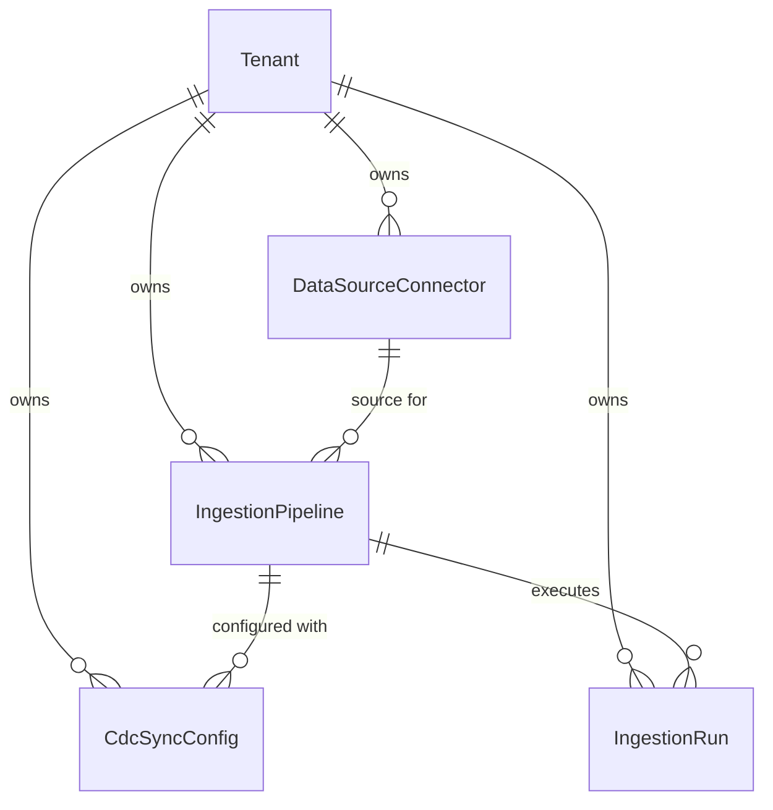

# Research — Sub-module 10.1: Data Integration & Ingestion (Module 10 — Business Intelligence, `bi`)

- **Sub-module:** 10.1 Data Integration & Ingestion
- **Module:** 10 Business Intelligence
- **Target app:** `apps/bi` (brand-new app; to be scaffolded in Phase 3 of 10.1)
- **Research date:** 2026-11-03
- **Phase:** 1 Research only
- **Output boundary:** `.claude/tasks/research-bi-10.1.md` only; no application code, migrations, settings, navigation, or git commits

---

## 1. Executive Summary & Domain Architecture

Sub-module 10.1 establishes the **data integration and ingestion foundation** for NavERP's Business Intelligence platform (`apps/bi`). While operational modules (`apps/accounting`, `apps/sales`, `apps/scm`, `apps/hrm`, `apps/inventory`) produce transactional domain records and transactional API gateways (e.g., Core 0.13, SCM 4.16) handle B2B message exchanges, BI 10.1 is specifically architected to extract, ingest, replicate, and stage operational data across internal ERP modules, external databases, cloud object storage, and streaming webhooks into unified analytical staging datasets.

### Architectural Boundaries & Domain Ownership
1. **Separation from Operational Transactions**: BI 10.1 does not process customer orders or post general ledger entries. It ingests data asynchronously from source systems (read-only queries, CDC logs, file drops, webhook payloads) into staging tables for downstream analytical modeling.
2. **Separation from 10.2 ETL Pipelines**: 10.1 owns *Ingestion* (connectors, schedules, CDC stream capture, file parsing configuration, and execution run telemetry). 10.2 owns *ETL/ELT Transformation Pipelines* (visual DAG builder, multi-table joins, aggregations, data enrichment, and transformation version control).
3. **Separation from 10.3 Data Warehouse Storage**: 10.1 lands ingested batches and CDC deltas into staging buffers. 10.3 owns the long-term Star/Snowflake schemas, dimensional data marts, and lakehouse tiering.
4. **Separation from 10.19 External BI Syndication**: 10.1 handles *inbound* ingestion from external and internal sources. 10.19 handles *outbound* syndication to external BI tools (Snowflake, BigQuery, Tableau, Looker) and enterprise message brokers.

---

## 2. Repo State Checked First

### 2.1 Navigation & App Tree State
- **`apps/core/navigation.py`:** Inspected `LIVE_LINKS`. Zero `"10.*"` entries exist in `LIVE_LINKS`. Module 10 has no previously built sub-modules. Sub-module 10.1 is the foundation and initial entry point for Module 10.
- **`apps/bi/`:** Verified non-existent (`Test-Path "apps/bi"` returned `False`). `apps/bi` will be scaffolded during Phase 3 of Sub-module 10.1.

### 2.2 As-Built Core Spine Entities (Grep Verified)
Every spine entity mapped in this research was verified against the repository:

| Entity | Location | Verified Status | 10.1 Relationship |
|---|---|---|---|
| `core.Tenant` | `apps/core/models/Tenant.py:17` | **Present** | Strict tenant isolation boundary across all BI connectors, pipelines, and runs |
| `core.ApiCredential` | `apps/core/models/Integration.py:35` | **Present** | Verified API authentication issuance (API key prefix + SHA-256 hash) |
| `core.RateLimitPolicy` | `apps/core/models/Integration.py:114` | **Present** | Rate limiting policies for API & webhook gateway endpoints |
| `core.ConnectorDefinition` | `apps/core/models/Integration.py:143` | **Present** | Core marketplace catalog of platform connectors (`engine_label` linkable) |
| `core.MappingTemplate` | `apps/core/models/Integration.py:185` | **Present** | Reusable inbound/outbound JSON field mapping templates |
| `core.SyncSchedule` | `apps/core/models/Integration.py:219` | **Present** | Platform-level sync cadence definitions |
| `core.AuditLog` | `apps/core/models/AuditLog.py:5` | **Present** | Immutable enterprise security and configuration audit trail |
| `core.JobDefinition` / `JobRun` | `apps/core/models/JobScheduler.py:71, 161` | **Present** | Server-level background cron jobs (distinct from BI analytical run metrics) |
| `scm.IntegrationEndpoint` | `apps/scm/models/IntegrationApiGateway/IntegrationEndpoints.py:15` | **Present** | SCM transactional B2B EDI/API endpoint (`NUMBER_PREFIX = "CNX"`) |
| `sales.SalesSyncRun` | `apps/sales/models/MasterDataConfiguration/SalesSyncRuns.py:10` | **Present** | SFA operational sync runs (`NUMBER_PREFIX = "SSR"`) |
| `accounting.JournalEntry` | `apps/accounting/models/GeneralLedger/JournalEntries.py:10` | **Present** | Financial GL entries for analytical ingestion |
| `settings.AUTH_USER_MODEL` | `apps/core/models/` | **Present** | Ownership and creator user reference |

### 2.3 Prefix Collision Verification
An exhaustive scan of `NUMBER_PREFIX` was conducted across all existing apps in `apps/`:
- Scanned all prefixes starting with `B`: `BILL` (accounting), `BUD` (accounting), `BLAST` (crm), `BEN` (hrm), `BGV` (hrm), `BRC` (hrm), `BKO` (procurement), `BID` (procurement), `BVR` (projects), `BSL` (projects), `BND` (sales), `BOM` (scm).
- `DS` is already used by `scm.DemandSignal` (`apps/scm/models/DemandPlanning/DemandSignals.py`).
- ✅ **`BDSC`** (`DataSourceConnector`) — **100% Free** (zero codebase occurrences).
- ✅ **`BING`** (`IngestionPipeline`) — **100% Free** (zero codebase occurrences).
- ✅ **`BCDC`** (`CdcSyncConfig`) — **100% Free** (zero codebase occurrences).
- ✅ **`BIJR`** (`IngestionRun`) — **100% Free** (zero codebase occurrences).
- Additional verified free candidate prefixes: `BICON`, `BIJOB`, `BICDC`, `BIRUN`, `BIGW`, `BISTG`.

---

## 3. Commercial Market Leaders Surveyed

We analyzed 10 leading commercial platforms across modern ELT ingestion, change data capture, streaming integration, and enterprise data warehouse loaders:

1. **Fivetran** (Enterprise Automated Data Movement Leader)
   - *Key Architecture:* 500+ pre-built connectors (ERP, SaaS, RDBMS, NoSQL, Files), automated schema drift handling (Allow All, Block All, Detect Only), log-based Change Data Capture (Postgres WAL, MySQL binlog, Oracle LogMiner), sync modes (Live/Standard overwrite, Soft Delete with `_fivetran_deleted`, History mode/SCD Type 2), cursor tracking via high-water mark timestamps, integer sequence IDs, and LSN offsets.
   - *Sources:* [Fivetran Sync Modes](https://fivetran.com/docs/getting-started/sync-modes) · [Fivetran CDC Architecture](https://fivetran.com/docs/databases) · [Fivetran Schema Drift](https://fivetran.com/docs/core-concepts/schema-drift)

2. **Airbyte** (Open-Source & Cloud ELT Integration Platform)
   - *Key Architecture:* Standardized Source & Destination connection model, catalog discovery mechanism (discovering streams, tables, and JSON schemas), 4 distinct Sync Modes: Full Refresh Overwrite, Full Refresh Append, Incremental Append, and Incremental Deduped History (requires Primary Key and Cursor field), connection scheduling (cron and interval), connection status health-checks, table-level volume logging.
   - *Sources:* [Airbyte Connection Sync Modes](https://docs.airbyte.com/using-airbyte/core-concepts/sync-modes) · [Airbyte Source Catalog & Streams](https://docs.airbyte.com/understanding-airbyte/catalog)

3. **Qlik Replicate** (formerly Attunity — Enterprise High-Throughput CDC & Replication)
   - *Key Architecture:* Heterogeneous zero-footprint log-based CDC replication across mainframe, enterprise ERPs (SAP, Oracle, Dynamics), and modern databases. Dual target architecture: direct state replication vs. dedicated Change Tables (`__ct`) recording operation flags (`INSERT`, `UPDATE`, `DELETE`), transaction IDs, commit timestamps, and LSN sequence markers. Full Load initialization transitioning automatically to continuous CDC stream.
   - *Sources:* [Qlik Replicate CDC Architecture](https://www.qlik.com/us/products/qlik-replicate) · [Qlik Store Changes & Change Tables](https://help.qlik.com/en-US/replicate/May2024/Content/Global_Context/Replicate/StoreChanges.htm)

4. **Meltano** (Open-Source Singer-Spec Declarative ELT Engine)
   - *Key Architecture:* Declarative configuration for Singer Taps (data extractors) and Targets (data loaders), stream/table catalog selection, state management storing bookmark JSON with stateful cursor bookmarks for incremental sync resumption, schedule execution.
   - *Sources:* [Meltano Data Integration](https://meltano.com/) · [Singer Tap Specification](https://hub.meltano.com/)

5. **Talend Data Integration / Stitch** (Qlik Managed Cloud Ingestion)
   - *Key Architecture:* Over 140 SaaS and database connectors, user-defined replication frequency, automated historical backfills, selective table and column sync toggle, API rate-limiting handling, and historical extraction audit tracking.
   - *Sources:* [Stitch Data Ingestion](https://www.stitchdata.com/) · [Talend Cloud Data Integration](https://www.talend.com/products/data-integration/)

6. **AWS Glue & AWS AppFlow** (Managed Cloud Ingestion & Lakehouse Ingestion)
   - *Key Architecture:* Managed connection catalog (JDBC, SaaS, S3), Job Bookmarks tracking S3 object modification timestamps and database cursors for stateful delta processing, file ingestion across Parquet, ORC, JSON, CSV, and XML with compression options (Gzip, Snappy), automated schema detection.
   - *Sources:* [AWS Glue Job Bookmarks](https://docs.aws.amazon.com/glue/latest/dg/monitor-continuations.html) · [AWS AppFlow SaaS Integrations](https://aws.amazon.com/appflow/)

7. **Databricks Lakeflow Connect** (formerly Arcion — Real-Time CDC & Database Replication)
   - *Key Architecture:* Native log-based CDC for enterprise transactional engines (PostgreSQL, MySQL, Oracle, SQL Server, Salesforce, Workday), real-time continuous replication to lakehouse staging tables, automated schema evolution tracking, pipeline health monitoring.
   - *Sources:* [Databricks Lakeflow Connect](https://www.databricks.com/product/lakeflow)

8. **Apache NiFi** (Enterprise Real-Time Data Ingestion & Routing Engine)
   - *Key Architecture:* Directed graph flow-based data routing, built-in processors for RDBMS, SFTP, S3, REST endpoints, and Webhooks, fine-grained rate-limiting, backpressure management, data provenance tracking logging every record ingress event.
   - *Sources:* [Apache NiFi Documentation](https://nifi.apache.org/documentation/)

9. **Hevo Data** (No-Code Real-Time Ingestion Platform)
   - *Key Architecture:* 150+ pre-built source connectors across ERP, databases, and SaaS, automated schema learning engine that infers data types and normalizes nested JSON records, zero-data-loss CDC from transaction logs, webhook ingress endpoints with secret authentication, bucket listeners for S3, GCS, Azure Blob, and SFTP.
   - *Sources:* [Hevo Data Ingestion Pipelines](https://hevodata.com/docs/pipelines/) · [Hevo CDC Models](https://hevodata.com/docs/sources/)

10. **Estuary Flow** (Real-Time Streaming CDC & Data Capture Engine)
    - *Key Architecture:* Millisecond-latency log-based CDC, Collections abstraction acting as real-time schema-enforced cloud storage document datasets, decoupled capture from downstream materializations, continuous streaming ingestion unified with historical batch backfills.
    - *Sources:* [Estuary Flow Capture Architecture](https://estuary.dev/docs/concepts/captures/) · [Estuary Real-Time CDC](https://estuary.dev/cdc/)

---

## 4. Feature Catalog (Sub-module 10.1 Only)

Grouped strictly by the 5 feature bullets in `NavERP.md` under `### 10.1 Data Integration & Ingestion`, plus the essential operational observability layer:

### 4.1 Source Connectors
- **Connector Type Categorization** — Multi-type connector support: Internal ERP modules (Finance/Accounting, Sales, SCM, HRM, Inventory), External Relational RDBMS (PostgreSQL, MySQL, SQL Server, Oracle), NoSQL/Document DBs (MongoDB), Cloud Object Storage (S3, Azure Blob, GCS), SFTP/FTP file servers, and Webhooks/REST APIs.
  - *Seen in:* Fivetran, Airbyte, Hevo, Stitch.
  - *Priority:* `table-stakes`.
  - *Spine:* Stored in new `DataSourceConnector` model; optionally links to `core.ConnectorDefinition` for platform marketplace metadata.
  - *Status:* Buildable now.
- **Connection Configuration & Secure Credentials** — Encrypted/isolated connection parameters: host, port, database name, username, SSL/TLS enforcement (`require`, `verify-ca`, `disable`), and credential storage (referencing `core.ApiCredential` or vault/JSON secrets).
  - *Seen in:* All 10 leaders.
  - *Priority:* `table-stakes`.
  - *Spine:* `DataSourceConnector` with tenant isolation; references `core.ApiCredential`.
  - *Status:* Buildable now.
- **Connection Health Checks & Diagnostics** — One-click "Test Connection" ping action validating host reachability, authentication credentials, database read permissions, and schema visibility, recording `last_tested_at` and `test_status_message`.
  - *Seen in:* Airbyte, Fivetran, Hevo.
  - *Priority:* `table-stakes`.
  - *Spine:* Model method + view action on `DataSourceConnector`.
  - *Status:* Buildable now.
- **Schema & Entity Discovery (Catalog Inspector)** — Introspects source systems to discover available database tables, ERP models, or file schemas, storing a cached JSON stream catalog (`discovered_catalog`) for user selection during pipeline creation.
  - *Seen in:* Airbyte, Fivetran, Meltano, AWS Glue.
  - *Priority:* `common`.
  - *Spine:* JSON field on `DataSourceConnector`.
  - *Status:* Buildable now.

### 4.2 Batch & Real-Time Ingestion
- **Ingestion Mode Selection** — Configurable execution modes: `batch_scheduled` (periodic full/incremental loads), `micro_batch` (5-15 minute cadence), `real_time_streaming` (webhook or message queue continuous push), and `manual_on_demand`.
  - *Seen in:* Fivetran, Airbyte, Hevo, Estuary.
  - *Priority:* `table-stakes`.
  - *Spine:* `IngestionPipeline` model.
  - *Status:* Buildable now.
- **Cadence & Schedule Configuration** — User-friendly schedule definitions: `every_15_minutes`, `hourly`, `daily`, `weekly`, or standard Unix cron expressions, recording `next_run_due_at` and `last_run_at`.
  - *Seen in:* Airbyte, Stitch, Fivetran.
  - *Priority:* `table-stakes`.
  - *Spine:* `IngestionPipeline` model; can sync with `core.SyncSchedule`.
  - *Status:* Buildable now.
- **Target Staging Table Specification** — Designates the analytical staging dataset / destination table (e.g., `stg_accounting_invoices`, `stg_sales_leads`, `stg_sftp_orders`) where extracted records land prior to 10.2 transformation.
  - *Seen in:* Fivetran, Airbyte, Qlik Replicate.
  - *Priority:* `table-stakes`.
  - *Spine:* `IngestionPipeline.target_table_name`.
  - *Status:* Buildable now.
- **Selective Field & Column Mapping** — Column-level filtering and field renaming rules linking source columns to target staging attributes, referencing `core.MappingTemplate`.
  - *Seen in:* Stitch, Airbyte, Hevo.
  - *Priority:* `common`.
  - *Spine:* Links to `core.MappingTemplate`.
  - *Status:* Buildable now.

### 4.3 Change Data Capture (CDC)
- **CDC Capture Method Strategy** — Explicit selection of delta capture engine:
  1. `log_based` (Database transaction log replication: Postgres WAL/logical replication, MySQL binlog, Oracle LogMiner),
  2. `query_timestamp` (Incremental polling filtering by `updated_at >= :cursor_timestamp`),
  3. `query_incrementing_id` (Incremental polling filtering by `id > :cursor_id`),
  4. `full_snapshot` (Full table reload each cycle).
  - *Seen in:* Qlik Replicate, Fivetran, Airbyte, Databricks Lakeflow.
  - *Priority:* `table-stakes`.
  - *Spine:* `CdcSyncConfig` model.
  - *Status:* Buildable now.
- **Sync Strategy Modes** — Industry-standard synchronization modes:
  - `full_refresh_overwrite` (Wipes destination staging table and replaces with full extract),
  - `full_refresh_append` (Appends full snapshot as a historical timestamped version),
  - `incremental_append` (Extracts only new/modified rows and appends as immutable event log),
  - `incremental_deduped` (Extracts new/modified rows and upserts in place based on Primary Key).
  - *Seen in:* Airbyte, Fivetran, Meltano.
  - *Priority:* `table-stakes`.
  - *Spine:* `CdcSyncConfig` model.
  - *Status:* Buildable now.
- **High-Water Mark Cursor Management** — Tracks extraction progress state: `cursor_field` name (e.g. `updated_at`, `modified_on`, `sequence_num`, `lsn`), `last_cursor_value` (recorded high-water mark string/timestamp), and `checkpoint_timestamp`.
  - *Seen in:* Fivetran, Airbyte, AWS Glue.
  - *Priority:* `table-stakes`.
  - *Spine:* `CdcSyncConfig` model.
  - *Status:* Buildable now.
- **CDC Change Metadata Tracking** — Appends metadata audit columns to staging records: `header__operation` (`INSERT`, `UPDATE`, `DELETE`), `header__commit_timestamp`, `header__transaction_id`, and `header__is_deleted` soft-delete flag.
  - *Seen in:* Qlik Replicate (`__ct` pattern), Fivetran (`_fivetran_deleted`), Estuary.
  - *Priority:* `common`.
  - *Spine:* `CdcSyncConfig` configuration settings.
  - *Status:* Buildable now.
- **Schema Drift Handling Policy** — Configurable strategy when source schema changes: `auto_propagate` (automatically add new columns to staging table), `detect_and_warn` (log warning and ignore new columns), or `block_and_pause` (pause pipeline and alert administrator).
  - *Seen in:* Fivetran, Databricks Lakeflow, Hevo.
  - *Priority:* `differentiator`.
  - *Spine:* `CdcSyncConfig.schema_drift_policy` choice field.
  - *Status:* Buildable now.

### 4.4 API & Webhook Gateway
- **Inbound Ingestion Gateway Endpoints** — Dedicated URL route per pipeline (`/api/bi/ingest/<endpoint_token>/`) allowing external SaaS applications, mobile clients, and microservices to push JSON/NDJSON payloads directly into BI staging buffers.
  - *Seen in:* Apache NiFi, Hevo, Estuary, Segment.
  - *Priority:* `table-stakes`.
  - *Spine:* Inbound webhook URL configuration in `IngestionPipeline`.
  - *Status:* Buildable now.
- **Webhook Security & HMAC Verification** — Inbound webhook verification via secret token, API key (referencing `core.ApiCredential`), or HMAC SHA-256 header signature validation (e.g. Stripe, Shopify signature verification).
  - *Seen in:* Airbyte Webhook, SCM 4.16 WebhookSubscriptions, Core 0.13.
  - *Priority:* `table-stakes`.
  - *Spine:* `IngestionPipeline.webhook_secret` / `core.ApiCredential`.
  - *Status:* Buildable now.
- **Rate Limiting & Ingress Throttling** — Protection against ingestion DDoS and payload flood by enforcing per-minute request limits, linking to `core.RateLimitPolicy`.
  - *Seen in:* Apache NiFi, Core 0.13.
  - *Priority:* `common`.
  - *Spine:* `core.RateLimitPolicy`.
  - *Status:* Buildable now.
- **Inbound Payload Mapping & Root Unpacking** — Unpacks nested JSON envelopes (e.g. `{ "data": { "items": [...] } }`) by defining a `payload_root_path` (e.g. `data.items`) to iterate over and ingest as flat rows.
  - *Seen in:* Hevo, NiFi, Stitch.
  - *Priority:* `common`.
  - *Spine:* `IngestionPipeline` configuration JSON.
  - *Status:* Buildable now.

### 4.5 File & Cloud Storage Imports
- **Multi-Storage Protocols** — Native protocol support: AWS S3, Azure Blob Storage, Google Cloud Storage (GCS), SFTP, and Direct File Upload (via Django media storage).
  - *Seen in:* AWS Glue, Fivetran, Hevo, Airbyte.
  - *Priority:* `table-stakes`.
  - *Spine:* `DataSourceConnector` with `storage_protocol` choices.
  - *Status:* Buildable now.
- **File Format & Parsing Engine** — Ingestion parameters for `csv`, `tsv`, `json`, `ndjson`, `excel_xlsx`, and `parquet`. Configurable delimiter, quote character, header row index, skip rows, encoding (`utf-8`, `iso-8859-1`), and date format parsing strings.
  - *Seen in:* AWS Glue, Fivetran, Airbyte.
  - *Priority:* `table-stakes`.
  - *Spine:* Stored on `IngestionPipeline`.
  - *Status:* Buildable now.
- **Path Pattern & Glob Matching** — Dynamic file matching patterns (e.g. `invoices/*.csv`, `logs/year=2026/month=11/*.parquet`) and archive policies (`move_to_archive`, `delete_after_ingest`, `leave_in_place`).
  - *Seen in:* AWS Glue, NiFi, Fivetran.
  - *Priority:* `common`.
  - *Spine:* `IngestionPipeline.file_path_pattern`.
  - *Status:* Buildable now.

### 4.6 Beyond the Bullets: Operational Run Observability & Checkpointing
- **Execution Run Ledger & Telemetry** — Immutable run record per ingestion execution: status (`pending`, `running`, `completed`, `warning`, `failed`, `cancelled`), trigger type (`scheduled`, `manual`, `webhook`, `cdc_stream`), start timestamp, end timestamp, and duration in seconds.
  - *Seen in:* Airbyte Job History, Fivetran Sync History, AWS Glue Job Runs.
  - *Priority:* `table-stakes`.
  - *Spine:* `IngestionRun` model.
  - *Status:* Buildable now.
- **Throughput & Data Volume Metrics** — Quantified run audit metrics: `records_extracted`, `records_inserted`, `records_updated`, `records_rejected`, and `bytes_transferred`.
  - *Seen in:* Fivetran, Airbyte, Qlik Replicate.
  - *Priority:* `table-stakes`.
  - *Spine:* Integer fields on `IngestionRun`.
  - *Status:* Buildable now.
- **Committed Checkpoint / High-Water Mark State** — Captures the exact cursor offset (timestamp, LSN, ID) successfully committed by the run, ensuring idempotent resume on subsequent syncs.
  - *Seen in:* Fivetran, Airbyte, AWS Glue Bookmarks.
  - *Priority:* `table-stakes`.
  - *Spine:* `IngestionRun.checkpoint_cursor`.
  - *Status:* Buildable now.
- **Error Diagnostics & Traceback Logging** — Capture of failure reasons, HTTP status codes, DB exception snippets, and dead-letter row count without exposing sensitive DB passwords.
  - *Seen in:* All 10 leaders.
  - *Priority:* `table-stakes`.
  - *Spine:* `IngestionRun.error_message` and `error_log`.
  - *Status:* Buildable now.

---

## 5. Recommended Build Scope (This Pass — Exactly Four Models)

To fulfill all 5 feature bullets of `NavERP.md` 10.1 and provide enterprise-grade data integration without model bloat, we recommend **exactly four tenant-isolated models**:

### Model 1: `DataSourceConnector` [`BDSC-`]
- **Purpose:** Represents a configured connection to a data source (Internal ERP module, External Database, Cloud Storage / SFTP, or Webhook/API).
- **Auto-number Prefix:** `BDSC` (verified 100% collision-free).
- **Key Fields & Choices:**
  - `number`: `CharField(max_length=20, editable=False)` (minted as `BDSC-#####`).
  - `tenant`: `ForeignKey("core.Tenant", on_delete=models.CASCADE)`.
  - `name`: `CharField(max_length=150)`.
  - `connector_type`: `CharField` with choices:
    - `internal_erp`: NavERP native modules (Accounting, Sales, SCM, HRM, Inventory).
    - `database_rdbms`: PostgreSQL, MySQL, SQL Server, Oracle.
    - `database_nosql`: MongoDB, Document DB.
    - `cloud_storage`: AWS S3, Azure Blob, Google Cloud Storage.
    - `sftp_server`: SFTP / Secure FTP server.
    - `rest_api`: External SaaS REST API.
    - `webhook_push`: Inbound HTTP Webhook.
    - `file_upload`: Manual CSV/Excel upload buffer.
  - `status`: `CharField` with choices `active`, `inactive`, `testing`, `error`.
  - `connection_config`: `JSONField` (host, port, database, bucket, sftp_path, ssl_mode, query_options).
  - `credential`: `ForeignKey("core.ApiCredential", null=True, blank=True, on_delete=models.SET_NULL)`.
  - `discovered_catalog`: `JSONField(default=dict, blank=True)` (cached table list, streams, and schema attributes).
  - `last_tested_at`: `DateTimeField(null=True, blank=True)`.
  - `test_status`: `CharField` with choices `untested`, `success`, `failed`.
  - `test_message`: `CharField(max_length=255, blank=True)`.
  - `created_by`: `ForeignKey(settings.AUTH_USER_MODEL, null=True, on_delete=models.SET_NULL)`.
  - `created_at` / `updated_at`.
- **Justified by Features:** Bullet 1 (Source Connectors), Bullet 5 (Storage connection), connection testing, schema discovery.

### Model 2: `IngestionPipeline` [`BING-`]
- **Purpose:** Defines an end-to-end data ingestion task linking a `DataSourceConnector` to an analytical target staging table, specifying schedule, ingestion mode, file parsing parameters, and webhook gateway endpoints.
- **Auto-number Prefix:** `BING` (verified 100% collision-free).
- **Key Fields & Choices:**
  - `number`: `CharField(max_length=20, editable=False)` (minted as `BING-#####`).
  - `tenant`: `ForeignKey("core.Tenant", on_delete=models.CASCADE)`.
  - `name`: `CharField(max_length=150)`.
  - `connector`: `ForeignKey("bi.DataSourceConnector", on_delete=models.PROTECT, related_name="pipelines")`.
  - `ingestion_mode`: `CharField` with choices:
    - `batch_scheduled`: Scheduled periodic bulk or incremental sync.
    - `micro_batch`: Near-real-time polling (5-15 min cadence).
    - `real_time_webhook`: Inbound webhook streaming push.
    - `manual_on_demand`: Manual trigger only.
  - `source_entity`: `CharField(max_length=150)` (source table name, API resource path, or ERP model identifier like `accounting.Invoice`).
  - `target_staging_table`: `CharField(max_length=150)` (staging table identifier, e.g. `stg_invoices`).
  - `schedule_cadence`: `CharField` with choices `manual`, `every_15_min`, `hourly`, `daily`, `weekly`, `custom_cron`.
  - `cron_expression`: `CharField(max_length=60, blank=True)`.
  - `file_format`: `CharField` with choices `none`, `csv`, `tsv`, `json`, `ndjson`, `excel`, `parquet`.
  - `file_parsing_options`: `JSONField(default=dict, blank=True)` (delimiter, quote_char, has_header, skip_rows, encoding, path_pattern).
  - `webhook_token`: `CharField(max_length=64, blank=True, unique=True, db_index=True)` (endpoint slug for inbound webhooks).
  - `webhook_secret`: `CharField(max_length=128, blank=True)` (HMAC verification secret).
  - `rate_limit_policy`: `ForeignKey("core.RateLimitPolicy", null=True, blank=True, on_delete=models.SET_NULL)`.
  - `mapping_template`: `ForeignKey("core.MappingTemplate", null=True, blank=True, on_delete=models.SET_NULL)`.
  - `status`: `CharField` with choices `active`, `paused`, `draft`, `error`.
  - `last_run_at` / `next_run_due_at`: `DateTimeField(null=True, blank=True)`.
  - `created_at` / `updated_at`.
- **Justified by Features:** Bullet 2 (Batch & Real-Time Ingestion), Bullet 4 (API & Webhook Gateway), Bullet 5 (File & Cloud Storage Imports).

### Model 3: `CdcSyncConfig` [`BCDC-`]
- **Purpose:** Specializes Change Data Capture (CDC) behavior, delta detection mechanisms, sync modes, cursor tracking, and schema drift policies for a pipeline.
- **Auto-number Prefix:** `BCDC` (verified 100% collision-free).
- **Key Fields & Choices:**
  - `number`: `CharField(max_length=20, editable=False)` (minted as `BCDC-#####`).
  - `tenant`: `ForeignKey("core.Tenant", on_delete=models.CASCADE)`.
  - `pipeline`: `OneToOneField("bi.IngestionPipeline", on_delete=models.CASCADE, related_name="cdc_config")`.
  - `capture_method`: `CharField` with choices:
    - `log_based`: Transaction log replication (WAL, Binlog, Redo).
    - `query_timestamp`: Timestamp cursor on modified date.
    - `query_incrementing_id`: Sequence cursor on primary key.
    - `full_snapshot`: Full table snapshot replacement.
  - `sync_mode`: `CharField` with choices:
    - `full_refresh_overwrite`: Overwrite destination table entirely.
    - `full_refresh_append`: Append new snapshot with timestamp.
    - `incremental_append`: Append changed records as event stream.
    - `incremental_deduped`: Upsert in place by primary key.
  - `primary_key_fields`: `CharField(max_length=150, default="id")` (comma-separated primary keys for deduplication).
  - `cursor_field`: `CharField(max_length=100, blank=True)` (e.g. `updated_at`, `modified_at`, `id`, `lsn`).
  - `last_cursor_value`: `CharField(max_length=255, blank=True)` (persisted high-water mark).
  - `last_checkpoint_at`: `DateTimeField(null=True, blank=True)`.
  - `schema_drift_policy`: `CharField` with choices `auto_propagate`, `detect_and_warn`, `block_and_pause`.
  - `capture_deletes`: `BooleanField(default=True)`.
  - `soft_delete_field`: `CharField(max_length=60, default="is_deleted")`.
  - `created_at` / `updated_at`.
- **Justified by Features:** Bullet 3 (Change Data Capture CDC), log delta detection, high-water mark cursor tracking, schema drift handling.

### Model 4: `IngestionRun` [`BIJR-`]
- **Purpose:** Immutable operational execution run log capturing execution status, throughput metrics, duration, error diagnostics, and checkpoint updates for every batch, micro-batch, webhook, or CDC sync.
- **Auto-number Prefix:** `BIJR` (verified 100% collision-free).
- **Key Fields & Choices:**
  - `number`: `CharField(max_length=20, editable=False)` (minted as `BIJR-#####`).
  - `tenant`: `ForeignKey("core.Tenant", on_delete=models.CASCADE)`.
  - `pipeline`: `ForeignKey("bi.IngestionPipeline", on_delete=models.CASCADE, related_name="runs")`.
  - `trigger_type`: `CharField` with choices `scheduled`, `manual`, `webhook`, `cdc_stream`.
  - `status`: `CharField` with choices: `pending`, `running`, `completed`, `warning`, `failed`, `cancelled`.
  - `started_at`: `DateTimeField(default=timezone.now)`.
  - `ended_at`: `DateTimeField(null=True, blank=True)`.
  - `duration_seconds`: `DecimalField(max_digits=10, decimal_places=2, default=0)`.
  - `records_extracted`: `PositiveIntegerField(default=0)`.
  - `records_inserted`: `PositiveIntegerField(default=0)`.
  - `records_updated`: `PositiveIntegerField(default=0)`.
  - `records_rejected`: `PositiveIntegerField(default=0)`.
  - `bytes_transferred`: `BigIntegerField(default=0)`.
  - `committed_cursor`: `CharField(max_length=255, blank=True)`.
  - `error_message`: `CharField(max_length=500, blank=True)`.
  - `log_summary`: `TextField(blank=True)` (structured summary of execution events).
  - `created_at`.
- **Justified by Features:** Operational observability, run history, throughput tracking, failure diagnostics, checkpointing.

---

## 6. Belongs to Sibling Sub-Modules (Parked, Not Scoped Here)

Features identified during leader research that belong to subsequent Sub-modules of Module 10:

- **Visual DAG Pipeline Designer & Low-Code Workflow Canvas** → Belongs to **10.2 ETL/ELT & Data Pipelines**.
- **Transformation Functions (Joins, Pivots, Casts, Enrichment, Window Functions)** → Belongs to **10.2 ETL/ELT & Data Pipelines**.
- **Pipeline Version Control, Promotion (Dev/Test/Prod) & Rollback** → Belongs to **10.2 ETL/ELT & Data Pipelines**.
- **Star/Snowflake Schemas, Analytical Facts, Dimensions & Aggregations** → Belongs to **10.3 Data Warehouse & Storage**.
- **Departmental Data Marts (Finance Mart, Sales Mart, HR Mart)** → Belongs to **10.3 Data Warehouse & Storage**.
- **Storage Tiering (Hot/Warm/Cold), Historical Snapshots & Retention Purging** → Belongs to **10.3 Data Warehouse & Storage**.
- **Data Modeling & Semantic Layer (Calculated Metrics, Dimensions)** → Belongs to **10.4 Data Modeling & Semantic Layer**.
- **Data Cleansing, Validation Rules & Data Profiling Quality Scores** → Belongs to **10.5 Data Quality & Cleansing**.
- **Master Data Golden Records, Match & Merge Algorithms** → Belongs to **10.6 Master Data Management (MDM)**.
- **Data Catalog, End-to-End Lineage Visualizer & Governance** → Belongs to **10.7 Data Catalog, Lineage & Governance**.
- **Dashboards, Widgets, Charts & Reporting Canvas** → Belongs to **10.8 Dashboards & Visualization**.
- **Outbound Syndication to Snowflake, BigQuery, Tableau, Looker** → Belongs to **10.19 Integration & API Hub**.

---

## 7. Deferred (Later Passes / Integrations)

Features that inform data models but require external infrastructure or enterprise drivers:

1. **Native Binary Database CDC Log Parsers** (e.g. native C-level `pgoutput` streaming or MySQL binary log parsing daemon). In NavERP, CDC is modeled cleanly with configurable capture methods; the Django application executes query-timestamp cursors, sequence cursors, and simulation/polling adapters directly, while real log-based CDC integrates with Debezium or cloud CDC workers.
2. **Distributed Streaming Queue Infrastructure** (Kafka / RabbitMQ / Apache Flink). In 10.1, real-time ingestion is served via HTTP Webhook gateways and micro-batch triggers. Dedicated Kafka brokers are deferred to enterprise deployment phases.
3. **Automated Live DDL Migration on External Target Engines**. Automatic DDL alters on live external target databases are logged and flagged as drift alerts rather than executing unreviewed destructive `ALTER TABLE` commands.
4. **Binary Parquet File Compression Engines**. Direct Parquet file parsing relies on standard Python libraries (`pyarrow`/`fastparquet`) when installed in the environment, falling back gracefully to CSV/JSON format processing.

---

## 8. Summary for Todo Agent

- **App Slug:** `bi` (`apps/bi/`)
- **Sub-module:** `10.1 Data Integration & Ingestion`
- **Recommended Models (4):**
  1. `DataSourceConnector` (`BDSC-`) — Source systems: ERP modules, RDBMS, NoSQL, Cloud Storage, SFTP, Webhooks.
  2. `IngestionPipeline` (`BING-`) — Ingestion job definition: batch/streaming, scheduling, file parsing, webhook endpoint.
  3. `CdcSyncConfig` (`BCDC-`) — CDC engine: capture method, sync modes, high-water mark cursor, schema drift.
  4. `IngestionRun` (`BIJR-`) — Execution telemetry: status, duration, throughput rows/bytes, committed cursor, logs.
- **Prefix Collision Status:** `BDSC`, `BING`, `BCDC`, `BIJR` verified 100% collision-free.
- **Reused Spine Entities:** `core.Tenant`, `core.ApiCredential`, `core.RateLimitPolicy`, `core.ConnectorDefinition`, `core.MappingTemplate`, `core.SyncSchedule`.
