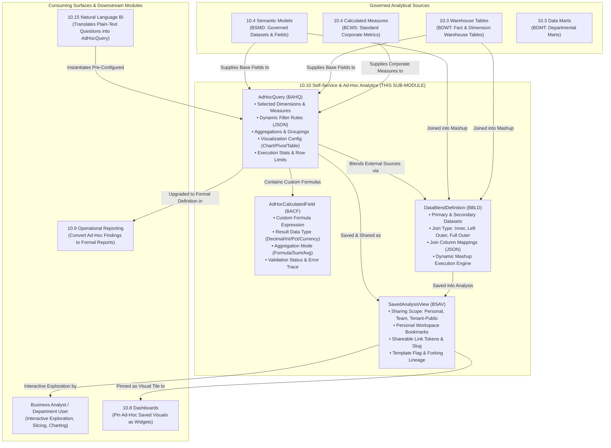

# Research — Sub-module 10.10: Self-Service & Ad-Hoc Analytics (Module 10 — Business Intelligence, `bi`)

- **Sub-module:** 10.10 Self-Service & Ad-Hoc Analytics
- **Module:** 10 Business Intelligence
- **Target app:** `apps/bi` (extended across 10.1–10.9; adding 10.10 `SelfServiceAnalytics` package)
- **Research date:** 2026-11-06
- **Phase:** Phase 1 Research Catalog
- **Output file target:** `.claude/tasks/research-bi-10.10.md`

---

## 1. Executive Summary & Domain Architecture

Sub-module 10.10 delivers **self-service, ad-hoc data exploration, visual query building, calculated metrics, on-the-fly data blending, and personal/shared analytical views** for NavERP (`apps/bi`). While Sub-module 10.8 delivers curated executive dashboards and Sub-module 10.9 provides formal, banded, pixel-perfect operational reports, Sub-module 10.10 empowers business analysts, department heads, and non-technical domain users to **freely explore governed ERP datasets without writing raw SQL code or submitting tickets to IT/data engineering teams**.

In enterprise architectures (Tableau, Looker, ThoughtSpot, Sigma, Power BI, Metabase), self-service analytics bridges strict centralized data governance with agile user exploration:
- **Sub-module 10.1 (Data Integration & Ingestion):** Ingests and stages source ERP transactions.
- **Sub-module 10.2 (ETL/ELT & Data Pipelines):** Orchestrates analytical transforms.
- **Sub-module 10.3 (Data Warehouse & Storage):** Hosts physical analytical fact/dimension tables (`WarehouseTable`, `DataMart`).
- **Sub-module 10.4 (Data Modeling & Semantic Layer):** Governs dimensional business models (`SemanticModel`), metrics (`CalculatedMeasure`), and drill hierarchies (`DrillHierarchy`).
- **Sub-module 10.5 (Data Quality & Cleansing):** Guarantees data reliability and completeness.
- **Sub-module 10.6 (Master Data Management):** Supplies canonical customer, vendor, and product golden records (`MdmGoldenRecord`).
- **Sub-module 10.7 (Data Catalog, Lineage & Governance):** Catalogs analytical assets and provides trust endorsements.
- **Sub-module 10.8 (Dashboards & Visualization):** Renders pre-built visual dashboard canvases.
- **Sub-module 10.9 (Standard & Operational Reporting):** Formats precision, print-ready, regulatory banded reports.
- **Sub-module 10.10 (Self-Service & Ad-Hoc Analytics — THIS SUB-MODULE):** Provides end-user exploratory freedom:
  1. **Visual Ad-Hoc Query Builder (`AdHocQuery`):** No-code query composer allowing users to pick fields, apply multi-condition filters, select aggregation functions (SUM, AVG, MIN, MAX, COUNT, COUNT DISTINCT), specify grouping dimensions, and configure dynamic visualizations (table, bar, line, pie, area, scatter, KPI card).
  2. **Data Discovery & Drill-Anywhere Exploration:** Interactive slicing and dicing, time-period grain shifts (day, week, month, quarter, year), drill-down paths, and quick exploration pivots.
  3. **Calculated Fields & Custom Measures (`AdHocCalculatedField`):** User-defined formula expressions (e.g. `[total_revenue] - [cost_of_goods_sold]`, profit margins, percentage-of-total, growth ratios, conditional CASE statements) evaluated dynamically during query execution.
  4. **Data Blending & Mashups (`DataBlendDefinition`):** On-the-fly joining of multiple independent governed semantic models or warehouse tables (e.g., blending SCM procurement spend with CRM customer opportunities) using user-defined join criteria (Inner, Left Outer, Full Outer) without IT schema migrations.
  5. **Saved Views & Collaborative Sharing (`SavedAnalysisView`):** Personal exploration sandboxes, shared team views, public tenant templates, cloneable explorations, and deep-link analytical sharing.

### Architectural Boundaries & Data Flow

---

## 2. Repo State Checked First

### 2.1 Navigation & App Tree State
- **`apps/core/navigation.py`:** Inspected `LIVE_LINKS`. Sub-modules `10.1` through `10.9` are fully built and live.
- **`apps/bi/models/`:** Verified existing sub-packages:
  - `DataIntegration/` (10.1)
  - `EtlPipelines/` (10.2)
  - `DataWarehouse/` (10.3)
  - `SemanticLayer/` (10.4)
  - `DataQuality/` (10.5)
  - `MasterData/` (10.6)
  - `DataCatalog/` (10.7)
  - `Dashboards/` (10.8)
  - `OperationalReporting/` (10.9)
  - `_base.py` (`TenantOwned`, `TenantNumbered` with `next_number()` sequence allocation).
  - Target package to create in Phase 3: `apps/bi/models/SelfServiceAnalytics/`.

### 2.2 As-Built Core Spine & Sibling Entities (Grep Verified)

| Entity | Location | Verified Status | 10.10 Relationship |
|---|---|---|---|
| `core.Tenant` | `apps/core/models/Tenant.py:17` | **Present** | Mandatory multi-tenant isolation boundary across queries, formulas, blends, and views |
| `settings.AUTH_USER_MODEL` | `config/settings.py` (`accounts.User`) | **Present** | Query owner (`created_by`), last executed by, personal workspace scoping |
| `core.OrgUnit` | `apps/core/models/OrgUnit.py:5` | **Present** | Departmental/team sharing scope for saved analytical views |
| `core.AuditLog` | `apps/core/models/AuditLog.py:14` | **Present** | Audit trail recording ad-hoc query creations, blend modifications, and shared view permissions |
| `bi.SemanticModel` | `apps/bi/models/SemanticLayer/SemanticModels.py:8` | **Present** | Primary and secondary governed semantic data source for ad-hoc visual queries and data blends (10.4) |
| `bi.WarehouseTable` | `apps/bi/models/DataWarehouse/WarehouseTables.py:8` | **Present** | Warehouse fact/dimension table source for ad-hoc exploration (10.3) |
| `bi.CalculatedMeasure` | `apps/bi/models/SemanticLayer/CalculatedMeasures.py:8` | **Present** | Corporate standardized metrics available for selection alongside ad-hoc calculated fields (10.4) |
| `bi.BiDashboard` | `apps/bi/models/Dashboards/BiDashboards.py:8` | **Present** | Target dashboard canvas where saved ad-hoc exploration views can be pinned as widgets (10.8) |
| `bi.ReportDefinition` | `apps/bi/models/OperationalReporting/ReportDefinitions.py:9` | **Present** | Target operational report system where ad-hoc explorations can be promoted to formal reports (10.9) |

### 2.3 Collision-Free Prefix Verification
Inspected all prefixes repository-wide and within `apps/bi/`:
- Existing prefixes in `apps/bi/`:
  - 10.1: `BCDC`, `BDSC`, `BING`, `BIJR`
  - 10.2: `BETL`, `BTRN`, `BPVR`, `BEXR`
  - 10.3: `BDMT`, `BLHZ`, `BWSP`, `BDWT`
  - 10.4: `BSMD`, `BGLO`, `BCMS`, `BDHI`
  - 10.5: `BDQP`, `BDQR`, `BDQE`, `BDQS`
  - 10.6: `BMGR`, `BMSR`, `BMHR`, `BMRD`
  - 10.7: `BCAT`, `BLIN`, `BTRU`, `BGOV`
  - 10.8: `BDSH`, `BDWG`, `BDBM`, `BDFL`
  - 10.9: `BRPT`, `BDRP`, `BRUN`, `BPAR`
- Candidate prefixes checked repository-wide — **zero collisions detected**:
  - `BAHQ`: `AdHocQuery` (**Unique & Collision-free**)
  - `BACF`: `AdHocCalculatedField` (**Unique & Collision-free**)
  - `BBLD`: `DataBlendDefinition` (**Unique & Collision-free**)
  - `BSAV`: `SavedAnalysisView` (**Unique & Collision-free**)

---

## 3. Leaders Surveyed (with source references)

1. **Tableau (Salesforce)** — The Benchmark for Drag-and-Drop Visual Exploration & Data Blending
   - *Overview*: Recognized gold standard for visual analytics, featuring the intuitive "Shelves & Pills" paradigm (Columns, Rows, Filters, Marks) and on-the-fly data blending across heterogeneous sources.
   - *Key capabilities*: Visual drag-and-drop query composition without SQL, ad-hoc table calculations (running total, percent difference, moving average), calculated fields using a formula editor, data blending across distinct data connections via common dimension links, Ask Data natural language queries, and Tableau Server/Cloud saved views with custom sharing permissions.
   - *URL*: `https://www.tableau.com/products/desktop`

2. **Microsoft Power BI** — Self-Service Modeling, Quick Measures & Personal Workspaces
   - *Overview*: Market-leading self-service BI platform providing accessible visual authoring, Quick Measures, DAX formula authoring, and personal/shared workspaces.
   - *Key capabilities*: Drag-and-drop field assignment to visual wells (Axis, Legend, Values, Tooltips), Quick Measures enabling guided formula generation without complex syntax, Composite Models allowing ad-hoc cross-source relationships, personal bookmarks, and workspace sharing with fine-grained access control.
   - *URL*: `https://powerbi.microsoft.com/`

3. **Looker (Google Cloud)** — Governed Ad-Hoc Exploration via Semantic Explores
   - *Overview*: Centralized semantic modeling architecture (LookML) that empowers non-technical users to build ad-hoc queries ("Explores") with guaranteed single-source-of-truth accuracy.
   - *Key capabilities*: Explore interface with field pickers for dimensions and measures, ad-hoc Table Calculations (offset, running sum, percent of column), custom filters with boolean logic, saving explorations as "Looks", and embedding or sharing queries via persistent URLs.
   - *URL*: `https://cloud.google.com/looker`

4. **ThoughtSpot** — Search-Driven Ad-Hoc Analytics & Guided Discovery
   - *Overview*: AI- and search-driven analytics platform allowing business users to type questions in natural language and receive real-time interactive chart answers.
   - *Key capabilities*: Relational search engine indexing underlying data dimensions, SpotIQ automated anomaly and trend discovery, user-created formulas and group bands, Search Answers saved to collaborative Liveboards, and self-service what-if parameter exploration.
   - *URL*: `https://www.thoughtspot.com/product`

5. **Sigma Computing** — Warehouse-Native Spreadsheet-Style Ad-Hoc Analytics
   - *Overview*: Next-generation cloud analytics platform providing a spreadsheet-familiar workbook interface executed directly against cloud data warehouses (Snowflake, BigQuery, Databricks).
   - *Key capabilities*: Visual formula bar using familiar Excel-like formulas (e.g. `Sum([Revenue]) / Count([Orders])`), multi-source visual data blending and ad-hoc joins without SQL, what-if parameter sliders, version-controlled workbooks, and team folder sharing.
   - *URL*: `https://www.sigmacomputing.com/product`

6. **Metabase** — Intuitive Open-Core Visual Query Builder
   - *Overview*: Widely praised open-source/commercial BI tool renowned for its non-technical "Question" visual builder.
   - *Key capabilities*: Step-by-step visual query composer (Data -> Filter -> Summarize -> Group By -> Sort), custom column expressions, ad-hoc joins across tables, automatic exploration drill-through ("X-Rays"), saved questions, and public or role-restricted dashboard embedding.
   - *URL*: `https://www.metabase.com/product`

7. **Apache Superset** — Open-Source Exploratory Analytics & Ad-Hoc Slices
   - *Overview*: High-performance open-source exploration platform backed by the Apache Software Foundation.
   - *Key capabilities*: Explore view for rapid slice-and-dice data visualization, ad-hoc metrics builder (custom SQL snippets and standard aggregations), customizable chart palettes, saved query slices, and role-based sharing.
   - *URL*: `https://superset.apache.org/`

8. **Omni / Holistics** — Modern BI with Hybrid Semantic Modeling & Ad-Hoc Freedom
   - *Overview*: Modern cloud BI tools that resolve the tension between strict semantic governance and exploratory agility.
   - *Key capabilities*: Point-and-click ad-hoc exploration on top of governed datasets, branchable personal exploration workbooks, calculated fields with automatic promotion to shared data models, and team collaboration spaces.
   - *URL*: `https://omni.co/`

---

## 4. Feature Catalog (mapped to NavERP.md Bullets)

### 4.1 Ad-Hoc Query Builder
- **Visual Drag-and-Drop Field Selection** — Allows users to select dimensions (attributes) and measures (metrics) from governed `SemanticModel` or `WarehouseTable` sources without writing SQL queries.
  - *Seen in*: Tableau (Shelves), Power BI (Field Wells), Metabase (Summarize), Looker (Explore).
  - *Priority*: `table-stakes`.
  - *Spine*: Stored in `AdHocQuery.fields_config_json`.
  - *Status*: Buildable now.
- **Dynamic Multi-Condition Filtering** — Rule-based filter builder supporting operators: equals, not equals, contains, starts with, in list, greater than, less than, between, is null, and date presets (today, yesterday, last 7 days, this month, YTD).
  - *Seen in*: Looker, Tableau, Metabase, Sigma.
  - *Priority*: `table-stakes`.
  - *Spine*: Stored in `AdHocQuery.filter_criteria_json`.
  - *Status*: Buildable now.
- **Aggregation & Grouping Controls** — Automatic SQL `GROUP BY` generation with support for standard aggregations: `sum`, `avg`, `min`, `max`, `count`, `count_distinct`.
  - *Seen in*: All surveyed leaders.
  - *Priority*: `table-stakes`.
  - *Spine*: Evaluated by `AdHocQuery` execution engine.
  - *Status*: Buildable now.
- **Visualization Type Selector** — Dynamically switches the query presentation between Tabular Grid, Bar Chart, Line Chart, Area Chart, Donut/Pie Chart, Scatter Plot, and KPI Metric Card.
  - *Seen in*: Metabase, Tableau, Power BI, Superset.
  - *Priority*: `table-stakes`.
  - *Spine*: Configured in `AdHocQuery.visualization_type` and `AdHocQuery.chart_config_json`.
  - *Status*: Buildable now (rendered via Tailwind CSS + Chart.js).
- **Execution Performance & Row Limits** — Configurable row truncation (100, 500, 1000, 5000 rows) with query execution duration tracking and error capturing.
  - *Seen in*: Looker, Superset, Metabase.
  - *Priority*: `table-stakes`.
  - *Spine*: `AdHocQuery.row_limit`, `AdHocQuery.execution_duration_ms`, `AdHocQuery.row_count`.
  - *Status*: Buildable now.

### 4.2 Data Discovery & Exploration
- **Time Grain Drill-Down & Date Truncation** — Allows users to easily toggle date dimensions between raw timestamp, hour, day, week, month, quarter, and year without manual SQL date functions.
  - *Seen in*: Tableau, Looker, ThoughtSpot.
  - *Priority*: `common`.
  - *Spine*: Supported within `AdHocQuery.fields_config_json`.
  - *Status*: Buildable now.
- **Quick Pivot & Crosstab Matrix** — Rearranges dimensions across rows and columns to generate multidimensional summary matrices.
  - *Seen in*: Tableau (Cross-tabs), Power BI (Matrix Visual), Sigma.
  - *Priority*: `common`.
  - *Spine*: Configured via `AdHocQuery.chart_config_json`.
  - *Status*: Buildable now.
- **Interactive Drill-Anywhere Navigation** — Clicking any dimension cell or chart bar filters the exploration context or navigates deeper into child hierarchies.
  - *Seen in*: ThoughtSpot (Drill Anywhere), Tableau, Metabase (X-rays).
  - *Priority*: `differentiator`.
  - *Spine*: Bridges to `bi.DrillHierarchy` (10.4) and `bi.ReportDrillPath` (10.9).
  - *Status*: Buildable now.

### 4.3 Calculated Fields & Custom Metrics
- **Ad-Hoc Expression & Formula Builder** — Allows users to define custom mathematical and logical formulas (e.g., `[gross_margin] / [sales_revenue] * 100`) directly within their exploration session.
  - *Seen in*: Tableau (Calculated Fields), Sigma (Spreadsheet formulas), Power BI (DAX / Quick Measures), Looker (Table Calculations).
  - *Priority*: `table-stakes`.
  - *Spine*: Implemented via `AdHocCalculatedField` (`BACF-`) linked to `AdHocQuery`.
  - *Status*: Buildable now.
- **Formula Syntax Validation & Return Data Types** — Real-time expression parsing validating token references and enforcing output typing: `decimal`, `integer`, `percentage`, `currency`, `string`, `boolean`.
  - *Seen in*: Tableau, Sigma.
  - *Priority*: `common`.
  - *Spine*: `AdHocCalculatedField.formula_expression`, `return_type`, `is_valid`, `error_message`.
  - *Status*: Buildable now.
- **Custom Ratio & Aggregation Logic** — Specifies whether the calculation is evaluated row-by-row before aggregation (`pre_agg`) or computed over aggregated summary totals (`post_agg`).
  - *Seen in*: Looker, Tableau.
  - *Priority*: `common`.
  - *Spine*: `AdHocCalculatedField.aggregation_mode`.
  - *Status*: Buildable now.

### 4.4 Data Blending & Mashups
- **No-Code Dataset Mashup Engine** — Combines two distinct governed data models (e.g. `SemanticModel` A and `SemanticModel` B, or `WarehouseTable` X and Y) into a single blended exploration dataset without modifying the underlying database schema.
  - *Seen in*: Tableau (Data Blending), Power BI (Composite Models), Sigma (Cross-table Joins), Omni.
  - *Priority*: `differentiator`.
  - *Spine*: Implemented via `DataBlendDefinition` (`BBLD-`).
  - *Status*: Buildable now.
- **Flexible Join Topologies** — Supports standard relational join semantics: `inner`, `left_outer`, `right_outer`, and `full_outer`.
  - *Seen in*: Sigma, Tableau, Power BI.
  - *Priority*: `common`.
  - *Spine*: `DataBlendDefinition.join_type`.
  - *Status*: Buildable now.
- **Join Key Mapping Matrix** — Configurable pair mappings specifying linking fields between datasets (e.g. `primary.customer_id == secondary.account_id`).
  - *Seen in*: Tableau, Metabase.
  - *Priority*: `table-stakes`.
  - *Spine*: `DataBlendDefinition.join_keys_mapping_json`.
  - *Status*: Buildable now.
- **Blend Cardinality & Conflict Resolution** — Declares relationship cardinality (`one_to_one`, `one_to_many`, `many_to_one`) and field collision resolution rules (prefixing conflicting column names).
  - *Seen in*: Power BI, Omni.
  - *Priority*: `common`.
  - *Spine*: `DataBlendDefinition.cardinality`, `DataBlendDefinition.collision_resolution`.
  - *Status*: Buildable now.

### 4.5 Saved Views & Sharing
- **Personal Workspace vs Shared Catalog** — Users can maintain private exploratory drafts in their personal workspace or publish them for wider organization visibility.
  - *Seen in*: Power BI (My Workspace vs Shared Workspaces), Metabase (Personal Collections), Looker (Personal vs Shared Folders).
  - *Priority*: `table-stakes`.
  - *Spine*: `SavedAnalysisView` (`BSAV-`), `sharing_scope` (`personal`, `team`, `tenant_public`).
  - *Status*: Buildable now.
- **Team / Departmental Access Delegation** — Scopes view visibility to specific organizational units (`core.OrgUnit`) or user roles (`accounts.Role`).
  - *Seen in*: Looker, Tableau Server.
  - *Priority*: `common`.
  - *Spine*: `SavedAnalysisView.org_unit` (`core.OrgUnit`, SET_NULL).
  - *Status*: Buildable now.
- **Templated Explorations & Analytical Forking** — Allows users to mark an analysis as a verified template or clone/fork an existing shared view into a private personal exploration.
  - *Seen in*: Sigma (Templates), Metabase, Looker.
  - *Priority*: `common`.
  - *Spine*: `SavedAnalysisView.is_template`, `SavedAnalysisView.parent_view` (self-referential FK).
  - *Status*: Buildable now.
- **Direct Shareable Deep-Links & Slugs** — Unique slug / token allowing team members to directly open and review live filtered explorations.
  - *Seen in*: Looker, Metabase, Superset.
  - *Priority*: `table-stakes`.
  - *Spine*: `SavedAnalysisView.share_token`, `SavedAnalysisView.slug`.
  - *Status*: Buildable now.

### 4.6 Beyond the Bullets (High-Value Commercial Capabilities)
- **Export to CSV / Excel / JSON** — Instant client-side and server-side data download of the filtered exploration results for offline spreadsheet analysis.
  - *Seen in*: All surveyed tools.
  - *Priority*: `table-stakes`.
  - *Spine*: Executable action on `AdHocQuery` and `SavedAnalysisView`.
  - *Status*: Buildable now.
- **Pin to Dashboard Action** — One-click action to promote an ad-hoc query visual into an active tile on an existing `bi.BiDashboard` (10.8).
  - *Seen in*: Metabase, Superset, ThoughtSpot.
  - *Priority*: `differentiator`.
  - *Spine*: Cross-wires `AdHocQuery` into `bi.BiDashboardWidget`.
  - *Status*: Buildable now.

---

## 5. Recommended Build Scope (4 Models)

To deliver Sub-module 10.10 end-to-end within the standard 1–4 model build unit while maintaining full CRUD completeness, tenant scoping, and rich interactive exploratory UI, the recommended build scope comprises:

1. **`AdHocQuery` (`BAHQ-`)** — The Core Visual Query Definition
   - *Purpose*: Represents the visual ad-hoc query configured by the user without writing SQL. Captures data source links, dimensions, measures, filter criteria, groupings, sorts, visualization type, and execution statistics.
   - *Key fields*: `tenant` (FK `core.Tenant`), `number` (auto `BAHQ-#####`), `name`, `description`, `source_type` (`semantic_model`, `warehouse_table`, `blend`), `semantic_model` (FK `bi.SemanticModel`, optional), `warehouse_table` (FK `bi.WarehouseTable`, optional), `data_blend` (FK `bi.DataBlendDefinition`, optional), `fields_config_json` (selected dimensions and measures), `filter_criteria_json` (multi-rule filter tree), `sort_config_json`, `visualization_type` (`table`, `bar_chart`, `line_chart`, `area_chart`, `pie_chart`, `kpi_card`, `pivot_table`), `chart_config_json` (colors, axes, legends), `row_limit`, `status` (`draft`, `active`, `archived`), `last_executed_at`, `execution_duration_ms`, `row_count`, `created_by` (FK `accounts.User`).
   - *Prefix*: `BAHQ` (100% collision-free repository-wide).

2. **`AdHocCalculatedField` (`BACF-`)** — User-Defined Metrics & Custom Formulas
   - *Purpose*: Stores custom formulas, ratios, and calculated dimensions defined on-the-fly during self-service exploration sessions.
   - *Key fields*: `tenant` (FK `core.Tenant`), `number` (auto `BACF-#####`), `query` (FK `AdHocQuery`, CASCADE), `field_name`, `display_label`, `formula_expression` (e.g. `[revenue] - [cost]`, `([margin] / [revenue]) * 100`), `return_type` (`decimal`, `integer`, `percentage`, `currency`, `string`, `boolean`), `aggregation_mode` (`pre_agg`, `post_agg`, `formula`), `is_valid`, `error_message`, `created_by` (FK `accounts.User`).
   - *Prefix*: `BACF` (100% collision-free repository-wide).

3. **`DataBlendDefinition` (`BBLD-`)** — On-The-Fly Cross-Dataset Mashups
   - *Purpose*: Governs multi-source dataset blending and ad-hoc joins across disparate semantic models and warehouse tables without modifying database schemas.
   - *Key fields*: `tenant` (FK `core.Tenant`), `number` (auto `BBLD-#####`), `name`, `description`, `primary_source_type` (`semantic_model`, `warehouse_table`), `primary_semantic_model` (FK `bi.SemanticModel`, optional), `primary_warehouse_table` (FK `bi.WarehouseTable`, optional), `secondary_source_type` (`semantic_model`, `warehouse_table`), `secondary_semantic_model` (FK `bi.SemanticModel`, optional), `secondary_warehouse_table` (FK `bi.WarehouseTable`, optional), `join_type` (`inner`, `left_outer`, `right_outer`, `full_outer`), `join_keys_mapping_json` (array of primary/secondary field key pairs), `cardinality` (`one_to_one`, `one_to_many`, `many_to_one`), `status` (`active`, `draft`, `deprecated`), `created_by` (FK `accounts.User`).
   - *Prefix*: `BBLD` (100% collision-free repository-wide).

4. **`SavedAnalysisView` (`BSAV-`)** — Personal Workspaces, Sharing & Exploration Templates
   - *Purpose*: Manages saved exploratory views, personal bookmarks, departmental sharing, public exploration templates, and shareable deep-links.
   - *Key fields*: `tenant` (FK `core.Tenant`), `number` (auto `BSAV-#####`), `name`, `description`, `slug`, `query` (FK `AdHocQuery`, CASCADE), `sharing_scope` (`personal`, `team`, `tenant_public`), `org_unit` (FK `core.OrgUnit`, optional, SET_NULL), `is_template` (boolean), `is_favorite` (boolean), `parent_view` (self-referential FK `SavedAnalysisView`, optional, SET_NULL for forking/lineage), `share_token` (unique random token for URL deep-linking), `view_count`, `last_viewed_at`, `created_by` (FK `accounts.User`).
   - *Prefix*: `BSAV` (100% collision-free repository-wide).

---

## 6. Belongs to Sibling Sub-Modules (Parked, Not Scoped Here)

- **Drag-and-Drop Dashboard Canvases & Free-Form Tile Layouts** -> Belongs to Sub-module 10.8 Dashboards & Visualization.
- **Banded Pixel-Perfect Paginated Documents & Print Layouts** -> Belongs to Sub-module 10.9 Standard & Operational Reporting.
- **KPI Performance Scorecards & Strategy Tree Objectives** -> Belongs to Sub-module 10.11 KPI & Performance Scorecards.
- **Multidimensional OLAP Cubes & MDX/DAX Hierarchy Processing** -> Belongs to Sub-module 10.12 OLAP & Multidimensional Analysis.
- **Automated ML Forecasts & Trend Regressions** -> Belongs to Sub-module 10.13 Predictive & Advanced Analytics.
- **Natural Language Query Parsing & LLM Data Assistants** -> Belongs to Sub-module 10.15 Natural Language & Conversational BI.
- **Scheduled Report Bursting & Email Distribution Lists** -> Belongs to Sub-module 10.16 Alerts, Subscriptions & Distribution.

---

## 7. Deferred (Later Passes / Integrations)

- **Real-Time Collaborative Multi-Cursor Query Co-Authoring** (like Google Docs / Figma) — Deferred; standard optimistic locking and saved versions suffice for current enterprise requirements.
- **Live SQL Query Reverse-Engineering from Raw Text** — High syntax parser complexity across varied SQL dialects; visual query builder emits SQL, but does not parse arbitrary external SQL.
- **Automated AI Chart Recommendation Engine** — Belongs to downstream Sub-module 10.14 AI & Augmented Analytics.

---

## 8. Summary of Research

- **Sub-module:** 10.10 Self-Service & Ad-Hoc Analytics
- **Products Surveyed:** Tableau, Microsoft Power BI, Looker, ThoughtSpot, Sigma Computing, Metabase, Apache Superset, Omni.
- **Recommended 4 Models:**
  1. `AdHocQuery` (`BAHQ-`)
  2. `AdHocCalculatedField` (`BACF-`)
  3. `DataBlendDefinition` (`BBLD-`)
  4. `SavedAnalysisView` (`BSAV-`)
- **Prefixes Verified:** `BAHQ`, `BACF`, `BBLD`, `BSAV` (100% collision-free repository-wide).
- **File Written:** `.claude/tasks/research-bi-10.10.md`
