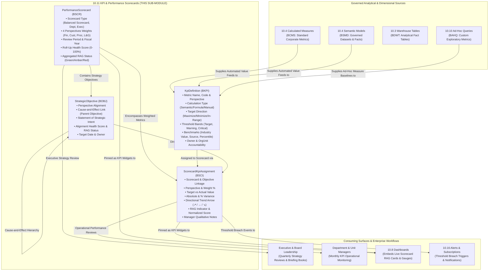

# Research — Sub-module 10.11: KPI & Performance Scorecards (Module 10 — Business Intelligence, `bi`)

- **Sub-module:** 10.11 KPI & Performance Scorecards
- **Module:** 10 Business Intelligence
- **Target app:** `apps/bi` (extended across 10.1–10.10; adding 10.11 `KpiScorecards` package)
- **Research date:** 2026-11-06
- **Phase:** Phase 1 Research Catalog
- **Output file target:** `.claude/tasks/research-bi-10.11.md`

---

## 1. Executive Summary & Domain Architecture

Sub-module 10.11 delivers **centralized KPI catalogs, Balanced Scorecards (Kaplan & Norton 4 perspectives: Financial, Customer, Internal Process, Learning & Growth), goal and target tracking with plan-vs-actual variance and traffic-light RAG indicators, period-over-period and industry benchmarking, and strategy maps with cause-and-effect objective alignment** for NavERP (`apps/bi`). 

While Sub-module 10.8 provides executive visual canvases, Sub-module 10.9 produces banded operational documents, and Sub-module 10.10 empowers ad-hoc exploratory querying, Sub-module 10.11 provides the **strategic operating system of the enterprise**—translating high-level corporate strategy into measurable objectives, cascading KPIs down through business units, continuously calculating health scores, and holding managers accountable for actual results versus target plans.

In modern enterprise performance architectures (Spider Impact, ClearPoint Strategy, Cascade Strategy, BSC Designer, SimpleKPI, Databox, Corporater BMP, AchieveIt):
- **Strategic Alignment:** Connects enterprise mission and vision directly down to measurable KPIs and departmental objectives across Kaplan and Norton's four classical perspectives.
- **Hierarchical Scorecards & Cascading:** Aggregates individual metric performance into weighted objective scores, which in turn roll up into perspective health scores and overall scorecard performance indices.
- **Actionable Monitoring & Governance:** Evaluates actual values against target, warning, and critical thresholds to calculate normalized scores (0–100%), directional trend arrows (improving, steady, deteriorating), and RAG health badges (Red, Amber, Green).
- **Contextual Benchmarking:** Contextualizes performance using period-over-period delta comparisons (MoM, QoQ, YoY) and industry peer benchmark overlays (median, top-quartile standards).
- **Cause-and-Effect Strategy Mapping:** Visualizes how intangible assets and investments in people (Learning & Growth) drive operational efficiency (Internal Business Processes), which fuels customer satisfaction and market share (Customer), ultimately realizing sustainable financial return (Financial).

### Architectural Boundaries & Data Flow

---

## 2. Repo State Checked First

### 2.1 Navigation & App Tree State
- **`apps/core/navigation.py`:** Inspected `LIVE_LINKS`. Sub-modules `10.1` through `10.10` are completely built and live in the sidebar:
  - 10.1: Data Integration & Ingestion (`DataSourceConnector`, `IngestionPipeline`)
  - 10.2: ETL/ELT & Data Pipelines (`EtlPipeline`, `TransformationStep`)
  - 10.3: Data Warehouse & Storage (`WarehouseTable`, `DataMart`)
  - 10.4: Data Modeling & Semantic Layer (`SemanticModel`, `BusinessGlossaryTerm`)
  - 10.5: Data Quality & Cleansing (`DataQualityProfile`, `DataQualityRule`)
  - 10.6: Master Data Management (`MdmGoldenRecord`, `MdmSurvivorshipRule`)
  - 10.7: Data Catalog & Lineage (`CatalogAsset`)
  - 10.8: Dashboards & Visualization (`BiDashboard`, `BiDashboardWidget`)
  - 10.9: Standard & Operational Reporting (`ReportDefinition`)
  - 10.10: Self-Service & Ad-Hoc Analytics (`AdHocQuery`)
- **Next Unbuilt Sub-Module:** `10.11` KPI & Performance Scorecards (no entry in `LIVE_LINKS["10.11"]`).
- **Target package to create in Phase 3:** `apps/bi/models/KpiScorecards/`.

### 2.2 As-Built Core Spine & Sibling Entities (Grep Verified)

| Entity | Location | Verified Status | 10.11 Relationship |
|---|---|---|---|
| `core.Tenant` | `apps/core/models/Tenant.py:17` | **Present** | Mandatory multi-tenant isolation boundary across KPIs, scorecards, assignments, and objectives |
| `settings.AUTH_USER_MODEL` | `config/settings.py` (`accounts.User:52`) | **Present** | Metric owner (`owner`), scorecard manager, objective champion, qualitative note author |
| `core.OrgUnit` | `apps/core/models/OrgUnit.py:5` | **Present** | Departmental / business unit alignment for departmental scorecards and strategic objectives |
| `core.AuditLog` | `apps/core/models/AuditLog.py:5` | **Present** | Audit trail capturing KPI target changes, threshold revisions, and manual score overrides |
| `bi.CalculatedMeasure` | `apps/bi/models/SemanticLayer/CalculatedMeasures.py:9` | **Present** | Corporate standardized metric source linking 10.4 semantic measures directly into KPI definitions |
| `bi.SemanticModel` | `apps/bi/models/SemanticLayer/SemanticModels.py:8` | **Present** | Underlying analytical dataset for automated calculation of operational and financial KPIs |
| `bi.BiDashboard` | `apps/bi/models/Dashboards/BiDashboards.py:8` | **Present** | Target executive dashboard canvas where scorecard summary widgets and KPI cards are embedded |
| `bi.ReportDefinition` | `apps/bi/models/OperationalReporting/ReportDefinitions.py:8` | **Present** | Operational report engine where scorecard data can be rendered into executive briefing packs |
| `bi.AdHocQuery` | `apps/bi/models/SelfServiceAnalytics/AdHocQueries.py:9` | **Present** | Ad-hoc query definitions supplying exploratory measure baselines to KPI libraries |

### 2.3 Collision-Free Prefix Verification
All models in `apps/bi/` inherit from `TenantNumbered` and specify a unique 4-character prefix:
- Existing prefixes in `apps/bi/`:
  - 10.1: `BCDC`, `BDSC`, `BING`, `BIJR`
  - 10.2: `BETL`, `BTRN`, `BPVR`, `BEXR`
  - 10.3: `BDMT`, `BLHZ`, `BWSP`, `BDWT`
  - 10.4: `BSMD`, `BGLO`, `BCMS`, `BDHI`
  - 10.5: `BDQP`, `BDQR`, `BDQE`, `BDQS`
  - 10.6: `BMGR`, `BMSR`, `BMHR`, `BMRD`
  - 10.7: `BCAT`, `BLIN`, `BTRU`, `BGOV`
  - 10.8: `BDSH`, `BDWG`, `BDBM`, `BDFL`
  - 10.9: `BRPT`, `BDRP`, `BRUN`, `BPAR`
  - 10.10: `BAHQ`, `BACF`, `BBLD`, `BSAV`
- Candidate prefixes checked repository-wide — **zero collisions detected**:
  - `BKPI`: `KpiDefinition` (**Unique & Collision-free**)
  - `BSCR`: `PerformanceScorecard` (**Unique & Collision-free**)
  - `BSCI`: `ScorecardKpiAssignment` (**Unique & Collision-free**)
  - `BOBJ`: `StrategicObjective` (**Unique & Collision-free**)

---

## 3. Leaders Surveyed (with source references)

### 1. Spider Impact (Spider Strategies) — The Gold Standard for Balanced Scorecard Automation
- **Positioning**: Certified Balanced Scorecard platform designed to automate Kaplan & Norton frameworks, OKRs, and strategic initiative tracking.
- **Key capabilities**:
  - *Scorecard Tree Hierarchy*: Hierarchical aggregation rolling up individual KPIs into strategic objectives, which roll up into organizational perspectives (Financial, Customer, Internal Processes, Learning & Growth).
  - *Normalized Scoring & Traffic Light Statuses*: Automatic normalization of raw metrics into color-coded scores (Red, Amber, Green) against target, warning, and critical thresholds.
  - *Strategy Maps*: Visual representation of cause-and-effect relationships between strategic objectives dynamically updated with live KPI health.
  - *Actual vs. Plan Tracking*: Visual speedometers, historical trend charts, and actual-versus-target variance tables across customizable review frequencies.
- **Reference URL**: `https://www.spiderstrategies.com/`

### 2. ClearPoint Strategy — Enterprise Strategy Execution & Board Briefing Books
- **Positioning**: Strategy execution and scorecard software built around the Balanced Scorecard methodology for leadership alignment and automated reporting.
- **Key capabilities**:
  - *Four-Perspective Alignment*: Native templates for Financial, Customer, Internal Process, and Learning & Growth perspectives.
  - *Owner Accountability*: Enforced metric ownership linking every KPI and objective to an accountable user.
  - *Qualitative Commentary & Analysis*: Text narrative fields alongside numerical variances enabling managers to document "why" a metric lagged and what corrective actions are underway.
  - *Briefing Books*: Interactive scorecard briefing packs generated automatically for quarterly board reviews.
- **Reference URL**: `https://www.clearpointstrategy.com/`

### 3. Cascade Strategy — Multi-Tier Strategy Execution & Cascading Performance Trees
- **Positioning**: Modern enterprise performance platform connecting corporate strategy to operational KPIs and departmental initiatives.
- **Key capabilities**:
  - *Multi-Level Cascading*: Cascading scorecards from corporate enterprise down to division, department, team, and individual contributors.
  - *Auto-Calculated Health Scoring*: Dynamic score computation recalculating health based on live data inflows and target variance.
  - *RAG Indicators & Directional Trend Arrows*: Automated health badges and trend vectors indicating whether metrics are improving, flat, or declining.
  - *Review Cadences*: Flexible review schedules (weekly, monthly, quarterly, annual) with structured milestone checkpoints.
- **Reference URL**: `https://www.cascade.app/`

### 4. BSC Designer — Kaplan-Norton Strategy Maps & Optimization Direction
- **Positioning**: Dedicated Balanced Scorecard software supporting strategy mapping, KPI formula design, and cause-and-effect linkage.
- **Key capabilities**:
  - *Optimization Direction*: Flexible goal definitions supporting "Higher is Better" (e.g. Sales, CSAT), "Lower is Better" (e.g. Churn, Incident Rate), and "In-Range is Best" (e.g. Inventory Turnover, Resource Utilization).
  - *Strategy Map Cause-and-Effect*: Drag-and-drop linking of objectives across perspectives showing how people growth drives operational performance and customer delight.
  - *Metrics Library*: Centralized catalog of standard KPIs with formulas, measurement units, and target bands.
  - *Weighting & Normalization*: Configurable metric weights within perspectives ensuring high-impact KPIs drive the overall scorecard rating.
- **Reference URL**: `https://bscdesigner.com/`

### 5. SimpleKPI — Agile KPI Tracking & Health Bowler Tables
- **Positioning**: Cloud-based KPI management platform focused on eliminating spreadsheet chaos with clear bowler matrices and status dashboards.
- **Key capabilities**:
  - *Bowler Scorecard Table*: Matrix layouts displaying KPI name, owner, unit, target, actual, variance, percentage variance, and RAG health.
  - *Period-over-Period Tracking*: Comparison of current actual values against previous periods (prior month, prior quarter).
  - *Goal Management*: Setting realistic numerical targets and monitoring deviation over time.
- **Reference URL**: `https://www.simplekpi.com/`

### 6. Databox — KPI Scorecards & Industry Benchmark Groups
- **Positioning**: Performance dashboard and scorecard platform pairing internal goal tracking with external market benchmarking.
- **Key capabilities**:
  - *Management Scorecards*: Curated lists of high-impact KPIs showing current actual, goal, and variance status.
  - *Benchmark Groups*: Anonymized peer group comparison overlaying industry median, bottom 25%, and top 25% standards on internal metrics.
  - *Contextual Goal Setting*: Setting targets informed by external benchmarks rather than subjective estimates.
  - *Benchmark Lines on Charts*: Visual overlay lines on trend graphs comparing company trajectory against industry benchmarks.
- **Reference URL**: `https://databox.com/`

### 7. Corporater Business Management Platform (BMP) — Certified Balanced Scorecard & GPRC Suite
- **Positioning**: Enterprise-grade business management platform certified by Palladium (Kaplan & Norton) for strategy execution.
- **Key capabilities**:
  - *Palladium Certified BSC Framework*: Strict adherence to Kaplan-Norton four perspectives, strategy maps, and initiative linkage.
  - *KPI and KRI Library*: Unified library covering Key Performance Indicators (KPIs) and Key Risk Indicators (KRIs).
  - *Trend Arrows & Status Gauges*: Visual stoplights and multi-angle directional arrows for rapid status assessment.
  - *Scorecard Cascading*: Linking corporate strategy down to operational business units.
- **Reference URL**: `https://corporater.com/`

### 8. AchieveIt — Integrated Plan Management & Execution Accountability
- **Positioning**: Plan performance tracking software driving accountability across cross-functional initiatives and strategic objectives.
- **Key capabilities**:
  - *Strategic Pillars & Objective Hierarchy*: Multi-tiered plan alignment connecting high-level organizational pillars to department plans and KPIs.
  - *Automated Update Cadences*: Automated cadence tracking prompting owners for status updates before reporting meetings.
  - *Target vs Actual Tracking*: Real-time variance tracking with visual health icons.
- **Reference URL**: `https://www.achieveit.com/`

---

## 4. Feature Catalog (mapped to NavERP.md Bullets)

### 4.1 KPI Library & Definitions
- **Centralized KPI Catalog & Governance** — Shared corporate dictionary of Key Performance Indicators with standardized names, unique codes, descriptions, categories, and business tags.
  - *Seen in*: Spider Impact, BSC Designer, Corporater, SimpleKPI.
  - *Priority*: `table-stakes`.
  - *Spine*: Implemented via `KpiDefinition` (`BKPI-`).
  - *Status*: Buildable now.
- **Multi-Source Metric Calculation** — Flexible KPI values populated via manual entry, linked corporate measures from Sub-module 10.4 (`bi.CalculatedMeasure`), formula expressions (e.g. `([Revenue] - [COGS]) / [Revenue] * 100`), or transactional aggregations.
  - *Seen in*: ClearPoint, Spider Impact, SimpleKPI, Cascade.
  - *Priority*: `table-stakes`.
  - *Spine*: `KpiDefinition.calculation_type`, `KpiDefinition.semantic_measure` (`bi.CalculatedMeasure`), `KpiDefinition.formula_expression`.
  - *Status*: Buildable now.
- **Optimization Direction (Goal Orientation)** — Configurable target directions:
  - `maximize`: Higher is better (e.g. Revenue, Customer Retention, Profit Margin).
  - `minimize`: Lower is better (e.g. Churn Rate, Operating Expense, Defect Rate).
  - `in_range`: Target band / in-range is best (e.g. Inventory Turnover, Capacity Utilization).
  - *Seen in*: BSC Designer, Spider Impact, Cascade.
  - *Priority*: `table-stakes`.
  - *Spine*: `KpiDefinition.target_direction`.
  - *Status*: Buildable now.
- **Threshold Bands & Boundary RAG Rules** — Quantitative boundaries defining performance levels:
  - Target Value: The desired performance goal.
  - Warning Threshold: Boundary between Green (Satisfactory) and Amber (At Risk).
  - Critical Threshold: Boundary between Amber and Red (Critical Lag).
  - *Seen in*: Spider Impact, ClearPoint, Cascade, SimpleKPI.
  - *Priority*: `table-stakes`.
  - *Spine*: `KpiDefinition.target_value`, `KpiDefinition.warning_threshold`, `KpiDefinition.critical_threshold`.
  - *Status*: Buildable now.
- **Unit of Measure & Review Frequency** — Formatted display units (`currency`, `percentage`, `count`, `days`, `hours`, `ratio`, `score`) and tracking review frequencies (`daily`, `weekly`, `monthly`, `quarterly`, `annual`).
  - *Seen in*: All surveyed tools.
  - *Priority*: `table-stakes`.
  - *Spine*: `KpiDefinition.unit_of_measure`, `KpiDefinition.tracking_frequency`.
  - *Status*: Buildable now.
- **Ownership & Accountability Assignment** — Explicit assignment of a metric owner (`settings.AUTH_USER_MODEL`) and department (`core.OrgUnit`) to establish line-of-sight accountability.
  - *Seen in*: ClearPoint, AchieveIt, Cascade, SimpleKPI.
  - *Priority*: `table-stakes`.
  - *Spine*: `KpiDefinition.owner` (`accounts.User`), `KpiDefinition.department` (`core.OrgUnit`).
  - *Status*: Buildable now.

### 4.2 Scorecards & Balanced Scorecard
- **Kaplan & Norton 4-Perspective Balanced Scorecard** — Out-of-the-box support for the canonical Balanced Scorecard perspectives:
  1. `financial`: Financial & Shareholder Value (e.g., ROI, Cash Flow, Revenue Growth).
  2. `customer`: Customer Satisfaction & Market Share (e.g., NPS, Retention, Brand Equity).
  3. `internal_process`: Operational Excellence & Cycle Times (e.g., Order Lead Time, Quality Yield).
  4. `learning_growth`: Human Capital, Skills & Innovation (e.g., Training Hours, Employee Retention, R&D Velocity).
  - *Seen in*: Spider Impact, ClearPoint, Corporater, BSC Designer.
  - *Priority*: `table-stakes`.
  - *Spine*: `PerformanceScorecard.scorecard_type`, `ScorecardKpiAssignment.perspective`.
  - *Status*: Buildable now.
- **Scorecard Archetypes** — Configurable scorecard scopes including Balanced Scorecard, Executive Overview, Departmental Scorecard, Operational KPI Board, and Strategic Transformation Board.
  - *Seen in*: Cascade, ClearPoint, Corporater.
  - *Priority*: `common`.
  - *Spine*: `PerformanceScorecard.scorecard_type`.
  - *Status*: Buildable now.
- **Weighted Roll-Up Scoring & Normalization** — Mathematical roll-up of individual KPI scores into perspective scores and overall scorecard performance:
  - Metric weights within perspective (e.g., 20% weight on Gross Margin, 80% on Net Profit).
  - Perspective weights within scorecard (default 25% across all 4 perspectives).
  - Normalization of actual vs. target into a 0.00–100.00% standardized performance index.
  - *Seen in*: Spider Impact, BSC Designer, Cascade.
  - *Priority*: `table-stakes`.
  - *Spine*: `ScorecardKpiAssignment.weight`, `ScorecardKpiAssignment.normalized_score`, `PerformanceScorecard.overall_score`.
  - *Status*: Buildable now.
- **Aggregated Scorecard Health Status** — Overall traffic-light status (`green`, `amber`, `red`, `gray`) reflecting aggregate scorecard performance index.
  - *Seen in*: Spider Impact, ClearPoint, SimpleKPI.
  - *Priority*: `table-stakes`.
  - *Spine*: `PerformanceScorecard.overall_rag_status`.
  - *Status*: Buildable now.
- **Review Period & Fiscal Scoping** — Temporal scoping of scorecards to monthly, quarterly, semi-annual, annual, or rolling 12-month review cycles with fiscal year binding.
  - *Seen in*: ClearPoint, Corporater, Cascade.
  - *Priority*: `table-stakes`.
  - *Spine*: `PerformanceScorecard.review_period`, `PerformanceScorecard.fiscal_year`.
  - *Status*: Buildable now.

### 4.3 Goal & Target Tracking
- **Plan-vs-Actual Variance Analysis** — Real-time computation of deviation between actual metric performance and targeted goals:
  - Absolute Variance: `Actual - Target` (or `Target - Actual` depending on direction).
  - Percentage Variance: `((Actual - Target) / Target) * 100`.
  - *Seen in*: All surveyed tools.
  - *Priority*: `table-stakes`.
  - *Spine*: `ScorecardKpiAssignment.variance`, `ScorecardKpiAssignment.variance_percentage`.
  - *Status*: Buildable now.
- **Traffic-Light RAG Health Indicators** — Clear visual badge signaling health:
  - `green` (On Track / Target Exceeded): Performance meets or exceeds target threshold.
  - `amber` (Warning / Needs Attention): Performance falls within warning tolerance.
  - `red` (Critical Lag / Off Track): Performance breached critical threshold.
  - `gray` (Pending / Not Measured): Awaiting measurement or baseline data.
  - *Seen in*: Spider Impact, ClearPoint, Cascade, SimpleKPI, Databox.
  - *Priority*: `table-stakes`.
  - *Spine*: `ScorecardKpiAssignment.rag_status`.
  - *Status*: Buildable now.
- **Directional Trend Vectors** — Trajectory indicators showing performance momentum compared to prior periods:
  - `improving` (↗): Performance improving toward target.
  - `steady` (→): Performance within ±2% flat variance.
  - `deteriorating` (↘): Performance decaying away from target.
  - *Seen in*: Corporater, Spider Impact, SimpleKPI, BSC Designer.
  - *Priority*: `table-stakes`.
  - *Spine*: `ScorecardKpiAssignment.trend_direction`.
  - *Status*: Buildable now.
- **Qualitative Context & Manager Commentary** — Narrative field enabling metric owners to explain variance drivers, root causes, and corrective action plans during review cycles.
  - *Seen in*: ClearPoint, AchieveIt, Corporater.
  - *Priority*: `common`.
  - *Spine*: `ScorecardKpiAssignment.manager_notes`.
  - *Status*: Buildable now.

### 4.4 Benchmarking
- **Period-over-Period Historical Comparison** — Comparison of current actual performance against prior periods (prior month, prior quarter, year-over-year) to determine velocity and progress.
  - *Seen in*: SimpleKPI, Databox, ClearPoint.
  - *Priority*: `table-stakes`.
  - *Spine*: `KpiDefinition.previous_value`, `KpiDefinition.current_value`.
  - *Status*: Buildable now.
- **Industry & External Benchmark Overlays** — Storing external benchmark standards directly alongside internal metrics (e.g. Industry Average Gross Margin, Peer Median Churn Rate).
  - *Seen in*: Databox (Benchmark Groups), ClearPoint.
  - *Priority*: `common`.
  - *Spine*: `KpiDefinition.industry_benchmark_value`, `KpiDefinition.benchmark_source`, `KpiDefinition.benchmark_percentile`.
  - *Status*: Buildable now.
- **Benchmark Gap Analysis** — Measuring internal performance delta against industry benchmarks (`Actual - Benchmark`), identifying competitive advantages or performance gaps.
  - *Seen in*: Databox, Corporater.
  - *Priority*: `differentiator`.
  - *Spine*: `ScorecardKpiAssignment.benchmark_gap`, `ScorecardKpiAssignment.benchmark_overlay_value`.
  - *Status*: Buildable now.

### 4.5 Strategy Maps & Alignment
- **Strategic Objectives Framework** — Defining high-level corporate objectives (e.g., "Accelerate Enterprise Revenue", "Enhance Customer Retention", "Streamline Production Cycle", "Upskill Technical Workforce") aligned to the 4 BSC perspectives.
  - *Seen in*: Spider Impact, BSC Designer, Corporater, ClearPoint.
  - *Priority*: `table-stakes`.
  - *Spine*: Implemented via `StrategicObjective` (`BOBJ-`).
  - *Status*: Buildable now.
- **Cause-and-Effect Alignment Hierarchy** — Self-referential parent/child linkage modeling how enabling objectives (e.g., Learning & Growth training) drive operational execution (Internal Process efficiency), which drives Customer satisfaction, culminating in Financial outperformance.
  - *Seen in*: Spider Impact, BSC Designer, Corporater.
  - *Priority*: `differentiator`.
  - *Spine*: `StrategicObjective.parent_objective` (self-referential FK).
  - *Status*: Buildable now.
- **Objective Health & Alignment Scoring** — Roll-up alignment score (0.00–100.00%) and aggregated RAG status calculated from the child KPIs assigned to that objective.
  - *Seen in*: Spider Impact, Cascade, ClearPoint.
  - *Priority*: `table-stakes`.
  - *Spine*: `StrategicObjective.alignment_score`, `StrategicObjective.rag_status`.
  - *Status*: Buildable now.
- **Statement of Strategic Intent** — Narrative qualitative vision describing the hypothesis behind the objective, strategic rationale, and expected organizational impact.
  - *Seen in*: ClearPoint, AchieveIt, Corporater.
  - *Priority*: `common`.
  - *Spine*: `StrategicObjective.statement_of_intent`.
  - *Status*: Buildable now.

### 4.6 Beyond the Bullets (High-Value Commercial Capabilities)
- **Pin Scorecard KPI to Executive Dashboard** — Direct cross-module linkage allowing users to pin a live scorecard KPI card or gauge widget to an existing `bi.BiDashboard` (Sub-module 10.8).
  - *Seen in*: Spider Impact, SimpleKPI, Databox.
  - *Priority*: `differentiator`.
  - *Spine*: Cross-wires `ScorecardKpiAssignment` into `bi.BiDashboardWidget`.
  - *Status*: Buildable now.
- **Pre-Built Starter KPI Templates** — Out-of-the-box seed templates for standard financial (Gross Margin, EBITDA, Quick Ratio), customer (NPS, Churn Rate, CAC), operational (Order Lead Time, OTIF), and HR (Employee Turnover, Training Hours) KPIs.
  - *Seen in*: BSC Designer, SimpleKPI.
  - *Priority*: `common`.
  - *Spine*: Seed command `seed_bi` extension.
  - *Status*: Buildable now.

---

## 5. Recommended Build Scope (4 Models)

To deliver Sub-module 10.11 end-to-end within the standard 1–4 model build unit while maintaining full CRUD completeness, tenant isolation, and rich interactive scorecard UI, the recommended build scope comprises:

### 1. `KpiDefinition` (`BKPI-`) — Centralized KPI Catalog & Calculation Rules
- **Purpose**: Master catalog of Key Performance Indicators. Captures metric code, name, category, default perspective, ownership, measurement units, calculation source (manual, 10.4 semantic measure, formula expression), target optimization direction, warning/critical threshold boundaries, current/previous values, and industry benchmark baselines.
- **Key Fields**:
  - `tenant` (`core.Tenant` FK, CASCADE)
  - `number` (auto `BKPI-#####`)
  - `name`: `CharField(max_length=255)`
  - `code`: `CharField(max_length=100, db_index=True)` (e.g. `NET_PROFIT_MARGIN`, `CUST_CHURN_RATE`)
  - `description`: `TextField(blank=True)`
  - `category`: `CharField(max_length=50, choices=CATEGORY_CHOICES)` (`financial`, `customer`, `operational`, `people_hr`, `quality_compliance`, `sustainability`)
  - `default_perspective`: `CharField(max_length=50, choices=PERSPECTIVE_CHOICES)` (`financial`, `customer`, `internal_process`, `learning_growth`)
  - `owner`: `ForeignKey(settings.AUTH_USER_MODEL, SET_NULL, null=True, blank=True)`
  - `department`: `ForeignKey('core.OrgUnit', SET_NULL, null=True, blank=True)`
  - `unit_of_measure`: `CharField(max_length=50, choices=UNIT_CHOICES)` (`currency`, `percentage`, `count`, `days`, `hours`, `ratio`, `score`)
  - `calculation_type`: `CharField(max_length=50, choices=CALC_TYPE_CHOICES)` (`manual`, `semantic_measure`, `formula_expression`, `aggregation`)
  - `semantic_measure`: `ForeignKey('bi.CalculatedMeasure', SET_NULL, null=True, blank=True)` (reusing Sub-module 10.4)
  - `formula_expression`: `CharField(max_length=500, blank=True)`
  - `aggregation_method`: `CharField(max_length=50, choices=AGGREGATION_CHOICES)` (`sum`, `average`, `last_value`, `minimum`, `maximum`)
  - `target_direction`: `CharField(max_length=50, choices=DIRECTION_CHOICES)` (`maximize`, `minimize`, `in_range`)
  - `tracking_frequency`: `CharField(max_length=50, choices=FREQUENCY_CHOICES)` (`daily`, `weekly`, `monthly`, `quarterly`, `annual`)
  - `target_value`: `DecimalField(max_digits=16, decimal_places=4, default=0.0000)`
  - `warning_threshold`: `DecimalField(max_digits=16, decimal_places=4, default=0.0000)`
  - `critical_threshold`: `DecimalField(max_digits=16, decimal_places=4, default=0.0000)`
  - `current_value`: `DecimalField(max_digits=16, decimal_places=4, default=0.0000)`
  - `previous_value`: `DecimalField(max_digits=16, decimal_places=4, default=0.0000)`
  - `industry_benchmark_value`: `DecimalField(max_digits=16, decimal_places=4, null=True, blank=True)`
  - `benchmark_source`: `CharField(max_length=255, blank=True)` (e.g. "Gartner Benchmark 2026", "APQC SCM Standard")
  - `benchmark_percentile`: `IntegerField(null=True, blank=True)`
  - `status`: `CharField(max_length=50, choices=STATUS_CHOICES)` (`draft`, `active`, `under_review`, `deprecated`, `archived`)
  - `is_active`: `BooleanField(default=True)`
- **Prefix**: `BKPI` (100% collision-free repository-wide).

### 2. `PerformanceScorecard` (`BSCR-`) — Balanced Scorecard Container & Roll-Up Index
- **Purpose**: The organizational scorecard container. Governs Balanced Scorecard perspectives, scorecard archetypes (executive, departmental, operational), review cadence, fiscal year, perspective weighting, overall calculated performance score, and aggregate traffic-light health status.
- **Key Fields**:
  - `tenant` (`core.Tenant` FK, CASCADE)
  - `number` (auto `BSCR-#####`)
  - `title`: `CharField(max_length=255)`
  - `code`: `CharField(max_length=100, db_index=True)`
  - `scorecard_type`: `CharField(max_length=50, choices=SCORECARD_TYPE_CHOICES)` (`balanced_scorecard`, `executive`, `departmental`, `operational`, `strategic_initiative`)
  - `description`: `TextField(blank=True)`
  - `owner`: `ForeignKey(settings.AUTH_USER_MODEL, SET_NULL, null=True, blank=True)`
  - `org_unit`: `ForeignKey('core.OrgUnit', SET_NULL, null=True, blank=True)`
  - `review_period`: `CharField(max_length=50, choices=REVIEW_PERIOD_CHOICES)` (`monthly`, `quarterly`, `semi_annual`, `annual`, `rolling_12_months`)
  - `fiscal_year`: `IntegerField(default=2026)`
  - `overall_score`: `DecimalField(max_digits=5, decimal_places=2, default=0.00)` (0.00–100.00% weighted roll-up)
  - `overall_rag_status`: `CharField(max_length=20, choices=RAG_STATUS_CHOICES)` (`green`, `amber`, `red`, `gray`)
  - `financial_weight`: `DecimalField(max_digits=5, decimal_places=2, default=25.00)`
  - `customer_weight`: `DecimalField(max_digits=5, decimal_places=2, default=25.00)`
  - `internal_process_weight`: `DecimalField(max_digits=5, decimal_places=2, default=25.00)`
  - `learning_growth_weight`: `DecimalField(max_digits=5, decimal_places=2, default=25.00)`
  - `is_default`: `BooleanField(default=False)`
  - `is_published`: `BooleanField(default=True)`
  - `status`: `CharField(max_length=50, choices=STATUS_CHOICES)` (`draft`, `active`, `in_review`, `closed`, `archived`)
- **Prefix**: `BSCR` (100% collision-free repository-wide).

### 3. `ScorecardKpiAssignment` (`BSCI-`) — Metric Weighting, Actuals & Variance Tracking
- **Purpose**: Operational junction linking a `KpiDefinition` into a `PerformanceScorecard` and optional `StrategicObjective`. Manages perspective classification, assigned weight, target value, actual recorded value, absolute variance, percentage variance, directional trend arrow, normalized health score, benchmark gap, and manager qualitative commentary.
- **Key Fields**:
  - `tenant` (`core.Tenant` FK, CASCADE)
  - `number` (auto `BSCI-#####`)
  - `scorecard`: `ForeignKey('PerformanceScorecard', CASCADE, related_name='kpi_assignments')`
  - `kpi`: `ForeignKey('KpiDefinition', CASCADE, related_name='scorecard_assignments')`
  - `objective`: `ForeignKey('StrategicObjective', SET_NULL, null=True, blank=True, related_name='kpi_assignments')`
  - `perspective`: `CharField(max_length=50, choices=PERSPECTIVE_CHOICES)` (`financial`, `customer`, `internal_process`, `learning_growth`)
  - `weight`: `DecimalField(max_digits=5, decimal_places=2, default=10.00)` (weight percentage)
  - `target_value`: `DecimalField(max_digits=16, decimal_places=4, default=0.0000)`
  - `actual_value`: `DecimalField(max_digits=16, decimal_places=4, default=0.0000)`
  - `variance`: `DecimalField(max_digits=16, decimal_places=4, default=0.0000)` (Actual - Target)
  - `variance_percentage`: `DecimalField(max_digits=8, decimal_places=2, default=0.00)`
  - `rag_status`: `CharField(max_length=20, choices=RAG_STATUS_CHOICES)` (`green`, `amber`, `red`, `gray`)
  - `trend_direction`: `CharField(max_length=20, choices=TREND_DIRECTION_CHOICES)` (`improving`, `steady`, `deteriorating`)
  - `normalized_score`: `DecimalField(max_digits=5, decimal_places=2, default=100.00)` (0.00–100.00 normalized performance)
  - `benchmark_overlay_value`: `DecimalField(max_digits=16, decimal_places=4, null=True, blank=True)`
  - `benchmark_gap`: `DecimalField(max_digits=16, decimal_places=4, null=True, blank=True)`
  - `sort_order`: `PositiveIntegerField(default=10)`
  - `manager_notes`: `TextField(blank=True)`
- **Prefix**: `BSCI` (100% collision-free repository-wide).

### 4. `StrategicObjective` (`BOBJ-`) — Strategy Maps & Cause-and-Effect Alignment
- **Purpose**: Defines strategic objectives organized across the 4 Balanced Scorecard perspectives. Supports cause-and-effect relationship mapping via a self-referential parent objective FK (e.g. People training -> Operational process -> Customer satisfaction -> Financial results), statement of strategic intent, target dates, and roll-up objective health scoring.
- **Key Fields**:
  - `tenant` (`core.Tenant` FK, CASCADE)
  - `number` (auto `BOBJ-#####`)
  - `name`: `CharField(max_length=255)`
  - `code`: `CharField(max_length=100, db_index=True)`
  - `scorecard`: `ForeignKey('PerformanceScorecard', CASCADE, related_name='objectives')`
  - `perspective`: `CharField(max_length=50, choices=PERSPECTIVE_CHOICES)` (`financial`, `customer`, `internal_process`, `learning_growth`)
  - `parent_objective`: `ForeignKey('self', SET_NULL, null=True, blank=True, related_name='child_objectives')` (cause-and-effect link)
  - `owner`: `ForeignKey(settings.AUTH_USER_MODEL, SET_NULL, null=True, blank=True)`
  - `org_unit`: `ForeignKey('core.OrgUnit', SET_NULL, null=True, blank=True)`
  - `statement_of_intent`: `TextField(blank=True)`
  - `target_date`: `DateField(null=True, blank=True)`
  - `rag_status`: `CharField(max_length=20, choices=RAG_STATUS_CHOICES)` (`green`, `amber`, `red`, `gray`)
  - `alignment_score`: `DecimalField(max_digits=5, decimal_places=2, default=0.00)` (0.00–100.00% roll-up from assigned KPIs)
  - `sort_order`: `PositiveIntegerField(default=10)`
  - `status`: `CharField(max_length=50, choices=STATUS_CHOICES)` (`proposed`, `active`, `achieved`, `postponed`, `canceled`)
- **Prefix**: `BOBJ` (100% collision-free repository-wide).

---

## 6. Belongs to Sibling Sub-Modules (Parked, Not Scoped Here)

- **Real-Time Automated Threshold Alerts & Email/Slack Dispatch** -> Belongs to Sub-module 10.16 Alerts, Subscriptions & Distribution.
- **Drag-and-Drop Visual Dashboard Canvases** -> Belongs to Sub-module 10.8 Dashboards & Visualization.
- **Pixel-Perfect Paginated Scorecard Briefing Books & PDF Output** -> Belongs to Sub-module 10.9 Standard & Operational Reporting.
- **AI-Generated Narrative Insights & Commentary** -> Belongs to Sub-module 10.14 AI & Augmented Analytics.
- **Natural Language Scorecard Inquiries & Conversational Q&A** -> Belongs to Sub-module 10.15 Natural Language & Conversational BI.
- **Multidimensional OLAP Cube Aggregations & MDX/DAX Slice-and-Dice** -> Belongs to Sub-module 10.12 OLAP & Multidimensional Analysis.
- **Threaded Contextual Comments & Collaborative Discussions** -> Belongs to Sub-module 10.18 Collaboration & Data Storytelling.
- **Operational Project Task Scheduling & WBS/Gantt Execution** -> Belongs to Module 9 Projects (`projects`).

---

## 7. Deferred (Later Passes / Integrations)

- **Automated External SaaS Metric Ingestion** (e.g. directly scraping HubSpot, Salesforce, Stripe for KPI actual values) — Deferred to Sub-module 10.19 Integration & API Hub.
- **Predictive Anomaly Detection & Forecast Trend Regressions on KPIs** — Belongs to downstream Sub-module 10.13 Predictive & Advanced Analytics.
- **Bi-Directional Financial Budget Writeback to General Ledger** — Belongs to integration with Module 2 Accounting (`accounting.Budget`).

---

## 8. Summary of Research

- **Sub-module:** 10.11 KPI & Performance Scorecards
- **Products Surveyed:** Spider Impact (Spider Strategies), ClearPoint Strategy, Cascade Strategy, BSC Designer, SimpleKPI, Databox, Corporater Business Management Platform, AchieveIt.
- **Recommended 4 Models:**
  1. `KpiDefinition` (`BKPI-`)
  2. `PerformanceScorecard` (`BSCR-`)
  3. `ScorecardKpiAssignment` (`BSCI-`)
  4. `StrategicObjective` (`BOBJ-`)
- **Prefixes Verified:** `BKPI`, `BSCR`, `BSCI`, `BOBJ` (100% collision-free repository-wide).
- **File Written:** `.claude/tasks/research-bi-10.11.md`
