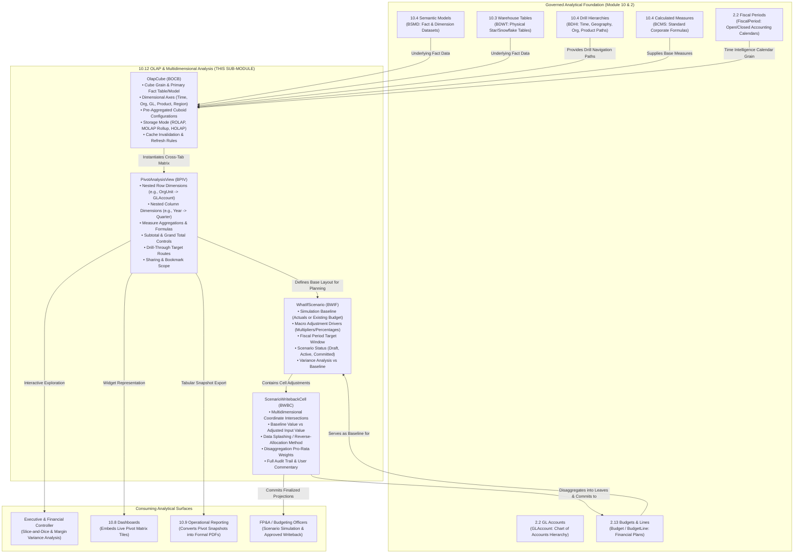

# Research — Sub-module 10.12: OLAP & Multidimensional Analysis (Module 10 — Business Intelligence, `bi`)

- **Sub-module:** 10.12 OLAP & Multidimensional Analysis
- **Module:** 10 Business Intelligence
- **Target app:** `apps/bi` (package: `apps/bi/models/OlapAnalysis/`)
- **Research date:** 2026-11-06
- **Phase:** Phase 1 Research Catalog
- **Output file target:** `.claude/tasks/research-bi-10.12.md`

---

## 1. Executive Summary & Domain Architecture

Sub-module 10.12 delivers **Online Analytical Processing (OLAP), multidimensional cubes, interactive pivot and cross-tab matrix analysis, hierarchical drill navigation, native time intelligence, and what-if planning with writeback adjustments** for NavERP (`apps/bi`).

While Sub-module 10.8 provides curated executive dashboards, Sub-module 10.9 produces formal banded operational reports, and Sub-module 10.10 delivers ad-hoc visual query composition and data blending, Sub-module 10.12 empowers financial analysts, planners, operational controllers, and executives to **slice and dice enterprise metrics across arbitrary dimension intersections, traverse multi-tier hierarchies from executive totals down to granular GL postings, compute period-over-period time intelligence, and simulate business adjustments with governed writeback to financial budgets**.

In modern enterprise architectures (Microsoft SSAS / Power BI XMLA, Cube.js, AtScale, Apache Kylin, Jedox, Board International, Pigment, Vena Solutions, Pentaho Mondrian), OLAP bridges high-volume transactional data and sub-second decision making:
- **Relational OLAP (ROLAP) & Pre-Aggregations:** Dynamic SQL multidimensional rollups and cached summary cuboids over governed warehouse tables and semantic models.
- **Pivot & Cross-Tab Matrix:** Nested row and column dimension hierarchies with interactive expansion, collapsible subtotals, grand totals, and conditional variance formatting.
- **Drill-Down, Up & Through:** Seamless navigation across dimension levels (e.g. Fiscal Year $\rightarrow$ Quarter $\rightarrow$ Month; Company $\rightarrow$ OrgUnit; Account Category $\rightarrow$ GL Account) and drill-through from an aggregated cell down into underlying transactional lines (such as `accounting.JournalLine` or `bi.WarehouseTable` records).
- **Time Intelligence Engine:** Built-in period-to-date (MTD, QTD, YTD), period-over-period growth (YoY, QoQ, MoM), prior period variances, and rolling moving averages mapped to corporate fiscal calendars (`accounting.FiscalPeriod`).
- **What-If Modeling & Writeback:** Isolated simulation sandboxes where planners test macro assumptions (+10% revenue, -5% freight), enter cell-level adjustments with data splashing / reverse-allocation (pro-rata, equal, incremental spread), and commit approved scenarios directly into `accounting.Budget` and `accounting.BudgetLine`.

### Architectural Data Flow



---

## 2. Repo State Checked First

### 2.1 Navigation & App Tree State
- **`apps/core/navigation.py`:** Inspected `LIVE_LINKS`. Sub-modules `10.1` through `10.10` are fully built and live. Sub-module 10.12 is the next planned sub-module in Business Intelligence.
- **`apps/bi/models/`:** Verified existing sub-packages:
  - `DataIntegration/` (10.1: `DataSourceConnector`, `IngestionPipeline`, `CdcSyncConfig`, `IngestionRun`)
  - `EtlPipelines/` (10.2: `EtlPipeline`, `EtlPipelineVersion`, `TransformationStep`, `EtlPipelineRun`)
  - `DataWarehouse/` (10.3: `LakehouseZone`, `WarehouseTable`, `DataMart`, `WarehouseStoragePolicy`)
  - `SemanticLayer/` (10.4: `SemanticModel`, `CalculatedMeasure`, `DrillHierarchy`, `BusinessGlossaryTerm`)
  - `DataQuality/` (10.5: `DataQualityRule`, `DataQualityProfile`, `DataQualityScorecard`, `DataQualityException`)
  - `MasterData/` (10.6: `MdmGoldenRecord`, `MdmSurvivorshipRule`, `MdmHierarchyNode`, `MdmReferenceCode`)
  - `DataCatalog/` (10.7: `CatalogAsset`, `CatalogLineageEdge`, `CatalogTrustEndorsement`, `DataGovernancePolicy`)
  - `Dashboards/` (10.8: `BiDashboard`, `BiDashboardWidget`, `BiDashboardFilter`, `BiDashboardBookmark`)
  - `OperationalReporting/` (10.9: `ReportDefinition`, `ReportParameter`, `ReportDrillPath`, `ReportExecution`)
  - `SelfServiceAnalytics/` (10.10: `AdHocQuery`, `AdHocCalculatedField`, `DataBlendDefinition`, `SavedAnalysisView`)
  - `_base.py` (`TenantOwned`, `TenantNumbered` with `next_number()` sequence allocation and collision retry loops).
  - Target package to create for 10.12: `apps/bi/models/OlapAnalysis/`.

### 2.2 As-Built Core Spine & Sibling Entities (Grep Verified)

| Entity | Location | Verified Status | 10.12 Relationship |
|---|---|---|---|
| `core.Tenant` | `apps/core/models/Tenant.py:17` | **Present** | Mandatory multi-tenant isolation boundary across cubes, pivot views, scenarios, and writeback cells |
| `settings.AUTH_USER_MODEL` | `config/settings.py` (`accounts.User`) | **Present** | Cube author, scenario owner, writeback modifier audit logging |
| `core.OrgUnit` | `apps/core/models/OrgUnit.py:5` | **Present** | Organizational dimension level (Company $\rightarrow$ Division $\rightarrow$ Department), cost center scoping, writeback cell disaggregation |
| `accounting.FiscalPeriod` | `apps/accounting/models/GeneralLedger/FiscalPeriods.py:5` | **Present** | Time intelligence calendar backbone (Month, Quarter, Year), status locking for writeback validation |
| `accounting.GLAccount` | `apps/accounting/models/GeneralLedger/GLAccounts.py:5` | **Present** | Chart of accounts dimensional hierarchy, account types (asset, liability, equity, income, expense), normal balance rules |
| `accounting.Budget` | `apps/accounting/models/Budgeting/Budgets.py:6` | **Present** | Baseline plan for what-if scenarios; destination target when writeback adjustments are committed |
| `accounting.BudgetLine` | `apps/accounting/models/Budgeting/BudgetLines.py:5` | **Present** | Granular target rows (`gl_account`, `org_unit`, `amount`) populated when what-if scenarios are written back to the financial ledger |
| `bi.SemanticModel` | `apps/bi/models/SemanticLayer/SemanticModels.py:8` | **Present** | Primary governed fact/dimension metadata source for OLAP cube definitions |
| `bi.WarehouseTable` | `apps/bi/models/DataWarehouse/WarehouseTables.py:8` | **Present** | Physical warehouse table backing fact aggregations and drill-through targets |
| `bi.CalculatedMeasure` | `apps/bi/models/SemanticLayer/CalculatedMeasures.py:9` | **Present** | Governed corporate measures and time-intelligence formula specifications |
| `bi.DrillHierarchy` | `apps/bi/models/SemanticLayer/DrillHierarchies.py:7` | **Present** | Navigation paths for drill-down/up across time, geography, organizational, and product dimensions |
| `bi.AdHocQuery` | `apps/bi/models/SelfServiceAnalytics/AdHocQueries.py:9` | **Present** | Can be promoted into a multidimensional OLAP cube or feed cross-tab pivots |
| `bi.BiDashboard` | `apps/bi/models/Dashboards/BiDashboards.py:8` | **Present** | Container capable of hosting live interactive pivot matrix widgets |

### 2.3 Unbuilt Spine Entities Confirmed
- `core.Item` / `StockMove` / `LotSerial` (Module 5 Inventory — not yet built). Product dimension levels are represented by semantic field mappings and reference code strings, with clean forward migration readiness.
- `sales.SalesOrder` (Module 8 Sales — not yet built). Sales fact measures are sourced via `bi.WarehouseTable` or `bi.SemanticModel` views.

---

## 3. Leaders Surveyed

Ten commercial market leaders in OLAP engines, multidimensional analytics, MDX/DAX calculation layers, pivot/cross-tab analysis, time intelligence, and what-if writeback were surveyed:

### 1. Microsoft SQL Server Analysis Services (SSAS) / Power BI XMLA / Azure Analysis Services
- **Positioning:** The enterprise benchmark for Multidimensional OLAP (MOLAP) and Tabular (VertiPaq) in-memory analytics.
- **Reference:** https://learn.microsoft.com/en-us/analysis-services/multidimensional-models/olap-logical-cube-objects
- **Key Capabilities:**
  - Measure groups, dimension hierarchies (balanced, unbalanced, parent-child).
  - Native cell writeback: writes adjustments into a dedicated relational writeback table, calculating the net analytical balance on-the-fly (`Base + Adjustments`).
  - Drill-through actions returning the granular underlying transaction rows that produce an aggregated cell.
  - Comprehensive DAX/MDX time intelligence (`TOTALYTD`, `SAMEPERIODLASTYEAR`, `DATEADD`, rolling moving averages).

### 2. Cube.js / Cube
- **Positioning:** Modern universal semantic layer and high-performance pre-aggregation OLAP engine.
- **Reference:** https://cube.dev/docs/product/caching/pre-aggregations/getting-started
- **Key Capabilities:**
  - Automated aggregate awareness and rollup pre-aggregations.
  - Dynamic multidimensional query routing: intercepts slice-and-dice requests and resolves them against optimal pre-computed rollups.
  - Time partitioning by day, month, and year to accelerate incremental historical refreshes.
  - Sub-second query caching over cloud and relational data warehouses.

### 3. Apache Kylin
- **Positioning:** Extreme-scale distributed analytical engine providing sub-second OLAP queries over petabyte datasets.
- **Reference:** https://kylin.apache.org/docs/
- **Key Capabilities:**
  - Pre-calculates multidimensional cuboids ($2^N$ dimension combinations) into high-performance key-value indexes.
  - Aggregation groups, mandatory dimensions, and hierarchy pruning to prevent the curse of dimensionality.
  - Pre-aggregated measures including `SUM`, `COUNT`, `MIN`, `MAX`, `DISTINCT_COUNT` (HyperLogLog), and `TOP_N`.
  - ANSI SQL and MDX compatibility for BI frontends (Excel, Tableau, Power BI).

### 4. AtScale
- **Positioning:** Cloud-native universal semantic layer providing "Virtual OLAP Cubes" over cloud data warehouses.
- **Reference:** https://www.atscale.com/resource/virtual-cube-modern-data-warehouse/
- **Key Capabilities:**
  - Virtualizes multidimensional cubes directly over relational and lakehouse engines (Snowflake, BigQuery, Databricks, PostgreSQL) without duplicating source data.
  - Autonomous Data Engineering: automatically detects frequent drill and slice patterns to synthesize aggregate tables.
  - Translates MDX and DAX multi-axis pivot queries into dialect-optimized SQL.
  - Preserves dimensional hierarchies and enterprise security rules across all connected BI tools.

### 5. Jedox
- **Positioning:** Enterprise Performance Management (EPM) platform with a native in-memory multidimensional OLAP database.
- **Reference:** https://www.jedox.com/en/platform/in-memory-db/
- **Key Capabilities:**
  - Real-time cell-based multidimensional calculation engine designed for FP&A budgeting, planning, and forecasting.
  - Advanced writeback: users type new numbers directly into matrix cells with immediate recalculation.
  - "Data Splashing" (reverse-allocation / disaggregation): spreading top-down adjustments across lower-level child cells (pro-rata based on baseline proportions, equal spread, or incremental addition).
  - Deep what-if scenario branching with instant variance comparison against actuals.

### 6. Board International
- **Positioning:** Unified decision-making platform integrating BI, multidimensional predictive analytics, and performance planning.
- **Reference:** https://www.board.com/en/platform
- **Key Capabilities:**
  - Proprietary multi-dimensional planning database supporting simultaneous multi-user writeback.
  - Dynamic cross-tab and pivot matrices with asymmetric row/column nesting and expandable subtotals.
  - Algorithmic reverse-allocation: updates parent cells and distributes delta values across multidimensional hierarchies.
  - Scenario simulation sandboxes comparing base budgets, optimistic projections, and stress-tested forecasts.

### 7. Infor d/EPM (Dynamic Enterprise Performance Management)
- **Positioning:** Enterprise financial performance management suite built on in-memory multidimensional OLAP cubes.
- **Reference:** https://docs.infor.com/
- **Key Capabilities:**
  - Multidimensional OLAP cubes organizing data across Time, Account, Cost Center, and Scenario axes.
  - Writeback mode with administrative security toggles and cell audit logging.
  - Data splashing routines supporting proportional, delta, and weighted distributions.
  - Dynamic time-intelligence rules evaluating fiscal calendars, quarterly rollups, and rolling forecasts.

### 8. Pigment
- **Positioning:** Next-generation agile business planning and multidimensional modeling platform.
- **Reference:** https://www.gopigment.com/platform
- **Key Capabilities:**
  - Replaces rigid, sparse OLAP cubes with a high-performance, flexible relational calculation engine.
  - Multi-dimensional pivot grids with on-the-fly dimension swapping, nested groupings, and collapsible headers.
  - Instant what-if scenario branching: create independent planning branches without cloning whole databases.
  - Real-time collaborative writeback with granular cell history and rollback capabilities.

### 9. Vena Solutions
- **Positioning:** Excel-first enterprise planning and CPM platform powered by a multidimensional cube engine (CubeFLEX).
- **Reference:** https://www.venasolutions.com/platform
- **Key Capabilities:**
  - Centralized multidimensional cube organizing metrics across Time, Entity, Account, Department, and Scenario dimensions.
  - Governed writeback: users input plans in grid matrices, pushing adjustments directly to the central cube with role permissions and audit trails.
  - Interactive drill-through: one-click navigation from an aggregated cross-tab cell down to individual GL transaction line items.
  - Scenario management comparing actuals, initial budgets, revised forecasts, and simulated scenarios.

### 10. Pentaho Mondrian
- **Positioning:** Widely deployed open-source Relational OLAP (ROLAP) engine supporting MDX and XML schemas.
- **Reference:** https://github.com/pentaho/mondrian
- **Key Capabilities:**
  - Schema defines Cubes, Dimensions, Hierarchies, Levels, and Measures over relational database tables.
  - Dynamic translation of multidimensional MDX queries into group-by relational SQL statements.
  - Aggregate table awareness: routes queries to pre-computed aggregate tables when available.
  - Interactive drill-through action retrieving underlying row-level records for any given cell coordinates.

---

## 4. Feature Catalog (Sub-Module 10.12 Only)

### 4.1 OLAP Cubes & Aggregations
- **Multidimensional Cube Definition (`OlapCube`)** — Central metadata model defining the cube name, grain, primary fact table/model, and assigned dimension axes (Time, Organization, General Ledger, Product, Geography).  
  *Seen in:* SSAS, Cube.js, Mondrian, Vena, Infor d/EPM.  
  *Priority:* `table-stakes`.  
  *Spine:* New tenant-numbered table `bi.OlapCube` [BOCB-]; FKs to `bi.SemanticModel` and `bi.WarehouseTable`. `buildable now`.
- **Pre-Aggregated Cuboid Configurations** — Specification of pre-calculated rollup combinations (e.g. `[FiscalYear, OrgUnit]`, `[FiscalYear, GLAccount, OrgUnit]`) to accelerate frequent query patterns.  
  *Seen in:* Apache Kylin, Cube.js, SSAS, AtScale.  
  *Priority:* `table-stakes`.  
  *Spine:* Configured as structured JSON field `aggregations_config` on `bi.OlapCube`. `buildable now`.
- **Storage / Computation Modes** — Support for ROLAP (dynamic relational grouping), Pre-Aggregated Summary Rollups (MOLAP-style cached summary records), and Hybrid (HOLAP).  
  *Seen in:* SSAS, Mondrian, AtScale.  
  *Priority:* `common`.  
  *Spine:* Choices field on `bi.OlapCube` (`rolap`, `summary_rollup`, `hybrid`). `buildable now`.
- **Sparsity & Cache Invalidation Management** — Intelligent handling of empty dimensional intersections (suppressing zero/empty cells) and scheduled or event-driven cache invalidation when underlying ERP fact tables update.  
  *Seen in:* Jedox, Pigment, Cube.js.  
  *Priority:* `common`.  
  *Spine:* Cache settings and sparsity flags on `bi.OlapCube`. `buildable now`.

### 4.2 Pivot & Cross-Tab Analysis
- **Interactive Pivot Analysis View (`PivotAnalysisView`)** — Configurable multidimensional matrix view defining nested row dimensions, nested column dimensions, and aggregate measures.  
  *Seen in:* Excel PivotTables, Board, Pigment, Vena, Power BI Matrix.  
  *Priority:* `table-stakes`.  
  *Spine:* New tenant-numbered table `bi.PivotAnalysisView` [BPIV-]; FK to `bi.OlapCube`. `buildable now`.
- **Multi-Level Dimension Nesting** — Hierarchical stacking of multiple dimensions along the vertical (rows) and horizontal (columns) axes (e.g., Row: `[OrgUnit, GLAccount]`; Column: `[FiscalYear, FiscalQuarter]`).  
  *Seen in:* Excel, Jedox, Board, Pigment.  
  *Priority:* `table-stakes`.  
  *Spine:* JSON fields `row_dimensions` and `column_dimensions` on `bi.PivotAnalysisView`. `buildable now`.
- **Configurable Subtotals & Grand Totals** — Per-dimension toggle for collapsible subtotals, grand totals for rows, grand totals for columns, and total display positions (top vs bottom, left vs right).  
  *Seen in:* Excel, Mondrian, Pigment.  
  *Priority:* `table-stakes`.  
  *Spine:* Boolean flags and position choices on `bi.PivotAnalysisView`. `buildable now`.
- **Conditional Formatting & Heat Maps** — Cell-level visual formatting rules (gradient color scales, threshold badges, variance heatmaps) highlighting high/low outliers and budget discrepancies.  
  *Seen in:* Excel, Board, Jedox, Pigment.  
  *Priority:* `common`.  
  *Spine:* JSON configuration field `formatting_rules` on `bi.PivotAnalysisView`. `buildable now`.
- **Matrix Slicing & Filter Context** — Dimensional slicers and filter criteria applied to the pivot matrix without altering the underlying cube definition.  
  *Seen in:* Power BI Slicers, SSAS, Pigment.  
  *Priority:* `table-stakes`.  
  *Spine:* JSON field `filters_json` on `bi.PivotAnalysisView`. `buildable now`.

### 4.3 Drill-Down, Up & Through
- **Hierarchical Drill-Down & Drill-Up** — Expand parent nodes to reveal child members along defined drill paths (e.g., Year $\rightarrow$ Quarter $\rightarrow$ Month; Account Category $\rightarrow$ Sub-Account $\rightarrow$ Posting GL Account).  
  *Seen in:* SSAS, Mondrian, AtScale, Board.  
  *Priority:* `table-stakes`.  
  *Spine:* Reuses `bi.DrillHierarchy` (`BDHI`) linked to `bi.OlapCube`. `buildable now`.
- **Drill-Through to Transactional Detail** — Clicking an aggregated matrix cell triggers a drill-through query that retrieves the raw transactional rows (such as general ledger lines in `accounting.JournalLine` or warehouse table rows in `bi.WarehouseTable`).  
  *Seen in:* SSAS Drillthrough Actions, Mondrian, Vena Solutions.  
  *Priority:* `table-stakes`.  
  *Spine:* Target route identifier, drill-through fields, and max-row configuration on `bi.OlapCube` / `bi.PivotAnalysisView`. `buildable now`.
- **Breadcrumb Hierarchy Navigation** — Visual path indicator showing current drill depth with one-click return to higher aggregation levels.  
  *Seen in:* Board, Pigment, ThoughtSpot.  
  *Priority:* `common`.  
  *Spine:* Managed in view context and UI templates. `buildable now`.

### 4.4 Time Intelligence
- **Fiscal Calendar Alignment** — Time dimension binding directly to corporate accounting periods (`accounting.FiscalPeriod`), supporting fiscal year-ends, 4-4-5 / monthly calendars, and open/closed period enforcement.  
  *Seen in:* SSAS, Vena, Jedox, Infor d/EPM.  
  *Priority:* `table-stakes`.  
  *Spine:* Reuses `accounting.FiscalPeriod`. `buildable now`.
- **Period-to-Date Aggregations (MTD, QTD, YTD)** — Dynamic calculation of accumulated figures from the period beginning to current date.  
  *Seen in:* DAX (`TOTALYTD`, `TOTALQTD`, `TOTALMTD`), Cube.js, Board.  
  *Priority:* `table-stakes`.  
  *Spine:* Time intelligence measure functions embedded in `bi.OlapCube` and `bi.CalculatedMeasure`. `buildable now`.
- **Period-over-Period Growth & Variances (YoY, QoQ, MoM)** — Side-by-side comparison of current period values with identical prior periods, calculating absolute variance and percentage growth.  
  *Seen in:* DAX (`SAMEPERIODLASTYEAR`), AtScale, Pigment, Jedox.  
  *Priority:* `table-stakes`.  
  *Spine:* Built-in calculation formulas evaluated dynamically across cube axes. `buildable now`.
- **Rolling Moving Windows** — Trailing 3-month, 6-month, or 12-month moving averages and sums (Trailing Twelve Months / TTM) smoothing seasonal volatility.  
  *Seen in:* Power BI, Cube.js, AtScale.  
  *Priority:* `common`.  
  *Spine:* Rolling window period parameter on measures. `buildable now`.

### 4.5 What-If & Writeback
- **What-If Scenario Sandbox (`WhatIfScenario`)** — Isolated analytical scenario branching from a baseline budget (`accounting.Budget`) or historical actuals, allowing planners to test assumptions without altering production records.  
  *Seen in:* Jedox, Board, Pigment, Vena, Infor d/EPM.  
  *Priority:* `table-stakes`.  
  *Spine:* New tenant-numbered table `bi.WhatIfScenario` [BWIF-]; FK to `accounting.Budget` and `accounting.FiscalPeriod`. `buildable now`.
- **Global Macro Adjustment Drivers** — High-level scenario parameters (e.g., `+8.0%` top-line revenue growth, `+5.0%` raw material inflation, `-3.0%` headcount attrition) automatically factored into cell projections.  
  *Seen in:* Pigment, Board, Jedox.  
  *Priority:* `common`.  
  *Spine:* JSON parameter field `driver_parameters` on `bi.WhatIfScenario`. `buildable now`.
- **Granular Scenario Writeback Cells (`ScenarioWritebackCell`)** — Delta writeback ledger storing individual cell adjustments at specified dimensional coordinates (Account, OrgUnit, Period, Scenario).  
  *Seen in:* SSAS Writeback Tables, Jedox, Infor d/EPM, Vena.  
  *Priority:* `table-stakes`.  
  *Spine:* New tenant-numbered table `bi.ScenarioWritebackCell` [BWBC-]; FK to `bi.WhatIfScenario`, `accounting.GLAccount`, `core.OrgUnit`. `buildable now`.
- **Data Splashing & Reverse-Allocation (Disaggregation)** — When an adjustment is input at a summary/parent level, it automatically disaggregates down to child leaf cells:
  1. *Pro-Rata Spread:* distributed proportionally based on historical baseline weights.
  2. *Equal Spread:* divided evenly among all child nodes.
  3. *Delta / Incremental Spread:* adds a fixed increment to each child node.  
  *Seen in:* Infor d/EPM ("Splashing"), Jedox, Board.  
  *Priority:* `differentiator`.  
  *Spine:* `disaggregation_method` choices on `bi.ScenarioWritebackCell` and `bi.WhatIfScenario`. `buildable now`.
- **Commit Writeback to Financial Budget** — Formal workflow action that approves the what-if scenario and writes the consolidated figures directly into an official `accounting.Budget` and `accounting.BudgetLine`s.  
  *Seen in:* Vena, Jedox, Infor d/EPM.  
  *Priority:* `table-stakes`.  
  *Spine:* Integration workflow creating/updating `accounting.Budget` lines; adheres strictly to L29 ("accounting owns the financial ledger"). `buildable now`.
- **Cell Commentary & Audit Trail** — User justification notes, timestamp, and user attribution for every edited writeback cell.  
  *Seen in:* Vena, Jedox, Pigment.  
  *Priority:* `common`.  
  *Spine:* `notes`, `user`, and `timestamp` fields on `bi.ScenarioWritebackCell`. `buildable now`.

### 4.6 Beyond the Bullets (Enterprise Differentiators)
- **Asymmetric Cross-Tab Stacking** — Ability to display different measure sets or time periods under different dimensional columns (e.g., showing Actuals for Q1–Q3, but Forecast + Variance for Q4 only).  
  *Seen in:* Jedox, Board, Pigment.  
  *Priority:* `differentiator`.  
  *Spine:* Configured within `bi.PivotAnalysisView`. `buildable now`.
- **Writeback Status Locking & Period Control** — Tying scenario editing rights to accounting period lock status (`accounting.FiscalPeriod.status == 'open'`), preventing writeback into locked or closed accounting months.  
  *Seen in:* SSAS, Infor d/EPM, Vena.  
  *Priority:* `table-stakes`.  
  *Spine:* Validated via `accounting.FiscalPeriod.is_open`. `buildable now`.

---

## 5. Recommended Build Scope (This Pass — 4 Models)

To deliver a comprehensive, enterprise-grade OLAP and multidimensional analytics engine for Sub-module 10.12 while adhering strictly to NavERP conventions (`TenantNumbered`, function-based views, single financial ledger, Tailwind + HTMX UI), we recommend **4 tenant-scoped models** organized within `apps/bi/models/OlapAnalysis/`:

```
apps/bi/models/OlapAnalysis/
├── __init__.py
├── OlapCubes.py                 # BOCB: OLAP Cube definition, dimensions, measures, pre-aggregations
├── PivotAnalysisViews.py        # BPIV: Interactive pivot/cross-tab matrix, nesting, subtotals, drill routes
├── WhatIfScenarios.py           # BWIF: Simulation scenario sandbox, baseline, macro drivers, status
└── ScenarioWritebackCells.py    # BWBC: Granular writeback delta ledger, coordinates, disaggregation spread
```

### Model 1: `OlapCube`
- **File:** `apps/bi/models/OlapAnalysis/OlapCubes.py`
- **Class:** `OlapCube(TenantNumbered)`
- **Auto-number Prefix:** `BOCB` (e.g. `BOCB-00001`) — conforming to `apps/bi` 4-character prefix standard (`BDWT`, `BSMD`, `BDHI`, `BAHQ`).
- **Core Fields:**
  - `name`: CharField(max_length=150) — Human-friendly cube name (e.g. "Revenue & Margin Multi-Dimensional Cube", "Operating Expenses Analysis Cube").
  - `code`: SlugField(max_length=60) — Unique tenant slug identifier.
  - `description`: TextField(blank=True).
  - `storage_mode`: CharField(max_length=25, choices=[`rolap`, `summary_rollup`, `hybrid`], default=`rolap`).
  - `semantic_model`: ForeignKey(`bi.SemanticModel`, on_delete=SET_NULL, null=True, blank=True) — Primary governed semantic model fact source.
  - `warehouse_table`: ForeignKey(`bi.WarehouseTable`, on_delete=SET_NULL, null=True, blank=True) — Physical warehouse fact table source.
  - `default_hierarchy`: ForeignKey(`bi.DrillHierarchy`, on_delete=SET_NULL, null=True, blank=True) — Primary drill navigation hierarchy.
  - `dimensions_config`: JSONField(default=list) — List of enabled dimension definitions (`[{"name": "Fiscal Year", "field": "fiscal_year", "type": "time"}, {"name": "Org Unit", "field": "org_unit_name", "type": "org"}, ...]`).
  - `measures_config`: JSONField(default=list) — List of cube measures with aggregation formulas (`[{"name": "Total Revenue", "field": "amount", "agg": "sum", "format": "currency"}, ...]`).
  - `aggregations_config`: JSONField(default=list) — Pre-aggregated rollup cuboid specifications (`[["fiscal_year", "org_unit"], ["fiscal_year", "gl_account"]]`).
  - `time_intelligence_enabled`: BooleanField(default=True) — Enables automatic MTD, QTD, YTD, and YoY calculations.
  - `cache_ttl_minutes`: PositiveIntegerField(default=60) — Cached pre-aggregation time-to-live in minutes.
  - `is_active`: BooleanField(default=True).
  - `created_by`: ForeignKey(settings.AUTH_USER_MODEL, on_delete=SET_NULL, null=True, blank=True).
- **Justified by Researched Features:** OLAP Cubes & Aggregations (Mondrian, SSAS, Cube.js, Kylin), Time Intelligence engine, pre-aggregation awareness.
- **Verified Spine FKs:** `core.Tenant`, `bi.SemanticModel`, `bi.WarehouseTable`, `bi.DrillHierarchy`, `settings.AUTH_USER_MODEL`.

### Model 2: `PivotAnalysisView`
- **File:** `apps/bi/models/OlapAnalysis/PivotAnalysisViews.py`
- **Class:** `PivotAnalysisView(TenantNumbered)`
- **Auto-number Prefix:** `BPIV` (e.g. `BPIV-00001`).
- **Core Fields:**
  - `cube`: ForeignKey(`bi.OlapCube`, on_delete=CASCADE, related_name="pivot_views").
  - `name`: CharField(max_length=150) — Name of the saved pivot matrix view (e.g. "Departmental P&L by Quarter", "Product Margin Cross-Tab").
  - `slug`: SlugField(max_length=80).
  - `description`: TextField(blank=True).
  - `row_dimensions`: JSONField(default=list) — Ordered list of nested row dimension keys (e.g. `["org_unit", "gl_account"]`).
  - `column_dimensions`: JSONField(default=list) — Ordered list of nested column dimension keys (e.g. `["fiscal_year", "fiscal_quarter"]`).
  - `selected_measures`: JSONField(default=list) — Active measure keys displayed in matrix data cells.
  - `filters_json`: JSONField(default=dict) — Slicer and filter criteria applied to the matrix.
  - `show_row_subtotals`: BooleanField(default=True).
  - `show_col_subtotals`: BooleanField(default=True).
  - `show_grand_totals`: BooleanField(default=True).
  - `total_position`: CharField(max_length=15, choices=[`bottom_right`, `top_left`], default=`bottom_right`).
  - `formatting_rules`: JSONField(default=list) — Conditional formatting thresholds and color gradients.
  - `drill_through_enabled`: BooleanField(default=True) — Allows clicking cells to jump to underlying transaction detail.
  - `drill_through_target`: CharField(max_length=80, blank=True, default="accounting:journal_entry_list") — Target URL name for drill-through.
  - `is_shared`: BooleanField(default=False) — Tenant-wide or team visibility.
  - `created_by`: ForeignKey(settings.AUTH_USER_MODEL, on_delete=SET_NULL, null=True, blank=True).
- **Justified by Researched Features:** Pivot & Cross-Tab Analysis (Excel PivotTables, Board, Jedox, Pigment), Drill-Down & Drill-Through navigation, conditional formatting.
- **Verified Spine FKs:** `core.Tenant`, `bi.OlapCube`, `settings.AUTH_USER_MODEL`.

### Model 3: `WhatIfScenario`
- **File:** `apps/bi/models/OlapAnalysis/WhatIfScenarios.py`
- **Class:** `WhatIfScenario(TenantNumbered)`
- **Auto-number Prefix:** `BWIF` (e.g. `BWIF-00001`).
- **Core Fields:**
  - `name`: CharField(max_length=150) — Scenario name (e.g. "FY2027 Optimistic Revenue +8%", "Supply Chain Inflation Stress Test").
  - `code`: SlugField(max_length=60).
  - `cube`: ForeignKey(`bi.OlapCube`, on_delete=CASCADE, related_name="what_if_scenarios").
  - `baseline_budget`: ForeignKey(`accounting.Budget`, on_delete=SET_NULL, null=True, blank=True, related_name="scenarios") — Base budget for comparison.
  - `fiscal_period`: ForeignKey(`accounting.FiscalPeriod`, on_delete=SET_NULL, null=True, blank=True, related_name="what_if_scenarios") — Target planning period.
  - `status`: CharField(max_length=20, choices=[`draft`, `simulated`, `approved`, `committed`, `archived`], default=`draft`).
  - `driver_parameters`: JSONField(default=dict) — Global macro drivers (e.g. `{"revenue_multiplier": 1.08, "cost_inflation_pct": 5.0, "headcount_delta": 2}`).
  - `default_disaggregation`: CharField(max_length=25, choices=[`pro_rata`, `equal`, `delta`], default=`pro_rata`).
  - `notes`: TextField(blank=True).
  - `committed_at`: DateTimeField(null=True, blank=True).
  - `committed_by`: ForeignKey(settings.AUTH_USER_MODEL, on_delete=SET_NULL, null=True, blank=True, related_name="committed_scenarios").
  - `created_by`: ForeignKey(settings.AUTH_USER_MODEL, on_delete=SET_NULL, null=True, blank=True, related_name="created_scenarios").
- **Justified by Researched Features:** What-If & Scenario Planning (Jedox, Board, Pigment, Infor d/EPM, Vena), baseline budgeting alignment.
- **Verified Spine FKs:** `core.Tenant`, `bi.OlapCube`, `accounting.Budget`, `accounting.FiscalPeriod`, `settings.AUTH_USER_MODEL`.

### Model 4: `ScenarioWritebackCell`
- **File:** `apps/bi/models/OlapAnalysis/ScenarioWritebackCells.py`
- **Class:** `ScenarioWritebackCell(TenantNumbered)`
- **Auto-number Prefix:** `BWBC` (e.g. `BWBC-00001`).
- **Core Fields:**
  - `scenario`: ForeignKey(`bi.WhatIfScenario`, on_delete=CASCADE, related_name="writeback_cells").
  - `cell_coordinates`: JSONField(default=dict) — Multidimensional intersection keys (e.g. `{"fiscal_year": "2027", "period": "Q1", "org_unit_id": 4, "gl_account_id": 12}`).
  - `gl_account`: ForeignKey(`accounting.GLAccount`, on_delete=SET_NULL, null=True, blank=True, related_name="writeback_cells") — Optional direct FK for financial lines.
  - `org_unit`: ForeignKey(`core.OrgUnit`, on_delete=SET_NULL, null=True, blank=True, related_name="writeback_cells") — Optional direct FK for departmental cost centers.
  - `measure_name`: CharField(max_length=60, default="amount") — The measure being adjusted.
  - `baseline_value`: DecimalField(max_digits=18, decimal_places=2, default=0) — Original value before adjustment.
  - `adjusted_value`: DecimalField(max_digits=18, decimal_places=2, default=0) — New user-specified value.
  - `variance_amount`: DecimalField(max_digits=18, decimal_places=2, default=0, editable=False) — `adjusted_value - baseline_value`.
  - `disaggregation_method`: CharField(max_length=25, choices=[`direct_leaf`, `pro_rata`, `equal`, `delta`], default=`direct_leaf`).
  - `is_committed`: BooleanField(default=False) — True once written back to official `accounting.BudgetLine`.
  - `commentary`: TextField(blank=True) — User justification for the planning change.
  - `created_by`: ForeignKey(settings.AUTH_USER_MODEL, on_delete=SET_NULL, null=True, blank=True).
- **Justified by Researched Features:** Cell Writeback (SSAS Writeback Tables, Jedox, Infor d/EPM, Vena), Data Splashing / Reverse-Allocation, Full Audit Trail.
- **Verified Spine FKs:** `core.Tenant`, `bi.WhatIfScenario`, `accounting.GLAccount`, `core.OrgUnit`, `settings.AUTH_USER_MODEL`.

---

## 6. Belongs to Sibling Sub-Modules (Parked, Not Scoped Here)

To maintain sharp sub-module boundaries (lessons L31 & L32), the following features surveyed in commercial platforms belong to sibling sub-modules and are parked:
- **KPI Scoring Cards, Cascading Objectives & OKR Trees:** Belongs to **10.11 KPI & Performance Scorecards**.
- **Automated Time-Series Forecasting & Anomaly Detection:** Belongs to **10.13 Predictive & Advanced Analytics**.
- **Natural Language Querying ("Show me Q3 revenue by department"):** Belongs to **10.15 Natural Language & Conversational BI**.
- **Scheduled Email Distribution & Automated Bursts:** Belongs to **10.16 Alerts, Subscriptions & Distribution**.
- **Mobile Native Layouts & Responsive Touch Matrix Slicing:** Belongs to **10.17 Embedded & Mobile BI**.
- **Executive Drag-and-Drop Visual Dashboard Canvases:** Belongs to **10.8 Dashboards & Visualization** (already live; pivot views can be embedded as tiles).
- **Pixel-Perfect Banded Financial Statement Printing:** Belongs to **10.9 Standard & Operational Reporting** (already live).

---

## 7. Deferred (Later Passes / Integrations)

The following advanced or specialized capabilities are deferred to future enterprise hardening passes:
- **External XMLA Protocol Endpoint Listener:** Emulating an SSAS XMLA endpoint for direct Excel / Power BI Desktop external tool connectivity requires a dedicated TCP/HTTP daemon. Deferred; NavERP provides native web-based pivot tables and CSV/Excel exports.
- **Distributed Spark / Hadoop Pre-Computation:** Compiling cuboids across Apache Spark / MapReduce clusters is deferred until multi-node tenant deployment infrastructure is commissioned. NavERP’s built-in ROLAP and summary rollup tables provide sub-second responses on relational database engines.
- **Automated Genetic Pre-Aggregation Index Synthesis:** AtScale-style autonomous query pattern machine learning for automatic index creation is deferred to a future optimization pass.

---

## 8. Summary for Phase 2 (`todo` Agent)

- **Target Sub-module:** 10.12 OLAP & Multidimensional Analysis (`apps/bi`).
- **Commercial Leaders Surveyed:** 10 leading solutions (SSAS / Power BI XMLA, Cube.js, Apache Kylin, AtScale, Jedox, Board International, Infor d/EPM, Pigment, Vena Solutions, Pentaho Mondrian).
- **Recommended Build Scope:** 4 tenant-scoped models in `apps/bi/models/OlapAnalysis/`:
  1. `OlapCube` [`BOCB`]: Cube definition, storage mode (ROLAP/rollup), dimension axes, measures, and pre-aggregations.
  2. `PivotAnalysisView` [`BPIV`]: Nested row/column dimensions, expandable subtotals, grand totals, and drill-through targets.
  3. `WhatIfScenario` [`BWIF`]: Simulation sandbox, baseline budget FK, fiscal period window, macro driver parameters.
  4. `ScenarioWritebackCell` [`BWBC`]: Multidimensional cell coordinates, writeback delta adjustments, reverse-allocation splashing, and commit to `accounting.BudgetLine`.
- **Verified Spine Integration:** Direct foreign keys into `accounting.FiscalPeriod`, `accounting.GLAccount`, `accounting.Budget`, `core.OrgUnit`, `bi.SemanticModel`, `bi.WarehouseTable`, and `bi.DrillHierarchy`.
- **Immediate Next Step:** Hand this research catalog to the `todo` agent to generate the concrete Phase 2 build plan in `.claude/tasks/todo.md`.
