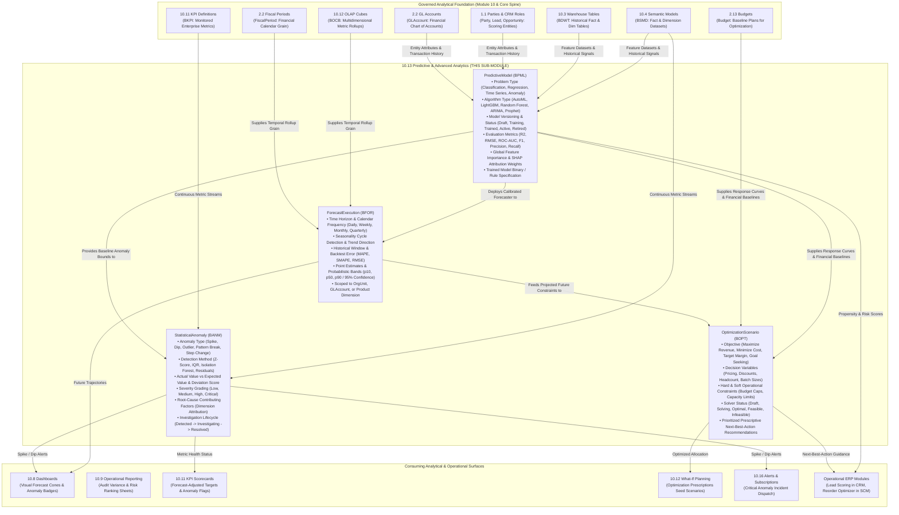
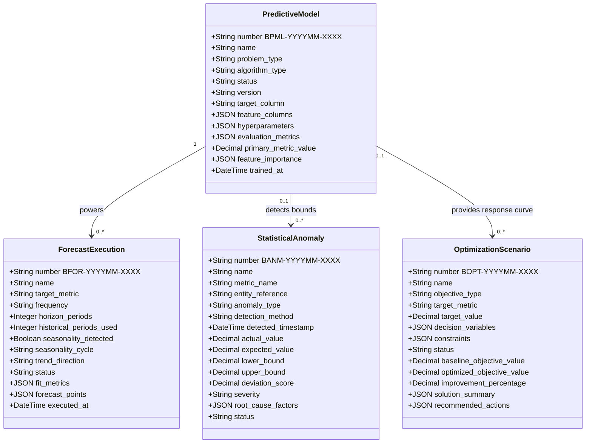

# Research — Sub-module 10.13: Predictive & Advanced Analytics (Module 10 — Business Intelligence, `bi`)

- **Sub-module:** 10.13 Predictive & Advanced Analytics
- **Module:** 10 Business Intelligence
- **Target app:** `apps/bi` (package: `apps/bi/models/PredictiveAnalytics/`)
- **Research date:** 2026-11-07
- **Phase:** Phase 1 Research Catalog
- **Output file target:** `.claude/tasks/research-bi-10.13.md`

---

## 1. Executive Summary & Domain Architecture

Sub-module 10.13 delivers **Predictive & Advanced Analytics, Automated Machine Learning (AutoML), Time-Series Forecasting & Seasonality Detection, Statistical Anomaly & Outlier Detection, and Prescriptive Goal-Seeking & Scenario Optimization** for NavERP (`apps/bi`).

While Sub-module 10.8 delivers visual executive dashboards, Sub-module 10.9 produces formal banded operational reports, Sub-module 10.10 provides visual ad-hoc querying and data blending, Sub-module 10.11 manages KPI catalogs and balanced scorecards, and Sub-module 10.12 powers multidimensional OLAP cubes and financial what-if planning with budget writeback, **Sub-module 10.13 elevates NavERP from descriptive and diagnostic reporting to forward-looking predictive and prescriptive intelligence**.

In modern enterprise architectures (Microsoft Power BI AutoML, AWS SageMaker Canvas, Salesforce Einstein Discovery in Tableau, Qlik AutoML, SAP Analytics Cloud Smart Predict, DataRobot AI Platform, Dataiku DSS, Alteryx Machine Learning, and Databricks AutoML):
- **Predictive & Propensity Modeling:** Governed machine learning algorithms predict binary and continuous enterprise outcomes—such as customer churn probability, lead conversion propensity, supplier delivery default risk, and invoice payment default—with transparent feature attribution.
- **Time-Series Forecasting & Seasonality Detection:** Statistical and ML forecasting models project multi-period future trajectories for revenue, operating cash flow, headcount, and inventory demand, automatically detecting seasonality cycles (weekly, monthly, quarterly) and outputting probabilistic confidence intervals ($p10$, $p50$, $p90$).
- **Statistical Anomaly & Outlier Detection:** Multi-method statistical algorithms (Z-score, Interquartile Range / IQR, moving average residuals, Isolation Forests) continuously scan operational volumes, general ledger postings, and KPI metrics to flag abnormal spikes, dips, and structural pattern breaks before they disrupt operations.
- **Prescriptive Optimization & Goal-Seeking:** Optimization engines solve linear and non-linear business scenarios subject to real-world operational constraints (budget caps, resource limits, minimum margin requirements), providing prioritized **next-best-action** recommendations and goal-seeking solutions.
- **AutoML & Model Lifecycle Management:** Code-free model tournaments automatically evaluate candidate algorithms against standardized evaluation metrics ($R^2$, RMSE, ROC-AUC, F1-score), manage model versioning, track deployment status, and evaluate feature importance / SHAP weights.

### Architectural Data Flow

---

## 2. Repo State Checked First

### 2.1 Navigation & App Tree State
- **`apps/core/navigation.py`:** Inspected `LIVE_LINKS`. Sub-modules `10.1` through `10.12` are fully built and live. Sub-module 10.13 is the next planned sub-module in Module 10 (Business Intelligence).
- **`apps/bi/models/`:** Verified existing sub-packages:
  - `DataIntegration/` (10.1: `DataSourceConnector`, `IngestionPipeline`, `CdcSyncConfig`, `IngestionRun`)
  - `EtlPipelines/` (10.2: `EtlPipeline`, `EtlPipelineVersion`, `TransformationStep`, `EtlPipelineRun`)
  - `DataWarehouse/` (10.3: `LakehouseZone`, `WarehouseTable`, `DataMart`, `WarehouseStoragePolicy`)
  - `SemanticLayer/` (10.4: `SemanticModel`, `CalculatedMeasure`, `DrillHierarchy`, `BusinessGlossaryTerm`)
  - `DataQuality/` (10.5: `DataQualityRule`, `DataQualityProfile`, `DataQualityScorecard`, `DataQualityException`)
  - `MasterData/` (10.6: `MdmGoldenRecord`, `MdmSurvivorshipRule`, `MdmHierarchyNode`, `MdmReferenceCode`)
  - `DataCatalog/` (10.7: `CatalogAsset`, `CatalogLineageEdge`, `CatalogTrustEndorsement`, `DataGovernancePolicy`)
  - `Dashboards/` (10.8: `BiDashboard`, `BiDashboardWidget`, `BiDashboardFilter`, `BiDashboardBookmark`)
  - `OperationalReporting/` (10.9: `ReportDefinition`, `ReportParameter`, `ReportDrillPath`, `ReportExecution`)
  - `SelfServiceAnalytics/` (10.10: `AdHocQuery`, `AdHocCalculatedField`, `DataBlendDefinition`, `SavedAnalysisView`)
  - `PerformanceScorecards/` (10.11: `KpiDefinition`, `PerformanceScorecard`, `ScorecardKpiAssignment`, `StrategicObjective`)
  - `OlapAnalysis/` (10.12: `OlapCube`, `PivotAnalysisView`, `WhatIfScenario`, `ScenarioWritebackCell`)
  - Base classes: `apps/bi/models/_base.py` (`TenantOwned`, `TenantNumbered` with `next_number()` sequence allocation and collision retry loops).
  - Target package to create for 10.13: `apps/bi/models/PredictiveAnalytics/`.

### 2.2 As-Built Core Spine & Sibling Entities (Grep Verified)

| Entity | Location | Verified Status | 10.13 Relationship |
|---|---|---|---|
| `core.Tenant` | `apps/core/models/Tenant.py:17` | **Present** | Mandatory multi-tenant isolation boundary across predictive models, forecast runs, anomalies, and optimization scenarios |
| `settings.AUTH_USER_MODEL` | `config/settings.py` (`accounts.User`) | **Present** | Model trainer, forecast executor, anomaly investigator, and scenario owner audit logging |
| `core.OrgUnit` | `apps/core/models/OrgUnit.py:5` | **Present** | Organizational dimension scoping for departmental forecasts, budget optimization, and anomaly allocation |
| `core.Party` | `apps/core/models/Party.py:5` | **Present** | Scoring target entity for customer churn, supplier default risk, and credit propensity models |
| `core.AuditLog` | `apps/core/models/AuditLog.py:5` | **Present** | Immutable change and compliance tracking for model deployments and optimization approvals |
| `accounting.FiscalPeriod` | `apps/accounting/models/GeneralLedger/FiscalPeriods.py:5` | **Present** | Time intelligence calendar backbone (Month, Quarter, Year) for time-series forecasting and anomaly baselines |
| `accounting.GLAccount` | `apps/accounting/models/GeneralLedger/GLAccounts.py:5` | **Present** | Chart of accounts scoping for financial revenue/expense forecasting and GL transaction anomaly detection |
| `accounting.Budget` | `apps/accounting/models/Budgeting/Budgets.py:6` | **Present** | Baseline plan and financial constraint target for goal-seeking and prescriptive optimization |
| `accounting.BudgetLine` | `apps/accounting/models/Budgeting/BudgetLines.py:5` | **Present** | Detailed account-level budget lines optimized by prescriptive scenarios |
| `bi.SemanticModel` | `apps/bi/models/SemanticLayer/SemanticModels.py:8` | **Present** | Governed fact and dimension dataset metadata source used for ML feature extraction and training |
| `bi.WarehouseTable` | `apps/bi/models/DataWarehouse/WarehouseTables.py:8` | **Present** | Physical star/snowflake warehouse table providing historical training samples and forecast writeback targets |
| `bi.CalculatedMeasure` | `apps/bi/models/SemanticLayer/CalculatedMeasures.py:9` | **Present** | Standardized corporate metrics evaluated for anomaly detection and optimization objectives |
| `bi.KpiDefinition` | `apps/bi/models/PerformanceScorecards/KpiDefinitions.py:12` | **Present** | Enterprise KPI target evaluated for statistical anomaly violation and goal-seeking optimization |
| `bi.OlapCube` | `apps/bi/models/OlapAnalysis/OlapCubes.py:9` | **Present** | Multidimensional aggregated rollups feeding pre-aggregated fact metrics into forecasting engines |
| `crm.Lead` | `apps/crm/models/CoreData/Leads.py:5` | **Present** | Target entity for propensity-to-convert and lead qualification predictive scoring |
| `crm.Opportunity` | `apps/crm/models/SalesForceAutomation/Opportunities.py:5` | **Present** | Target entity for win/loss likelihood, expected deal size regression, and sales velocity modeling |

### 2.3 Unbuilt Spine Entities Confirmed
- `core.Item` / `StockMove` / `LotSerial` (Module 5 Inventory — not yet built). SKU demand prediction and inventory stockout risk scoring use string reference codes (`item_code`, `sku_reference`) with future foreign key migration paths.
- `sales.SalesOrder` (Module 8 Sales — not yet built). Sales demand forecasting operates over `bi.WarehouseTable` fact records or `bi.SemanticModel` aggregations.

### 2.4 Prefix Collision Sweep
A comprehensive repo-wide check was executed across all apps in NavERP. All `apps/bi` prefixes strictly adhere to the 4-character uppercase convention starting with `B`:
- Proposed for 10.13:
  - `BPML` (PredictiveModel): **0 collisions** across entire repository.
  - `BFOR` (ForecastExecution): **0 collisions** across entire repository.
  - `BANM` (StatisticalAnomaly): **0 collisions** across entire repository.
  - `BOPT` (OptimizationScenario): **0 collisions** across entire repository.
- Neighboring `apps/bi` prefixes:
  - 10.1: `BDSC`, `BING`, `BCDC`, `BIJR`
  - 10.2: `BETL`, `BPVR`, `BTRN`, `BEXR`
  - 10.3: `BLHZ`, `BDWT`, `BDMT`, `BWSP`
  - 10.4: `BSMD`, `BCMS`, `BDHI`, `BGLO`
  - 10.5: `BDQR`, `BDQP`, `BDQS`, `BDQE`
  - 10.6: `BMGR`, `BMSR`, `BMHR`, `BMRD`
  - 10.7: `BCAT`, `BLIN`, `BTRU`, `BGOV`
  - 10.8: `BDSH`, `BDWG`, `BDFL`, `BDBM`
  - 10.9: `BRPT`, `BPAR`, `BDRP`, `BRUN`
  - 10.10: `BAHQ`, `BACF`, `BBLD`, `BSAV`
  - 10.11: `BKPI`, `BSCR`, `BSCI`, `BOBJ`
  - 10.12: `BOCB`, `BPIV`, `BWIF`, `BWBC`

---

## 3. Commercial Leaders Surveyed

Nine commercial market leaders in AutoML, time-series forecasting, statistical anomaly detection, explainable AI, and prescriptive optimization were surveyed:

### 1. Microsoft Power BI AutoML & AI Visuals
- **Positioning:** Embedded automated machine learning and augmented intelligence suite integrated into Microsoft Power BI and Fabric.
- **Reference:** https://learn.microsoft.com/en-us/power-bi/transform-model/desktop-ai-visuals-concept
- **Key Capabilities:**
  - Guided no-code AutoML wizard in Power BI Dataflows supporting Binary Classification, General Classification, and Regression models.
  - Native Time-Series Visual Forecasting built directly into Line Charts, using exponential smoothing (ETS) algorithms with configurable forecast lengths, confidence intervals (75% to 99%), and auto-detected seasonality.
  - Built-in Anomaly Detection highlighting unexpected spikes and drops in temporal charts with adjustable sensitivity bands and instant root-cause factor explanations.
  - Automated feature extraction, hyperparameter tuning, model performance scoring, and automatic generation of explainability reports detailing top driving factors.

### 2. AWS SageMaker Canvas
- **Positioning:** Visual, code-free machine learning platform empowering business analysts to build, explain, and simulate ML models.
- **Reference:** https://aws.amazon.com/sagemaker/canvas/
- **Key Capabilities:**
  - Automated time-series forecasting supporting multi-series modeling across thousands of item-location hierarchies.
  - Quantile forecasting generating probabilistic trajectories ($p10$, $p50$, $p90$) to model best-case, expected, and worst-case scenarios.
  - Interactive "What-If" scenario simulation directly on forecast plots, recalculating projected curves when users adjust input variables (e.g. price promotions, staffing).
  - Model explainability powered by SHAP (Shapley Additive exPlanations), delivering directional impact scores and feature importance rankings at global and row levels.

### 3. Salesforce Einstein Discovery in Tableau
- **Positioning:** Market-leading predictive and prescriptive analytics engine embedded in Tableau dashboards and CRM workflows.
- **Reference:** https://help.salesforce.com/s/articleView?id=sf.bi_edd_tableau_overview.htm
- **Key Capabilities:**
  - Automated machine learning training on tabular datasets with classification, regression, and scoring models.
  - Transparent "Why It Happened" diagnostic explanations surfacing the strongest correlation drivers behind historical outcomes.
  - Prescriptive "Improvements" and next-best-action guidance identifying actionable, controllable levers (e.g. discount adjustment, preferred carrier) that optimize the predicted outcome.
  - Interactive scenario modeling: dynamically alters input parameters in Tableau dashboards and recalculates predicted outcomes in real time.

### 4. Qlik AutoML (Qlik Predict)
- **Positioning:** Code-free automated machine learning integrated into Qlik Cloud Analytics and augmented intelligence.
- **Reference:** https://www.qlik.com/us/products/automl
- **Key Capabilities:**
  - End-to-end automated machine learning for classification and regression tasks, identifying target fields, data leakage, and feature collinearity.
  - Real-time Explainable AI (XAI) computing SHAP values for every single predicted record, explaining *why* an individual customer or transaction was scored high or low.
  - Key Driver Analysis enabling ad-hoc driver discovery directly from visual sheets using underlying Random Forest models.
  - Scenario planning and simulations testing operational changes by shifting feature values and viewing dynamic prediction adjustments.

### 5. SAP Analytics Cloud (SAC) Smart Predict
- **Positioning:** Native embedded machine learning and predictive forecasting engine built directly into SAP's enterprise ERP/BI suite.
- **Reference:** https://help.sap.com/docs/SAP_ANALYTICS_CLOUD/00f68c2e08b941f081002fd3691d86a7/0a943715ffea49a19c5c2d1bbf223363.html
- **Key Capabilities:**
  - Three specialized predictive scenarios: Classification (churn, propensity-to-buy), Regression (deal size, cost estimation), and Time-Series Forecasting (demand, cash flow).
  - Automated Model Quality Indicators: Predictive Power ($KI$ - how well the model explains historical variation) and Prediction Confidence ($KR$ - robustness against overfitting on unseen data).
  - Outlier detection and automated calendar/holiday candidate influencer integration for temporal signals.
  - Native writeback of forecasted and predicted values directly into planning models and financial budgets.

### 6. DataRobot AI Platform
- **Positioning:** Enterprise-grade AI platform automating the end-to-end lifecycle from data ingestion to model registry, MLOps, and monitoring.
- **Reference:** https://www.datarobot.com/platform/
- **Key Capabilities:**
  - Automated Time Series modeling supporting segmented and multi-series hierarchical forecasting with automated lag, rolling average, and trend derivation.
  - Unsupervised Anomaly Detection blueprints identifying operational outliers, transaction irregularities, and security deviations.
  - Centralized Model Registry providing governed versioning, model packages, lineage tracking, and compliance documentation.
  - Comprehensive MLOps monitoring service health, prediction latency, data drift, and concept drift, triggering automated retraining against challenger models.

### 7. Dataiku DSS
- **Positioning:** Collaborative enterprise AI and machine learning platform bridging data preparation, modeling, and operational deployment.
- **Reference:** https://www.dataiku.com/product/capabilities/machine-learning/
- **Key Capabilities:**
  - Guided AutoML featuring Quick Prototypes (rapid baseline models), Interpretable Models (white-box decision trees), and High-Performance algorithms (XGBoost, LightGBM).
  - Visual scoring recipes applying trained models to batch and streaming datasets, outputting individual row explanations and top feature importance reasons.
  - Native time-series preparation, seasonality decomposition, and forecasting recipes.
  - Prescriptive optimization combining predictive model scoring with custom business rules, cost-benefit matrices, and mathematical constraints.

### 8. Alteryx Machine Learning & Intelligence Suite
- **Positioning:** No-code/low-code automated machine learning and assisted modeling suite for business analysts.
- **Reference:** https://www.alteryx.com/products/alteryx-machine-learning
- **Key Capabilities:**
  - Automated Feature Engineering using Deep Feature Synthesis (DFS) to extract relational and aggregation signals from multi-table schemas.
  - Automated algorithm selection and tuning across tree-based ensembles, linear models, and specialized time-series engines (ARIMA, Exponential Smoothing, Prophet).
  - Explainable AI (XAI) dashboards providing global feature importance and individual prediction breakdowns to demystify black-box models.
  - Prescriptive workflow integration connecting predictive outputs directly into optimization routines to prescribe operational actions.

### 9. Databricks AutoML & MLflow
- **Positioning:** Glass-box automated machine learning engine integrated with the MLflow model registry and governance layer.
- **Reference:** https://docs.databricks.com/en/machine-learning/automl/index.html
- **Key Capabilities:**
  - Glass-box AutoML generating transparent, editable Python code notebooks for classification, regression, and forecasting trials.
  - Automated evaluation across standard metrics: ROC-AUC, F1, Log Loss for classification; RMSE, MAE, $R^2$ for regression; SMAPE, MAPE for forecasting.
  - Unified experiment tracking via MLflow, logging hyperparameters, artifacts, confusion matrices, and residual distribution plots.
  - Seamless promotion of winning models to the Model Registry for governed versioning, staging transitions, and deployment.

---

## 4. Feature Catalog (Sub-Module 10.13 Only)

Features are deduplicated across surveyed commercial leaders and organized strictly by the bolded feature bullets in `NavERP.md` Section 10.13:

### 4.1 Forecasting & Trend Analysis
- **Time-Series Forecast Execution (`ForecastExecution`)** — Execution of time-series projections over historical metrics, defining horizon periods, calendar frequency (daily, weekly, monthly, quarterly, yearly), and historical sample windows.  
  *Seen in:* Power BI, SageMaker Canvas, SAC Smart Predict, DataRobot, Alteryx, Databricks.  
  *Priority:* `table-stakes`.  
  *Spine:* New tenant-numbered table `bi.ForecastExecution` [BFOR-]; FK to `bi.PredictiveModel` and `accounting.FiscalPeriod`. `buildable now`.
- **Automated Seasonality & Periodicity Detection** — Statistical algorithms analyzing historical time-series signals to detect repeating cyclical patterns (7-day weekly, 12-month annual, 4-quarter cyclical) and calculate seasonality strength indices.  
  *Seen in:* Power BI, SageMaker Canvas, DataRobot, Prophet.  
  *Priority:* `table-stakes`.  
  *Spine:* Seasonality cycle fields and boolean flags on `bi.ForecastExecution`. `buildable now`.
- **Probabilistic Confidence Intervals ($p10$, $p50$, $p90$)** — Generation of forecast uncertainty boundaries (median expected curve along with conservative $p10$ lower bound and optimistic $p90$ upper bound, or 95% confidence bands).  
  *Seen in:* SageMaker Canvas, Power BI, DataRobot.  
  *Priority:* `table-stakes`.  
  *Spine:* Structured JSON field `forecast_points` storing array of timestamped estimates with bounds on `bi.ForecastExecution`. `buildable now`.
- **Trend Direction & Changepoint Detection** — Automatic characterization of series momentum (upward, downward, flat, volatile) and identification of inflection points where growth rates structurally shifted.  
  *Seen in:* Prophet, SAC Smart Predict, Alteryx.  
  *Priority:* `common`.  
  *Spine:* Choices field `trend_direction` and changepoints list on `bi.ForecastExecution`. `buildable now`.
- **Backtesting & Historical Fit Error Metrics** — Automated evaluation of model accuracy over withheld historical periods, computing Mean Absolute Percentage Error (MAPE), Symmetric MAPE (SMAPE), and Root Mean Squared Error (RMSE).  
  *Seen in:* DataRobot, Databricks, SageMaker Canvas.  
  *Priority:* `table-stakes`.  
  *Spine:* JSON field `fit_metrics` on `bi.ForecastExecution`. `buildable now`.

### 4.2 Predictive & Propensity Models
- **Predictive Model Registry (`PredictiveModel`)** — Governed catalog registering trained models, problem type (classification, regression, time series, anomaly detection), target metric, feature schema, algorithm family, and execution status.  
  *Seen in:* DataRobot, Databricks MLflow, Dataiku, SAC Smart Predict.  
  *Priority:* `table-stakes`.  
  *Spine:* New tenant-numbered table `bi.PredictiveModel` [BPML-]; FK to `bi.SemanticModel` or `bi.WarehouseTable`. `buildable now`.
- **Customer Churn & Retention Propensity Scoring** — Binary classification models estimating the probability of customer departure based on purchase frequency, support ticket volume, payment lag, and engagement recency.  
  *Seen in:* SAC Smart Predict, Qlik AutoML, Power BI, DataRobot.  
  *Priority:* `table-stakes`.  
  *Spine:* Supported as `problem_type='classification'` on `bi.PredictiveModel`; scores reference `core.Party`. `buildable now`.
- **Lead & Opportunity Conversion Likelihood** — Propensity scoring predicting the probability that a prospective lead or sales deal closes successfully, prioritizing sales team follow-up.  
  *Seen in:* Salesforce Einstein, HubSpot Predictive Lead Scoring, Qlik AutoML.  
  *Priority:* `table-stakes`.  
  *Spine:* Scored over `crm.Lead` and `crm.Opportunity` via `bi.PredictiveModel`. `buildable now`.
- **Credit & Financial Default Risk Scoring** — Regression and classification estimating risk scorecards and probability of late customer payments or invoice default.  
  *Seen in:* Dataiku, SAC, Power BI.  
  *Priority:* `common`.  
  *Spine:* Sourced from `accounting.Invoice` and `accounting.Payment` history via semantic layers into `bi.PredictiveModel`. `buildable now`.
- **Batch & Interactive Model Scoring** — Engine applying trained model logic to current database tables to compute updated predictions, confidence scores, and ranking percentiles.  
  *Seen in:* Dataiku (Scoring Recipe), DataRobot, Qlik.  
  *Priority:* `table-stakes`.  
  *Spine:* Service method in `apps/bi/services/predictive.py` logging predictions into audit and operational views. `buildable now`.

### 4.3 Prescriptive & Optimization
- **Prescriptive Optimization Scenarios (`OptimizationScenario`)** — Governed simulation scenario defining an objective function (maximize revenue, minimize cost, maximize profit margin, goal-seeking), decision variables, and constraint parameters.  
  *Seen in:* Salesforce Einstein Discovery, Dataiku, Board, Alteryx.  
  *Priority:* `table-stakes`.  
  *Spine:* New tenant-numbered table `bi.OptimizationScenario` [BOPT-]; optional FK to `bi.PredictiveModel` and `accounting.Budget`. `buildable now`.
- **Goal-Seeking & Target Inversion** — Back-calculation solving for the required input values (e.g. required sales volume or maximum allowable discount) needed to hit an executive target metric (e.g. 15% net operating margin).  
  *Seen in:* Excel Goal Seek, SAC, Einstein Discovery, Pigment.  
  *Priority:* `table-stakes`.  
  *Spine:* Objective type `goal_seeking` with target value field on `bi.OptimizationScenario`. `buildable now`.
- **Controllable Decision Variables & Ranges** — Explicit definition of business levers that can be altered (e.g. product discount range [5%–20%], marketing budget allocation, warehouse replenishment batch sizes).  
  *Seen in:* Einstein Discovery, Dataiku, Alteryx.  
  *Priority:* `table-stakes`.  
  *Spine:* JSON field `decision_variables` on `bi.OptimizationScenario`. `buildable now`.
- **Operational Constraint Boundaries** — Enforcing hard and soft business constraints (e.g. maximum budget cap, minimum headcount, warehouse capacity, regulatory price floors).  
  *Seen in:* Dataiku, Board, IBM ILOG CPLEX.  
  *Priority:* `table-stakes`.  
  *Spine:* JSON field `constraints` on `bi.OptimizationScenario`. `buildable now`.
- **Prioritized Next-Best-Action Recommendations** — Ordered, actionable business prescriptions derived from the optimization solution (e.g. "1. Offer 7% discount to Tier-1 accounts; 2. Shift 12% freight to regional carrier; 3. Reorder SKU-402 at volume tier").  
  *Seen in:* Salesforce Einstein Discovery, Pega Customer Decision Hub.  
  *Priority:* `differentiator`.  
  *Spine:* Structured JSON field `recommended_actions` on `bi.OptimizationScenario`. `buildable now`.

### 4.4 Anomaly & Outlier Detection
- **Statistical Anomaly Register (`StatisticalAnomaly`)** — Central log recording detected anomalies, identifying the affected metric, entity reference, detection timestamp, actual vs expected values, and deviation score.  
  *Seen in:* Power BI Anomaly Detection, DataRobot, AWS Lookout for Metrics, Datadog Watchdog.  
  *Priority:* `table-stakes`.  
  *Spine:* New tenant-numbered table `bi.StatisticalAnomaly` [BANM-]; FK to `bi.PredictiveModel`, `bi.SemanticModel`, or `bi.KpiDefinition`. `buildable now`.
- **Multi-Method Detection Algorithms** — Support for diverse statistical detection strategies: Z-Score (standard deviation deviations), Interquartile Range (IQR boxplot outliers), Moving Average Residuals, and Isolation Forests.  
  *Seen in:* Power BI, DataRobot, Alteryx, Databricks.  
  *Priority:* `table-stakes`.  
  *Spine:* Choices field `detection_method` on `bi.StatisticalAnomaly`. `buildable now`.
- **Anomaly Pattern Classification** — Distinguishing anomaly morphologies: sudden positive spikes (`spike`), sudden negative collapse (`dip`), multivariate outliers (`outlier`), structural trend violations (`pattern_break`), and permanent baseline shifts (`step_change`).  
  *Seen in:* Power BI, Amazon Lookout, Anodot.  
  *Priority:* `common`.  
  *Spine:* Choices field `anomaly_type` on `bi.StatisticalAnomaly`. `buildable now`.
- **Root-Cause Factor Attribution** — Diagnostic breakdown identifying the top dimensions and categorical features contributing to the anomaly (e.g. "Customer Acme Corp placed 5.2x standard volume in Northwest Region").  
  *Seen in:* Power BI (Anomaly Explanations), Qlik (Driver Analysis), DataRobot.  
  *Priority:* `differentiator`.  
  *Spine:* Structured JSON field `root_cause_factors` on `bi.StatisticalAnomaly`. `buildable now`.
- **Investigation & Resolution Lifecycle** — Governed workflow state tracking the investigation of anomalies (`detected` $\rightarrow$ `acknowledged` $\rightarrow$ `investigating` $\rightarrow$ `confirmed_true_positive` | `false_positive` $\rightarrow$ `resolved`).  
  *Seen in:* Datadog, Dynatrace, AWS Lookout.  
  *Priority:* `table-stakes`.  
  *Spine:* Choices field `status`, resolution notes, and resolver user FK on `bi.StatisticalAnomaly`. `buildable now`.

### 4.5 AutoML & Model Lifecycle
- **No-Code AutoML Tournament** — Automated model competition that trains multiple candidate algorithms against a training dataset and ranks them on a leaderboard by primary evaluation metric.  
  *Seen in:* DataRobot, Databricks AutoML, Qlik AutoML, SAC Smart Predict.  
  *Priority:* `table-stakes`.  
  *Spine:* Configured via `algorithm_type='auto_ml'` on `bi.PredictiveModel`. `buildable now`.
- **Standardized Model Evaluation Metrics** — Multi-metric evaluation recording $R^2$, RMSE, and MAE for regression; ROC-AUC, F1-Score, Precision, and Recall for classification; and SMAPE for forecasting.  
  *Seen in:* Databricks, DataRobot, SageMaker Canvas, Alteryx.  
  *Priority:* `table-stakes`.  
  *Spine:* Structured JSON field `evaluation_metrics` and decimal `primary_metric_value` on `bi.PredictiveModel`. `buildable now`.
- **Model Versioning & Lineage Tracking** — Version tracking (`v1.0`, `v1.1`, `v2.0`) recording parent model lineages, training timestamp, training dataset snapshot reference, and user author.  
  *Seen in:* MLflow, DataRobot Model Registry, SageMaker Model Registry.  
  *Priority:* `table-stakes`.  
  *Spine:* Fields `version`, `trained_at`, `trained_by` on `bi.PredictiveModel`. `buildable now`.
- **Deployment Status Lifecycle** — Governed operational lifecycle (`draft` $\rightarrow$ `training` $\rightarrow$ `trained` $\rightarrow$ `active` $\rightarrow$ `retired` | `failed`). Only `active` models are executed by production forecast and scoring pipelines.  
  *Seen in:* MLflow, DataRobot, AWS SageMaker.  
  *Priority:* `table-stakes`.  
  *Spine:* Choices field `status` on `bi.PredictiveModel`. `buildable now`.
- **Challenger Comparison & Performance Degradation** — Periodic benchmarking comparing the production model against newly trained challenger models to identify performance drift over time.  
  *Seen in:* DataRobot MLOps, Databricks.  
  *Priority:* `common`.  
  *Spine:* Status flags and metric comparison fields on `bi.PredictiveModel`. `buildable now`.

### 4.6 Beyond the Bullets: Explainability & Governance
- **Global & Local Feature Importance (SHAP-Style Attribution)** — Transparent explainability weights quantifying how heavily each feature influences predictions across the whole model and on individual record scores.  
  *Seen in:* Qlik AutoML, SageMaker Canvas, Alteryx, Databricks.  
  *Priority:* `table-stakes`.  
  *Spine:* JSON field `feature_importance` on `bi.PredictiveModel`. `buildable now`.
- **Predictive Power & Confidence Indices (KI / KR)** — Implementation of SAP Analytics Cloud-style quality indices ($KI$ for explanatory power, $KR$ for generalization confidence against overfitting).  
  *Seen in:* SAP Analytics Cloud Smart Predict.  
  *Priority:* `common`.  
  *Spine:* Embedded within `evaluation_metrics` on `bi.PredictiveModel`. `buildable now`.
- **Model Governance & Ethical Audit Logging** — Immutable recording of model activations, parameter overrides, and optimization scenario approvals to ensure compliance with financial and corporate governance standards.  
  *Seen in:* DataRobot AI Governance, Databricks Unity Catalog.  
  *Priority:* `table-stakes`.  
  *Spine:* Integration with `core.AuditLog` on model state transitions. `buildable now`.

---

## 5. Recommended Build Scope (This Pass — 4 Models)

To deliver a production-ready foundation matching the NavERP standard build unit, Sub-module 10.13 implements **four tenant-scoped, tenant-numbered models** under `apps/bi/models/PredictiveAnalytics/`:

### 1. `PredictiveModel` [BPML-]
- **Purpose:** Governed catalog and registry for machine learning models, covering problem types, algorithms, hyperparameters, training status, evaluation metrics, and feature importance.
- **Auto-Number Prefix:** `BPML` (`BPML-YYYYMM-XXXX`).
- **Inheritance:** `TenantNumbered` (`apps/bi/models/_base.py`).
- **Key Fields:**
  - `name` (CharField 255) & `description` (TextField blank).
  - `problem_type` (CharField 30, choices: `classification`, `regression`, `time_series`, `anomaly_detection`, `clustering`).
  - `algorithm_type` (CharField 40, choices: `auto_ml`, `linear_regression`, `logistic_regression`, `random_forest`, `gradient_boosting`, `exponential_smoothing`, `arima`, `prophet`, `isolation_forest`, `z_score_statistical`).
  - `semantic_model` (ForeignKey `bi.SemanticModel`, on_delete=SET_NULL, null=True, blank=True) — source training dataset.
  - `warehouse_table` (ForeignKey `bi.WarehouseTable`, on_delete=SET_NULL, null=True, blank=True) — physical warehouse training source.
  - `target_column` (CharField 100) — metric or outcome predicted.
  - `date_column` (CharField 100, blank=True) — temporal axis for time-series models.
  - `entity_identifier_column` (CharField 100, blank=True) — entity identifier (e.g. `party_id`, `account_id`, `sku_code`).
  - `feature_columns` (JSONField, default=list) — list of selected predictive features.
  - `hyperparameters` (JSONField, default=dict) — tuning settings (learning rate, tree depth, n_estimators, seasonality priors).
  - `status` (CharField 20, choices: `draft`, `training`, `trained`, `active`, `retired`, `failed`, default=`draft`).
  - `version` (CharField 20, default=`1.0`).
  - `evaluation_metrics` (JSONField, default=dict) — holds $R^2$, RMSE, MAE, ROC-AUC, F1, Precision, Recall, SMAPE, $KI$, $KR$.
  - `primary_metric_value` (DecimalField, max_digits=10, decimal_places=4, null=True, blank=True).
  - `feature_importance` (JSONField, default=dict) — global SHAP-style feature attribution ranking.
  - `trained_at` (DateTimeField, null=True, blank=True) & `trained_by` (ForeignKey `settings.AUTH_USER_MODEL`, on_delete=SET_NULL, null=True).
- **Justified by Features:** Model Catalog & Registration (4.2), AutoML Tournament (4.5), Model Versioning (4.5), Evaluation Metrics (4.5), Feature Importance (4.6), Deployment Status Lifecycle (4.5).

### 2. `ForecastExecution` [BFOR-]
- **Purpose:** Time-series projection execution record, capturing horizon, calendar frequency, seasonality detection, trend direction, backtest error, and projected confidence bounds.
- **Auto-Number Prefix:** `BFOR` (`BFOR-YYYYMM-XXXX`).
- **Inheritance:** `TenantNumbered` (`apps/bi/models/_base.py`).
- **Key Fields:**
  - `name` (CharField 255).
  - `predictive_model` (ForeignKey `bi.PredictiveModel`, on_delete=PROTECT, related_name=`forecast_executions`).
  - `semantic_model` (ForeignKey `bi.SemanticModel`, on_delete=SET_NULL, null=True, blank=True).
  - `warehouse_table` (ForeignKey `bi.WarehouseTable`, on_delete=SET_NULL, null=True, blank=True).
  - `fiscal_period` (ForeignKey `accounting.FiscalPeriod`, on_delete=SET_NULL, null=True, blank=True) — anchor calendar period.
  - `target_metric` (CharField 100) — metric projected (e.g. `gross_revenue`, `operating_cash_flow`, `order_volume`).
  - `frequency` (CharField 20, choices: `daily`, `weekly`, `monthly`, `quarterly`, `yearly`, default=`monthly`).
  - `horizon_periods` (PositiveIntegerField, default=12) — count of future periods projected.
  - `historical_periods_used` (PositiveIntegerField, default=36) — historical sample depth.
  - `seasonality_detected` (BooleanField, default=False).
  - `seasonality_cycle` (CharField 50, blank=True) — detected cycle (e.g. `12 Months (Annual)`, `7 Days (Weekly)`).
  - `trend_direction` (CharField 20, choices: `upward`, `downward`, `flat`, `volatile`, default=`flat`).
  - `status` (CharField 20, choices: `pending`, `running`, `completed`, `failed`, default=`pending`).
  - `fit_metrics` (JSONField, default=dict) — historical fit quality (`mape`, `smape`, `rmse`).
  - `forecast_points` (JSONField, default=list) — array of objects: `{"period": "2027-01", "point": 125000.0, "lower_bound": 112000.0, "upper_bound": 138000.0, "p10": 108000.0, "p90": 142000.0}`.
  - `executed_at` (DateTimeField, auto_now_add=True) & `executed_by` (ForeignKey `settings.AUTH_USER_MODEL`, on_delete=SET_NULL, null=True).
- **Justified by Features:** Time-Series Forecast Execution (4.1), Seasonality Detection (4.1), Probabilistic Confidence Intervals (4.1), Trend Direction (4.1), Backtesting Fit Metrics (4.1).

### 3. `StatisticalAnomaly` [BANM-]
- **Purpose:** Central register tracking detected statistical anomalies across financial, operational, and performance metrics, including detection method, deviation scores, root-cause attribution, and investigation lifecycle.
- **Auto-Number Prefix:** `BANM` (`BANM-YYYYMM-XXXX`).
- **Inheritance:** `TenantNumbered` (`apps/bi/models/_base.py`).
- **Key Fields:**
  - `name` (CharField 255).
  - `predictive_model` (ForeignKey `bi.PredictiveModel`, on_delete=SET_NULL, null=True, blank=True).
  - `semantic_model` (ForeignKey `bi.SemanticModel`, on_delete=SET_NULL, null=True, blank=True).
  - `warehouse_table` (ForeignKey `bi.WarehouseTable`, on_delete=SET_NULL, null=True, blank=True).
  - `kpi_definition` (ForeignKey `bi.KpiDefinition`, on_delete=SET_NULL, null=True, blank=True).
  - `olap_cube` (ForeignKey `bi.OlapCube`, on_delete=SET_NULL, null=True, blank=True).
  - `metric_name` (CharField 100) — metric where deviation occurred.
  - `entity_reference` (CharField 100, blank=True) — scoped entity ID (e.g. `Party #1042`, `GL Account 4010`).
  - `anomaly_type` (CharField 20, choices: `spike`, `dip`, `outlier`, `pattern_break`, `step_change`, default=`spike`).
  - `detection_method` (CharField 30, choices: `z_score`, `iqr`, `isolation_forest`, `confidence_band`, `moving_average_residual`, default=`z_score`).
  - `detected_timestamp` (DateTimeField) — timestamp of the anomalous data point.
  - `actual_value` (DecimalField, max_digits=18, decimal_places=4).
  - `expected_value` (DecimalField, max_digits=18, decimal_places=4).
  - `lower_bound` (DecimalField, max_digits=18, decimal_places=4, null=True, blank=True).
  - `upper_bound` (DecimalField, max_digits=18, decimal_places=4, null=True, blank=True).
  - `deviation_score` (DecimalField, max_digits=10, decimal_places=4) — absolute Z-score or anomaly confidence.
  - `severity` (CharField 20, choices: `low`, `medium`, `high`, `critical`, default=`medium`).
  - `root_cause_factors` (JSONField, default=list) — ranked contributing factors explaining the variance.
  - `status` (CharField 30, choices: `detected`, `acknowledged`, `investigating`, `confirmed_true_positive`, `false_positive`, `resolved`, default=`detected`).
  - `resolved_by` (ForeignKey `settings.AUTH_USER_MODEL`, on_delete=SET_NULL, null=True, blank=True) & `resolved_at` (DateTimeField, null=True, blank=True).
  - `resolution_notes` (TextField, blank=True).
- **Justified by Features:** Statistical Anomaly Register (4.4), Multi-Method Algorithms (4.4), Anomaly Pattern Classification (4.4), Root-Cause Attribution (4.4), Investigation Lifecycle (4.4).

### 4. `OptimizationScenario` [BOPT-]
- **Purpose:** Prescriptive scenario planning and mathematical goal-seeking, optimizing decision variables under operational constraints to generate prioritized next-best-action recommendations.
- **Auto-Number Prefix:** `BOPT` (`BOPT-YYYYMM-XXXX`).
- **Inheritance:** `TenantNumbered` (`apps/bi/models/_base.py`).
- **Key Fields:**
  - `name` (CharField 255) & `description` (TextField blank).
  - `predictive_model` (ForeignKey `bi.PredictiveModel`, on_delete=SET_NULL, null=True, blank=True) — supplies response curves.
  - `budget` (ForeignKey `accounting.Budget`, on_delete=SET_NULL, null=True, blank=True) — financial baseline / target.
  - `objective_type` (CharField 30, choices: `maximize_revenue`, `minimize_cost`, `maximize_profit_margin`, `balance_workload`, `goal_seeking`, `next_best_action`, default=`maximize_profit_margin`).
  - `target_metric` (CharField 100) — metric targeted.
  - `target_value` (DecimalField, max_digits=18, decimal_places=4, null=True, blank=True) — for goal seeking.
  - `decision_variables` (JSONField, default=list) — array of variable specifications: `{"name": "discount_pct", "min": 5.0, "max": 20.0, "baseline": 10.0, "step": 1.0, "unit": "%"}`.
  - `constraints` (JSONField, default=list) — array of operational bounds: `{"name": "max_budget", "operator": "<=", "value": 50000.0, "unit": "USD"}`.
  - `status` (CharField 20, choices: `draft`, `solving`, `optimal`, `feasible`, `infeasible`, `applied`, default=`draft`).
  - `baseline_objective_value` (DecimalField, max_digits=18, decimal_places=4, null=True, blank=True).
  - `optimized_objective_value` (DecimalField, max_digits=18, decimal_places=4, null=True, blank=True).
  - `improvement_percentage` (DecimalField, max_digits=8, decimal_places=2, null=True, blank=True).
  - `solution_summary` (JSONField, default=dict) — solved variable values.
  - `recommended_actions` (JSONField, default=list) — ordered prescriptive steps.
  - `applied_at` (DateTimeField, null=True, blank=True) & `applied_by` (ForeignKey `settings.AUTH_USER_MODEL`, on_delete=SET_NULL, null=True).
- **Justified by Features:** Prescriptive Optimization Scenarios (4.3), Goal-Seeking & Target Inversion (4.3), Controllable Decision Variables (4.3), Operational Constraints (4.3), Prioritized Next-Best-Action Recommendations (4.3).

---

## 6. Belongs to Sibling Sub-modules (Parked, Not Scoped Here)

To maintain strict modular boundaries, the following capabilities are parked in their designated sibling sub-modules:

| Feature / Area | Owning Sub-Module | Rationale |
|---|---|---|
| Ad-Hoc Drag-and-Drop Query Canvas & Visual Data Blending | **10.10 Self-Service & Ad-Hoc Analytics** | Already built (`AdHocQuery`, `DataBlendDefinition`). 10.13 consumes clean datasets; it does not build visual query tools. |
| KPI Definitions, Thresholds & Balanced Scorecards | **10.11 KPI & Performance Scorecards** | Already built (`KpiDefinition`, `PerformanceScorecard`). 10.13 evaluates KPIs for anomalies and targets, but does not define scorecard hierarchies. |
| Multidimensional OLAP Cubes & Pivot Tables | **10.12 OLAP & Multidimensional Analysis** | Already built (`OlapCube`, `PivotAnalysisView`, `WhatIfScenario`). 10.12 owns multidimensional ROLAP aggregation and cell writeback; 10.13 owns algorithmic ML forecasting and prescriptive optimization. |
| Auto-Generated LLM Insights & Narrative Summaries | **10.14 AI & Augmented Analytics** | Generative AI explanations, natural language executive briefing summaries, and automated key-driver storytelling belong to 10.14. |
| Natural Language Query (NLQ) & Conversational Assistant | **10.15 Natural Language & Conversational BI** | Conversational chat interfaces and natural-language-to-SQL search bars belong to 10.15. |
| Threshold & Anomaly Incident Notifications | **10.16 Alerts, Subscriptions & Distribution** | Multi-channel dispatch (Email, SMS, Webhook, Slack) triggered by statistical anomalies detected in 10.13 is dispatched via 10.16 alert policies. |
| Embedded Dashboards & White-Label Portals | **10.17 Embedded & Mobile BI** | Embedding predictive visualizations into third-party portals or responsive mobile views belongs to 10.17. |
| Threaded Insight Annotations & Data Presentation Slides | **10.18 Collaboration & Data Storytelling** | Collaborative comments and presentation slide decks belong to 10.18. |
| Cloud Lakehouse & External ML Connectors | **10.19 Integration & API Hub** | Direct streaming connectors to Snowflake, Databricks Unity Catalog, and AWS SageMaker endpoints belong to 10.19. |

---

## 7. Deferred (Later Passes / Integrations)

The following advanced or compute-heavy capabilities are intentionally deferred from this pass:

1. **Distributed Cluster & GPU Training Engines:**
   - Training massive deep neural networks or distributed cluster jobs via Ray, Spark MLlib, or Horovod is deferred. Current scope focuses on statistical algorithms (ETS, Holt-Winters, ARIMA, Z-Score, IQR) and high-performance tabular ML (LightGBM, Random Forest, Isolation Forest) deployable directly in Python/Django environments.
2. **Real-Time Streaming Anomaly Detection over Kafka/Flink:**
   - Sub-second streaming anomaly detection over continuous event streams is deferred to 10.19 / future streaming infrastructure. This pass delivers batch and micro-batch anomaly evaluation over warehouse tables, semantic models, and scheduled executions.
3. **External Cloud Managed ML Endpoints:**
   - Direct real-time invocation of remote AWS SageMaker Real-Time Inference endpoints or Azure ML Managed Online Endpoints is deferred to Sub-module 10.19.
4. **Automated Continuous Retraining Daemons:**
   - Autonomous background cron jobs that trigger retraining upon data drift detection are deferred to future operational pipeline enhancements. Models in this pass are retrained via user trigger or API action.
5. **Computer Vision & Deep Multimodal NLP:**
   - Image classification, document OCR extraction, and unstructured video/audio analytics are deferred; 10.13 is strictly scoped to tabular enterprise ERP metrics, sequential time-series, and operational event logs.
