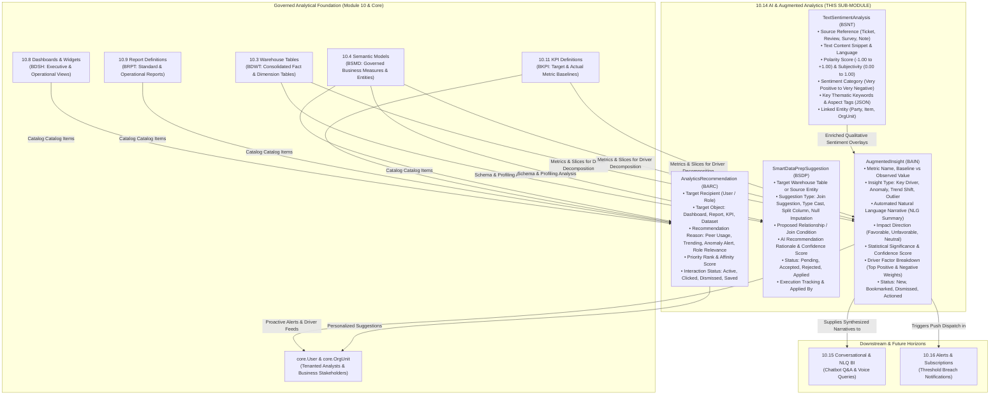

# Research — Sub-module 10.14: AI & Augmented Analytics (Module 10 — Business Intelligence, `bi`)

- **Sub-module:** 10.14 AI & Augmented Analytics
- **Module:** 10 Business Intelligence
- **Target app:** `apps/bi` (package: `apps/bi/models/AiAugmentedAnalytics/`)
- **Research date:** 2026-11-07
- **Phase:** Phase 1 Research Catalog
- **Output file target:** `.claude/tasks/research-bi-10.14.md`

---

## 1. Executive Summary & Domain Architecture

Sub-module 10.14 delivers **AI & Augmented Analytics, auto-generated statistical insights, automated key-driver analysis, an interactive smart insight feed, automated smart data preparation recommendations, natural language text & sentiment analytics, and role-personalized analytical recommendations** for NavERP (`apps/bi`).

While Sub-module 10.8 provides curated visual dashboards, Sub-module 10.9 produces formal operational reports, Sub-module 10.10 delivers ad-hoc visual query composition, Sub-module 10.11 manages balanced KPI scorecards, and Sub-module 10.12 supports multidimensional OLAP slicing and what-if writeback, Sub-module 10.14 shifts NavERP from passive reporting to **proactive, machine-assisted intelligence**:
- **Auto-Generated Insights & Key-Driver Analysis:** Automatically runs statistical variance and regression decomposition over dimensional metrics to answer the "why" behind business metric changes (e.g., decomposing an unexpected gross margin decline into contributing product lines, customer tiers, and regional freight costs).
- **Smart Insight Feed:** A proactive, ranked event stream surfacing significant statistical anomalies, trend shifts, threshold crossovers, and emerging seasonal spikes directly to decision-makers.
- **Automated Data Preparation:** Machine-assisted join discovery, column type inference, automated data quality anomaly filtering, null imputation, and fuzzy-matching transform suggestions between disparate enterprise tables.
- **Text & Sentiment Analytics:** NLP ingestion and sentiment scoring (polarity, subjectivity, sentiment classification) over unstructured customer reviews, support ticket notes, employee feedback, and survey responses, correlating sentiment with hard financial and operational KPIs.
- **Analytical Recommendation Engine:** Personalized recommendation of relevant dashboards, reports, metrics, and semantic datasets based on user role, peer consumption patterns, organizational focus, and metric volatility.

### Architectural Data Flow

---

## 2. Repo State Checked First

- **Existing App:** `apps/bi` exists and is packaged with 12 sub-modules already built (`DataIntegration`, `EtlPipelines`, `DataWarehouse`, `SemanticLayer`, `DataQuality`, `MasterData`, `DataCatalog`, `Dashboards`, `OperationalReporting`, `SelfServiceAnalytics`, `PerformanceScorecards`, `OlapAnalysis`).
- **LIVE_LINKS Built So Far:**
  - `10.1`: Data Integration & Ingestion (`DataSourceConnectors`)
  - `10.2`: ETL/ELT & Data Pipelines (`EtlPipelines`)
  - `10.3`: Data Warehouse & Storage (`WarehouseTables`, `DataMarts`)
  - `10.4`: Data Modeling & Semantic Layer (`SemanticModels`, `CalculatedMeasures`)
  - `10.5`: Data Quality & Cleansing (`DataQualityRules`, `DataQualityProfiles`)
  - `10.6`: Master Data Management (`MdmGoldenRecords`)
  - `10.7`: Data Catalog, Lineage & Governance (`CatalogAssets`)
  - `10.8`: Dashboards & Visualization (`BiDashboards`)
  - `10.9`: Standard & Operational Reporting (`ReportDefinitions`)
  - `10.10`: Self-Service & Ad-Hoc Analytics (`AdHocQueries`, `DataBlendDefinitions`)
  - `10.11`: KPI & Performance Scorecards (`KpiDefinitions`, `PerformanceScorecards`)
  - `10.12`: OLAP & Multidimensional Analysis (`OlapCubes`, `PivotViews`, `WhatIfScenarios`)
- **Verified Sibling Models in `apps/bi` Available to FK:**
  - `bi.WarehouseTable` (`apps/bi/models/DataWarehouse/WarehouseTables.py`) — verified.
  - `bi.SemanticModel` (`apps/bi/models/SemanticLayer/SemanticModels.py`) — verified.
  - `bi.KpiDefinition` (`apps/bi/models/PerformanceScorecards/KpiDefinitions.py`) — verified.
  - `bi.BiDashboard` (`apps/bi/models/Dashboards/BiDashboards.py`) — verified.
  - `bi.ReportDefinition` (`apps/bi/models/OperationalReporting/ReportDefinitions.py`) — verified.
- **Verified Spine Entities in `apps/core`:**
  - `core.Tenant` — verified.
  - `core.OrgUnit` — verified.
  - `core.Party` — verified.
  - `settings.AUTH_USER_MODEL` (`core.User`) — verified.
- **Prefix Collision Sweep (100% Collision-Free Across Repository):**
  - `BAIN`: `AugmentedInsight` — verified free.
  - `BSDP`: `SmartDataPrepSuggestion` — verified free.
  - `BSNT`: `TextSentimentAnalysis` — verified free.
  - `BARC`: `AnalyticsRecommendation` — verified free.
- **Incremental Migration Target:**
  - Leaf migration is `0029_alter_scorecardkpiassignment_options_and_more.py`.
  - Next migration for 10.14 will claim `0030`.

---

## 3. Commercial Leaders Surveyed (with Official Links)

### 1. ThoughtSpot (SpotIQ & Augmented Change Analysis)
- **Positioning:** The market standard for search- and AI-driven business intelligence with automated root cause decomposition.
- **Reference:** https://www.thoughtspot.com/platform/ai
- **Key Capabilities:**
  - **SpotIQ Automated Change Analysis:** With a single click or background scan, decomposes KPI swings into drivers, segments, and anomalies across billions of records.
  - **Auto-Generated Summaries:** Summarizes trends and dimensional drivers into readable narratives ("Sales fell 8.4% primarily due to a 22% drop in Enterprise tier deals in EMEA").
  - **Proactive Feed:** Continuously monitors modeled metrics and delivers ranked anomaly alerts to users.

### 2. Salesforce Tableau (Tableau Pulse & Einstein Discovery)
- **Positioning:** Enterprise visual analytics infused with AI-driven automated metric digests and root-cause explanations.
- **Reference:** https://www.tableau.com/products/pulse
- **Key Capabilities:**
  - **Tableau Pulse Metrics Digest:** Delivers personalized, automated metric cards directly to users with plain-English narratives describing current pace, anomalies, and key drivers.
  - **Explain Data (Einstein Discovery):** Evaluates all available dimensions and statistically calculates which factors best explain outlier data points.
  - **Smart Data Prep (Tableau Prep):** Recommends fuzzy-matching groupings, auto-cleans dates, and detects relationship join keys across tables.

### 3. Microsoft Power BI (Key Influencers, Smart Narratives & AI Insights)
- **Positioning:** The dominant corporate BI platform with native augmented analytical visuals and AI transformations.
- **Reference:** https://learn.microsoft.com/en-us/power-bi/visuals/power-bi-visualization-influencers
- **Key Capabilities:**
  - **Key Influencers Visual:** Uses logistic/linear regression behind the scenes to rank which factor combinations increase or decrease a metric the most.
  - **Smart Narrative:** Generates dynamic, context-aware text summaries that update automatically when users filter dashboards.
  - **AI Insights in Power Query:** Suggests automated joins, entity extraction, and sentiment scoring over unstructured text columns.

### 4. Qlik Sense (Qlik Insight Advisor & AutoML)
- **Positioning:** Associative business intelligence engine enhanced with automated conversational and narrative AI.
- **Reference:** https://www.qlik.com/us/products/technology/augmented-analytics
- **Key Capabilities:**
  - **Insight Advisor Auto-Insights:** Analyzes dataset schemas and automatically proposes the most impactful charts, correlations, and metric observations.
  - **Key Driver Analysis:** Calculates relative importance scores across independent variables explaining target variance.
  - **Smart Data Prep:** AI-assisted table association and smart data profiling suggestions during data modeling.

### 5. Tellius (Genius Insights & Kaiya AI)
- **Positioning:** AI-native decision intelligence platform combining natural language search with automated root cause and cohort comparison.
- **Reference:** https://www.tellius.com/product/
- **Key Capabilities:**
  - **Genius Insights:** Automatically computes "Why did metric X change?", comparing two time periods or cohorts to isolate top driving factors.
  - **Automated Data Preparation:** Recommends join keys, detects data type mismatches, and highlights data quality outliers before model publishing.
  - **Proactive Notification Stream:** Personalized feed of statistical shifts tailored to individual user permissions.

### 6. Domo (Domo AI & Automated Insights)
- **Positioning:** Cloud-native executive data platform with real-time proactive metric monitoring and automated narrative summaries.
- **Reference:** https://www.domo.com/platform/ai
- **Key Capabilities:**
  - **Domo Smart Insights:** Evaluates card metrics and generates narrative explanations highlighting trends, minimums, maximums, and anomalies.
  - **Asset Recommendations:** Suggests relevant cards, dashboards, and datasets based on peer interactions and user responsibilities.
  - **Text Sentiment Encoders:** Evaluates customer review and service desk ticket text streams to extract polarity and thematic sentiment.

### 7. Oracle Analytics Cloud (OAC Explain & Auto-Insights)
- **Positioning:** Enterprise cloud analytics with 1-click statistical explanation and automated data enrichment.
- **Reference:** https://www.oracle.com/business-analytics/analytics-platform/
- **Key Capabilities:**
  - **OAC Explain:** Generates instant basic statistics, anomalous distributions, key drivers, and segment correlations for any chosen metric.
  - **Data Enrichment Suggestions:** Proactively recommends date extractions, semantic domain tags, and automated column joins during dataset ingestion.
  - **Sentiment Scoring:** Enriches textual columns with sentiment classifications and keyword extractions.

### 8. SAP Analytics Cloud (Smart Insights & Smart Discovery)
- **Positioning:** Integrated financial and operational analytics suite with automated machine learning and driver explanations.
- **Reference:** https://www.sap.com/products/technology-platform/cloud-analytics.html
- **Key Capabilities:**
  - **Smart Insights:** Surfaces top contributing dimensions and values directly inside visual charts.
  - **Smart Discovery:** Trains automated classification and regression models to identify the strongest predictors of business outcomes.
  - **Search & Recommendation:** Suggests relevant stories, KPIs, and models based on user role and department context.

---

## 4. Feature Catalog (Mapped to NavERP.md 10.14 Bullets)

### 4.1 Auto-Generated Insights
- **Key Driver Analysis & Variance Decomposition** — Mathematically identifies which dimensional factors (e.g. customer segment, product category, region, sales rep) contributed most to a metric's increase or decrease. · seen in: *ThoughtSpot, Tableau, Power BI, Tellius* · priority: `table-stakes` · spine: `bi.AugmentedInsight` [BAIN-] · buildable now.
- **Automated Natural Language Summaries (NLG)** — Produces human-readable, executive-ready narrative sentences describing the magnitude, direction, and primary driver of metric changes. · seen in: *Tableau Pulse, Power BI Smart Narrative, Domo* · priority: `table-stakes` · spine: `bi.AugmentedInsight` [BAIN-] · buildable now.
- **Statistical Significance & Confidence Scoring** — Evaluates whether an observed change is a genuine shift or random statistical noise, attaching a confidence score (0.00–100.00%) to every insight. · seen in: *ThoughtSpot, Tellius, Oracle OAC* · priority: `common` · spine: `bi.AugmentedInsight` [BAIN-] · buildable now.

### 4.2 Smart Insight Feed
- **Proactive Insight Feed & Ticker** — Real-time, reverse-chronological feed displaying newly discovered metric shifts, anomalies, and driver explanations. · seen in: *Tableau Pulse, ThoughtSpot, Domo* · priority: `table-stakes` · spine: `bi.AugmentedInsight` [BAIN-] · buildable now.
- **Insight Status & Triage Workflow** — Allows decision makers to acknowledge, bookmark, dismiss, or log follow-up actions against surfaced insights. · seen in: *Domo, Tableau Pulse* · priority: `common` · spine: `bi.AugmentedInsight` [BAIN-] · buildable now.
- **Impact & Urgency Classification** — Categorizes insights by business impact direction (`favorable`, `unfavorable`, `neutral`) and severity (`low`, `medium`, `high`, `critical`). · seen in: *Tableau Pulse, ThoughtSpot* · priority: `table-stakes` · spine: `bi.AugmentedInsight` [BAIN-] · buildable now.

### 4.3 Automated Data Preparation
- **AI-Suggested Table Joins** — Examines table schema, column names, cardinality, and sample values to suggest accurate join keys between analytical tables. · seen in: *Tableau Prep, Qlik Sense, Tellius, Google Dataprep* · priority: `table-stakes` · spine: `bi.SmartDataPrepSuggestion` [BSDP-] · buildable now.
- **Smart Type Inference & Extraction** — Automatically detects date formats, currency types, categorical codes, and recommends casting or split transformations. · seen in: *Power Query, Alteryx, Oracle OAC* · priority: `common` · spine: `bi.SmartDataPrepSuggestion` [BSDP-] · buildable now.
- **Cleansing & Imputation Recommendations** — Flags high-null columns and suggests imputation methods (mean, median, mode, forward-fill) or outlier filtering rules. · seen in: *Qlik Sense, Alteryx, Dataiku* · priority: `common` · spine: `bi.SmartDataPrepSuggestion` [BSDP-] · buildable now.
- **Suggestion Acceptance & Application Workflow** — Review workflow allowing data engineers to inspect rationale, accept/reject recommendations, and mark them as applied. · seen in: *Qlik, Tableau Prep, Matillion* · priority: `table-stakes` · spine: `bi.SmartDataPrepSuggestion` [BSDP-] · buildable now.

### 4.4 Text & Sentiment Analytics
- **Sentiment Scoring & Classification** — Evaluates customer reviews, CRM notes, support tickets, and surveys to determine sentiment polarity (-1.00 to +1.00), subjectivity (0.00 to 1.00), and classification (`very_positive`, `positive`, `neutral`, `negative`, `very_negative`). · seen in: *Power BI AI Insights, Domo, Oracle OAC* · priority: `table-stakes` · spine: `bi.TextSentimentAnalysis` [BSNT-] · buildable now.
- **Thematic Keyword & Aspect Extraction** — Extracts key positive/negative phrases and aspect tags (e.g. "pricing", "delivery speed", "product quality", "customer support") for thematic clustering. · seen in: *Domo, Power BI, Tableau* · priority: `common` · spine: `bi.TextSentimentAnalysis` [BSNT-] · buildable now.
- **Entity Correlation** — Maps sentiment records to NavERP core entities (`core.Party` customer/vendor, `core.OrgUnit`, or catalog items) to correlate sentiment with operational KPIs. · seen in: *Power BI, Domo* · priority: `common` · spine: `bi.TextSentimentAnalysis` [BSNT-] · buildable now.

### 4.5 Recommendation Engine
- **Personalized Analytics Recommendations** — Recommends relevant reports, dashboards, KPIs, and datasets to users based on role, department, and usage patterns. · seen in: *Domo, Tableau Pulse, SAP Analytics Cloud* · priority: `table-stakes` · spine: `bi.AnalyticsRecommendation` [BARC-] · buildable now.
- **Recommendation Rationale & Affinity Scoring** — Explains *why* an asset was recommended (`peer_usage`, `trending_metric`, `anomaly_in_domain`, `role_relevance`) with a confidence score. · seen in: *Domo, SAP Analytics Cloud* · priority: `common` · spine: `bi.AnalyticsRecommendation` [BARC-] · buildable now.
- **User Engagement Tracking** — Tracks user feedback (`clicked`, `saved`, `dismissed`) to refine future recommendation relevance. · seen in: *Domo, ThoughtSpot* · priority: `common` · spine: `bi.AnalyticsRecommendation` [BARC-] · buildable now.

---

## 5. Recommended Build Scope (This Pass — 4 Models)

To deliver Sub-module 10.14 end-to-end within the standard 1–4 model scope, we build:

1. **`AugmentedInsight` [BAIN-]** — The core insight and smart feed model.
   - Fields: `number` (BAIN-#####), `title`, `insight_type` (`key_driver`, `anomaly`, `trend_shift`, `outlier`, `period_comparison`), `narrative_summary` (plain-text NLG explanation), `metric_name`, `baseline_value`, `observed_value`, `variance_percentage`, `impact_direction` (`favorable`, `unfavorable`, `neutral`), `severity` (`low`, `medium`, `high`, `critical`), `confidence_score` (Decimal 0.00–100.00), `dimension_name`, `dimension_value`, `driver_decomposition` (JSONField storing top positive & negative contributing factors), `status` (`new`, `bookmarked`, `dismissed`, `actioned`), `action_notes`, `semantic_model` (FK `bi.SemanticModel`, optional), `kpi_definition` (FK `bi.KpiDefinition`, optional), `warehouse_table` (FK `bi.WarehouseTable`, optional).
2. **`SmartDataPrepSuggestion` [BSDP-]** — Automated data preparation and schema transform recommendations.
   - Fields: `number` (BSDP-#####), `target_table` (FK `bi.WarehouseTable`), `target_column`, `suggestion_type` (`join_relationship`, `type_cast`, `split_column`, `impute_missing`, `deduplicate_fuzzy`, `filter_outliers`), `related_table` (FK `bi.WarehouseTable`, optional), `related_column`, `confidence_score` (Decimal 0.00–100.00), `rationale` (narrative explanation of why the prep step was suggested), `suggested_config` (JSONField with transformation rules/expression), `status` (`pending`, `accepted`, `rejected`, `applied`), `reviewed_by` (FK `User`), `reviewed_at`.
3. **`TextSentimentAnalysis` [BSNT-]** — Unstructured text ingestion, sentiment scoring, and theme extraction.
   - Fields: `number` (BSNT-#####), `source_type` (`customer_review`, `support_ticket`, `survey_feedback`, `crm_note`, `internal_comment`), `source_reference` (char identifier), `text_content` (analyzed text snippet), `language` (default 'en'), `sentiment_category` (`very_positive`, `positive`, `neutral`, `negative`, `very_negative`), `polarity_score` (Decimal -1.00 to +1.00), `subjectivity_score` (Decimal 0.00 to 1.00), `thematic_tags` (JSONField or comma-separated list of extracted themes), `linked_party` (FK `core.Party`, optional), `linked_org_unit` (FK `core.OrgUnit`, optional), `analyzed_at`.
4. **`AnalyticsRecommendation` [BARC-]** — Recommendation engine model for personalized analytical discovery.
   - Fields: `number` (BARC-#####), `user` (FK `User`, recipient), `recommendation_type` (`dashboard`, `report`, `kpi`, `dataset`, `drill_path`), `target_title`, `target_url`, `reason` (`peer_usage`, `trending_metric`, `anomaly_in_domain`, `recent_search`, `role_relevance`), `affinity_score` (Decimal 0.00–100.00), `status` (`active`, `clicked`, `dismissed`, `saved`), `dashboard` (FK `bi.BiDashboard`, optional), `report` (FK `bi.ReportDefinition`, optional), `kpi` (FK `bi.KpiDefinition`, optional), `semantic_model` (FK `bi.SemanticModel`, optional).

---

## 6. Belongs to Sibling Sub-modules (Parked, Not Scoped Here)

- **Natural Language Query (NLQ) & Conversational BI Assistant** $\rightarrow$ Belongs to **10.15 Natural Language & Conversational BI** (chat Q&A, voice queries, NL-to-SQL visualizer).
- **Automated Threshold & Anomaly Alerts via Email/Slack/Webhook** $\rightarrow$ Belongs to **10.16 Alerts, Subscriptions & Distribution**.
- **Interactive Multi-Axis Pivot Matrices & Data Splashing** $\rightarrow$ Belongs to **10.12 OLAP & Multidimensional Analysis** (built in 10.12).
- **Core KPI Definition and Balanced Scorecard Perspectives** $\rightarrow$ Belongs to **10.11 KPI & Performance Scorecards** (built in 10.11).

---

## 7. Deferred (Later Passes / Integrations)

- **External LLM / OpenAI API Integration:** While models support full automated statistical analysis, heuristics, and natural language formatting natively within Django, live connections to external LLM providers (OpenAI, Claude, Gemini) will be governed centrally in Module 23 (AI & Intelligent Automation).
- **Full NLP Tokenizer / Spacy / HuggingFace Pipelines:** Text sentiment analysis runs a robust rule-based scoring engine with keyword aspect matching natively in Python, with hooks for external embeddings in later passes.
