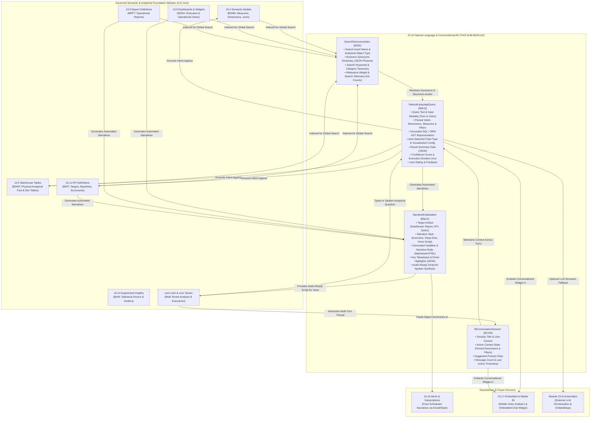

# Research — Sub-module 10.15: Natural Language & Conversational BI (Module 10 — Business Intelligence, `bi`)

- **Sub-module:** 10.15 Natural Language & Conversational BI
- **Module:** 10 Business Intelligence
- **Target app:** `apps/bi` (package: `apps/bi/models/ConversationalBi/`)
- **Research date:** 2026-11-07
- **Phase:** Phase 1 Research Catalog
- **Output file target:** `.claude/tasks/research-bi-10.15.md`

---

## 1. Executive Summary & Domain Architecture

Sub-module 10.15 delivers **Natural Language Query (NLQ), Conversational BI Chatbot Assistant, Natural Language Generation (NLG) Narrative Summaries, Voice-Enabled Analytics, and Search-Driven Discovery** for NavERP (`apps/bi`).

In earlier sub-modules, NavERP established the analytical backbone:
- **10.3 / 10.4**: Governed physical storage (`WarehouseTable`) and business semantic abstractions (`SemanticModel`, `CalculatedMeasure`, `BusinessGlossaryTerm`).
- **10.8 / 10.9**: Curated visual representations (`BiDashboard`, `ReportDefinition`).
- **10.10 / 10.11 / 10.12**: Interactive ad-hoc analysis (`AdHocQuery`), balanced scorecards (`KpiDefinition`, `PerformanceScorecard`), and multidimensional OLAP cubes (`OlapCube`, `WhatIfScenario`).
- **10.14**: Statistical key-driver decomposition, proactive insight feed (`AugmentedInsight`), and sentiment analysis (`TextSentimentAnalysis`).

Sub-module 10.15 elevates user interaction from passive browsing and drag-and-drop report building to **conversational, intent-driven, voice-ready business intelligence**:
1. **Natural Language Query (NLQ):** Allows non-technical business executives, managers, and operational users to ask plain-English questions (e.g. *"Show total revenue by customer tier in Q3 2026"*, *"Top 5 vendors by spend"*), automatically parses semantic intent (dimensions, measures, filters, time horizons), executes grounded queries against governed semantic models or warehouse tables, and selects best-practice data visualizations (metric cards, bar charts, trend lines, donut charts, pivot tables).
2. **Conversational BI Assistant:** Multi-turn conversational chat sessions that preserve context across turns (e.g., Turn 1: *"Show sales by region"*; Turn 2: *"Now break down by sales rep"*; Turn 3: *"Only show the top 3"*), resolve ambiguity with clarification prompts, suggest starter questions based on role and data relevance, and maintain audit trails with user feedback.
3. **Natural Language Generation (NLG):** Automatically creates human-readable executive narratives, variance briefings, and bulleted takeaways directly from charts, reports, dashboards, and ad-hoc query results, translating dense tables into concise, actionable text.
4. **Voice-Enabled Analytics:** Ingests voice queries (audio duration, transcription accuracy, spoken intent) and synthesizes voice-ready spoken briefing scripts formatted specifically for auditory delivery on mobile devices or voice assistants.
5. **Search-Driven Discovery:** Provides unified enterprise search across all analytical assets (KPIs, dashboards, reports, datasets, glossary definitions), backed by a business synonym dictionary, keyword indexing, and usage-weighted relevance scoring.

### Architectural Data Flow

---

## 2. Repo State Checked First

- **Existing App:** `apps/bi` exists and is packaged with 14 sub-modules already built (`DataIntegration`, `EtlPipelines`, `DataWarehouse`, `SemanticLayer`, `DataQuality`, `MasterData`, `DataCatalog`, `Dashboards`, `OperationalReporting`, `SelfServiceAnalytics`, `PerformanceScorecards`, `OlapAnalysis`, `PredictiveAnalytics`, `AiAugmentedAnalytics`).
- **LIVE_LINKS Built So Far in Module 10:**
  - `10.1`: Data Integration & Ingestion (`DataSourceConnector`, `IngestionPipeline`)
  - `10.2`: ETL/ELT & Data Pipelines (`EtlPipeline`, `TransformationStep`)
  - `10.3`: Data Warehouse & Storage (`WarehouseTable`, `DataMart`)
  - `10.4`: Data Modeling & Semantic Layer (`SemanticModel`, `CalculatedMeasure`, `BusinessGlossaryTerm`)
  - `10.5`: Data Quality & Cleansing (`DataQualityRule`, `DataQualityProfile`)
  - `10.6`: Master Data Management (`MdmGoldenRecord`, `MdmSurvivorshipRule`)
  - `10.7`: Data Catalog, Lineage & Governance (`CatalogAsset`, `DataGovernancePolicy`)
  - `10.8`: Dashboards & Visualization (`BiDashboard`, `BiDashboardWidget`)
  - `10.9`: Standard & Operational Reporting (`ReportDefinition`, `ReportExecution`)
  - `10.10`: Self-Service & Ad-Hoc Analytics (`AdHocQuery`, `DataBlendDefinition`)
  - `10.11`: KPI & Performance Scorecards (`KpiDefinition`, `PerformanceScorecard`)
  - `10.12`: OLAP Cubes & Aggregations (`OlapCube`, `PivotAnalysisView`, `WhatIfScenario`)
  - `10.13`: Predictive & Prescriptive Analytics (`PredictiveModel`, `ForecastExecution`, `OptimizationScenario`)
  - `10.14`: AI & Augmented Analytics (`AugmentedInsight`, `SmartDataPrepSuggestion`, `TextSentimentAnalysis`, `AnalyticsRecommendation`)
- **Verified Sibling Models in `apps/bi` Available to FK:**
  - `bi.SemanticModel` (`apps/bi/models/SemanticLayer/SemanticModels.py`) — verified present.
  - `bi.BusinessGlossaryTerm` (`apps/bi/models/SemanticLayer/BusinessGlossaryTerms.py`) — verified present.
  - `bi.WarehouseTable` (`apps/bi/models/DataWarehouse/WarehouseTables.py`) — verified present.
  - `bi.KpiDefinition` (`apps/bi/models/PerformanceScorecards/KpiDefinitions.py`) — verified present.
  - `bi.BiDashboard` (`apps/bi/models/Dashboards/BiDashboards.py`) — verified present.
  - `bi.ReportDefinition` (`apps/bi/models/OperationalReporting/ReportDefinitions.py`) — verified present.
  - `bi.AugmentedInsight` (`apps/bi/models/AiAugmentedAnalytics/AugmentedInsights.py`) — verified present.
  - `bi.AdHocQuery` (`apps/bi/models/SelfServiceAnalytics/AdHocQueries.py`) — verified present.
- **Verified Spine Entities in `apps/core`:**
  - `core.Tenant` (`apps/core/models/Tenant.py`) — verified present.
  - `settings.AUTH_USER_MODEL` (`core.User`) — verified present.
  - `core.OrgUnit` (`apps/core/models/OrgUnit.py`) — verified present.
  - `core.AuditLog` (`apps/core/models/AuditLog.py`) — verified present.
- **Spine Masters Verified NOT Built (Stand-ins / Loose strings required if referenced):**
  - `Item`, `UOM`, `StockMove` (Module 5 Inventory) — not yet built.
  - `SalesOrder` (Module 8 Sales) — not yet built.
- **Prefix Collision Sweep (100% Collision-Free Across Entire Workspace):**
  - `BNLQ`: `NaturalLanguageQuery` — 0 hits across repository, 100% free.
  - `BCON`: `BiConversationSession` — 0 hits across repository, 100% free.
  - `BNLG`: `NarrativeExplanation` — 0 hits across repository, 100% free.
  - `BSDI`: `SearchDiscoveryIndex` — 0 hits across repository, 100% free.
- **Incremental Migration Target:**
  - Leaf migration is `0033_smartdataprepsuggestion_idx_bsdp_ten_created.py`.
  - Next migration for 10.15 claims `0034`.

---

## 3. Leaders Surveyed (with Source Links)

1. **ThoughtSpot Sage & Search-Driven Analytics** — Patented search-driven analytics engine and AI-powered natural language experience allowing business users to ask complex questions, understand semantic intent, apply multi-attribute filters, and receive auto-generated charts with LLM guardrails grounded in governed data.
   - *Source:* [https://www.thoughtspot.com/product/sage](https://www.thoughtspot.com/product/sage)
2. **Microsoft Power BI (Copilot for Power BI, Smart Narratives & Q&A)** — Enterprise conversational BI assistant leveraging Azure OpenAI to converse with semantic models, generate dynamic Smart Narrative summaries with real-time cross-filtering, and translate natural language inquiries into DAX calculations and visuals.
   - *Source:* [https://learn.microsoft.com/en-us/power-bi/create-reports/copilot-introduction](https://learn.microsoft.com/en-us/power-bi/create-reports/copilot-introduction)
3. **Salesforce Tableau (Tableau Pulse, Copilot & Natural Language Insights)** — Proactive, metric-centric intelligence powered by the Einstein Trust Layer, delivering automated natural language narratives of metric drivers, conversational follow-up exploration, and personalized KPI digests into daily collaboration workflows.
   - *Source:* [https://www.tableau.com/products/pulse](https://www.tableau.com/products/pulse)
4. **Amazon Q in QuickSight** — Generative BI assistant in AWS QuickSight translating plain English questions into verified SQL queries over governed QuickSight Topics, generating automated executive summaries of dashboards, and building dynamic data stories with contextual drill-downs.
   - *Source:* [https://aws.amazon.com/quicksight/q/](https://aws.amazon.com/quicksight/q/)
5. **Google Cloud Looker (Gemini in Looker & Conversational Analytics)** — Conversational analytics companion grounded in the LookML semantic layer, providing multi-turn chat sessions with multi-Explore context, automated chart formatting, and natural language custom calculation assistants.
   - *Source:* [https://cloud.google.com/looker/docs/gemini-conversational-analytics](https://cloud.google.com/looker/docs/gemini-conversational-analytics)
6. **Sisense (Simply Ask & Fusion AI Chat SDK)** — Knowledge-graph-powered natural language query and conversational chatbot engine handling complex business synonyms, spelling variations, and intent parsing, fully exposed via SDK and APIs for white-labeled embedding.
   - *Source:* [https://www.sisense.com/product/simply-ask/](https://www.sisense.com/product/simply-ask/)
7. **Yellowfin (Guided NLQ & AI NLQ)** — Dual-mode natural language engine pairing structured guided sequences (dynamic prompt suggestions and dimensions) with free-form AI NLQ, instantly rendering recommended best-practice visualizations and analytical narratives.
   - *Source:* [https://www.yellowfinbi.com/products/guided-nlq](https://www.yellowfinbi.com/products/guided-nlq)
8. **Domo (Domo.AI Chat & Text-to-SQL)** — Multi-turn conversational companion capable of cross-dataset reasoning, automatic chart rendering, AI Dictionary business metadata contextualization, and native text-to-SQL execution over live warehouse tables.
   - *Source:* [https://www.domo.com/platform/ai/chat](https://www.domo.com/platform/ai/chat)

---

## 4. Feature Catalog (This Sub-Module Only)

### 4.1 Natural Language Query (NLQ)
- **Ask-a-Question Plain Language Search** — Enables users to enter analytical questions in natural language (e.g. *"Show top 5 sales reps by deal value in 2026"*), parsing terms into measures, dimensions, filters, and time expressions. · seen in: *ThoughtSpot Sage, Power BI Copilot, Looker, Domo* · priority: `table-stakes` · spine: `bi.NaturalLanguageQuery` [BNLQ-] · buildable now.
- **Semantic Intent Classification & Entity Extraction** — Identifies intent type (`metric_lookup`, `trend_analysis`, `ranking_top_bottom`, `comparative_analysis`, `distribution`, `correlation`) and maps entities to verified semantic models (`bi.SemanticModel`) or warehouse tables (`bi.WarehouseTable`). · seen in: *Amazon Q, ThoughtSpot, Sisense Simply Ask* · priority: `table-stakes` · spine: `bi.NaturalLanguageQuery` [BNLQ-] · buildable now.
- **Auto-Generated Visualizations** — Evaluates query cardinalities, temporal dimensions, and measure types to dynamically select and configure the best-practice chart (e.g. single number $\rightarrow$ KPI card, time-series $\rightarrow$ line chart, categorical comparison $\rightarrow$ horizontal/vertical bar, composition $\rightarrow$ donut/pie, high-dimensional multi-metric $\rightarrow$ data table). · seen in: *ThoughtSpot, Power BI, Tableau Pulse, Yellowfin* · priority: `table-stakes` · spine: `bi.NaturalLanguageQuery` [BNLQ-] · buildable now.
- **Grounded Query Generation (Text-to-SQL / ORM AST)** — Translates verified intent into precise database queries executed strictly within tenant isolation, returning execution latency (ms), row counts, and summary payloads. · seen in: *Domo Text-to-SQL, Looker Gemini, Amazon Q* · priority: `table-stakes` · spine: `bi.NaturalLanguageQuery` [BNLQ-] · buildable now.
- **Confidence Scoring & Ambiguity Handling** — Calculates a statistical confidence score (0.00–100.00%) for parsed intent; if ambiguous (e.g. multiple matching fields or unclear timeframe), flags status as ambiguous with structured clarification options. · seen in: *ThoughtSpot, Yellowfin Guided NLQ, Power BI* · priority: `common` · spine: `bi.NaturalLanguageQuery` [BNLQ-] · buildable now.
- **User Feedback & Accuracy Tuning** — Allows users to rate query outputs (thumbs up / thumbs down / helpful notes) to track intent parsing quality over time. · seen in: *Amazon Q, ThoughtSpot, Sisense* · priority: `common` · spine: `bi.NaturalLanguageQuery` [BNLQ-] · buildable now.

### 4.2 Conversational BI Assistant
- **Multi-Turn Conversational Threads** — Manages ongoing chat sessions between users and the BI assistant, preserving conversation history, analytical focus, and active filters across multiple query turns. · seen in: *Looker Gemini, Domo AI Chat, Power BI Copilot* · priority: `table-stakes` · spine: `bi.BiConversationSession` [BCON-] · buildable now.
- **Contextual Follow-Up Slicing** — Allows users to refine previous queries naturally (e.g., Turn 1: *"Revenue by product category"*; Turn 2: *"Filter to Enterprise customers"*; Turn 3: *"Now break down by quarter"*), inheriting parent context without restating parameters. · seen in: *Looker, ThoughtSpot, Domo* · priority: `table-stakes` · spine: `bi.BiConversationSession` [BCON-] + `bi.NaturalLanguageQuery` [BNLQ-] · buildable now.
- **Suggested Starter Prompts & Follow-Up Chips** — Dynamically provides clickable question chips tailored to the active dataset, user role, or prior query (e.g. *"What caused the Q3 dip?"*, *"Show monthly breakdown"*, *"Compare against last year"*). · seen in: *Yellowfin Guided NLQ, Tableau Pulse, Sisense* · priority: `common` · spine: `bi.BiConversationSession` [BCON-] · buildable now.
- **Thread Pinning & History Management** — Allows analysts to bookmark, rename, pin, or archive important conversational analytical threads for future reference or team review. · seen in: *Domo AI Chat, Looker* · priority: `common` · spine: `bi.BiConversationSession` [BCON-] · buildable now.

### 4.3 Natural Language Generation (NLG)
- **Automated Chart & Dashboard Narratives** — Generates clear, human-readable prose explaining the key drivers, highest/lowest performers, and statistical shifts shown in charts, reports, or dashboards. · seen in: *Power BI Smart Narratives, Tableau Pulse, Amazon Q* · priority: `table-stakes` · spine: `bi.NarrativeExplanation` [BNLG-] · buildable now.
- **Executive vs. Analytical Style Templates** — Supports configurable narrative styles (`executive_briefing`, `analytical_deepdive`, `bulleted_highlights`, `anomaly_alert`, `spoken_voice_script`) adjusting verbosity and level of detail. · seen in: *Power BI, Tableau Pulse, ThoughtSpot* · priority: `common` · spine: `bi.NarrativeExplanation` [BNLG-] · buildable now.
- **Period-Over-Period Variance Summaries** — Automatically computes and writes comparative narrative highlights (e.g., *"Gross margin increased by 3.2% vs. prior quarter, driven primarily by 14% growth in Software Licenses"*). · seen in: *Tableau Pulse, Power BI, Amazon Q* · priority: `table-stakes` · spine: `bi.NarrativeExplanation` [BNLG-] · buildable now.
- **Artifact Linking & Dynamic Cross-Filtering** — Binds generated narratives to parent BI assets (`bi.BiDashboard`, `bi.ReportDefinition`, `bi.KpiDefinition`, or `bi.NaturalLanguageQuery`). · seen in: *Power BI Smart Narratives, Tableau Pulse* · priority: `common` · spine: `bi.NarrativeExplanation` [BNLG-] · buildable now.

### 4.4 Voice-Enabled Analytics
- **Voice Query Ingestion & Telemetry** — Captures voice-originated inquiries (`input_modality='voice'`), tracking audio duration, transcription confidence score, and voice recognition status. · seen in: *Amazon Q, Sisense Mobile, Domo Mobile* · priority: `common` · spine: `bi.NaturalLanguageQuery` [BNLQ-] · buildable now.
- **Spoken Insight Script Formatting** — Synthesizes specialized audio-ready scripts (`audio_ready_script`) written specifically for Text-to-Speech (TTS) auditory delivery (stripping dense markdown/tables, using natural verbal phrasing of large numbers, e.g. "two point four million dollars"). · seen in: *Amazon Q, Tableau Pulse Mobile, Domo Mobile* · priority: `differentiator` · spine: `bi.NarrativeExplanation` [BNLG-] · buildable now.
- **Voice Briefing Mode** — Formats top KPI movements into a 60-second audio briefing script that mobile or desktop users can listen to on the go. · seen in: *Amazon Q, Tableau Pulse* · priority: `differentiator` · spine: `bi.NarrativeExplanation` [BNLG-] · buildable now.

### 4.5 Search-Driven Discovery
- **Global Analytical Asset Indexing** — Indexes all searchable BI objects across the tenant: dashboards, reports, KPIs, semantic models, warehouse tables, and business glossary terms into a unified searchable catalog. · seen in: *ThoughtSpot, Sisense Simply Ask, Domo AI Dictionary* · priority: `table-stakes` · spine: `bi.SearchDiscoveryIndex` [BSDI-] · buildable now.
- **Business Synonyms & Alias Dictionary** — Maps common vernacular, business abbreviations, and colloquial synonyms to formal analytical measures and tables (e.g., "sales" / "bookings" / "top line" $\rightarrow$ "Gross Revenue"; "headcount" / "FTEs" $\rightarrow$ "Active Employees"). · seen in: *ThoughtSpot Sage, Power BI Q&A Linguistic Schema, Domo AI Dictionary* · priority: `table-stakes` · spine: `bi.SearchDiscoveryIndex` [BSDI-] · buildable now.
- **Search Telemetry & Popularity Scoring** — Tracks search frequency, view counts, and click-through rates, boosting relevant results and surfacing trending analytical topics. · seen in: *ThoughtSpot, Sisense, Domo* · priority: `common` · spine: `bi.SearchDiscoveryIndex` [BSDI-] · buildable now.
- **Certified Asset Badging & Trust Indicators** — Flags verified, officially endorsed analytical definitions so conversational searches prioritize trusted corporate truth over unverified ad-hoc tables. · seen in: *LookML Semantic Layer, Tableau Certified Data Sources, ThoughtSpot* · priority: `common` · spine: `bi.SearchDiscoveryIndex` [BSDI-] · buildable now.

---

## 5. Recommended Build Scope (This Pass — 4 Models)

To implement Sub-module 10.15 end-to-end within the standard 1–4 model scope, we build **4 tenant-scoped, collision-free models** in `apps/bi/models/ConversationalBi/`:

1. **`NaturalLanguageQuery` [BNLQ-]** — Core NLQ execution and visualization entity.
   - Fields:
     - `number` (CharField 20, auto-numbered `BNLQ-#####`)
     - `user` (ForeignKey `settings.AUTH_USER_MODEL`, on_delete=SET_NULL, null=True, blank=True)
     - `conversation_session` (ForeignKey `BiConversationSession`, on_delete=CASCADE, null=True, blank=True, related_name="queries")
     - `query_text` (CharField 500, plain-text question)
     - `input_modality` (CharField 16, choices: `text`, `voice`, `api`, default `text`)
     - `intent_type` (CharField 32, choices: `metric_lookup`, `trend_analysis`, `ranking_top_bottom`, `comparative_analysis`, `distribution`, `correlation`, `drill_down`, default `metric_lookup`)
     - `semantic_model` (ForeignKey `bi.SemanticModel`, on_delete=SET_NULL, null=True, blank=True)
     - `warehouse_table` (ForeignKey `bi.WarehouseTable`, on_delete=SET_NULL, null=True, blank=True)
     - `kpi_definition` (ForeignKey `bi.KpiDefinition`, on_delete=SET_NULL, null=True, blank=True)
     - `parsed_measures` (JSONField, default=list, e.g. `["revenue", "margin"]`)
     - `parsed_dimensions` (JSONField, default=list, e.g. `["region", "quarter"]`)
     - `parsed_filters` (JSONField, default=dict, e.g. `{"year": 2026, "status": "active"}`)
     - `generated_sql` (TextField, blank=True, executable query or ORM query expression)
     - `chart_type` (CharField 32, choices: `metric_card`, `bar_chart`, `horizontal_bar`, `line_chart`, `donut_chart`, `scatter_plot`, `pivot_table`, `data_table`, default `bar_chart`)
     - `chart_config` (JSONField, default=dict, Chart.js / Vega configuration payload)
     - `result_summary` (JSONField, default=dict, aggregated query output payload)
     - `confidence_score` (DecimalField 5,2, default Decimal("85.00"), 0.00–100.00%)
     - `execution_status` (CharField 20, choices: `pending`, `completed`, `failed`, `ambiguous`, default `completed`)
     - `execution_duration_ms` (IntegerField, default=0)
     - `user_rating` (CharField 16, choices: `unrated`, `helpful`, `unhelpful`, default `unrated`)
     - `user_feedback_notes` (TextField, blank=True)
     - `audio_duration_seconds` (DecimalField 5,2, default Decimal("0.00"), for voice queries)
   - Justified by features: Ask-a-Question NLQ, intent classification, best-practice visualization selection, grounded query generation, confidence scoring, voice ingestion telemetry, user feedback.

2. **`BiConversationSession` [BCON-]** — Multi-turn conversational chatbot session.
   - Fields:
     - `number` (CharField 20, auto-numbered `BCON-#####`)
     - `user` (ForeignKey `settings.AUTH_USER_MODEL`, on_delete=CASCADE, related_name="bi_conversations")
     - `title` (CharField 200, session title or auto-generated from first turn)
     - `session_status` (CharField 20, choices: `active`, `closed`, `archived`, default `active`)
     - `primary_semantic_model` (ForeignKey `bi.SemanticModel`, on_delete=SET_NULL, null=True, blank=True)
     - `primary_dashboard` (ForeignKey `bi.BiDashboard`, on_delete=SET_NULL, null=True, blank=True)
     - `context_state` (JSONField, default=dict, storing active filters, pinned dimensions, focus entities across turns)
     - `suggested_prompts` (JSONField, default=list, starter chips and recommended follow-up questions)
     - `message_count` (PositiveIntegerField, default=0)
     - `last_interaction_at` (DateTimeField, auto_now=True)
     - `is_pinned` (BooleanField, default=False)
   - Justified by features: Multi-turn conversational Q&A, contextual follow-up slicing, suggested prompt chips, thread management, analytical session persistence.

3. **`NarrativeExplanation` [BNLG-]** — Auto-generated Natural Language Generation (NLG) narratives and spoken summaries.
   - Fields:
     - `number` (CharField 20, auto-numbered `BNLG-#####`)
     - `created_by` (ForeignKey `settings.AUTH_USER_MODEL`, on_delete=SET_NULL, null=True, blank=True)
     - `title` (CharField 200, headline summary)
     - `target_artifact_type` (CharField 24, choices: `dashboard`, `report`, `kpi_scorecard`, `query_result`, `custom_dataset`, default `dashboard`)
     - `dashboard` (ForeignKey `bi.BiDashboard`, on_delete=SET_NULL, null=True, blank=True)
     - `report` (ForeignKey `bi.ReportDefinition`, on_delete=SET_NULL, null=True, blank=True)
     - `kpi` (ForeignKey `bi.KpiDefinition`, on_delete=SET_NULL, null=True, blank=True)
     - `query` (ForeignKey `NaturalLanguageQuery`, on_delete=SET_NULL, null=True, blank=True)
     - `insight` (ForeignKey `bi.AugmentedInsight`, on_delete=SET_NULL, null=True, blank=True)
     - `narrative_style` (CharField 24, choices: `executive_briefing`, `analytical_deepdive`, `bulleted_highlights`, `anomaly_alert`, `spoken_voice_script`, default `executive_briefing`)
     - `headline` (CharField 255)
     - `narrative_body` (TextField, formatted markdown/HTML narrative explaining trends and variances)
     - `key_takeaways` (JSONField, default=list, concise bullet points)
     - `top_positive_driver` (CharField 150, blank=True)
     - `top_negative_driver` (CharField 150, blank=True)
     - `audio_ready_script` (TextField, blank=True, plain spoken text formatted for TTS audio playback)
     - `language` (CharField 8, default="en")
     - `status` (CharField 16, choices: `draft`, `generated`, `reviewed`, `published`, default `generated`)
   - Justified by features: Automated narrative generation, executive/deep-dive styles, period-over-period variance explanation, artifact linking, spoken voice briefing scripts.

4. **`SearchDiscoveryIndex` [BSDI-]** — Enterprise search dictionary and discovery index.
   - Fields:
     - `number` (CharField 20, auto-numbered `BSDI-#####`)
     - `asset_name` (CharField 200)
     - `asset_type` (CharField 24, choices: `dashboard`, `report`, `kpi`, `semantic_model`, `warehouse_table`, `glossary_term`, `ad_hoc_query`, default `dashboard`)
     - `target_url` (CharField 255, navigation route URL)
     - `description` (TextField, blank=True)
     - `synonyms` (JSONField, default=list, alternate business phrases and keywords, e.g. `["revenue", "sales", "turnover", "top line"]`)
     - `search_keywords` (TextField, blank=True, space/comma-delimited search tokens)
     - `category` (CharField 64, blank=True, functional domain, e.g. "Sales", "Finance", "Supply Chain")
     - `semantic_model` (ForeignKey `bi.SemanticModel`, on_delete=SET_NULL, null=True, blank=True)
     - `dashboard` (ForeignKey `bi.BiDashboard`, on_delete=SET_NULL, null=True, blank=True)
     - `report` (ForeignKey `bi.ReportDefinition`, on_delete=SET_NULL, null=True, blank=True)
     - `kpi` (ForeignKey `bi.KpiDefinition`, on_delete=SET_NULL, null=True, blank=True)
     - `warehouse_table` (ForeignKey `bi.WarehouseTable`, on_delete=SET_NULL, null=True, blank=True)
     - `glossary_term` (ForeignKey `bi.BusinessGlossaryTerm`, on_delete=SET_NULL, null=True, blank=True)
     - `relevance_weight` (DecimalField 4,2, default Decimal("1.00"), search boost multiplier)
     - `search_hit_count` (PositiveIntegerField, default=0)
     - `view_count` (PositiveIntegerField, default=0)
     - `is_featured` (BooleanField, default=False)
     - `is_verified` (BooleanField, default=True, certified corporate data asset)
   - Justified by features: Global analytical asset indexing, business synonyms dictionary, search telemetry, certified asset badging, typo-tolerant search discovery.

---

## 6. Belongs to Sibling Sub-modules (Parked, Not Scoped Here)

- **Statistical Key-Driver Decomposition & Anomaly Discovery** $\rightarrow$ Belongs to **10.14 AI & Augmented Analytics** (built in 10.14 via `AugmentedInsight`).
- **Push Alerts via Email/Slack/Webhooks & Bursting** $\rightarrow$ Belongs to **10.16 Alerts, Subscriptions & Distribution** (sub-module 10.16).
- **Mobile Native/PWA App Shell & Embedded SDK** $\rightarrow$ Belongs to **10.17 Embedded & Mobile BI** (sub-module 10.17).
- **Drag-and-Drop Ad-Hoc Canvas & Query Blending** $\rightarrow$ Belongs to **10.10 Self-Service & Ad-Hoc Analytics** (built in 10.10).
- **Balanced Scorecard Perspective Tree & Strategy Objectives** $\rightarrow$ Belongs to **10.11 KPI & Performance Scorecards** (built in 10.11).
- **OLAP Multidimensional Writeback & What-If Slicing** $\rightarrow$ Belongs to **10.12 OLAP & Multidimensional Analysis** (built in 10.12).
- **External LLM Provider Gateway (OpenAI / Anthropic / Bedrock) Key Management** $\rightarrow$ Belongs to **Module 23 AI & Intelligent Automation**.

---

## 7. Deferred (Later Passes / Integrations)

- **Browser Web Speech API & Live Microphone Streaming:** While `NaturalLanguageQuery` and `NarrativeExplanation` include full data fields for voice query duration, transcription confidence, and audio-ready script formatting, direct browser audio hardware recording via WebRTC/MediaStream is deferred to front-end mobile/PWA passes in 10.17.
- **External Cloud LLM API Connectors:** The 10.15 implementation executes native Python/Django intent parsing, rule-based semantic translation, and template-driven NLG narratives without hard external API dependencies, allowing the platform to run fully self-contained offline, with standard extension points for Module 23's LLM engine.
- **Vector Embeddings / Hybrid Semantic Search Engine:** Search discovery uses full-text indexing, fuzzy string matching, and synonym expansion natively in Django/Postgres. Vector embedding indexers (pgvector) will hook in during Module 23.
