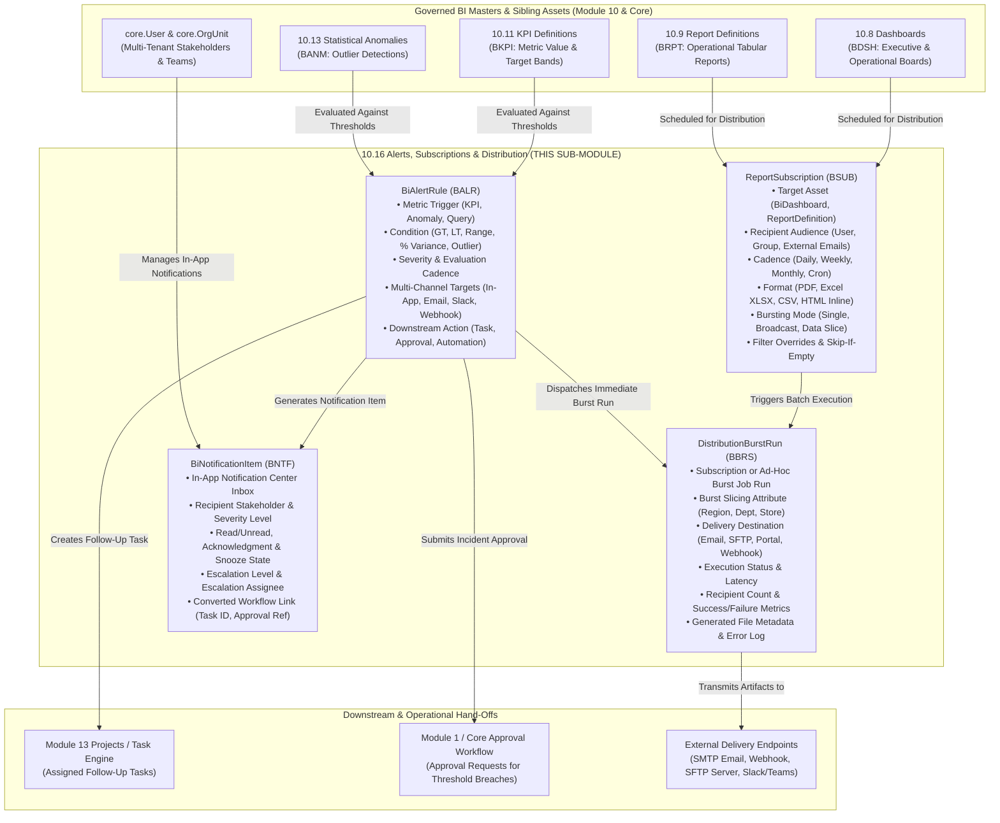

# Research — Sub-module 10.16: Alerts, Subscriptions & Distribution (Module 10 — Business Intelligence, `bi`)

- **Sub-module:** 10.16 Alerts, Subscriptions & Distribution
- **Module:** 10 Business Intelligence
- **Target app:** `apps/bi` (package: `apps/bi/models/AlertsSubscriptions/`)
- **Research date:** 2026-11-07
- **Phase:** Phase 1 Research Catalog
- **Output file target:** `.claude/tasks/research-bi-10.16.md`

---

## 1. Executive Summary & Domain Architecture

Sub-module 10.16 delivers **Threshold & Anomaly Alerts, Report & Dashboard Subscriptions, Enterprise Distribution & Data Bursting, In-App Notification Center, and Trigger-Based Workflows** for NavERP (`apps/bi`).

In earlier sub-modules, NavERP established the comprehensive data foundation and presentation layer:
- **10.3 / 10.4**: Governed analytical tables (`WarehouseTable`, `DataMart`) and the semantic layer (`SemanticModel`, `CalculatedMeasure`).
- **10.8 / 10.9**: Executive dashboards (`BiDashboard`, `BiDashboardWidget`) and operational reports (`ReportDefinition`, `ReportExecution`).
- **10.11 / 10.13**: Strategic scorecards (`KpiDefinition`, `PerformanceScorecard`) and predictive anomaly detection (`StatisticalAnomaly`).
- **10.14 / 10.15**: Augmented insight drivers (`AugmentedInsight`) and conversational query summaries (`NarrativeExplanation`).

While sub-modules 10.8–10.15 allow business users to actively query, inspect, and converse with analytics inside the application, **Sub-module 10.16 shifts analytics from pull to push**:
1. **Threshold & Anomaly Alerts (`BiAlertRule`)**: Continuously monitors key performance metrics and anomaly registers against user-defined static thresholds, percentage variances, target bands, or statistical anomalies. Evaluates conditions on scheduled intervals or following data ingestion refreshes, triggering targeted notifications across multi-channel destinations.
2. **Report Subscriptions (`ReportSubscription`)**: Allows executives, managers, and operational teams to schedule recurring, automated deliveries of entire dashboards or operational reports (daily, weekly, monthly, quarterly) in desired export formats (PDF, Excel XLSX, CSV, HTML inline digest) with custom parameters.
3. **Distribution & Data Bursting (`DistributionBurstRun`)**: Executes high-volume batch report generation and "data bursting" — dynamically slicing a single master report by recipient attributes (e.g., regional manager, department head, vendor) so each stakeholder receives only the data permitted under their access scope across email, portal inbox, SFTP drop, or webhook channels.
4. **Notification Center (`BiNotificationItem`)**: Provides an in-app operational inbox with read/unread tracking, severity badges, alert snoozing, multi-level escalation handling, and user acknowledgment audit trails.
5. **Trigger-Based Workflows**: Closes the loop from passive insight to active operational response by automatically generating ERP tasks, routing approval requests, or triggering automated webhooks whenever critical alert thresholds are breached.

### Architectural Data Flow

---

## 2. Repo State Checked First

- **Existing App:** `apps/bi` exists and is organized into dedicated sub-packages (`DataIntegration`, `EtlPipelines`, `DataWarehouse`, `SemanticLayer`, `DataQuality`, `MasterData`, `DataCatalog`, `Dashboards`, `OperationalReporting`, `SelfServiceAnalytics`, `PerformanceScorecards`, `OlapAnalysis`, `PredictiveAnalytics`, `AiAugmentedAnalytics`, `ConversationalBi`).
- **LIVE_LINKS Built So Far in Module 10 (`apps/core/navigation.py`):**
  - `10.1`: Data Integration & Ingestion (`DataSourceConnector`, `IngestionPipeline`)
  - `10.2`: ETL/ELT & Data Pipelines (`EtlPipeline`, `TransformationStep`)
  - `10.3`: Data Warehouse & Storage (`WarehouseTable`, `DataMart`)
  - `10.4`: Data Modeling & Semantic Layer (`SemanticModel`, `CalculatedMeasure`, `BusinessGlossaryTerm`)
  - `10.5`: Data Quality & Cleansing (`DataQualityRule`, `DataQualityProfile`)
  - `10.6`: Master Data Management (`MdmGoldenRecord`, `MdmSurvivorshipRule`)
  - `10.7`: Data Catalog, Lineage & Governance (`CatalogAsset`, `DataGovernancePolicy`)
  - `10.8`: Dashboards & Visualization (`BiDashboard`, `BiDashboardWidget`)
  - `10.9`: Standard & Operational Reporting (`ReportDefinition`, `ReportExecution`)
  - `10.10`: Self-Service & Ad-Hoc Analytics (`AdHocQuery`, `DataBlendDefinition`)
  - `10.11`: KPI & Performance Scorecards (`KpiDefinition`, `PerformanceScorecard`)
  - `10.12`: OLAP Cubes & Aggregations (`OlapCube`, `PivotViews`, `WhatIfScenario`)
  - `10.13`: Predictive Analytics (`PredictiveModel`, `ForecastExecution`, `StatisticalAnomaly`)
  - `10.14`: AI Augmented Analytics (`AugmentedInsight`, `SmartDataPrepSuggestion`, `TextSentimentAnalysis`)
  - `10.15`: Natural Language & Conversational BI (`NaturalLanguageQuery`, `BiConversationSession`, `NarrativeExplanation`, `SearchDiscoveryIndex`)
- **Verified Sibling Models in `apps/bi` Available to FK:**
  - `bi.KpiDefinition` (`apps/bi/models/PerformanceScorecards/KpiDefinitions.py`) — verified present [BKPI-].
  - `bi.BiDashboard` (`apps/bi/models/Dashboards/BiDashboards.py`) — verified present [BDSH-].
  - `bi.ReportDefinition` (`apps/bi/models/OperationalReporting/ReportDefinitions.py`) — verified present [BRPT-].
  - `bi.StatisticalAnomaly` (`apps/bi/models/PredictiveAnalytics/StatisticalAnomalies.py`) — verified present [BANM-].
  - `bi.AugmentedInsight` (`apps/bi/models/AiAugmentedAnalytics/AugmentedInsights.py`) — verified present [BAIN-].
  - `bi.AdHocQuery` (`apps/bi/models/SelfServiceAnalytics/AdHocQueries.py`) — verified present [BAHQ-].
- **Verified Spine Entities in `apps/core`:**
  - `core.Tenant` (`apps/core/models/Tenant.py`) — verified present.
  - `settings.AUTH_USER_MODEL` (`core.User`) — verified present.
  - `core.OrgUnit` (`apps/core/models/OrgUnit.py`) — verified present.
  - `core.AuditLog` (`apps/core/models/AuditLog.py`) — verified present.
- **Spine Masters Verified NOT Built (Stand-ins / Loose strings required if referenced):**
  - `Item`, `UOM`, `StockMove` (Module 5 Inventory) — not yet built.
  - `SalesOrder` (Module 8 Sales) — not yet built.
- **Prefix Collision Sweep (100% Collision-Free Across Entire Workspace):**
  - `BALR`: `BiAlertRule` — 0 hits across repository, 100% free.
  - `BSUB`: `ReportSubscription` — 0 hits across repository, 100% free.
  - `BBRS`: `DistributionBurstRun` — 0 hits across repository, 100% free.
  - `BNTF`: `BiNotificationItem` — 0 hits across repository, 100% free.
- **Incremental Migration Target:**
  - Leaf migration in `apps/bi/migrations/` is `0035_searchdiscoveryindex_idx_bsdi_ten_feat_rw.py`.
  - Next migration for 10.16 claims `0036`.

---

## 3. Leaders Surveyed (with Source Links)

1. **Microsoft Power BI / Microsoft Fabric (Data Alerts & Dynamic Subscriptions & Power Automate Flows)**
   - *Overview:* Market leader in enterprise reporting, offering data alerts on KPI cards/gauges, dynamic per-recipient report subscriptions (bursting filtered snapshots via recipient mapping datasets), and seamless Power Automate event triggers.
   - *Source:* [https://learn.microsoft.com/en-us/power-bi/collaborate-share/service-report-subscribe](https://learn.microsoft.com/en-us/power-bi/collaborate-share/service-report-subscribe) & [https://learn.microsoft.com/en-us/power-bi/create-reports/service-set-data-alerts](https://learn.microsoft.com/en-us/power-bi/create-reports/service-set-data-alerts)
2. **Salesforce Tableau (Data-Driven Alerts & PDF/Image Subscriptions & Tableau Pulse)**
   - *Overview:* Native data-driven alerts on continuous numeric axes with multi-user notifications via email and Slack; scheduled subscriptions to dashboards and views with user-filter bursting for group recipients; personalized proactive metric digests in Tableau Pulse.
   - *Source:* [https://help.tableau.com/current/pro/desktop/en-us/data_alerts.htm](https://help.tableau.com/current/pro/desktop/en-us/data_alerts.htm) & [https://help.tableau.com/current/server/en-us/subscribe_user.htm](https://help.tableau.com/current/server/en-us/subscribe_user.htm)
3. **Google Cloud Looker (Alerts & Schedules, Looker Action Hub & Bursting)**
   - *Overview:* Comprehensive data delivery infrastructure supporting threshold alerts, scheduled Looks and Dashboards, user attribute bursting ("Run Schedule as Recipient"), and the Looker Action Hub for dispatching data payloads into Slack, webhooks, SFTP, and cloud storage.
   - *Source:* [https://cloud.google.com/looker/docs/alerts](https://cloud.google.com/looker/docs/alerts) & [https://cloud.google.com/looker/docs/scheduling-and-sharing](https://cloud.google.com/looker/docs/scheduling-and-sharing)
4. **ThoughtSpot (Monitor & Alerts, Scheduled Liveboard Delivery)**
   - *Overview:* Modern search & AI analytics platform featuring KPI Monitor (tracking metric milestones, threshold breaches, and statistical anomalies), scheduled Liveboard generation with PDF/CSV attachments, and webhook automation.
   - *Source:* [https://docs.thoughtspot.com/cloud/latest/alerts](https://docs.thoughtspot.com/cloud/latest/alerts) & [https://docs.thoughtspot.com/cloud/latest/liveboard-schedule](https://docs.thoughtspot.com/cloud/latest/liveboard-schedule)
5. **Metabase (Alerts, Pulses / Dashboard Subscriptions & Slack/Email Delivery)**
   - *Overview:* Intuitive open-source & cloud BI solution providing question alerts (thresholds, goal lines, row count presence), scheduled dashboard subscriptions with smart skipping (suppressing delivery when questions return empty results), and deep Slack and webhook integration.
   - *Source:* [https://www.metabase.com/docs/latest/questions/sharing/alerts](https://www.metabase.com/docs/latest/questions/sharing/alerts) & [https://www.metabase.com/docs/latest/dashboards/subscriptions](https://www.metabase.com/docs/latest/dashboards/subscriptions)
6. **Qlik Alerting & Qlik NPrinting (Next-Generation Reporting & Distribution)**
   - *Overview:* Enterprise gold standard for report generation and broadcast alerting. Qlik Alerting provides intelligent data-driven criteria and self-service subscriptions; Qlik NPrinting handles high-scale document bursting across email, folders, and the NewsStand web portal with recipient filter slicing.
   - *Source:* [https://help.qlik.com/en-US/nprinting/May2023/Content/NPrinting/ReportsDevelopment/Report-bursting.htm](https://help.qlik.com/en-US/nprinting/May2023/Content/NPrinting/ReportsDevelopment/Report-bursting.htm) & [https://help.qlik.com/en-US/alerting/](https://help.qlik.com/en-US/alerting/)
7. **Domo (Alert Engine, Attach Actions & Notification Center)**
   - *Overview:* Action-oriented business cloud with an advanced alert engine monitoring cards and datasets; supports "Attach Action" to automatically spawn project tasks, trigger webhooks, or route approvals; backed by a centralized notification center and Buzz social stream.
   - *Source:* [https://domohelp.domo.com/hc/en-us/articles/360043438913-Creating-an-Alert-for-a-Card](https://domohelp.domo.com/hc/en-us/articles/360043438913-Creating-an-Alert-for-a-Card) & [https://domohelp.domo.com/hc/en-us/articles/360042934274-Receiving-and-Managing-Notifications](https://domohelp.domo.com/hc/en-us/articles/360042934274-Receiving-and-Managing-Notifications)
8. **MicroStrategy Distribution Services (Report Subscriptions & Document Bursting)**
   - *Overview:* Classic enterprise distribution backbone delivering pixel-perfect reports, grouping/page-by bursting per recipient, password-protected encrypted zip archives, and multi-channel routing (email, printer, file server, mobile).
   - *Source:* [https://www2.microstrategy.com/producthelp/Current/SystemAdmin/WebHelp/Lang_1033/Content/scheduling_reports_and_documents.htm](https://www2.microstrategy.com/producthelp/Current/SystemAdmin/WebHelp/Lang_1033/Content/scheduling_reports_and_documents.htm)

---

## 4. Feature Catalog (This Sub-Module Only)

### 4.1 Threshold & Anomaly Alerts
- **Configurable KPI Threshold Triggers** — Monitors numerical measures from `bi.KpiDefinition` or queries against dynamic conditions: `greater_than`, `less_than`, `equal_to`, `outside_range`, `pct_change_exceeds`. · seen in: *Power BI, Tableau, Looker, ThoughtSpot, Domo* · priority: `table-stakes` · spine: `bi.BiAlertRule` [BALR-] · buildable now.
- **Statistical Anomaly Integration** — Triggers alert notifications when an outlier or anomaly is flagged in `bi.StatisticalAnomaly` (10.13) or `bi.AugmentedInsight` (10.14) without requiring manual threshold tuning. · seen in: *ThoughtSpot Monitor, Tableau Pulse, Domo* · priority: `differentiator` · spine: `bi.BiAlertRule` [BALR-] · buildable now.
- **Alert Trigger Frequency & Cooldown Rules** — Governs how often an alert evaluates (`on_data_refresh`, `hourly`, `daily`, `weekly`, `custom_cron`) and its notification behavior (`every_time`, `once_until_resolved`, `disposable_one_off`). · seen in: *Metabase, Tableau, Looker, Power BI* · priority: `table-stakes` · spine: `bi.BiAlertRule` [BALR-] · buildable now.
- **Severity Classification** — Assigns operational urgency (`info`, `warning`, `critical`, `urgent`) to route notifications according to impact. · seen in: *Domo, Qlik Alerting, MicroStrategy* · priority: `table-stakes` · spine: `bi.BiAlertRule` [BALR-] · buildable now.
- **Multi-Channel Notification Dispatch** — Sends alert notifications across in-app notification center, email, Slack/Teams webhooks, and generic REST endpoints. · seen in: *Domo, Looker Action Hub, Metabase* · priority: `table-stakes` · spine: `bi.BiAlertRule` [BALR-] · buildable now.
- **Self-Service Alert Subscriptions** — Allows users to subscribe to public alert rules or create their own personal alert watches on shared dashboards. · seen in: *Qlik Alerting, ThoughtSpot, Power BI* · priority: `common` · spine: `bi.BiAlertRule` [BALR-] · buildable now.

### 4.2 Report Subscriptions
- **Scheduled Dashboard & Report Delivery** — Configures recurring delivery (daily, weekly, monthly, quarterly) of `bi.BiDashboard` or `bi.ReportDefinition` artifacts. · seen in: *Tableau, Power BI, Metabase, Looker, ThoughtSpot* · priority: `table-stakes` · spine: `bi.ReportSubscription` [BSUB-] · buildable now.
- **Export Format Selection** — Supports multi-format rendering including PDF document, Excel spreadsheet (`.xlsx`), flat CSV data file, PNG chart snapshot, or inline HTML summary. · seen in: *MicroStrategy, Metabase, ThoughtSpot, Qlik NPrinting* · priority: `table-stakes` · spine: `bi.ReportSubscription` [BSUB-] · buildable now.
- **Audience Targeting** — Delivers reports to individual users (`settings.AUTH_USER_MODEL`), organizational teams (`core.OrgUnit`), or external stakeholder email distribution lists. · seen in: *Power BI, Metabase, Looker, Qlik NPrinting* · priority: `table-stakes` · spine: `bi.ReportSubscription` [BSUB-] · buildable now.
- **Personalized Parameter & Filter Overrides** — Stores custom filter parameters per subscription (e.g., date range, branch, department) so each subscriber receives tailored data. · seen in: *Looker, ThoughtSpot, MicroStrategy* · priority: `table-stakes` · spine: `bi.ReportSubscription` [BSUB-] · buildable now.
- **Smart Skipping (Empty Result Suppression)** — Suppresses scheduled delivery if underlying reports return zero rows or no exceptions, preventing inbox clutter for exception-based reporting. · seen in: *Metabase, Looker, Tableau* · priority: `common` · spine: `bi.ReportSubscription` [BSUB-] · buildable now.
- **Zip Packaging & File Attachment Policies** — Packages multiple report tabs or large datasets into compressed zip files with optional filename prefix templates. · seen in: *MicroStrategy Distribution Services, Qlik NPrinting* · priority: `common` · spine: `bi.ReportSubscription` [BSUB-] · buildable now.

### 4.3 Distribution & Bursting
- **Per-Recipient Data Bursting Engine** — Executes a single master report execution and splits/bursts output slices according to recipient identity or slicing attribute (e.g. `department_id`, `region_code`, `manager_id`). · seen in: *Power BI Dynamic Subscriptions, Qlik NPrinting, MicroStrategy Distribution Services* · priority: `differentiator` · spine: `bi.DistributionBurstRun` [BBRS-] · buildable now.
- **Multi-Channel Distribution Endpoints** — Dispatches burst packages to SMTP email recipients, internal portal dropboxes, SFTP remote storage, and webhook targets. · seen in: *MicroStrategy, Looker Action Hub, Qlik NPrinting* · priority: `table-stakes` · spine: `bi.DistributionBurstRun` [BBRS-] · buildable now.
- **Batch Burst Execution Telemetry** — Tracks batch delivery status (`queued`, `generating`, `dispatching`, `completed`, `partial_failure`, `failed`), total recipient count, success count, failure count, and runtime latency. · seen in: *Qlik NPrinting Publish Tasks, Looker Schedule History* · priority: `table-stakes` · spine: `bi.DistributionBurstRun` [BBRS-] · buildable now.
- **Delivery Error Logging & Retry Auditing** — Captures detailed error messages for bounced emails, invalid filter attributes, or failed transmission endpoints in a structured log payload. · seen in: *Qlik NPrinting, MicroStrategy Distribution Services* · priority: `table-stakes` · spine: `bi.DistributionBurstRun` [BBRS-] · buildable now.
- **Ad-Hoc Manual Burst Triggering** — Allows administrators and report authors to run immediate "Burst Now" tests outside of recurring cron schedules. · seen in: *Qlik NPrinting, MicroStrategy, Power BI* · priority: `common` · spine: `bi.DistributionBurstRun` [BBRS-] · buildable now.

### 4.4 Notification Center
- **Unified In-App Notification Inbox** — Central repository displaying operational alerts, subscription delivery notices, and threshold warnings with read/unread flags and severity badges. · seen in: *Domo Notification Center, Power BI Activity Center, Tableau Notifications* · priority: `table-stakes` · spine: `bi.BiNotificationItem` [BNTF-] · buildable now.
- **Alert Acknowledgment Tracking** — Allows operators and managers to explicitly mark critical alerts as "Acknowledged", recording user ID and timestamp to guarantee accountability. · seen in: *Domo Alert Center, OpsGenie/PagerDuty enterprise alerting* · priority: `table-stakes` · spine: `bi.BiNotificationItem` [BNTF-] · buildable now.
- **Alert Snooze & Mute Controls** — Enables users to snooze recurring notifications for a configurable duration (1 hour, 4 hours, 24 hours, 7 days) while root causes are remediated. · seen in: *Domo, Tableau Pulse, OpsGenie* · priority: `common` · spine: `bi.BiNotificationItem` [BNTF-] · buildable now.
- **Multi-Tier Escalation Routing** — Automatically advances unacknowledged critical alerts to secondary managers or escalation contacts if unhandled after a threshold window. · seen in: *Domo Alert Escalations, Enterprise IT Service Management* · priority: `differentiator` · spine: `bi.BiNotificationItem` [BNTF-] · buildable now.
- **Deep-Link Context Navigation** — Provides direct one-click navigation links to the underlying dashboard, KPI scorecard, report, or statistical anomaly that caused the alert. · seen in: *Tableau, Power BI, Domo* · priority: `table-stakes` · spine: `bi.BiNotificationItem` [BNTF-] · buildable now.

### 4.5 Trigger-Based Workflows
- **Alert-to-Task Conversion** — Automatically converts a breached alert into an assigned operational task (`Module 13 Projects / Task Management`), tracking task ID and assignee. · seen in: *Domo Alert Actions (Attach Task), Power Automate* · priority: `table-stakes` · spine: `bi.BiAlertRule` [BALR-] + `bi.BiNotificationItem` [BNTF-] · buildable now.
- **Approval Workflow Trigger** — Submits an approval request (e.g. budget override, inventory replenishment request) into the core approval engine when a threshold is exceeded. · seen in: *Power Automate Approval Flows, Domo Workflows* · priority: `common` · spine: `bi.BiAlertRule` [BALR-] + `bi.BiNotificationItem` [BNTF-] · buildable now.
- **Automated Webhook Callbacks** — Dispatches a structured JSON webhook payload to external business systems (ERP automation, Zapier, custom listener) containing breached metric values and metadata. · seen in: *Looker Action Hub, Metabase Webhooks, Domo Webhooks* · priority: `table-stakes` · spine: `bi.BiAlertRule` [BALR-] + `bi.DistributionBurstRun` [BBRS-] · buildable now.
- **Pipeline Retriggering on Metric Drift** — Capable of triggering an ETL pipeline rerun (`bi.EtlPipeline`) or data quality profile refresh (`bi.DataQualityProfile`) when metric anomaly alerts fire. · seen in: *Domo, Looker Datagroups* · priority: `differentiator` · spine: `bi.BiAlertRule` [BALR-] · buildable now.

### 4.6 Beyond the Bullets (Enterprise Governance & Administration)
- **Delivery Throttling & Digest Batching** — Consolidates multiple high-frequency notifications into a single periodic digest email to prevent notification fatigue. · seen in: *Domo Notification Settings, Tableau Pulse* · priority: `common` · spine: `bi.ReportSubscription` [BSUB-] · buildable now.
- **Subscriber Unsubscribe & Opt-Out Governance** — Provides clean unsubscribe and opt-out links for recipients of broadcasts and scheduled reports, logging audit records. · seen in: *Qlik Alerting, Metabase* · priority: `table-stakes` · spine: `bi.ReportSubscription` [BSUB-] · buildable now.
- **Run-As Impersonation Security** — Executes subscription queries either as the subscription author or dynamically as the individual recipient, enforcing tenant-isolated Row-Level Security (RLS). · seen in: *Looker "Run Schedule as Recipient", Power BI Dynamic Subscriptions* · priority: `table-stakes` · spine: `bi.ReportSubscription` [BSUB-] · buildable now.

---

## 5. Recommended Build Scope (This Pass — 4 Models)

To implement Sub-module 10.16 end-to-end within the standard 1–4 model scope, we build **4 tenant-scoped, collision-free models** in `apps/bi/models/AlertsSubscriptions/`:

### 1. `BiAlertRule` [BALR-] — Threshold & Anomaly Alert Definitions
- **Prefix:** `BALR` (e.g. `BALR-00001`)
- **Base Class:** `TenantNumbered` (`apps/bi/models/_base.py`)
- **Key Fields:**
  - `number`: CharField 20, auto-generated sequence `BALR-#####`
  - `name`: CharField 150, descriptive name of the alert rule
  - `description`: TextField, blank=True
  - `kpi`: ForeignKey `bi.KpiDefinition`, on_delete=SET_NULL, null=True, blank=True, related_name="alert_rules"
  - `anomaly`: ForeignKey `bi.StatisticalAnomaly`, on_delete=SET_NULL, null=True, blank=True, related_name="alert_rules"
  - `metric_name`: CharField 100, fallback metric identifier or calculated measure name
  - `condition_type`: CharField 32, choices: `greater_than`, `less_than`, `equal_to`, `outside_range`, `pct_change_exceeds`, `anomaly_detected`, `zero_results`, `has_results`, default `greater_than`
  - `threshold_value`: DecimalField 16,4, null=True, blank=True (lower bound or static trigger value)
  - `threshold_ceiling`: DecimalField 16,4, null=True, blank=True (upper bound for `outside_range`)
  - `pct_change_threshold`: DecimalField 7,2, null=True, blank=True (percentage variance trigger, e.g. 15.00%)
  - `evaluation_frequency`: CharField 24, choices: `hourly`, `daily`, `weekly`, `on_data_refresh`, `custom_cron`, default `daily`
  - `cron_expression`: CharField 64, blank=True (e.g. `0 8 * * *`)
  - `severity`: CharField 16, choices: `info`, `warning`, `critical`, `urgent`, default `warning`
  - `trigger_mode`: CharField 24, choices: `every_time`, `once_until_resolved`, `disposable_one_off`, default `once_until_resolved`
  - `channel_in_app`: BooleanField, default=True
  - `channel_email`: BooleanField, default=True
  - `channel_slack_teams`: BooleanField, default=False
  - `channel_webhook`: BooleanField, default=False
  - `webhook_url`: URLField, blank=True
  - `downstream_action`: CharField 24, choices: `none`, `create_task`, `trigger_approval`, `webhook_call`, `retrigger_pipeline`, default `none`
  - `action_assignee`: ForeignKey `settings.AUTH_USER_MODEL`, on_delete=SET_NULL, null=True, blank=True, related_name="assigned_bi_alerts"
  - `is_active`: BooleanField, default=True
  - `last_evaluated_at`: DateTimeField, null=True, blank=True
  - `last_triggered_at`: DateTimeField, null=True, blank=True
  - `trigger_count`: IntegerField, default=0
- **Justification:** Fulfills NavERP.md bullets **Threshold & Anomaly Alerts** and **Trigger-Based Workflows**. Connects directly to verified sibling masters `bi.KpiDefinition` and `bi.StatisticalAnomaly`.

### 2. `ReportSubscription` [BSUB-] — Scheduled Delivery Configurations
- **Prefix:** `BSUB` (e.g. `BSUB-00001`)
- **Base Class:** `TenantNumbered` (`apps/bi/models/_base.py`)
- **Key Fields:**
  - `number`: CharField 20, auto-generated sequence `BSUB-#####`
  - `name`: CharField 150, subscription title (e.g. "Weekly Executive Revenue Digest")
  - `dashboard`: ForeignKey `bi.BiDashboard`, on_delete=SET_NULL, null=True, blank=True, related_name="subscriptions"
  - `report_definition`: ForeignKey `bi.ReportDefinition`, on_delete=SET_NULL, null=True, blank=True, related_name="subscriptions"
  - `cadence`: CharField 24, choices: `daily`, `weekly`, `monthly`, `quarterly`, `cron_custom`, default `weekly`
  - `delivery_time`: TimeField, default "08:00:00"
  - `delivery_day_of_week`: IntegerField, null=True, blank=True, choices=[(0, "Monday"), (1, "Tuesday"), (2, "Wednesday"), (3, "Thursday"), (4, "Friday"), (5, "Saturday"), (6, "Sunday")]
  - `delivery_day_of_month`: IntegerField, null=True, blank=True (1–31)
  - `export_format`: CharField 20, choices: `pdf`, `excel_xlsx`, `csv`, `png_image`, `html_inline`, default `pdf`
  - `recipient_user`: ForeignKey `settings.AUTH_USER_MODEL`, on_delete=SET_NULL, null=True, blank=True, related_name="bi_subscriptions"
  - `recipient_org_unit`: ForeignKey `core.OrgUnit`, on_delete=SET_NULL, null=True, blank=True, related_name="bi_subscriptions"
  - `recipient_emails`: TextField, blank=True, help_text="Comma-separated external recipient email addresses"
  - `burst_mode`: CharField 24, choices: `single_recipient`, `group_broadcast`, `data_bursting`, default `single_recipient`
  - `burst_slicing_attribute`: CharField 64, blank=True, help_text="Attribute used to slice data per recipient (e.g. department, region)"
  - `filter_overrides`: JSONField, default=dict, help_text="Custom query parameters and filters applied to the view"
  - `destination_channel`: CharField 20, choices: `email`, `portal_inbox`, `sftp_server`, `slack_teams`, `webhook`, default `email`
  - `sftp_path`: CharField 255, blank=True
  - `skip_if_empty`: BooleanField, default=True
  - `zip_attachment`: BooleanField, default=False
  - `is_active`: BooleanField, default=True
  - `last_sent_at`: DateTimeField, null=True, blank=True
  - `next_run_at`: DateTimeField, null=True, blank=True
  - `send_count`: IntegerField, default=0
- **Justification:** Fulfills NavERP.md bullet **Report Subscriptions** and configures bursting metadata for **Distribution & Bursting**. Connects to verified sibling masters `bi.BiDashboard` and `bi.ReportDefinition`.

### 3. `DistributionBurstRun` [BBRS-] — Batch Generation & Delivery Burst Runs
- **Prefix:** `BBRS` (e.g. `BBRS-00001`)
- **Base Class:** `TenantNumbered` (`apps/bi/models/_base.py`)
- **Key Fields:**
  - `number`: CharField 20, auto-generated sequence `BBRS-#####`
  - `subscription`: ForeignKey `ReportSubscription`, on_delete=SET_NULL, null=True, blank=True, related_name="burst_runs"
  - `alert_rule`: ForeignKey `BiAlertRule`, on_delete=SET_NULL, null=True, blank=True, related_name="burst_runs"
  - `run_mode`: CharField 24, choices: `scheduled`, `manual_burst`, `alert_triggered`, default `scheduled`
  - `destination_channel`: CharField 20, choices: `email`, `portal_inbox`, `sftp_server`, `slack_teams`, `webhook`, default `email`
  - `burst_slicing_attribute`: CharField 64, blank=True
  - `status`: CharField 20, choices: `queued`, `generating`, `dispatching`, `completed`, `partial_failure`, `failed`, default `queued`
  - `total_recipients`: IntegerField, default=0
  - `successful_deliveries`: IntegerField, default=0
  - `failed_deliveries`: IntegerField, default=0
  - `artifact_file_name`: CharField 255, blank=True
  - `artifact_file_size_bytes`: BigIntegerField, default=0
  - `artifact_storage_uri`: CharField 500, blank=True
  - `error_summary`: TextField, blank=True
  - `delivery_telemetry`: JSONField, default=dict, help_text="Per-recipient delivery status, timestamps, and error codes"
  - `duration_ms`: IntegerField, default=0
  - `started_at`: DateTimeField, default=timezone.now
  - `completed_at`: DateTimeField, null=True, blank=True
- **Justification:** Fulfills NavERP.md bullet **Distribution & Bursting**, providing complete execution history, delivery tracking, and performance telemetry for enterprise audits.

### 4. `BiNotificationItem` [BNTF-] — Notification Center Inbox & Escalations
- **Prefix:** `BNTF` (e.g. `BNTF-00001`)
- **Base Class:** `TenantNumbered` (`apps/bi/models/_base.py`)
- **Key Fields:**
  - `number`: CharField 20, auto-generated sequence `BNTF-#####`
  - `recipient`: ForeignKey `settings.AUTH_USER_MODEL`, on_delete=CASCADE, related_name="bi_notifications"
  - `alert_rule`: ForeignKey `BiAlertRule`, on_delete=SET_NULL, null=True, blank=True, related_name="notifications"
  - `subscription`: ForeignKey `ReportSubscription`, on_delete=SET_NULL, null=True, blank=True, related_name="notifications"
  - `title`: CharField 200, notification headline
  - `message`: TextField, alert narrative or delivery summary (Markdown supported)
  - `severity`: CharField 16, choices: `info`, `warning`, `critical`, `urgent`, default `info`
  - `status`: CharField 16, choices: `unread`, `read`, `acknowledged`, `snoozed`, `escalated`, `archived`, default `unread`
  - `is_acknowledged`: BooleanField, default=False
  - `acknowledged_at`: DateTimeField, null=True, blank=True
  - `acknowledged_by`: ForeignKey `settings.AUTH_USER_MODEL`, on_delete=SET_NULL, null=True, blank=True, related_name="acknowledged_bi_notifications"
  - `snoozed_until`: DateTimeField, null=True, blank=True
  - `escalation_level`: IntegerField, default=0, help_text="0=Normal, 1=Manager Escalation, 2=Executive Escalation"
  - `escalated_to`: ForeignKey `settings.AUTH_USER_MODEL`, on_delete=SET_NULL, null=True, blank=True, related_name="escalated_bi_notifications"
  - `action_url`: CharField 255, blank=True, help_text="Internal deep-link URL to affected dashboard, scorecard, or report"
  - `workflow_converted_type`: CharField 24, choices: `none`, `task`, `approval`, `incident`, default `none`
  - `workflow_reference_id`: CharField 64, blank=True, help_text="Reference ID of created task or approval request"
- **Justification:** Fulfills NavERP.md bullet **Notification Center** and tracks the audit trail for **Trigger-Based Workflows**.

---

## 6. Belongs to Sibling Sub-modules (Parked, Not Scoped Here)

- **KPI Definition & Balanced Scorecard Design** $\rightarrow$ Belongs to **10.11 KPI & Performance Scorecards** (`KpiDefinition`, `PerformanceScorecard` - already built).
- **Statistical Anomaly Detection Algorithms & Time-Series Forecasting** $\rightarrow$ Belongs to **10.13 Predictive Analytics** (`PredictiveModel`, `StatisticalAnomaly` - already built).
- **Natural Language Narrative Generation for Charts** $\rightarrow$ Belongs to **10.15 Conversational BI** (`NarrativeExplanation` - already built).
- **Embedded Analytics, Mobile BI App & Touch Wallboards** $\rightarrow$ Belongs to **10.17 Embedded & Mobile BI** (next sub-module).
- **Collaborative Data Storytelling & Slide Presentations** $\rightarrow$ Belongs to **10.18 Collaboration & Data Storytelling**.
- **External Multi-Agent LLM Orchestration & Natural Reasoning** $\rightarrow$ Belongs to **Module 23 AI Automation**.

---

## 7. Deferred to Later Passes / External Integrations

- **Direct SFTP Network Socket Streaming**: In this pass, `DistributionBurstRun` generates tenant-isolated storage artifact paths and logs delivery telemetry; live socket communication to remote SFTP servers hooks into background Celery/Redis workers in later deployment passes.
- **Bi-Directional Slack Bot & Microsoft Teams Graph Webhooks**: Notification payloads and webhooks emit structured JSON events (`webhook_url`, `delivery_telemetry`); full bi-directional bot slash-command listeners defer to Module 23 / external integration gateways.
- **Headless Chromium PDF Rendering Daemon**: Export artifact generation provides structured CSV, XLSX, and HTML inline digest builders, with headless browser PDF rasterization configured via modular exporter adapters.

---

## 8. Verification & Next Steps

- **Package Path:** `apps/bi/models/AlertsSubscriptions/`
- **Migration Target:** `0036` (following `0035_searchdiscoveryindex_idx_bsdi_ten_feat_rw.py`)
- **Prefix Verification Summary:**
  - `BALR` (`BiAlertRule`) — Confirmed 0 collisions.
  - `BSUB` (`ReportSubscription`) — Confirmed 0 collisions.
  - `BBRS` (`DistributionBurstRun`) — Confirmed 0 collisions.
  - `BNTF` (`BiNotificationItem`) — Confirmed 0 collisions.
- **Execution Proceeding:** Pass this research catalog to Phase 2 (`todo` agent) to construct the implementation task plan in `.claude/tasks/todo.md`.
