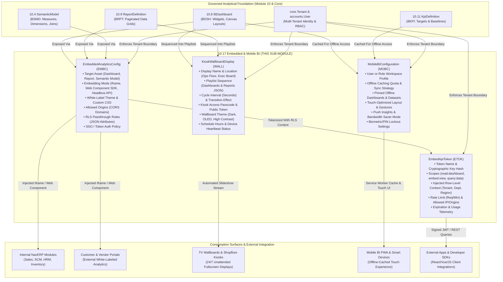

# Research — Sub-module 10.17: Embedded & Mobile BI (Module 10 — Business Intelligence, `bi`)

- **Sub-module:** 10.17 Embedded & Mobile BI
- **Module:** 10 Business Intelligence
- **Target app:** `apps/bi` (package: `apps/bi/models/EmbeddedMobileBi/`)
- **Research date:** 2026-11-07
- **Phase:** Phase 1 Research Catalog
- **Output file target:** `.claude/tasks/research-bi-10.17.md`

---

## 1. Executive Summary & Domain Architecture

Sub-module 10.17 delivers **Embedded Analytics, Mobile BI Configuration & PWA Caching, Developer APIs & SDKs, Portal, Kiosk & Wallboard Displays, and SSO with Row-Level Context (RLS)** for NavERP (`apps/bi`).

In earlier sub-modules, NavERP established the comprehensive analytics engine:
- **10.3 / 10.4**: Physical analytical data marts (`WarehouseTable`, `DataMart`) and business semantic abstractions (`SemanticModel`, `CalculatedMeasure`, `BusinessGlossaryTerm`).
- **10.8 / 10.9**: High-impact interactive visualizations (`BiDashboard`, `BiDashboardWidget`) and paginated operational reports (`ReportDefinition`, `ReportExecution`).
- **10.10 / 10.11 / 10.12**: Self-service queries (`AdHocQuery`), balanced scorecards (`KpiDefinition`, `PerformanceScorecard`), and multidimensional OLAP cubes (`OlapCube`, `WhatIfScenario`).
- **10.14 / 10.15**: Augmented intelligence (`AugmentedInsight`, `TextSentimentAnalysis`) and conversational query interfaces (`NaturalLanguageQuery`, `BiConversationSession`).

Sub-module 10.17 takes this entire analytical catalog beyond the core BI module boundaries into:
1. **Embedded Analytics:** White-labeled, theme-customized visual components (dashboards, charts, report grids, KPI metric cards) embedded directly into external portals, ERP operational pages (e.g., Sales Order screens, Supplier Portals, HR Employee Self-Service), and third-party SaaS products using both iframe and JavaScript/HTML Web Component integration modes.
2. **Mobile BI & Offline Caching:** Native-like Progressive Web App (PWA) workspace settings, offline caching quotas, touch-optimized visual layout presets, background sync preferences, and biometric/PIN lockdown for mobile analysts and executives on the go.
3. **Developer APIs & SDKs:** Cryptographically secure API access tokens (service principal / guest API keys) with scopes (`read:dashboard`, `embed:view`, `query:data`), origin CORS whitelists, rate limits, and client SDK integration helper snippets.
4. **Portal, Kiosk & Wallboard TV Displays:** Dedicated unattended display configurations for operations centers, manufacturing plant floors, warehouse loading docks, and executive war rooms featuring automated slide rotation (page cycling), configurable dwell intervals, dark/high-contrast wallboard themes, kiosk access passcodes, scheduled active hours, and display heartbeat tracking.
5. **SSO & Row-Level Security (RLS) Context:** Cryptographically signed embed token generation (HMAC-SHA256 / JWT claims) carrying tenant and row-level context (e.g. `customer_id`, `department_code`, `sales_region`), ensuring zero data leakage when third-party users view embedded visuals.

### Architectural Data Flow

---

## 2. Repo State Checked First

- **Existing App:** `apps/bi` exists and is packaged with 15 sub-modules already built (`DataIntegration`, `EtlPipelines`, `DataWarehouse`, `SemanticLayer`, `DataQuality`, `MasterData`, `DataCatalog`, `Dashboards`, `OperationalReporting`, `SelfServiceAnalytics`, `PerformanceScorecards`, `OlapAnalysis`, `PredictiveAnalytics`, `AiAugmentedAnalytics`, `ConversationalBi`).
- **LIVE_LINKS Built So Far in Module 10:**
  - `10.1`: Data Integration & Ingestion (`DataSourceConnector`, `IngestionPipeline`, `CdcSyncConfig`)
  - `10.2`: ETL/ELT & Data Pipelines (`EtlPipeline`, `TransformationStep`, `EtlPipelineRun`)
  - `10.3`: Data Warehouse & Storage (`WarehouseTable`, `DataMart`, `LakehouseZone`, `WarehouseStoragePolicy`)
  - `10.4`: Data Modeling & Semantic Layer (`SemanticModel`, `CalculatedMeasure`, `BusinessGlossaryTerm`)
  - `10.5`: Data Quality & Cleansing (`DataQualityRule`, `DataQualityProfile`, `DataQualityScorecard`)
  - `10.6`: Master Data Management (`MdmGoldenRecord`, `MdmSurvivorshipRule`, `MdmHierarchyNode`)
  - `10.7`: Data Catalog, Lineage & Governance (`CatalogAsset`, `CatalogLineageEdge`, `DataGovernancePolicy`, `CatalogTrustEndorsement`)
  - `10.8`: Dashboards & Visualization (`BiDashboard`, `BiDashboardWidget`, `BiDashboardFilter`, `BiDashboardBookmark`)
  - `10.9`: Standard & Operational Reporting (`ReportDefinition`, `ReportExecution`, `ReportSchedule`, `ReportParameter`)
  - `10.10`: Self-Service & Ad-Hoc Analytics (`AdHocQuery`, `AdHocCalculatedField`, `DataBlendDefinition`, `SavedAnalysisView`)
  - `10.11`: KPI & Performance Scorecards (`KpiDefinition`, `PerformanceScorecard`, `ScorecardKpiAssignment`, `StrategicObjective`)
  - `10.12`: OLAP Cubes & Aggregations (`OlapCube`, `PivotAnalysisView`, `WhatIfScenario`)
  - `10.13`: Predictive & Prescriptive Analytics (`PredictiveModel`, `ForecastExecution`, `OptimizationScenario`, `StatisticalAnomaly`)
  - `10.14`: AI & Augmented Analytics (`AugmentedInsight`, `SmartDataPrepSuggestion`, `TextSentimentAnalysis`, `AnalyticsRecommendation`)
  - `10.15`: Natural Language & Conversational BI (`NaturalLanguageQuery`, `BiConversationSession`, `NarrativeExplanation`, `SearchDiscoveryIndex`)
- **Verified Sibling Models in `apps/bi` Available to FK:**
  - `bi.BiDashboard` (`apps/bi/models/Dashboards/BiDashboards.py`) — verified present.
  - `bi.ReportDefinition` (`apps/bi/models/OperationalReporting/ReportDefinitions.py`) — verified present.
  - `bi.SemanticModel` (`apps/bi/models/SemanticLayer/SemanticModels.py`) — verified present.
  - `bi.KpiDefinition` (`apps/bi/models/PerformanceScorecards/KpiDefinitions.py`) — verified present.
- **Verified Spine Models in `apps/core` & `apps/accounts` Available to FK:**
  - `core.Tenant` (`apps/core/models/Tenant.py`) — verified present.
  - `core.AuditLog` (`apps/core/models/AuditLog.py`) — verified present via `log_action`.
  - `accounts.User` (`apps/accounts/models/User.py`) — verified present.

---

## 3. Commercial Leaders Surveyed

1. **Microsoft Power BI Embedded & Power BI Mobile**
   - *Positioning:* Industry standard enterprise embedding platform using Azure A-SKU / Fabric capacity, JavaScript Client SDK (`powerbi-client`), Row-Level Security (RLS), and native iOS/Android apps with offline caching for favorite dashboards.
   - *Key Capabilities:* Embed token generation via Azure Service Principals; JavaScript SDK with bi-directional event hooks; Power BI Slideshow & TV presentation mode; mobile touch layouts with portrait rendering; offline report snapshots with periodic background sync.
   - *Source:* https://learn.microsoft.com/en-us/power-bi/collaborate-share/service-mobile-offline-data

2. **Tableau Embedded Analytics & Tableau Mobile**
   - *Positioning:* Visual analytics leader with Tableau Embedding API v3, Connected Apps (JWT authentication with user attribute passthrough), and Tableau Mobile with offline Interactive Previews.
   - *Key Capabilities:* Web Component embedding (`<tableau-viz>`); cryptographically signed JWT tokens with direct user/attribute mapping; offline previews with cached tooltips and panning; unattended TV presentation mode with `:refresh=yes` intervals and automated fullscreen kiosk mode.
   - *Source:* https://help.tableau.com/current/mobile/mobile-admin/en-us/mobile_admin_offline.htm

3. **ThoughtSpot Everywhere & ThoughtSpot Mobile**
   - *Positioning:* Modern search & AI-driven embedded platform offering Visual Embed SDK, headless data APIs, and mobile conversational analytics.
   - *Key Capabilities:* Web component embedding of whole dashboards, single liveboards, or search bars; granular white-labeling with custom CSS variables and custom typography; Trusted Token authentication for seamless SSO; mobile instant push insights.
   - *Source:* https://www.thoughtspot.com/everywhere

4. **Looker Embedded (Google Cloud)**
   - *Positioning:* Semantic-governed embedded platform built on LookML with signed iframe URLs, Embed SDK, and action webhooks.
   - *Key Capabilities:* SSO Signed URLs passing permissions, models, and user attributes for multi-tenant isolation; Looker Embed SDK for bi-directional message communication; Data Actions triggering workflows directly from embedded charts; scheduled wallboard displays.
   - *Source:* https://cloud.google.com/looker/docs/embedded-bi

5. **Domo Everywhere & Domo Mobile**
   - *Positioning:* Cloud-native BI suite renowned for high-velocity embedding, native TV wallboard Page Cycling, and mobile-first experience.
   - *Key Capabilities:* Native TV Page Cycle mode rotating through dashboard cards at configurable intervals; permanent public/passcode kiosk URLs; mobile offline card caching; embed tokens with dynamic dataset PDP (Personalized Data Permissions / RLS).
   - *Source:* https://www.domo.com/product/capabilities/mobile-bi

6. **Sisense Fusion Embed & Compose SDK**
   - *Positioning:* Developer-first embedded analytics platform with Compose SDK for headless UI and deep white-label styling.
   - *Key Capabilities:* Compose SDK for React/Vue/Angular; pixel-perfect white-labeling without standard BI chrome; JWT single sign-on with multi-tenant data security; wallboard display optimization.
   - *Source:* https://www.sisense.com/product/embed/

7. **Metabase Embedding & Metabase Mobile SDK**
   - *Positioning:* Widely adopted open-source/commercial embedding platform with signed JWT iframes and interactive embedding SDK.
   - *Key Capabilities:* HMAC-SHA256 signed embed tokens with pinned parameters and locked attributes; Interactive Embedding SDK with customizable borders, fonts, and dark mode; mobile responsive layouts.
   - *Source:* https://www.metabase.com/docs/latest/embedding/embedded-analytics

8. **Apache Superset Embedded SDK**
   - *Positioning:* Open-source enterprise BI with official `@superset-ui/embedded-sdk` and guest token security.
   - *Key Capabilities:* Ephemeral Guest Tokens carrying user identity and RLS filter clauses; headless iframe embedding with postMessage security handshake; UI configuration hiding title bars and navigation chrome.
   - *Source:* https://superset.apache.org/docs/configuration/embedded-sdk/

---

## 4. Feature Catalog (Sub-module 10.17: Embedded & Mobile BI)

### Bullet 1: Embedded Analytics
- **White-Labeled Visual Embeds** — Embed dashboards, operational reports, or individual metric widgets with custom branding, hidden header chrome, and responsive iframe/web-component rendering · seen in: Power BI, Looker, ThoughtSpot, Sisense · priority: `table-stakes` · spine: reuses `bi.BiDashboard`, `bi.ReportDefinition` · `buildable now`
- **Embedding Mode Selection** — Configurable embed delivery modes: Standard Iframe, Sandboxed Web Component, or Headless JSON Data API · seen in: ThoughtSpot, Sisense Compose SDK · priority: `common` · spine: new model `EmbeddedAnalyticsConfig` · `buildable now`
- **Custom Theme & CSS Injection** — Per-embed branding overrides: primary color, accent color, background color, font family, border radius, and custom CSS overrides · seen in: Sisense, Metabase, ThoughtSpot · priority: `common` · spine: new model `EmbeddedAnalyticsConfig` · `buildable now`
- **Allowed Origin Domain Whitelist (CORS)** — Strict domain whitelisting to prevent unauthorized embedding and clickjacking attacks · seen in: Power BI, Superset, Metabase · priority: `table-stakes` · spine: new model `EmbeddedAnalyticsConfig` · `buildable now`

### Bullet 2: Mobile BI App
- **PWA & Mobile Workspace Profile** — Configurable mobile workspace profiles governing touch layout density, mobile-optimized card sizing, and gesture navigation · seen in: Power BI Mobile, Domo Mobile · priority: `table-stakes` · spine: new model `MobileBiConfiguration` · `buildable now`
- **Offline Caching Policies & Storage Quota** — Configure cache max age (hours/days), offline pre-fetch targets (favorite dashboards/reports), storage size quotas (MB), and Wi-Fi-only background refresh · seen in: Power BI Mobile, Tableau Mobile · priority: `common` · spine: new model `MobileBiConfiguration` · `buildable now`
- **Push Insight Notifications & Digest Frequency** — Real-time or daily push notification preferences for critical KPI alerts, threshold exceptions, and morning briefings · seen in: Domo, ThoughtSpot Mobile · priority: `common` · spine: new model `MobileBiConfiguration` · `buildable now`
- **Biometric / PIN Screen Lockdown** — Require local device PIN or biometric authentication to access cached mobile analytics data after inactivity timeout · seen in: Power BI Mobile, Tableau Mobile · priority: `differentiator` · spine: new model `MobileBiConfiguration` · `buildable now`

### Bullet 3: Developer APIs & SDKs
- **Embed API Token Generation** — Cryptographically secure token generation with key prefix (`eapi_...`) and SHA-256 hashed secret storage (NavERP encryption pattern) · seen in: Superset Guest Tokens, Power BI Service Principal · priority: `table-stakes` · spine: new model `EmbedApiToken` · `buildable now`
- **Granular Token Scopes** — Permission scopes restricting API actions: `read:dashboard`, `read:report`, `query:semantic`, `embed:view`, `export:pdf` · seen in: Looker API, Power BI · priority: `table-stakes` · spine: new model `EmbedApiToken` · `buildable now`
- **Rate Limiting & Telemetry** — Request rate limits (RPM), daily request quotas, last-used timestamp, and total API invocation counters · seen in: Looker API, Superset · priority: `common` · spine: new model `EmbedApiToken` · `buildable now`
- **SDK Code Snippet Generator** — Auto-generated embed code snippets for HTML Iframe, JavaScript SDK, React Component, and cURL REST queries directly on the detail page · seen in: Metabase, ThoughtSpot, Superset · priority: `differentiator` · spine: UI/view layer · `buildable now`

### Bullet 4: Portal, Kiosk & Wallboard
- **TV Wallboard Playlists & Page Cycling** — Multi-asset playlist rotation (cycling through dashboards and operational reports) with individual slide dwell times (e.g. 30s per slide) · seen in: Domo Page Cycle, Power BI Slideshow · priority: `table-stakes` · spine: new model `KioskWallboardDisplay` · `buildable now`
- **Wallboard Display Themes** — High-contrast display themes optimized for large 4K/1080p wall displays, shopfloor monitors, and executive war rooms (Dark Mode, OLED Deep Black, Light Contrast) · seen in: Domo, Tableau · priority: `common` · spine: new model `KioskWallboardDisplay` · `buildable now`
- **Unattended Kiosk Passcode & Public Access Token** — Dedicated kiosk access tokens allowing unattended TV displays to run 24/7 without requiring active user session login or suffering SSO session timeouts · seen in: Domo, Metabase Public Links · priority: `table-stakes` · spine: new model `KioskWallboardDisplay` · `buildable now`
- **Display Schedule & Device Heartbeat** — Active display schedules (e.g. 24/7 continuous, weekday office hours, shopfloor shifts) with remote ping heartbeat telemetry tracking live display status · seen in: Digital signage BI integrations, Domo · priority: `differentiator` · spine: new model `KioskWallboardDisplay` · `buildable now`
- **Fullscreen Presentation Workspace** — Dedicated clutter-free fullscreen presentation view with smooth slide transitions, pause/play controls, and manual jump pills · seen in: Power BI, Domo · priority: `table-stakes` · spine: UI/view layer · `buildable now`

### Bullet 5: SSO & Row-Level Context (RLS)
- **Signed Embed Token (JWT / HMAC-SHA256)** — Dynamic token signing with expiration timestamps, preventing frontend URL manipulation and parameter tampering · seen in: Metabase, Looker Signed URLs, Superset Guest Tokens · priority: `table-stakes` · spine: `apps.core.utils` / `EmbedApiToken` · `buildable now`
- **Row-Level Security (RLS) Attribute Passthrough** — Injected user and tenant context attributes (e.g., `{"department": "Sales", "region": "North America", "customer_tier": "Enterprise"}`) automatically appended to underlying queries · seen in: Power BI RLS, Looker User Attributes, Superset RLS · priority: `table-stakes` · spine: `EmbedApiToken`, `EmbeddedAnalyticsConfig` · `buildable now`
- **Multi-Tenant Isolation Guard** — Strict tenant validation preventing cross-tenant token issuance or unauthorized data leakage · seen in: NavERP Tenant Architecture · priority: `table-stakes` · spine: `core.Tenant` · `buildable now`

---

## 5. Recommended Build Scope (4 Models for Sub-module 10.17)

To deliver the full scope of 10.17 while maintaining strict adherence to the 1–4 model build unit:

1. **`EmbeddedAnalyticsConfig`** [`EMB-#####`]
   - *Role:* Governs embedded analytics configurations, white-label visual parameters, allowed domain origins, and authentication modes for embedded dashboards, reports, or semantic models.
   - *Key Fields:* `tenant` (FK), `config_number` (auto `EMB-#####`), `name`, `target_type` (`DASHBOARD`, `REPORT`, `SEMANTIC_MODEL`), `dashboard` (FK nullable), `report` (FK nullable), `semantic_model` (FK nullable), `embedding_mode` (`IFRAME`, `WEB_COMPONENT`, `HEADLESS_API`), `auth_mode` (`PUBLIC_TOKEN`, `SIGNED_JWT`, `SSO_PASSTHROUGH`), `allowed_origins` (text/multiline domains), `theme_mode` (`LIGHT`, `DARK`, `AUTO`, `CUSTOM`), `primary_color`, `accent_color`, `custom_css`, `enable_rls_filter`, `default_rls_attributes` (JSON), `is_active`, `view_count`, `last_accessed_at`, `created_by` (FK).
   - *Justification:* Covers Bullet 1 (Embedded Analytics), Bullet 5 (SSO & Row-Level Context).

2. **`KioskWallboardDisplay`** [`WALL-#####`]
   - *Role:* Manages unattended TV displays, shopfloor wallboards, and kiosk presentations with automated slide cycling, display schedules, and remote device telemetry.
   - *Key Fields:* `tenant` (FK), `display_number` (auto `WALL-#####`), `name`, `location_description`, `kiosk_slug` (unique per tenant), `access_passcode`, `is_public_kiosk`, `playlist_items` (JSON array of dashboard/report IDs, titles, and individual durations), `default_slide_duration_seconds` (integer, e.g. 30), `transition_effect` (`FADE`, `SLIDE`, `NONE`), `theme` (`DARK_OLED`, `DARK_NAVY`, `LIGHT_CLEAN`), `display_schedule` (`CONTINUOUS_24_7`, `BUSINESS_HOURS`, `SHIFT_WORK`), `operating_hours_json` (JSON), `auto_refresh_data_interval_seconds` (integer, e.g. 60), `is_active`, `last_heartbeat_at`, `device_ip_address`, `device_user_agent`, `created_by` (FK).
   - *Justification:* Covers Bullet 4 (Portal, Kiosk & Wallboard).

3. **`MobileBiConfiguration`** [`MOB-#####`]
   - *Role:* Governs mobile PWA settings, offline caching quotas, touch-optimized visual presets, and mobile push insight rules per user or role.
   - *Key Fields:* `tenant` (FK), `config_number` (auto `MOB-#####`), `name`, `target_user` (FK nullable), `is_default_profile`, `offline_caching_enabled` (bool), `cache_max_age_hours` (integer, e.g. 24), `max_cache_storage_mb` (integer, e.g. 100), `sync_on_wifi_only` (bool), `pinned_dashboard_ids` (JSON array), `pinned_report_ids` (JSON array), `touch_layout_preset` (`COMPACT`, `COMFORTABLE`, `LARGE_CARDS`), `enable_push_insights` (bool), `push_digest_frequency` (`REALTIME`, `HOURLY`, `DAILY_MORNING`, `WEEKLY`), `require_biometric_lock` (bool), `inactivity_lock_minutes` (integer, e.g. 5), `is_active`, `last_synced_at`, `created_by` (FK).
   - *Justification:* Covers Bullet 2 (Mobile BI App).

4. **`EmbedApiToken`** [`EAPI-#####`]
   - *Role:* Developer API & SDK access tokens with cryptographic key hashing, rate limiting, and row-level context injection.
   - *Key Fields:* `tenant` (FK), `token_number` (auto `EAPI-#####`), `name`, `token_prefix` (e.g. `eapi_live_`), `token_hash` (SHA-256 hash of plaintext secret), `scopes` (JSON array or comma-delimited string of scopes), `embedded_config` (FK nullable to `EmbeddedAnalyticsConfig`), `injected_rls_context` (JSON object of row-level constraints), `allowed_ip_ranges` (text), `rate_limit_rpm` (integer, e.g. 120), `expires_at` (datetime nullable), `is_active`, `total_requests_count` (integer), `last_used_at`, `created_by` (FK).
   - *Justification:* Covers Bullet 3 (Developer APIs & SDKs), Bullet 5 (SSO & Row-Level Context).

---

## 6. Belongs to Sibling Sub-modules (Parked)

- **10.16 Alerts, Subscriptions & Distribution** — Automated email report bursting, threshold webhook dispatchers, scheduled Slack notifications.
- **10.18 Collaboration & Data Storytelling** — Threaded comment annotations, slide-style data stories, PowerPoint live deck export.
- **10.19 Integration & API Hub** — Streaming Kafka feeds, warehouse reverse-ETL, third-party BI marketplace extensions.

---

## 7. Deferred Scope (Future Passes / External Dependencies)

- Native iOS / Android compiled binary packages (React Native / Flutter wrappers) — deferred to standalone mobile distribution pipelines; PWA with Service Worker offline caching is fully realized in this sub-module.
- External OAuth2 / OpenID Connect Identity Provider federation — handled at the foundation `accounts` / `tenants` layer.
- Hardware digital signage MDM (Mobile Device Management) agent software — kiosk browser fullscreen mode and REST heartbeat polling provide complete platform-agnostic wallboard support.
