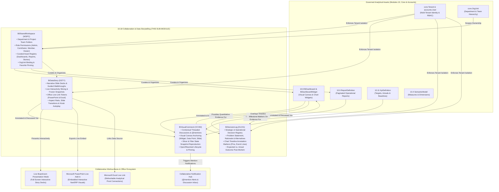

# Research — Sub-module 10.18: Collaboration & Data Storytelling (Module 10 — Business Intelligence, `bi`)

- **Sub-module:** 10.18 Collaboration & Data Storytelling
- **Module:** 10 Business Intelligence
- **Target app:** `apps/bi` (package: `apps/bi/models/CollaborationStorytelling/`)
- **Research date:** 2026-11-08
- **Phase:** Phase 1 Research Catalog
- **Output file target:** `.claude/tasks/research-bi-10.18.md`

---

## 1. Executive Summary & Domain Architecture

Sub-module 10.18 delivers **Data Stories & Presentations, Comments & Discussions, Shared Workspaces, Annotations & Decision Logging, and Export & Embed to Office** for NavERP (`apps/bi`).

In earlier sub-modules, NavERP established a comprehensive analytical and intelligence engine:
- **10.1 – 10.3**: Data pipelines, storage marts, and lakehouse infrastructure (`DataSourceConnector`, `EtlPipeline`, `WarehouseTable`, `DataMart`).
- **10.4 – 10.7**: Semantic modeling, data quality, master data, and governance lineage (`SemanticModel`, `CalculatedMeasure`, `DataQualityRule`, `MdmGoldenRecord`, `CatalogAsset`).
- **10.8 – 10.12**: Visualizations, operational reports, self-service exploration, scorecards, and OLAP cubes (`BiDashboard`, `BiDashboardWidget`, `ReportDefinition`, `AdHocQuery`, `KpiDefinition`, `OlapCube`).
- **10.13 – 10.15**: Predictive models, augmented insights, and conversational NLQ (`PredictiveModel`, `AugmentedInsight`, `NaturalLanguageQuery`, `BiConversationSession`).
- **10.16 – 10.17**: Automated alert distribution, bursts, embedded analytics, and mobile/wallboard displays (`BiAlertRule`, `ReportSubscription`, `EmbeddedAnalyticsConfig`, `KioskWallboardDisplay`, `EmbedApiToken`).

While previous sub-modules enabled analysts to compute numbers and build charts, **Sub-module 10.18 bridges the "Context Gap"** between analytical outputs and organizational action. In enterprise operations, dashboards reveal *what* happened, but teams frequently fail to capture *why* metrics fluctuated, what strategic decisions were made in response, or who is accountable for execution. Furthermore, static weekly slide decks waste countless hours taking stale screenshots of charts and pasting them into presentations.

Sub-module 10.18 transforms NavERP BI into a unified, collaborative decision-making platform through four synergistic pillars:
1. **Shared Workspaces (`BiSharedWorkspace` - `WSPC`):** Departmental, project, and executive team workspaces for curating shared dashboards, reports, and stories with fine-grained role-based collaboration (`viewer`, `contributor`, `member`, `admin`).
2. **Data Stories & Presentations (`BiDataStory` - `DSTY`):** Guided presentation-ready narrative slide decks combining frozen visual snapshots, automated captions, live interactivity (allowing executives to slice and drill live data inside the presentation without breaking flow), and Office/PowerPoint export integration.
3. **Contextual Comments & Discussions (`BiVisualComment` - `VCOM`):** Element-level threaded discussions anchored directly to dashboard cards, chart data points, report cells, or presentation slides, capturing active filter states and tagging team members via `@mentions`.
4. **Annotations & Decision Logging (`BiDecisionLog` - `DLOG`):** Structured institutional memory recording the rationale, problem statement, alternatives evaluated, and expected vs. actual outcomes of business choices, while projecting milestone annotation pins directly onto historical trend charts.

### Architectural Data Flow



---

## 2. Repo State Checked First

### 2.1 Existing Sibling Sub-modules in `apps/bi/`
All 17 predecessor sub-modules are fully built and registered in `LIVE_LINKS` (`apps/core/navigation.py`):
- `10.1`: Data Integration & Ingestion (`DataSourceConnector`, `IngestionPipeline`, `CdcSyncConfig`, `IngestionRun`)
- `10.2`: ETL/ELT & Data Pipelines (`EtlPipeline`, `TransformationStep`, `EtlPipelineRun`, `EtlPipelineVersion`)
- `10.3`: Data Warehouse & Storage (`WarehouseTable`, `DataMart`, `LakehouseZone`, `WarehouseStoragePolicy`)
- `10.4`: Data Modeling & Semantic Layer (`SemanticModel`, `CalculatedMeasure`, `BusinessGlossaryTerm`, `DrillHierarchy`)
- `10.5`: Data Quality & Cleansing (`DataQualityRule`, `DataQualityProfile`, `DataQualityScorecard`, `DataQualityException`)
- `10.6`: Master Data Management (`MdmGoldenRecord`, `MdmSurvivorshipRule`, `MdmHierarchyNode`, `MdmReferenceCode`)
- `10.7`: Data Catalog, Lineage & Governance (`CatalogAsset`, `CatalogLineageEdge`, `DataGovernancePolicy`, `CatalogTrustEndorsement`)
- `10.8`: Dashboards & Visualization (`BiDashboard`, `BiDashboardWidget`, `BiDashboardFilter`, `BiDashboardBookmark`)
- `10.9`: Standard & Operational Reporting (`ReportDefinition`, `ReportExecution`, `ReportParameter`, `ReportDrillPath`)
- `10.10`: Self-Service & Ad-Hoc Analytics (`AdHocQuery`, `AdHocCalculatedField`, `DataBlendDefinition`, `SavedAnalysisView`)
- `10.11`: KPI & Performance Scorecards (`KpiDefinition`, `PerformanceScorecard`, `ScorecardKpiAssignment`, `StrategicObjective`)
- `10.12`: OLAP Cubes & Aggregations (`OlapCube`, `PivotAnalysisView`, `WhatIfScenario`, `ScenarioWritebackCell`)
- `10.13`: Predictive & Prescriptive Analytics (`PredictiveModel`, `ForecastExecution`, `OptimizationScenario`, `StatisticalAnomaly`)
- `10.14`: AI & Augmented Analytics (`AugmentedInsight`, `SmartDataPrepSuggestion`, `TextSentimentAnalysis`, `AnalyticsRecommendation`)
- `10.15`: Natural Language & Conversational BI (`NaturalLanguageQuery`, `BiConversationSession`, `NarrativeExplanation`, `SearchDiscoveryIndex`)
- `10.16`: Automated Alerts & Distribution (`BiAlertRule`, `ReportSubscription`, `DistributionBurstRun`, `BiNotificationItem`)
- `10.17`: Embedded & Mobile BI (`EmbeddedAnalyticsConfig`, `MobileBiConfiguration`, `EmbedApiToken`, `KioskWallboardDisplay`)

### 2.2 Sibling Models in `apps/bi` Verified Available to FK
- `bi.BiDashboard` (`apps/bi/models/Dashboards/BiDashboards.py` - prefix `BDSH`): Verified present. Target for visual discussions, workspace asset curation, and decision timeline annotations.
- `bi.BiDashboardWidget` (`apps/bi/models/Dashboards/BiDashboardWidgets.py` - prefix `BDWG`): Verified present. Anchor target for contextual comments and data anomaly decisions.
- `bi.ReportDefinition` (`apps/bi/models/OperationalReporting/ReportDefinitions.py` - prefix `BRPT`): Verified present. Target for report discussions and workspace curation.
- `bi.KpiDefinition` (`apps/bi/models/PerformanceScorecards/KpiDefinitions.py` - prefix `BKPI`): Verified present. Referenced by decision logs for tracking measurable impact.
- `bi.SemanticModel` (`apps/bi/models/SemanticLayer/SemanticModels.py` - prefix `BSMD`): Verified present.
- `bi.BiDashboardBookmark` (`apps/bi/models/Dashboards/BiDashboardBookmarks.py` - prefix `BDBM`): Verified present. Provides filter state persistence pattern.

### 2.3 Core Spine & Identity Models Verified Available to FK
- `core.Tenant` (`apps/core/models/Tenant.py`): Verified present. All models inherit from `apps.bi.models._base.TenantNumbered` (which encapsulates tenant isolation and auto-number generation).
- `core.OrgUnit` (`apps/core/models/OrgUnit.py`): Verified present (`class OrgUnit(models.Model)`). Available for departmental workspace binding.
- `core.AuditLog` (`apps/core/models/AuditLog.py`): Verified present via `log_action`.
- `accounts.User` (`apps/accounts/models.py` / `settings.AUTH_USER_MODEL = "accounts.User"`): Verified present (`class User(AbstractBaseUser, PermissionsMixin)`). Target for `owner`, `author`, `decision_maker`, and `@mentions`.

### 2.4 Auto-Number Prefix Uniqueness Verification
Grep across the entire NavERP repository confirms complete uniqueness for the 4 proposed prefixes:
- `WSPC`: Completely unique (0 collisions across repository). Note: `BWSP` was used by `WarehouseStoragePolicies` in 10.3, so `WSPC` is chosen.
- `DSTY`: Completely unique (0 collisions across repository).
- `VCOM`: Completely unique (0 collisions across repository).
- `DLOG`: Completely unique (0 collisions across repository).

---

## 3. Market Leaders Surveyed (with source links)

### 1. Microsoft Power BI (Workspaces, Live Storytelling & Office Integration)
- **Positioning:** The enterprise benchmark for collaborative business intelligence, deeply integrated with Microsoft 365, PowerPoint, and Excel.
- **Key Capabilities Surveyed:**
  - *Collaborative Workspaces:* Centralized hubs for co-authoring dashboards, semantic models, and reports with four explicit workspace RBAC roles: `Admin`, `Member`, `Contributor`, and `Viewer`.
  - *Live PowerPoint Storytelling:* Interactive live data embedding via the Power BI PowerPoint add-in, allowing presenters to cross-highlight, slice, and drill down directly within slides without switching to a browser.
  - *Analyze in Excel:* Direct OLE DB / XMLA analytical connection generating live PivotTables connected to cloud semantic models, refreshing on demand while honoring Row-Level Security (RLS).
  - *Visual Comments & @Mentions:* Threaded discussions attached to individual visuals or report pages with user tagging that triggers automated in-app and email notifications.
  - *Data Point Annotations:* Direct right-click contextual callouts on charts tied dynamically to measure values.
- **Source Links:**
  - https://learn.microsoft.com/en-us/power-bi/collaborate-share/service-collaborate-power-bi-workspace
  - https://learn.microsoft.com/en-us/power-bi/collaborate-share/service-power-bi-powerpoint-add-in
  - https://learn.microsoft.com/en-us/power-bi/collaborate-share/service-comment

### 2. Tableau / Salesforce (Story Points & Discussion Panels)
- **Positioning:** Pioneer in visual analytics, offering dedicated "Story Points" sequence frameworks and enterprise discussion threads.
- **Key Capabilities Surveyed:**
  - *Tableau Story Points:* Dedicated sheet type organizing sequential story points into a narrative arc. Each point captures a specific dashboard or worksheet with locked filter, sort, and zoom states.
  - *Story Navigator Controls:* Presenter toolbars with interactive caption buttons, dots, or arrows guiding audiences through analytical conclusions.
  - *Visual Annotations:* Three distinct annotation primitives: *Mark Annotations* (attached to a data mark that moves dynamically when filtered), *Point Annotations* (fixed canvas coordinates), and *Area Annotations* (shaded highlight regions).
  - *Server/Cloud Comments:* Threaded discussions on published workbooks supporting `@mentions` and thumbnail snapshot previews of the commenter's exact view state.
  - *Projects & Personal Spaces:* Hierarchical team folders with granular permission inheritance and personal sandboxes.
- **Source Links:**
  - https://help.tableau.com/current/pro/desktop/en-us/story_create.htm
  - https://help.tableau.com/current/server/en-us/comments.htm
  - https://help.tableau.com/current/pro/desktop/en-us/annotations_annotations_add.htm

### 3. Qlik Sense (Data Storytelling & In-Presentation Live Drill)
- **Positioning:** Renowned associative engine with a built-in presentation storyboard combining static snapshots and live interactive sheets.
- **Key Capabilities Surveyed:**
  - *Visual Snapshots:* Point-in-time visual bookmarks freezing chart representations and filter selections for inclusion in presentations.
  - *Storyboard Presentation Canvas:* Slide-based sequencing interface with layout templates, text banners, shapes, and media assets.
  - *Live Sheet Switching ("The Secret Weapon"):* Presenters can pause a slide and jump directly into the live underlying Qlik sheet to answer unexpected executive questions on the fly, then resume the presentation seamlessly.
  - *Qlik Cloud Spaces:* Governed collaboration via *Shared Spaces* (team co-development) and *Managed Spaces* (controlled executive distribution).
- **Source Links:**
  - https://help.qlik.com/en-US/sense/Subsystems/Hub/Content/Sense_Hub/Storytelling/storytelling-overview.htm
  - https://help.qlik.com/en-US/cloud-services/Subsystems/Hub/Content/Sense_Hub/Spaces/spaces.htm

### 4. ThoughtSpot (Liveboard Notes, Discussions & Verified Badges)
- **Positioning:** Modern search- and AI-driven analytics leader focusing on dynamic Liveboards and inline contextual documentation.
- **Key Capabilities Surveyed:**
  - *Liveboard Note Tiles:* Rich-text markdown and contextual documentation tiles embedded directly between charts on interactive Liveboards.
  - *Verified Liveboards:* Governance verification badges stamped by data stewards to signify official, boardroom-ready datasets and prevent metric ambiguity.
  - *Collaborative Liveboard Sharing:* Granular user/group sharing with edit or view rights and user-level drill permissions.
  - *Conversational Threads:* Inline query trails where teams interrogate anomalies collectively using conversational AI.
- **Source Links:**
  - https://docs.thoughtspot.com/cloud/latest/liveboard-note-tiles
  - https://docs.thoughtspot.com/cloud/latest/liveboards

### 5. Looker / Google Cloud (Boards, Curated Pinboards & Spaces)
- **Positioning:** Governed semantic-first BI with dual-layer asset organization (hierarchical folders for governance, boards for team curation).
- **Key Capabilities Surveyed:**
  - *Curated Boards:* Pinboards that allow teams to organize dashboards and Looks (individual charts) into logical sections without duplicating or moving files in the folder hierarchy.
  - *Hierarchical Spaces / Folders:* Strict permission structures (Shared, Personal, Group folders) controlling viewing and editing rights.
  - *Contextual Markdown Tiles:* Visual tiles conveying business descriptions, operational guides, and team SLAs on dashboards.
  - *Board Following & Notifications:* Users follow specific boards to receive digest alerts when new analyses or dashboards are pinned.
- **Source Links:**
  - https://cloud.google.com/looker/docs/presenting-content-with-boards
  - https://cloud.google.com/looker/docs/organizing-spaces

### 6. Sigma Computing (Multi-Player Workbooks & In-Context Comments)
- **Positioning:** Cloud-native spreadsheet-BI hybrid emphasizing live multi-player collaboration and canvas commenting.
- **Key Capabilities Surveyed:**
  - *Multi-Player Live Co-Authoring:* Real-time concurrent workbook editing with presence indicators showing active team members on each sheet.
  - *Element-Specific Comments:* Comment threads pinned to specific charts, pivot tables, or control filters with screenshot attachments and `@mentions`.
  - *Thread Lifecycle:* Open, resolved, and reopened states for data questions and review workflows.
  - *Presentation / View Mode:* Stripped-down full-screen presentation mode that preserves safe, transient slicing without editing rights.
- **Source Links:**
  - https://help.sigmacomputing.com/docs/comments
  - https://help.sigmacomputing.com/docs/workbooks-overview

### 7. Domo (Buzz Collaboration & Decision Auditing)
- **Positioning:** Executive and operational BI suite with native real-time chat (Buzz) and decision tracking.
- **Key Capabilities Surveyed:**
  - *Domo Buzz:* Built-in real-time team messaging platform embedded side-by-side with dashboards and cards.
  - *Card & Dashboard Discussions:* Conversations linked to live card snapshots, allowing team members to discuss metric drops without external tools.
  - *Milestone Annotations:* Global calendar and time-series markers annotating external business events (e.g. "Price increase launched", "ERP upgrade downtime") across company charts.
  - *Decision History:* Transparent audit trail linking executive decisions directly to subsequent operational dashboard metrics.
- **Source Links:**
  - https://www.domo.com/features/collaboration
  - https://knowledge.domo.com/Connect/Buzz/01Buzz_Overview

### 8. Preset & Apache Superset (Chart Comments & Time-Series Annotation Layers)
- **Positioning:** Open-source and managed cloud modern BI powerhouse with robust time-series annotations.
- **Key Capabilities Surveyed:**
  - *Dashboard Comments & Slack Integration:* Contextual comment threads on dashboards and individual charts with `@mentions` and bi-directional Slack notification syncing.
  - *Annotation Layers:* Global time-series overlays supporting *Event Markers* (single-point vertical lines for product launches or outages) and *Intervals* (shaded bands for promotional campaigns or holiday periods).
  - *Presence Indicators:* Real-time awareness badges showing active viewers currently inspecting the dashboard.
- **Source Links:**
  - https://preset.io/blog/dashboard-comments/
  - https://superset.apache.org/docs/using-superset/creating-your-first-dashboard/

### 9. Zoho Analytics (Collaborative Workspaces & Advanced Slideshows)
- **Positioning:** SME and mid-market business analytics suite featuring native presentation creation via Zoho Show.
- **Key Capabilities Surveyed:**
  - *Advanced Slideshows:* Slide decks blending live, interactive charts with narrative text, shapes, and infographics.
  - *Collaborative Workspaces:* Granular permission-based sharing across user groups with role presets (Read, Write, Share, Comment).
  - *Contextual Discussion Threads:* In-app commenting directly on charts, pivot views, and dashboard tiles with `@mentions` and file attachments.
- **Source Links:**
  - https://www.zoho.com/analytics/collaboration.html
  - https://www.zoho.com/analytics/help/sharing-and-collaboration/slideshow.html

---

## 4. Comprehensive Feature Catalog (Deduplicated & Prioritized)

Features are grouped directly against the bolded feature bullets in `NavERP.md` for `### 10.18 Collaboration & Data Storytelling`:

### 4.1 Data Stories & Presentations
- **Guided Narrative Slide Decks** — Sequential presentation slide decks combining chart visualizations, narrative text callouts, and key takeaway bullet points. · seen in: *Tableau Story Points, Qlik Sense Storytelling, Zoho Analytics* · priority: `table-stakes` · spine: new table `BiDataStory` · buildable now.
- **State-Preserving Visual Snapshots** — Freezing the exact filter, parameter, and zoom state of a dashboard or chart for a specific slide while preserving live underlying query capabilities. · seen in: *Tableau, Qlik Sense* · priority: `table-stakes` · spine: new table `BiDataStory` (JSON `slides_data.filter_snapshot`) · buildable now.
- **Live In-Presentation Interaction** — Ability for presenters to toggle an interactive mode during full-screen slide presentations to filter, cross-highlight, or drill into live underlying data in response to executive questions. · seen in: *Qlik Sense, Microsoft Power BI* · priority: `differentiator` · spine: new table `BiDataStory` (`allow_live_interaction` flag) · buildable now.
- **Slide Transitions, Aspect Ratios & Autoplay** — Configurable slide aspect ratios (16:9 widescreen, 4:3 standard, fluid fullscreen) with transition effects and optional automated timed rotation for boardroom displays. · seen in: *Qlik Sense, Zoho Analytics* · priority: `common` · spine: new table `BiDataStory` (`aspect_ratio`, `auto_advance_seconds`, `loop_presentation`) · buildable now.
- **Story Publishing & Review Lifecycle** — Formal workflow states (`draft`, `in_review`, `published`, `archived`) ensuring unvetted presentations are not presented in executive forums. · seen in: *ThoughtSpot Verified, Looker* · priority: `common` · spine: new table `BiDataStory` (`status`) · buildable now.

### 4.2 Comments & Discussions
- **Visual-Anchored Discussion Threads** — Threaded conversations attached to specific visual elements (dashboard header, widget card, specific chart series/data point, table cell, or story slide). · seen in: *Power BI, Sigma Computing, Domo Buzz, Preset* · priority: `table-stakes` · spine: new table `BiVisualComment` (FKs `dashboard`, `widget`, `report`, `story`) · buildable now.
- **Contextual Filter Snapshot Capture** — Automatically recording active dashboard slicers/filters when a comment is written, so colleagues clicking the comment reproduce the exact data state the commenter observed. · seen in: *Tableau, Sigma Computing* · priority: `differentiator` · spine: new table `BiVisualComment` (`filter_state_snapshot` JSON) · buildable now.
- **@Mentions & Stakeholder Alerting** — Tagging colleagues via `@username` within comment text, triggering notifications in the notification center and email. · seen in: *Power BI, Tableau, Sigma, Domo, Preset* · priority: `table-stakes` · spine: new table `BiVisualComment` (`mentions_list` JSON) · buildable now.
- **Comment Lifecycle & Resolution** — Workflow tracking for data inquiries with `open`, `in_progress`, and `resolved` states, capturing resolving user and resolution timestamp. · seen in: *Sigma Computing, Preset* · priority: `common` · spine: new table `BiVisualComment` (`status`, `resolved_by`, `resolved_at`) · buildable now.
- **Pinned Insight Callouts** — Pinning critical caveats or data notices to the top of a visual's discussion panel so casual viewers immediately see known anomalies. · seen in: *ThoughtSpot, Sigma* · priority: `common` · spine: new table `BiVisualComment` (`is_pinned`) · buildable now.

### 4.3 Shared Workspaces
- **Department & Project Team Workspaces** — Team folders grouping related dashboards, reports, and data stories by department or initiative rather than cluttering an unorganized shared space. · seen in: *Power BI Workspaces, Qlik Shared Spaces, Looker Spaces* · priority: `table-stakes` · spine: new table `BiSharedWorkspace` (FK `core.OrgUnit`) · buildable now.
- **Role-Based Workspace Permissions** — Clear collaborative tiers (`viewer`, `contributor`, `member`, `admin`) governing who can edit visual definitions vs. consume assets. · seen in: *Power BI, Qlik Cloud, Looker* · priority: `table-stakes` · spine: new table `BiSharedWorkspace` (`access_level`, `allowed_roles` JSON) · buildable now.
- **Curated Asset Registry & Section Pinning** — Organization of dashboards, reports, scorecards, and stories into custom sections or pinboards within the workspace. · seen in: *Looker Boards, ThoughtSpot Liveboards* · priority: `common` · spine: new table `BiSharedWorkspace` (`curated_asset_ids` JSON) · buildable now.
- **Personal vs. Team Workspace Classification** — Categorizing spaces into personal scratchpads, team workspaces, or company-wide executive portals. · seen in: *Power BI Personal, Looker Personal, Tableau Personal Spaces* · priority: `common` · spine: new table `BiSharedWorkspace` (`workspace_type`) · buildable now.
- **Favorites & Workspace Discovery** — Quick-access bookmarking (`is_favorite`), color badges, and asset counters for navigating active workspaces. · seen in: *Power BI, Looker, Domo* · priority: `common` · spine: new table `BiSharedWorkspace` (`color_tag`, `icon`, `is_favorite`, `asset_count`) · buildable now.

### 4.4 Annotations & Decision Logging
- **Decision Record & Rationale Logging** — Capturing business decisions, the underlying problem statement, justification rationale, and rejected alternatives directly in the BI platform. · seen in: *Domo Decision History, Plane, Inforiver* · priority: `differentiator` · spine: new table `BiDecisionLog` · buildable now.
- **Time-Series Chart Annotation Overlays** — Marking specific dates on trend charts and dashboards with vertical event lines or pin flags linked to the decision ID (explaining spikes or dips). · seen in: *Apache Superset Annotation Layers, Domo Milestone Annotations, Tableau Mark Annotations* · priority: `common` · spine: new table `BiDecisionLog` (`decision_date`, `annotation_marker_style`, FK `dashboard`, FK `widget`) · buildable now.
- **Quantifiable Outcome & Impact Post-Mortem** — Recording estimated vs. actual financial and operational outcomes (e.g. "+15% ARR", "-4% Churn", "$25,000 savings") and reviewing efficacy on a follow-up date. · seen in: *Domo, Strategic Portfolio Tools* · priority: `differentiator` · spine: new table `BiDecisionLog` (`expected_impact`, `actual_outcome`, `financial_impact_estimate`, `review_date`) · buildable now.
- **Decision Lifecycle Management** — Tracking governance phases (`proposed`, `approved`, `in_execution`, `completed`, `reviewed_post_mortem`, `superseded`) with decision maker accountability. · seen in: *Enterprise Architecture & ERP governance* · priority: `table-stakes` · spine: new table `BiDecisionLog` (`status`, `decision_maker` FK `accounts.User`) · buildable now.
- **KPI Binding & Metric Attribution** — Explicitly linking a decision to a tracked `KpiDefinition` so subsequent performance reviews measure against the strategic objective. · seen in: *ThoughtSpot Verified, 10.11 Scorecards* · priority: `common` · spine: new table `BiDecisionLog` (FK `bi.KpiDefinition`) · buildable now.

### 4.5 Export & Embed to Office
- **PowerPoint Live Storyboard Export & Live Add-in** — Generating live-linked presentation deck tokens enabling Microsoft PowerPoint to render interactive, refreshable NavERP BI visual cards inside slides. · seen in: *Power BI PowerPoint Add-in, Zebra BI* · priority: `differentiator` · spine: handled via `BiDataStory` (`office_embed_token`, `export_target="powerpoint_live"`) · buildable now.
- **Live Excel Analytical Workbook Connectivity** — Dedicated tokenized endpoint enabling Microsoft Excel to connect live to underlying semantic model datasets (Analyze in Excel paradigm). · seen in: *Power BI Analyze in Excel, Zoho Sheet Sync* · priority: `common` · spine: handled via `BiDataStory` (`export_target="excel_linked_workbook"`) · buildable now.
- **PDF Handout Deck Generation** — Compiling data stories with captions, charts, and annotations into publication-grade executive briefing PDFs. · seen in: *Tableau Story PDF, Qlik Story Export* · priority: `table-stakes` · spine: handled via `BiDataStory` (`export_target="pdf_handout"`) · buildable now.
- **Embeddable Web Story Cards** — Secure iframe or component embedding of data stories into external internal knowledge bases, intranets, or ERP module views. · seen in: *Power BI Publish to Web/Secure Embed, 10.17 Embedded BI* · priority: `common` · spine: handled via `BiDataStory` (`export_target="web_embed"`) + reuses `10.17 EmbeddedAnalyticsConfig` · buildable now.

---

## 5. Recommended Build Scope (This Pass — 4 Tenant-Scoped Models)

To deliver the complete scope of `NavERP.md` Sub-module 10.18 while maintaining clean separation of concerns and matching NavERP's modular architecture, exactly **4 tenant-scoped models** are recommended. All models inherit from `apps.bi.models._base.TenantNumbered` to guarantee tenant isolation and deterministic auto-numbering.

### Entity 1: `BiSharedWorkspace` (Auto-Number Prefix: `WSPC-`)
- **Domain Role:** Team workspaces and folders for shared dashboards, permission-based collaboration, and department-scoped analytics.
- **NavERP Bullet Justification:** Bullet 3 (*Shared Workspaces*).
- **Key Fields & Choices:**
  - `name`: `CharField(max_length=200)` — Name of the workspace (e.g., "Executive Growth Council", "Supply Chain Operations", "Q4 Finance Planning").
  - `slug`: `SlugField(max_length=120)` — URL-friendly slug unique per tenant.
  - `description`: `TextField(blank=True)` — Mission statement, SLA, and scope of the workspace.
  - `workspace_type`: `CharField(max_length=40, default="department")` — Choices:
    - `department`: "Departmental Workspace" (bound to an OrgUnit)
    - `project_initiative`: "Strategic Initiative / Project"
    - `executive_briefing`: "Executive & Boardroom Briefing"
    - `cross_functional`: "Cross-Functional Team"
    - `personal_sandbox`: "Personal Analyst Sandbox"
  - `access_level`: `CharField(max_length=40, default="contributor")` — Default access level. Choices:
    - `viewer`: "Viewer (Read & Interactive Slicing Only)"
    - `contributor`: "Contributor (Can Create Stories & Annotations)"
    - `member`: "Member (Can Author Dashboards & Reports)"
    - `admin`: "Workspace Administrator (Full Management)"
  - `owner`: `ForeignKey(settings.AUTH_USER_MODEL, on_delete=models.SET_NULL, null=True, related_name="bi_owned_workspaces")` — Designated workspace lead.
  - `department`: `ForeignKey("core.OrgUnit", on_delete=models.SET_NULL, null=True, blank=True, related_name="bi_workspaces")` — Verified core spine link.
  - `color_tag`: `CharField(max_length=30, default="slate")` — Slate, indigo, emerald, amber, rose, sky.
  - `icon`: `CharField(max_length=50, default="folder")` — Lucide icon identifier.
  - `is_favorite`: `BooleanField(default=False)` — Quick-access pin for user dashboard.
  - `is_archived`: `BooleanField(default=False)` — Lifecycle flag.
  - `curated_asset_ids`: `JSONField(default=dict, blank=True)` — Pinned dashboard, report, and data story IDs grouped by display section.
  - `allowed_roles`: `JSONField(default=list, blank=True)` — RBAC role keys permitted entry.
  - `member_count`: `PositiveIntegerField(default=1)` — Aggregated collaborator count.
  - `asset_count`: `PositiveIntegerField(default=0)` — Aggregated pinned asset count.
- **Verified Foreign Keys:**
  - `tenant`: `ForeignKey("core.Tenant")` (inherited from `TenantOwned`)
  - `owner`: `ForeignKey(settings.AUTH_USER_MODEL)`
  - `department`: `ForeignKey("core.OrgUnit")`

### Entity 2: `BiDataStory` (Auto-Number Prefix: `DSTY-`)
- **Domain Role:** Guided analytical slide stories, narratives, interactive walkthroughs, and PowerPoint/Office live export presentations.
- **NavERP Bullet Justification:** Bullet 1 (*Data Stories & Presentations*) and Bullet 5 (*Export & Embed to Office*).
- **Key Fields & Choices:**
  - `title`: `CharField(max_length=200)` — Headline title of the data story (e.g., "FY26 Q3 Revenue Analysis & Pipeline Health").
  - `slug`: `SlugField(max_length=120)` — URL slug unique per tenant.
  - `subtitle`: `CharField(max_length=255, blank=True)` — Subtitle or analytical thesis.
  - `description`: `TextField(blank=True)` — Executive abstract.
  - `workspace`: `ForeignKey("bi.BiSharedWorkspace", on_delete=models.SET_NULL, null=True, blank=True, related_name="data_stories")` — Parent workspace.
  - `author`: `ForeignKey(settings.AUTH_USER_MODEL, on_delete=models.SET_NULL, null=True, related_name="bi_authored_stories")` — Author analyst.
  - `status`: `CharField(max_length=30, default="draft")` — Choices:
    - `draft`: "Draft (Work in Progress)"
    - `in_review`: "In Review (Pending Governance Sign-off)"
    - `published`: "Published (Boardroom & Executive Ready)"
    - `archived`: "Archived (Historical)"
  - `presentation_mode`: `CharField(max_length=40, default="slide_deck")` — Choices:
    - `slide_deck`: "Structured Slide Deck (Slide by Slide)"
    - `guided_walkthrough`: "Interactive Guided Walkthrough"
    - `executive_briefing`: "Executive Summary Briefing"
    - `continuous_narrative`: "Continuous Vertical Narrative"
  - `aspect_ratio`: `CharField(max_length=30, default="16_9")` — Choices:
    - `16_9`: "16:9 Widescreen (Standard Presentation)"
    - `4_3`: "4:3 Classic Presentation"
    - `fullscreen_fluid`: "Fluid Responsive Canvas"
  - `theme`: `CharField(max_length=40, default="corporate_slate")` — Corporate Slate, Modern Indigo, Dark Boardroom, High-Contrast Observability.
  - `auto_advance_seconds`: `PositiveIntegerField(default=0)` — 0 for manual click navigation, >0 for timed autoplay.
  - `loop_presentation`: `BooleanField(default=False)` — Autoplay looping.
  - `allow_live_interaction`: `BooleanField(default=True)` — Allows viewers to drill down, cross-filter, and slice live charts within slides without leaving presentation mode.
  - `slides_data`: `JSONField(default=list, blank=True)` — Structured slide sequence containing slide objects:
    ```json
    [
      {
        "slide_index": 1,
        "title": "Macro Revenue Growth",
        "narrative_text": "Q3 closed at $14.2M, beating forecast by 8.4% despite supply bottlenecks.",
        "visual_type": "dashboard_widget",
        "visual_id": 4,
        "layout_mode": "split_left_text_right_chart",
        "filter_snapshot": {"region": "North America", "fiscal_quarter": "Q3"},
        "callout_annotations": ["Record enterprise renewal rate (94%)"]
      }
    ]
    ```
  - `export_target`: `CharField(max_length=40, default="powerpoint_live")` — Choices:
    - `powerpoint_live`: "Microsoft PowerPoint Live Data Deck"
    - `pdf_handout`: "Printable Executive PDF Handout"
    - `excel_linked_workbook`: "Microsoft Excel Refreshable Connection"
    - `web_embed`: "Interactive Web Embed Card"
  - `office_embed_token`: `CharField(max_length=64, blank=True)` — Secure UUID/cryptographic token for PowerPoint/Excel live add-in connectivity.
  - `slide_count`: `PositiveIntegerField(default=0)` — Total slide count.
  - `view_count`: `PositiveIntegerField(default=0)` — Cumulative presentations delivered.
- **Verified Foreign Keys:**
  - `tenant`: `ForeignKey("core.Tenant")`
  - `workspace`: `ForeignKey("bi.BiSharedWorkspace")`
  - `author`: `ForeignKey(settings.AUTH_USER_MODEL)`

### Entity 3: `BiVisualComment` (Auto-Number Prefix: `VCOM-`)
- **Domain Role:** Contextual discussions, threaded comments, chart element anchoring, and @mentions on dashboards, widgets, and story slides.
- **NavERP Bullet Justification:** Bullet 2 (*Comments & Discussions*).
- **Key Fields & Choices:**
  - `dashboard`: `ForeignKey("bi.BiDashboard", on_delete=models.CASCADE, null=True, blank=True, related_name="comments")` — Target dashboard.
  - `widget`: `ForeignKey("bi.BiDashboardWidget", on_delete=models.SET_NULL, null=True, blank=True, related_name="comments")` — Target widget card.
  - `report`: `ForeignKey("bi.ReportDefinition", on_delete=models.SET_NULL, null=True, blank=True, related_name="comments")` — Target operational report.
  - `story`: `ForeignKey("bi.BiDataStory", on_delete=models.CASCADE, null=True, blank=True, related_name="comments")` — Target data story.
  - `parent_comment`: `ForeignKey("self", on_delete=models.CASCADE, null=True, blank=True, related_name="replies")` — Self-referential thread parenting.
  - `author`: `ForeignKey(settings.AUTH_USER_MODEL, on_delete=models.SET_NULL, null=True, related_name="bi_visual_comments")` — Comment creator.
  - `comment_text`: `TextField()` — Markdown comment body with `@mention` strings.
  - `anchor_type`: `CharField(max_length=40, default="widget_card")` — Choices:
    - `dashboard_canvas`: "General Dashboard Discussion"
    - `widget_card`: "Specific Widget / Visualization Card"
    - `data_point`: "Specific Data Point / Series Mark"
    - `table_cell`: "Report Matrix / Table Data Cell"
    - `story_slide`: "Data Story Slide Anchor"
  - `anchor_coordinates`: `JSONField(default=dict, blank=True)` — Canvas x/y coordinates, element DOM ID, or series point key.
  - `filter_state_snapshot`: `JSONField(default=dict, blank=True)` — Active filter parameters when comment was posted, enabling one-click view reproduction.
  - `mentions_list`: `JSONField(default=list, blank=True)` — Array of mentioned usernames and User IDs.
  - `status`: `CharField(max_length=30, default="open")` — Choices:
    - `open`: "Open (Active Discussion)"
    - `in_review`: "In Review / Investigation"
    - `acknowledged`: "Acknowledged by Owner"
    - `resolved`: "Resolved / Closed"
  - `resolved_by`: `ForeignKey(settings.AUTH_USER_MODEL, on_delete=models.SET_NULL, null=True, blank=True, related_name="bi_comments_resolved")` — User who closed the discussion.
  - `resolved_at`: `DateTimeField(null=True, blank=True)` — Resolution timestamp.
  - `is_pinned`: `BooleanField(default=False)` — Pinned to the top of the discussion pane.
- **Verified Foreign Keys:**
  - `tenant`: `ForeignKey("core.Tenant")`
  - `dashboard`: `ForeignKey("bi.BiDashboard")` (10.8 verified)
  - `widget`: `ForeignKey("bi.BiDashboardWidget")` (10.8 verified)
  - `report`: `ForeignKey("bi.ReportDefinition")` (10.9 verified)
  - `story`: `ForeignKey("bi.BiDataStory")`
  - `author`: `ForeignKey(settings.AUTH_USER_MODEL)`
  - `resolved_by`: `ForeignKey(settings.AUTH_USER_MODEL)`

### Entity 4: `BiDecisionLog` (Auto-Number Prefix: `DLOG-`)
- **Domain Role:** Business decision tracking, rationale capture, impact forecasting, and milestone event overlay linked to underlying analytical data.
- **NavERP Bullet Justification:** Bullet 4 (*Annotations & Decision Logging*).
- **Key Fields & Choices:**
  - `title`: `CharField(max_length=200)` — Title of the decision (e.g., "Approved 15% Strategic Discount for Tier-1 Accounts", "Pivoted Logistics Route from Port A to Port B").
  - `slug`: `SlugField(max_length=120)` — URL slug unique per tenant.
  - `workspace`: `ForeignKey("bi.BiSharedWorkspace", on_delete=models.SET_NULL, null=True, blank=True, related_name="decision_logs")` — Contextual workspace.
  - `dashboard`: `ForeignKey("bi.BiDashboard", on_delete=models.SET_NULL, null=True, blank=True, related_name="decision_logs")` — Underlying dashboard.
  - `widget`: `ForeignKey("bi.BiDashboardWidget", on_delete=models.SET_NULL, null=True, blank=True, related_name="decision_logs")` — Specific chart displaying the trend.
  - `kpi`: `ForeignKey("bi.KpiDefinition", on_delete=models.SET_NULL, null=True, blank=True, related_name="decision_logs")` — KPI metric targeted by this decision (10.11 verified).
  - `decision_maker`: `ForeignKey(settings.AUTH_USER_MODEL, on_delete=models.SET_NULL, null=True, related_name="bi_decisions_made")` — Accountable executive/manager.
  - `decision_date`: `DateField()` — Effective date when the action took place (used for time-series chart timeline annotation markers).
  - `category`: `CharField(max_length=40, default="operational_intervention")` — Choices:
    - `strategic_pivot`: "Strategic Pivot / Direction Change"
    - `pricing_adjustment`: "Pricing or Discount Policy Revision"
    - `operational_intervention`: "Operational / Production Intervention"
    - `budget_reallocation`: "Budget & Capital Reallocation"
    - `inventory_policy`: "Inventory Reorder / Safety Stock Policy"
    - `risk_mitigation`: "Risk & Compliance Mitigation"
    - `marketing_campaign`: "Go-To-Market / Marketing Launch"
  - `problem_statement`: `TextField()` — Observed data trend or bottleneck that prompted the decision.
  - `rationale`: `TextField()` — Detailed business justification and expected ROI.
  - `alternatives_considered`: `TextField(blank=True)` — Evaluated alternatives and reasons for rejection.
  - `expected_impact`: `CharField(max_length=255)` — Quantifiable forecast (e.g. "+12% net retention within 90 days").
  - `actual_outcome`: `TextField(blank=True)` — Evaluated post-implementation outcome recorded during post-mortem.
  - `financial_impact_estimate`: `DecimalField(max_digits=14, decimal_places=2, default=0)` — Estimated financial impact in base currency.
  - `status`: `CharField(max_length=30, default="proposed")` — Choices:
    - `proposed`: "Proposed (Under Evaluation)"
    - `approved`: "Approved (Execution Scheduled)"
    - `in_execution`: "In Execution (Active Monitoring)"
    - `completed`: "Completed / Stabilized"
    - `reviewed_post_mortem`: "Reviewed Post-Mortem (Outcome Validated)"
    - `superseded`: "Superseded by Subsequent Decision"
  - `annotation_marker_style`: `CharField(max_length=40, default="pin_flag")` — Choices:
    - `vertical_line_event`: "Vertical Event Line Across Time Axis"
    - `pin_flag`: "Milestone Pin Flag on Data Mark"
    - `highlight_zone`: "Shaded Period Duration Highlight"
    - `milestone_callout`: "Floating Milestone Callout Card"
  - `review_date`: `DateField(null=True, blank=True)` — Target date for reviewing measurable impact against KPIs.
- **Verified Foreign Keys:**
  - `tenant`: `ForeignKey("core.Tenant")`
  - `workspace`: `ForeignKey("bi.BiSharedWorkspace")`
  - `dashboard`: `ForeignKey("bi.BiDashboard")` (10.8 verified)
  - `widget`: `ForeignKey("bi.BiDashboardWidget")` (10.8 verified)
  - `kpi`: `ForeignKey("bi.KpiDefinition")` (10.11 verified)
  - `decision_maker`: `ForeignKey(settings.AUTH_USER_MODEL)`

---

## 6. Belongs to Sibling Sub-modules (Parked, Not Scoped Here)

To maintain strict sub-module boundaries, features belonging to sibling sub-modules are deliberately parked:
- **Alert Trigger Workflows & Subscriptions** → Belongs to `10.16 Automated Alerts & Distribution` (`BiAlertRule`, `ReportSubscription`).
- **External White-Label Iframe Embedding & Headless REST Tokens** → Belongs to `10.17 Embedded & Mobile BI` (`EmbeddedAnalyticsConfig`, `EmbedApiToken`). 10.18 interfaces with these via data story export targets without duplicating the token engine.
- **Unattended Kiosk TV Wallboard Slideshow Playlists** → Belongs to `10.17 Embedded & Mobile BI` (`KioskWallboardDisplay`). 10.18 provides slide deck authoring; 10.17 provides hardware kiosk device heartbeat and cycle loop playback.
- **Natural Language Narrative Generation & Conversational Query** → Belongs to `10.15 Natural Language & Conversational BI` (`NarrativeExplanation`, `NaturalLanguageQuery`).
- **External Warehouse Sync & Streaming Webhooks** → Belongs to `10.19 Integration & API Hub`.
- **Core Activity Feed & Audit Logging** → Handled via `apps/core/models/Activity.py` and `apps/core/models/AuditLog.py`.

---

## 7. Deferred Features (Later Passes & External Integrations)

The following advanced capabilities are deferred to future integration passes:
- **Bi-Directional Slack & Microsoft Teams Bot Integrations** — While `@mentions` and notifications are logged in `BiVisualComment`, live bi-directional Slack message syncing (replying from Slack into NavERP) requires external webhook infrastructure (10.19).
- **Automated AI Story Generation from Dashboard Data** — Auto-authoring slides using GenAI (Tableau Pulse / Zia Insights model); deferred to future AI enhancement passes, as 10.18 focuses on human and collaborative storytelling foundations.
- **Real-Time WebRTC Canvas Co-Presence (Figma/Multi-Player Mode)** — Real-time live cursor co-presence like Sigma Computing; deferred to future WebSocket / Django Channels infrastructure. The current pass uses optimistic concurrency and optimistic locking.
- **Native Microsoft Office VSTO / Office.js Client Add-in Packages** — The cryptographic token, live endpoint, and URL generation are delivered in `BiDataStory`; building client-side Microsoft Office manifest XML packages is parked for client-side tool distribution.

---

## 8. Summary for Todo Agent & Pre-Build Contract

- **Domain Scope:** Sub-module 10.18 Collaboration & Data Storytelling (`apps/bi`).
- **Package Path:** `apps/bi/models/CollaborationStorytelling/`
- **Models Recommended (4):**
  1. `BiSharedWorkspace` (`WSPC`): Collaborative team folders, role access (`viewer`, `contributor`, `member`, `admin`), curated asset registry, and OrgUnit binding.
  2. `BiDataStory` (`DSTY`): Guided presentation slide decks, filter snapshot state preservation, live in-presentation drilldowns, and PowerPoint/Excel Office live links.
  3. `BiVisualComment` (`VCOM`): Contextual visual discussion threads, `@mentions`, anchor coordinate targeting, filter state snapshotting, and open/resolved lifecycle.
  4. `BiDecisionLog` (`DLOG`): Business decision and rationale tracking, time-series chart annotation overlays, KPI metric attribution, and expected vs. actual impact post-mortem.
- **Verified Foreign Keys:** `bi.BiDashboard`, `bi.BiDashboardWidget`, `bi.ReportDefinition`, `bi.KpiDefinition`, `core.OrgUnit`, `accounts.User`, and `core.Tenant`.
- **Status:** Complete research catalog ready for pre-build contract and todo generation.
