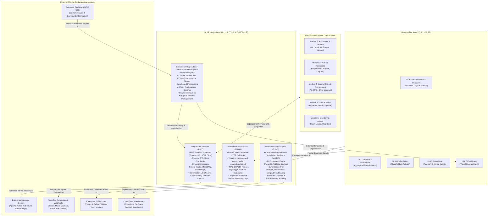

# Research — Sub-module 10.19: Integration & API Hub (Module 10 — Business Intelligence, `bi`)

- **Sub-module:** 10.19 Integration & API Hub
- **Module:** 10 Business Intelligence
- **Target app:** `apps/bi` (package: `apps/bi/models/IntegrationApiHub/`)
- **Research date:** 2026-11-08
- **Phase:** Phase 1 Research Catalog
- **Output file target:** `.claude/tasks/research-bi-10.19.md`

---

## 1. Executive Summary & Domain Architecture

Sub-module 10.19 delivers the **Integration & API Hub** for NavERP (`apps/bi`). As the nineteenth and final sub-module of Module 10, it transforms NavERP's analytical suite from an internal reporting tool into an open, bidirectional enterprise data and intelligence ecosystem.

In predecessor sub-modules (10.1 through 10.18), NavERP constructed a comprehensive end-to-end analytical stack:
- **10.1 – 10.3**: Data pipelines, lakehouse storage, and data marts (`DataSourceConnector`, `EtlPipeline`, `WarehouseTable`, `DataMart`).
- **10.4 – 10.7**: Semantic modeling, data quality, master data, and governance lineage (`SemanticModel`, `CalculatedMeasure`, `DataQualityRule`, `MdmGoldenRecord`, `CatalogAsset`).
- **10.8 – 10.12**: Visualizations, operational reports, self-service exploration, scorecards, and OLAP write-back cubes (`BiDashboard`, `ReportDefinition`, `AdHocQuery`, `KpiDefinition`, `OlapCube`).
- **10.13 – 10.15**: Machine learning forecasts, augmented insights, and natural language conversational query (`PredictiveModel`, `AugmentedInsight`, `NaturalLanguageQuery`, `BiConversationSession`).
- **10.16 – 10.18**: Automated alert distribution, embedded/mobile analytics, shared workspaces, and collaborative storytelling (`BiAlertRule`, `EmbeddedAnalyticsConfig`, `BiSharedWorkspace`, `BiDataStory`, `BiDecisionLog`).

While **Sub-module 10.1 (Data Integration & Ingestion)** focused on pulling data *into* NavERP BI from external databases, **Sub-module 10.19 (Integration & API Hub)** serves as the enterprise interchange and API gateway. It operationalizes business intelligence through five synergistic pillars:
1. **ERP & Application Connectors (`IntegrationConnector` - `BINT`):** Native bidirectional integrations linking BI directly to NavERP's operational core modules (Finance/Accounting, HRM, Supply Chain, CRM, and Inventory). It enables *Operational Analytics / Reverse ETL*, pushing calculated intelligence (e.g., customer lifetime value, churn risk score, supplier reliability index, stock reorder recommendations) back into operational transactional records.
2. **External BI & Cloud Warehouse Sync (`WarehouseSyncEndpoint` - `BSNC`):** Automated replication and feeds pushing governed semantic models, data marts, and KPI aggregates out to enterprise cloud data warehouses (Snowflake, Google BigQuery, AWS Redshift, Databricks Unity Catalog) and third-party BI engines (Microsoft Power BI semantic models, Tableau Hyper extracts, Looker feeds).
3. **Open APIs & Webhooks (`BiWebhookSubscription` - `BWHK`):** Public programmatic REST/GraphQL endpoints for external systems to query analytical measures, along with an event-driven webhook dispatch engine (pushing signed HTTP payloads on KPI threshold breaches, report completions, anomaly detections, and pipeline states).
4. **Streaming & Message Queues (via `IntegrationConnector` - `BINT`):** Real-time streaming integration with enterprise message brokers (Apache Kafka, RabbitMQ, AWS EventBridge, Redis Streams) for low-latency metric publication and event-bus analytics.
5. **Marketplace & Extensions Gallery (`BiExtensionPlugin` - `BEXT`):** A governed third-party extensibility framework for installing, verifying, and configuring custom visual components (D3.js, ECharts), connector plug-ins, transformation scripts, and dashboard actions with strict permission sandboxing.

### Architectural Data Flow



---

## 2. Repo State Checked First

### 2.1 Existing Sibling Sub-modules in `apps/bi/`
All 18 predecessor sub-modules are fully built, registered in `LIVE_LINKS` (`apps/core/navigation.py`), and operational:
- `10.1`: Data Integration & Ingestion (`DataSourceConnector`, `IngestionPipeline`, `CdcSyncConfig`, `IngestionRun`)
- `10.2`: ETL/ELT & Data Pipelines (`EtlPipeline`, `TransformationStep`, `EtlPipelineRun`, `EtlPipelineVersion`)
- `10.3`: Data Warehouse & Storage (`WarehouseTable`, `DataMart`, `LakehouseZone`, `WarehouseStoragePolicy`)
- `10.4`: Data Modeling & Semantic Layer (`SemanticModel`, `CalculatedMeasure`, `BusinessGlossaryTerm`, `DrillHierarchy`)
- `10.5`: Data Quality & Cleansing (`DataQualityRule`, `DataQualityProfile`, `DataQualityScorecard`, `DataQualityException`)
- `10.6`: Master Data Management (`MdmGoldenRecord`, `MdmSurvivorshipRule`, `MdmHierarchyNode`, `MdmReferenceCode`)
- `10.7`: Data Catalog, Lineage & Governance (`CatalogAsset`, `CatalogLineageEdge`, `DataGovernancePolicy`, `CatalogTrustEndorsement`)
- `10.8`: Dashboards & Visualization (`BiDashboard`, `BiDashboardWidget`, `BiDashboardFilter`, `BiDashboardBookmark`)
- `10.9`: Standard & Operational Reporting (`ReportDefinition`, `ReportExecution`, `ReportParameter`, `ReportDrillPath`)
- `10.10`: Self-Service & Ad-Hoc Analytics (`AdHocQuery`, `AdHocCalculatedField`, `DataBlendDefinition`, `SavedAnalysisView`)
- `10.11`: KPI & Performance Scorecards (`KpiDefinition`, `PerformanceScorecard`, `ScorecardKpiAssignment`, `StrategicObjective`)
- `10.12`: OLAP Cubes & Aggregations (`OlapCube`, `PivotAnalysisView`, `WhatIfScenario`, `ScenarioWritebackCell`)
- `10.13`: Predictive & Prescriptive Analytics (`PredictiveModel`, `ForecastExecution`, `OptimizationScenario`, `StatisticalAnomaly`)
- `10.14`: AI & Augmented Analytics (`AugmentedInsight`, `SmartDataPrepSuggestion`, `TextSentimentAnalysis`, `AnalyticsRecommendation`)
- `10.15`: Natural Language & Conversational BI (`NaturalLanguageQuery`, `BiConversationSession`, `NarrativeExplanation`, `SearchDiscoveryIndex`)
- `10.16`: Automated Alerts & Distribution (`BiAlertRule`, `ReportSubscription`, `DistributionBurstRun`, `BiNotificationItem`)
- `10.17`: Embedded & Mobile BI (`EmbeddedAnalyticsConfig`, `MobileBiConfiguration`, `EmbedApiToken`, `KioskWallboardDisplay`)
- `10.18`: Collaboration & Data Storytelling (`BiSharedWorkspace`, `BiDataStory`, `BiVisualComment`, `BiDecisionLog`)

### 2.2 Sibling Models in `apps/bi` Verified Available to FK
- `bi.SemanticModel` (`apps/bi/models/SemanticLayer/SemanticModels.py` - prefix `BSMD`): Verified present (`class SemanticModel(TenantNumbered)`). Data source entity for warehouse reverse ETL syncs.
- `bi.DataMart` (`apps/bi/models/DataWarehouse/DataMarts.py` - prefix `BDMT`): Verified present (`class DataMart(TenantNumbered)`). Subject-area aggregate source for external cloud feeds.
- `bi.BiAlertRule` (`apps/bi/models/AlertsSubscriptions/BiAlertRules.py` - prefix `BALR`): Verified present (`class BiAlertRule(TenantNumbered)`). Event trigger for webhook notifications.
- `bi.ReportDefinition` (`apps/bi/models/OperationalReporting/ReportDefinitions.py` - prefix `BRPT`): Verified present (`class ReportDefinition(TenantNumbered)`). Event trigger on report completion.
- `bi.KpiDefinition` (`apps/bi/models/PerformanceScorecards/KpiDefinitions.py` - prefix `BKPI`): Verified present (`class KpiDefinition(TenantNumbered)`). Metric source for streaming queue emission and webhook thresholds.

### 2.3 Core Spine & Identity Models Verified Available to FK
- `core.Tenant` (`apps/core/models/Tenant.py`): Verified present. All models inherit from `apps.bi.models._base.TenantNumbered` (which encapsulates tenant isolation and auto-number generation).
- `core.AuditLog` (`apps/core/models/AuditLog.py`): Verified present via `log_action`.
- `accounts.User` (`apps/accounts/models.py` / `settings.AUTH_USER_MODEL = "accounts.User"`): Verified present (`class User(AbstractBaseUser, PermissionsMixin)`). Target for `created_by`, `owner`, `installed_by`.

### 2.4 Auto-Number Prefix Uniqueness Verification
Rigorous repo-wide `git grep` verification confirms complete uniqueness (0 collisions across the entire NavERP repository) for the four proposed prefixes:
- `BINT`: Unique (0 collisions). Assigned to `IntegrationConnector`.
- `BSNC`: Unique (0 collisions). Assigned to `WarehouseSyncEndpoint`.
- `BWHK`: Unique (0 collisions). Assigned to `BiWebhookSubscription`.
- `BEXT`: Unique (0 collisions). Assigned to `BiExtensionPlugin`.

---

## 3. Market Leaders Surveyed (with source links)

### 1. Fivetran (Enterprise Reverse ETL & Powered by Fivetran APIs)
- **Positioning:** Global leader in automated data movement, now featuring native Reverse ETL (via Census integration / Fivetran Activations) and developer APIs.
- **Key Capabilities Surveyed:**
  - *Fivetran Activations (Reverse ETL):* Synchronizing modeled warehouse entities (Snowflake, BigQuery, Databricks) directly into operational SaaS applications (Salesforce CRM, Marketo, NetSuite, Zendesk) with merge/upsert sync semantics.
  - *Fivetran REST API:* Complete programmatic control for creating, updating, and triggering connector syncs and destination configurations using Infrastructure as Code (Terraform / API).
  - *Webhook Events API:* Real-time HTTPS POST callbacks dispatching notifications upon sync success, sync failure, or schema drift warnings to automate downstream dbt or alerting workflows.
  - *Credential Encryption & Health Monitoring:* Automatic credential rotation, OAuth2 token renewal, and proactive connector heartbeat monitoring.
- **Source Links:**
  - https://www.fivetran.com/docs/rest-api
  - https://www.fivetran.com/docs/rest-api/webhooks
  - https://www.fivetran.com/docs/activations

### 2. Airbyte (Connector Development Kit & PyAirbyte)
- **Positioning:** Premier open-source data integration platform featuring an extensible Connector Development Kit (CDK) and low-code connector builder.
- **Key Capabilities Surveyed:**
  - *Low-Code Connector Builder & Python CDK:* Declarative YAML and Python frameworks allowing developers to build, test, and distribute custom REST/GraphQL API source and destination connectors in minutes.
  - *PyAirbyte Engine:* Headless execution library allowing Airbyte connectors to be executed in-process inside Python web services or microservices without heavy Docker orchestration.
  - *Airbyte Cloud API & Webhooks:* REST APIs for managing connections, workspaces, and triggering ad-hoc syncs; outbound webhooks for Slack/Teams alerts on pipeline status changes.
  - *Catalog & Schema Discovery:* Automated dynamic schema inference for endpoints with stream/field mapping and data type translation.
- **Source Links:**
  - https://docs.airbyte.com/connector-development/
  - https://docs.airbyte.com/airbyte-api/
  - https://docs.airbyte.com/operator-guides/using-the-pyairbyte-library/

### 3. MuleSoft / Salesforce Anypoint Platform (API-led Connectivity & Anypoint Exchange)
- **Positioning:** The enterprise benchmark for API-led connectivity, data graph unification, and reusable integration marketplaces.
- **Key Capabilities Surveyed:**
  - *API-Led Architecture:* Strict architectural separation of System APIs (unlocking core ERP/database records), Process APIs (orchestrating business logic across domains), and Experience APIs (tailored consumption endpoints for portals/BI).
  - *Anypoint Exchange:* Centralized enterprise marketplace and repository where internal developers discover, evaluate, and install connectors, templates, and OpenAPI/RAML specifications.
  - *Anypoint DataGraph:* Unified GraphQL abstraction layer allowing client applications to run a single federated query that traverses and aggregates data across multiple discrete REST APIs.
  - *Anypoint Connectors:* Standardized pre-built connector ecosystem with built-in OAuth, pagination, rate-limiting, and error-retry logic.
- **Source Links:**
  - https://www.mulesoft.com/platform/enterprise-integration
  - https://www.mulesoft.com/platform/api/exchange
  - https://www.mulesoft.com/platform/api/datagraph

### 4. Workato (Enterprise Automation, Reverse ETL & Connector SDK)
- **Positioning:** Enterprise integration platform as a service (iPaaS) and workflow automation leader bridging data warehouses and business operations.
- **Key Capabilities Surveyed:**
  - *Hybrid ETL & Reverse ETL:* Syncing processed warehouse records from Snowflake, BigQuery, and Redshift directly into business software while simultaneously evaluating complex multi-step enrichment logic.
  - *Connector SDK:* Ruby- and JSON-based developer kit for building custom connectors with custom actions, dynamic trigger polling, and OAuth2/HMAC authentication.
  - *API Platform & Gateway:* Full lifecycle API management enabling any recipe or analytical dataset to be exposed instantly as a secured, rate-limited REST API endpoint with developer portal documentation.
  - *Enterprise Workbot:* Conversational bot integration for Slack and Microsoft Teams delivering interactive operational analytics and in-chat approval buttons.
- **Source Links:**
  - https://www.workato.com/product/reverse-etl
  - https://docs.workato.com/developing-connectors/sdk.html
  - https://docs.workato.com/api-management.html

### 5. Twilio Segment (Customer Data Platform, Reverse ETL & Functions)
- **Positioning:** Leading customer data platform (CDP) connecting real-time streaming event ingestion with Reverse ETL and extensibility functions.
- **Key Capabilities Surveyed:**
  - *Reverse ETL Warehouse Models:* Scheduling SQL queries directly against cloud warehouses (Snowflake, BigQuery, Redshift) and mapping extracted columns to external business tool properties.
  - *Webhook (Actions) Destinations:* Streaming outbound HTTP POST payloads of transformed warehouse rows to custom webhooks with configurable JSON template mappings.
  - *Segment Functions:* Serverless JavaScript execution blocks inserted into ingestion or Reverse ETL pipelines to sanitize, transform, or enrich payloads before transmission.
  - *Integrations Catalog:* A marketplace of hundreds of verified source and destination connectors categorized by business domain.
- **Source Links:**
  - https://segment.com/docs/connections/reverse-etl/
  - https://segment.com/docs/connections/destinations/catalog/actions-webhook/
  - https://segment.com/docs/connections/functions/

### 6. Snowflake Data Cloud (Zero-Copy Data Sharing & Native Apps)
- **Positioning:** Cloud data warehouse and sharing pioneer providing frictionless zero-copy cross-account sharing and an integrated native application marketplace.
- **Key Capabilities Surveyed:**
  - *Secure Data Sharing:* Instantly sharing live tables, secure views, and semantic marts with external partner accounts without data replication or SFTP export overhead.
  - *Snowflake Data Clean Rooms:* Privacy-safe multi-party analytical collaboration allowing two organizations to query overlapping data using restricted templates without exposing underlying PII.
  - *Snowpipe Streaming:* High-velocity low-latency streaming ingestion (sub-10-second latency) directly from Kafka message queues and IoT event streams into Snowflake tables.
  - *Snowflake Native Apps Framework & Marketplace:* Distributing and monetizing applications that install and execute compute *inside* the consumer's Snowflake tenant, bringing the code to the data.
- **Source Links:**
  - https://docs.snowflake.com/en/user-guide/data-sharing-intro
  - https://www.snowflake.com/en/data-cloud/data-clean-rooms/
  - https://docs.snowflake.com/en/user-guide/data-load-snowpipe-streaming-overview

### 7. Tableau Server & Cloud (Metadata GraphQL API, Webhooks & Exchange)
- **Positioning:** Flagship enterprise visual analytics platform with comprehensive developer extensibility, event webhooks, and marketplace gallery.
- **Key Capabilities Surveyed:**
  - *Tableau Metadata API (GraphQL):* Rich GraphQL querying interface indexing all published data sources, workbooks, database tables, and column lineage, allowing programmatic discovery of assets and upstream dependencies.
  - *Tableau Webhooks:* Event-driven HTTP POST notifications dispatched on workbook published, datasource refreshed, extract refresh failed, or subscription triggered.
  - *Tableau Exchange (Extension Gallery):* Official marketplace offering certified *Dashboard Extensions* (adding write-back capabilities or embedded forms) and *Viz Extensions* (introducing custom chart rendering types to the canvas).
  - *Tableau REST API:* Administrative and data management API for programmatic site provisioning, user sync, and permission governance.
- **Source Links:**
  - https://help.tableau.com/current/api/metadata_api/en-us/
  - https://help.tableau.com/current/developer/webhooks/en-us/
  - https://exchange.tableau.com/

### 8. Microsoft Power BI & Fabric Platform (OneLake Data Hub, REST APIs & Eventstreams)
- **Positioning:** Pervasive enterprise BI suite featuring centralized OneLake discovery, Kafka event streaming, and AppSource visualization extensions.
- **Key Capabilities Surveyed:**
  - *Fabric OneLake Data Hub:* Unified discovery and governance plane exposing all semantic models, lakehouses, and warehouse shortcuts across the enterprise.
  - *Fabric Eventstreams & Kafka Integration:* Native Kafka-compatible endpoints for high-throughput streaming ingestion and outbound message distribution directly linked to real-time dashboards.
  - *Power BI REST APIs:* Extensive API suite for dataset refresh triggering, push dataset streaming, workspace provisioning, and gateway monitoring.
  - *AppSource Custom Visuals Marketplace:* Extensible visual framework allowing developers to build, test, and distribute custom D3/TypeScript visualizations that seamlessly inherit canvas themes and slicer filtering.
- **Source Links:**
  - https://learn.microsoft.com/en-us/rest/api/power-bi/
  - https://learn.microsoft.com/en-us/fabric/real-time-intelligence/event-streams/overview
  - https://learn.microsoft.com/en-us/power-bi/developer/visuals/power-bi-custom-visuals

### 9. Databricks Lakehouse Platform (Lakehouse Federation, Delta Sharing & Unity Catalog)
- **Positioning:** Open data and AI architecture leader pioneering cross-system query federation and vendor-neutral open data sharing protocols.
- **Key Capabilities Surveyed:**
  - *Lakehouse Federation:* Query virtualization engine allowing Databricks users to run read-only federated SQL queries across external systems (Snowflake, BigQuery, PostgreSQL, Redshift) without copying data.
  - *Delta Sharing (Open Protocol):* Linux Foundation open standard for securely sharing live delta tables and ML models with any client (Python, Power BI, Tableau, Spark) without proprietary platform lock-in.
  - *Unity Catalog REST APIs:* Centralized governance and catalog automation APIs for access control, lineage tracing, and federated connection management.
  - *Databricks Marketplace:* Open marketplace for discovering and consuming live data products, solution accelerators, and ML models.
- **Source Links:**
  - https://docs.databricks.com/en/query-federation/index.html
  - https://www.databricks.com/product/delta-sharing
  - https://docs.databricks.com/en/data-governance/unity-catalog/index.html

---

## 4. Comprehensive Feature Catalog (Deduplicated & Prioritized)

Features are grouped directly against the bolded feature bullets in `NavERP.md` for `### 10.19 Integration & API Hub`:

### 4.1 ERP & Application Connectors
- **Native Operational Core Reverse ETL** — Bidirectional pipelines pushing calculated analytical metrics (e.g. customer health scores, supplier risk scores, dynamic stock reorder points, budget variance alerts) back into NavERP core modules (Accounting, HRM, SCM, CRM, Inventory). · seen in: *Fivetran Activations, Workato Reverse ETL, Segment Unify* · priority: `table-stakes` · spine: new table `IntegrationConnector` (maps to core module targets) · buildable now.
- **Closed-Loop Transaction Triggering** — Automated triggering of operational workflows (such as creating a draft Purchase Requisition in SCM 4.1 or generating a CRM Lead task) when analytical models identify an operational exception. · seen in: *Workato, MuleSoft* · priority: `differentiator` · spine: new table `IntegrationConnector` (`trigger_action_type`) · buildable now.
- **Configurable Sync Directionality** — Declarative sync modes: `inbound` (ingesting operational ERP transactions into BI marts), `outbound` (pushing calculated intelligence back into operational tables), or `bidirectional`. · seen in: *Fivetran, Airbyte, MuleSoft* · priority: `table-stakes` · spine: new table `IntegrationConnector` (`sync_direction`) · buildable now.
- **Connector Heartbeat & Operational Health Monitoring** — Real-time ping diagnostics, latency tracking, connection uptime percentage, and automated alerts on connection degradation or authentication failure. · seen in: *Fivetran, Airbyte, MuleSoft* · priority: `common` · spine: new table `IntegrationConnector` (`health_status`, `last_heartbeat_at`) · buildable now.
- **Credential & Secret Vault Storage** — Encrypted credential management for connection strings, API tokens, and service keys supporting rotation schedules and masked UI display. · seen in: *Fivetran, Airbyte* · priority: `table-stakes` · spine: new table `IntegrationConnector` (`auth_credentials` JSON) · buildable now.

### 4.2 External BI & Warehouse Sync
- **Multi-Cloud Warehouse Replication Feeds** — Reverse ETL endpoints replicating curated NavERP semantic models and data marts out to Snowflake, Google BigQuery, and AWS Redshift with automated schema mapping. · seen in: *Fivetran, Snowflake, Airbyte* · priority: `table-stakes` · spine: new table `WarehouseSyncEndpoint` (FK `bi.SemanticModel`, FK `bi.DataMart`) · buildable now.
- **External BI Semantic Feeds (Power BI & Tableau)** — Direct outbound synchronization pushing NavERP semantic models into Power BI Datasets (via Power BI REST API) or Tableau Cloud Hyper Extracts. · seen in: *Power BI REST API, Tableau Hyper API, Databricks Delta Sharing* · priority: `common` · spine: new table `WarehouseSyncEndpoint` (`target_warehouse="power_bi_semantic_model"|"tableau_hyper"`) · buildable now.
- **Sync Cadence & Scheduling Strategies** — Multi-mode sync triggers including scheduled intervals (hourly, daily, weekly), event-triggered (following a successful ETL pipeline run), or on-demand manual triggers. · seen in: *Fivetran, Workato, Segment* · priority: `table-stakes` · spine: new table `WarehouseSyncEndpoint` (`sync_schedule`) · buildable now.
- **Flexible Data Synchronization Modes** — Declarative load semantics: `full_refresh` (table overwrite), `incremental_merge` (upsert on primary key with watermark timestamp), `append_only` (immutable time-series log), or `delta_sharing` (open delta log feed). · seen in: *Databricks Delta Sharing, Snowflake, Fivetran* · priority: `differentiator` · spine: new table `WarehouseSyncEndpoint` (`sync_mode`) · buildable now.
- **Sync Telemetry & Row Auditing** — Comprehensive operational tracking recording last sync start/end time, execution duration in milliseconds, rows inserted/updated, bytes transferred, and granular error stack traces. · seen in: *Fivetran, Airbyte* · priority: `common` · spine: new table `WarehouseSyncEndpoint` (`last_rows_synced`, `last_sync_duration_ms`, `total_rows_synced`, `last_error_message`) · buildable now.

### 4.3 Open APIs & Webhooks
- **Event-Driven Outbound Webhook Subscriptions** — Configurable HTTP POST callback endpoints triggered on critical business events: `kpi.breached`, `report.generated`, `anomaly.detected`, `warehouse_sync.completed`, `data_pipeline.failed`, or `quality_alert.triggered`. · seen in: *Fivetran Webhooks, Tableau Webhooks, Airbyte Webhooks* · priority: `table-stakes` · spine: new table `BiWebhookSubscription` · buildable now.
- **Cryptographic Request Signing (HMAC-SHA256)** — Generating an `X-NavERP-Signature` header calculated from the payload body and a shared secret key, enabling receiver endpoints (Slack, Zapier, custom servers) to verify payload authenticity. · seen in: *Twilio Segment, GitHub, Stripe Webhook Standard* · priority: `table-stakes` · spine: new table `BiWebhookSubscription` (`secret_token`) · buildable now.
- **Exponential Backoff & Failure Circuit Breaking** — Resilient delivery engine featuring automated retries with exponential backoff on HTTP 5xx responses, failure counters, and automatic suspension if an endpoint fails consecutively above a defined threshold. · seen in: *Segment Actions, Workato API* · priority: `common` · spine: new table `BiWebhookSubscription` (`max_retries`, `consecutive_failures`, `status`) · buildable now.
- **Delivery Auditing & Response Logging** — Complete log of the last dispatched HTTP status code, round-trip response latency in milliseconds, and error response body for developer troubleshooting. · seen in: *Segment, Fivetran* · priority: `common` · spine: new table `BiWebhookSubscription` (`last_response_code`, `last_response_time_ms`, `last_error_log`) · buildable now.
- **Open API Metric & Catalog Endpoints** — Standardized REST API endpoints allowing external developers and scripts to query semantic metrics, run ad-hoc queries, and fetch catalog metadata programmatically. · seen in: *Power BI REST API, MuleSoft DataGraph, Databricks Unity Catalog API* · priority: `common` · spine: handled via views / API routes exposing `SemanticModel` and `KpiDefinition` · buildable now.

### 4.4 Streaming & Message Queues
- **Enterprise Message Broker Connectivity** — Pre-configured connectors for leading streaming message brokers: Apache Kafka, RabbitMQ, AWS EventBridge, Azure Service Bus, and Redis Streams. · seen in: *Fabric Eventstreams, Snowflake Snowpipe Streaming* · priority: `table-stakes` · spine: new table `IntegrationConnector` (`connector_type="message_broker"`, `target_system="kafka"|"rabbitmq"|"aws_eventbridge"|"redis_streams"`) · buildable now.
- **Real-Time Metric Streaming Outbound** — Publishing high-velocity analytical metric changes, anomaly alerts, or live KPI status updates directly onto event-bus topics for downstream consumer microservices. · seen in: *Fabric Eventstreams, Kafka* · priority: `common` · spine: new table `IntegrationConnector` (`connection_config.topic_name`) · buildable now.
- **Polyglot Message Serialization Formats** — Support for industry-standard message payload serializations: `json` (human-readable), `avro` (schema-governed binary), `protobuf` (high-performance protocol buffers), and `cloudevents` (CNCF standard specification). · seen in: *Kafka, AWS EventBridge, Segment* · priority: `differentiator` · spine: new table `IntegrationConnector` (`message_format`) · buildable now.
- **Buffering & Batch Flush Optimization** — Configurable streaming buffer limits (max batch size in bytes, max buffer wait time in milliseconds) to balance network efficiency against message delivery latency. · seen in: *Snowpipe Streaming, Kafka Producer* · priority: `common` · spine: new table `IntegrationConnector` (`connection_config.batch_size`, `connection_config.flush_interval_ms`) · buildable now.

### 4.5 Marketplace & Extensions
- **Third-Party Extension & Plugin Registry** — Centralized catalog tracking installed and available extensions: custom visualization cards (D3.js, ECharts), connector plug-ins, custom ETL transformation scripts, and dashboard action extensions. · seen in: *Tableau Exchange, Power BI AppSource, MuleSoft Exchange* · priority: `table-stakes` · spine: new table `BiExtensionPlugin` · buildable now.
- **Manifest-Driven Plugin Metadata** — Structured package manifest capturing author name, semantic version, license (MIT, Apache, Commercial), repository URL, documentation link, and thumbnail icon SVG. · seen in: *Tableau Exchange, Power BI Visuals* · priority: `common` · spine: new table `BiExtensionPlugin` (`manifest_metadata`, `version`, `author_name`, `license`) · buildable now.
- **Declarative JSON Configuration Schema** — Dynamic JSON Schema defining tenant-configurable properties (e.g. API keys, color palettes, display limits) rendered as auto-generated forms in the NavERP UI. · seen in: *Airbyte CDK, Tableau Extensions API* · priority: `differentiator` · spine: new table `BiExtensionPlugin` (`config_schema`, `current_config`) · buildable now.
- **Granular Permission & Capability Sandboxing** — Strict security boundary enforcement declaring required capabilities (`read_dataset`, `write_datamart`, `render_canvas_ui`, `network_egress`) to prevent unauthorized cross-tenant data leaks or malicious code execution. · seen in: *Tableau Extensions API, Snowflake Native Apps* · priority: `table-stakes` · spine: new table `BiExtensionPlugin` (`permissions_required` JSON) · buildable now.
- **Verification Badging & System Bundling** — Trust tier flags indicating whether an extension is verified by NavERP Data Governance (`is_verified`) or bundled as an immutable core system plugin (`is_system_plugin`). · seen in: *Power BI Certified Visuals, Tableau Verified* · priority: `common` · spine: new table `BiExtensionPlugin` (`is_verified`, `is_system_plugin`) · buildable now.

### 4.6 Beyond the Bullets: Integration Observability & Governance
- **API Rate Limiting & Usage Quotas** — Tenant-scoped rate limit governance preventing third-party API abuse and resource starvation on BI query engines. · seen in: *Workato API Platform, MuleSoft API Manager* · priority: `common` · spine: metadata tracking on `Tenant` / API middleware · buildable now.
- **Secret Masking & Key Rotation Tracking** — Masked display of sensitive tokens (`sk_live_...`) with rotation timestamp auditing. · seen in: *Fivetran, Airbyte* · priority: `table-stakes` · spine: built into `IntegrationConnector` and `BiWebhookSubscription` · buildable now.

---

## 5. Recommended Build Scope (This Pass — 4 Tenant-Scoped Models)

To deliver the complete scope of `NavERP.md` Sub-module 10.19 while preserving clean separation of concerns and matching NavERP's modular architecture, exactly **4 tenant-scoped models** are recommended. All models inherit from `apps.bi.models._base.TenantNumbered` to guarantee tenant isolation and deterministic auto-numbering.

### Entity 1: `IntegrationConnector` (Auto-Number Prefix: `BINT-`)
- **Domain Role:** Manages connections to internal NavERP ERP modules (Finance, HRM, SCM, CRM, Inventory) for Reverse ETL / Operational Analytics AND external streaming message queues (Kafka, RabbitMQ, AWS EventBridge, Redis Streams).
- **NavERP Bullet Justification:** Bullet 1 (*ERP & Application Connectors*) and Bullet 4 (*Streaming & Message Queues*).
- **Key Fields & Choices:**
  - `name`: `CharField(max_length=200)` — Name of the integration (e.g., "Finance GL Closed-Loop Sync", "Enterprise Kafka Production Bus", "CRM Customer Health Push").
  - `slug`: `SlugField(max_length=120)` — URL-friendly slug unique per tenant.
  - `description`: `TextField(blank=True)` — Functional summary and business objectives.
  - `connector_type`: `CharField(max_length=40, default="internal_erp")` — Choices:
    - `internal_erp`: "Internal NavERP Operational Module"
    - `message_broker`: "Streaming Message Queue / Event Bus"
    - `saas_application`: "Third-Party SaaS Application"
    - `custom_api`: "Custom REST/GraphQL Endpoint"
  - `target_system`: `CharField(max_length=50, default="erp_accounting")` — Choices:
    - `erp_accounting`: "Module 2: Accounting & Financial Ledger"
    - `erp_hrm`: "Module 3: Human Resource Management"
    - `erp_scm`: "Module 4: Supply Chain & Procurement"
    - `erp_crm`: "Module 1: CRM & Sales Management"
    - `erp_inventory`: "Module 5: Inventory & Warehouse"
    - `kafka`: "Apache Kafka Cluster"
    - `rabbitmq`: "RabbitMQ Message Broker"
    - `aws_eventbridge`: "AWS EventBridge Event Bus"
    - `redis_streams`: "Redis Streams Pub/Sub"
    - `generic_webhook`: "Generic HTTP/REST Gateway"
  - `sync_direction`: `CharField(max_length=30, default="outbound")` — Choices:
    - `inbound`: "Inbound (Operational Data → BI Lakehouse)"
    - `outbound`: "Outbound (BI Intelligence → Operational Target)"
    - `bidirectional`: "Bidirectional (Continuous Closed-Loop)"
  - `connection_config`: `JSONField(default=dict, blank=True)` — Host connection settings:
    ```json
    {
      "bootstrap_servers": "kafka.internal.corp:9092",
      "topic_name": "naverp.bi.kpi-events",
      "consumer_group_id": "naverp-bi-analytics",
      "batch_size": 100,
      "flush_interval_ms": 1000,
      "timeout_seconds": 15
    }
    ```
  - `auth_type`: `CharField(max_length=40, default="internal_session")` — Choices:
    - `internal_session`: "Internal NavERP Direct Session"
    - `api_key`: "API Key Header"
    - `bearer_token`: "OAuth2 / Bearer Token"
    - `basic_auth`: "HTTP Basic Authentication"
    - `iam_role`: "AWS IAM Role / Cloud Identity"
    - `tls_certificate`: "Mutual TLS Certificate"
  - `auth_credentials`: `JSONField(default=dict, blank=True)` — Secure credential parameters (masked in UI).
  - `message_format`: `CharField(max_length=30, default="json")` — Choices:
    - `json`: "Standard JSON"
    - `avro`: "Apache Avro (Schema Governed)"
    - `protobuf`: "Google Protocol Buffers"
    - `cloudevents`: "CloudEvents 1.0 Specification"
  - `sync_interval`: `CharField(max_length=30, default="realtime_event")` — Choices:
    - `realtime_event`: "Real-Time Event Triggered"
    - `every_minute`: "Every Minute"
    - `every_5_minutes`: "Every 5 Minutes"
    - `hourly`: "Hourly"
    - `daily`: "Daily Scheduled"
    - `manual`: "Manual On-Demand Only"
  - `status`: `CharField(max_length=30, default="active")` — Choices:
    - `active`: "Active & Running"
    - `paused`: "Paused by Administrator"
    - `error`: "Failed / Error State"
    - `maintenance`: "Under Maintenance"
  - `health_status`: `CharField(max_length=30, default="healthy")` — Choices:
    - `healthy`: "Healthy (Heartbeat Normal)"
    - `degraded`: "Degraded (High Latency / Intermittent)"
    - `unreachable`: "Unreachable (Connection Refused)"
    - `untested`: "Untested Configuration"
  - `last_heartbeat_at`: `DateTimeField(null=True, blank=True)` — Last successful connectivity ping.
  - `last_sync_at`: `DateTimeField(null=True, blank=True)` — Timestamp of last completed data dispatch.
  - `total_messages_processed`: `PositiveBigIntegerField(default=0)` — Cumulative event counter.
  - `error_message`: `TextField(blank=True)` — Diagnostic message on connection error.
  - `is_enabled`: `BooleanField(default=True)` — Active administrative toggle.
  - `created_by`: `ForeignKey(settings.AUTH_USER_MODEL, on_delete=models.SET_NULL, null=True, related_name="bi_connectors")` — Author user.
- **Verified Foreign Keys:**
  - `tenant`: `ForeignKey("core.Tenant")` (inherited from `TenantOwned`)
  - `created_by`: `ForeignKey(settings.AUTH_USER_MODEL)`

### Entity 2: `WarehouseSyncEndpoint` (Auto-Number Prefix: `BSNC-`)
- **Domain Role:** Manages Reverse ETL and replication feeds pushing curated NavERP semantic models, data marts, and KPI scorecards to external cloud data warehouses (Snowflake, BigQuery, Redshift, Databricks) and third-party BI tools (Power BI, Tableau, Looker).
- **NavERP Bullet Justification:** Bullet 2 (*External BI & Warehouse Sync*).
- **Key Fields & Choices:**
  - `name`: `CharField(max_length=200)` — Display title (e.g., "Snowflake Finance Mart Sync", "Power BI Executive Dataset Push", "BigQuery Enterprise Lake").
  - `slug`: `SlugField(max_length=120)` — URL slug unique per tenant.
  - `target_warehouse`: `CharField(max_length=40, default="snowflake")` — Choices:
    - `snowflake`: "Snowflake Cloud Data Warehouse"
    - `google_bigquery`: "Google BigQuery"
    - `aws_redshift`: "Amazon Redshift"
    - `databricks_unity`: "Databricks Unity Catalog"
    - `power_bi_semantic_model`: "Microsoft Power BI Semantic Model"
    - `tableau_hyper`: "Tableau Cloud / Server Hyper Extract"
    - `looker_lookml`: "Google Cloud Looker (LookML Feed)"
  - `sync_mode`: `CharField(max_length=40, default="incremental_merge")` — Choices:
    - `incremental_merge`: "Incremental Upsert (Merge on Primary Key)"
    - `full_refresh`: "Full Overwrite (Truncate & Replace)"
    - `append_only`: "Append-Only (Time-Series Event Log)"
    - `delta_sharing`: "Delta Sharing Open Protocol Feed"
    - `direct_query_federation`: "Direct Query Virtualization View"
  - `semantic_model`: `ForeignKey("bi.SemanticModel", on_delete=models.SET_NULL, null=True, blank=True, related_name="warehouse_syncs")` — Governed source semantic model.
  - `data_mart`: `ForeignKey("bi.DataMart", on_delete=models.SET_NULL, null=True, blank=True, related_name="warehouse_syncs")` — Governed source data mart.
  - `destination_database`: `CharField(max_length=150, blank=True)` — Target database name (e.g. `ANALYTICS_PROD`).
  - `destination_schema`: `CharField(max_length=150, blank=True)` — Target schema name (e.g. `NAVERP_EXPORTS`).
  - `destination_table`: `CharField(max_length=150)` — Target table/view name (e.g. `DIM_CUSTOMER_METRICS`).
  - `connection_config`: `JSONField(default=dict, blank=True)` — Cloud warehouse parameters:
    ```json
    {
      "account_identifier": "xy12345.us-east-1",
      "warehouse_name": "ANALYTICS_WH",
      "role": "NAVERP_REVERSE_ETL_ROLE",
      "project_id": "corp-bi-analytics-prod",
      "workspace_id": "pbi-ws-84729"
    }
    ```
  - `auth_method`: `CharField(max_length=40, default="service_account_key")` — Choices:
    - `service_account_key`: "Service Account Key (JSON / PEM)"
    - `snowflake_keypair`: "Snowflake Key-Pair RSA Authentication"
    - `oauth2_token`: "OAuth2 Client Credentials Grant"
    - `iam_role_arn`: "AWS IAM Role ARN Delegation"
    - `personal_access_token`: "Personal Access Token"
  - `sync_schedule`: `CharField(max_length=30, default="daily")` — Choices:
    - `hourly`: "Hourly Sync"
    - `every_4_hours`: "Every 4 Hours"
    - `daily`: "Daily Sync (Nightly)"
    - `weekly`: "Weekly Sync"
    - `event_triggered`: "Triggered by ETL Pipeline Finish"
    - `manual`: "Manual Execution Only"
  - `status`: `CharField(max_length=30, default="idle")` — Choices:
    - `idle`: "Idle (Scheduled)"
    - `syncing`: "Syncing in Progress"
    - `success`: "Last Sync Succeeded"
    - `error`: "Last Sync Failed"
    - `disabled`: "Sync Disabled"
  - `last_sync_at`: `DateTimeField(null=True, blank=True)` — Timestamp of last execution.
  - `last_sync_duration_ms`: `PositiveIntegerField(default=0)` — Duration of last sync in milliseconds.
  - `last_rows_synced`: `PositiveIntegerField(default=0)` — Records synced in last run.
  - `total_rows_synced`: `PositiveBigIntegerField(default=0)` — Lifetime total records synchronized.
  - `last_error_message`: `TextField(blank=True)` — Granular failure log.
  - `is_active`: `BooleanField(default=True)` — Scheduling toggle.
  - `owner`: `ForeignKey(settings.AUTH_USER_MODEL, on_delete=models.SET_NULL, null=True, related_name="bi_warehouse_syncs")` — Owner engineer.
- **Verified Foreign Keys:**
  - `tenant`: `ForeignKey("core.Tenant")` (inherited from `TenantOwned`)
  - `semantic_model`: `ForeignKey("bi.SemanticModel")`
  - `data_mart`: `ForeignKey("bi.DataMart")`
  - `owner`: `ForeignKey(settings.AUTH_USER_MODEL)`

### Entity 3: `BiWebhookSubscription` (Auto-Number Prefix: `BWHK-`)
- **Domain Role:** Registers event-driven outbound webhook destinations that receive cryptographically signed HTTP POST notifications when analytical and pipeline events fire.
- **NavERP Bullet Justification:** Bullet 3 (*Open APIs & Webhooks*).
- **Key Fields & Choices:**
  - `name`: `CharField(max_length=200)` — Name of the webhook (e.g., "Slack Data Breach & KPI Alerts", "Make.com Automation Pipeline", "ServiceNow Incident Trigger").
  - `endpoint_url`: `URLField(max_length=500)` — Target destination HTTPS URL.
  - `secret_token`: `CharField(max_length=128)` — Secret key used to compute the `X-NavERP-Signature` HMAC-SHA256 hash.
  - `event_types`: `JSONField(default=list, blank=True)` — Subscribed event identifiers:
    ```json
    [
      "kpi.threshold_breached",
      "report.execution_completed",
      "anomaly.detected",
      "warehouse_sync.completed",
      "warehouse_sync.failed",
      "data_pipeline.failed",
      "data_quality.exception_raised"
    ]
    ```
  - `payload_format`: `CharField(max_length=30, default="standard_json")` — Choices:
    - `standard_json`: "NavERP Standard Analytical JSON"
    - `cloudevents_v1`: "CloudEvents v1.0 Standard"
    - `slack_compatible`: "Slack Block Kit Compatible"
    - `compact_minimal`: "Compact Minimalist Payload"
  - `custom_headers`: `JSONField(default=dict, blank=True)` — Optional custom headers (e.g. `{"Authorization": "Bearer ...", "X-Custom-Env": "prod"}`).
  - `max_retries`: `PositiveIntegerField(default=3)` — Maximum automated retry attempts on 5xx or network errors.
  - `timeout_seconds`: `PositiveIntegerField(default=10)` — HTTP request timeout in seconds.
  - `status`: `CharField(max_length=30, default="active")` — Choices:
    - `active`: "Active (Receiving Events)"
    - `suspended`: "Suspended (Excessive Consecutive Failures)"
    - `failing`: "Degraded (Intermittent 5xx Errors)"
    - `disabled`: "Disabled by Administrator"
  - `consecutive_failures`: `PositiveIntegerField(default=0)` — Circuit breaker failure counter.
  - `last_triggered_at`: `DateTimeField(null=True, blank=True)` — Timestamp of last outbound dispatch.
  - `last_response_code`: `PositiveIntegerField(null=True, blank=True)` — HTTP status code returned by receiver (e.g. 200, 202, 500).
  - `last_response_time_ms`: `PositiveIntegerField(default=0)` — Round-trip response time in ms.
  - `last_error_log`: `TextField(blank=True)` — Captured error response body.
  - `total_deliveries`: `PositiveIntegerField(default=0)` — Lifetime total delivery counter.
  - `is_active`: `BooleanField(default=True)` — Webhook active toggle.
  - `created_by`: `ForeignKey(settings.AUTH_USER_MODEL, on_delete=models.SET_NULL, null=True, related_name="bi_webhooks")` — Creator.
- **Verified Foreign Keys:**
  - `tenant`: `ForeignKey("core.Tenant")` (inherited from `TenantOwned`)
  - `created_by`: `ForeignKey(settings.AUTH_USER_MODEL)`

### Entity 4: `BiExtensionPlugin` (Auto-Number Prefix: `BEXT-`)
- **Domain Role:** Governs the marketplace registry of third-party plug-in connectors, custom D3/ECharts visual components, transformation scripts, and dashboard extensions with sandboxed permissions.
- **NavERP Bullet Justification:** Bullet 5 (*Marketplace & Extensions*).
- **Key Fields & Choices:**
  - `name`: `CharField(max_length=200)` — Display title (e.g., "ECharts Sankey Diagram Pro", "Shopify Analytics Ingestion Plug-in", "D3 Hierarchical Sunburst").
  - `plugin_identifier`: `CharField(max_length=120)` — Reverse-DNS unique package ID (e.g., `io.naverp.visuals.sankey-pro`, `org.openbi.connector.shopify`).
  - `version`: `CharField(max_length=30, default="1.0.0")` — SemVer version string.
  - `plugin_type`: `CharField(max_length=40, default="custom_visual")` — Choices:
    - `custom_visual`: "Custom Visualization Canvas Component"
    - `connector_plugin`: "Third-Party Data Connector Plug-in"
    - `transformation_script`: "Custom ETL Transformation Step"
    - `dashboard_extension`: "Interactive Dashboard Extension Action"
    - `metric_provider`: "External Metric & Benchmark Provider"
  - `category`: `CharField(max_length=40, default="visualization")` — Choices:
    - `visualization`: "Charts & Visual Displays"
    - `data_integration`: "Ingestion & Reverse ETL"
    - `governance`: "Data Governance & Quality"
    - `advanced_analytics`: "Predictive & Statistical Tools"
    - `workflow_action`: "Operational Closed-Loop Actions"
  - `description`: `TextField(blank=True)` — Comprehensive capability overview.
  - `author_name`: `CharField(max_length=150)` — Author, vendor, or publisher organization.
  - `homepage_url`: `URLField(max_length=500, blank=True)` — Extension product page.
  - `repository_url`: `URLField(max_length=500, blank=True)` — Open-source code repository or docs.
  - `license`: `CharField(max_length=60, default="MIT")` — License string (e.g. MIT, Apache-2.0, Commercial).
  - `manifest_metadata`: `JSONField(default=dict, blank=True)` — Technical manifest:
    ```json
    {
      "entrypoint_js": "/static/bi/plugins/sankey-pro/index.js",
      "entrypoint_css": "/static/bi/plugins/sankey-pro/style.css",
      "icon_svg": "<svg ...></svg>",
      "min_naverp_version": "1.0.0",
      "tags": ["sankey", "flow", "d3", "financial-flows"]
    }
    ```
  - `config_schema`: `JSONField(default=dict, blank=True)` — JSON Schema defining user-configurable settings.
  - `current_config`: `JSONField(default=dict, blank=True)` — Active tenant configuration values.
  - `permissions_required`: `JSONField(default=list, blank=True)` — Declared capability scopes:
    ```json
    ["read_semantic_layer", "render_canvas_ui", "network_egress"]
    ```
  - `status`: `CharField(max_length=30, default="installed")` — Choices:
    - `installed`: "Installed (Not Enabled)"
    - `enabled`: "Enabled & Active"
    - `disabled`: "Disabled by Administrator"
    - `deprecated`: "Deprecated Version"
    - `quarantined`: "Quarantined (Security Flagged)"
  - `is_verified`: `BooleanField(default=False)` — Verified marketplace badge.
  - `is_system_plugin`: `BooleanField(default=False)` — System-bundled immutable plugin flag.
  - `installed_at`: `DateTimeField(auto_now_add=True)` — Installation timestamp.
  - `installed_by`: `ForeignKey(settings.AUTH_USER_MODEL, on_delete=models.SET_NULL, null=True, related_name="bi_installed_plugins")` — Installing user.
- **Verified Foreign Keys:**
  - `tenant`: `ForeignKey("core.Tenant")` (inherited from `TenantOwned`)
  - `installed_by`: `ForeignKey(settings.AUTH_USER_MODEL)`

---

## 6. Belongs to Sibling Sub-Modules (Parked, Not Scoped Here)

- **Raw Ingestion Source Connectors & Database CDC Extractors** → Belongs to **10.1 Data Integration & Ingestion** (`DataSourceConnector`, `IngestionPipeline`, `CdcSyncConfig`). Inbound extraction from databases into lakehouse storage is handled in 10.1; 10.19 focuses on Reverse ETL back into ERP modules, streaming brokers, external warehouse feeds, and Open API webhooks.
- **DAG Pipelines & ETL Transformation Step Sequencing** → Belongs to **10.2 ETL/ELT & Data Pipelines** (`EtlPipeline`, `TransformationStep`). Pipeline scheduling and intermediate transformations are orchestrated in 10.2.
- **Internal Data Warehouse Tables & Mart Schemas** → Belongs to **10.3 Data Warehouse & Storage** (`WarehouseTable`, `DataMart`). Creating internal analytical tables and lakehouse zones belongs to 10.3; 10.19 provides the outward sync to external cloud warehouses.
- **Alert Rule Threshold Evaluation & User Email Bursts** → Belongs to **10.16 Automated Alerts & Distribution** (`BiAlertRule`, `ReportSubscription`, `DistributionBurstRun`). User email delivery and cron schedules belong to 10.16; 10.19 handles the external HTTP webhook notification dispatch.
- **Embedded Analytics iFrame & Mobile Tokens** → Belongs to **10.17 Embedded & Mobile BI** (`EmbeddedAnalyticsConfig`, `EmbedApiToken`, `MobileBiConfiguration`). Secure URL generation and mobile rendering belong to 10.17; 10.19 provides the programmatic REST/GraphQL Open APIs and reverse data sync feeds.

---

## 7. Deferred (Later Passes / Integrations)

- **Dedicated In-Process Kafka/RabbitMQ Socket Daemons:** In this Django web pass, connectors track broker configuration, topic schemas, message serialization, and simulate/test payload publishing. Direct long-running Celery/socket worker daemons are deferred to production worker services.
- **Snowflake Snowpipe Streaming TCP Socket Service:** Direct client-side Snowpipe Java/Rust SDK socket ingestion daemons are deferred; the endpoint model captures all credentials, table destinations, and incremental merge schedules.
- **WASM / WebWorker JavaScript Sandboxing Runner:** Browser-side sandboxed iframe and WebWorker runtime wrappers for running unverified third-party plugin visual scripts in complete memory isolation will be layered onto the UI dashboard rendering pass.
- **Comprehensive GraphQL Server Resolvers (Graphene / Strawberry):** The API Hub provides standard REST endpoints and webhook dispatches. A full GraphQL AST compiler traversing deep cross-module relationships is deferred to a future dedicated API gateway expansion.
