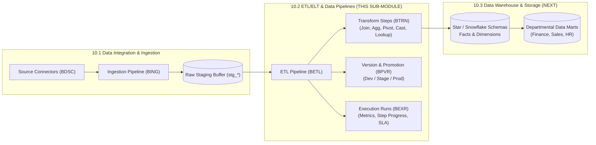
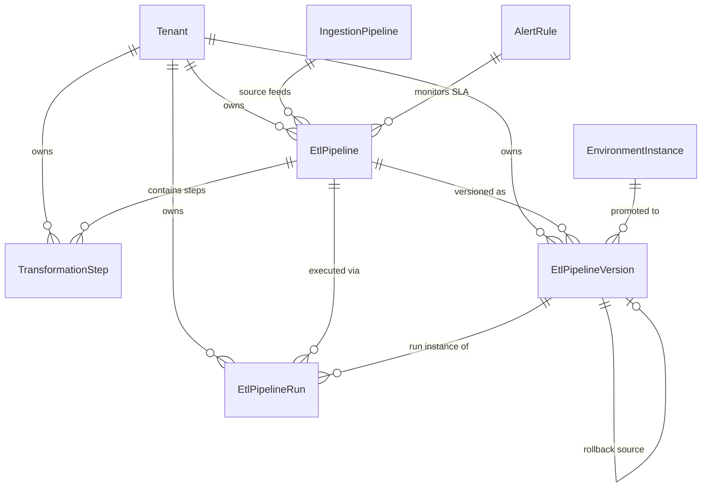

# Research — Sub-module 10.2: ETL/ELT & Data Pipelines (Module 10 — Business Intelligence, `bi`)

- **Sub-module:** 10.2 ETL/ELT & Data Pipelines
- **Module:** 10 Business Intelligence
- **Target app:** `apps/bi` (scaffolded in 10.1; extending with 10.2 package structure)
- **Research date:** 2026-11-03
- **Phase:** Phase 1 Research Catalog
- **Output file:** `.claude/tasks/research-bi-10.2.md`

---

## 1. Executive Summary & Domain Architecture

Sub-module 10.2 builds the **analytical transformation, workflow orchestration, and data pipeline engine** for NavERP (`apps/bi`). Where Sub-module 10.1 handles data extraction and raw landing from source systems into staging datasets (`stg_*`), Sub-module 10.2 takes those staged records and applies multi-step transformations (relational joins, grouped aggregations, matrix pivots, type sanitization, reference lookups, and business rules), orchestrates multi-pipeline Directed Acyclic Graph (DAG) dependencies with retries and backfills, logs execution telemetry with SLA monitoring, and enforces software-engineering-grade version control and multi-environment promotion (Dev $\rightarrow$ Staging $\rightarrow$ Production).

### Architectural Boundaries & Domain Ownership

1. **Separation from 10.1 Ingestion**: 10.1 owns *data extraction and ingress* (`DataSourceConnector`, `IngestionPipeline`, `CdcSyncConfig`, `IngestionRun`). 10.2 owns *analytical transformation and workflow orchestration* (`EtlPipeline`, `TransformationStep`, `EtlPipelineVersion`, `EtlPipelineRun`). 10.2 binds to 10.1's staging outputs as inputs.
2. **Separation from 10.3 Data Warehouse & Storage**: 10.2 executes the transformation logic that populates analytical models. 10.3 owns the long-term Star/Snowflake schemas (fact tables, dimension tables), departmental data marts, lakehouse tiering (raw/curated/aggregated), and partition retention policies.
3. **Separation from 10.4 Semantic Layer**: 10.2 executes physical transformations (ETL/ELT). 10.4 defines the abstract business glossary, user-friendly metric calculations, drill hierarchies, and virtual reporting datasets.
4. **Separation from 10.5 Data Quality & Cleansing**: 10.2 applies deterministic type casting and standard ETL validation rules. 10.5 owns advanced data profiling statistics, fuzzy matching deduplication, and data steward exception remediation workflows.
5. **Separation from 10.7 Data Catalog & Lineage**: 10.2 generates operational run logs and declarative step graph snapshots. 10.7 parses these snapshots into enterprise searchable data catalogs and end-to-end column-level lineage visualizations.

---

## 2. Repo State Checked First

### 2.1 Navigation & App Tree State
- **`apps/core/navigation.py`:** Inspected `LIVE_LINKS`. Sub-module `10.1` is live with:
  - `"Source Connectors": "bi:data_source_connector_list"`
  - `"Batch & Real-Time Ingestion": "bi:ingestion_pipeline_list"`
  - `"Change Data Capture (CDC)": "bi:cdc_sync_config_list"`
  - `"API & Webhook Gateway": "bi:ingestion_pipeline_list"`
  - `"File & Cloud Storage Imports": "bi:ingestion_pipeline_list"`
  - `"Data Integration Hub": "bi:data_integration_hub"`
  - `"Ingestion Runs": "bi:ingestion_run_list"`
- **`10.2` is the next unbuilt sub-module in Module 10.**
- **`apps/bi/`:** Exists, scaffolded in 10.1 with standard package directories: `models/`, `views/`, `forms/`, `urls/`, `management/commands/`, `templates/bi/`.
- Sibling models in `apps/bi/models/DataIntegration/` available to link against:
  - `DataSourceConnector` (`BDSC-`)
  - `IngestionPipeline` (`BING-`)
  - `CdcSyncConfig` (`BCDC-`)
  - `IngestionRun` (`BIJR-`)

### 2.2 As-Built Core Spine Entities (Grep Verified)
Every spine entity mapped in this research was verified against the repository:

| Entity | Location | Verified Status | 10.2 Relationship |
|---|---|---|---|
| `core.Tenant` | `apps/core/models/Tenant.py:17` | **Present** | Strict tenant isolation boundary across all ETL pipelines, steps, versions, and runs |
| `core.EnvironmentInstance` | `apps/core/models/Backup.py:28` | **Present** | Verified Sandbox & Environment master (0.16) for Dev/Stage/Prod promotion binding |
| `core.MappingTemplate` | `apps/core/models/Integration.py:185` | **Present** | Reusable field mapping templates referenced by transformation steps |
| `core.JobDefinition` | `apps/core/models/JobScheduler.py:71` | **Present** | Core server-level job registration for time-based pipeline execution |
| `core.AlertRule` | `apps/core/models/Monitoring.py:65` | **Present** | Observability alert rules (0.17) for SLA breaches and pipeline failure alerts |
| `bi.IngestionPipeline` | `apps/bi/models/DataIntegration/IngestionPipelines.py:8` | **Present** | Upstream ingestion pipeline providing source staging tables to transformation pipelines |
| `settings.AUTH_USER_MODEL` | `apps/core/models/` | **Present** | Pipeline creator, editor, and promotion approver reference |

### 2.3 Prefix Collision Verification
An exhaustive scan of `NUMBER_PREFIX` was conducted across all existing apps in `apps/`:
- `apps/bi/` currently uses: `BDSC` (Connector), `BING` (Pipeline), `BCDC` (CDC), `BIJR` (Ingestion Run).
- Scanned all candidate prefixes for 10.2:
  - ✅ **`BETL`** (`EtlPipeline`) — **100% Free** (zero codebase occurrences).
  - ✅ **`BTRN`** (`TransformationStep`) — **100% Free** (zero codebase occurrences).
  - ✅ **`BPVR`** (`EtlPipelineVersion`) — **100% Free** (zero codebase occurrences).
  - ✅ **`BEXR`** (`EtlPipelineRun`) — **100% Free** (zero codebase occurrences).
- Additional verified free candidate prefixes: `BDAG`, `BPLN`, `BPIP`, `BVER`, `BETR`.

---

## 3. Commercial Market Leaders Surveyed

We analyzed 10 leading commercial and open-source platforms across workflow orchestration, visual ETL/ELT designer interfaces, in-warehouse transformations, and pipeline CI/CD lifecycle management:

1. **Apache Airflow / Astronomer** (Industry Standard Programmatic Orchestration)
   - *Key Architecture:* Directed Acyclic Graphs (DAGs) representing workflows, Task Operators (Extract, SQL, Python, Sensors), Trigger Rules (`all_success`, `all_done`, `one_failed`), automated retries with exponential backoff, historical data backfilling (`catchup` and chronological execution intervals), SLA miss detection with alert dispatch, and execution run states (`queued`, `running`, `success`, `failed`).
   - *Sources:* [Apache Airflow DAG Concepts](https://airflow.apache.org/docs/apache-airflow/stable/core-concepts/dags.html) · [Airflow SLA Monitoring](https://airflow.apache.org/docs/apache-airflow/stable/core-concepts/slas.html)

2. **dbt Labs (dbt Core / dbt Cloud)** (Standard for In-Warehouse ELT Transformations)
   - *Key Architecture:* Declarative SQL transformations compiled into warehouse DDL/DML, Model Versioning (`versions` YAML specification allowing breaking schema changes to coexist across `v1` and `v2`), Multi-Environment deployment (`Development`, `Staging`, `Production`), contract enforcement (`contract: {enforced: true}`), DAG lineage graph (`ref()` dependencies), automated testing (`not_null`, `unique`), and state deferral.
   - *Sources:* [dbt Model Versioning](https://docs.getdbt.com/docs/collaborate/govern/model-versions) · [dbt Deployment Environments](https://docs.getdbt.com/docs/deploy/deploy-environments)

3. **Azure Data Factory (ADF) / Synapse Analytics Pipelines** (Enterprise Visual Cloud ETL)
   - *Key Architecture:* Visual drag-and-drop pipeline canvas, Mapping Data Flows executing on managed Spark runtimes, transformation library nodes: **Join** (Inner, Left, Right, Full, Cross), **Aggregate** (Group By + SUM/AVG/COUNT), **Pivot** (rotating rows into column headers) & **Unpivot**, **Derived Column** (expressions), **Filter**, **Select** (type casting & aliasing). Triggers (Tumbling Window, Schedule, Event), and Git-native ARM template promotion across Dev/QA/Prod.
   - *Sources:* [Azure Data Factory Mapping Data Flows](https://learn.microsoft.com/en-us/azure/data-factory/concepts-data-flow-overview) · [ADF Data Flow Transformations](https://learn.microsoft.com/en-us/azure/data-factory/data-flow-transformation-overview)

4. **AWS Glue Studio & AWS Glue ETL** (Serverless Visual Transformation Engine)
   - *Key Architecture:* Visual node-based DAG editor, pre-built transform library: **Join** (6 join types), **Aggregate** (Group-by + metrics), **Filter** (conditional logic), **DropNullFields**, **ChangeSchema** (data type casting), **Custom Transform** (Python/PySpark). Orchestration via Glue Triggers, Job Bookmarks tracking incremental state, and Job Run execution telemetry.
   - *Sources:* [AWS Glue Studio Visual ETL](https://docs.aws.amazon.com/glue/latest/dg/glue-studio.html) · [AWS Glue Transforms](https://docs.aws.amazon.com/glue/latest/dg/transforms-configure.html)

5. **Matillion ETL / Data Productivity Cloud** (Cloud Data Warehouse Visual ELT Leader)
   - *Key Architecture:* Clean architectural bifurcation between **Orchestration Jobs** (control flow, loops, conditions, scheduling, calling child jobs) and **Transformation Jobs** (in-warehouse SQL pushdown). Transformation components: **Join**, **Aggregate**, **Filter**, **Calculator** (expressions), **Pivot/Unpivot**, **Table Output**. Environment profiles for Snowflake/Databricks/Redshift, version manager with snapshots, and run history logging.
   - *Sources:* [Matillion Transformation Jobs](https://docs.matillion.com/metl/docs/transformation-jobs/) · [Matillion Orchestration vs Transformation](https://docs.matillion.com/metl/docs/jobs-overview/)

6. **Informatica Intelligent Data Management Cloud (IDMC) / Cloud Data Integration (CDI)** (Enterprise ETL/ELT)
   - *Key Architecture:* Cloud Mapping Designer (visual low-code data flow builder). Active and Passive transformation components: **Expression** (row-level calculations), **Joiner** (Master/Detail multi-source join), **Aggregator** (group calculations with data cache), **Router** (multi-condition stream splitting), **Lookup** (dimension table enrichment). Orchestration via **Taskflows** (sequential/parallel execution, branching, retries), Parameter Sets, and lifecycle asset promotion across environments.
   - *Sources:* [Informatica Cloud Data Integration Mappings](https://docs.informatica.com/integration-cloud/data-integration/current-version/mappings.html) · [Informatica Transformations](https://docs.informatica.com/integration-cloud/data-integration/current-version/transformations.html)

7. **Prefect** (Modern Python Workflow Orchestration)
   - *Key Architecture:* Declarative orchestration using `@flow` and `@task` abstractions. Discrete task state tracking (`Pending`, `Running`, `Completed`, `Failed`, `Retrying`, `Crashed`), automated retry policies with configurable retry delays, schedules (cron, interval), event-driven triggers, work pool infrastructure bindings, and concurrency limits.
   - *Sources:* [Prefect Flows & Tasks Architecture](https://docs.prefect.io/v3/develop/flows) · [Prefect States and Retries](https://docs.prefect.io/v3/develop/states-and-retries)

8. **Dagster** (Asset-Based Orchestration Engine)
   - *Key Architecture:* Software-Defined Assets (SDAs) pairing computed data tables with upstream lineage dependencies, **Partitions** (Daily, Hourly, Dynamic) slicing datasets for incremental computation, automated **Backfills** (bulk re-execution of historical partition windows), **Sensors** (event-driven asset reconciliation), and **Schedules** (time-based materialization).
   - *Sources:* [Dagster Software-Defined Assets](https://docs.dagster.io/concepts/assets/software-defined-assets) · [Dagster Partitions & Backfills](https://docs.dagster.io/concepts/partitions-schedules-sensors/partitions)

9. **Kestra** (Declarative Event-Driven Orchestrator)
   - *Key Architecture:* Declarative YAML and interactive **Visual Topology** canvas, runnable tasks (SQL, Python, Script) vs. flowable tasks (`If`, `Switch`, `Parallel`, `Each`), retry policies with `constant` and `exponential` backoff, execution monitoring with live task status transitions, and execution telemetry.
   - *Sources:* [Kestra Topology & Visual Editor](https://kestra.io/docs/concepts/topology) · [Kestra Flow Architecture](https://kestra.io/docs/workflow-components/flows)

10. **Prophecy.io** (Low-Code Visual Data Transformation for dbt & Spark)
    - *Key Architecture:* Visual-to-code compiler translating drag-and-drop canvas nodes into standard dbt Core SQL models and Spark code. Git-native repository synchronization, automated CI/CD pipelines via Prophecy Build Tool (`pbt`), automated unit testing, model versioning, and environment deployment promotion across Dev, Staging, and Production fabrics.
    - *Sources:* [Prophecy.io Low-Code Data Transformation](https://docs.prophecy.ai/) · [Prophecy CI/CD & dbt Deployment](https://docs.prophecy.ai/ci-cd/)

---

## 4. Feature Catalog (Sub-module 10.2 Only)

Grouped strictly by the 5 feature bullets in `NavERP.md` under `### 10.2 ETL/ELT & Data Pipelines`, plus architectural declarations:

### 4.1 Visual Pipeline Builder
- **Visual DAG Canvas & Node-Graph Layout** — Interactive visual builder canvas where extraction sources, transformations, and load sinks are laid out as interconnected nodes with directional edges, tracking canvas coordinates (`canvas_x`, `canvas_y`) and visual layout metadata.
  - *Seen in:* Azure Data Factory, AWS Glue Studio, Matillion, Kestra, Prophecy.io.
  - *Priority:* `table-stakes`.
  - *Spine:* `EtlPipeline.canvas_layout` JSONField + `TransformationStep.canvas_x/y`.
  - *Status:* Buildable now.
- **Pipeline Architecture Mode (ETL vs. ELT vs. Micro-Batch)** — Explicit architecture configuration: `etl_standard` (in-memory row transform & load), `elt_pushdown` (SQL transformation compiled and pushed down into analytical database), and `streaming_microbatch` (frequent micro-batch transformation).
  - *Seen in:* Matillion, dbt Labs, ADF.
  - *Priority:* `table-stakes`.
  - *Spine:* `EtlPipeline.pipeline_type` choice field.
  - *Status:* Buildable now.
- **Staging Source & Analytical Target Binding** — Configurable source dataset (linking to `bi.IngestionPipeline` staging tables like `stg_accounting_invoices` or internal database models) and target analytical table/mart designation (e.g. `fact_customer_revenue`).
  - *Seen in:* ADF, AWS Glue, Matillion.
  - *Priority:* `table-stakes`.
  - *Spine:* `EtlPipeline.source_ingestion_pipeline` FK + `source_staging_table` / `target_table`.
  - *Status:* Buildable now.
- **Target Loading Strategy** — Loading behavior for transformed records: `truncate_insert` (full wipe & replace), `append_only` (historical immutable journal), `merge_upsert` (upsert on primary key), and `scd_type_2` (slowly changing dimension tracking valid-from/valid-to).
  - *Seen in:* dbt, Matillion, Fivetran.
  - *Priority:* `table-stakes`.
  - *Spine:* `EtlPipeline.target_load_strategy` choice field.
  - *Status:* Buildable now.
- **Multi-Branch & Parallel Data Flows** — Allows an upstream dataset to split into multiple parallel transformation branches and merge downstream via join or union nodes.
  - *Seen in:* Apache Airflow, ADF, Informatica CDI, Kestra.
  - *Priority:* `common`.
  - *Spine:* `TransformationStep.upstream_step_ids` JSON list.
  - *Status:* Buildable now.

### 4.2 Transformation Library
- **Relational Joins (Multi-Stream Merging)** — Multi-type join transformation combining two datasets on matching keys: Inner Join, Left Outer Join, Right Outer Join, Full Outer Join, and Cross Join.
  - *Seen in:* ADF Data Flows, AWS Glue Studio, Matillion, Informatica Joiner.
  - *Priority:* `table-stakes`.
  - *Spine:* `TransformationStep` with `step_type='join'`.
  - *Status:* Buildable now.
- **Aggregations & Grouped Metrics** — Group-by summarization computing metric measures: `SUM`, `AVG`, `MIN`, `MAX`, `COUNT`, `COUNT_DISTINCT` over specified dimensions.
  - *Seen in:* ADF Aggregate, Glue Studio Aggregate, Matillion Aggregate, Informatica Aggregator.
  - *Priority:* `table-stakes`.
  - *Spine:* `TransformationStep` with `step_type='aggregate'`.
  - *Status:* Buildable now.
- **Pivot & Unpivot (Matrix Transformations)** — Pivot transformation rotating unique row values into column headers for cross-tab analysis, and Unpivot normalizing wide columnar tables into normalized key-value rows.
  - *Seen in:* ADF Pivot/Unpivot, Matillion, SQL pushdown.
  - *Priority:* `common`.
  - *Spine:* `TransformationStep` with `step_type='pivot'` / `unpivot`.
  - *Status:* Buildable now.
- **Data Type Casting & Sanitization** — Explicit casting converting staging text attributes into typed analytical primitives: string to decimal/currency, ISO text to date/datetime, integer to boolean, timezone UTC conversion, and NULL coalescing.
  - *Seen in:* dbt, Glue Studio, ADF Derived Column.
  - *Priority:* `table-stakes`.
  - *Spine:* `TransformationStep` with `step_type='cast'`.
  - *Status:* Buildable now.
- **Lookup & Master Data Enrichment** — Enriches transactional records with master data lookups by joining against Core and operational entities (e.g., resolving `Party` customer names, `TaxCode` statutory rates, `Currency` FX rates, or `OrgUnit` hierarchies).
  - *Seen in:* Informatica Lookup, Matillion Table Lookup, ADF Lookup.
  - *Priority:* `table-stakes`.
  - *Spine:* `TransformationStep` with `step_type='lookup_enrichment'`.
  - *Status:* Buildable now.
- **Derived Columns & Calculated Expressions** — Row-level calculations using mathematical operations, string manipulations, date differences, and conditional `CASE/WHEN` logic.
  - *Seen in:* ADF Derived Column, Informatica Expression, Glue Custom Transform.
  - *Priority:* `table-stakes`.
  - *Spine:* `TransformationStep` with `step_type='derived_column'`.
  - *Status:* Buildable now.
- **Row Filtering & Conditional Routing** — Multi-condition row evaluation (AND/OR logic) filtering out invalid records or routing rows into distinct analytical branches based on status or date bounds.
  - *Seen in:* Glue Filter, Informatica Router, Matillion Filter.
  - *Priority:* `table-stakes`.
  - *Spine:* `TransformationStep` with `step_type='filter'`.
  - *Status:* Buildable now.
- **Reusable Business-Rule Transforms** — Standardized, parameterized ERP transformation rules (e.g., fiscal year/quarter computation from calendar date, aging bucket categorization `0-30/31-60/61-90/90+`, currency normalization).
  - *Seen in:* dbt Macros/Packages, Informatica Mapplets.
  - *Priority:* `differentiator`.
  - *Spine:* `TransformationStep` with `step_type='business_rule'`.
  - *Status:* Buildable now.

### 4.3 Orchestration & Scheduling
- **Topological Dependency Chaining (DAG Orchestration)** — Directed Acyclic Graph dependency sequencing ensuring downstream pipelines execute only after upstream prerequisites succeed (e.g., `Sales_Mart_Transform` runs only after `Order_Staging` and `Customer_Staging` succeed).
  - *Seen in:* Apache Airflow, Dagster, Prefect, Kestra.
  - *Priority:* `table-stakes`.
  - *Spine:* `EtlPipeline.upstream_dependencies` JSON list of pipeline numbers/slugs.
  - *Status:* Buildable now.
- **Multi-Trigger Execution Engine** — Triggers pipelines based on: (1) Time-based schedule (Cron or fixed interval), (2) Ingestion completion event (fired automatically when an upstream `bi.IngestionRun` finishes), (3) Manual user on-demand execution, (4) Inbound webhook/API call.
  - *Seen in:* Airflow Dataset Triggers, Prefect Automations, Dagster Sensors, ADF Triggers.
  - *Priority:* `table-stakes`.
  - *Spine:* `EtlPipeline.trigger_mode` choice field.
  - *Status:* Buildable now.
- **Automated Retries & Exponential Backoff** — Configurable failure recovery parameters: `max_retries` (e.g. 1–5), `retry_delay_seconds`, and backoff algorithm (`fixed`, `linear`, `exponential`) to withstand transient lock contention or network timeouts.
  - *Seen in:* Airflow, Prefect, Kestra, ADF.
  - *Priority:* `table-stakes`.
  - *Spine:* `EtlPipeline` fields `max_retries`, `retry_delay_seconds`, `retry_backoff_strategy`.
  - *Status:* Buildable now.
- **Historical Partition Backfilling** — Re-executes transformation logic over historical time slices (e.g. re-transforming all records for `2026-Q1` following a business rule change) with configurable date range and batch chunking.
  - *Seen in:* Airflow CLI/UI backfill, Dagster Backfills, dbt run `--vars`.
  - *Priority:* `table-stakes`.
  - *Spine:* `EtlPipeline.allow_backfill` + `EtlPipelineRun.is_backfill`, `backfill_range_start/end`.
  - *Status:* Buildable now.
- **Schedules & Cron Execution** — Flexible time-based scheduling (`hourly`, `daily_midnight`, `weekly_sunday`, or custom Unix 5-field cron syntax), tracking `last_run_at` and `next_run_due_at`.
  - *Seen in:* All 10 leaders.
  - *Priority:* `table-stakes`.
  - *Spine:* `EtlPipeline` schedule fields; can link to `core.JobDefinition`.
  - *Status:* Buildable now.

### 4.4 Pipeline Monitoring & Logging
- **Execution Run Ledger & Status Tracking** — Comprehensive execution record per pipeline run: status (`pending`, `running`, `completed`, `warning`, `failed`, `cancelled`, `timed_out`), trigger type, executor user, start time, end time, and duration.
  - *Seen in:* Airflow DAG Runs, Prefect Flow Runs, ADF Pipeline Runs, Glue Job Runs.
  - *Priority:* `table-stakes`.
  - *Spine:* `EtlPipelineRun` model.
  - *Status:* Buildable now.
- **Granular Step-Level Progress & Node Telemetry** — Node-by-node execution audit: per-step status, step start/end timestamps, step row count processed, and step execution time, enabling instant visual bottleneck identification.
  - *Seen in:* ADF Activity Runs, AWS Glue Studio Run Details, Kestra Executions.
  - *Priority:* `table-stakes`.
  - *Spine:* `EtlPipelineRun.step_progress` JSONField.
  - *Status:* Buildable now.
- **Throughput & Data Volume Accounting** — Quantitative data movement audit metrics: `records_in` from staging, `records_transformed`, `records_out` to target, `records_rejected` (transform errors), and `bytes_processed`.
  - *Seen in:* ADF, Matillion, Informatica CDI, Glue.
  - *Priority:* `table-stakes`.
  - *Spine:* Integer/BigInteger fields on `EtlPipelineRun`.
  - *Status:* Buildable now.
- **SLA Breach Monitoring & Timeout Enforcement** — Configurable maximum allowable execution duration (`sla_timeout_seconds`); if elapsed runtime exceeds the threshold, the run flags `sla_missed=True` and generates operational alerts.
  - *Seen in:* Airflow SLA Misses, Dagster Freshness Policies.
  - *Priority:* `common`.
  - *Spine:* `EtlPipeline.sla_timeout_seconds` + `EtlPipelineRun.sla_missed`.
  - *Status:* Buildable now.
- **Failure Diagnostics, Logs & Alert Integration** — Captures root-cause error messages, failed node names, SQL compilation errors, and links into `core.AlertRule` for failure notifications without leaking database passwords.
  - *Seen in:* All 10 leaders.
  - *Priority:* `table-stakes`.
  - *Spine:* `EtlPipelineRun.error_message`, `execution_log`, links to `core.AlertRule`.
  - *Status:* Buildable now.

### 4.5 Version Control & CI/CD
- **Immutable Pipeline Versioning** — Semantic versioning (`v1.0`, `v1.1`, `v2.0`) capturing a frozen, immutable declarative snapshot of the pipeline DAG (JSON manifest of all nodes, transformation logic, parameters, and input/output schemas).
  - *Seen in:* dbt Model Versioning, Prophecy.io, ADF Git Integration, Matillion Versions.
  - *Priority:* `table-stakes`.
  - *Spine:* `EtlPipelineVersion` model.
  - *Status:* Buildable now.
- **Multi-Environment Promotion (Dev $\rightarrow$ Staging $\rightarrow$ Prod)** — Formal lifecycle promotion workflow advancing pipeline configurations across development, staging (testing/QA), and production environments, referencing `core.EnvironmentInstance`.
  - *Seen in:* dbt Cloud Environments, Prophecy.io Fabrics, ADF Environment Deployment, Informatica Life Cycle Management.
  - *Priority:* `table-stakes`.
  - *Spine:* `EtlPipelineVersion.environment` + `core.EnvironmentInstance`.
  - *Status:* Buildable now.
- **Single-Click Version Rollback** — Ability to instantly revert a malfunctioning production pipeline back to a previously certified stable version snapshot (`status='rolled_back'`, `rollback_source`), updating the active production pointer without code deployment.
  - *Seen in:* dbt Cloud, Prophecy.io, Matillion, AWS Glue.
  - *Priority:* `table-stakes`.
  - *Spine:* `EtlPipelineVersion.rollback_source` self-FK + `EtlPipeline.active_version`.
  - *Status:* Buildable now.
- **Changelog & Audit Lineage** — Traceable change log tracking who authored the version, what transformations were altered, who approved promotion to production, and the approval timestamp.
  - *Seen in:* Prophecy.io, dbt Cloud PRs, Core 0.9 AuditLog.
  - *Priority:* `table-stakes`.
  - *Spine:* `EtlPipelineVersion.changelog`, `promoted_by`, `promoted_at`.
  - *Status:* Buildable now.

---

## 5. Recommended Build Scope (This Pass — Exactly Four Models)

To fulfill all 5 feature bullets of `NavERP.md` 10.2 without model bloat, we recommend **exactly four tenant-isolated models**:

### Model 1: `EtlPipeline` [`BETL-`]
- **Purpose:** Represents the top-level ETL/ELT transformation pipeline definition, binding source staging data to target analytical tables, configuring execution triggers, schedules, DAG dependency chaining, retry policies, SLA bounds, and visual canvas layouts.
- **Auto-number Prefix:** `BETL` (verified 100% collision-free).
- **Key Fields & Choices:**
  - `number`: `CharField(max_length=20, editable=False)` (minted as `BETL-#####`).
  - `tenant`: `ForeignKey("core.Tenant", on_delete=models.CASCADE)`.
  - `name`: `CharField(max_length=150)`.
  - `slug`: `SlugField(max_length=160, blank=True)`.
  - `description`: `TextField(blank=True)`.
  - `pipeline_type`: `CharField` with choices:
    - `etl_standard`: Extract-Transform-Load (in-memory row-by-row transform and load).
    - `elt_pushdown`: Extract-Load-Transform (in-warehouse SQL compiled pushdown).
    - `streaming_microbatch`: Near-real-time micro-batch transformation.
  - `source_ingestion_pipeline`: `ForeignKey("bi.IngestionPipeline", null=True, blank=True, on_delete=models.SET_NULL, related_name="downstream_etl_pipelines")`.
  - `source_staging_table`: `CharField(max_length=150)` (e.g. `stg_accounting_invoices`).
  - `target_table`: `CharField(max_length=150)` (e.g. `fact_financial_invoices`).
  - `target_load_strategy`: `CharField` with choices:
    - `truncate_insert`: Full wipe and replace of target dataset.
    - `append_only`: Append all records as immutable ledger.
    - `merge_upsert`: Upsert by primary key (insert new, update modified).
    - `scd_type_2`: Slowly Changing Dimension Type 2 (tracks valid_from, valid_to, is_current).
  - `trigger_mode`: `CharField` with choices:
    - `manual`: Manual on-demand execution only.
    - `scheduled_cron`: Scheduled execution based on cron cadence.
    - `event_on_ingest`: Triggered automatically upon upstream ingestion run success.
    - `dependency_chained`: Triggered when upstream ETL pipelines complete.
  - `schedule_cadence`: `CharField` with choices `manual`, `hourly`, `daily`, `weekly`, `custom_cron`.
  - `cron_expression`: `CharField(max_length=60, blank=True)`.
  - `upstream_dependencies`: `JSONField(default=list, blank=True)` (list of upstream pipeline numbers/slugs for DAG dependency chaining).
  - `max_retries`: `PositiveIntegerField(default=3)`.
  - `retry_delay_seconds`: `PositiveIntegerField(default=60)`.
  - `retry_backoff_strategy`: `CharField` with choices `fixed`, `linear`, `exponential` (default `fixed`).
  - `sla_timeout_seconds`: `PositiveIntegerField(default=3600, help_text="Maximum expected execution time before SLA alert")`.
  - `alert_on_sla_miss`: `BooleanField(default=True)`.
  - `alert_rule`: `ForeignKey("core.AlertRule", null=True, blank=True, on_delete=models.SET_NULL)`.
  - `allow_backfill`: `BooleanField(default=True)`.
  - `canvas_layout`: `JSONField(default=dict, blank=True, help_text="Visual drag-and-drop node graph layout: coordinates, nodes, edges, zoom")`.
  - `active_version`: `ForeignKey("bi.EtlPipelineVersion", null=True, blank=True, on_delete=models.SET_NULL, related_name="+")`.
  - `status`: `CharField` with choices `draft`, `active`, `paused`, `deprecated` (default `draft`).
  - `last_run_at`: `DateTimeField(null=True, blank=True)`.
  - `next_run_due_at`: `DateTimeField(null=True, blank=True)`.
  - `created_by`: `ForeignKey(settings.AUTH_USER_MODEL, null=True, on_delete=models.SET_NULL)`.
  - `created_at` / `updated_at`.
- **Justified by Features:** Bullet 1 (Visual Pipeline Builder), Bullet 3 (Orchestration & Scheduling), Bullet 4 (SLA configuration).

### Model 2: `TransformationStep` [`BTRN-`]
- **Purpose:** Represents an individual transformation node within the pipeline's DAG (joins, aggregations, pivots, type casts, derived expressions, and business rules), with inputs, outputs, parameters, and canvas placement.
- **Auto-number Prefix:** `BTRN` (verified 100% collision-free).
- **Key Fields & Choices:**
  - `number`: `CharField(max_length=20, editable=False)` (minted as `BTRN-#####`).
  - `tenant`: `ForeignKey("core.Tenant", on_delete=models.CASCADE)`.
  - `pipeline`: `ForeignKey("bi.EtlPipeline", on_delete=models.CASCADE, related_name="transformation_steps")`.
  - `step_name`: `CharField(max_length=150)`.
  - `step_type`: `CharField` with choices:
    - `join`: Multi-stream relational join (Inner, Left, Right, Full, Cross).
    - `aggregate`: Group-by summarization (SUM, AVG, MIN, MAX, COUNT, COUNT_DISTINCT).
    - `pivot`: Row-to-column rotation.
    - `unpivot`: Column-to-row normalization.
    - `cast`: Column type casting and date/timezone formatting.
    - `filter`: Row-level filter condition (WHERE clause).
    - `derived_column`: Expression / calculated column.
    - `lookup_enrichment`: Master data entity enrichment.
    - `deduplicate`: Row deduplication / window partition.
    - `business_rule`: Reusable domain business rule transform.
  - `sequence`: `PositiveIntegerField(default=10, help_text="Topological order index in DAG")`.
  - `upstream_step_ids`: `JSONField(default=list, blank=True, help_text="Parent node numbers/IDs for branching/merging")`.
  - `step_config`: `JSONField(default=dict, blank=True, help_text="Type-specific parameters: join_keys, group_by_fields, expressions, rules")`.
  - `mapping_template`: `ForeignKey("core.MappingTemplate", null=True, blank=True, on_delete=models.SET_NULL)`.
  - `is_active`: `BooleanField(default=True)`.
  - `canvas_x`: `IntegerField(default=100, help_text="X position on visual builder canvas")`.
  - `canvas_y`: `IntegerField(default=100, help_text="Y position on visual builder canvas")`.
  - `created_at` / `updated_at`.
- **Justified by Features:** Bullet 1 (Visual canvas nodes), Bullet 2 (Transformation Library: joins, aggregations, pivots, casting, lookups, expressions, business rules).

### Model 3: `EtlPipelineVersion` [`BPVR-`]
- **Purpose:** Represents an immutable, frozen declarative version snapshot of a pipeline's DAG and transformation steps, providing multi-environment promotion (Dev $\rightarrow$ Staging $\rightarrow$ Production) and instant rollback capabilities.
- **Auto-number Prefix:** `BPVR` (verified 100% collision-free).
- **Key Fields & Choices:**
  - `number`: `CharField(max_length=20, editable=False)` (minted as `BPVR-#####`).
  - `tenant`: `ForeignKey("core.Tenant", on_delete=models.CASCADE)`.
  - `pipeline`: `ForeignKey("bi.EtlPipeline", on_delete=models.CASCADE, related_name="versions")`.
  - `version_number`: `CharField(max_length=30, default="v1.0")`.
  - `environment`: `CharField` with choices:
    - `development`: Authoring & sandbox testing.
    - `staging`: Pre-production integration & verification.
    - `production`: Active production execution.
  - `environment_instance`: `ForeignKey("core.EnvironmentInstance", null=True, blank=True, on_delete=models.SET_NULL, help_text="Optional link to Core 0.16 Sandbox/Environment")`.
  - `definition_snapshot`: `JSONField(default=dict, help_text="Immutable declarative snapshot of DAG nodes, steps, and parameters")`.
  - `changelog`: `TextField(blank=True, help_text="Release notes, commit message, or summary of changes")`.
  - `status`: `CharField` with choices:
    - `draft`: Work-in-progress version.
    - `tested`: Verified passing in sandbox.
    - `promoted`: Promoted to target environment.
    - `active_production`: Currently live in production.
    - `deprecated`: Superseded by newer version.
    - `rolled_back`: Deactivated via rollback.
  - `is_active_for_env`: `BooleanField(default=False, help_text="Whether this is the currently active version in this environment")`.
  - `rollback_source`: `ForeignKey("self", null=True, blank=True, on_delete=models.SET_NULL, related_name="rollbacks")`.
  - `promoted_by`: `ForeignKey(settings.AUTH_USER_MODEL, null=True, on_delete=models.SET_NULL)`.
  - `promoted_at`: `DateTimeField(null=True, blank=True)`.
  - `created_at` / `updated_at`.
- **Justified by Features:** Bullet 5 (Version Control & CI/CD: pipeline versioning, environment promotion, rollback support).

### Model 4: `EtlPipelineRun` [`BEXR-`]
- **Purpose:** Immutable operational execution run log capturing execution status, node-level step progress, data volume throughput (records read, transformed, written, rejected), duration, SLA adherence, and diagnostics.
- **Auto-number Prefix:** `BEXR` (verified 100% collision-free).
- **Key Fields & Choices:**
  - `number`: `CharField(max_length=20, editable=False)` (minted as `BEXR-#####`).
  - `tenant`: `ForeignKey("core.Tenant", on_delete=models.CASCADE)`.
  - `pipeline`: `ForeignKey("bi.EtlPipeline", on_delete=models.CASCADE, related_name="runs")`.
  - `pipeline_version`: `ForeignKey("bi.EtlPipelineVersion", null=True, blank=True, on_delete=models.SET_NULL, related_name="execution_runs")`.
  - `trigger_type`: `CharField` with choices:
    - `scheduled`: Automated cron schedule trigger.
    - `manual`: Manual user execution.
    - `event_upstream_ingest`: Triggered upon upstream ingestion run success.
    - `backfill`: Historical partition backfill execution.
    - `webhook_api`: Inbound API execution request.
  - `execution_environment`: `CharField` with choices `development`, `staging`, `production` (default `production`).
  - `status`: `CharField` with choices: `pending`, `queued`, `running`, `completed`, `warning`, `failed`, `cancelled`, `timed_out` (default `pending`).
  - `started_at`: `DateTimeField(default=timezone.now)`.
  - `ended_at`: `DateTimeField(null=True, blank=True)`.
  - `duration_seconds`: `DecimalField(max_digits=10, decimal_places=2, default=0)`.
  - `records_in`: `PositiveIntegerField(default=0, help_text="Extracted records from source staging")`.
  - `records_transformed`: `PositiveIntegerField(default=0, help_text="Records successfully transformed")`.
  - `records_out`: `PositiveIntegerField(default=0, help_text="Records committed to target table")`.
  - `records_rejected`: `PositiveIntegerField(default=0, help_text="Records rejected during transformation / DQ checks")`.
  - `bytes_processed`: `BigIntegerField(default=0)`.
  - `step_progress`: `JSONField(default=list, blank=True, help_text="Per-step audit: step_number, status, duration, row_count, error")`.
  - `sla_missed`: `BooleanField(default=False)`.
  - `is_backfill`: `BooleanField(default=False)`.
  - `backfill_range_start`: `DateTimeField(null=True, blank=True)`.
  - `backfill_range_end`: `DateTimeField(null=True, blank=True)`.
  - `retry_count`: `PositiveIntegerField(default=0)`.
  - `error_message`: `CharField(max_length=500, blank=True)`.
  - `execution_log`: `TextField(blank=True, help_text="Detailed step execution log, pushdown SQL statements, and tracebacks")`.
  - `created_at`.
- **Justified by Features:** Bullet 3 (Retries, Backfills), Bullet 4 (Pipeline Monitoring & Logging: run history, throughput metrics, SLA tracking, failure alerts).

---

## 6. Belongs to Sibling Sub-Modules (Parked, Not Scoped Here)

Features identified during leader research that belong to other sub-modules in Module 10:

- **Source Connectors (Database, Storage, REST API) & File Parsing** → Built in **10.1 Data Integration & Ingestion** (`bi.DataSourceConnector`, `bi.IngestionPipeline`).
- **Change Data Capture (CDC Log/Timestamp/Sequence)** → Built in **10.1 Data Integration & Ingestion** (`bi.CdcSyncConfig`).
- **Star & Snowflake Schema Design (Fact Tables, Dimension Tables)** → Belongs to **10.3 Data Warehouse & Storage**.
- **Departmental Data Marts (Finance, Sales, HR, Inventory Marts)** → Belongs to **10.3 Data Warehouse & Storage**.
- **Storage Tiering (Hot/Warm/Cold), Data Lake Zones & Historical Archival** → Belongs to **10.3 Data Warehouse & Storage**.
- **Semantic Layer, Business Glossary & Metric Hierarchies** → Belongs to **10.4 Data Modeling & Semantic Layer**.
- **Data Profiling, Column Distributions & Quality Scorecards** → Belongs to **10.5 Data Quality & Cleansing**.
- **Master Data Golden Records, Match & Merge Algorithms** → Belongs to **10.6 Master Data Management (MDM)**.
- **Enterprise Searchable Data Catalog & Column-Level Lineage Graph** → Belongs to **10.7 Data Catalog, Lineage & Governance**.
- **Interactive Dashboards, Chart Widgets & Canvas Designer** → Belongs to **10.8 Dashboards & Visualization**.
- **Pre-Built Operational Report Templates & Pixel-Perfect Exports** → Belongs to **10.9 Standard & Operational Reporting**.
- **Outbound Reverse-ETL & Syndication to Snowflake, BigQuery, Tableau** → Belongs to **10.19 Integration & API Hub**.

---

## 7. Deferred (Later Passes / External Infrastructure)

Features that inform our data models but require external server infrastructure or heavy external drivers:

1. **Distributed Spark Cluster Execution** (e.g. AWS EMR or Databricks cluster provisioning). NavERP models the visual transformation nodes and execution metadata cleanly; transformations execute natively in Django/Python for in-memory batching or pushdown SQL queries to PostgreSQL/MySQL/SQLite without requiring a dedicated Apache Spark cluster.
2. **Real-Time Stream Processing Daemons** (e.g. Apache Flink / Kafka Streams continuous micro-second stateful streaming). Streaming micro-batches are modeled via frequent cadences and webhook triggers; native Flink infrastructure is deferred.
3. **Automated Live Target DDL Alterations**. When target schemas change, the pipeline records the desired target schema in the version definition snapshot rather than executing unreviewed, potentially destructive `ALTER TABLE` DDL on external analytical production warehouses.
4. **Automated Git Remote Repository Push / PR Integration**. While the pipeline stores Git-compatible declarative JSON snapshots and change notes, bi-directional webhook-based Git repo sync (e.g. GitHub/GitLab PR webhooks) is deferred to enterprise developer integrations.

---

## 8. Summary for Todo Agent

- **App Slug:** `bi` (`apps/bi/`)
- **Sub-module:** `10.2 ETL/ELT & Data Pipelines`
- **Recommended Models (4):**
  1. `EtlPipeline` (`BETL-`) — Pipeline definition, canvas graph layout, staging source & analytical target, trigger modes, schedule cadence, DAG dependency chaining, retries, and SLA threshold.
  2. `TransformationStep` (`BTRN-`) — Transformation library node (join, aggregate, pivot, unpivot, cast, filter, derived expression, lookup enrichment, deduplication, business rules) with canvas coordinates and upstream step bindings.
  3. `EtlPipelineVersion` (`BPVR-`) — Version control and CI/CD lifecycle promotion (Dev $\rightarrow$ Staging $\rightarrow$ Production), declarative snapshot manifest, rollback tracking, and approval audit.
  4. `EtlPipelineRun` (`BEXR-`) — Operational execution run log, step-level progress telemetry, throughput metrics (records read/transformed/written/rejected, bytes), duration, SLA tracking, and diagnostics.
- **Prefix Collision Status:** `BETL`, `BTRN`, `BPVR`, `BEXR` verified 100% collision-free across all apps.
- **Reused Spine Entities:**
  - `bi.IngestionPipeline` (10.1) as source staging pipeline FK.
  - `core.Tenant` (0.1) for strict tenant isolation.
  - `core.EnvironmentInstance` (0.16) for Dev/Stage/Prod promotion binding.
  - `core.MappingTemplate` (0.13) for column mapping reuse.
  - `core.AlertRule` (0.17) for SLA breach and failure alert monitoring.
  - `settings.AUTH_USER_MODEL` for pipeline creators, editors, and promotion approvers.
- **Next Step:** Todo agent translates these 4 models and feature specifications into checkable build tasks in `.claude/tasks/todo.md`.
