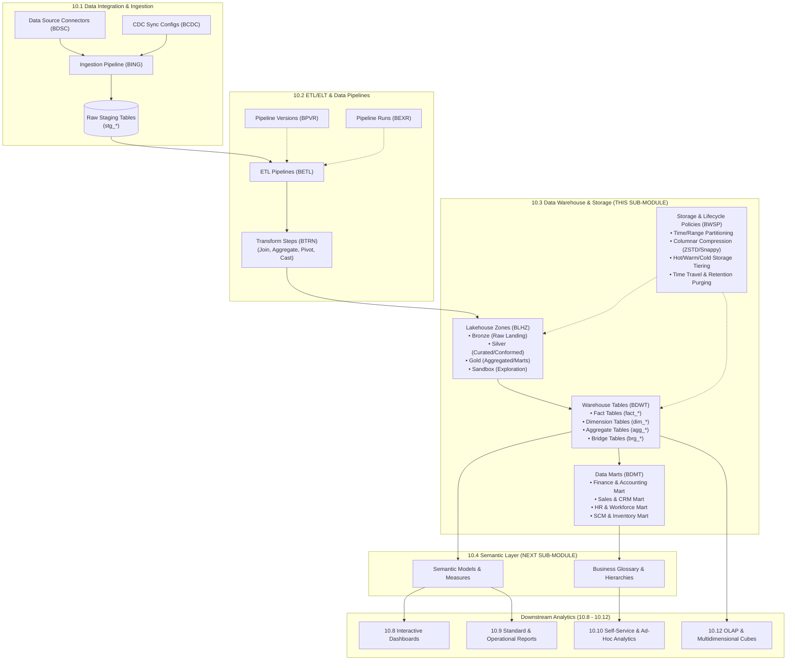

# Research — Sub-module 10.3: Data Warehouse & Storage (Module 10 — Business Intelligence, `bi`)

- **Sub-module:** 10.3 Data Warehouse & Storage
- **Module:** 10 Business Intelligence
- **Target app:** `apps/bi` (scaffolded in 10.1, extended in 10.2; extending with 10.3 package structure)
- **Research date:** 2026-11-04
- **Phase:** Phase 1 Research Catalog
- **Output file:** `.claude/tasks/research-bi-10.3.md`

---

## 1. Executive Summary & Domain Architecture

Sub-module 10.3 builds the **centralized analytical storage, dimensional data warehouse, data lakehouse tiering, and lifecycle retention architecture** for NavERP (`apps/bi`). 

In the modern enterprise data stack:
- **Sub-module 10.1 (Data Integration & Ingestion)** extracts raw records from operational ERP modules, relational databases, external APIs, and files, landing them into staging buffers (`stg_*`).
- **Sub-module 10.2 (ETL/ELT & Data Pipelines)** applies multi-step transformations (relational joins, grouped aggregations, matrix pivots, type sanitization, and business rule enrichments) and orchestrates execution DAGs with versioning and promotion.
- **Sub-module 10.3 (Data Warehouse & Storage — THIS SUB-MODULE)** provides the persistent, highly optimized analytical target:
  1. **Consolidated Data Warehouse:** Star and Snowflake dimensional schemas (`fact_*`, `dim_*`, `agg_*`, `brg_*`) designed for cross-module analytical queries.
  2. **Departmental Data Marts:** Subject-specific analytical domains (Finance, Sales, Human Resources, Supply Chain, Procurement, Executive) enabling isolated self-service business intelligence.
  3. **Lakehouse Architecture & Medallion Zones:** Logical and physical tiering across Bronze (Raw/Ingestion), Silver (Curated/Conformed), Gold (Aggregated/Business-Ready), and Sandbox (Ad-hoc Exploration) zones.
  4. **Partitioning & Columnar Optimization:** Range, time, and list partitioning strategies with columnar compression encoding (ZSTD, Snappy, LZ4, Gzip) and min/max zone map pruning metadata.
  5. **Storage Lifecycle & Archival:** Automated tiering (Hot NVMe/SSD, Warm standard storage, Cold object archive), time-travel historical snapshot retention windows, partition expiration, and policy-driven data purging.
- **Sub-module 10.4 (Data Modeling & Semantic Layer — NEXT)** sits immediately downstream, defining abstract business vocabularies, user-friendly metric calculations, drill hierarchies, and virtual reporting datasets on top of 10.3 warehouse tables and data marts.

### Architectural Boundaries & End-to-End Data Flow



### Architectural Principles & Boundary Guarantees

1. **Separation from 10.1 Ingestion**: 10.1 owns *source extraction and inbound staging* (`DataSourceConnector`, `IngestionPipeline`, `CdcSyncConfig`, `IngestionRun`). 10.3 does not extract external source data; it defines the analytical destinations and lakehouse zones where ingested and transformed data reside.
2. **Separation from 10.2 Transformation**: 10.2 owns *workflow orchestration and execution engines* (`EtlPipeline`, `TransformationStep`, `EtlPipelineRun`). 10.3 owns the *storage target topology, schemas, and lifecycle rules* (`DataMart`, `LakehouseZone`, `WarehouseTable`, `WarehouseStoragePolicy`). 10.2 pipelines write into 10.3 warehouse tables.
3. **Separation from 10.4 Semantic Layer**: 10.3 defines the *physical and logical analytical tables* (facts, dimensions, storage zones, partitions, compression, retention). 10.4 defines the *business abstraction layer* (friendly metric names, reusable calculated measures like `Gross Profit Margin %`, drill-down hierarchies, and governed virtual datasets).
4. **Separation from 10.5 Data Quality & Cleansing**: 10.3 enforces table schema constraints, data types, and surrogate key integrity. 10.5 owns advanced automated profiling statistics, cross-table duplicate entity resolution, fuzzy matching, and data steward exception queues.
5. **Separation from 10.7 Data Catalog & Lineage**: 10.3 stores table and mart metadata, storage footprints, and retention configs. 10.7 indexes all assets across the enterprise into a searchable catalog with global discovery tags, sensitivity labels (GDPR/HIPAA/SOX), and end-to-end column-level visual lineage graphs.
6. **Separation from 0.8 Compliance & 0.16 Disaster Recovery**:
   - `0.8 RetentionPolicy` (`apps/core/models/Retention.py`) governs *legal, GDPR, and regulatory compliance schedules* across operational database models.
   - `0.16 DataArchive` (`apps/core/models/Backup.py`) is an *operational database backup catalog* recording where physical disaster-recovery database dumps are archived.
   - `10.3 WarehouseStoragePolicy` (`apps/bi`) governs *analytical lakehouse/warehouse hot/warm/cold lifecycle tiering, time-travel snapshot retention, columnar compression codecs, and partition expiration*.

---

## 2. Repo State Checked First

### 2.1 Navigation & App Tree State
- **`apps/core/navigation.py`:** Inspected `LIVE_LINKS`. Sub-modules `10.1` and `10.2` are fully live:
  - `"10.1"`: Source Connectors, Batch & Real-Time Ingestion, Change Data Capture (CDC), API & Webhook Gateway, File & Cloud Storage Imports, Data Integration Hub, Ingestion Runs.
  - `"10.2"`: Visual Pipeline Builder, Transformation Library, Orchestration & Scheduling, Pipeline Monitoring & Logging, Version Control & CI/CD, ETL Pipelines, Transformation Steps, Pipeline Versions, Execution Runs.
  - **`10.3` is the next target sub-module in Module 10.**
- **`apps/bi/`:** Scaffolded with standard package layout:
  - `apps/bi/models/DataIntegration/` (10.1 models: `DataSourceConnectors.py`, `IngestionPipelines.py`, `CdcSyncConfigs.py`, `IngestionRuns.py`)
  - `apps/bi/models/EtlPipelines/` (10.2 models: `EtlPipelines.py`, `TransformationSteps.py`, `EtlPipelineVersions.py`, `EtlPipelineRuns.py`)
  - `apps/bi/models/_base.py` (Tenant isolation base classes: `TenantOwned`, `TenantNumbered` with `next_number()` sequence allocation)
  - `templates/bi/` (organized by sub-module slices)

### 2.2 As-Built Core Spine Entities (Grep Verified)
Every spine entity mapped in this research was verified directly against the repository codebase:

| Entity | Location | Verified Status | 10.3 Relationship |
|---|---|---|---|
| `core.Tenant` | `apps/core/models/Tenant.py:17` | **Present** | Strict tenant isolation boundary across all Data Marts, Lakehouse Zones, Warehouse Tables, and Storage Policies |
| `core.OrgUnit` | `apps/core/models/OrgUnit.py:5` | **Present** | Departmental organizational unit owner for subject-specific Data Marts (Finance, Sales, HR, SCM, etc.) |
| `core.DataArchive` | `apps/core/models/Backup.py:273` | **Present** | Operational backup catalog; separated from analytical storage tiering |
| `core.RetentionPolicy` | `apps/core/models/Retention.py:22` | **Present** | Legal/statutory GDPR data retention schedule; separated from analytical storage lifecycle |
| `bi.EtlPipeline` | `apps/bi/models/EtlPipelines/EtlPipelines.py:5` | **Present** | Upstream transformation pipeline feeding into warehouse tables |
| `settings.AUTH_USER_MODEL` | Django Core / `apps/core` | **Present** | Mart owner, data steward, and policy creator reference |

### 2.3 Prefix Collision Verification
An exhaustive scan of `NUMBER_PREFIX` was conducted across all existing apps in `apps/`:
- `apps/bi/` currently uses: `BDSC` (Connector), `BING` (Pipeline), `BCDC` (CDC), `BIJR` (Ingestion Run), `BETL` (ETL Pipeline), `BTRN` (Transform Step), `BPVR` (Pipeline Version), `BEXR` (Execution Run).
- Scanned all candidate prefixes for 10.3 across the entire repository (`git grep`):
  - ✅ **`BDMT`** (`DataMart`) — **100% Free** (zero codebase occurrences).
  - ✅ **`BLHZ`** (`LakehouseZone`) — **100% Free** (zero codebase occurrences).
  - ✅ **`BDWT`** (`WarehouseTable`) — **100% Free** (zero codebase occurrences).
  - ✅ **`BWSP`** (`WarehouseStoragePolicy`) — **100% Free** (zero codebase occurrences).
- Additional verified free candidate prefixes: `BSTP`, `BMRT`, `BZON`, `BTBL`.

---

## 3. Commercial Market Leaders Surveyed

We analyzed 10 leading commercial platforms across cloud data warehousing, data lakehouses, open table formats, columnar analytics databases, and in-warehouse transformation frameworks:

### 1. Snowflake (Cloud Data Warehouse & Lakehouse Platform)
- **Key Architecture:** Multi-cluster shared data architecture with complete separation of storage, compute (Virtual Warehouses), and cloud services. Organizes tables into **micro-partitions** (contiguous storage units of 50 MB to 500 MB of immutable columnar data with automatic min/max metadata pruning).
- **Storage Lifecycle & Continuous Data Protection (CDP):**
  - **Time Travel:** Enables point-in-time historical querying, cloning, and `UNDROP` operations from 0 up to 90 days (`DATA_RETENTION_TIME_IN_DAYS`).
  - **Fail-safe:** Non-configurable 7-day disaster recovery period following Time Travel expiration, managed by system support.
  - **Transient & Temporary Tables:** Exclude Fail-safe and limit Time Travel (0–1 days) to drastically minimize storage costs for intermediate ETL staging.
  - **Apache Iceberg Tables:** Support for open Iceberg table format on external cloud object storage (S3, GCS, Azure) with metadata catalog management.
- **Sources:** [Snowflake Micro-partitioning](https://docs.snowflake.com/en/user-guide/tables-clustering-micropartitions) · [Snowflake Time Travel & Fail-safe](https://docs.snowflake.com/en/user-guide/data-cdp) · [Snowflake Iceberg Tables](https://docs.snowflake.com/en/user-guide/tables-iceberg)

### 2. Databricks Lakehouse Platform (Delta Lake & Medallion Architecture)
- **Key Architecture:** Unifies data warehousing, data engineering, and data science on top of Delta Lake (open ACID table format using Parquet + JSON transaction log). Pioneered the **Medallion Architecture**:
  - **Bronze Layer (Raw):** Append-only, immutable landing zone preserving source schemas for historical lineage and replay.
  - **Silver Layer (Curated/Conformed):** Cleaned, deduplicated, standardized master entities and conformed dimensions.
  - **Gold Layer (Aggregated/Business-Ready):** Star/snowflake schemas and curated data marts optimized for executive BI and ad-hoc analytics.
- **Storage Optimization & Retention:**
  - **Liquid Clustering:** Replaces rigid physical directory partitioning and `ZORDER` with flexible disk clustering keys, handling skew without data rewrites.
  - **Time Travel & Retention:** Delta transaction log retention (`delta.logRetentionDuration`, default 30 days) and obsolete file retention (`delta.deletedFileRetentionPeriod`, default 7 days) cleaned via `VACUUM`.
  - **Predictive Optimization:** Automated maintenance routines in Unity Catalog that run clustering and vacuuming based on query patterns.
- **Sources:** [Databricks Medallion Architecture](https://www.databricks.com/glossary/medallion-architecture) · [Databricks Liquid Clustering](https://docs.databricks.com/en/delta/clustering.html) · [Delta Lake Time Travel & Vacuum](https://docs.databricks.com/en/delta/history.html)

### 3. Google Cloud BigQuery (Serverless Cloud Data Warehouse & BigLake)
- **Key Architecture:** Fully serverless enterprise data warehouse with separate Borg compute slots and Colossus/Capacitor columnar storage. Supports open formats via BigLake.
- **Partitioning & Clustering:**
  - **Table Partitioning:** Ingestion-time, date/timestamp (`HOUR`, `DAY`, `MONTH`, `YEAR`), or integer range partitioning; queries utilize partition pruning to skip unneeded data blocks.
  - **Table Clustering:** Sorts data within partitions across up to 4 high-cardinality columns (e.g., `customer_id`, `department_code`) for fine-grained block pruning.
- **Storage Lifecycle & Automatic Tiering:**
  - **Active Storage:** Billed at standard rates for data modified within the last 90 consecutive days.
  - **Long-Term Storage (Cold Tier):** Automatically transitions tables or individual partitions unmodified for 90 days to long-term storage with an automatic **50% price reduction** with identical query performance and zero latency penalty.
  - **Partition Expiration:** `partition_expiration_days` automatically purges expired historical partitions.
- **Sources:** [BigQuery Partitioned Tables](https://cloud.google.com/bigquery/docs/partitioned-tables) · [BigQuery Clustered Tables](https://cloud.google.com/bigquery/docs/clustered-tables) · [BigQuery Storage Billing Tiers](https://cloud.google.com/bigquery/pricing#storage)

### 4. Amazon Redshift (Petabyte-Scale Cloud Data Warehouse & Lakehouse)
- **Key Architecture:** Columnar, massively parallel processing (MPP) architecture available as provisioned clusters (RA3 nodes with Redshift Managed Storage) or Redshift Serverless.
- **Data Distribution & Sorting:**
  - **Distribution Styles (`DISTSTYLE`):** `KEY` (colocates matching hash keys on slices to avoid join shuffling), `EVEN` (round-robin across slices), `ALL` (full replica on every node for small dimensions), and `AUTO` (adaptive engine choice).
  - **Sort Keys (`SORTKEY`):** Compound and interleaved sort keys determining physical disk ordering, driving zone map block skipping.
- **Columnar Compression & Storage Tiering:**
  - **Compression Encodings:** Column-level encodings including `ZSTD` (Zstandard), `AZ64`, `LZO`, and `BYTEDICT`.
  - **Redshift Managed Storage (RMS):** Tier-1 high-speed local NVMe SSD cache coupled with automated petabyte-scale tier-2 S3 backing storage.
- **Sources:** [Amazon Redshift Distribution Styles](https://docs.aws.amazon.com/redshift/latest/dg/c_choosing_dist_sort.html) · [Redshift Compression Encodings](https://docs.aws.amazon.com/redshift/latest/dg/c_Compression_encodings.html) · [Redshift Managed Storage](https://docs.aws.amazon.com/redshift/latest/mgmt/managing-cluster-rms.html)

### 5. Microsoft Fabric (OneLake & Synapse Data Warehouse)
- **Key Architecture:** Unified SaaS analytics lakehouse environment built on **OneLake** (the "OneDrive for Data"). Eliminates data silos through virtual shortcuts across Azure ADLS Gen2, AWS S3, and Google Cloud Storage.
- **Storage & Workloads:**
  - **Universal Storage Format:** Native Delta-Parquet format across all lakehouses and warehouses with proprietary **V-Order compression** for ultra-fast Power BI Direct Lake querying.
  - **Medallion Pattern:** Native workspace folders organized into Bronze (Raw Files/Tables), Silver (Cleansed/Standardized Delta), and Gold (Dimensional Star Schemas).
  - **Lakehouse vs. Synapse Warehouse:** Lakehouse provides Spark/SQL dual endpoints; Synapse Data Warehouse provides enterprise ACID relational T-SQL with full transactional semantics.
  - **Power BI Datamarts:** Subject-specific analytical marts providing self-service modeling, relationships, and row-level security.
- **Sources:** [Microsoft Fabric OneLake Overview](https://learn.microsoft.com/en-us/fabric/onelake/onelake-overview) · [Fabric Lakehouse vs Data Warehouse](https://learn.microsoft.com/en-us/fabric/data-warehouse/lakehouse-or-warehouse) · [Power BI Datamarts](https://learn.microsoft.com/en-us/power-bi/transform-model/datamarts/datamarts-overview)

### 6. ClickHouse (High-Performance Columnar Analytical DBMS)
- **Key Architecture:** Vectorized columnar database engine renowned for blistering query throughput over billions of rows using the **MergeTree** engine family (`MergeTree`, `ReplacingMergeTree`, `AggregatingMergeTree`, `SummingMergeTree`).
- **Partitioning & Indexing:**
  - `PARTITION BY` expressions (e.g., `toYYYYMM(event_date)`) producing discrete physical data parts.
  - Sparse primary indexes (`ORDER BY`) coupled with column-level min/max index granules.
- **Tiered Storage & Automated TTL:**
  - **Storage Policies:** Multi-volume definitions combining `hot` (NVMe SSD), `warm` (HDD), and `cold` (S3/GCS object storage) volumes with automatic disk migration based on `move_factor`.
  - **TTL (Time-To-Live) Expressions:** Declarative table and column rules (e.g., `TTL event_date + INTERVAL 30 DAY TO VOLUME 'cold', event_date + INTERVAL 1 YEAR DELETE`) for automated background tier transitions and data purging.
- **Sources:** [ClickHouse MergeTree Engine](https://clickhouse.com/docs/en/engines/table-engines/mergetree-family/mergetree) · [ClickHouse Tiered Storage](https://clickhouse.com/docs/en/guides/developer/tiered-storage) · [ClickHouse Table & Column TTL](https://clickhouse.com/docs/en/engines/table-engines/mergetree-family/mergetree#table_engine-mergetree-ttl)

### 7. Apache Iceberg (High-Performance Open Table Format)
- **Key Architecture:** Open table specification designed for petabyte-scale analytic datasets, decoupling table logic from compute engines (Spark, Trino, Flink, DuckDB, Snowflake).
- **Core Breakthroughs:**
  - **Hidden Partitioning:** Users query natural business columns (`WHERE event_time >= ...`) without needing to know physical partition columns (`date=...`); Iceberg automatically applies partition transform functions (`days()`, `months()`, `bucket()`, `truncate()`).
  - **Partition Evolution:** Partition layouts can be altered as metadata-only operations without rewriting petabytes of historical data.
  - **Schema Evolution:** Columns are tracked by immutable unique IDs (not column names or positions), allowing safe additions, renames, drops, and reorders.
  - **Snapshot Retention & Time Travel:** Every commit writes an immutable snapshot metadata file; old snapshots are expired via garbage collection routines (`expire_snapshots`) to reclaim storage.
- **Sources:** [Apache Iceberg Table Specification](https://iceberg.apache.org/spec/) · [Iceberg Partitioning & Evolution](https://iceberg.apache.org/docs/latest/partitioning/) · [Iceberg Maintenance & Snapshots](https://iceberg.apache.org/docs/latest/maintenance/)

### 8. dbt Labs (dbt Core / dbt Cloud)
- **Key Architecture:** Industry standard for in-warehouse dimensional modeling and transformation (`T` in ELT).
- **Dimensional Modeling & Marts Structure:**
  - Standardized directory layout: `models/marts/<department>/` (e.g., `marts/finance/`, `marts/marketing/`, `marts/core/`).
  - Strict conventions for dimensional models: Dimension tables prefixed with `dim_*` (wide descriptive attributes, unique surrogate keys) and Fact tables prefixed with `fact_*` (narrow numeric measurements, foreign keys).
  - Materialization strategies: `table`, `view`, `incremental` (using `merge`, `append`, `delete+insert`, or `microbatch`), and `ephemeral`.
  - Model contracts (`contract: {enforced: true}`) enforcing column types and constraints before materialization.
- **Sources:** [dbt Dimensional Modeling Guide](https://docs.getdbt.com/terms/star-schema) · [dbt Materializations](https://docs.getdbt.com/docs/build/materializations) · [dbt Model Contracts](https://docs.getdbt.com/docs/collaborate/govern/model-contracts)

### 9. DuckDB / MotherDuck (Columnar Vectorized Embedded Data Warehouse)
- **Key Architecture:** Lightweight, in-process columnar analytical SQL engine operating directly over relational tables and Parquet/Iceberg files without server infrastructure.
- **Storage & Execution:**
  - Vectorized execution engine processing morsels of columnar data with SIMD vectorization.
  - Direct Parquet querying with automatic partition pruning over Hive directory layouts (`year=*/month=*`).
  - Zone maps (min-max column statistics stored in Parquet row groups) enabling aggressive I/O skipping.
  - Flexible columnar compression codecs: Snappy (fast decompression), ZSTD (high compression ratio), FSST (fast string compression).
- **Sources:** [DuckDB Partitioning & Hive Layouts](https://duckdb.org/docs/data/partitioning/hive_partitioning) · [DuckDB Parquet Storage](https://duckdb.org/docs/data/parquet/overview)

### 10. Apache Doris / StarRocks (MPP Real-Time Analytics Databases)
- **Key Architecture:** Modern next-generation MPP analytical databases designed for sub-second multidimensional analytics.
- **Data Modeling & Storage:**
  - Data Models: **Aggregate Key** (pre-computes `SUM`/`MIN`/`MAX` rollups), **Unique Key** (upsert/replace semantics on primary key), and **Duplicate Key** (append-only facts).
  - Dynamic Partitioning: Automatically creates new daily/monthly partitions and purges historical partitions past the TTL window.
  - Multi-tier Storage: Dynamic storage policies routing hot data to high-speed SSDs and cooling data to remote S3/HDFS after configured intervals.
- **Sources:** [Apache Doris Table Design & Models](https://doris.apache.org/docs/table-design/data-model/overview/) · [StarRocks Dynamic Partitioning & Tiered Storage](https://docs.starrocks.io/docs/table_design/dynamic_partitioning/)

---

### Commercial Capability Matrix

| Capability / Dimension | Snowflake | Databricks Lakehouse | Google BigQuery | AWS Redshift | ClickHouse | Apache Iceberg | dbt Labs | Microsoft Fabric | **NavERP Sub-module 10.3** |
|---|---|---|---|---|---|---|---|---|---|
| **Dimensional Star/Snowflake Tables** | Native (Facts/Dims) | Gold Tables | Native (Facts/Dims) | Native (Facts/Dims) | MergeTree Tables | Native | `fact_*` / `dim_*` Marts | Gold Delta Tables | **`WarehouseTable` (Fact, Dim, Bridge, Agg)** |
| **Departmental Data Marts** | Schemas/Databases | Unity Catalog Catalogs | Datasets | Databases/Schemas | Databases | Catalogs/Namespaces | `marts/<dept>/` | Power BI Datamarts | **`DataMart` (Finance, Sales, HR, SCM, etc.)** |
| **Lakehouse Multi-Zone Tiering** | Internal/External/Iceberg | Medallion (Bronze/Silver/Gold) | BigLake/Object Tables | Redshift Spectrum / S3 | Storage Volumes | Open Table Format | Staging/Intermediate/Marts | OneLake (Bronze/Silver/Gold) | **`LakehouseZone` (Bronze, Silver, Gold, Sandbox)** |
| **Table Partitioning Strategies** | Micro-partitioning | Liquid Clustering / Hive | Ingestion / Time / Integer Range | Auto / Key / Even Slices | `PARTITION BY` Expressions | Hidden Partitioning | Config `partition_by` | Delta Partitioning | **`WarehouseStoragePolicy` (Time/Range/List/Hash)** |
| **Columnar Compression** | Proprietary Columnar | Parquet (Snappy/ZSTD) | Capacitor Columnar | ZSTD / AZ64 / LZO | LZ4 / ZSTD Columnar | Parquet / ORC (Snappy/ZSTD) | In-warehouse pushdown | V-Order Delta-Parquet | **`WarehouseStoragePolicy` (ZSTD, Snappy, LZ4, Gzip)** |
| **Storage Lifecycle & Tiering** | Hot / Time Travel / Fail-safe | Hot / Cold Object / Vacuum | Active (90d) $\rightarrow$ Cold (-50%) | RMS (NVMe SSD $\rightarrow$ S3) | Hot SSD $\rightarrow$ Cold S3 (TTL) | Snapshot GC (`expire_snapshots`) | Incremental Strategies | OneLake Fabric Tiering | **`WarehouseStoragePolicy` (Hot/Warm/Cold Tiering)** |
| **Time-Travel Snapshot Retention** | 0–90 Days CDP | 30d Log / 7d Data | 2–7 Days Time Travel | Automated Snapshots | TTL Part Dropping | Snapshot IDs & Timestamps | Snapshots (`scd2`) | Delta Time Travel | **`WarehouseStoragePolicy` (Time Travel Days, Purge)** |

---

## 4. Feature Catalog

### 4.1 NavERP.md Bullet 1: Centralized Data Warehouse
*Consolidated star/snowflake schemas optimized for cross-module analytical querying.*

| Feature ID | Feature Name | Description | Priority | Spine Entity Mapping | Build Scope |
|---|---|---|---|---|---|
| **10.3-DW-01** | **Fact & Dimension Table Typing** | Explicit classification of analytical tables: Fact (`fact_*`), Dimension (`dim_*`), Bridge (`brg_*`), Aggregate (`agg_*`), and Staging (`stg_*`). | **Table-Stakes** | `bi.WarehouseTable` | **Buildable (This Pass)** |
| **10.3-DW-02** | **Schema Architecture Support** | Support for Star Schema (denormalized dimensions directly referenced by central facts) and Snowflake Schema (normalized sub-dimensions). | **Table-Stakes** | `bi.WarehouseTable` | **Buildable (This Pass)** |
| **10.3-DW-03** | **Analytical Table Grain Definition** | Explicit declaration of the table's grain (e.g., Transactional, Daily Snapshot, Monthly Snapshot, Accumulating Snapshot). | **Table-Stakes** | `bi.WarehouseTable` | **Buildable (This Pass)** |
| **10.3-DW-04** | **Surrogate & Natural Key Tracking** | Registration of primary surrogate keys (`id` / `*_sk`), natural business keys (`*_nk`), and foreign dimension references. | **Common** | `bi.WarehouseTable` | **Buildable (This Pass)** |
| **10.3-DW-05** | **Conformed Dimensions Tagging** | Flagging shared cross-module dimensions (`dim_date`, `dim_tenant`, `dim_orgunit`, `dim_party`, `dim_item`, `dim_currency`) used across multiple marts. | **Common** | `bi.WarehouseTable` | **Buildable (This Pass)** |
| **10.3-DW-06** | **Table Storage Footprint Telemetry** | Recording active row counts, uncompressed byte size, compressed storage footprint, and calculated compression ratios. | **Common** | `bi.WarehouseTable` | **Buildable (This Pass)** |
| **10.3-DW-07** | **DDL & Migration Definition Generator** | Auto-generating relational PostgreSQL/SQLite SQL DDL scripts and analytical view definitions from table metadata. | **Differentiator** | `bi.WarehouseTable` | **Buildable (This Pass)** |

### 4.2 NavERP.md Bullet 2: Data Marts
*Subject-specific marts (finance, sales, HR, inventory) for departmental self-service.*

| Feature ID | Feature Name | Description | Priority | Spine Entity Mapping | Build Scope |
|---|---|---|---|---|---|
| **10.3-DM-01** | **Subject-Area Categorization** | Classification of data marts by business subject area: Finance & Accounting, Sales & CRM, Human Resources, Supply Chain & Inventory, Procurement, Executive/Corporate. | **Table-Stakes** | `bi.DataMart` | **Buildable (This Pass)** |
| **10.3-DM-02** | **Departmental OrgUnit Binding** | Association of each data mart with an organizational business unit (`core.OrgUnit`) for administrative and domain governance. | **Table-Stakes** | `core.OrgUnit`, `bi.DataMart` | **Buildable (This Pass)** |
| **10.3-DM-03** | **Mart Ownership & Stewardship** | Designating primary business owner and technical data steward (`AUTH_USER_MODEL`) responsible for mart SLA and data validity. | **Common** | `settings.AUTH_USER_MODEL`, `bi.DataMart` | **Buildable (This Pass)** |
| **10.3-DM-04** | **Data Mart Access Tiering** | Enforcing accessibility tiers: Public (tenant-wide), Departmental (only OrgUnit members), and Restricted/Confidential (explicit executive permissions). | **Common** | `bi.DataMart` | **Buildable (This Pass)** |
| **10.3-DM-05** | **Certification & Trust State** | Trust indicators signaling data maturity to BI analysts: Draft, In Review, Certified (governed single source of truth), and Deprecated. | **Differentiator** | `bi.DataMart` | **Buildable (This Pass)** |
| **10.3-DM-06** | **Refresh Cadence Specification** | Stated refresh SLA: Streaming/Real-time, Hourly, Daily (Overnight Batch), Weekly, or On-Demand. | **Common** | `bi.DataMart` | **Buildable (This Pass)** |

### 4.3 NavERP.md Bullet 3: Data Lake & Lakehouse
*Raw, curated, and aggregated zones for structured and unstructured data.*

| Feature ID | Feature Name | Description | Priority | Spine Entity Mapping | Build Scope |
|---|---|---|---|---|---|
| **10.3-LH-01** | **Medallion Zone Classification** | Standardized lakehouse zone tiers: Bronze (Raw Ingestion / Append-only), Silver (Curated / Conformed / Enriched), Gold (Aggregated / Dimensional Marts), and Sandbox (Ad-hoc Exploration). | **Table-Stakes** | `bi.LakehouseZone` | **Buildable (This Pass)** |
| **10.3-LH-02** | **Storage Backend Provider Configuration** | Definition of underlying storage backend: Internal Relational DB (PostgreSQL/MySQL), Cloud Object Store (AWS S3, Azure Blob, Google Cloud Storage), or Local Shared Storage. | **Table-Stakes** | `bi.LakehouseZone` | **Buildable (This Pass)** |
| **10.3-LH-03** | **Storage Format Specification** | Default file/table serialization format: Relational Database Table/View, Apache Parquet, Delta Lake, Apache Iceberg, or Compressed CSV/JSONL. | **Common** | `bi.LakehouseZone` | **Buildable (This Pass)** |
| **10.3-LH-04** | **URI Base Path & Bucket Pathing** | Base URI endpoint or storage bucket prefix path for physical file landing and external partition resolution. | **Common** | `bi.LakehouseZone` | **Buildable (This Pass)** |
| **10.3-LH-05** | **Zone Immutability & Read-Only Locks** | Administrative guard preventing unauthorized DDL or modifications to raw Bronze landing zones. | **Differentiator** | `bi.LakehouseZone` | **Buildable (This Pass)** |

### 4.4 NavERP.md Bullet 4: Partitioning & Compression
*Time/range partitioning, columnar storage, and compression for query performance.*

| Feature ID | Feature Name | Description | Priority | Spine Entity Mapping | Build Scope |
|---|---|---|---|---|---|
| **10.3-PC-01** | **Partitioning Strategy Configuration** | Definition of partition strategy: None (flat table), Range/Time (date/timestamp), Numeric Range (integer buckets), Hash/Bucketed (even slicing), or List/Categorical (regions/branches). | **Table-Stakes** | `bi.WarehouseStoragePolicy` | **Buildable (This Pass)** |
| **10.3-PC-02** | **Time Partition Granularity** | Specification of time partitioning windows: Year, Quarter, Month, Day, or Hour. | **Table-Stakes** | `bi.WarehouseStoragePolicy` | **Buildable (This Pass)** |
| **10.3-PC-03** | **Columnar Compression Codec Selection** | Configuration of column compression encodings: None, Snappy (fastest decompression), ZSTD (balanced high ratio), LZ4 (ultra-low latency), or Gzip (maximum compression). | **Table-Stakes** | `bi.WarehouseStoragePolicy` | **Buildable (This Pass)** |
| **10.3-PC-04** | **Zone Map / Min-Max Statistics Pruning** | Enabling column-level min-max metadata tracking to accelerate query execution via automated block skipping. | **Common** | `bi.WarehouseStoragePolicy` | **Buildable (This Pass)** |
| **10.3-PC-05** | **Clustering / Secondary Sort Keys** | Definition of secondary sorting columns within partitions to optimize range scans and join co-location. | **Differentiator** | `bi.WarehouseStoragePolicy` | **Buildable (This Pass)** |

### 4.5 NavERP.md Bullet 5: Archival & Retention
*Hot/warm/cold tiering, historical snapshots, and policy-based purging.*

| Feature ID | Feature Name | Description | Priority | Spine Entity Mapping | Build Scope |
|---|---|---|---|---|---|
| **10.3-AR-01** | **Multi-Tier Storage Thresholds** | Configurable age thresholds (in days) defining when analytical data transitions from Hot (SSD/high-performance) to Warm (standard storage) to Cold (deep archive object store). | **Table-Stakes** | `bi.WarehouseStoragePolicy` | **Buildable (This Pass)** |
| **10.3-AR-02** | **Time-Travel Snapshot Retention Window** | Number of days (e.g., 7, 30, 90 days) historical transaction snapshots are preserved for point-in-time auditing and rollback. | **Common** | `bi.WarehouseStoragePolicy` | **Buildable (This Pass)** |
| **10.3-AR-03** | **Automated Partition Expiration & Purging** | Policy-driven rule for dropping partitions older than total retention days, with hard purge or soft tombstoning options. | **Table-Stakes** | `bi.WarehouseStoragePolicy` | **Buildable (This Pass)** |
| **10.3-AR-04** | **Snapshot Vacuum & Compaction Frequency** | Scheduled frequency (e.g., daily, weekly) for running Delta/Iceberg vacuum routines to permanently reclaim orphaned data files. | **Common** | `bi.WarehouseStoragePolicy` | **Buildable (This Pass)** |
| **10.3-AR-05** | **Archival Execution Audit & Last Run Tracking** | Tracking execution timestamps, rows archived, bytes reclaimed, and status of recent policy enforcement runs. | **Common** | `bi.WarehouseStoragePolicy` | **Buildable (This Pass)** |

### 4.6 Beyond the Bullets: Modern Enterprise Differentiators
*Capabilities drawn from Snowflake, Databricks, BigQuery, and Microsoft Fabric that elevate NavERP above legacy ERP data warehouses.*

| Feature ID | Feature Name | Description | Priority | Spine Entity Mapping | Build Scope |
|---|---|---|---|---|---|
| **10.3-XB-01** | **Direct Lake & Virtual Mart Views** | Abstract virtual views that expose conformed dimensions joined across multiple data marts without physical duplicate data copying. | **Differentiator** | `bi.WarehouseTable`, `bi.DataMart` | **Buildable (This Pass)** |
| **10.3-XB-02** | **Automated Storage Cost & Footprint Calculator** | Estimated monthly storage cost computation based on compressed bytes, tier allocation (Hot vs Warm vs Cold), and tenant storage quotas. | **Differentiator** | `bi.WarehouseTable`, `bi.LakehouseZone` | **Buildable (This Pass)** |
| **10.3-XB-03** | **Table Schema Drift Warning** | Detection mechanism alerting administrators when upstream 10.2 ETL pipeline outputs drift in data type or column layout from 10.3 warehouse table schema. | **Differentiator** | `bi.WarehouseTable`, `bi.EtlPipeline` | **Buildable (This Pass)** |
| **10.3-XB-04** | **Data Warehouse Health & Storage Overview** | Consolidated operational dashboard summarizing total storage by lakehouse zone, largest fact tables, partition count, and data mart certification statuses. | **Differentiator** | `apps/bi/views/` (Dashboard Board) | **Buildable (This Pass)** |

---

## 5. Recommended Build Scope (This Pass)

To deliver a production-grade, highly cohesive sub-module that completely satisfies the 5 NavERP.md bullets while strictly adhering to the **1–4 model sequence rule**, we recommend **exactly 4 tenant-scoped models** organized under `apps/bi/models/DataWarehouse/`:

```
apps/bi/models/DataWarehouse/
├── __init__.py
├── DataMarts.py
├── LakehouseZones.py
├── WarehouseTables.py
└── WarehouseStoragePolicies.py
```

### 5.1 Model 1: `DataMart` (Subject-Specific Departmental Data Marts)
- **Class:** `DataMart(TenantNumbered)`
- **Number Prefix:** `BDMT` (Verified 100% free)
- **Purpose:** Represents subject-specific analytical data marts (Finance, Sales, HR, Inventory, Procurement, Executive) enabling departmental self-service.
- **Key Fields:**
  - `tenant`: `ForeignKey("core.Tenant", on_delete=CASCADE)`
  - `number`: `CharField(max_length=20, editable=False)` (`BDMT-00001`)
  - `name`: `CharField(max_length=150)` (e.g. `"Finance & Accounting Mart"`, `"Sales & CRM Mart"`)
  - `code`: `SlugField(max_length=50)` (e.g. `"finance"`, `"sales"`, `"hr"`, `"supply_chain"`)
  - `subject_area`: `CharField(max_length=30, choices=SUBJECT_AREA_CHOICES)`:
    - `finance` — Finance & Accounting (GL, AR, AP, Cash)
    - `sales` — Sales & Customer Relationship (CRM, Pipeline, Orders)
    - `hr` — Human Resources & Workforce (Payroll, Attendance, Talent)
    - `supply_chain` — Supply Chain & Logistics (Warehousing, Movements, Fulfillment)
    - `procurement` — Procurement & Purchasing (Vendors, POs, Receptions)
    - `manufacturing` — Manufacturing & Production (BOMs, Work Orders)
    - `executive` — Executive & Cross-Functional (C-Suite KPIs, Corporate Strategy)
  - `org_unit`: `ForeignKey("core.OrgUnit", on_delete=SET_NULL, null=True, blank=True)` (Departmental ownership binding)
  - `owner`: `ForeignKey(settings.AUTH_USER_MODEL, on_delete=SET_NULL, null=True, blank=True)` (Business owner)
  - `steward`: `ForeignKey(settings.AUTH_USER_MODEL, on_delete=SET_NULL, null=True, blank=True, related_name="stewarded_marts")` (Data steward)
  - `access_tier`: `CharField(max_length=25, choices=ACCESS_TIER_CHOICES, default="department")`:
    - `public` — Public (accessible across all tenant departments)
    - `department` — Departmental Only (restricted to owning OrgUnit members)
    - `restricted` — Restricted / Confidential (requires explicit elevated grant)
  - `certification_status`: `CharField(max_length=25, choices=CERTIFICATION_CHOICES, default="draft")`:
    - `draft` — Draft / Under Construction
    - `in_review` — Under Review & Validation
    - `certified` — Certified / Governed Single Source of Truth
    - `deprecated` — Deprecated / Sunset Pending
  - `refresh_cadence`: `CharField(max_length=25, choices=REFRESH_CADENCE_CHOICES, default="daily")`:
    - `real_time` — Real-Time / Streaming
    - `hourly` — Hourly Micro-Batch
    - `daily` — Daily Overnight Batch
    - `weekly` — Weekly Snapshot
    - `on_demand` — On-Demand Only
  - `description`: `TextField(blank=True)`
  - `is_active`: `BooleanField(default=True)`
- **Relationships & Constraints:** Unique together `(tenant, code)`; indexes on `(tenant, subject_area)`, `(tenant, certification_status)`.

### 5.2 Model 2: `LakehouseZone` (Lakehouse Storage Zones & Medallion Architecture)
- **Class:** `LakehouseZone(TenantNumbered)`
- **Number Prefix:** `BLHZ` (Verified 100% free)
- **Purpose:** Organizes structured and unstructured analytical data across Medallion lakehouse tiers (Bronze, Silver, Gold, Sandbox).
- **Key Fields:**
  - `tenant`: `ForeignKey("core.Tenant", on_delete=CASCADE)`
  - `number`: `CharField(max_length=20, editable=False)` (`BLHZ-00001`)
  - `name`: `CharField(max_length=150)` (e.g. `"Curated Silver Zone"`, `"Enterprise Gold Analytics"`)
  - `code`: `SlugField(max_length=50)` (e.g. `"bronze"`, `"silver"`, `"gold"`, `"sandbox"`)
  - `zone_type`: `CharField(max_length=25, choices=ZONE_TYPE_CHOICES)`:
    - `bronze` — Bronze (Raw Ingestion / Append-Only Staging)
    - `silver` — Silver (Curated / Cleaned / Conformed Master Data)
    - `gold` — Gold (Aggregated / Dimensional Star Schemas / Business-Ready)
    - `sandbox` — Sandbox (Ad-Hoc Exploration / Data Science Workspaces)
  - `storage_backend`: `CharField(max_length=30, choices=STORAGE_BACKEND_CHOICES, default="internal_db")`:
    - `internal_db` — Internal Relational Database (PostgreSQL/MySQL/SQLite)
    - `aws_s3` — Amazon Web Services S3
    - `azure_blob` — Microsoft Azure Blob / ADLS Gen2
    - `gcs` — Google Cloud Storage
    - `local_filesystem` — Local Dedicated Shared Volume
  - `default_format`: `CharField(max_length=25, choices=FORMAT_CHOICES, default="relational_table")`:
    - `relational_table` — Relational Table / View
    - `parquet` — Apache Parquet Columnar File
    - `delta_lake` — Delta Lake (Delta-Parquet + Log)
    - `iceberg` — Apache Iceberg Table Format
    - `csv_compressed` — Compressed CSV / Gzip
  - `base_uri_path`: `CharField(max_length=500, blank=True)` (e.g., `"s3://nawerp-data/gold/"`, `"/var/data/silver/"`, `"schema_gold"`)
  - `is_read_only`: `BooleanField(default=False)` (Immutable protection for raw landing layers)
  - `description`: `TextField(blank=True)`
  - `is_active`: `BooleanField(default=True)`
- **Relationships & Constraints:** Unique together `(tenant, code)`; indexes on `(tenant, zone_type)`.

### 5.3 Model 3: `WarehouseStoragePolicy` (Partitioning, Compression & Lifecycle Retention)
- **Class:** `WarehouseStoragePolicy(TenantNumbered)`
- **Number Prefix:** `BWSP` (Verified 100% free)
- **Purpose:** Governs table partitioning strategies, columnar compression encodings, hot/warm/cold lifecycle transitions, and time-travel retention/purging.
- **Key Fields:**
  - `tenant`: `ForeignKey("core.Tenant", on_delete=CASCADE)`
  - `number`: `CharField(max_length=20, editable=False)` (`BWSP-00001`)
  - `name`: `CharField(max_length=150)` (e.g. `"Financial Transactions 7-Year Retention"`, `"High-Throughput Timeseries Policy"`)
  - `partition_strategy`: `CharField(max_length=30, choices=PARTITION_STRATEGY_CHOICES, default="range_time")`:
    - `none` — None (Unpartitioned Flat Table)
    - `range_time` — Range / Time-Based (Date/Timestamp)
    - `range_numeric` — Numeric Range (ID / Integer Buckets)
    - `hash` — Hash / Slices (Distributed Keys)
    - `list_category` — List / Categorical (Region, Country, Status)
  - `partition_key`: `CharField(max_length=100, blank=True)` (e.g. `"posting_date"`, `"created_at"`, `"fiscal_year"`)
  - `partition_granularity`: `CharField(max_length=25, choices=GRANULARITY_CHOICES, default="month")`:
    - `hour` — Hourly
    - `day` — Daily
    - `month` — Monthly
    - `quarter` — Quarterly
    - `year` — Yearly
  - `compression_codec`: `CharField(max_length=25, choices=COMPRESSION_CHOICES, default="zstd")`:
    - `none` — None (Uncompressed)
    - `snappy` — Snappy (Optimized for Fast Decompression)
    - `zstd` — Zstandard (ZSTD — Balanced High Compression & Speed)
    - `lz4` — LZ4 (Ultra-High Throughput)
    - `gzip` — Gzip (Maximum Compression Ratio)
  - `enable_zone_maps`: `BooleanField(default=True)` (Min-Max metadata statistics for block pruning)
  - `hot_tier_days`: `PositiveIntegerField(default=90)` (Days retained in high-performance hot storage)
  - `warm_tier_days`: `PositiveIntegerField(default=365)` (Days retained in standard warm storage before cooling)
  - `cold_tier_days`: `PositiveIntegerField(default=2555)` (Days retained in cold archive; 2555 days = 7 years statutory requirement)
  - `time_travel_days`: `PositiveIntegerField(default=7)` (Historical snapshot retention window for time-travel queries, 0–90 days)
  - `auto_purge_enabled`: `BooleanField(default=False)` (Whether data older than cold tier is automatically purged)
  - `vacuum_cadence`: `CharField(max_length=25, choices=VACUUM_CHOICES, default="weekly")`:
    - `daily` — Daily Vacuum / Maintenance
    - `weekly` — Weekly Vacuum / Compaction
    - `monthly` — Monthly Clean
    - `manual` — Manual Only
  - `is_default`: `BooleanField(default=False)`
  - `is_active`: `BooleanField(default=True)`
- **Relationships & Constraints:** Indexes on `(tenant, partition_strategy)`, `(tenant, is_default)`.

### 5.4 Model 4: `WarehouseTable` (Centralized Star/Snowflake Analytical Tables)
- **Class:** `WarehouseTable(TenantNumbered)`
- **Number Prefix:** `BDWT` (Verified 100% free)
- **Purpose:** Central entity representing Fact tables, Dimension tables, Aggregate tables, and Bridge tables across data marts and lakehouse zones.
- **Key Fields:**
  - `tenant`: `ForeignKey("core.Tenant", on_delete=CASCADE)`
  - `number`: `CharField(max_length=20, editable=False)` (`BDWT-00001`)
  - `name`: `CharField(max_length=150)` (e.g. `"Fact General Ledger Journal Entries"`, `"Dim Customer Profile"`)
  - `table_name`: `CharField(max_length=100)` (e.g. `"fact_journal_entries"`, `"dim_customers"`, `"agg_monthly_sales"`)
  - `table_type`: `CharField(max_length=25, choices=TABLE_TYPE_CHOICES, default="fact")`:
    - `fact` — Fact Table (Transactional / Snapshot Metrics)
    - `dimension` — Dimension Table (Contextual Attributes & Hierarchies)
    - `aggregate` — Aggregate Table (Pre-Calculated Summary Rollups)
    - `bridge` — Bridge Table (Many-to-Many Disambiguation)
    - `staging` — Staging / Transient Table (Intermediate Load Target)
  - `schema_type`: `CharField(max_length=25, choices=SCHEMA_TYPE_CHOICES, default="star")`:
    - `star` — Star Schema (Direct Fact-to-Dimension Joins)
    - `snowflake` — Snowflake Schema (Normalized Sub-Dimensions)
    - `flat` — Flat / Denormalized Wide Table
    - `medallion` — Medallion Delta Format
  - `grain`: `CharField(max_length=30, choices=GRAIN_CHOICES, default="transaction")`:
    - `transaction` — Transactional (One row per business event)
    - `daily_snapshot` — Daily Periodic Snapshot
    - `monthly_snapshot` — Monthly Periodic Snapshot
    - `accumulating_snapshot` — Accumulating Snapshot (Milestone-based)
    - `entity_state` — Entity State (Current dimension state)
  - `lakehouse_zone`: `ForeignKey("bi.LakehouseZone", on_delete=PROTECT, related_name="tables")`
  - `data_mart`: `ForeignKey("bi.DataMart", on_delete=SET_NULL, null=True, blank=True, related_name="tables")`
  - `storage_policy`: `ForeignKey("bi.WarehouseStoragePolicy", on_delete=SET_NULL, null=True, blank=True, related_name="tables")`
  - `primary_key_column`: `CharField(max_length=100, default="id")` (Surrogate key name, e.g. `"entry_sk"`, `"customer_sk"`)
  - `natural_key_column`: `CharField(max_length=100, blank=True)` (Business natural key, e.g. `"journal_entry_number"`, `"customer_code"`)
  - `is_conformed_dimension`: `BooleanField(default=False)` (Signals a shared dimension conformed across multiple business processes)
  - `schema_definition`: `JSONField(default=dict, blank=True)` (Ordered column definitions: `[{"name": "...", "type": "...", "nullable": bool, "description": "..."}]`)
  - `row_count`: `BigIntegerField(default=0)` (Estimated/analyzed row count)
  - `compressed_bytes`: `BigIntegerField(default=0)` (Storage footprint in bytes)
  - `compression_ratio`: `DecimalField(max_digits=5, decimal_places=2, default=Decimal("1.00"))` (e.g. 3.45x)
  - `last_analyzed_at`: `DateTimeField(null=True, blank=True)`
  - `description`: `TextField(blank=True)`
  - `is_active`: `BooleanField(default=True)`
- **Relationships & Constraints:** Unique together `(tenant, table_name)`; indexes on `(tenant, table_type)`, `(tenant, data_mart)`, `(tenant, lakehouse_zone)`.

---

## 6. Sibling Boundaries & Non-Goals

| Sibling Sub-module / Core Entity | What They Own | What Sub-module 10.3 Owns | Boundary Rule |
|---|---|---|---|
| **10.1 Data Integration & Ingestion** | Inbound data extraction connectors (`DataSourceConnector`), ingestion pipelines (`IngestionPipeline`), CDC replication (`CdcSyncConfig`), raw landing runs (`IngestionRun`). | Analytical target tables, dimensional schemas, lakehouse zones, and retention policies. | 10.1 extracts data into staging buffers (`stg_*`); 10.3 defines the long-term warehouse tables (`fact_*`, `dim_*`) where that data ultimately lives. |
| **10.2 ETL/ELT & Data Pipelines** | Visual transformation designer (`TransformationStep`), multi-step pipeline DAG orchestration (`EtlPipeline`), pipeline versioning (`EtlPipelineVersion`), and execution logs (`EtlPipelineRun`). | Warehouse table structures, subject data marts, lakehouse zones, and partition/tiering lifecycle policies. | 10.2 is the *engine* executing transforms; 10.3 is the *destination storage topology and schema*. |
| **10.4 Data Modeling & Semantic Layer** | Reusable calculated measures (`Gross Margin %`, `Customer Lifetime Value`), business glossary terms, drill-down hierarchies, and governed virtual datasets. | Physical and logical warehouse tables, schema structures (star/snowflake), partition strategies, and compression codecs. | 10.3 defines physical tables and columns; 10.4 defines the abstract business semantic layer on top of those tables. |
| **10.5 Data Quality & Cleansing** | Automated data profiling metrics, statistical distributions, fuzzy duplicate detection, deduplication merge rules, and data steward exception queues. | Basic relational column type constraints, primary/foreign key definitions, and active status. | 10.5 tests and remediates quality; 10.3 stores the resulting validated data models. |
| **10.7 Data Catalog, Lineage & Governance** | Enterprise search catalog, data classification tags (PII/Confidential), GDPR regulatory tags, and end-to-end visual DAG lineage graphs. | Operational metadata (table grain, row count, storage size, schema definition, and storage policy). | 10.3 registers warehouse tables and marts; 10.7 indexes them into a tenant-wide searchable data governance catalog. |
| **0.8 Compliance & Retention** | Legal, GDPR, and statutory compliance data retention schedules across core business models (`apps/core/models/Retention.py`). | Analytical storage tiering (Hot NVMe $\rightarrow$ Warm SSD $\rightarrow$ Cold S3), columnar compression, and time-travel snapshot retention. | 0.8 is legal compliance; 10.3 is analytical lakehouse storage lifecycle management. |
| **0.16 Disaster Recovery & Backups** | Operational system database backup archives (`apps/core/models/Backup.py:273`, `DataArchive`) and point-in-time database restore records. | Warehouse table structures, subject-specific marts, and lakehouse storage zones. | 0.16 backs up the operational ERP database; 10.3 organizes analytical data warehouse storage. |

---

## 7. Deferred Items (Future Passes / Enterprise Tier)

The following advanced enterprise capabilities are explicitly deferred from this pass:

1. **Native Spark / Distributed MPP Cluster Runner:** Direct execution of distributed Spark/Trino queries across multi-node external clusters (NavERP manages analytical table metadata, relational PostgreSQL analytical tables, and SQL-pushdown views; dedicated Spark cluster orchestration is deferred).
2. **Dynamic Automated Partition Rebalancing:** Automated online migration of historical partitions when partition keys evolve without table lockouts (Iceberg metadata-only partition evolution).
3. **Automated Continuous Micro-Clustering Engine:** Real-time background compaction daemons continuously reorganizing micro-partitions (like Snowflake's proprietary background clustering service).
4. **Direct Cloud Storage S3 Parquet File Writers:** Live streaming generation of physical Parquet files directly into remote customer S3/GCS buckets via Python PyArrow (belongs in dedicated asynchronous Celery worker background tasks).
5. **Cross-Tenant Data Clean Rooms:** Multi-tenant cryptographic data sharing and secure data clean rooms (deferred to Module 10 Advanced Governance).

---

## 8. Summary of Recommended Build

- **Models:** 4 models under `apps/bi/models/DataWarehouse/`:
  1. `DataMart` (Prefix: `BDMT`)
  2. `LakehouseZone` (Prefix: `BLHZ`)
  3. `WarehouseStoragePolicy` (Prefix: `BWSP`)
  4. `WarehouseTable` (Prefix: `BDWT`)
- **Navigation (LIVE_LINKS):** Add `"10.3"` block in `apps/core/navigation.py`:
  - `"Centralized Data Warehouse": "bi:warehouse_table_list"`
  - `"Data Marts": "bi:data_mart_list"`
  - `"Data Lake & Lakehouse": "bi:lakehouse_zone_list"`
  - `"Partitioning & Compression": "bi:warehouse_storage_policy_list"`
  - `"Archival & Retention": "bi:warehouse_storage_policy_list"`
  - Extra operational leaves: `"Warehouse Tables"`, `"Storage Policies"`, `"Warehouse Overview"`
- **Seeder:** Seed realistic analytical fixtures across Finance, Sales, and HR marts, Bronze/Silver/Gold zones, Fact and Dimension tables (`fact_gl_journal_entries`, `fact_sales_orders`, `dim_customers`, `dim_dates`), and storage policies.
