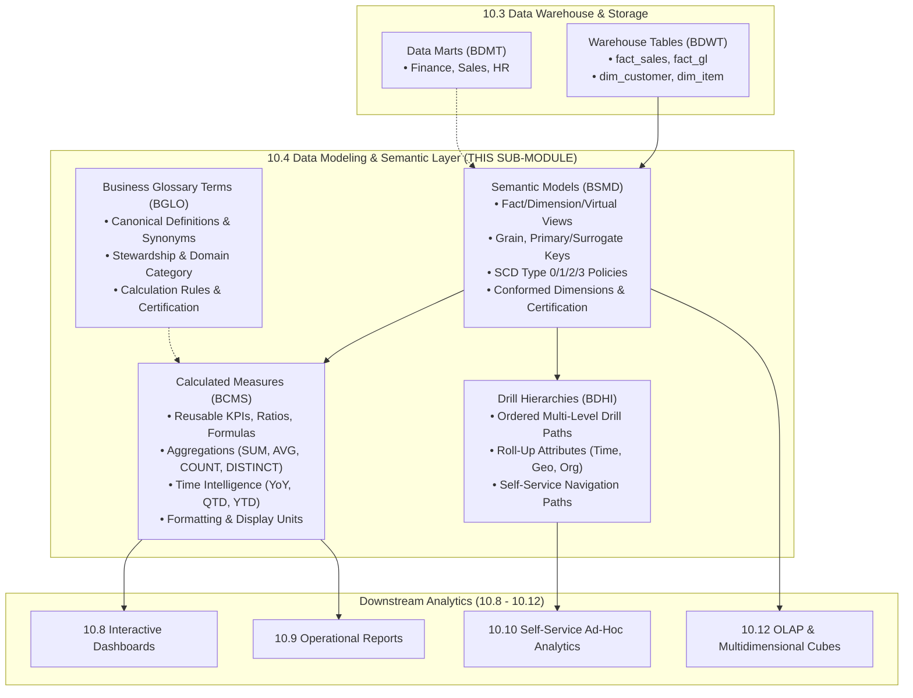

# Research — Sub-module 10.4: Data Modeling & Semantic Layer (Module 10 — Business Intelligence, `bi`)

- **Sub-module:** 10.4 Data Modeling & Semantic Layer
- **Module:** 10 Business Intelligence
- **Target app:** `apps/bi` (scaffolded in 10.1, extended in 10.2 and 10.3; extending with 10.4 package structure)
- **Research date:** 2026-11-04
- **Phase:** Phase 1 Research Catalog
- **Output file:** `.claude/tasks/research-bi-10.4.md`

---

## 1. Executive Summary & Domain Architecture

Sub-module 10.4 builds the **governed semantic layer, dimensional modeling metadata, business glossary, reusable calculated measures, and hierarchical drill navigation** for NavERP (`apps/bi`).

In the modern enterprise analytics stack:
- **Sub-module 10.1 (Data Integration & Ingestion)** extracts raw records from operational ERP modules, relational databases, external APIs, and files, landing them into staging buffers (`stg_*`).
- **Sub-module 10.2 (ETL/ELT & Data Pipelines)** applies multi-step transformations (relational joins, grouped aggregations, matrix pivots, type sanitization, and business rule enrichments) and orchestrates execution DAGs with versioning and promotion.
- **Sub-module 10.3 (Data Warehouse & Storage)** stores persistent, highly optimized analytical tables (`fact_*`, `dim_*`, `agg_*`, `brg_*`), subject data marts, medallion zones, partition strategies, and storage lifecycle tiering.
- **Sub-module 10.4 (Data Modeling & Semantic Layer — THIS SUB-MODULE)** abstracts the physical/logical warehouse tables into a unified, business-friendly semantic layer:
  1. **Dimensional Modeling:** Defines fact and dimension semantic entities, conformed dimensions, surrogate/natural keys, and Slowly Changing Dimensions (SCD Type 0/1/2/3) tracking policies.
  2. **Semantic Layer & Business Glossary:** Establishes a shared business vocabulary, human-readable metric/dimension definitions, synonyms, steward ownership, and certification statuses (Draft, Under Review, Certified, Deprecated).
  3. **Calculated Measures & Hierarchies:** Centrally authors reusable KPIs, aggregations, ratios, and time-intelligence calculations (YoY growth, period-to-date, moving averages) along with ordered multi-level drill paths (Year -> Quarter -> Month -> Day; Region -> Country -> State -> City).
  4. **Reusable Datasets & Virtual Views:** Governs certified datasets and virtual views for consistent self-service reporting across all downstream consumers.
  5. **Metadata-Driven Modeling:** Provides schema introspection and model synchronization directly from underlying warehouse tables (`WarehouseTable` from 10.3), inferring dimensions, measures, and data types automatically.
- **Downstream BI Consumers (10.8 - 10.12)**: Interactive dashboards (10.8), operational reports (10.9), self-service ad-hoc query builders (10.10), KPI scorecard management (10.11), and OLAP multidimensional cubes (10.12) query against 10.4 semantic models rather than raw physical SQL schemas, eliminating metric drift and conflicting figures.

### Architectural Boundaries & End-to-End Data Flow

---

## 2. Repo State Checked First

### 2.1 Navigation & App Tree State
- **`apps/core/navigation.py`:** Inspected `LIVE_LINKS`. Sub-modules `10.1`, `10.2`, and `10.3` are live:
  - `"10.1"`: Source Connectors, Batch & Real-Time Ingestion, Change Data Capture (CDC), API & Webhook Gateway, File & Cloud Storage Imports.
  - `"10.2"`: Visual Pipeline Builder, Transformation Library, Orchestration & Scheduling, Pipeline Monitoring & Logging, Version Control & CI/CD.
  - `"10.3"`: Centralized Data Warehouse, Data Marts, Data Lake & Lakehouse, Partitioning & Compression, Archival & Retention.
  - **`10.4` is the next unbuilt sub-module in Module 10.**
- **`apps/bi/`:** Scaffolded with standard package layout:
  - `apps/bi/models/DataIntegration/` (10.1: `DataSourceConnectors.py`, `IngestionPipelines.py`, `CdcSyncConfigs.py`, `IngestionRuns.py`)
  - `apps/bi/models/EtlPipelines/` (10.2: `EtlPipelines.py`, `TransformationSteps.py`, `EtlPipelineVersions.py`, `EtlPipelineRuns.py`)
  - `apps/bi/models/DataWarehouse/` (10.3: `DataMarts.py`, `LakehouseZones.py`, `WarehouseStoragePolicies.py`, `WarehouseTables.py`)
  - `apps/bi/models/_base.py` (`TenantOwned`, `TenantNumbered` with `next_number()` sequence allocation)

### 2.2 As-Built Core Spine & Sibling Entities (Grep Verified)

| Entity | Location | Verified Status | 10.4 Relationship |
|---|---|---|---|
| `core.Tenant` | `apps/core/models/Tenant.py:17` | **Present** | Strict tenant isolation boundary across all 10.4 semantic models, glossary terms, measures, and hierarchies |
| `core.OrgUnit` | `apps/core/models/OrgUnit.py:15` | **Present** | Departmental / business unit ownership of semantic models and glossary terms |
| `core.AuditLog` | `apps/core/models/AuditLog.py:14` | **Present** | Immutable administrative audit logging for certification status transitions and model schema updates |
| `settings.AUTH_USER_MODEL` | `config/settings.py` (`accounts.User`) | **Present** | Owner, steward, and author references |
| `bi.WarehouseTable` | `apps/bi/models/DataWarehouse/WarehouseTables.py` | **Present** | Physical/logical warehouse table underlying a semantic model (Sub-module 10.3) |
| `bi.DataMart` | `apps/bi/models/DataWarehouse/DataMarts.py` | **Present** | Departmental analytical data mart grouping semantic models (Sub-module 10.3) |

---

## 3. Leaders Surveyed (with source references)

1. **Cube (Cube Core / Cube Cloud)** — Universal Headless Semantic Layer
   - *Overview*: API-first, headless semantic layer delivering unified metrics to BI, embedded apps, and AI agents.
   - *Key capabilities*: Cubes and views, dimensions and measures, pre-aggregations, semantic role-based security, multi-source joins, JSON/YAML data modeling.
   - *URL*: `https://cube.dev/`

2. **dbt Semantic Layer (MetricFlow)** — Analytics Engineering Metrics Layer
   - *Overview*: MetricFlow engine defining governed metrics alongside dbt models in code repository.
   - *Key capabilities*: Semantic models, entities, dimensions, measures, cumulative/derived/ratio metrics, YAML-driven versioning, time granularity rollups.
   - *URL*: `https://docs.getdbt.com/docs/use-dbt-semantic-layer/dbt-semantic-layer`

3. **Looker (LookML)** — Industry-Standard BI Semantic Modeling
   - *Overview*: Declarative modeling language separating database structure from business logic.
   - *Key capabilities*: Views, explores, dimensions, measures, dimension groups (time frames), drill fields, primary keys, derived tables, liquid parameters.
   - *URL*: `https://cloud.google.com/looker/docs/what-is-lookml`

4. **Microsoft Fabric / Power BI (Semantic Models & DAX)** — Enterprise Tabular Modeling
   - *Overview*: Centralized semantic model engine serving Power BI reports, Excel pivot tables, and Copilot AI.
   - *Key capabilities*: Calculation groups, display folders, measure formatting strings, parent-child and explicit drill hierarchies, row-level security (RLS), endorsement certification (Promoted, Certified).
   - *URL*: `https://learn.microsoft.com/en-us/power-bi/transform-model/desktop-relationships-understand`

5. **GoodData (GoodData.CN / Cloud)** — Composable Data Modeling & Metric Engine
   - *Overview*: Semantic engine providing Logical Data Models (LDM) and Multi-Dimensional Analytical Query Language (MAQL).
   - *Key capabilities*: Datasets, attributes, facts, reusable metric expressions, transitive hierarchy rollups, governance certifications.
   - *URL*: `https://www.gooddata.com/platform/semantic-layer/`

6. **AtScale** — Universal Enterprise Semantic Layer
   - *Overview*: Decoupled semantic platform bridging cloud data warehouses to enterprise BI tools and Excel.
   - *Key capabilities*: Virtual star schemas, semi-additive measures, time-intelligence hierarchies, aggregate awareness, dimensional SCD modeling.
   - *URL*: `https://www.atscale.com/`

7. **Omni** — Next-Generation Hybrid Semantic BI
   - *Overview*: Bi-directional modeling engine supporting both visual drag-and-drop authoring and dbt code sync.
   - *Key capabilities*: Shared models, point-and-click calculated fields, branch versioning, automatic join inference, certified dataset badging.
   - *URL*: `https://omni.co/`

8. **Apache Superset** — Open Source Virtual Datasets & Semantic Metrics
   - *Overview*: Web-based data exploration and dashboarding platform with governed dataset abstractions.
   - *Key capabilities*: Physical vs. virtual SQL datasets, calculated columns, aggregate metrics, custom SQL expressions, dataset certification badges.
   - *URL*: `https://superset.apache.org/docs/using-superset/creating-your-first-dashboard/`

---

## 4. Feature Catalog (Sub-module 10.4 Only)

### 4.1 Dimensional Modeling
- **Fact & Dimension Model Definitions** — Declarative categorization of models into Facts (`fact`), Dimensions (`dim`), Bridge disambiguation (`brg`), or Virtual Analytical Views (`view`) with explicit grain declarations (e.g. "one row per invoice line"). · seen in: Cube, dbt, Looker, Power BI · priority: `table-stakes` · spine: new model `SemanticModel` · buildable now.
- **Conformed Dimension Flagging** — Flagging dimensions (Customer, Date/Time, Item/Product, Organization, Chart of Accounts) that are shared consistently across multiple business processes and data marts to guarantee cross-functional slice-and-dice comparability. · seen in: AtScale, Power BI, GoodData · priority: `table-stakes` · spine: `SemanticModel.is_conformed_dimension` · buildable now.
- **Slowly Changing Dimension (SCD) Policy** — Governed SCD behavior metadata: Type 0 (Fixed/Immutable), Type 1 (Overwrite In-Place), Type 2 (Historical Versioning with effective start/end dates and is_current flag), Type 3 (Previous Value Column Tracking). · seen in: dbt, AtScale, GoodData · priority: `table-stakes` · spine: `SemanticModel.scd_type` + SCD configuration fields · buildable now.
- **Primary & Natural Key Mapping** — Explicit specification of surrogate primary keys (`id`, `surrogate_key`) and business natural keys (`order_number`, `employee_code`) for join disambiguation and automated entity resolution. · seen in: Looker, dbt, Cube · priority: `table-stakes` · spine: `SemanticModel.primary_key_column`, `SemanticModel.natural_key_columns` · buildable now.

### 4.2 Semantic Layer & Business Glossary
- **Shared Business Glossary Terms** — Central dictionary of canonical business terms, clear qualitative definitions, abbreviations, synonyms, domain categories, and stewardship assignment. · seen in: Atlan, Collibra, Power BI, Omni · priority: `table-stakes` · spine: new model `BusinessGlossaryTerm` · buildable now.
- **Governance & Certification Workflow** — Lifecycle states for business terms and semantic models: Draft -> Under Review -> Certified (Single Source of Truth) -> Deprecated, with reviewer identity and certification notes. · seen in: Power BI, Tableau, Cube, Omni · priority: `table-stakes` · spine: `certification_status`, `certified_by`, `certified_at` · buildable now.
- **Term-to-Metric Mapping** — Linking qualitative glossary concepts directly to executable calculated measures and semantic models so business users and AI agents understand the exact calculation behind a term. · seen in: Cube, dbt, Omni · priority: `common` · spine: `CalculatedMeasure.glossary_term` FK · buildable now.

### 4.3 Calculated Measures & Hierarchies
- **Centralized Metric / Measure Library** — Governed calculation expressions authored once and consumed by all reports and dashboards, preventing formula fragmentation. · seen in: Cube, Looker, Power BI, dbt MetricFlow · priority: `table-stakes` · spine: new model `CalculatedMeasure` · buildable now.
- **Aggregation Types** — Standard aggregations: Sum (`sum`), Average (`avg`), Count (`count`), Count Distinct (`count_distinct`), Minimum (`min`), Maximum (`max`), Custom Formula / Expression (`formula`). · seen in: Cube, Looker, dbt · priority: `table-stakes` · spine: `CalculatedMeasure.aggregation_type` · buildable now.
- **Time Intelligence Calculations** — Out-of-the-box time offsets: None, Year-over-Year (YoY), Quarter-to-Date (QTD), Month-to-Date (MTD), Year-to-Date (YTD), Rolling 30-Day Moving Average, Prior Period Comparison. · seen in: Power BI (DAX), Looker, AtScale · priority: `common` · spine: `CalculatedMeasure.time_intelligence` · buildable now.
- **Display Formatting & Units** — Formatting directives: Currency, Percentage, Integer, Decimal (2 decimal places), Scientific, Duration, with prefix/suffix formatting and display units (thousands 'K', millions 'M', billions 'B'). · seen in: Power BI, Looker, Cube · priority: `table-stakes` · spine: `CalculatedMeasure.format_string`, `CalculatedMeasure.display_units` · buildable now.
- **Threshold & Target Boundaries** — Setting warning and critical target thresholds on calculated measures to power traffic-light indicators, KPI cards, and dashboard alert badges. · seen in: Power BI, GoodData · priority: `common` · spine: `CalculatedMeasure.target_value`, `warning_threshold`, `critical_threshold` · buildable now.
- **Drill-Down Hierarchies** — Explicit ordered hierarchy paths governing multi-level navigation: Time (Year -> Quarter -> Month -> Day), Geography (Region -> Country -> State -> City), Organization (Company -> Division -> Department -> Cost Center), Product (Category -> Subcategory -> Item). · seen in: Power BI, Looker, AtScale · priority: `table-stakes` · spine: new model `DrillHierarchy` · buildable now.

### 4.4 Reusable Datasets & Virtual Views
- **Governed Dataset Abstraction** — Abstract virtual models representing pre-joined, certified combinations of facts and dimensions ready for self-service drag-and-drop. · seen in: Power BI (Certified Datamarts), Superset, Omni · priority: `table-stakes` · spine: `SemanticModel` (`model_type='reusable_dataset'`) · buildable now.
- **Virtual View SQL / Expression Definition** — Defining virtual datasets via ANSI SQL queries or view definitions that compute on-the-fly without requiring physical table instantiation. · seen in: Superset, Looker (Derived Tables), Cube · priority: `table-stakes` · spine: `SemanticModel.sql_definition`, `SemanticModel.is_virtual_view` · buildable now.
- **Access Tier & Departmental Scoping** — Restricting semantic models and datasets to tenant-wide public, departmental-only, or confidential access tiers. · seen in: Power BI, Cube · priority: `table-stakes` · spine: `SemanticModel.access_tier`, `SemanticModel.data_mart` · buildable now.

### 4.5 Metadata-Driven Modeling
- **Automated Schema Introspection & Model Generation** — One-click introspection of an underlying 10.3 `WarehouseTable`, generating the `SemanticModel`, extracting all columns as dimensions, and auto-proposing numeric aggregations as `CalculatedMeasure`s. · seen in: Omni, Looker, Cube · priority: `differentiator` · spine: `introspect_warehouse_table()` action on `SemanticModel` · buildable now.
- **Data Type & Lineage Invariant Tracking** — Recording source table linkage, schema fingerprint, and last introspected timestamp to detect schema drift when warehouse tables change. · seen in: dbt, Omni · priority: `common` · spine: `SemanticModel.source_fingerprint`, `SemanticModel.last_introspected_at` · buildable now.

---

## 5. Recommended Build Scope (This Pass — 4 Models)

To deliver Sub-module 10.4 comprehensively within the standard 1–4 model unit, we recommend four tenant-scoped models:

### Model 1: `SemanticModel` [Prefix: `BSMD-`]
- **File:** `apps/bi/models/SemanticLayer/SemanticModels.py`
- **Inherits:** `TenantNumbered` (`apps/bi/models/_base.py`)
- **Key Fields:**
  - `number`: auto-generated (`BSMD-00001`)
  - `name`: `CharField(max_length=150)` (e.g. "Sales Performance Model", "General Ledger Financials")
  - `code`: `SlugField(max_length=50)` (e.g. "sales_performance", "gl_financials")
  - `model_type`: `CharField(choices=[('fact', 'Fact Model'), ('dimension', 'Dimension Model'), ('bridge', 'Bridge / Disambiguation Model'), ('virtual_view', 'Virtual Analytical View'), ('reusable_dataset', 'Certified Reusable Dataset')])`
  - `warehouse_table`: `ForeignKey('bi.WarehouseTable', null=True, blank=True, on_delete=models.SET_NULL, related_name='semantic_models')`
  - `data_mart`: `ForeignKey('bi.DataMart', null=True, blank=True, on_delete=models.SET_NULL, related_name='semantic_models')`
  - `primary_key_column`: `CharField(max_length=100, default='id')`
  - `natural_key_columns`: `CharField(max_length=255, blank=True, help_text="Comma-separated business keys")`
  - `grain_description`: `CharField(max_length=255, blank=True, help_text="E.g. One row per completed sales order item")`
  - `is_conformed_dimension`: `BooleanField(default=False)`
  - `scd_type`: `CharField(choices=[('type_0', 'Type 0: Fixed / Non-Changing'), ('type_1', 'Type 1: Overwrite In-Place'), ('type_2', 'Type 2: Historical Versioning (Start/End Date)'), ('type_3', 'Type 3: Previous Value Tracking')], default='type_1')`
  - `is_virtual_view`: `BooleanField(default=False)`
  - `sql_definition`: `TextField(blank=True, help_text="Custom SQL query for virtual analytical views")`
  - `access_tier`: `CharField(choices=[('public', 'Public (Tenant-Wide)'), ('department', 'Departmental Only'), ('restricted', 'Restricted / Confidential')], default='department')`
  - `certification_status`: `CharField(choices=[('draft', 'Draft / In Development'), ('in_review', 'Under Review & Validation'), ('certified', 'Certified Single Source of Truth'), ('deprecated', 'Deprecated / Sunset Pending')], default='draft')`
  - `certified_by`: `ForeignKey(settings.AUTH_USER_MODEL, null=True, blank=True, on_delete=models.SET_NULL, related_name='+')`
  - `certified_at`: `DateTimeField(null=True, blank=True)`
  - `source_fingerprint`: `CharField(max_length=64, blank=True)`
  - `last_introspected_at`: `DateTimeField(null=True, blank=True)`
  - `owner`: `ForeignKey(settings.AUTH_USER_MODEL, null=True, blank=True, on_delete=models.SET_NULL, related_name='owned_semantic_models')`
  - `description`: `TextField(blank=True)`
  - `is_active`: `BooleanField(default=True)`

### Model 2: `BusinessGlossaryTerm` [Prefix: `BGLO-`]
- **File:** `apps/bi/models/SemanticLayer/BusinessGlossaryTerms.py`
- **Inherits:** `TenantNumbered` (`apps/bi/models/_base.py`)
- **Key Fields:**
  - `number`: auto-generated (`BGLO-00001`)
  - `name`: `CharField(max_length=150)` (e.g. "Net Recurring Revenue (NRR)", "Active Customer")
  - `code`: `SlugField(max_length=50)` (e.g. "net_recurring_revenue", "active_customer")
  - `domain_category`: `CharField(choices=[('finance', 'Finance & Accounting'), ('sales', 'Sales & Commercial'), ('marketing', 'Marketing & Demand Gen'), ('hr', 'Human Resources & People'), ('supply_chain', 'Supply Chain & Inventory'), ('operations', 'Operations & Manufacturing'), ('general', 'General Enterprise')], default='finance')`
  - `short_definition`: `CharField(max_length=300, help_text="Executive one-line definition")`
  - `full_definition`: `TextField(blank=True, help_text="Comprehensive corporate standard definition")`
  - `calculation_rule`: `TextField(blank=True, help_text="Prose business rule or formula narrative")`
  - `synonyms`: `CharField(max_length=255, blank=True, help_text="Alternative or colloquial business names (comma-separated)")`
  - `steward`: `ForeignKey(settings.AUTH_USER_MODEL, null=True, blank=True, on_delete=models.SET_NULL, related_name='stewarded_glossary_terms')`
  - `org_unit`: `ForeignKey('core.OrgUnit', null=True, blank=True, on_delete=models.SET_NULL, related_name='glossary_terms')`
  - `certification_status`: `CharField(choices=[('draft', 'Draft / In Development'), ('in_review', 'Under Review & Validation'), ('certified', 'Certified Corporate Standard'), ('deprecated', 'Deprecated / Superseded')], default='draft')`
  - `certified_by`: `ForeignKey(settings.AUTH_USER_MODEL, null=True, blank=True, on_delete=models.SET_NULL, related_name='+')`
  - `certified_at`: `DateTimeField(null=True, blank=True)`
  - `related_terms`: `ManyToManyField('self', blank=True, symmetrical=True)`
  - `is_active`: `BooleanField(default=True)`

### Model 3: `CalculatedMeasure` [Prefix: `BCMS-`]
- **File:** `apps/bi/models/SemanticLayer/CalculatedMeasures.py`
- **Inherits:** `TenantNumbered` (`apps/bi/models/_base.py`)
- **Key Fields:**
  - `number`: auto-generated (`BCMS-00001`)
  - `semantic_model`: `ForeignKey('bi.SemanticModel', on_delete=models.CASCADE, related_name='measures')`
  - `glossary_term`: `ForeignKey('bi.BusinessGlossaryTerm', null=True, blank=True, on_delete=models.SET_NULL, related_name='measures')`
  - `name`: `CharField(max_length=150)` (e.g. "Gross Profit Margin %", "Total Invoiced Revenue")
  - `code`: `SlugField(max_length=50)` (e.g. "gross_profit_margin_pct", "total_invoiced_revenue")
  - `aggregation_type`: `CharField(choices=[('sum', 'Sum'), ('avg', 'Average'), ('count', 'Count'), ('count_distinct', 'Count Distinct'), ('min', 'Minimum'), ('max', 'Maximum'), ('formula', 'Custom Calculated Expression / Ratio')], default='sum')`
  - `source_column`: `CharField(max_length=100, blank=True, help_text="Column name for standard aggregations")`
  - `formula_expression`: `CharField(max_length=500, blank=True, help_text="E.g. [total_revenue] - [total_cost] or ([gross_profit] / [total_revenue]) * 100")`
  - `filter_expression`: `CharField(max_length=500, blank=True, help_text="SQL WHERE clause filter condition (e.g. status = 'paid')")`
  - `time_intelligence`: `CharField(choices=[('none', 'None (Standard Aggregation)'), ('yoy_growth', 'Year-over-Year (YoY) Growth %'), ('qtd', 'Quarter-to-Date (QTD)'), ('ytd', 'Year-to-Date (YTD)'), ('rolling_30d', 'Rolling 30-Day Moving Sum/Avg'), ('prior_period', 'Prior Period Difference')], default='none')`
  - `format_string`: `CharField(choices=[('currency', 'Currency ($#,##0.00)'), ('percentage', 'Percentage (0.00%)'), ('integer', 'Whole Number (#,##0)'), ('decimal', 'Decimal Number (#,##0.00)'), ('raw', 'Raw Unformatted')], default='decimal')`
  - `display_units`: `CharField(choices=[('auto', 'Auto-Scale (K/M/B)'), ('none', 'None (Raw Value)'), ('thousands', 'Thousands (K)'), ('millions', 'Millions (M)'), ('billions', 'Billions (B)')], default='auto')`
  - `target_value`: `DecimalField(max_digits=16, decimal_places=4, null=True, blank=True)`
  - `warning_threshold`: `DecimalField(max_digits=16, decimal_places=4, null=True, blank=True)`
  - `critical_threshold`: `DecimalField(max_digits=16, decimal_places=4, null=True, blank=True)`
  - `description`: `TextField(blank=True)`
  - `is_active`: `BooleanField(default=True)`

### Model 4: `DrillHierarchy` [Prefix: `BDHI-`]
- **File:** `apps/bi/models/SemanticLayer/DrillHierarchies.py`
- **Inherits:** `TenantNumbered` (`apps/bi/models/_base.py`)
- **Key Fields:**
  - `number`: auto-generated (`BDHI-00001`)
  - `semantic_model`: `ForeignKey('bi.SemanticModel', on_delete=models.CASCADE, related_name='drill_hierarchies')`
  - `name`: `CharField(max_length=150)` (e.g. "Fiscal Time Hierarchy", "Sales Territory Hierarchy")
  - `code`: `SlugField(max_length=50)` (e.g. "fiscal_time_hierarchy", "sales_territory_hierarchy")
  - `hierarchy_type`: `CharField(choices=[('time', 'Calendar / Fiscal Time (Year -> Quarter -> Month -> Day)'), ('geography', 'Geographical Territory (Region -> Country -> State -> City)'), ('organizational', 'Organizational Unit (Company -> Division -> Department)'), ('product', 'Product Catalog (Category -> Subcategory -> Item)'), ('custom', 'Custom Business Dimension Path')], default='time')`
  - `levels_json`: `JSONField(default=list, help_text="Ordered list of hierarchy levels [{'level': 1, 'name': 'Year', 'column': 'fiscal_year'}, ...]")`
  - `primary_drill_path`: `BooleanField(default=True, help_text="Default drill path for this dimensional model")`
  - `description`: `TextField(blank=True)`
  - `is_active`: `BooleanField(default=True)`

---

## 6. Belongs to Sibling Sub-modules (Parked, Not Scoped Here)
- Automated Data Profiling & Completeness Scoring -> Sub-module 10.5 Data Quality & Cleansing
- Golden Record Matching, Merging & Survivorship -> Sub-module 10.6 Master Data Management (MDM)
- Enterprise Search Catalog & Column-Level Visual Lineage -> Sub-module 10.7 Data Catalog, Lineage & Governance
- Drag-and-Drop Dashboard Canvases & Interactive Charts -> Sub-module 10.8 Interactive Dashboards
- Pixel-Perfect Banded Financial & Operational Reports -> Sub-module 10.9 Standard & Operational Reports
- Ad-Hoc Drag-and-Drop Visual Pivot Builder -> Sub-module 10.10 Self-Service & Ad-Hoc Analytics
- OLAP Multidimensional Cube Storage & MDX Querying -> Sub-module 10.12 OLAP & Multidimensional Cubes

---

## 7. Deferred (Later Passes / Integrations)
- Live bi-directional dbt Semantic Layer MetricFlow synchronization via Git/API -> Enterprise Analytics integration
- Custom Python/R script runtime execution inside semantic measure formulas -> Advanced data science extensions
- Automated LLM text-to-semantic-measure query parsing -> Sub-module 10.15 Natural Language & Conversational BI
- Pre-aggregation caching engine (Cube pre-aggregations / materialized rollup tables) -> Performance optimization pass
