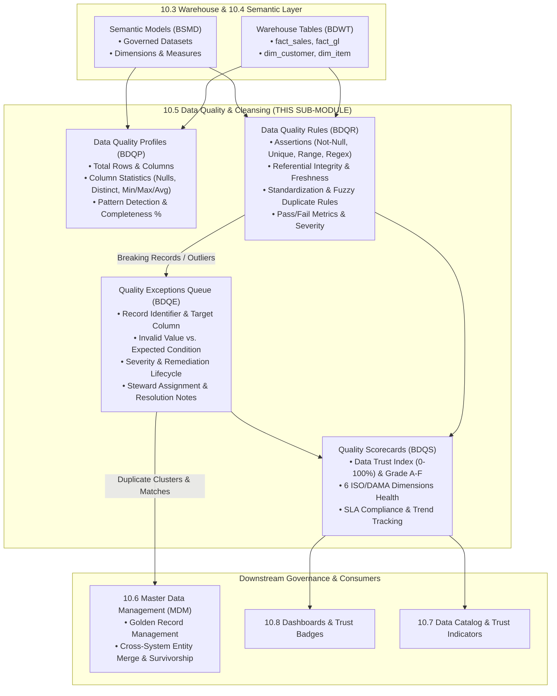

# Research — Sub-module 10.5: Data Quality & Cleansing (Module 10 — Business Intelligence, `bi`)

- **Sub-module:** 10.5 Data Quality & Cleansing
- **Module:** 10 Business Intelligence
- **Target app:** `apps/bi` (extended across 10.1, 10.2, 10.3, 10.4; adding 10.5 `DataQuality` package)
- **Research date:** 2026-11-04
- **Phase:** Phase 1 Research Catalog
- **Output file target:** `.claude/tasks/research-bi-10.5.md`

---

## 1. Executive Summary & Domain Architecture

Sub-module 10.5 delivers **automated data profiling, configurable validation and quality rules, deduplication/matching anomaly detection, standardization/cleansing transformations, and quality scorecards with steward-driven remediation** for NavERP (`apps/bi`).

In the modern enterprise analytics stack:
- **Sub-module 10.1 (Data Integration & Ingestion)** extracts raw records from operational ERP modules, external databases, APIs, and cloud files, landing them into staging buffers (`stg_*`).
- **Sub-module 10.2 (ETL/ELT & Data Pipelines)** applies multi-step transformations and orchestrates execution DAGs with versioning and promotion.
- **Sub-module 10.3 (Data Warehouse & Storage)** stores persistent, optimized analytical tables (`fact_*`, `dim_*`, `agg_*`, `brg_*`), data marts, and lakehouse medallion zones.
- **Sub-module 10.4 (Data Modeling & Semantic Layer)** abstracts warehouse tables into governed semantic models, business glossary terms, calculated measures, and drill hierarchies.
- **Sub-module 10.5 (Data Quality & Cleansing — THIS SUB-MODULE)** establishes trust, reliability, and accuracy across both physical warehouse tables (`WarehouseTable`) and analytical datasets (`SemanticModel`):
  1. **Data Profiling:** Inspects warehouse tables and semantic models to compute column statistics (min, max, mean, null count, distinct count), value distributions, pattern detection (regex masks), and completeness scoring.
  2. **Validation & Quality Rules:** Evaluates configurable assertions across completeness, accuracy, consistency, timeliness, uniqueness, and validity (null checks, range boundaries, regex patterns, set memberships, referential-integrity checks, data freshness, and custom SQL assertions).
  3. **Deduplication & Matching:** Configures fuzzy string matching (Levenshtein, Jaro-Winkler, Soundex/Metaphone, token fingerprinting), blocking keys, and match confidence thresholds to detect duplicate pairs and feed the remediation queue.
  4. **Standardization & Enrichment:** Applies formatting rules (whitespace trimming, case normalization, regex masking, date/phone formatting, missing value imputation, and dictionary lookups).
  5. **Quality Scorecards & Remediation:** Aggregates scores into an overall Data Trust Index (0–100%) and ISO/DAMA 6-dimensional health scores (Grade A–F) with SLA monitoring, while routing breaking records into an operational exception queue for steward investigation, quarantine, and correction.
- **Sub-module 10.6 (Master Data Management — NEXT SUB-MODULE)** will consume 10.5 duplicate detection outputs to drive cross-system Golden Record consolidation, master record match/merge/survivorship across Parties, Items, and Vendors, and enterprise reference data crosswalks.

### Architectural Boundaries & End-to-End Data Flow

---

## 2. Repo State Checked First

### 2.1 Navigation & App Tree State
- **`apps/core/navigation.py`:** Inspected `LIVE_LINKS`. Sub-modules `10.1`, `10.2`, `10.3`, and `10.4` are live:
  - `"10.1"`: Source Connectors, Batch & Real-Time Ingestion, Change Data Capture (CDC), API & Webhook Gateway, File & Cloud Storage Imports.
  - `"10.2"`: Visual Pipeline Builder, Transformation Library, Orchestration & Scheduling, Pipeline Monitoring & Logging, Version Control & CI/CD.
  - `"10.3"`: Centralized Data Warehouse, Data Marts, Data Lake & Lakehouse, Partitioning & Compression, Archival & Retention.
  - `"10.4"`: Dimensional Modeling, Semantic Layer & Business Glossary, Calculated Measures & Hierarchies, Reusable Datasets & Views, Metadata-Driven Modeling.
  - **`10.5` is the next unbuilt sub-module in Module 10.**
- **`apps/bi/`:** Scaffolded with standard package layout:
  - `apps/bi/models/DataIntegration/` (10.1: `DataSourceConnectors.py`, `IngestionPipelines.py`, `CdcSyncConfigs.py`, `IngestionRuns.py`)
  - `apps/bi/models/EtlPipelines/` (10.2: `EtlPipelines.py`, `TransformationSteps.py`, `EtlPipelineVersions.py`, `EtlPipelineRuns.py`)
  - `apps/bi/models/DataWarehouse/` (10.3: `DataMarts.py`, `LakehouseZones.py`, `WarehouseStoragePolicies.py`, `WarehouseTables.py`)
  - `apps/bi/models/SemanticLayer/` (10.4: `SemanticModels.py`, `BusinessGlossaryTerms.py`, `CalculatedMeasures.py`, `DrillHierarchies.py`)
  - `apps/bi/models/_base.py` (`TenantOwned`, `TenantNumbered` with `next_number()` sequence allocation)

### 2.2 As-Built Core Spine & Sibling Entities (Grep Verified)

| Entity | Location | Verified Status | 10.5 Relationship |
|---|---|---|---|
| `core.Tenant` | `apps/core/models/Tenant.py:17` | **Present** | Strict tenant isolation boundary across all 10.5 profiles, rules, exceptions, and scorecards |
| `core.OrgUnit` | `apps/core/models/OrgUnit.py:15` | **Present** | Departmental / business unit ownership of quality scorecards and remediation domains |
| `core.AuditLog` | `apps/core/models/AuditLog.py:14` | **Present** | Immutable administrative audit logging for rule status changes and exception resolution actions |
| `settings.AUTH_USER_MODEL` | `config/settings.py` (`accounts.User`) | **Present** | Data steward, resolver, and profiler references |
| `bi.WarehouseTable` | `apps/bi/models/DataWarehouse/WarehouseTables.py:8` | **Present** | Target physical/analytical warehouse table to profile, check, and monitor (Sub-module 10.3) |
| `bi.DataMart` | `apps/bi/models/DataWarehouse/DataMarts.py:8` | **Present** | Subject data mart for departmental quality scorecards (Sub-module 10.3) |
| `bi.SemanticModel` | `apps/bi/models/SemanticLayer/SemanticModels.py:8` | **Present** | Target semantic model / dataset to profile, check, and score (Sub-module 10.4) |

### 2.3 Collision-Free Prefix Verification
Inspected all prefixes in `apps/bi/` and repository-wide:
- Built in `apps/bi/`: `BCDC`, `BDSC`, `BING`, `BIJR`, `BETL`, `BTRN`, `BPVR`, `BEXR`, `BDWT`, `BDMT`, `BLHZ`, `BWSP`, `BSMD`, `BGLO`, `BCMS`, `BDHI`.
- Sibling app prefixes starting with `B`: `BILL`, `BUD`, `BLAST`, `BEN`, `BGV`, `BRC`, `BKO`, `BID`, `BVR`, `BSL`, `BND`, `BOM`.
- **Recommended 10.5 prefixes:**
  - `BDQP`: `DataQualityProfile` (**Unique & Collision-free**)
  - `BDQR`: `DataQualityRule` (**Unique & Collision-free**)
  - `BDQE`: `DataQualityException` (**Unique & Collision-free**)
  - `BDQS`: `DataQualityScorecard` (**Unique & Collision-free**)

---

## 3. Leaders Surveyed (with source references)

1. **Great Expectations (GX)** — Python-First Declarative Data Quality & Validation Framework
   - *Overview*: Open-source data assertion framework treating data validation like automated unit testing.
   - *Key capabilities*: Declarative expectations (`expect_column_values_to_not_be_null`, `expect_column_values_to_be_unique`, `expect_column_values_to_be_between`), expectation suites, automated profiling data assistants, validation runs, checkpoints, and auto-compiled HTML Data Docs.
   - *URL*: `https://greatexpectations.io/`

2. **Soda (Soda Core / Soda Cloud)** — Modern Data Observability & SodaCL Checks Engine
   - *Overview*: Lightweight developer-first data quality testing library with cloud governance and scorecards.
   - *Key capabilities*: Human-readable SodaCL YAML check language, 25+ built-in metrics (`row_count`, `missing_count`, `duplicate_count`, `freshness`), warning vs. failure thresholds, automated profiling scans, and cross-domain data health scorecards.
   - *URL*: `https://www.soda.io/`

3. **Monte Carlo** — Enterprise Data Observability & Incident Management Platform
   - *Overview*: AI-driven data reliability platform monitoring data downtime across pipelines, warehouses, and BI.
   - *Key capabilities*: Automated anomaly detection (freshness, volume, schema drift), deterministic SQL validation monitors, incident triage lifecycle (Open -> Investigating -> Remediated), alert severity scoring, false-positive suppression, and root cause analysis.
   - *URL*: `https://www.getmontecarlo.com/`

4. **Ataccama ONE** — Unified Self-Driving Data Quality & Governance Fabric
   - *Overview*: Enterprise platform integrating automated data profiling, rule discovery, cleansing, and scorecards.
   - *Key capabilities*: Sample and full dataset profiling, pattern discovery, automated rule detection, ISO/DAMA DQ dimensions (Accuracy, Completeness, Consistency, Uniqueness, Validity), proactive API remediation, and executive data health scorecards.
   - *URL*: `https://www.ataccama.com/`

5. **Informatica Cloud Data Quality (CDQ / IDMC)** — Enterprise Cloud Data Quality & Remediation
   - *Overview*: Market-leading enterprise suite for profiling, cleansing, matching, and governance.
   - *Key capabilities*: Visual profiling tasks, Rule Specifications, address/string standardization dictionaries, deterministic and fuzzy deduplication, Cloud Data Governance Catalog (CDGC) scorecards, and human-in-the-loop exception tasks for data stewards.
   - *URL*: `https://www.informatica.com/products/data-quality.html`

6. **Collibra Data Quality & Observability (formerly OwlDQ)** — Predictive Data Quality & Remediation
   - *Overview*: Automated, machine-learning-driven data profiling and continuous quality monitoring platform.
   - *Key capabilities*: ML baseline auto-discovery, rule penalty points, breaking record identification, Data Quality Score calculation (0–100%), exception handling for breaking monitors, and role-based data stewardship workflows.
   - *URL*: `https://www.collibra.com/us/en/products/data-quality`

7. **OpenRefine** — Interactive Data Cleaning, Fuzzy Clustering & Transformation Engine
   - *Overview*: Powerful open-source desktop tool for exploring, cleansing, standardizing, and reconciling messy tabular data.
   - *Key capabilities*: Faceting distributions, fuzzy string clustering algorithms (Fingerprint, Bi-gram/N-gram, Metaphone3, Levenshtein distance), GREL (General Refinement Expression Language) transformations, missing value imputation, and reconciliation lookups.
   - *URL*: `https://openrefine.org/`

8. **Talend Data Quality (Qlik Talend)** — Comprehensive Data Quality & Stewardship Platform
   - *Overview*: Enterprise data profiling, deduplication, cleansing, and data stewardship console.
   - *Key capabilities*: Statistical profiling indicators, pattern discovery, match grouping (`tMatchGroup`), record survivorship rules, Data Trust Scores (completeness, validity, popularity), and human-in-the-loop stewardship campaigns.
   - *URL*: `https://www.talend.com/products/data-quality/`

---

## 4. Feature Catalog (Sub-module 10.5 Only)

### 4.1 Data Profiling
- **Automated Column Statistics & Metric Profiling** — Profiling target warehouse tables and semantic models to compute total row count, column count, null frequency, distinct value count, minimum, maximum, mean, and uniqueness ratio. · seen in: Great Expectations, Soda, Ataccama, Talend · priority: `table-stakes` · spine: new model `DataQualityProfile` · buildable now.
- **Value Distribution & Frequency Faceting** — Capturing top-N most frequent values and outlier frequencies to identify skew, defaults (e.g. repeated dummy strings or dates `1900-01-01`), and data anomalies. · seen in: OpenRefine, Ataccama, Informatica · priority: `table-stakes` · spine: `DataQualityProfile.column_profiles_json` · buildable now.
- **Pattern Detection & Mask Discovery** — Inferred structural text patterns and regex masks (e.g. `AAAA-9999`, email shape, postal shape) identifying format violations across string columns. · seen in: Ataccama, Talend, OpenRefine · priority: `common` · spine: `DataQualityProfile.column_profiles_json` · buildable now.
- **Completeness & Validity Scoring** — Automated percentage scoring of dataset completeness (`(non_null_cells / total_cells) * 100`) and validity against inferred data types. · seen in: Soda, Talend, Ataccama · priority: `table-stakes` · spine: `DataQualityProfile.completeness_score`, `DataQualityProfile.validity_score` · buildable now.

### 4.2 Validation & Quality Rules
- **Declarative Quality Assertion Engine** — Configurable rules mapped to warehouse tables or semantic models specifying mandatory assertions: Not Null, Uniqueness, Numeric/Date Range Boundaries, Regex Pattern, and Allowed Set Membership. · seen in: Great Expectations, SodaCL, Ataccama · priority: `table-stakes` · spine: new model `DataQualityRule` · buildable now.
- **Referential Integrity & Foreign Key Checks** — Validating that foreign key columns in transactional warehouse tables resolve cleanly to target dimension/master tables without orphan rows. · seen in: Great Expectations, Soda, Informatica · priority: `table-stakes` · spine: `DataQualityRule` (`rule_type='referential_integrity'`) · buildable now.
- **Data Freshness & Timeliness SLA Validation** — Checking timestamps against current execution time (e.g. `updated_at > NOW() - INTERVAL 24 HOURS`) to verify pipeline freshness and catch pipeline delays. · seen in: Soda, Monte Carlo, Great Expectations · priority: `table-stakes` · spine: `DataQualityRule` (`rule_type='date_freshness'`) · buildable now.
- **Custom SQL Boolean Assertions** — Authoring advanced cross-column and relational business rules expressed as SQL conditions (e.g. `discount_amount <= total_amount AND status IN ('paid', 'refunded')`). · seen in: Great Expectations, SodaCL, Monte Carlo · priority: `table-stakes` · spine: `DataQualityRule` (`rule_type='custom_sql'`) · buildable now.
- **Failure Tolerance & Severity Tiers** — Setting acceptable failure percentage tolerances (e.g. 0.00% for financial ledger vs. 1.00% for marketing leads) and severity classifications (Info, Warning, Critical, Fatal). · seen in: Great Expectations, Soda, Monte Carlo · priority: `table-stakes` · spine: `DataQualityRule.failure_tolerance_pct`, `DataQualityRule.severity` · buildable now.
- **Rule Execution History & Pass Rate Tracking** — Recording last execution timestamp, passed/failed record counts, pass rate percentage, and execution status (`passed`, `warning`, `failed`, `error`). · seen in: Soda Cloud, Great Expectations, Collibra · priority: `table-stakes` · spine: `DataQualityRule.last_status`, `pass_rate_pct`, `passed_records_count`, `failed_records_count` · buildable now.

### 4.3 Deduplication & Matching
- **Fuzzy String Matching & Similarity Metrics** — Configurable similarity comparison algorithms (Levenshtein edit distance, Jaro-Winkler, Soundex/Metaphone phonetic, token sorting/fingerprinting) across key text fields. · seen in: OpenRefine, Talend (`tMatchGroup`), Informatica · priority: `table-stakes` · spine: `DataQualityRule` (`rule_type='duplicate_cluster'`) · buildable now.
- **Blocking Key Optimization** — Grouping candidate comparison records by coarse blocking keys (e.g. postal code + first 3 letters of surname) to prevent quadratic Cartesian product performance degradation. · seen in: Talend (`tGenKey`), OpenRefine · priority: `common` · spine: `DataQualityRule.parameters_json['blocking_keys']` · buildable now.
- **Match Confidence Thresholding & Duplicate Pair Detection** — Scoring candidate duplicate pairs against similarity thresholds (e.g. >= 85% match), flagging duplicate clusters as quality exceptions for review. · seen in: Informatica, OpenRefine, Talend · priority: `table-stakes` · spine: `DataQualityException` (`exception_type='duplicate_candidate'`) · buildable now.
- **Survivorship & Merge Review Rules** — Declarative policy defining surviving attributes during duplicate resolution (Most Recently Updated, Highest Completeness, Trusted Source Priority, Manual Pick). · seen in: Talend (`tRuleSurvivorship`), Informatica · priority: `common` · spine: `DataQualityException.remediation_action` · buildable now. *(Note: Cross-system Master Data Golden Record consolidation is owned by Sub-module 10.6 MDM).*

### 4.4 Standardization & Enrichment
- **Text & Case Normalization** — Cleansing rules that automatically trim leading/trailing whitespace, collapse internal duplicate spaces, and standardize casing (UPPERCASE, lowercase, Title Case). · seen in: OpenRefine (GREL), Talend, Ataccama · priority: `table-stakes` · spine: `DataQualityRule` (`rule_type='string_standardization'`) · buildable now.
- **Pattern Masking & Regular Expression Replacement** — Applying regex substitution patterns to sanitize phone numbers, strip non-numeric characters, or mask sensitive PII attributes. · seen in: OpenRefine, Ataccama, Talend · priority: `table-stakes` · spine: `DataQualityRule.parameters_json['regex_replacement']` · buildable now.
- **Missing Value Imputation Strategies** — Configurable default handling for null or empty values: fill static constant, coalesce with secondary column, or map to standard 'Unknown' dimensional surrogate. · seen in: OpenRefine, Talend, Ataccama · priority: `table-stakes` · spine: `DataQualityRule.parameters_json['imputation_strategy']` · buildable now.
- **Controlled Reference-Data Lookups & Dictionaries** — Standardizing raw codes or colloquial abbreviations against canonical reference tables (e.g. mapping `US`, `U.S.A.`, `United States` to standard ISO code `USA`). · seen in: OpenRefine, Informatica, Ataccama · priority: `common` · spine: `DataQualityRule.parameters_json['lookup_mapping']` · buildable now.

### 4.5 Quality Scorecards & Remediation
- **Multi-Dimensional Quality Scorecards** — Aggregating data health metrics across the 6 standard ISO/DAMA data quality dimensions: Completeness, Accuracy, Consistency, Timeliness, Uniqueness, and Validity. · seen in: Ataccama, Collibra, Soda, Talend · priority: `table-stakes` · spine: new model `DataQualityScorecard` · buildable now.
- **Overall Data Trust Index & Letter Grades** — Calculating a weighted Data Trust Index (0.00% to 100.00%) and assigning an executive letter grade (Grade A >95%, B 85–95%, C 75–84%, D 60–74%, F <60%) with health status (Healthy, Needs Attention, Critical, Failing). · seen in: Talend Trust Score, Collibra DQ Score, Soda Cloud · priority: `table-stakes` · spine: `DataQualityScorecard.overall_quality_score`, `DataQualityScorecard.grade` · buildable now.
- **SLA Thresholds & Target Tracking** — Specifying corporate SLA minimum quality targets (e.g. 95.00%) with automated SLA breach detection and operational alerts. · seen in: Soda Cloud, Monte Carlo, Ataccama · priority: `table-stakes` · spine: `DataQualityScorecard.target_quality_score`, `DataQualityScorecard.meets_sla` · buildable now.
- **Operational Exception Queue & Finding Register** — Centralized workbench capturing invalid/breaking records, failed assertion details, offending column values, and expected criteria. · seen in: Collibra DQ, Informatica Exception Tasks, Monte Carlo Incidents · priority: `table-stakes` · spine: new model `DataQualityException` · buildable now.
- **Steward-Driven Remediation Workflow** — Lifecycle states for exceptions: Open -> Under Investigation -> Remediated -> Suppressed (False Positive) -> Accepted Business Risk -> Rejected, with assigned data steward, resolution timestamp, and audit trail. · seen in: Informatica, Talend Stewardship, Collibra · priority: `table-stakes` · spine: `DataQualityException.status`, `assigned_steward`, `resolved_by`, `resolution_notes` · buildable now.
- **Remediation Actions & Value Correction** — Interactive recording of proposed corrected values and applied remediation actions (Manual Record Edit, Automated Standardization Applied, Duplicate Merged, Value Imputed, Record Quarantined). · seen in: Talend Data Stewardship, OpenRefine, Informatica · priority: `table-stakes` · spine: `DataQualityException.remediation_action`, `proposed_value`, `remediated_value` · buildable now.

---

## 5. Recommended Build Scope (This Pass — 4 Models)

To deliver Sub-module 10.5 comprehensively within the standard 1–4 model unit, we recommend four tenant-scoped models in package `apps/bi/models/DataQuality/`:

### Model 1: `DataQualityProfile` [Prefix: `BDQP-`]
- **File:** `apps/bi/models/DataQuality/DataQualityProfiles.py`
- **Inherits:** `TenantNumbered` (`apps/bi/models/_base.py`)
- **Key Fields:**
  - `number`: auto-generated (`BDQP-00001`)
  - `name`: `CharField(max_length=150)` (e.g. "Sales Fact Table Profile", "Customer Dimension Profile")
  - `target_type`: `CharField(choices=[('warehouse_table', 'Warehouse Table'), ('semantic_model', 'Semantic Model')], default='warehouse_table')`
  - `warehouse_table`: `ForeignKey('bi.WarehouseTable', null=True, blank=True, on_delete=models.CASCADE, related_name='quality_profiles')`
  - `semantic_model`: `ForeignKey('bi.SemanticModel', null=True, blank=True, on_delete=models.CASCADE, related_name='quality_profiles')`
  - `status`: `CharField(choices=[('pending', 'Pending / Scheduled'), ('profiling', 'Profiling In Progress'), ('completed', 'Completed Successfully'), ('failed', 'Profiling Failed')], default='pending')`
  - `total_row_count`: `BigIntegerField(default=0)`
  - `total_column_count`: `PositiveIntegerField(default=0)`
  - `completeness_score`: `DecimalField(max_digits=5, decimal_places=2, default=Decimal('100.00'), help_text="Percentage of populated, non-null values")`
  - `uniqueness_score`: `DecimalField(max_digits=5, decimal_places=2, default=Decimal('100.00'), help_text="Percentage of unique distinct records across primary keys")`
  - `validity_score`: `DecimalField(max_digits=5, decimal_places=2, default=Decimal('100.00'), help_text="Percentage of values conforming to expected data types and masks")`
  - `column_profiles_json`: `JSONField(default=list, help_text="Statistical metadata per column: column_name, data_type, null_count, null_pct, distinct_count, distinct_pct, min_value, max_value, avg_value, sample_patterns, most_frequent_values")`
  - `profiled_by`: `ForeignKey(settings.AUTH_USER_MODEL, null=True, blank=True, on_delete=models.SET_NULL, related_name='+')`
  - `profiled_at`: `DateTimeField(null=True, blank=True)`
  - `duration_seconds`: `DecimalField(max_digits=8, decimal_places=2, default=Decimal('0.00'))`
  - `error_message`: `TextField(blank=True)`
  - `notes`: `TextField(blank=True)`
  - `is_active`: `BooleanField(default=True)`

### Model 2: `DataQualityRule` [Prefix: `BDQR-`]
- **File:** `apps/bi/models/DataQuality/DataQualityRules.py`
- **Inherits:** `TenantNumbered` (`apps/bi/models/_base.py`)
- **Key Fields:**
  - `number`: auto-generated (`BDQR-00001`)
  - `name`: `CharField(max_length=150)` (e.g. "Customer Email Valid Format", "Invoice Line Amount Greater Than Zero")
  - `code`: `SlugField(max_length=60)`
  - `rule_category`: `CharField(choices=[('validation', 'Validation & Accuracy Check'), ('consistency', 'Consistency & Referential Integrity'), ('uniqueness', 'Uniqueness & Deduplication'), ('standardization', 'Standardization & Cleansing'), ('custom_sql', 'Custom SQL Assertion')], default='validation')`
  - `dimension`: `CharField(choices=[('completeness', 'Completeness'), ('accuracy', 'Accuracy'), ('consistency', 'Consistency'), ('timeliness', 'Timeliness'), ('uniqueness', 'Uniqueness'), ('validity', 'Validity')], default='validity')`
  - `target_type`: `CharField(choices=[('warehouse_table', 'Warehouse Table'), ('semantic_model', 'Semantic Model')], default='warehouse_table')`
  - `warehouse_table`: `ForeignKey('bi.WarehouseTable', null=True, blank=True, on_delete=models.CASCADE, related_name='quality_rules')`
  - `semantic_model`: `ForeignKey('bi.SemanticModel', null=True, blank=True, on_delete=models.CASCADE, related_name='quality_rules')`
  - `target_column`: `CharField(max_length=100, blank=True, help_text="Specific target column to evaluate, or empty for table-level rules")`
  - `rule_type`: `CharField(choices=[('not_null', 'Not Null / Mandatory Check'), ('unique', 'Uniqueness Constraint'), ('range_between', 'Value Range Boundary (Min/Max)'), ('regex_pattern', 'Regex Pattern Matching'), ('set_membership', 'Allowed Set Membership / Enum'), ('referential_integrity', 'Referential Integrity / Foreign Key'), ('date_freshness', 'Data Freshness / Timeliness SLA'), ('string_standardization', 'Standardization (Trim, Case, Regex Normalize)'), ('duplicate_cluster', 'Fuzzy Duplicate Cluster Check'), ('custom_sql', 'Custom SQL Boolean Condition')], default='not_null')`
  - `parameters_json`: `JSONField(default=dict, help_text="Configuration parameters (e.g. min_value, max_value, regex, allowed_values, foreign_table, foreign_column, sql_condition, fuzzy_algorithm, match_threshold)")`
  - `severity`: `CharField(choices=[('info', 'Information (Advisory)'), ('warning', 'Warning (Low Impact)'), ('critical', 'Critical (Business SLA Impact)'), ('fatal', 'Fatal (Pipeline Blocking)')], default='warning')`
  - `failure_tolerance_pct`: `DecimalField(max_digits=5, decimal_places=2, default=Decimal('0.00'), help_text="Maximum failure rate allowed before rule status changes to failed")`
  - `last_run_at`: `DateTimeField(null=True, blank=True)`
  - `last_status`: `CharField(choices=[('passed', 'Passed'), ('warning', 'Warning (Within Tolerance)'), ('failed', 'Failed'), ('error', 'Execution Error'), ('skipped', 'Skipped')], default='passed')`
  - `passed_records_count`: `BigIntegerField(default=0)`
  - `failed_records_count`: `BigIntegerField(default=0)`
  - `pass_rate_pct`: `DecimalField(max_digits=5, decimal_places=2, default=Decimal('100.00'))`
  - `steward`: `ForeignKey(settings.AUTH_USER_MODEL, null=True, blank=True, on_delete=models.SET_NULL, related_name='stewarded_quality_rules')`
  - `description`: `TextField(blank=True)`
  - `is_active`: `BooleanField(default=True)`

### Model 3: `DataQualityException` [Prefix: `BDQE-`]
- **File:** `apps/bi/models/DataQuality/DataQualityExceptions.py`
- **Inherits:** `TenantNumbered` (`apps/bi/models/_base.py`)
- **Key Fields:**
  - `number`: auto-generated (`BDQE-00001`)
  - `rule`: `ForeignKey('bi.DataQualityRule', null=True, blank=True, on_delete=models.SET_NULL, related_name='exceptions')`
  - `profile`: `ForeignKey('bi.DataQualityProfile', null=True, blank=True, on_delete=models.SET_NULL, related_name='exceptions')`
  - `warehouse_table`: `ForeignKey('bi.WarehouseTable', null=True, blank=True, on_delete=models.SET_NULL, related_name='quality_exceptions')`
  - `semantic_model`: `ForeignKey('bi.SemanticModel', null=True, blank=True, on_delete=models.SET_NULL, related_name='quality_exceptions')`
  - `record_identifier`: `CharField(max_length=150, help_text="Primary key value or natural identifier of the offending record")`
  - `target_column`: `CharField(max_length=100, blank=True)`
  - `invalid_value`: `TextField(blank=True, help_text="Offending or anomalous value captured")`
  - `expected_condition`: `CharField(max_length=255, blank=True, help_text="Description of what value was expected")`
  - `exception_type`: `CharField(choices=[('rule_violation', 'Rule Assertion Violation'), ('duplicate_candidate', 'Potential Duplicate Record Pair'), ('null_anomaly', 'Null / Missing Mandatory Value'), ('range_outlier', 'Range / Statistical Outlier'), ('format_invalid', 'Invalid Pattern or Format'), ('referential_orphan', 'Referential Integrity Orphan')], default='rule_violation')`
  - `severity`: `CharField(choices=[('info', 'Information'), ('warning', 'Warning'), ('critical', 'Critical'), ('fatal', 'Fatal')], default='warning')`
  - `status`: `CharField(choices=[('open', 'Open / Unassigned'), ('investigating', 'Under Investigation'), ('remediated', 'Remediated & Verified'), ('suppressed_false_positive', 'Suppressed (False Positive)'), ('accepted_risk', 'Accepted Business Risk'), ('rejected', 'Rejected / Invalid Exception')], default='open')`
  - `remediation_action`: `CharField(choices=[('none', 'No Action Taken'), ('manual_edit', 'Manual Record Correction'), ('automated_standardize', 'Automated Standardization Applied'), ('merge_duplicate', 'Duplicate Merged / Reconciled'), ('impute_value', 'Value Imputed / Defaulted'), ('quarantine_row', 'Record Quarantined')], default='none')`
  - `proposed_value`: `TextField(blank=True, help_text="Suggested cleansed or standardized value")`
  - `remediated_value`: `TextField(blank=True, help_text="Final corrected value applied")`
  - `assigned_steward`: `ForeignKey(settings.AUTH_USER_MODEL, null=True, blank=True, on_delete=models.SET_NULL, related_name='assigned_quality_exceptions')`
  - `resolved_by`: `ForeignKey(settings.AUTH_USER_MODEL, null=True, blank=True, on_delete=models.SET_NULL, related_name='+')`
  - `resolved_at`: `DateTimeField(null=True, blank=True)`
  - `resolution_notes`: `TextField(blank=True)`
  - `is_active`: `BooleanField(default=True)`

### Model 4: `DataQualityScorecard` [Prefix: `BDQS-`]
- **File:** `apps/bi/models/DataQuality/DataQualityScorecards.py`
- **Inherits:** `TenantNumbered` (`apps/bi/models/_base.py`)
- **Key Fields:**
  - `number`: auto-generated (`BDQS-00001`)
  - `name`: `CharField(max_length=150)` (e.g. "Sales Operations Data Quality Scorecard", "Enterprise Warehouse Health Scorecard")
  - `code`: `SlugField(max_length=60)`
  - `scope_type`: `CharField(choices=[('warehouse_table', 'Warehouse Table'), ('semantic_model', 'Semantic Model'), ('data_mart', 'Data Mart Domain'), ('tenant_wide', 'Tenant-Wide Aggregate')], default='warehouse_table')`
  - `warehouse_table`: `ForeignKey('bi.WarehouseTable', null=True, blank=True, on_delete=models.SET_NULL, related_name='scorecards')`
  - `semantic_model`: `ForeignKey('bi.SemanticModel', null=True, blank=True, on_delete=models.SET_NULL, related_name='scorecards')`
  - `data_mart`: `ForeignKey('bi.DataMart', null=True, blank=True, on_delete=models.SET_NULL, related_name='scorecards')`
  - `org_unit`: `ForeignKey('core.OrgUnit', null=True, blank=True, on_delete=models.SET_NULL, related_name='quality_scorecards')`
  - `overall_quality_score`: `DecimalField(max_digits=5, decimal_places=2, default=Decimal('100.00'), help_text="Aggregated Data Trust Index (0.00% - 100.00%)")`
  - `completeness_score`: `DecimalField(max_digits=5, decimal_places=2, default=Decimal('100.00'))`
  - `accuracy_score`: `DecimalField(max_digits=5, decimal_places=2, default=Decimal('100.00'))`
  - `consistency_score`: `DecimalField(max_digits=5, decimal_places=2, default=Decimal('100.00'))`
  - `timeliness_score`: `DecimalField(max_digits=5, decimal_places=2, default=Decimal('100.00'))`
  - `uniqueness_score`: `DecimalField(max_digits=5, decimal_places=2, default=Decimal('100.00'))`
  - `validity_score`: `DecimalField(max_digits=5, decimal_places=2, default=Decimal('100.00'))`
  - `grade`: `CharField(choices=[('A', 'Grade A: Excellent (>95%)'), ('B', 'Grade B: Good (85-95%)'), ('C', 'Grade C: Acceptable (75-84%)'), ('D', 'Grade D: Poor (60-74%)'), ('F', 'Grade F: Failing (<60%)')], default='A')`
  - `health_status`: `CharField(choices=[('healthy', 'Healthy (Meets SLAs)'), ('needs_attention', 'Needs Attention (Minor Breaches)'), ('critical', 'Critical (Major SLA Breaches)'), ('failing', 'Failing (Data Untrusted)')], default='healthy')`
  - `target_quality_score`: `DecimalField(max_digits=5, decimal_places=2, default=Decimal('95.00'))`
  - `meets_sla`: `BooleanField(default=True)`
  - `total_rules_evaluated`: `PositiveIntegerField(default=0)`
  - `rules_passed_count`: `PositiveIntegerField(default=0)`
  - `rules_failed_count`: `PositiveIntegerField(default=0)`
  - `open_exceptions_count`: `PositiveIntegerField(default=0)`
  - `critical_exceptions_count`: `PositiveIntegerField(default=0)`
  - `evaluation_period`: `CharField(choices=[('ad_hoc', 'Ad-Hoc / Current'), ('daily', 'Daily Snapshot'), ('weekly', 'Weekly Rollup'), ('monthly', 'Monthly Scorecard')], default='ad_hoc')`
  - `last_calculated_at`: `DateTimeField(null=True, blank=True)`
  - `steward`: `ForeignKey(settings.AUTH_USER_MODEL, null=True, blank=True, on_delete=models.SET_NULL, related_name='stewarded_scorecards')`
  - `description`: `TextField(blank=True)`
  - `is_active`: `BooleanField(default=True)`

---

## 6. Belongs to Sibling Sub-modules (Parked, Not Scoped Here)
- Golden Record Consolidation & Master Record Survivorship -> Sub-module 10.6 Master Data Management (MDM)
- Cross-System Entity Resolution for Customers, Vendors, and Items -> Sub-module 10.6 Master Data Management (MDM)
- Enterprise Hierarchy & Parent-Child Tree Management -> Sub-module 10.6 Master Data Management (MDM)
- Enterprise Reference Data Cross-Walk Code Sets -> Sub-module 10.6 Master Data Management (MDM)
- Global Searchable Data Catalog Indexing -> Sub-module 10.7 Data Catalog, Lineage & Governance
- Automated End-to-End Column-Level Lineage Graph -> Sub-module 10.7 Data Catalog, Lineage & Governance
- Regulatory Tagging (GDPR/HIPAA/SOX) & Retention Policies -> Sub-module 10.7 Data Catalog, Lineage & Governance
- Interactive KPI Scorecard Dashboards & Visual Heatmaps -> Sub-module 10.8 Interactive Dashboards

---

## 7. Deferred (Later Passes / Integrations)
- External Great Expectations Checkpoint / Soda Core CLI daemon automated execution runner -> Advanced ETL/orchestration integration
- Commercial address standardization API integration (Google Maps / SmartyStreets APIs) -> External enrichment adapter
- AI/LLM-assisted natural language rule drafting and auto-suggestion -> Sub-module 10.15 Natural Language & Conversational BI
- Distributed Spark / DuckDB in-memory profiling engine for multi-terabyte datasets -> Big Data scaling pass
