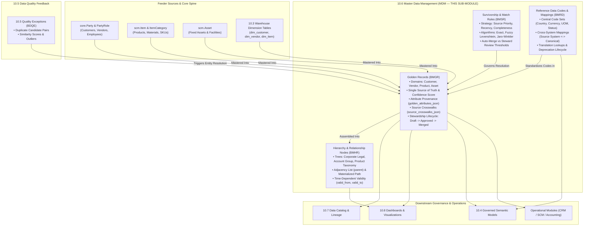

# Research — Sub-module 10.6: Master Data Management (MDM) (Module 10 — Business Intelligence, `bi`)

- **Sub-module:** 10.6 Master Data Management (MDM)
- **Module:** 10 Business Intelligence
- **Target app:** `apps/bi` (extended across 10.1, 10.2, 10.3, 10.4, 10.5; adding 10.6 `MasterData` package)
- **Research date:** 2026-11-04
- **Phase:** Phase 1 Research Catalog
- **Output file target:** `.claude/tasks/research-bi-10.6.md`

---

## 1. Executive Summary & Domain Architecture

Sub-module 10.6 delivers **enterprise Golden Record management, deterministic and probabilistic match/merge resolution, attribute-level survivorship rules, multi-domain hierarchy management, centralized reference data crosswalks, and role-based data stewardship workflows** for NavERP (`apps/bi`).

In the modern enterprise analytics and data management architecture:
- **Sub-module 10.1 (Data Integration & Ingestion)** extracts raw entity fragments and operational transactions from internal ERP apps, legacy databases, cloud file drops, and external third-party APIs into staging buffers (`stg_*`).
- **Sub-module 10.2 (ETL/ELT & Data Pipelines)** applies transformations, joins, and normalizations across staging tables.
- **Sub-module 10.3 (Data Warehouse & Storage)** stores persistent, optimized analytical dimensional tables (`dim_customer`, `dim_vendor`, `dim_item`, `dim_account`).
- **Sub-module 10.4 (Data Modeling & Semantic Layer)** defines governed business metrics, conformed dimensions, business glossary terms, and drill paths.
- **Sub-module 10.5 (Data Quality & Cleansing)** profiles warehouse tables, executes quality assertions, calculates 6-dimensional health scorecards, and identifies duplicate candidate pairs in the exception queue (`DataQualityException`).
- **Sub-module 10.6 (Master Data Management — THIS SUB-MODULE)** establishes the authoritative, single-version-of-truth master data layer across the enterprise:
  1. **Golden Record Management:** Consolidates fragmented records across customers, vendors, products/items, assets, and accounts into authoritative golden records (`MdmGoldenRecord`) with attribute-level provenance and source crosswalks (`source_crosswalks_json`).
  2. **Match, Merge & Survivorship:** Evaluates configurable matching rules (exact and fuzzy) and attribute-level survivorship strategies (`MdmSurvivorshipRule`: Source Precedence, Most Recent Timestamp, Highest Completeness, Majority Voting, Manual Pick) to determine the winning operational values.
  3. **Hierarchy & Relationship Management:** Organizes master entities into multi-level parent-child trees (`MdmHierarchyNode`), including corporate legal structures, sales account groupings, product taxonomies, cost center rollups, and asset locations with effective date ranges.
  4. **Reference Data Management (RDM):** Centralizes enterprise code sets, canonical lookup tables, and cross-system translation mappings (`MdmReferenceCode`) to bridge discrepancies between source system representations (e.g. `US` vs `USA` vs `840`).
  5. **Data Stewardship Workflows:** Empowers domain stewards with review queues, confidence thresholding, automated vs manual merge approval, attribute survivorship overrides, and audit trails.
- **Downstream Consumers (10.7 – 10.12 & Operational Modules):** Clean golden records and standardized hierarchies syndicate downstream to the Searchable Data Catalog (10.7), Executive Dashboards (10.8), and operational ERP modules (`apps/crm`, `apps/scm`, `apps/accounting`), eliminating conflicting master data.

### Architectural Boundaries & End-to-End Data Flow



---

## 2. Repo State Checked First

### 2.1 Navigation & App Tree State
- **`apps/core/navigation.py`:** Inspected `LIVE_LINKS`. Sub-modules `10.1`, `10.2`, `10.3`, `10.4`, and `10.5` are fully built and live:
  - `"10.1"`: Source Connectors, Batch & Real-Time Ingestion, Change Data Capture (CDC), API & Webhook Gateway, File & Cloud Storage Imports.
  - `"10.2"`: Visual Pipeline Builder, Transformation Library, Orchestration & Scheduling, Pipeline Monitoring & Logging, Version Control & CI/CD.
  - `"10.3"`: Centralized Data Warehouse, Data Marts, Data Lake & Lakehouse, Partitioning & Compression, Archival & Retention.
  - `"10.4"`: Dimensional Modeling, Semantic Layer & Business Glossary, Calculated Measures & Hierarchies, Reusable Datasets & Views, Metadata-Driven Modeling.
  - `"10.5"`: Data Profiling, Validation & Quality Rules, Deduplication & Matching, Standardization & Enrichment, Quality Scorecards & Remediation.
  - **`10.6` is the next unbuilt sub-module in Module 10.**
- **`apps/bi/`:** Established package layout under `apps/bi/models/`:
  - `apps/bi/models/DataIntegration/` (10.1: `DataSourceConnectors.py`, `IngestionPipelines.py`, `CdcSyncConfigs.py`, `IngestionRuns.py`)
  - `apps/bi/models/EtlPipelines/` (10.2: `EtlPipelines.py`, `TransformationSteps.py`, `EtlPipelineVersions.py`, `EtlPipelineRuns.py`)
  - `apps/bi/models/DataWarehouse/` (10.3: `DataMarts.py`, `LakehouseZones.py`, `WarehouseStoragePolicies.py`, `WarehouseTables.py`)
  - `apps/bi/models/SemanticLayer/` (10.4: `SemanticModels.py`, `BusinessGlossaryTerms.py`, `CalculatedMeasures.py`, `DrillHierarchies.py`)
  - `apps/bi/models/DataQuality/` (10.5: `DataQualityProfiles.py`, `DataQualityRules.py`, `DataQualityExceptions.py`, `DataQualityScorecards.py`)
  - `apps/bi/models/_base.py` (`TenantOwned`, `TenantNumbered` with `next_number()` sequence allocation)

### 2.2 As-Built Core Spine & Sibling Entities (Grep Verified)

| Entity | Location | Verified Status | 10.6 Relationship |
|---|---|---|---|
| `core.Tenant` | `apps/core/models/Tenant.py:17` | **Present** | Strict tenant isolation boundary across all 10.6 golden records, rules, hierarchies, and reference codes |
| `core.Party` | `apps/core/models/Party.py:5` | **Present** | Real-world person or organization (customer, vendor, employee, supplier, partner) mastered into golden records |
| `core.PartyRole` | `apps/core/models/PartyRole.py:5` | **Present** | Role classification on Party (`customer`, `vendor`, `supplier`, `employee`, `lead`, `contact`, `partner`) |
| `core.PartyRelationship` | `apps/core/models/PartyRelationship.py:8` | **Present** | Pre-built core relationships (`subsidiary_of`, `employee_of`, `contact_of`, `reports_to`) mapped into MDM hierarchies |
| `core.OrgUnit` | `apps/core/models/OrgUnit.py:5` | **Present** | Internal organizational tree (company, branch, department, cost center) linked to MDM hierarchy nodes |
| `core.AuditLog` | `apps/core/models/AuditLog.py:14` | **Present** | Immutable administrative audit logging for manual survivorship overrides, merges, and status transitions |
| `settings.AUTH_USER_MODEL` | `config/settings.py` (`accounts.User`) | **Present** | Data steward, reviewer, and approver references |
| `scm.Item` | `apps/scm/models/InventoryManagement/Items.py:73` | **Present** | Core operational product, material, and SKU mastered into product golden records |
| `scm.ItemCategory` | `apps/scm/models/InventoryManagement/Items.py:34` | **Present** | Product category taxonomy mapped to MDM product hierarchy nodes |
| `scm.Asset` | `apps/scm/models/AssetManagement/Assets.py:50` | **Present** | Physical asset/equipment master mastered into asset golden records |
| `accounting.GLAccount` | `apps/accounting/models/GeneralLedger/GLAccounts.py:5` | **Present** | Chart of accounts master entity governed in reference data code sets |
| `bi.WarehouseTable` | `apps/bi/models/DataWarehouse/WarehouseTables.py:8` | **Present** | Target physical/analytical warehouse table contributing source data (Sub-module 10.3) |
| `bi.SemanticModel` | `apps/bi/models/SemanticLayer/SemanticModels.py:8` | **Present** | Target analytical dataset governed by MDM golden records (Sub-module 10.4) |
| `bi.DataQualityException` | `apps/bi/models/DataQuality/DataQualityExceptions.py:8` | **Present** | Duplicate candidate exceptions and rule anomalies feeding the MDM matching engine (Sub-module 10.5) |

### 2.3 Collision-Free Prefix Verification
Inspected all prefixes repository-wide and within `apps/bi/`:
- Built in `apps/bi/`:
  - 10.1: `BCDC`, `BDSC`, `BING`, `BIJR`
  - 10.2: `BETL`, `BTRN`, `BPVR`, `BEXR`
  - 10.3: `BDMT`, `BLHZ`, `BWSP`, `BDWT`
  - 10.4: `BSMD`, `BGLO`, `BCMS`, `BDHI`
  - 10.5: `BDQP`, `BDQR`, `BDQE`, `BDQS`
- All `BM*` prefixes checked across the entire repository — **zero collisions detected**.
- **Recommended 10.6 prefixes:**
  - `BMGR`: `MdmGoldenRecord` (**Unique & Collision-free**)
  - `BMSR`: `MdmSurvivorshipRule` (**Unique & Collision-free**)
  - `BMHR`: `MdmHierarchyNode` (**Unique & Collision-free**)
  - `BMRD`: `MdmReferenceCode` (**Unique & Collision-free**)

---

## 3. Leaders Surveyed (with source references)

1. **Informatica Multidomain MDM (IDMC / Cloud MDM)** — Enterprise AI-Powered Multidomain Master Data Hub
   - *Overview*: Market-leading enterprise cloud MDM platform delivering consolidated 360-degree views of customers, products, suppliers, and assets.
   - *Key capabilities*: Advanced deterministic & probabilistic matching, AI-driven match tuning (CLAIRE engine), attribute-level survivorship based on trust scores and update recency, cross-reference (XREF) lineage, Reference 360 (RD360) code set management, and role-based data stewardship portals.
   - *URL*: `https://www.informatica.com/products/master-data-management.html`

2. **Profisee MDM** — Modern Cloud-Native Master Data Management Platform
   - *Overview*: Native Microsoft Fabric and Azure partner platform offering fast, multidomain mastering with low total cost of ownership.
   - *Key capabilities*: High-precision matching engine, attribute-level survivorship rules (source priority, recency, completeness, frequency), interactive exception management dashboards, automated record merge and manual split, and seamless syndication back to operational ERP/CRM systems.
   - *URL*: `https://profisee.com/master-data-management-platform/`

3. **Semarchy xDM** — Intelligent Data Hub & Agile Multidomain MDM
   - *Overview*: Flexible, business-driven master and reference data management platform using an iterative data hub architecture.
   - *Key capabilities*: Reference Data Management (RDM) for code sets and lookup tables, probabilistic and fuzzy match/merge algorithms, customizable SemQL survivorship rules, interactive visual hierarchy and graph navigation, and governance workflows with data steward task lists.
   - *URL*: `https://www.semarchy.com/intelligent-data-hub/`

4. **Reltio Connected Data Platform** — Real-Time Cloud-Native Graph MDM
   - *Overview*: Multi-domain SaaS platform built on a distributed graph engine delivering unified customer, product, and organization profiles in real time.
   - *Key capabilities*: Graph-native entity resolution, dynamic Operational Value (OV) calculation with fallback strategies, role-based survivorship views, multi-parent hierarchy graphs, automated unmerging upon data invalidation, and universal entity identifiers.
   - *URL*: `https://www.reltio.com/products/connected-data-platform/`

5. **Ataccama ONE MDM** — Unified AI-Powered Data Trust & Mastering Fabric
   - *Overview*: Modern data fabric integrating data profiling, data quality, metadata cataloging, and master data management in a single engine.
   - *Key capabilities*: Automated master record calculation, source precedence matrices, timestamp recency survivorship, audit lineage preserving contributing source records, agentic and headless stewardship APIs, and tight coupling with automated data quality scoring.
   - *URL*: `https://www.ataccama.com/products/master-data-management`

6. **SAP Master Data Governance (SAP MDG)** — Enterprise Central Governance & Consolidation
   - *Overview*: De facto standard enterprise master data platform for SAP S/4HANA environments managing financial, customer, supplier, and material domains.
   - *Key capabilities*: Central Governance with staging areas and Change Request (CR) approval frameworks, decentralized Consolidation pipeline (Standardization -> Matching -> Best Record Calculation -> Activation), time-dependent global hierarchies, and mass processing with selective branch locking.
   - *URL*: `https://www.sap.com/products/technology-platform/master-data-governance.html`

7. **Pimcore MDM / PIM** — Open-Source Enterprise Master Data & Product Information Hub
   - *Overview*: Highly flexible open-source multi-domain master data management platform uniting MDM, PIM, and digital asset management.
   - *Key capabilities*: Flexible multi-domain data modeling (products, customers, vendors, locations), visual drag-and-drop parent-child hierarchy trees, cross-domain relational linking, standardized reference classifications (ETIM, UNSPSC), workflow state-machines, and full audit version histories.
   - *URL*: `https://pimcore.com/en/products/mdm`

8. **CluedIn MDM** — Azure-Native Graph MDM & Data Stewardship Engine
   - *Overview*: Modern, graph-native MDM solution utilizing "eventual connectivity" to master data without rigid upfront schema locking.
   - *Key capabilities*: Automated ingestion from 100+ connectors, machine learning entity resolution, attribute-level survivorship rules, graph-based multi-tier hierarchy modeling, centralized reference data crosswalks, and human-in-the-loop stewardship portals for manual merge/split operations.
   - *URL*: `https://cluedin.com/product/`

---

## 4. Feature Catalog (Sub-module 10.6 Only)

### 4.1 Golden Record Management
- **Unified Multi-Domain Master Records** — Authoritative, consolidated single-version-of-truth master profiles for core business domains: Customers (`core.Party` customer role), Vendors/Suppliers (`core.Party` vendor/supplier role), Products/Materials (`scm.Item`), Assets (`scm.Asset`), and General Ledger Accounts (`accounting.GLAccount`). · seen in: Informatica MDM, Profisee, Semarchy xDM, SAP MDG · priority: `table-stakes` · spine: new model `MdmGoldenRecord` · buildable now.
- **Attribute-Level Provenance & Lineage** — Structured storage (`golden_attributes_json`) tracking the winning value, source system identifier, confidence score, and survivorship strategy for every consolidated attribute (e.g. legal name, tax ID, phone, email, billing address, category). · seen in: Reltio (OV), Profisee, Ataccama ONE · priority: `table-stakes` · spine: `MdmGoldenRecord.golden_attributes_json` · buildable now.
- **Cross-System Source Crosswalks (XREF)** — Detailed registry (`source_crosswalks_json`) linking source system names (e.g. `crm_sales`, `sap_erp`, `billing_gateway`), original source record identifiers, contributing field values, match confidence, and ingestion timestamps to the Golden Record. · seen in: Informatica (XREF), Reltio (Crosswalks), CluedIn · priority: `table-stakes` · spine: `MdmGoldenRecord.source_crosswalks_json` · buildable now.
- **Trust Tiers & Confidence Scoring** — Calculated master record confidence score (0.00% – 100.00%) and categorizing trust tier badges (`gold` >=95%, `silver` 80–94%, `bronze` <80%) reflecting data completeness, source reliability, and match strength. · seen in: Profisee, Ataccama ONE, Informatica · priority: `table-stakes` · spine: `MdmGoldenRecord.confidence_score`, `MdmGoldenRecord.trust_tier` · buildable now.
- **Master Record Lifecycle States** — Rigorous governance lifecycle: `draft` -> `pending_review` -> `approved` (active golden record) -> `in_dispute` -> `merged` (absorbed into surviving record) -> `superseded` -> `archived`. · seen in: SAP MDG, Pimcore, Semarchy · priority: `table-stakes` · spine: `MdmGoldenRecord.status` · buildable now.

### 4.2 Match, Merge & Survivorship
- **Configurable Survivorship Strategy Engine** — Declarative attribute-level survivorship policies determining which source value prevails:
  - `source_priority`: Feeder system trust hierarchy (e.g. ERP > CRM > Billing > Staging).
  - `most_recent`: Latest non-null timestamp recency.
  - `highest_completeness`: Most populated or highest data quality score.
  - `most_frequent`: Majority voting / highest frequency across contributing records.
  - `manual_pick`: Data steward explicit manual selection.
  - `oldest_original`: Preserving original creation values for foundational identifiers.
  · seen in: Profisee, Informatica MDM, Semarchy xDM, Reltio · priority: `table-stakes` · spine: new model `MdmSurvivorshipRule` (`survivorship_strategy`) · buildable now.
- **Cross-System Entity Resolution Algorithms** — Configurable matching logic across deterministic checks (exact tax_id, email, phone, external ID) and probabilistic fuzzy algorithms (Levenshtein distance, Jaro-Winkler similarity, Soundex phonetic, token set ratio). · seen in: Informatica, Reltio, Profisee, OpenRefine · priority: `table-stakes` · spine: `MdmSurvivorshipRule.match_algorithm` · buildable now.
- **Dual-Threshold Match & Auto-Merge Orchestration** — Setting a minimum match threshold (e.g. >=80.00% to flag as candidate pair for steward review) and an automated merge threshold (e.g. >=95.00% to auto-consolidate without human intervention). · seen in: Informatica, Profisee, Ataccama ONE · priority: `table-stakes` · spine: `MdmSurvivorshipRule.match_threshold_pct`, `MdmSurvivorshipRule.auto_merge_threshold_pct` · buildable now.
- **Ranked Source System Trust Lists** — Ordered list of contributing systems (`source_priority_list_json`) defining relative authority per field (e.g. for `tax_id`: `["erp_core", "government_api", "crm"]`; for `phone`: `["crm", "web_portal", "erp_core"]`). · seen in: Profisee, Reltio, Informatica · priority: `table-stakes` · spine: `MdmSurvivorshipRule.source_priority_list_json` · buildable now.
- **Automated Merge Execution & Unmerge Capability** — Consolidating candidate duplicates into a single surviving Golden Record while retaining the merged record's source crosswalks and history, with the ability for stewards to unmerge records if a match is invalidated. · seen in: Reltio, SAP MDG, Informatica · priority: `common` · spine: `MdmGoldenRecord.merged_into_record`, `MdmGoldenRecord.merged_at` · buildable now.

### 4.3 Hierarchy & Relationship Management
- **Multi-Domain Adjacency Tree Structures** — Modeling recursive parent-child hierarchies across diverse business domains:
  - `corporate_legal`: Parent corporate group -> Subsidiary company -> Operating branch (`core.Party`).
  - `account_group`: Global holding account -> Regional enterprise account -> Local billing account.
  - `product_taxonomy`: Category -> Subcategory -> Product family -> Base SKU (`scm.ItemCategory`).
  - `org_reporting`: Division -> Department -> Team -> Cost Center (`core.OrgUnit`).
  - `asset_location`: Facility -> Building -> Floor -> Production Line -> Machine Asset (`scm.Asset`).
  · seen in: SAP MDG, Semarchy xDM, Pimcore, Reltio · priority: `table-stakes` · spine: new model `MdmHierarchyNode` · buildable now.
- **Materialized Path for High-Performance Tree Navigation** — Maintaining a materialized node path (e.g. `/1/4/12/`) enabling $O(1)$ subtree querying, depth calculations, and hierarchical rollups without recursive SQL CTE performance penalties. · seen in: Semarchy, Pimcore, Django MPTT patterns · priority: `table-stakes` · spine: `MdmHierarchyNode.path`, `MdmHierarchyNode.level` · buildable now.
- **Time-Dependent Hierarchies** — Supporting temporal effective date windows (`valid_from` and `valid_to`) for historical realignment, corporate mergers/reorganizations, and restatements without destroying historical reporting truth. · seen in: SAP MDG, Semarchy xDM · priority: `common` · spine: `MdmHierarchyNode.valid_from`, `MdmHierarchyNode.valid_to` · buildable now.
- **Cross-Domain Entity Linking** — Connecting hierarchy nodes to specific Golden Records (`MdmGoldenRecord`), core parties (`core.Party`), organizational units (`core.OrgUnit`), or item categories (`scm.ItemCategory`). · seen in: Reltio Graph, Pimcore, Semarchy · priority: `table-stakes` · spine: `MdmHierarchyNode.golden_record`, `MdmHierarchyNode.party`, `MdmHierarchyNode.org_unit`, `MdmHierarchyNode.item_category` · buildable now.

### 4.4 Reference Data Management (RDM)
- **Centralized Canonical Code Sets** — Authoritative code sets and standardized lookup tables for enterprise reference domains: ISO Country Codes (ISO 3166), Currencies (ISO 4217), Units of Measure, State/Province, Payment Terms, Tax Classifications, Industry Classifications (NAICS/SIC), and Delivery Incoterms. · seen in: Informatica Reference 360, Semarchy xDM, CluedIn · priority: `table-stakes` · spine: new model `MdmReferenceCode` · buildable now.
- **Cross-System Code Translation & Crosswalk Mappings** — Explicit mapping between external source system codes and canonical enterprise standards (e.g. Source `CRM` code `US` <-> Source `Legacy_ERP` code `840` <-> Canonical Standard `USA`). · seen in: Informatica RD360, Profisee, CluedIn · priority: `table-stakes` · spine: `MdmReferenceCode.source_system`, `MdmReferenceCode.source_code`, `MdmReferenceCode.canonical_code` · buildable now.
- **Reference Code Versioning & Deprecation Lifecycle** — Managing status states (`draft`, `active`, `deprecated`, `superseded`) with superseding code pointers and effective date windows to prevent transactional breaks when reference standards evolve. · seen in: Semarchy, CluedIn, SAP MDG · priority: `common` · spine: `MdmReferenceCode.status`, `MdmReferenceCode.superseded_by`, `MdmReferenceCode.effective_from`, `MdmReferenceCode.effective_to` · buildable now.
- **Lookup Code Syndication** — Central reference tables providing standardized choice lists for ingestion validation (10.1), warehouse dimension enrichment (10.3), and semantic layer glossary standardization (10.4). · seen in: Informatica, Semarchy · priority: `table-stakes` · spine: `MdmReferenceCode` · buildable now.

### 4.5 Data Stewardship Workflows
- **Role-Based Stewardship Assignment** — Direct assignment of master records and survivorship exceptions to designated business data stewards based on domain expertise (Customer Steward, Product Steward, Supplier Steward, Financial Steward). · seen in: Informatica MDM, Profisee, Ataccama ONE, Collibra · priority: `table-stakes` · spine: `MdmGoldenRecord.assigned_steward`, `MdmSurvivorshipRule.steward` · buildable now.
- **Stewardship Review & Approval Workbench** — Dedicated operational workbench for data stewards to inspect suspect duplicate clusters, evaluate match confidence scores, review conflicting field values side-by-side, and approve or reject proposed master merges. · seen in: Profisee, Ataccama ONE, SAP MDG, CluedIn · priority: `table-stakes` · spine: `MdmGoldenRecord` list & detail stewardship views · buildable now.
- **Manual Survivorship Override with Audit Trail** — Allowing authorized stewards to manually override automated survivorship values for any specific attribute, recording the overriding steward, timestamp, previous value, new value, and mandatory business justification. · seen in: Profisee, Ataccama ONE, Reltio, SAP MDG · priority: `table-stakes` · spine: `MdmGoldenRecord.golden_attributes_json`, `core.AuditLog` · buildable now.
- **Data Quality Anomaly & Duplicate Ingestion** — Consuming duplicate candidate pairs flagged by Sub-module 10.5 `DataQualityException` (`exception_type='duplicate_candidate'`) to automatically generate candidate merge reviews in the MDM workbench. · seen in: Ataccama ONE, Informatica CDQ+MDM · priority: `table-stakes` · spine: integration between `bi.DataQualityException` and `bi.MdmGoldenRecord` · buildable now.

### 4.6 Beyond the Bullets (Enterprise MDM Differentiators)
- **Dynamic Role-Based Operational Views** — Displaying tailored operational views of the Golden Record based on user persona (e.g. Sales sees CRM contact preferences; Finance sees ERP payment terms and credit limit) derived from attribute metadata. · seen in: Reltio (Survivorship Groups), Informatica · priority: `differentiator` · spine: `MdmGoldenRecord.golden_attributes_json` · buildable now.
- **Master Data Health & Quality Metrics** — Rollup indicators tracking Golden Record completeness percentage, number of contributing feeder systems, and time elapsed since last consolidation. · seen in: Profisee, Ataccama ONE · priority: `common` · spine: `MdmGoldenRecord.confidence_score`, `MdmGoldenRecord.source_record_count` · buildable now.

---

## 5. Recommended Build Scope (This Pass — 4 Models)

To implement Sub-module 10.6 comprehensively within the standard 1–4 model unit, we recommend four tenant-scoped models in package `apps/bi/models/MasterData/`:

```
apps/bi/models/MasterData/
├── __init__.py
├── MdmGoldenRecords.py       # BMGR- (Golden Record Management & Stewardship Lifecycle)
├── MdmSurvivorshipRules.py   # BMSR- (Match, Merge & Survivorship Rules)
├── MdmHierarchyNodes.py       # BMHR- (Hierarchy & Relationship Tree Management)
└── MdmReferenceCodes.py       # BMRD- (Reference Data Management & Cross-System Mappings)
```

### Model 1: `MdmGoldenRecord` [Prefix: `BMGR-`]
- **File:** `apps/bi/models/MasterData/MdmGoldenRecords.py`
- **Inherits:** `TenantNumbered` (`apps/bi/models/_base.py`)
- **Key Fields:**
  - `number`: auto-generated (`BMGR-00001`)
  - `name`: `CharField(max_length=255)` (Consolidated authoritative entity name, e.g. "Acme Global Industries Inc.", "Industrial Titanium Drill Bit #4")
  - `code`: `SlugField(max_length=80)` (Unique canonical master identifier)
  - `domain`: `CharField(choices=[('customer', 'Customer Master'), ('vendor', 'Vendor / Supplier Master'), ('product', 'Product / Material Master'), ('asset', 'Asset / Facility Master'), ('employee', 'Employee / Personnel Master'), ('account', 'General Ledger Account Master'), ('custom', 'Custom Domain Master')], default='customer')`
  - `status`: `CharField(choices=[('draft', 'Draft / Staging'), ('pending_review', 'Pending Steward Review'), ('approved', 'Approved / Certified Active'), ('in_dispute', 'In Dispute / Exception Flagged'), ('merged', 'Merged / Consolidated'), ('superseded', 'Superseded'), ('archived', 'Archived')], default='approved')`
  - `trust_tier`: `CharField(choices=[('gold', 'Gold Tier (Certified, Complete)'), ('silver', 'Silver Tier (Standard Confidence)'), ('bronze', 'Bronze Tier (Partial / Unverified)')], default='silver')`
  - `confidence_score`: `DecimalField(max_digits=5, decimal_places=2, default=Decimal('100.00'), help_text="Consolidation confidence score (0.00% - 100.00%)")`
  - `tax_id`: `CharField(max_length=64, blank=True, help_text="Canonical Tax / VAT / Registration number")`
  - `primary_email`: `EmailField(blank=True)`
  - `primary_phone`: `CharField(max_length=40, blank=True)`
  - `primary_address`: `TextField(blank=True)`
  - `party`: `ForeignKey('core.Party', null=True, blank=True, on_delete=models.SET_NULL, related_name='mdm_golden_records', help_text="Spine party reference for customer/vendor/employee domains")`
  - `party_role`: `ForeignKey('core.PartyRole', null=True, blank=True, on_delete=models.SET_NULL, related_name='mdm_golden_records')`
  - `item`: `ForeignKey('scm.Item', null=True, blank=True, on_delete=models.SET_NULL, related_name='mdm_golden_records', help_text="Spine item reference for product/material domain")`
  - `asset`: `ForeignKey('scm.Asset', null=True, blank=True, on_delete=models.SET_NULL, related_name='mdm_golden_records', help_text="Spine asset reference for equipment/facility domain")`
  - `warehouse_table`: `ForeignKey('bi.WarehouseTable', null=True, blank=True, on_delete=models.SET_NULL, related_name='mdm_golden_records', help_text="Feeder warehouse dimension table")`
  - `source_record_count`: `PositiveIntegerField(default=1, help_text="Number of distinct source records consolidated into this golden record")`
  - `golden_attributes_json`: `JSONField(default=dict, help_text="Consolidated attribute dictionary with value and provenance: {field_name: {'value': X, 'source_system': Y, 'confidence': Z, 'survivorship_rule': W, 'updated_at': T}}")`
  - `source_crosswalks_json`: `JSONField(default=list, help_text="List of source system records: [{'source_system': 'crm', 'source_record_id': '1042', 'match_confidence': 98.5, 'ingested_at': '...'}, ...]")`
  - `merged_into_record`: `ForeignKey('self', null=True, blank=True, on_delete=models.SET_NULL, related_name='absorbed_records', help_text="Pointer to surviving golden record if this record was merged")`
  - `merged_at`: `DateTimeField(null=True, blank=True)`
  - `assigned_steward`: `ForeignKey(settings.AUTH_USER_MODEL, null=True, blank=True, on_delete=models.SET_NULL, related_name='assigned_golden_records')`
  - `reviewed_by`: `ForeignKey(settings.AUTH_USER_MODEL, null=True, blank=True, on_delete=models.SET_NULL, related_name='+')`
  - `reviewed_at`: `DateTimeField(null=True, blank=True)`
  - `stewardship_notes`: `TextField(blank=True)`
  - `is_active`: `BooleanField(default=True)`

### Model 2: `MdmSurvivorshipRule` [Prefix: `BMSR-`]
- **File:** `apps/bi/models/MasterData/MdmSurvivorshipRules.py`
- **Inherits:** `TenantNumbered` (`apps/bi/models/_base.py`)
- **Key Fields:**
  - `number`: auto-generated (`BMSR-00001`)
  - `name`: `CharField(max_length=150)` (e.g. "Customer Legal Name ERP Precedence", "Primary Phone Most Recent Wins", "Vendor Tax ID Exact Match")
  - `code`: `SlugField(max_length=60)`
  - `domain`: `CharField(choices=[('all', 'All Domains'), ('customer', 'Customer Master'), ('vendor', 'Vendor Master'), ('product', 'Product Master'), ('asset', 'Asset Master'), ('employee', 'Employee Master')], default='all')`
  - `target_field`: `CharField(max_length=100, default='*', help_text="Specific attribute name evaluated (e.g. 'tax_id', 'phone', 'address', 'name') or '*' for entity-level merge")`
  - `survivorship_strategy`: `CharField(choices=[('source_priority', 'Source System Trust Precedence'), ('most_recent', 'Most Recently Updated Timestamp'), ('highest_completeness', 'Highest Completeness / Quality Score'), ('most_frequent', 'Most Frequent Value (Majority Vote)'), ('manual_pick', 'Manual Data Steward Selection'), ('oldest_original', 'Oldest Original Value (Earliest Created)')], default='source_priority')`
  - `match_algorithm`: `CharField(choices=[('exact', 'Exact Deterministic Match'), ('fuzzy_levenshtein', 'Fuzzy Levenshtein Distance'), ('fuzzy_jaro_winkler', 'Fuzzy Jaro-Winkler Similarity'), ('phonetic_soundex', 'Phonetic Soundex / Metaphone'), ('token_set_ratio', 'Token Set Ratio (Order Independent)'), ('rule_expression', 'Custom Rule Expression')], default='exact')`
  - `match_threshold_pct`: `DecimalField(max_digits=5, decimal_places=2, default=Decimal('80.00'), help_text="Minimum similarity score required to flag candidate duplicate pairs for steward review")`
  - `auto_merge_threshold_pct`: `DecimalField(max_digits=5, decimal_places=2, default=Decimal('95.00'), help_text="Similarity score threshold at or above which records are automatically merged")`
  - `source_priority_list_json`: `JSONField(default=list, help_text="Ordered list of trusted source systems from highest to lowest: e.g. ['erp_core', 'crm_sales', 'billing_app', 'web_portal']")`
  - `priority_order`: `PositiveIntegerField(default=10, help_text="Rule evaluation precedence order (lower numbers evaluated first)")`
  - `steward`: `ForeignKey(settings.AUTH_USER_MODEL, null=True, blank=True, on_delete=models.SET_NULL, related_name='stewarded_mdm_rules')`
  - `description`: `TextField(blank=True)`
  - `is_active`: `BooleanField(default=True)`

### Model 3: `MdmHierarchyNode` [Prefix: `BMHR-`]
- **File:** `apps/bi/models/MasterData/MdmHierarchyNodes.py`
- **Inherits:** `TenantNumbered` (`apps/bi/models/_base.py`)
- **Key Fields:**
  - `number`: auto-generated (`BMHR-00001`)
  - `name`: `CharField(max_length=200)` (e.g. "Global Holding Enterprise", "North American Operations", "Industrial Machinery Division", "Audio & Electronics")
  - `code`: `SlugField(max_length=80)`
  - `hierarchy_type`: `CharField(choices=[('corporate_legal', 'Corporate & Legal Subsidiary Tree'), ('account_group', 'Sales & Account Grouping Hierarchy'), ('product_taxonomy', 'Product Category & SKU Taxonomy'), ('org_reporting', 'Organizational & Departmental Hierarchy'), ('cost_center_rollup', 'Financial Cost Center Rollup'), ('asset_location', 'Physical Facility & Asset Location Tree')], default='corporate_legal')`
  - `parent`: `ForeignKey('self', null=True, blank=True, on_delete=models.CASCADE, related_name='children', help_text="Parent node in the hierarchy tree (null for root nodes)")`
  - `level`: `PositiveIntegerField(default=1, help_text="Depth level in tree: 1=Root, 2=Child, 3=Grandchild...")`
  - `path`: `CharField(max_length=500, blank=True, db_index=True, help_text="Materialized path for fast recursive querying, e.g. /1/4/12/")`
  - `golden_record`: `ForeignKey('bi.MdmGoldenRecord', null=True, blank=True, on_delete=models.SET_NULL, related_name='hierarchy_nodes', help_text="Optional link to an authoritative Golden Record")`
  - `party`: `ForeignKey('core.Party', null=True, blank=True, on_delete=models.SET_NULL, related_name='mdm_hierarchy_nodes', help_text="Optional link to core Party (customer, vendor, subsidiary)")`
  - `org_unit`: `ForeignKey('core.OrgUnit', null=True, blank=True, on_delete=models.SET_NULL, related_name='mdm_hierarchy_nodes', help_text="Optional link to core OrgUnit")`
  - `item_category`: `ForeignKey('scm.ItemCategory', null=True, blank=True, on_delete=models.SET_NULL, related_name='mdm_hierarchy_nodes', help_text="Optional link to SCM ItemCategory for product taxonomies")`
  - `relationship_kind`: `CharField(max_length=60, default='parent_child', help_text="Semantic nature of link: parent_child, subsidiary_of, rolls_up_to, category_member")`
  - `sort_order`: `PositiveIntegerField(default=10)`
  - `valid_from`: `DateField(null=True, blank=True, help_text="Temporal validity start date for restatements/reorganizations")`
  - `valid_to`: `DateField(null=True, blank=True, help_text="Temporal validity end date")`
  - `description`: `TextField(blank=True)`
  - `is_active`: `BooleanField(default=True)`

### Model 4: `MdmReferenceCode` [Prefix: `BMRD-`]
- **File:** `apps/bi/models/MasterData/MdmReferenceCodes.py`
- **Inherits:** `TenantNumbered` (`apps/bi/models/_base.py`)
- **Key Fields:**
  - `number`: auto-generated (`BMRD-00001`)
  - `code_set`: `CharField(max_length=80, db_index=True, help_text="Grouping code set, e.g. 'country_codes', 'currency_codes', 'uom_codes', 'payment_terms', 'tax_categories', 'industry_codes'")`
  - `canonical_code`: `CharField(max_length=60, db_index=True, help_text="Canonical standardized enterprise code, e.g. 'USA', 'EUR', 'KGM', 'NET30'")`
  - `canonical_name`: `CharField(max_length=200, help_text="Canonical official label, e.g. 'United States of America', 'Euro', 'Kilogram', 'Net 30 Days'")`
  - `source_system`: `CharField(max_length=80, blank=True, help_text="Feeder or external system name, e.g. 'crm_sales', 'sap_erp', 'legacy_db', 'iso_standard'")`
  - `source_code`: `CharField(max_length=80, blank=True, help_text="Original code in the source system, e.g. 'US' or '840' for USA")`
  - `category`: `CharField(max_length=80, blank=True, help_text="Sub-classification category within the code set")`
  - `status`: `CharField(choices=[('draft', 'Draft / Under Review'), ('active', 'Active & Canonical'), ('deprecated', 'Deprecated (Do Not Use for New Records)'), ('superseded', 'Superseded by Newer Standard'), ('inactive', 'Inactive')], default='active')`
  - `superseded_by`: `ForeignKey('self', null=True, blank=True, on_delete=models.SET_NULL, related_name='superseded_codes', help_text="Newer canonical reference code replacing this one")`
  - `effective_from`: `DateField(null=True, blank=True)`
  - `effective_to`: `DateField(null=True, blank=True)`
  - `attributes_json`: `JSONField(default=dict, help_text="Supplementary metadata attributes: numeric codes, secondary symbols, localized translations")`
  - `description`: `TextField(blank=True)`
  - `is_active`: `BooleanField(default=True)`

---

## 6. Belongs to Sibling Sub-modules (Parked, Not Scoped Here)

- Data Profiling, Statistical Column Analysis & Completeness Scoring -> Sub-module 10.5 Data Quality & Cleansing (`DataQualityProfile`)
- Quality Rule Assertions & Threshold Breach Alarming -> Sub-module 10.5 Data Quality & Cleansing (`DataQualityRule`)
- Multi-Dimensional Quality Health Scorecards & SLAs -> Sub-module 10.5 Data Quality & Cleansing (`DataQualityScorecard`)
- Searchable Metadata Catalog Indexing & Asset Endorsements -> Sub-module 10.7 Data Catalog, Lineage & Governance
- End-to-End Visual Column-Level Lineage Graph -> Sub-module 10.7 Data Catalog, Lineage & Governance
- Regulatory Compliance Tagging (GDPR/HIPAA/SOX) & Retention -> Sub-module 10.7 Data Catalog, Lineage & Governance
- Interactive 360-Degree Customer & Product Visual Dashboards -> Sub-module 10.8 Interactive Dashboards

---

## 7. Deferred (Later Passes / Integrations)

- **AI/LLM-Assisted Entity Resolution (e.g. CLAIRE / FERN models):** High-dimensional vector embedding clustering for non-relational matching -> deferred to advanced BI/AI integration pass.
- **External D&B / GLEIF Third-Party Enrichment:** Real-time API verification against global corporate registry registries -> deferred to third-party enrichment adapter.
- **Formal Multi-Approver Change Request Workflow (`MdmChangeRequest`):** Multi-step sequential approval gates with financial signing limits -> deferred to enterprise compliance pass; in this pass, stewardship lifecycle is managed directly on `MdmGoldenRecord` with full audit logging.
- **Bidirectional Operational Sync Daemons:** Automated reverse ETL synchronization publishing golden records back into third-party CRM/ERP databases via webhooks/CDC -> deferred to Advanced Integration pass.
