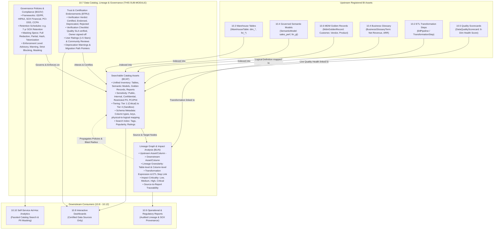

# Research — Sub-module 10.7: Data Catalog, Lineage & Governance (Module 10 — Business Intelligence, `bi`)

- **Sub-module:** 10.7 Data Catalog, Lineage & Governance
- **Module:** 10 Business Intelligence
- **Target app:** `apps/bi` (extended across 10.1–10.6; adding 10.7 `DataCatalog` package)
- **Research date:** 2026-11-05
- **Phase:** Phase 1 Research Catalog
- **Output file target:** `.claude/tasks/research-bi-10.7.md`

---

## 1. Executive Summary & Domain Architecture

Sub-module 10.7 delivers an **enterprise searchable data catalog, physical-to-logical business metadata mapping, automated end-to-end and column-level data lineage, regulatory policy and compliance enforcement (GDPR/HIPAA/SOX/PCI-DSS), and dataset certification with trust and deprecation indicators** for NavERP (`apps/bi`).

In modern enterprise data platforms, data governance shifts from static documentation into **active metadata intelligence**:
- **Sub-module 10.1 (Data Integration & Ingestion):** Ingests raw data from external connectors, batch pipelines, and CDC streams (`DataSourceConnector`, `IngestionPipeline`, `CdcSyncConfig`).
- **Sub-module 10.2 (ETL/ELT & Data Pipelines):** Transforms and stages data through structured multi-step DAG pipelines (`EtlPipeline`, `TransformationStep`).
- **Sub-module 10.3 (Data Warehouse & Storage):** Stores physical warehouse tables, dimension tables, fact tables, lakehouse zones, and storage policies (`WarehouseTable`, `DataMart`, `LakehouseZone`).
- **Sub-module 10.4 (Data Modeling & Semantic Layer):** Abstraction layer providing business glossary definitions, governed semantic models, calculated measures, and drill hierarchies (`BusinessGlossaryTerm`, `SemanticModel`, `CalculatedMeasure`, `DrillHierarchy`).
- **Sub-module 10.5 (Data Quality & Cleansing):** Profiles datasets, enforces assertion rules, records anomalies, and calculates multi-dimensional health scores (`DataQualityScorecard`, `DataQualityRule`, `DataQualityProfile`).
- **Sub-module 10.6 (Master Data Management):** Consolidates golden records, multi-domain hierarchies, and reference data crosswalks (`MdmGoldenRecord`, `MdmHierarchyNode`, `MdmReferenceCode`).
- **Sub-module 10.7 (Data Catalog, Lineage & Governance — THIS SUB-MODULE):** Provides the centralized discovery, traceability, compliance, and trust fabric unifying all BI data assets:
  1. **Searchable Data Catalog (`CatalogAsset`):** A centralized, faceted search index across all enterprise analytical assets (warehouse tables, semantic models, MDM golden records, reports, metrics, and ingestion pipelines) with user ratings, view popularity, domain classification, and search tags.
  2. **Business & Technical Metadata (`CatalogAsset`):** Maps physical schemas, columns, types, and partition keys to business glossary terms (`BusinessGlossaryTerm`), data stewards, owning org units (`core.OrgUnit`), and multi-tier data classifications (`Tier 1 Mission Critical` to `Tier 4 Sandbox`).
  3. **End-to-End & Column-Level Lineage (`CatalogLineageEdge`):** Directed acyclic graph (DAG) tracing upstream source assets and specific columns through ETL transformations down to semantic models and reports, enabling root-cause debugging and automated downstream impact analysis.
  4. **Policy & Compliance Management (`DataGovernancePolicy`):** Authoritative rules defining regulatory handling (GDPR, HIPAA, SOX, PCI-DSS, CCPA), mandatory retention schedules, automated masking requirements (SHA-256, tokenization, redaction), and policy review audit cycles.
  5. **Certification & Trust Indicators (`CatalogTrustEndorsement`):** Rigorous multi-stage asset verification (Draft -> Under Review -> Certified / Endorsed -> Deprecated), capturing peer endorsements, 5-star user ratings, deprecation replacement links, and steward verification checklists linked with live 10.5 quality scorecards.
- **Downstream Consumers (10.8–10.12):** Cataloged, certified, and lineage-verified assets empower self-service reporting, dashboard builders (10.8), standard reports (10.9), and ad-hoc query builders (10.10) with complete confidence in data accuracy, regulatory compliance, and provenance.

### Architectural Boundaries & End-to-End Data Flow



---

## 2. Repo State Checked First

### 2.1 Navigation & App Tree State
- **`apps/core/navigation.py`:** Inspected `LIVE_LINKS`. Sub-modules `10.1`, `10.2`, `10.3`, `10.4`, `10.5`, and `10.6` are fully built and live:
  - `"10.1"`: Source Connectors, Batch & Real-Time Ingestion, Change Data Capture (CDC), API & Webhook Gateway, File & Cloud Storage Imports.
  - `"10.2"`: Visual Pipeline Builder, Transformation Library, Orchestration & Scheduling, Pipeline Monitoring & Logging, Version Control & CI/CD.
  - `"10.3"`: Centralized Data Warehouse, Data Marts, Data Lake & Lakehouse, Partitioning & Compression, Archival & Retention.
  - `"10.4"`: Dimensional Modeling, Semantic Layer & Business Glossary, Calculated Measures & Hierarchies, Reusable Datasets & Views, Metadata-Driven Modeling.
  - `"10.5"`: Data Profiling, Validation & Quality Rules, Deduplication & Matching, Standardization & Enrichment, Quality Scorecards & Remediation.
  - `"10.6"`: Golden Record Management, Match/Merge & Survivorship, Hierarchy & Relationship Trees, Reference Data Code Sets & Crosswalks, Stewardship Workflows.
  - **`10.7` is the next unbuilt sub-module in Module 10.**
- **`apps/bi/`:** Established package layout under `apps/bi/models/`:
  - `apps/bi/models/DataIntegration/` (10.1)
  - `apps/bi/models/EtlPipelines/` (10.2)
  - `apps/bi/models/DataWarehouse/` (10.3)
  - `apps/bi/models/SemanticLayer/` (10.4)
  - `apps/bi/models/DataQuality/` (10.5)
  - `apps/bi/models/MasterData/` (10.6)
  - Target for 10.7: `apps/bi/models/DataCatalog/`
  - Base classes: `apps/bi/models/_base.py` (`TenantOwned`, `TenantNumbered` with `next_number()` sequence allocation).

### 2.2 As-Built Core Spine & Sibling Entities (Grep & Runtime Verified)

| Entity | Location | Verified Status | 10.7 Relationship & Usage |
|---|---|---|---|
| `core.Tenant` | `apps/core/models/Tenant.py:17` | **Present** | Strict tenant isolation boundary across all catalog assets, lineage edges, governance policies, and endorsements |
| `settings.AUTH_USER_MODEL` | `config/settings.py` (`accounts.User`) | **Present** | Asset owners, designated data stewards, certifying authorities, policy owners, and user reviewers |
| `core.OrgUnit` | `apps/core/models/OrgUnit.py:5` | **Present** | Organizational stewardship boundary (Finance, Operations, Supply Chain, Human Resources) |
| `core.AuditLog` | `apps/core/models/AuditLog.py:14` | **Present** | Immutable administrative audit trails for certification approvals, policy revisions, and deprecation notices |
| `bi.WarehouseTable` | `apps/bi/models/DataWarehouse/WarehouseTables.py:8` | **Present** | Primary physical analytical tables registered in catalog; source/target nodes for lineage |
| `bi.SemanticModel` | `apps/bi/models/SemanticLayer/SemanticModels.py:8` | **Present** | Governed semantic models registered in catalog; target nodes for upstream table lineage |
| `bi.BusinessGlossaryTerm` | `apps/bi/models/SemanticLayer/BusinessGlossaryTerms.py:8` | **Present** | Business glossary term linked to catalog assets for physical-to-logical conceptual mapping |
| `bi.DataQualityScorecard` | `apps/bi/models/DataQuality/DataQualityScorecards.py:10` | **Present** | Automated quality health scores, completeness, and freshness metrics powering catalog trust badges |
| `bi.MdmGoldenRecord` | `apps/bi/models/MasterData/MdmGoldenRecords.py:8` | **Present** | Master data golden records cataloged as authoritative single-source-of-truth enterprise entities |
| `bi.EtlPipeline` | `apps/bi/models/EtlPipelines/EtlPipelines.py:9` | **Present** | ETL pipelines powering transformation nodes in end-to-end data lineage |
| `bi.TransformationStep` | `apps/bi/models/EtlPipelines/TransformationSteps.py:9` | **Present** | Granular transformation steps defining SQL logic / column transformations along lineage edges |
| `bi.DataSourceConnector` | `apps/bi/models/DataIntegration/DataSourceConnectors.py:8` | **Present** | External source connectors representing the ingestion root origins of data lineage |

### 2.3 Collision-Free Prefix Verification
Inspected all prefixes repository-wide and within `apps/bi/`:
- Built in `apps/bi/`:
  - 10.1: `BCDC`, `BDSC`, `BING`, `BIJR`
  - 10.2: `BETL`, `BTRN`, `BPVR`, `BEXR`
  - 10.3: `BDMT`, `BLHZ`, `BWSP`, `BDWT`
  - 10.4: `BSMD`, `BGLO`, `BCMS`, `BDHI`
  - 10.5: `BDQP`, `BDQR`, `BDQE`, `BDQS`
  - 10.6: `BMGR`, `BMSR`, `BMHR`, `BMRD`
- Checked candidate prefixes across all 24 apps in NavERP — **zero collisions detected**:
  - `BCAT`: `CatalogAsset` (**100% Unique & Free**)
  - `BLIN`: `CatalogLineageEdge` (**100% Unique & Free**)
  - `BGOV`: `DataGovernancePolicy` (**100% Unique & Free**)
  - `BTRU`: `CatalogTrustEndorsement` (**100% Unique & Free**)

---

## 3. Leaders Surveyed (with source references)

1. **Collibra Data Intelligence Cloud (Catalog, Lineage & Governance)** — Enterprise Data Governance & Intelligence Platform
   - *Overview:* The enterprise gold standard for unified data cataloging, business governance, automated data lineage, and policy compliance.
   - *Key capabilities:* Automated technical metadata harvesting across databases and BI reports, business glossary linking, automated technical and business lineage diagrams, multi-stage certification workflows (Gold/Silver/Bronze trust tiers), data usage contracts, and compliance tagging (GDPR/CCPA/BCBS 239).
   - *URL:* `https://www.collibra.com/us/en/products/data-catalog`

2. **Alation Data Catalog** — Active Behavioral Data Catalog & Governance Platform
   - *Overview:* Leading data intelligence platform emphasizing collaborative cataloging, behavioral query analysis, and active data trust indicators.
   - *Key capabilities:* Machine-learning powered query log ingestion (Lexicon engine), trust flags (Endorsement badges, Warning banners, Deprecation flags), column-level visual lineage with data quality score overlays, user community ratings, conversation threads, and automated usage frequency rankings.
   - *URL:* `https://www.alation.com/product/data-catalog/`

3. **Atlan Active Metadata Platform** — Next-Gen Active Metadata, Column Lineage & Governance
   - *Overview:* Cloud-native active metadata platform designed for modern data teams, analytics engineers, and autonomous AI agents.
   - *Key capabilities:* Granular SQL-parser-driven column-level lineage, automated impact analysis (upstream root-cause identification and downstream blast radius calculation), active policy propagation (e.g. tagging a source column as PII automatically propagates that tag down to all derivative views and dashboard fields), automated certification badges, and metadata playbooks.
   - *URL:* `https://atlan.com/product/`

4. **Microsoft Purview & Apache Atlas** — Enterprise Unified Data Governance & Metadata Graph
   - *Overview:* Enterprise data governance platform powered by the open-source Apache Atlas graph metadata standard.
   - *Key capabilities:* Dual-layer classification system combining Apache Atlas technical data classifications (e.g. `CREDIT_CARD_NUMBER`, `SSN`) with Microsoft Information Protection sensitivity labels (e.g. `Public`, `General`, `Confidential`, `Highly Confidential`), end-to-end execution lineage from Azure Data Factory / Synapse / Power BI, and Apache Atlas-compatible REST APIs for custom lineage integration.
   - *URL:* `https://www.microsoft.com/en-us/security/business/compliance/microsoft-purview`

5. **Informatica Cloud Data Governance and Catalog (CDGC)** — AI-Powered Intelligent Data Management Cloud (IDMC)
   - *Overview:* Cloud-native data catalog and governance solution using Informatica's CLAIRE AI engine for automated metadata discovery and classification.
   - *Key capabilities:* Automated metadata scanners across multicloud lakes, warehouses, and BI reports; unified business-to-technical lineage; AI-driven data classification (PII, PHI, financial); regulatory policy management (GDPR, HIPAA, SOX) with enforcement levels (strict blocking vs audit alert); and physical-to-logical glossary term association.
   - *URL:* `https://www.informatica.com/products/data-governance/cloud-data-governance-and-catalog.html`

6. **Monte Carlo & Datafold** — Data Observability, Column-Level Lineage & CI/CD Diffing
   - *Overview:* Leaders in modern data observability and automated column-level impact analysis.
   - *Key capabilities:* Automated column-level SQL dialect parsing (Snowflake, BigQuery, Postgres), reactive root-cause analysis (tracing corrupted BI metrics back to upstream broken ETL jobs), proactive pre-merge schema impact diffing (preventing silent breaking changes in downstream dashboards), and live freshness/quality telemetry overlay on lineage DAGs.
   - *URL:* `https://www.montecarlo.ai/product/` & `https://www.datafold.com/`

7. **OpenMetadata** — Open-Source Metadata Standard, Lineage & Data Governance
   - *Overview:* Open-source data catalog and metadata standard built natively on OpenLineage specifications and schemas.
   - *Key capabilities:* Standardized data tiering (`Tier 1 Mission Critical` down to `Tier 5 Experimental`), formal dataset certification, mutually exclusive classification tags, hierarchical business glossary term bindings, table and column-level DAG lineage graphs, and automated PII profiler tagging.
   - *URL:* `https://open-metadata.org/`

8. **Google Cloud Dataplex & Data Catalog** — Unified Intelligent Lakehouse & Governance Fabric
   - *Overview:* Google Cloud's centralized metadata management, active data governance, and discovery service.
   - *Key capabilities:* Schema-driven Tag Templates for business metadata standardization, hierarchical Policy Tags for column-level fine-grained access control (FGAC) and masking, automated execution lineage across BigQuery and Cloud Data Fusion, cross-project faceted asset discovery, and data quality SLA tracking.
   - *URL:* `https://cloud.google.com/dataplex`

---

## 4. Feature Catalog (Sub-module 10.7 Only)

### 4.1 Searchable Data Catalog
- **Unified Multi-Type Asset Inventory** — Indexed registry of analytical assets across physical warehouse tables (`bi.WarehouseTable`), governed semantic models (`bi.SemanticModel`), MDM golden records (`bi.MdmGoldenRecord`), ETL pipelines (`bi.EtlPipeline`), external source connectors (`bi.DataSourceConnector`), calculated measures, and analytical reports. · seen in: Collibra, Alation, Atlan, OpenMetadata · priority: `table-stakes` · spine: new model `CatalogAsset` · buildable now.
- **Faceted Multi-Dimensional Search & Filtering** — Rapid filtering by asset type, business domain area (Finance, Sales, Supply Chain, HR, Customer, Operations), data tier, sensitivity level, certification status, owner/steward, and tag keywords. · seen in: Alation, Atlan, Microsoft Purview · priority: `table-stakes` · spine: `CatalogAsset` search view with Django Q filters · buildable now.
- **Usage Popularity & Engagement Scoring** — Tracking usage frequency (`popularity_score`), query counts, and user view interactions to float high-value, actively utilized assets to the top of catalog search results. · seen in: Alation, Atlan · priority: `table-stakes` · spine: `CatalogAsset.popularity_score` · buildable now.
- **User Ratings & Community Review Registry** — Community crowd-sourced feedback with 5-star ratings and structured reviews (`user_rating_avg`, `rating_count`) enabling data consumers to share practical usage guidance and caveats. · seen in: Alation, OpenMetadata · priority: `common` · spine: `CatalogAsset.user_rating_avg`, `CatalogTrustEndorsement` · buildable now.
- **Searchable Tag & Keyword Taxonomies** — Flexible keyword tagging (`tags`) supporting freeform and controlled taxonomies for rapid categorization and cross-domain asset grouping. · seen in: Collibra, OpenMetadata, Dataplex · priority: `table-stakes` · spine: `CatalogAsset.tags` · buildable now.

### 4.2 Business & Technical Metadata
- **Physical-to-Logical Schema Mapping** — Direct association between physical database tables/columns (`bi.WarehouseTable`) and abstract business concepts (`bi.BusinessGlossaryTerm`), providing non-technical analysts with intuitive business context for cryptic column names. · seen in: Collibra, Informatica CDGC, OpenMetadata · priority: `table-stakes` · spine: `CatalogAsset.business_glossary_term`, `CatalogAsset.technical_schema_json` · buildable now.
- **Technical Schema Dictionary & Data Profiling Snapshot** — Detailed technical schema dictionary (`technical_schema_json`) recording column names, physical SQL data types, nullability, primary/foreign key flags, partition keys, and sample distributions. · seen in: Atlan, Purview, OpenMetadata · priority: `table-stakes` · spine: `CatalogAsset.technical_schema_json` · buildable now.
- **Multi-Role Ownership & Stewardship Assignment** — Explicit assignment of business data owners (`owner_user`), designated technical stewards (`steward_user`), and responsible organizational units (`core.OrgUnit`), eliminating organizational ambiguity regarding data custody. · seen in: Collibra, Atlan, OpenMetadata · priority: `table-stakes` · spine: `CatalogAsset.owner_user`, `CatalogAsset.steward_user`, `CatalogAsset.steward_org_unit` · buildable now.
- **Hierarchical Asset Criticality Tiering** — Standardized four-tier business criticality rating:
  - `tier_1_mission_critical`: Core financial ledgers, regulatory filings, and executive KPIs.
  - `tier_2_business_operational`: Daily operational reports, inventory levels, and CRM pipelines.
  - `tier_3_internal_reporting`: Team dashboards and departmental analytics.
  - `tier_4_experimental_sandbox`: Ad-hoc exploratory queries and sandbox prototypes.
  · seen in: OpenMetadata, Atlan · priority: `table-stakes` · spine: `CatalogAsset.classification_tier` · buildable now.
- **Data Sensitivity & Privacy Labeling** — Fine-grained privacy and confidentiality labeling:
  - `public`: Unrestricted enterprise data.
  - `internal`: Internal company use only.
  - `confidential`: Sensitive commercial and financial metrics.
  - `restricted_pii`: Personally Identifiable Information (GDPR, CCPA).
  - `highly_sensitive_pci_phi`: Credit card payment details (PCI-DSS) or health data (HIPAA).
  · seen in: Microsoft Purview, Dataplex, Informatica CDGC · priority: `table-stakes` · spine: `CatalogAsset.sensitivity_level` · buildable now.

### 4.3 End-to-End Data Lineage
- **Directed Graph Lineage Edge Registry** — Graph relationship model tracking upstream source assets and downstream dependent assets, creating an end-to-end directed acyclic graph (DAG) from initial raw ingestion to final executive dashboards. · seen in: Collibra Lineage, Alation, Atlan, Purview · priority: `table-stakes` · spine: new model `CatalogLineageEdge` · buildable now.
- **Column-Level Lineage Granularity** — Detailed field-to-field tracking (`upstream_column` -> `downstream_column`) recording exact transformation expressions (e.g. `ROUND(SUM(unit_price * quantity), 2) AS net_revenue`) and calculation rules. · seen in: Atlan, Datafold, Monte Carlo, OpenMetadata · priority: `table-stakes` · spine: `CatalogLineageEdge.upstream_column`, `CatalogLineageEdge.downstream_column`, `CatalogLineageEdge.transformation_rule` · buildable now.
- **Pipeline & ETL Transformation Binding** — Direct linkage of lineage edges to specific ETL pipelines (`bi.EtlPipeline`) and transformation steps (`bi.TransformationStep`), tying logical lineage directly to executable code. · seen in: Atlan, OpenLineage, Purview · priority: `table-stakes` · spine: `CatalogLineageEdge.etl_pipeline`, `CatalogLineageEdge.transformation_step` · buildable now.
- **Downstream Blast Radius & Impact Analysis** — Interactive impact analysis evaluating the criticality (`low`, `medium`, `high`, `critical`) and total count of downstream dependent assets and reports affected by an upstream schema change or pipeline failure. · seen in: Monte Carlo, Datafold, Atlan, Collibra · priority: `table-stakes` · spine: `CatalogLineageEdge.impact_criticality`, reverse lineage traversal · buildable now.
- **Automated vs Manual Lineage Distinction** — Tracking whether a lineage edge was automatically introspected via SQL parsing / ETL telemetry (`is_automated_extraction=True`) or manually declared by a data architect. · seen in: Purview, OpenMetadata · priority: `common` · spine: `CatalogLineageEdge.is_automated_extraction`, `CatalogLineageEdge.last_verified_at` · buildable now.

### 4.4 Policy & Compliance Management
- **Enterprise Regulatory Governance Frameworks** — Authoritative policy definitions mapped to global compliance frameworks:
  - `gdpr_eu`: European General Data Protection Regulation (right to erasure, consent, residency).
  - `hipaa_healthcare`: Health Insurance Portability and Accountability Act.
  - `sox_financial`: Sarbanes-Oxley Act (financial reporting integrity, change control).
  - `pci_dss`: Payment Card Industry Data Security Standard.
  - `ccpa_cpra`: California Consumer Privacy Act.
  - `iso_27001`: Information security management standards.
  - `internal_standard`: Corporate internal governance policies.
  · seen in: Collibra, Informatica CDGC, Microsoft Purview · priority: `table-stakes` · spine: new model `DataGovernancePolicy` (`regulatory_framework`) · buildable now.
- **Policy Enforcement Levels** — Configurable compliance enforcement modes:
  - `advisory_informational`: Educational guidelines for data consumers.
  - `audit_warning`: Generates audit alerts upon non-compliant access or missing metadata.
  - `strict_blocking`: Disallows publishing or downstream querying without compliance sign-off.
  - `automated_masking`: Automatically redacts or hashes sensitive columns.
  · seen in: Informatica CDGC, Microsoft Purview · priority: `table-stakes` · spine: `DataGovernancePolicy.enforcement_level` · buildable now.
- **Automated Data Retention & Archival Schedules** — Enforcing statutory retention periods (`retention_period_days`, e.g. 2,555 days / 7 years for SOX financial transactions) and purging/archival schedules linked to 10.3 warehouse storage policies. · seen in: Collibra, Purview, Informatica · priority: `table-stakes` · spine: `DataGovernancePolicy.retention_period_days` · buildable now.
- **Data Masking & Redaction Specifications** — Standardized masking directives for sensitive columns: `full_redaction` (`***`), `partial_mask_email_phone` (`j***@corp.com`), `hash_sha256`, `tokenization`, or `nullify`. · seen in: Google Cloud Dataplex (Policy Tags), Microsoft Purview · priority: `table-stakes` · spine: `DataGovernancePolicy.masking_algorithm` · buildable now.
- **Periodic Policy Review Cycles** — Tracking statutory review cadences (`review_frequency_days`, `last_reviewed_at`, `expiration_date`) with assigned policy ownership (`policy_owner`) to guarantee policies remain current with evolving legal requirements. · seen in: Collibra, Informatica · priority: `common` · spine: `DataGovernancePolicy.last_reviewed_at`, `DataGovernancePolicy.review_frequency_days` · buildable now.

### 4.5 Certification & Trust Indicators
- **Dataset Certification Lifecycle States** — Explicit trust badges displayed prominently on catalog assets:
  - `draft`: Unverified / initial discovery.
  - `under_review`: Stewardship validation in progress.
  - `certified`: Formally verified, highly trusted for enterprise decision-making.
  - `endorsed`: Recognized as a recommended best-practice dataset.
  - `deprecated`: Outdated / scheduled for decommissioning; displays warning banner.
  - `quarantined`: Blocked from consumption due to critical quality or compliance breach.
  · seen in: Alation, Collibra, OpenMetadata, Atlan · priority: `table-stakes` · spine: `CatalogAsset.certification_status`, new model `CatalogTrustEndorsement` · buildable now.
- **Deprecation Warning Banners & Migration Paths** — Transparent deprecation management capturing deprecation rationales (`deprecation_reason`) and explicit pointers to superseding replacement assets (`deprecation_replacement_asset`), preventing silent analytical pipeline breakage. · seen in: Alation (Deprecation flags), OpenMetadata · priority: `table-stakes` · spine: `CatalogAsset.deprecation_reason`, `CatalogAsset.deprecation_replacement_asset` · buildable now.
- **Formal Certification Audit Trail** — Immutable historical endorsement log (`CatalogTrustEndorsement`) recording the attesting authority (`attested_by`), timestamp, review verdict (`approved_certified`, `conditionally_approved`, `deprecated_scheduled_retirement`), and expiration date. · seen in: Collibra, Atlan · priority: `table-stakes` · spine: `CatalogTrustEndorsement` · buildable now.
- **Structured Verification Criteria Checklist** — Verification checklist stored in structured JSON (`criteria_checklist_json`), validating that the dataset has passed four foundational trust gates:
  1. *Schema verified and documented* (100% column descriptions populated).
  2. *Quality health scorecard verified* (Sub-module 10.5 overall score >= 85.00%).
  3. *Business owner and steward assigned*.
  4. *Upstream lineage graph fully traced*.
  · seen in: Collibra (Trust Framework), OpenMetadata · priority: `table-stakes` · spine: `CatalogTrustEndorsement.criteria_checklist_json` · buildable now.
- **Data Quality Scorecard Integration** — Live connection to Sub-module 10.5 `DataQualityScorecard`, automatically displaying current health grades (A/B/C/D) and 6-dimensional metrics (completeness, accuracy, timeliness, uniqueness, consistency, validity) on the catalog asset header. · seen in: Collibra, Alation, Atlan · priority: `table-stakes` · spine: `CatalogAsset.quality_scorecard` · buildable now.

### 4.6 Beyond the Bullets (Enterprise Governance Differentiators)
- **Active Metadata Tag Propagation via Lineage** — Automated downstream inheritance: when a source table or column is tagged with `restricted_pii` or governed by a `gdpr_eu` policy, the classification automatically flows down all active lineage edges to alert downstream consumers. · seen in: Atlan, Purview, Informatica · priority: `differentiator` · spine: `CatalogLineageEdge` + `CatalogAsset.sensitivity_level` propagation · buildable now.
- **Data Contract & SLA Guarantees** — Clear specification of update frequency, schema stability guarantees, and latency expectations directly visible on the catalog asset profile. · seen in: Collibra, Atlan · priority: `common` · spine: `CatalogAsset.technical_schema_json` metadata fields · buildable now.

---

## 5. Recommended Build Scope (This Pass — 4 Models)

To implement Sub-module 10.7 comprehensively within NavERP's standard 1–4 model unit, we recommend four tenant-scoped models in package `apps/bi/models/DataCatalog/`:

```
apps/bi/models/DataCatalog/
├── __init__.py
├── CatalogAssets.py             # BCAT- (Searchable Catalog, Business & Technical Metadata, Ratings)
├── CatalogLineageEdges.py       # BLIN- (End-to-End & Column-Level Lineage Graph, Impact Analysis)
├── DataGovernancePolicies.py    # BGOV- (Regulatory Compliance, Retention, Classification & Masking)
└── CatalogTrustEndorsements.py  # BTRU- (Certification, Endorsements, Deprecation & Verification Audits)
```

### Model 1: `CatalogAsset` [Prefix: `BCAT-`]
- **File:** `apps/bi/models/DataCatalog/CatalogAssets.py`
- **Inherits:** `TenantNumbered` (`apps/bi/models/_base.py`)
- **Key Fields:**
  - `number`: auto-generated (`BCAT-00001`)
  - `name`: `CharField(max_length=200)` (e.g. "Monthly Executive Financial Summary", "Customer 360 Dimension", "Daily Sales Fact")
  - `slug`: `SlugField(max_length=100)`
  - `asset_type`: `CharField(choices=[('warehouse_table', 'Warehouse Table / Dimension / Fact'), ('semantic_model', 'Governed Semantic Model'), ('golden_record', 'MDM Golden Record Master'), ('metric', 'Calculated Measure / Metric'), ('report', 'Standard / Regulatory Report'), ('pipeline', 'ETL / Ingestion Pipeline'), ('source_dataset', 'External Source Dataset')], default='warehouse_table')`
  - `domain_area`: `CharField(choices=[('finance', 'Finance & Accounting'), ('sales', 'Sales & CRM'), ('supply_chain', 'Supply Chain & Inventory'), ('procurement', 'Procurement & Purchasing'), ('human_resources', 'Human Resources & Payroll'), ('customer', 'Customer Experience & Marketing'), ('operations', 'Operations & Logistics'), ('cross_domain', 'Cross-Domain Enterprise Master')], default='finance')`
  - `classification_tier`: `CharField(choices=[('tier_1_mission_critical', 'Tier 1 - Mission Critical (Executive / Regulatory)'), ('tier_2_business_operational', 'Tier 2 - Business Operational (Daily Core)'), ('tier_3_internal_reporting', 'Tier 3 - Internal Departmental Reporting'), ('tier_4_experimental_sandbox', 'Tier 4 - Exploratory Sandbox / Ad-hoc')], default='tier_2_business_operational')`
  - `sensitivity_level`: `CharField(choices=[('public', 'Public - Unrestricted'), ('internal', 'Internal Use Only'), ('confidential', 'Confidential Commercial'), ('restricted_pii', 'Restricted PII (GDPR / CCPA)'), ('highly_sensitive_pci_phi', 'Highly Sensitive (PCI-DSS / HIPAA)')], default='internal')`
  - `certification_status`: `CharField(choices=[('draft', 'Draft / Unverified'), ('under_review', 'Under Stewardship Review'), ('certified', 'Certified Enterprise Asset'), ('endorsed', 'Community Endorsed'), ('deprecated', 'Deprecated - Pending Decommission'), ('quarantined', 'Quarantined (Quality / Compliance Breach)')], default='draft')`
  - `business_glossary_term`: `ForeignKey('bi.BusinessGlossaryTerm', null=True, blank=True, on_delete=models.SET_NULL, related_name='catalog_assets', help_text="Logical business term binding for semantic clarity")`
  - `warehouse_table`: `ForeignKey('bi.WarehouseTable', null=True, blank=True, on_delete=models.SET_NULL, related_name='catalog_assets', help_text="Underlying physical warehouse table")`
  - `semantic_model`: `ForeignKey('bi.SemanticModel', null=True, blank=True, on_delete=models.SET_NULL, related_name='catalog_assets', help_text="Governed semantic model representation")`
  - `golden_record`: `ForeignKey('bi.MdmGoldenRecord', null=True, blank=True, on_delete=models.SET_NULL, related_name='catalog_assets', help_text="MDM golden record profile")`
  - `quality_scorecard`: `ForeignKey('bi.DataQualityScorecard', null=True, blank=True, on_delete=models.SET_NULL, related_name='catalog_assets', help_text="Latest data quality health scorecard")`
  - `owner_user`: `ForeignKey(settings.AUTH_USER_MODEL, null=True, blank=True, on_delete=models.SET_NULL, related_name='owned_catalog_assets', help_text="Business owner responsible for asset accuracy")`
  - `steward_user`: `ForeignKey(settings.AUTH_USER_MODEL, null=True, blank=True, on_delete=models.SET_NULL, related_name='stewarded_catalog_assets', help_text="Technical steward responsible for pipelines & maintenance")`
  - `steward_org_unit`: `ForeignKey('core.OrgUnit', null=True, blank=True, on_delete=models.SET_NULL, related_name='catalog_assets', help_text="Departmental ownership unit")`
  - `certified_by`: `ForeignKey(settings.AUTH_USER_MODEL, null=True, blank=True, on_delete=models.SET_NULL, related_name='certified_catalog_assets')`
  - `certified_at`: `DateTimeField(null=True, blank=True)`
  - `deprecation_reason`: `TextField(blank=True, help_text="Reason for deprecation and migration guidance")`
  - `deprecation_replacement_asset`: `ForeignKey('self', null=True, blank=True, on_delete=models.SET_NULL, related_name='deprecated_replacements', help_text="Recommended replacement asset")`
  - `user_rating_avg`: `DecimalField(max_digits=3, decimal_places=2, default=Decimal('0.00'), help_text="Average community rating (0.00 to 5.00)")`
  - `rating_count`: `PositiveIntegerField(default=0, help_text="Total number of user ratings submitted")`
  - `popularity_score`: `PositiveIntegerField(default=0, help_text="Aggregate query and view access counter")`
  - `tags`: `CharField(max_length=255, blank=True, help_text="Comma-separated search tags, e.g. finance, revenue, monthly_close, sox")`
  - `technical_schema_json`: `JSONField(default=dict, help_text="Column dictionary: {columns: [{name, data_type, nullable, is_pk, is_pii, description}], row_count, storage_format}")`
  - `description`: `TextField(blank=True, help_text="Comprehensive overview of dataset contents, grain, and business context")`
  - `is_active`: `BooleanField(default=True)`

### Model 2: `CatalogLineageEdge` [Prefix: `BLIN-`]
- **File:** `apps/bi/models/DataCatalog/CatalogLineageEdges.py`
- **Inherits:** `TenantNumbered` (`apps/bi/models/_base.py`)
- **Key Fields:**
  - `number`: auto-generated (`BLIN-00001`)
  - `upstream_asset`: `ForeignKey('bi.CatalogAsset', on_delete=models.CASCADE, related_name='downstream_edges', help_text="Source / upstream dataset producing data")`
  - `downstream_asset`: `ForeignKey('bi.CatalogAsset', on_delete=models.CASCADE, related_name='upstream_edges', help_text="Target / downstream dataset consuming data")`
  - `lineage_type`: `CharField(choices=[('table_level', 'Table-to-Table Dataset Lineage'), ('column_level', 'Column-to-Column Granular Lineage'), ('pipeline_transformation', 'ETL Pipeline Transformation'), ('semantic_abstraction', 'Semantic Model Logical Derivation'), ('report_consumption', 'BI Report / Dashboard Query')], default='table_level')`
  - `upstream_column`: `CharField(max_length=120, blank=True, help_text="Specific source column name (for column-level lineage)")`
  - `downstream_column`: `CharField(max_length=120, blank=True, help_text="Specific target column name (for column-level lineage)")`
  - `transformation_rule`: `TextField(blank=True, help_text="SQL expression, aggregation formula, or conversion logic (e.g. SUM(amount_cur * fx_rate))")`
  - `etl_pipeline`: `ForeignKey('bi.EtlPipeline', null=True, blank=True, on_delete=models.SET_NULL, related_name='lineage_edges', help_text="Executing ETL pipeline")`
  - `transformation_step`: `ForeignKey('bi.TransformationStep', null=True, blank=True, on_delete=models.SET_NULL, related_name='lineage_edges', help_text="Granular pipeline transformation step")`
  - `impact_criticality`: `CharField(choices=[('low', 'Low - Informational / Non-Breaking'), ('medium', 'Medium - Team Reporting Impact'), ('high', 'High - Key Operational Dependency'), ('critical', 'Critical - Regulatory / Financial Lineage Break')], default='medium')`
  - `is_automated_extraction`: `BooleanField(default=True, help_text="True if automatically discovered via query log / ETL parser; False if manually defined")`
  - `last_verified_at`: `DateTimeField(null=True, blank=True)`
  - `notes`: `TextField(blank=True)`
  - `is_active`: `BooleanField(default=True)`

### Model 3: `DataGovernancePolicy` [Prefix: `BGOV-`]
- **File:** `apps/bi/models/DataCatalog/DataGovernancePolicies.py`
- **Inherits:** `TenantNumbered` (`apps/bi/models/_base.py`)
- **Key Fields:**
  - `number`: auto-generated (`BGOV-00001`)
  - `name`: `CharField(max_length=180)` (e.g. "GDPR Customer PII Erasure Policy", "SOX 7-Year Financial Retention Mandate", "PCI-DSS Credit Card Redaction")
  - `code`: `SlugField(max_length=80)`
  - `policy_type`: `CharField(choices=[('regulatory_compliance', 'Regulatory Compliance Mandate'), ('retention_archival', 'Data Retention & Archival Schedule'), ('sensitivity_classification', 'Data Sensitivity & Tagging Policy'), ('data_masking', 'Column Masking & Redaction Rule'), ('acceptable_use', 'Data Sharing & Acceptable Use Policy'), ('sox_financial_control', 'SOX Financial Internal Control')], default='regulatory_compliance')`
  - `regulatory_framework`: `CharField(choices=[('gdpr_eu', 'GDPR - European Privacy Regulation'), ('hipaa_healthcare', 'HIPAA - Health Information Privacy'), ('sox_financial', 'SOX - Sarbanes-Oxley Financial Reporting'), ('pci_dss', 'PCI-DSS - Payment Card Security'), ('ccpa_cpra', 'CCPA/CPRA - California Consumer Privacy'), ('iso_27001', 'ISO 27001 - Security Standards'), ('internal_standard', 'Internal Enterprise Standard')], default='gdpr_eu')`
  - `enforcement_level`: `CharField(choices=[('advisory_informational', 'Advisory / Informational Guidelines'), ('audit_warning', 'Audit Warning / Compliance Alert'), ('strict_blocking', 'Strict Blocking / Enforcement Gate'), ('automated_masking', 'Automated Dynamic Column Masking')], default='audit_warning')`
  - `retention_period_days`: `PositiveIntegerField(null=True, blank=True, help_text="Statutory retention duration in days (e.g. 2555 days for 7 years)")`
  - `masking_algorithm`: `CharField(choices=[('none', 'No Masking (Plaintext)'), ('full_redaction', 'Full Redaction (***)'), ('partial_mask_email_phone', 'Partial Masking (Email / Phone)'), ('hash_sha256', 'Cryptographic SHA-256 Hash'), ('tokenization', 'Irreversible Tokenization'), ('nullify', 'Nullify / Blank Value')], default='none')`
  - `policy_owner`: `ForeignKey(settings.AUTH_USER_MODEL, null=True, blank=True, on_delete=models.SET_NULL, related_name='owned_governance_policies')`
  - `effective_date`: `DateField(help_text="Date from which this policy takes legal effect")`
  - `expiration_date`: `DateField(null=True, blank=True, help_text="Optional sunset / expiration date")`
  - `review_frequency_days`: `PositiveIntegerField(default=365, help_text="Mandatory policy review cadence in days (default: annual / 365 days)")`
  - `last_reviewed_at`: `DateTimeField(null=True, blank=True)`
  - `compliance_notes`: `TextField(blank=True, help_text="Legal citations, audit guidance, and statutory references")`
  - `description`: `TextField(blank=True)`
  - `is_active`: `BooleanField(default=True)`

### Model 4: `CatalogTrustEndorsement` [Prefix: `BTRU-`]
- **File:** `apps/bi/models/DataCatalog/CatalogTrustEndorsements.py`
- **Inherits:** `TenantNumbered` (`apps/bi/models/_base.py`)
- **Key Fields:**
  - `number`: auto-generated (`BTRU-00001`)
  - `asset`: `ForeignKey('bi.CatalogAsset', on_delete=models.CASCADE, related_name='endorsements', help_text="Catalog asset being evaluated or endorsed")`
  - `endorsement_type`: `CharField(choices=[('formal_certification', 'Formal Data Steward Certification'), ('peer_endorsement', 'Peer Data Practitioner Endorsement'), ('user_rating', 'Community User Review & Rating'), ('deprecation_notice', 'Deprecation Notice & Decommission Warning'), ('steward_attestation', 'Periodic Stewardship Attestation'), ('audit_clearance', 'Internal Audit Compliance Clearance')], default='formal_certification')`
  - `verdict`: `CharField(choices=[('approved_certified', 'Approved & Certified Production-Ready'), ('conditionally_approved', 'Conditionally Approved (Minor Caveats)'), ('recommended', 'Recommended Best-Practice Asset'), ('deprecated_scheduled_retirement', 'Deprecated - Scheduled for Retirement'), ('rejected_unfit_for_use', 'Rejected - Unfit for Enterprise Decision-Making')], default='approved_certified')`
  - `rating_value`: `PositiveSmallIntegerField(null=True, blank=True, help_text="Optional numerical rating: 1 to 5 stars")`
  - `attested_by`: `ForeignKey(settings.AUTH_USER_MODEL, on_delete=models.CASCADE, related_name='catalog_endorsements', help_text="User, steward, or auditor submitting the attestation")`
  - `attested_at`: `DateTimeField(auto_now_add=True)`
  - `valid_until`: `DateField(null=True, blank=True, help_text="Certification validity expiration date (triggering re-attestation)")`
  - `criteria_checklist_json`: `JSONField(default=dict, help_text="Checklist dictionary: {schema_documented: bool, quality_sla_passed: bool, ownership_verified: bool, lineage_complete: bool, compliance_cleared: bool}")`
  - `review_comments`: `TextField(help_text="Detailed feedback, validation notes, or deprecation explanation")`
  - `is_active`: `BooleanField(default=True)`

---

## 6. Belongs to Sibling Sub-modules (Parked, Not Scoped Here)

- Profiling execution, statistical null/cardinality calculations & rule evaluation engines -> Sub-module 10.5 Data Quality & Cleansing (`DataQualityProfile`, `DataQualityRule`).
- Exception remediation queues, duplicate candidate pair generation -> Sub-module 10.5 Data Quality & Cleansing (`DataQualityException`).
- Golden Record attribute survivorship resolution algorithms (Levenshtein, Jaro-Winkler) -> Sub-module 10.6 Master Data Management (`MdmSurvivorshipRule`).
- Centralized reference code crosswalk translations (ISO vs legacy codes) -> Sub-module 10.6 Master Data Management (`MdmReferenceCode`).
- Interactive dashboard canvas, cross-filtering, drag-and-drop tiles -> Sub-module 10.8 Interactive Dashboards.
- Standard pre-built operational templates (P&L, Balance Sheet, Sales performance) -> Sub-module 10.9 Standard & Operational Reporting.
- Ad-hoc visual query designer and dynamic SQL pivot generator -> Sub-module 10.10 Self-Service & Ad-Hoc Analytics.

---

## 7. Deferred (Later Passes / Integrations)

- **Automated SQL AST Lineage Parsing Daemon:** Real-time background worker parsing raw PostgreSQL query execution logs and dbt manifest JSON files to dynamically generate lineage edges -> deferred to Advanced Ingestion / Observability pass.
- **Dynamic Real-Time Row-Level / Column-Level DB Proxy Masking:** PostgreSQL dynamic data masking extension (`pg_masking`) intercepting raw SQL queries on the fly based on `DataGovernancePolicy` -> deferred to Enterprise Database Security pass (managed via UI application-level redaction in this pass).
- **Automated Git / dbt CI/CD Lineage Diffing Webhook:** Webhook receiver running pull-request impact checks against dbt repos -> deferred to external CI/CD connector.
- **Automated PII Discovery ML Scanner:** Fine-tuned transformer models scanning unindexed text columns for undetected PII -> deferred to AI/ML analytics pass.
