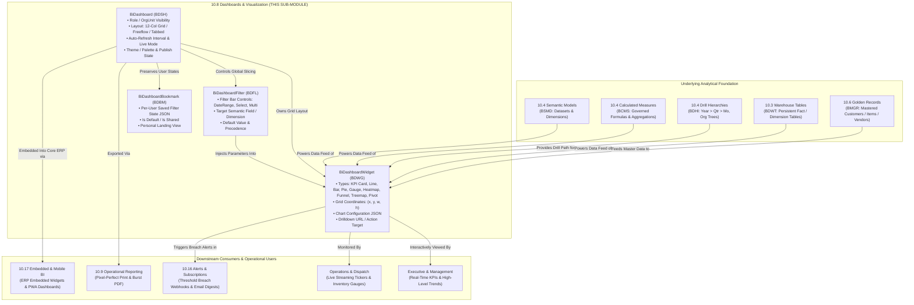

# Research — Sub-module 10.8: Dashboards & Visualization (Module 10 — Business Intelligence, `bi`)

- **Sub-module:** 10.8 Dashboards & Visualization
- **Module:** 10 Business Intelligence
- **Target app:** `apps/bi` (extended across 10.1, 10.2, 10.3, 10.4, 10.5, 10.6; adding 10.8 `Dashboards` package)
- **Research date:** 2026-11-05
- **Phase:** Phase 1 Research Catalog
- **Output file target:** `.claude/tasks/research-bi-10.8.md`

---

## 1. Executive Summary & Domain Architecture

Sub-module 10.8 delivers **interactive role-based dashboards, a rich visualization widget library, a responsive 12-column grid canvas builder, user-specific personalization and filter bookmarks, and real-time auto-refresh streaming capabilities** for NavERP (`apps/bi`).

In the enterprise analytical stack, operational data is extracted, transformed, cleansed, modeled, and governed across earlier sub-modules before reaching executive and operational decision-makers:
- **Sub-module 10.1 (Data Integration & Ingestion):** Ingests raw transactional events and batches into staging tables.
- **Sub-module 10.2 (ETL/ELT & Data Pipelines):** Cleanses, joins, and orchestrates data transformations.
- **Sub-module 10.3 (Data Warehouse & Storage):** Persists analytical fact and dimension tables (`WarehouseTable`, `DataMart`).
- **Sub-module 10.4 (Data Modeling & Semantic Layer):** Exposes governed business datasets (`SemanticModel`), standardized calculated metrics (`CalculatedMeasure`), business glossary terms (`BusinessGlossaryTerm`), and drilldown hierarchies (`DrillHierarchy`).
- **Sub-module 10.5 (Data Quality & Cleansing):** Validates and scores data trust, preventing corrupted data from entering dashboards.
- **Sub-module 10.6 (Master Data Management):** Consolidates golden records (`MdmGoldenRecord`) and reference hierarchies (`MdmHierarchyNode`).
- **Sub-module 10.8 (Dashboards & Visualization — THIS SUB-MODULE):** Synthesizes the governed semantic metrics and warehouse tables into actionable, dynamic, multi-widget visual dashboards:
  1. **Interactive Dashboards (`BiDashboard`):** Tenant-scoped, role-governed visual canvases supporting cross-filtering, category groupings, customizable layout templates, auto-refresh intervals, and interactive drill paths.
  2. **Visualization Library (`BiDashboardWidget`):** Diverse chart types (headline KPI cards with trend indicators, multi-series line, area, bar, column, pie, donut, gauges/speedometers, heatmaps, funnels, treemaps, and pivot tables) mapped directly to `SemanticModel` and `CalculatedMeasure` spine entities with flexible coordinate positioning ($x, y, w, h$).
  3. **Drag-and-Drop Responsive Grid Builder:** 12-column coordinate layout system with configurable widget dimensions, color palettes, chart options, and target navigation links.
  4. **Personalization & Bookmarks (`BiDashboardBookmark`):** User-specific view states capturing applied filters, cross-filters, chart focus states, and custom landing page preferences with team sharing capabilities.
  5. **Dashboard-Level Global Filter Controls (`BiDashboardFilter`):** Centralized filter bar widgets (dropdowns, multi-selects, date ranges, numeric thresholds, search text) that dynamically inject parameters across all linked widgets.
  6. **Real-Time & Streaming Visuals:** Configurable polling and live-refresh intervals (5s to 3600s), streaming counters, and operational monitoring indicators.

### Architectural Boundaries & End-to-End Data Flow



---

## 2. Repo State Checked First

### 2.1 Navigation & App Tree State
- **`apps/core/navigation.py`:** Inspected `LIVE_LINKS`. Sub-modules `10.1`, `10.2`, `10.3`, `10.4`, `10.5`, and `10.6` are fully built and live:
  - `"10.1"`: Source Connectors, Batch & Real-Time Ingestion, Change Data Capture (CDC), API & Webhook Gateway, File & Cloud Storage Imports.
  - `"10.2"`: Visual Pipeline Builder, Transformation Library, Orchestration & Scheduling, Pipeline Monitoring & Logging, Version Control & CI/CD.
  - `"10.3"`: Centralized Data Warehouse, Data Marts, Data Lake & Lakehouse, Partitioning & Compression, Archival & Retention.
  - `"10.4"`: Dimensional Modeling, Semantic Layer & Business Glossary, Calculated Measures & Hierarchies, Reusable Datasets & Views, Metadata-Driven Modeling.
  - `"10.5"`: Data Profiling, Validation & Quality Rules, Deduplication & Matching, Standardization & Enrichment, Quality Scorecards & Remediation.
  - `"10.6"`: Golden Record Management, Match, Merge & Survivorship, Hierarchy & Relationship Management, Reference Data Management, Data Stewardship Workflows.
  - **`10.8` is the target sub-module for this pass (Dashboards & Visualization).**
- **`apps/bi/models/`:** Established existing package structure:
  - `apps/bi/models/DataIntegration/` (10.1)
  - `apps/bi/models/EtlPipelines/` (10.2)
  - `apps/bi/models/DataWarehouse/` (10.3)
  - `apps/bi/models/SemanticLayer/` (10.4)
  - `apps/bi/models/DataQuality/` (10.5)
  - `apps/bi/models/MasterData/` (10.6)
  - `apps/bi/models/_base.py` (`TenantOwned`, `TenantNumbered` with `next_number()` sequence allocation).
  - Target package to create in Phase 3: `apps/bi/models/Dashboards/`.

### 2.2 As-Built Core Spine & Sibling Entities (Grep Verified)

| Entity | Location | Verified Status | 10.8 Relationship |
|---|---|---|---|
| `core.Tenant` | `apps/core/models/Tenant.py:17` | **Present** | Strict multi-tenant isolation boundary across all dashboards, widgets, bookmarks, and filters |
| `settings.AUTH_USER_MODEL` | `config/settings.py` (`accounts.User`) | **Present** | Dashboard author (`created_by`), bookmark owner (`user`), and personal preference tracking |
| `bi.SemanticModel` | `apps/bi/models/SemanticLayer/SemanticModels.py:8` | **Present** | Primary governed data source powering dashboard widgets (10.4) |
| `bi.CalculatedMeasure` | `apps/bi/models/SemanticLayer/CalculatedMeasures.py:8` | **Present** | Governed metric formula providing numeric aggregations for KPI cards and chart series (10.4) |
| `bi.WarehouseTable` | `apps/bi/models/DataWarehouse/WarehouseTables.py:8` | **Present** | Underlying physical/analytical warehouse table supporting direct table/pivot widgets (10.3) |
| `bi.DrillHierarchy` | `apps/bi/models/SemanticLayer/DrillHierarchies.py:8` | **Present** | Pre-configured multidimensional drill paths for chart drilldown events (10.4) |
| `bi.MdmGoldenRecord` | `apps/bi/models/MasterData/MdmGoldenRecords.py:8` | **Present** | Authoritative golden master records for entity-level 360-degree dashboard widgets (10.6) |
| `core.OrgUnit` | `apps/core/models/OrgUnit.py:5` | **Present** | Departmental/branch scoping and access control for departmental dashboards |
| `core.AuditLog` | `apps/core/models/AuditLog.py:14` | **Present** | Audit trail recording dashboard publishing, permission alterations, and widget deletions |

### 2.3 Collision-Free Prefix Verification
Inspected all prefixes repository-wide and within `apps/bi/`:
- Built in `apps/bi/`:
  - 10.1: `BCDC`, `BDSC`, `BING`, `BIJR`
  - 10.2: `BETL`, `BTRN`, `BPVR`, `BEXR`
  - 10.3: `BDMT`, `BLHZ`, `BWSP`, `BDWT`
  - 10.4: `BSMD`, `BGLO`, `BCMS`, `BDHI`
  - 10.5: `BDQP`, `BDQR`, `BDQE`, `BDQS`
  - 10.6: `BMGR`, `BMSR`, `BMHR`, `BMRD`
- Checked candidate prefixes against the entire repository — **zero collisions detected**:
  - `BDSH`: `BiDashboard` (**Unique & Collision-free**)
  - `BDWG`: `BiDashboardWidget` (**Unique & Collision-free**)
  - `BDBM`: `BiDashboardBookmark` (**Unique & Collision-free**)
  - `BDFL`: `BiDashboardFilter` (**Unique & Collision-free**)

---

## 3. Leaders Surveyed (with source references)

1. **Microsoft Power BI (Power BI Service Dashboards, Tiles, Bookmarks)** — Enterprise Cloud & Desktop BI Leader
   - *Overview*: Market-dominant enterprise BI platform featuring modular single-page dashboards, live interactive report tiles, personal bookmarks, and real-time streaming datasets.
   - *Key capabilities*: Tile pinning from multiple report canvases, cross-filtering and cross-highlighting across visual components, personal bookmarks capturing exact filter and cross-filter states, default personal views, and direct tile action links to underlying operational reports.
   - *URL*: `https://powerbi.microsoft.com/en-us/features/`

2. **Tableau (Salesforce)** — Visual Analytics & Interactive Dashboard Platform
   - *Overview*: Premier visual exploration and analytics platform renowned for intuitive drag-and-drop authoring, responsive device layouts, and rich dashboard actions.
   - *Key capabilities*: Dashboard Actions (Filter, Highlight, URL, and Parameter actions), device-specific responsive layout designer (Desktop, Tablet, Phone), Custom Views for saving individual user filter configurations, and interactive mark selection driving real-time cross-filtering.
   - *URL*: `https://www.tableau.com/products/dashboard-analytics`

3. **Looker (Google Cloud)** — Governed Semantic Analytics & Modern Dashboards
   - *Overview*: Web-first BI platform powered by LookML, offering modular user-defined dashboards (UDDs) with centralized dashboard-level filter bars and cross-filtering.
   - *Key capabilities*: User-defined dashboard canvas with drag-and-drop tile sizing, interactive cross-filtering enabling click-to-filter across all charts built from shared Explores, tile auto-refresh timers, and strict filter precedence hierarchies (Cross-filter > Tile-filter > Dashboard-filter).
   - *URL*: `https://cloud.google.com/looker`

4. **Apache Superset** — Leading Open-Source Modern Enterprise Data Visualization Platform
   - *Overview*: High-performance cloud-native visualization platform supporting massive data exploration with rich chart types and customizable dashboard layouts.
   - *Key capabilities*: Left-hand native Filter Bar injecting global parameters, interactive cross-filtering on Apache ECharts visual plugins (bars, pies, lines, treemaps, tables), 12-column responsive grid system, markdown text tiles, and CSS template theming.
   - *URL*: `https://superset.apache.org/`

5. **Metabase** — Intuitive Open-Source & Enterprise Visual Analytics Platform
   - *Overview*: User-friendly, accessible BI tool providing interactive dashboards, click behavior configuration, and parameter cards.
   - *Key capabilities*: Click Behavior allowing charts to update dashboard filters or navigate to custom URLs, top-of-canvas parameter filter cards (date ranges, dropdowns), auto-refresh timers that preserve active user filter parameters, and full-screen TV kiosk display mode.
   - *URL*: `https://www.metabase.com/`

6. **Domo (App Studio & Interactive Dashboards)** — Cloud-Native Low-Code Data Application & BI Suite
   - *Overview*: End-to-end data platform featuring App Studio for crafting customized, actionable, pixel-perfect executive dashboards and operational monitoring boards.
   - *Key capabilities*: Interactive cards, flexible multi-section page layouts with custom containers, native theming and brand palettes, real-time alert thresholds on KPI cards, and embedded actionable UI elements (buttons, forms, and workflow triggers).
   - *URL*: `https://www.domo.com/platform/app-studio`

7. **Sisense (BloX Widgets & Interactive Canvas)** — Embedded Analytics & Custom Widget Framework
   - *Overview*: Highly customizable analytics platform delivering JSON-based BloX widgets, advanced layout containers, and embedded interactive canvas filters.
   - *Key capabilities*: JSON-defined visual cards, data binding using handlebars syntax, custom interactive UI controls (embedded dropdowns, toggle switches, buttons) directly within the canvas, and rich chart customization.
   - *URL*: `https://www.sisense.com/product/blox/`

8. **Qlik Sense** — Associative Engine Analytics & Visual Discovery
   - *Overview*: Modern analytics solution powered by an in-memory associative engine (QIX) highlighting green/white/gray data associations across all visual elements.
   - *Key capabilities*: Interactive sheets with responsive grid layout, instant associative cross-filtering across all visual elements, comprehensive selection bookmarks saving exact filter states and sheet locations, and master visualization libraries.
   - *URL*: `https://www.qlik.com/us/products/qlik-sense`

9. **Grafana** — Real-Time Operational Monitoring & Observability Dashboards
   - *Overview*: Industry standard for real-time operational monitoring, time-series metrics, and live streaming dashboard panels.
   - *Key capabilities*: Dynamic panel library (time series, gauges, bar gauges, stat cards, heatmaps), dashboard template variables (`$variable`) interpolating dynamic parameters into queries, live streaming tiles via WebSocket/polling, and variable auto-refresh rates (5s to 1d).
   - *URL*: `https://grafana.com/oss/grafana/`

10. **GoodData** — Composable Cloud Analytics & Metric-Driven Dashboards
    - *Overview*: Modern composable analytics engine emphasizing reusable metrics, KPI headline cards, and hierarchical drill navigation.
    - *Key capabilities*: Analytical dashboards with atomic KPI cards featuring period-over-period comparisons (e.g. MoM, YoY), attribute drill hierarchies automatically enabling drill-down on chart marks, and drill-to-dashboard/drill-to-URL navigation.
    - *URL*: `https://www.gooddata.com/products/platform/`

---

## 4. Feature Catalog (Sub-module 10.8 Only)

### 4.1 Interactive Dashboards
- **Role-Based Tenant-Scoped Dashboards** — Authoritative executive and departmental dashboards with role/permission gating, category classification (Executive, Financial, Sales, SCM, Operations, HR), and public/published lifecycle states (`draft`, `published`, `archived`). · seen in: Power BI, Tableau, Domo, Looker · priority: `table-stakes` · spine: new model `BiDashboard` (`role_required`, `org_unit`, `is_published`) · buildable now.
- **Interactive Cross-Filtering** — Point-and-click interactivity where selecting a category, slice, or bar in one widget dynamically filters all surrounding widgets sharing the same semantic dataset. · seen in: Looker, Power BI, Apache Superset, Tableau · priority: `table-stakes` · spine: `BiDashboardWidget` + client-side HTMX/JSON filter bus · buildable now.
- **Multi-Level Drill-Down & Drill-Through Actions** — Navigating from macro-level metrics down through dimensional hierarchies (e.g. Year $\rightarrow$ Quarter $\rightarrow$ Month, or Region $\rightarrow$ Country $\rightarrow$ Store) by clicking chart marks, backed by `bi.DrillHierarchy` (10.4) and custom target URL links (`drilldown_target_url`). · seen in: GoodData, Tableau, Metabase, Looker · priority: `table-stakes` · spine: `bi.DrillHierarchy`, `BiDashboardWidget.drilldown_target_url` · buildable now.
- **Kiosk & Full-Screen TV Display Mode** — Headerless, distraction-free auto-scrolling full-screen display mode optimized for operations centers and office television monitors. · seen in: Metabase, Grafana, Domo · priority: `common` · spine: `BiDashboard.is_kiosk_enabled` · buildable now.

### 4.2 Visualization Library
- **Atomic KPI Headline Cards with Delta Sparklines** — Prominent headline numeric cards displaying current metric value, formatted currency/percentage, period-over-period percentage variance (MoM, YoY), trend direction badge (green positive, red negative), and micro-sparkline history. · seen in: GoodData, Domo, Power BI, Grafana · priority: `table-stakes` · spine: `BiDashboardWidget` (`widget_type='kpi_card'`, `calculated_measure`) · buildable now.
- **Comprehensive Core Chart Gallery** — Standardized, high-performance visualization suite:
  - `line`: Multi-series time-series and continuous trend lines.
  - `bar`: Horizontal categorical comparisons.
  - `column`: Vertical discrete period comparisons and stacked bars.
  - `pie` & `donut`: Proportional composition analysis with center metric readouts.
  - `area`: Cumulative volume over time (regular and stacked area).
  - `gauge`: Speedometer and bullet progress gauges tracking progress toward defined targets.
  - `heatmap`: Two-dimensional intensity matrices (e.g. Sales by Day of Week vs Hour of Day).
  - `funnel`: Conversion and progression stages (e.g. Sales Pipeline, Support Ticket Resolution).
  - `treemap`: Hierarchical nested rectangles showing relative category sizes.
  - `table_pivot`: Interactive cross-tab tabular view with column sorting and conditional cell formatting.
  - `streaming_counter`: High-frequency operational counter with animated numeric incrementing.
  · seen in: Apache Superset, Power BI, Tableau, Grafana, Metabase · priority: `table-stakes` · spine: `BiDashboardWidget.widget_type`, `BiDashboardWidget.chart_config_json` · buildable now.
- **Direct Semantic Layer & Measure Binding** — Seamless data binding linking widgets directly to governed `bi.SemanticModel` datasets and `bi.CalculatedMeasure` metric definitions without manual SQL coding. · seen in: Looker, GoodData, Power BI · priority: `table-stakes` · spine: `BiDashboardWidget.semantic_model`, `BiDashboardWidget.calculated_measure`, `BiDashboardWidget.warehouse_table` · buildable now.

### 4.3 Drag-and-Drop Dashboard Builder
- **12-Column Responsive Coordinate Grid Canvas** — Layout engine structuring dashboard widgets using standardized coordinate parameters (`pos_x`, `pos_y`, `width_cols` [1–12], `height_rows` [1–12]), guaranteeing responsiveness across widescreen monitors, tablets, and mobile devices. · seen in: Apache Superset, Domo App Studio, Grafana · priority: `table-stakes` · spine: `BiDashboardWidget.pos_x`, `BiDashboardWidget.pos_y`, `BiDashboardWidget.width_cols`, `BiDashboardWidget.height_rows` · buildable now.
- **Declarative Layout Templates** — Pre-configured grid blueprints for rapid dashboard creation:
  - `executive_summary`: 4 top KPI cards + 2 main trend charts + 1 breakdown table.
  - `operational_monitoring`: High-density live status tiles and gauges.
  - `analytical_deepdive`: Top filter bar + large comparison charts + interactive pivot table.
  - `custom_grid`: Unrestricted 12-column responsive canvas.
  · seen in: Domo, Tableau, Superset · priority: `common` · spine: `BiDashboard.layout_type`, `BiDashboard.is_template` · buildable now.
- **Visual Theme & Palette Customization** — Tenant and dashboard level color palettes (e.g. Corporate Slate, Modern Indigo, Emerald Growth, High-Contrast Dark, Amber Operations) applied consistently across all rendered charts. · seen in: Domo App Studio, Superset, Sisense BloX · priority: `common` · spine: `BiDashboard.theme`, `BiDashboard.color_palette_json` · buildable now.

### 4.4 Personalization & Bookmarks
- **User-Specific Saved Bookmarks (`BiDashboardBookmark`)** — Ability for individual users to capture and name specific analytical states: applied global filter selections, active cross-filters, chart sorting, and time window parameters. · seen in: Power BI Personal Bookmarks, Tableau Custom Views, Qlik Sense Bookmarks · priority: `table-stakes` · spine: new model `BiDashboardBookmark` (`filter_state_json`) · buildable now.
- **Default Personal Landing View** — End-users can designate their preferred bookmark as their personal default view, so accessing the dashboard immediately loads their personalized segment (e.g. Western Region Sales) without re-applying filters. · seen in: Power BI, Tableau · priority: `table-stakes` · spine: `BiDashboardBookmark.is_default` · buildable now.
- **Team-Shared Bookmarks** — Users can mark custom analytical views as shared (`is_shared=True`), allowing team members and department colleagues to inspect the exact same data slice. · seen in: Tableau Custom Views, Power BI · priority: `common` · spine: `BiDashboardBookmark.is_shared` · buildable now.
- **User Favorites & Quick Access** — Bookmarking dashboards to a personal quick-access toolbar and tracking usage telemetry (`view_count`, `last_viewed_at`). · seen in: Power BI, Superset, Tableau · priority: `common` · spine: `BiDashboardBookmark.view_count`, `BiDashboardBookmark.last_viewed_at` · buildable now.

### 4.5 Real-Time & Streaming Visuals
- **Configurable Auto-Refresh Intervals** — Dashboard and widget-level auto-refresh timers (`refresh_interval_seconds`: `0` [manual], `10`, `30`, `60`, `300`, `900`, `3600`) triggering non-blocking background HTMX polling or fetch requests to re-evaluate measures. · seen in: Metabase, Grafana, Looker · priority: `table-stakes` · spine: `BiDashboard.refresh_interval_seconds`, `BiDashboardWidget.refresh_interval_seconds` · buildable now.
- **Parameter-Preserving Auto-Refresh** — Background query refreshes strictly preserve currently active bookmark and filter bar parameters, ensuring live monitoring displays do not reset user selections. · seen in: Metabase, Grafana · priority: `table-stakes` · spine: client-side refresh orchestrator · buildable now.
- **Live Operational Status & Ticker Cards** — Real-time operational widgets displaying binary system health badges (Active / Warning / Critical) and streaming inventory/order counters with animated number changes. · seen in: Grafana, Domo, Power BI Streaming Tiles · priority: `common` · spine: `BiDashboardWidget` (`widget_type='streaming_counter'`) · buildable now.

### 4.6 Beyond the Bullets (Enterprise Dashboard Differentiators)
- **Dashboard-Level Global Filter Controls (`BiDashboardFilter`)** — Structured, first-class filter definitions (Date Range picker, Single Dropdown, Multi-Select Checkboxes, Numeric Range Slider, Text Search) positioned in a dedicated top filter bar that dynamically slices all compatible widgets on the canvas. · seen in: Apache Superset Native Filter Bar, Looker Dashboard Filters, Sisense BloX · priority: `table-stakes` · spine: new model `BiDashboardFilter` · buildable now.
- **Visual Snapshot & JSON Export** — Capturing complete dashboard state, widget definitions, and current data payloads into a portable snapshot payload for offline archiving or API consumption. · seen in: Superset, Power BI · priority: `common` · spine: `BiDashboard.export_config_json()` · buildable now.
- **Audit & View Telemetry** — Recording access frequency, average render latency, and active user counts to identify high-value enterprise dashboards and optimize under-performing queries. · seen in: Looker System Activity, Tableau Server Admin · priority: `common` · spine: `BiDashboard.view_count`, `BiDashboard.last_viewed_at`, `core.AuditLog` · buildable now.

---

## 5. Recommended Build Scope (This Pass — 4 Models)

To implement Sub-module 10.8 comprehensively within the standard 1–4 model unit, we recommend four tenant-scoped models in package `apps/bi/models/Dashboards/`:

```
apps/bi/models/Dashboards/
├── __init__.py
├── BiDashboards.py         # BDSH- (Dashboards, Canvases, Layouts & Themes)
├── BiDashboardWidgets.py    # BDWG- (Visualization Library, Coordinates & Configs)
├── BiDashboardBookmarks.py  # BDBM- (Personal Views, Filter States & Defaults)
└── BiDashboardFilters.py    # BDFL- (Global Dashboard Filter Bar Controls)
```

### Model 1: `BiDashboard` [Prefix: `BDSH-`]
- **File:** `apps/bi/models/Dashboards/BiDashboards.py`
- **Inherits:** `TenantNumbered` (`apps/bi/models/_base.py`)
- **Key Fields:**
  - `number`: auto-generated (`BDSH-00001`)
  - `title`: `CharField(max_length=200)` (e.g. "Executive Financial Performance", "Supply Chain & Fulfillment Command Center", "Customer Retention 360")
  - `slug`: `SlugField(max_length=100)` (URL-friendly unique identifier within tenant)
  - `category`: `CharField(choices=[('executive', 'Executive & C-Suite'), ('finance', 'Finance & Accounting'), ('sales_crm', 'Sales & CRM'), ('supply_chain', 'Supply Chain & Inventory'), ('operations', 'Plant & Operations'), ('hr', 'Human Resources & Talent'), ('custom', 'Custom Dashboard')], default='executive')`
  - `layout_type`: `CharField(choices=[('grid_12', '12-Column Responsive Grid'), ('executive_summary', 'Executive Summary Blueprint'), ('operational_monitoring', 'Operational Monitoring Board'), ('freeform', 'Flexible Fluid Layout')], default='grid_12')`
  - `refresh_interval_seconds`: `PositiveIntegerField(default=0, help_text="Auto-refresh timer in seconds (0 = manual refresh only, 10, 30, 60, 300, 900, 3600)")`
  - `theme`: `CharField(choices=[('slate_corporate', 'Corporate Slate (Default)'), ('indigo_modern', 'Modern Indigo'), ('emerald_growth', 'Emerald Financial'), ('amber_industrial', 'Amber Industrial / Logistics'), ('dark_observability', 'High-Contrast Dark Mode')], default='slate_corporate')`
  - `role_required`: `CharField(max_length=60, blank=True, default='all', help_text="Restricted role required to access dashboard: 'all', 'executive', 'finance_manager', 'sales_manager', etc.")`
  - `org_unit`: `ForeignKey('core.OrgUnit', null=True, blank=True, on_delete=models.SET_NULL, related_name='bi_dashboards', help_text="Optional link to internal OrgUnit / Department")`
  - `is_published`: `BooleanField(default=False, help_text="True if published and visible to authorized users; False if draft")`
  - `is_template`: `BooleanField(default=False, help_text="True if available as a starter template for new dashboards")`
  - `is_default`: `BooleanField(default=False, help_text="Tenant default landing dashboard")`
  - `is_kiosk_enabled`: `BooleanField(default=False, help_text="Permits full-screen headerless display mode for office monitors")`
  - `color_palette_json`: `JSONField(default=list, help_text="Custom hex color sequence for charts: ['#1e40af', '#0d9488', '#f59e0b', ...]")`
  - `config_json`: `JSONField(default=dict, help_text="Advanced dashboard settings: margins, default date range, animation flags")`
  - `created_by`: `ForeignKey(settings.AUTH_USER_MODEL, null=True, blank=True, on_delete=models.SET_NULL, related_name='created_bi_dashboards')`
  - `view_count`: `PositiveIntegerField(default=0)`
  - `last_viewed_at`: `DateTimeField(null=True, blank=True)`
  - `description`: `TextField(blank=True)`
  - `is_active`: `BooleanField(default=True)`

### Model 2: `BiDashboardWidget` [Prefix: `BDWG-`]
- **File:** `apps/bi/models/Dashboards/BiDashboardWidgets.py`
- **Inherits:** `TenantNumbered` (`apps/bi/models/_base.py`)
- **Key Fields:**
  - `number`: auto-generated (`BDWG-00001`)
  - `dashboard`: `ForeignKey('bi.BiDashboard', on_delete=models.CASCADE, related_name='widgets')`
  - `title`: `CharField(max_length=200)` (e.g. "Total Net Revenue (YTD)", "Monthly Operating Expense vs Budget", "Order Fulfillment Funnel")
  - `subtitle`: `CharField(max_length=255, blank=True)`
  - `widget_type`: `CharField(choices=[('kpi_card', 'Headline KPI Metric Card'), ('line', 'Line Trend Chart'), ('area', 'Area / Stacked Area Chart'), ('bar', 'Horizontal Bar Chart'), ('column', 'Vertical Column Chart'), ('pie', 'Pie Chart'), ('donut', 'Donut Composition Chart'), ('gauge', 'Gauge / Target Progress'), ('heatmap', 'Matrix Heatmap'), ('funnel', 'Conversion Funnel'), ('treemap', 'Hierarchical Treemap'), ('table_pivot', 'Data / Pivot Table'), ('streaming_counter', 'Live Streaming Counter / Ticker')], default='kpi_card')`
  - `semantic_model`: `ForeignKey('bi.SemanticModel', null=True, blank=True, on_delete=models.SET_NULL, related_name='dashboard_widgets', help_text="Governed analytical dataset source (10.4)")`
  - `calculated_measure`: `ForeignKey('bi.CalculatedMeasure', null=True, blank=True, on_delete=models.SET_NULL, related_name='dashboard_widgets', help_text="Governed metric measure for KPI value and aggregations (10.4)")`
  - `warehouse_table`: `ForeignKey('bi.WarehouseTable', null=True, blank=True, on_delete=models.SET_NULL, related_name='dashboard_widgets', help_text="Direct physical analytical warehouse table (10.3)")`
  - `drill_hierarchy`: `ForeignKey('bi.DrillHierarchy', null=True, blank=True, on_delete=models.SET_NULL, related_name='dashboard_widgets', help_text="Pre-configured drill path (10.4)")`
  - `aggregation_type`: `CharField(choices=[('sum', 'Sum'), ('avg', 'Average'), ('count', 'Count'), ('count_distinct', 'Distinct Count'), ('min', 'Minimum'), ('max', 'Maximum'), ('last', 'Latest Non-Null Value')], default='sum')`
  - `pos_x`: `PositiveSmallIntegerField(default=0, help_text="Horizontal column coordinate on 12-col grid (0 to 11)")`
  - `pos_y`: `PositiveSmallIntegerField(default=0, help_text="Vertical row coordinate on grid (0 to 100)")`
  - `width_cols`: `PositiveSmallIntegerField(default=4, help_text="Width in columns on 12-col grid (1 to 12)")`
  - `height_rows`: `PositiveSmallIntegerField(default=4, help_text="Height in grid row units (1 to 12)")`
  - `refresh_interval_seconds`: `PositiveIntegerField(default=0, help_text="Widget-specific auto-refresh interval (0 = inherit from dashboard)")`
  - `drilldown_target_url`: `CharField(max_length=255, blank=True, help_text="Destination URL or report route triggered upon clicking widget marks")`
  - `chart_config_json`: `JSONField(default=dict, help_text="Visual options: colors, axis labels, legend position, tooltip formatting, sparkline history points")`
  - `filter_overrides_json`: `JSONField(default=dict, help_text="Fixed filter overrides applied exclusively to this widget")`
  - `sort_order`: `PositiveIntegerField(default=10)`
  - `is_active`: `BooleanField(default=True)`

### Model 3: `BiDashboardBookmark` [Prefix: `BDBM-`]
- **File:** `apps/bi/models/Dashboards/BiDashboardBookmarks.py`
- **Inherits:** `TenantNumbered` (`apps/bi/models/_base.py`)
- **Key Fields:**
  - `number`: auto-generated (`BDBM-00001`)
  - `dashboard`: `ForeignKey('bi.BiDashboard', on_delete=models.CASCADE, related_name='bookmarks')`
  - `user`: `ForeignKey(settings.AUTH_USER_MODEL, on_delete=models.CASCADE, related_name='bi_dashboard_bookmarks')`
  - `name`: `CharField(max_length=150)` (e.g. "My Western Region View", "Q3 High-Value Opportunities", "Pending Fulfillment Escalations")
  - `filter_state_json`: `JSONField(default=dict, help_text="Serialized filter selections: {filter_key: selected_value, ...}")`
  - `crossfilter_state_json`: `JSONField(default=dict, help_text="Active cross-filtering selections: {widget_id: selected_dimension_value}")`
  - `is_default`: `BooleanField(default=False, help_text="If True, this bookmark automatically loads when this user accesses the dashboard")`
  - `is_shared`: `BooleanField(default=False, help_text="If True, other authorized tenant users can view and apply this bookmark")`
  - `view_count`: `PositiveIntegerField(default=0)`
  - `last_viewed_at`: `DateTimeField(null=True, blank=True)`
  - `description`: `TextField(blank=True)`
  - `is_active`: `BooleanField(default=True)`

### Model 4: `BiDashboardFilter` [Prefix: `BDFL-`]
- **File:** `apps/bi/models/Dashboards/BiDashboardFilters.py`
- **Inherits:** `TenantNumbered` (`apps/bi/models/_base.py`)
- **Key Fields:**
  - `number`: auto-generated (`BDFL-00001`)
  - `dashboard`: `ForeignKey('bi.BiDashboard', on_delete=models.CASCADE, related_name='filters')`
  - `filter_label`: `CharField(max_length=100)` (e.g. "Fiscal Year", "Sales Region", "Product Category", "Order Status")
  - `filter_key`: `SlugField(max_length=60, help_text="Query parameter key passed in filter requests, e.g. 'fiscal_year', 'region'")`
  - `filter_type`: `CharField(choices=[('dropdown', 'Single Select Dropdown'), ('multi_select', 'Multi-Select Dropdown / Badges'), ('date_range', 'Date Range Picker (From / To)'), ('date_preset', 'Relative Date Preset (Today, MTD, QTD, YTD)'), ('number_range', 'Numeric Range Slider / Min-Max'), ('search_text', 'Search Text Input')], default='dropdown')`
  - `target_field`: `CharField(max_length=100, help_text="Target semantic dimension or column filtered in the dataset, e.g. 'customer_region', 'order_date'")`
  - `default_value`: `CharField(max_length=255, blank=True, help_text="Default selected value or preset token (e.g. 'current_year', 'all')")`
  - `options_source`: `CharField(choices=[('static_list', 'Static Pre-defined Choices'), ('semantic_distinct', 'Distinct Values from Semantic Model'), ('warehouse_column', 'Distinct Values from Warehouse Table')], default='static_list')`
  - `static_options_json`: `JSONField(default=list, help_text="Pre-defined choices: [{'value': 'north', 'label': 'North Region'}, ...]")`
  - `order`: `PositiveIntegerField(default=10, help_text="Display order in the top filter bar")`
  - `is_required`: `BooleanField(default=False, help_text="If True, user must select a value before queries execute")`
  - `is_active`: `BooleanField(default=True)`

---

## 6. Belongs to Sibling Sub-modules (Parked, Not Scoped Here)

- **Searchable Data Catalog & Metadata Lineage Graph** $\rightarrow$ Sub-module 10.7 Data Catalog, Lineage & Governance
- **Pixel-Perfect Paginated Reports & PDF/Excel Bursting** $\rightarrow$ Sub-module 10.9 Standard & Operational Reporting
- **Freeform Ad-Hoc SQL Query Builder & Raw Data Discovery** $\rightarrow$ Sub-module 10.10 Self-Service & Ad-Hoc Analytics
- **Balanced Scorecard Frameworks & Strategy Mapping** $\rightarrow$ Sub-module 10.11 KPI & Performance Scorecards
- **Multidimensional OLAP Cube Aggregations & MDX Slicing** $\rightarrow$ Sub-module 10.12 OLAP & Multidimensional Analysis
- **Time-Series Predictive Forecasting & Propensity Scoring** $\rightarrow$ Sub-module 10.13 Predictive & Advanced Analytics
- **Automated AI Insights & Anomaly Narrative Summaries** $\rightarrow$ Sub-module 10.14 AI & Augmented Analytics
- **Natural Language Query (NLQ) Chatbot Assistant** $\rightarrow$ Sub-module 10.15 Natural Language & Conversational BI
- **KPI Threshold Breach Alarming & Scheduled Email Distribution** $\rightarrow$ Sub-module 10.16 Alerts, Subscriptions & Distribution
- **ERP In-App iFrame/SDK Embedding & Mobile PWA Offline Caching** $\rightarrow$ Sub-module 10.17 Embedded & Mobile BI
- **Interactive Slide Storytelling & Threaded @Mention Discussions** $\rightarrow$ Sub-module 10.18 Collaboration & Data Storytelling

---

## 7. Deferred (Later Passes / Integrations)

- **Dedicated ASGI WebSocket Streaming Server (e.g. Django Channels / Centrifugo):** Real-time push updates at sub-second frequencies $\rightarrow$ deferred to advanced infrastructure pass; in this pass, live updates and streaming counters operate via configurable HTMX interval polling (10s to 3600s) and non-blocking fetch triggers.
- **Third-Party Visualization Plugin Marketplace (Custom Web Components / D3.js plugins):** Arbitrary user-uploaded JavaScript chart scripts $\rightarrow$ deferred to extensible developer plugin pass; in this pass, the visualization library provides 13 robust, pre-built chart types configurable via JSON.
- **Headless Chromium Server-Side PDF/PNG Dashboard Rendering:** Headless browser rasterization for scheduled print snapshots $\rightarrow$ deferred to Sub-module 10.9 and 10.16 distribution engine.
- **Cross-Dashboard Tokenized URL Deep Linking:** Encrypted external deep links with dynamic credential tokens $\rightarrow$ deferred to 10.17 Embedded Analytics.
