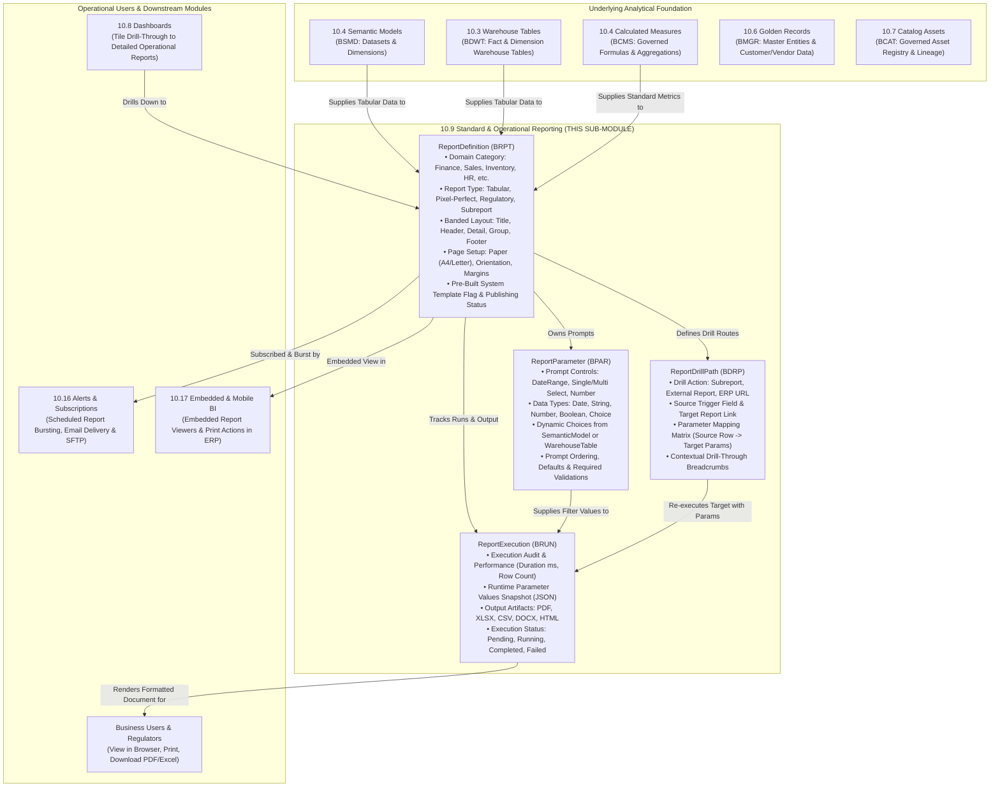

# Research — Sub-module 10.9: Standard & Operational Reporting (Module 10 — Business Intelligence, `bi`)

- **Sub-module:** 10.9 Standard & Operational Reporting
- **Module:** 10 Business Intelligence
- **Target app:** `apps/bi` (extended across 10.1, 10.2, 10.3, 10.4, 10.5, 10.6, 10.7, 10.8; adding 10.9 `OperationalReporting` package)
- **Research date:** 2026-11-06
- **Phase:** Phase 1 Research Catalog
- **Output file target:** `.claude/tasks/research-bi-10.9.md`

---

## 1. Executive Summary & Domain Architecture

Sub-module 10.9 delivers **enterprise standard, operational, and pixel-perfect paginated reporting** for NavERP (`apps/bi`). While Sub-module 10.8 provides interactive, dynamic, tile-based visual dashboards for on-screen monitoring, Sub-module 10.9 addresses the mission-critical enterprise need for **structured, banded, paginated, print-ready documents, regulatory compliance filings, prompt-driven parameterized reports, sub-reports with transactional drill-through, and multi-format exports (PDF, Excel, CSV, Word, PowerPoint, JSON)**.

In the analytical and operational stack of an ERP, standard reporting bridges governed semantic analytical data with day-to-day transactional execution:
- **Sub-module 10.1 (Data Integration & Ingestion):** Replicates and stages transactional source data.
- **Sub-module 10.2 (ETL/ELT & Data Pipelines):** Orchestrates analytical transformations and staging.
- **Sub-module 10.3 (Data Warehouse & Storage):** Centralizes star/snowflake schemas (`WarehouseTable`, `DataMart`).
- **Sub-module 10.4 (Data Modeling & Semantic Layer):** Provides governed business semantic datasets (`SemanticModel`), standardized calculated metrics (`CalculatedMeasure`), and drill hierarchies (`DrillHierarchy`).
- **Sub-module 10.5 (Data Quality & Cleansing):** Validates and verifies accuracy, ensuring reports reflect trusted data.
- **Sub-module 10.6 (Master Data Management):** Supplies golden records (`MdmGoldenRecord`) and reference structures.
- **Sub-module 10.7 (Data Catalog, Lineage & Governance):** Indexes assets and tracks end-to-end lineage from source to report.
- **Sub-module 10.8 (Dashboards & Visualization):** Serves interactive executive canvases, KPI cards, and chart widgets.
- **Sub-module 10.9 (Standard & Operational Reporting — THIS SUB-MODULE):** Provides the formal reporting engine:
  1. **Pre-Built Report Templates (`ReportDefinition`):** Out-of-the-box standardized operational reports across domains (Finance, Sales, Inventory, HR, Procurement, Production, Compliance).
  2. **Pixel-Perfect & Banded Regulatory Layouts:** Precision page layouts supporting standard paper sizes (A4, Letter, Legal), exact margins, headers/footers, and visual layout bands (Title, Page Header, Group Header, Detail rows, Group Footer, Page Footer, Summary totals).
  3. **Prompt-Driven Parameterized Filtering (`ReportParameter`):** Dynamic runtime prompts (date ranges, multi-select dropdowns, fiscal period pickers, numeric bounds, entity selectors) with validation and cascading dependencies.
  4. **Operational & Real-Time Reports:** Direct operational monitoring reports querying transactional and analytical tables with execution history (`ReportExecution`).
  5. **Sub-Reports & Transactional Drill Paths (`ReportDrillPath`):** Parameterized navigation from high-level summary rows into granular line-item sub-reports or direct ERP transaction records.
  6. **Multi-Format Export Engine:** High-fidelity rendering and export into PDF, Microsoft Excel (XLSX), CSV, Word (DOCX), PowerPoint (PPTX), and JSON.

### Architectural Boundaries & Data Flow



---

## 2. Repo State Checked First

### 2.1 Navigation & App Tree State
- **`apps/core/navigation.py`:** Inspected `LIVE_LINKS`. Sub-modules `10.1`, `10.2`, `10.3`, `10.4`, `10.5`, `10.6`, `10.7`, and `10.8` are fully built and live.
- **`apps/bi/models/`:** Existing packages:
  - `apps/bi/models/DataIntegration/` (10.1)
  - `apps/bi/models/EtlPipelines/` (10.2)
  - `apps/bi/models/DataWarehouse/` (10.3)
  - `apps/bi/models/SemanticLayer/` (10.4)
  - `apps/bi/models/DataQuality/` (10.5)
  - `apps/bi/models/MasterData/` (10.6)
  - `apps/bi/models/DataCatalog/` (10.7)
  - `apps/bi/models/Dashboards/` (10.8)
  - `apps/bi/models/_base.py` (`TenantOwned`, `TenantNumbered` with `next_number()` sequence allocation).
  - Target package to create in Phase 3: `apps/bi/models/OperationalReporting/`.

### 2.2 As-Built Core Spine & Sibling Entities (Grep Verified)

| Entity | Location | Verified Status | 10.9 Relationship |
|---|---|---|---|
| `core.Tenant` | `apps/core/models/Tenant.py:17` | **Present** | Strict multi-tenant isolation boundary across all report definitions, parameters, executions, and drill paths |
| `settings.AUTH_USER_MODEL` | `config/settings.py` (`accounts.User`) | **Present** | Report author (`created_by`), execution requester (`executed_by`) |
| `core.OrgUnit` | `apps/core/models/OrgUnit.py:5` | **Present** | Departmental/branch report scoping and access control |
| `core.AuditLog` | `apps/core/models/AuditLog.py:14` | **Present** | Audit trail recording report publishing, template changes, and parameter deletions |
| `bi.SemanticModel` | `apps/bi/models/SemanticLayer/SemanticModels.py:8` | **Present** | Governed dataset source for report queries and dynamic parameter choices (10.4) |
| `bi.WarehouseTable` | `apps/bi/models/DataWarehouse/WarehouseTables.py:8` | **Present** | Analytical warehouse fact/dimension table source for operational reporting (10.3) |
| `bi.CalculatedMeasure` | `apps/bi/models/SemanticLayer/CalculatedMeasures.py:8` | **Present** | Standardized metrics and formula definitions for report aggregates (10.4) |
| `bi.BiDashboard` | `apps/bi/models/Dashboards/BiDashboards.py:8` | **Present** | Cross-navigation link from interactive dashboard widgets to detailed operational reports (10.8) |

### 2.3 Collision-Free Prefix Verification
Inspected all prefixes repository-wide and within `apps/bi/`:
- Built in `apps/bi/`:
  - 10.1: `BCDC`, `BDSC`, `BING`, `BIJR`
  - 10.2: `BETL`, `BTRN`, `BPVR`, `BEXR`
  - 10.3: `BDMT`, `BLHZ`, `BWSP`, `BDWT`
  - 10.4: `BSMD`, `BGLO`, `BCMS`, `BDHI`
  - 10.5: `BDQP`, `BDQR`, `BDQE`, `BDQS`
  - 10.6: `BMGR`, `BMSR`, `BMHR`, `BMRD`
  - 10.7: `BCAT`, `BLIN`, `BTRU`, `BGOV`
  - 10.8: `BDSH`, `BDWG`, `BDBM`, `BDFL`
- Candidate prefixes checked repository-wide via `git grep` — **zero collisions detected**:
  - `BRPT`: `ReportDefinition` (**Unique & Collision-free**)
  - `BPAR`: `ReportParameter` (**Unique & Collision-free**)
  - `BRUN`: `ReportExecution` (**Unique & Collision-free**)
  - `BDRP`: `ReportDrillPath` (**Unique & Collision-free**)

---

## 3. Leaders Surveyed (with source references)

1. **SAP Crystal Reports** — The Industry Standard for Enterprise Banded Pixel-Perfect Reporting
   - *Overview*: The foundational benchmark for banded operational reporting, used globally for print-ready invoices, regulatory statements, and high-precision financial schedules.
   - *Key capabilities*: Banded layout model (Report Header, Page Header, Group Header, Details, Group Footer, Page Footer, Report Footer), sub-reports embedded within master bands, formula language for conditional formatting, parameter prompts, and multi-format export (PDF, Excel, Word, CSV).
   - *URL*: `https://www.sap.com/products/technology-platform/crystal-reports.html`

2. **Microsoft SQL Server Reporting Services (SSRS) & Power BI Report Builder** — Enterprise Paginated Reports
   - *Overview*: Microsoft's dedicated paginated reporting engine based on the Report Definition Language (RDL) specification, designed for multi-page, formatted, print-optimized documents.
   - *Key capabilities*: Prompt-driven cascading parameters, document maps for hierarchical navigation, tablix (matrix/table) data regions, drill-through actions linking parent reports to child detail reports or URLs, page-break controls, and export renderers.
   - *URL*: `https://learn.microsoft.com/en-us/power-bi/paginated-reports/`

3. **Oracle JasperReports & Jaspersoft Studio** — Enterprise Open-Source Paginated Reporting
   - *Overview*: Widely deployed open-source and commercial Java reporting engine generating pixel-perfect documents from JRXML templates.
   - *Key capabilities*: Precision bands, conditional style rules, parameter prompt cascades, master-subreport linking with parameter mapping, virtualization buffers for massive million-row reports, and multi-format export (PDF, XLS, CSV, DOCX, PPTX).
   - *URL*: `https://community.jaspersoft.com/project/jasperreports-library`

4. **Oracle Analytics Publisher (formerly BI Publisher / XML Publisher)** — Regulatory & Document Output
   - *Overview*: Enterprise reporting engine specializing in high-volume, pixel-perfect statutory documents, compliance forms, checks, and invoices.
   - *Key capabilities*: Separation of data model from layout templates, precision PDF layout generation, multi-channel document bursting, multi-language localization, and support for high-throughput batch operational schedules.
   - *URL*: `https://www.oracle.com/business-analytics/analytics-publisher/`

5. **IBM Cognos Analytics (Report Studio)** — Governed Enterprise Operational Reporting
   - *Overview*: Robust enterprise operational reporting solution offering prompt pages, rich financial statements, and multidimensional report layouts.
   - *Key capabilities*: Dedicated prompt pages executed before report generation, conditional layouts suppressing empty sections, master-detail relationships for nested data queries, drill-through definitions with parameter context passthrough, and scheduled bursting.
   - *URL*: `https://www.ibm.com/products/cognos-analytics`

6. **Telerik Reporting (Progress Software)** — Embedded Paginated & Operational Reporting Engine
   - *Overview*: Modern reporting tool for enterprise web applications offering declarative report authoring, interactive document viewers, and comprehensive export capabilities.
   - *Key capabilities*: Banded report designer, Report Books combining multiple distinct reports into single output packets, cascading parameter editors, drill-down toggle actions, and pixel-perfect rendering across HTML5, PDF, Excel, and Word.
   - *URL*: `https://www.telerik.com/products/reporting.aspx`

7. **ActiveReports (MESCIUS / GrapeCity)** — Precision Document & Operational Reporting
   - *Overview*: Enterprise reporting engine supporting banded and page-based layouts tailored for tax forms, compliance filings, bills of lading, and shipping labels.
   - *Key capabilities*: Tabular and continuous page layouts, subreport containers with data binding, barcodes and QR code generation, advanced grouping and page break rules, and high-performance PDF/A compliance export.
   - *URL*: `https://developer.mescius.com/activereportsnet`

8. **Stimulsoft Reports** — Cross-Platform Enterprise Operational Report Engine
   - *Overview*: Highly customizable reporting tool featuring a rich band structure, interactive parameter panel, and multi-format document generation.
   - *Key capabilities*: Visual band hierarchy (Title, Header, GroupHeader, Data, GroupFooter, Footer, Summary), cross-tab/matrix reporting, drill-down and hyperlink drill-through actions, watermarking, and instant export to 30+ document formats.
   - *URL*: `https://www.stimulsoft.com/en/products/reports`

9. **FastReport Enterprise** — High-Performance Banded Operational Report Generator
   - *Overview*: Compact, high-throughput report generator optimized for speed and memory efficiency in enterprise transactional environments.
   - *Key capabilities*: Multi-level data banding, interactive parameters, subreports, drill-down trees, aggregate summary functions, and clean HTML/PDF/Excel document rendering.
   - *URL*: `https://www.fast-report.com/en/`

10. **Bold Reports (Syncfusion)** — Modern Web-First SSRS RDL Reporting Platform
    - *Overview*: Cloud and web-based reporting platform compatible with Microsoft RDL standards for authoring, viewing, and exporting paginated reports.
    - *Key capabilities*: Web report designer with parameter panel configuration, subreport linking, tablix controls, interactive sorting, and high-fidelity PDF, Excel, and Word exports.
    - *URL*: `https://www.boldreports.com/`

---

## 4. Feature Catalog (Sub-module 10.9 Only)

### 4.1 Pre-Built Report Templates
- **Out-of-the-Box Domain Report Catalogs** — Pre-configured, certified report definitions across core ERP business modules:
  - *Finance & Accounting*: Balance Sheet, Income Statement (P&L), Trial Balance, General Ledger Detail, Cash Flow Statement, Accounts Receivable / Payable Aging.
  - *Sales & CRM*: Sales Pipeline Summary, Monthly Revenue by Customer/Region, Quote Win-Loss Analysis, Sales Rep Performance.
  - *Inventory & SCM*: Stock Status & Valuation, Inventory Aging & Slow-Moving Stock, Purchase Order Fulfillment Status, Goods Receipt Discrepancies.
  - *Human Resources*: Headcount & Turnover Summary, Payroll Register by Department, Employee Attendance & Leave Ledger.
  - *Procurement*: Vendor Spend Analysis, Purchase Requisition Aging, Supplier Delivery Performance.
  · seen in: Crystal Reports, SSRS, Cognos, JasperReports · priority: `table-stakes` · spine: `ReportDefinition` (`is_prebuilt_template`, `category`) · buildable now.
- **Template Cloning & Customization** — Ability for tenant administrators to clone any pre-built system template into a tenant-custom report definition to adjust fields, bands, or styling. · seen in: JasperReports, Bold Reports, ActiveReports · priority: `table-stakes` · spine: `ReportDefinition.clone()` view action · buildable now.
- **Report Lifecycle States** — Versioning and publishing lifecycle (`draft`, `published`, `archived`) to prevent experimental designs from being run by operational users. · seen in: Cognos, SSRS, Power BI · priority: `table-stakes` · spine: `ReportDefinition.status` · buildable now.

### 4.2 Pixel-Perfect & Regulatory Reports
- **Banded Document Architecture** — Visual layout structuring report output into standardized bands:
  - *Title Band*: Printed once at the beginning of the report.
  - *Page Header Band*: Repeated at the top of every printed page (company logo, document number, date).
  - *Group Header Band*: Printed when a grouping field changes (e.g., Department, Category, Customer).
  - *Detail Band*: Repeated for every record row in the dataset.
  - *Group Footer Band*: Printed at the end of each group with sub-totals and summary counts.
  - *Page Footer Band*: Repeated at the bottom of every page (page numbering "Page X of Y", generation timestamp).
  - *Summary Band*: Printed at the very end of the document for grand totals.
  · seen in: Crystal Reports, JasperReports, ActiveReports, Stimulsoft · priority: `table-stakes` · spine: `ReportDefinition.bands_config_json` · buildable now.
- **Page Geometry & Print Setup** — Strict configuration of paper standard (`a4`, `letter`, `legal`, `custom`), orientation (`portrait`, `landscape`), and page margins (top, bottom, left, right in millimeters) ensuring identical print output across browsers and PDF renderers. · seen in: Crystal Reports, SSRS, ActiveReports · priority: `table-stakes` · spine: `ReportDefinition.paper_size`, `ReportDefinition.orientation`, `ReportDefinition.margins_json` · buildable now.
- **Regulatory Document Compliance** — Layout formatting adhering to official statutory and tax filing requirements (e.g. standard invoice formatting, audit trails, and official company tax numbers). · seen in: Oracle BI Publisher, ActiveReports · priority: `common` · spine: `ReportDefinition.report_type='regulatory_filing'` · buildable now.
- **Custom CSS & Typography Styling** — Tenant brand styling with support for custom font families, borders, zebra-striping, and conditional cell coloring. · seen in: Stimulsoft, JasperReports · priority: `common` · spine: `ReportDefinition.styling_css` · buildable now.

### 4.3 Parameterized & Drill Reports
- **Dynamic Prompt-Driven Filter Controls (`ReportParameter`)** — Configurable parameter inputs presented to the user prior to report execution:
  - Text string, integer, decimal number, single date, date range picker, boolean flag, single-choice dropdown, and multi-select badge selector.
  · seen in: SSRS, Crystal Reports, Cognos, JasperReports · priority: `table-stakes` · spine: new model `ReportParameter` · buildable now.
- **Dynamic Parameter Option Sources** — Parameters populated dynamically from `bi.SemanticModel` dimensions, `bi.WarehouseTable` distinct columns, or static key-value lists. · seen in: SSRS, Cognos, Looker · priority: `table-stakes` · spine: `ReportParameter.choices_source`, `ReportParameter.choices_config_json` · buildable now.
- **Parameter Validation & Defaults** — Configurable default values, mandatory requirement flags (`is_required`), validation regular expressions, and display order. · seen in: SSRS, Crystal Reports, Telerik · priority: `table-stakes` · spine: `ReportParameter.default_value`, `ReportParameter.is_required`, `ReportParameter.validation_regex` · buildable now.
- **Sub-Reports & Nested Data Linking** — Embedding secondary reports within a master report band to display master-detail relationships (e.g. Sales Order header with embedded Order Lines sub-report). · seen in: Crystal Reports, SSRS, JasperReports · priority: `table-stakes` · spine: `ReportDefinition.report_type='subreport'` · buildable now.
- **Parameterized Drill Paths (`ReportDrillPath`)** — Interactive drill-through hyperlinks on report cells allowing users to jump from summary totals into child operational detail reports or direct ERP entity detail pages, automatically mapping row context into target parameters. · seen in: SSRS, Cognos, Telerik, Stimulsoft · priority: `table-stakes` · spine: new model `ReportDrillPath` · buildable now.

### 4.4 Operational & Real-Time Reports
- **Real-Time Transactional Execution** — Instant report execution directly against live operational and warehouse tables with interactive web pagination, sorting, and live searching. · seen in: SSRS, FastReport, Bold Reports · priority: `table-stakes` · spine: `ReportExecution` (`execution_mode='interactive_view'`) · buildable now.
- **Execution Run History & Performance Tracking (`ReportExecution`)** — Centralized execution log capturing timestamp, requesting user, execution duration (ms), row count, applied parameters (JSON snapshot), and error details for performance monitoring and operational compliance. · seen in: Cognos System Audit, SSRS ExecutionLog, JasperReports Server · priority: `table-stakes` · spine: new model `ReportExecution` · buildable now.
- **Result Caching & Reuse** — Intelligent caching of recent report executions with identical parameter signatures to minimize database load for heavy operational reports. · seen in: SSRS Report Caching, Cognos · priority: `common` · spine: `ReportExecution.is_cached` · buildable now.

### 4.5 Multi-Format Export
- **Print-Optimized PDF Export** — Server-side generation of high-resolution, paginated, vector-sharp PDF documents respecting exact page geometries, headers, footers, page numbering, and margin constraints. · seen in: Crystal Reports, SSRS, JasperReports, BI Publisher · priority: `table-stakes` · spine: `ReportExecution.output_format='pdf'` · buildable now.
- **Microsoft Excel (XLSX) Export** — Native spreadsheet export preserving column data types (dates, currencies, integers), tabular headers, and formula aggregates. · seen in: SSRS, JasperReports, Cognos · priority: `table-stakes` · spine: `ReportExecution.output_format='xlsx'` · buildable now.
- **CSV Data Dump Export** — Raw delimited tabular export formatted for downstream data loading, script automation, and external analysis. · seen in: All surveyed products · priority: `table-stakes` · spine: `ReportExecution.output_format='csv'` · buildable now.
- **Word (DOCX) & HTML Document Export** — Formatted document output for formal executive memoranda and web sharing. · seen in: Crystal Reports, Telerik, Stimulsoft · priority: `common` · spine: `ReportExecution.output_format='docx'` / `'html'` · buildable now.

### 4.6 Beyond the Bullets (Enterprise Reporting Differentiators)
- **Parameterized Drill-Through Mapping Matrix** — Flexible JSON parameter mapping allowing row-level values (e.g. `customer_id=1042`, `fiscal_period=2026-Q1`) to seamlessly populate target report parameters or construct ERP detail URLs (`/crm/customers/1042/`). · seen in: SSRS Action Properties, Cognos Drill-Through Definitions · priority: `table-stakes` · spine: `ReportDrillPath.parameter_mapping_json` · buildable now.
- **Report Document Watermarking** — Configurable security and draft watermarks (e.g. "CONFIDENTIAL", "DRAFT", "INTERNAL USE ONLY") stamped across generated report pages. · seen in: Stimulsoft, JasperReports, ActiveReports · priority: `common` · spine: `ReportDefinition.watermark_text` · buildable now.
- **Execution Error Recovery & Diagnostic Logs** — Detailed diagnostic logging for execution timeouts, SQL syntax issues, or missing parameter values, presenting user-friendly remediation messages while recording technical traces for admins. · seen in: SSRS, Cognos · priority: `table-stakes` · spine: `ReportExecution.error_message`, `core.AuditLog` · buildable now.

---

## 5. Recommended Build Scope (This Pass — 4 Models)

To implement Sub-module 10.9 comprehensively within the standard 1–4 model unit, we recommend four tenant-scoped models in package `apps/bi/models/OperationalReporting/`:

```
apps/bi/models/OperationalReporting/
├── __init__.py
├── ReportDefinitions.py    # BRPT- (Report Catalogs, Banded Layouts & Page Setup)
├── ReportParameters.py     # BPAR- (Prompt Controls, Types, Defaults & Validations)
├── ReportExecutions.py     # BRUN- (Execution Logs, Parameter Snapshots & Artifacts)
└── ReportDrillPaths.py     # BDRP- (Subreport Linkages & Transactional Drill Routes)
```

### Model 1: `ReportDefinition` [Prefix: `BRPT-`]
- **File:** `apps/bi/models/OperationalReporting/ReportDefinitions.py`
- **Inherits:** `TenantNumbered` (`apps/bi/models/_base.py`)
- **Key Fields:**
  - `number`: auto-generated (`BRPT-00001`)
  - `name`: `CharField(max_length=200)` (e.g. "Monthly Profit and Loss Statement", "Inventory Aging & Valuation Schedule", "Accounts Receivable Overdue Aging", "Employee Attendance Register")
  - `slug`: `SlugField(max_length=120)` (URL-friendly unique identifier within tenant)
  - `description`: `TextField(blank=True)`
  - `category`: `CharField(choices=[('finance', 'Finance & Accounting'), ('sales', 'Sales & CRM'), ('inventory', 'Inventory & Warehouse'), ('hr', 'Human Resources & Talent'), ('procurement', 'Procurement & Purchasing'), ('production', 'Manufacturing & Production'), ('compliance', 'Regulatory & Compliance'), ('custom', 'Custom Operational Report')], default='finance')`
  - `report_type`: `CharField(choices=[('standard_tabular', 'Standard Tabular Report'), ('pixel_perfect_document', 'Pixel-Perfect Banded Document'), ('regulatory_filing', 'Regulatory & Compliance Filing'), ('matrix_summary', 'Cross-Tab Matrix Summary'), ('subreport', 'Modular Subreport Component')], default='standard_tabular')`
  - `paper_size`: `CharField(choices=[('a4', 'ISO A4 (210 x 297 mm)'), ('letter', 'US Letter (8.5 x 11 in)'), ('legal', 'US Legal (8.5 x 14 in)'), ('tabloid', 'US Tabloid (11 x 17 in)'), ('custom', 'Custom Dimensions')], default='a4')`
  - `orientation`: `CharField(choices=[('portrait', 'Portrait'), ('landscape', 'Landscape')], default='portrait')`
  - `margins_json`: `JSONField(default=dict, help_text="Page margins in mm: {'top': 15, 'bottom': 15, 'left': 15, 'right': 15}")`
  - `bands_config_json`: `JSONField(default=dict, help_text="Banded layout configuration: {title_band: {...}, page_header: {...}, group_header: {...}, detail_band: {...}, group_footer: {...}, page_footer: {...}, summary_band: {...}}")`
  - `columns_config_json`: `JSONField(default=list, help_text="Tabular column definitions: [{'field': 'gl_code', 'title': 'GL Account', 'width': '15%', 'align': 'left', 'format': 'text'}, ...]")`
  - `styling_css`: `TextField(blank=True, help_text="Custom CSS styling rules applied to rendered report output")`
  - `watermark_text`: `CharField(max_length=100, blank=True, help_text="Optional background watermark text, e.g. 'CONFIDENTIAL', 'DRAFT'")`
  - `semantic_model`: `ForeignKey('bi.SemanticModel', null=True, blank=True, on_delete=models.SET_NULL, related_name='operational_reports', help_text="Governed analytical dataset source (10.4)")`
  - `warehouse_table`: `ForeignKey('bi.WarehouseTable', null=True, blank=True, on_delete=models.SET_NULL, related_name='operational_reports', help_text="Direct physical analytical warehouse table (10.3)")`
  - `raw_query`: `TextField(blank=True, help_text="Optional direct analytical SQL/ORM query specification for operational reporting")`
  - `org_unit`: `ForeignKey('core.OrgUnit', null=True, blank=True, on_delete=models.SET_NULL, related_name='bi_operational_reports', help_text="Departmental/branch scoping")`
  - `created_by`: `ForeignKey(settings.AUTH_USER_MODEL, null=True, blank=True, on_delete=models.SET_NULL, related_name='created_bi_reports')`
  - `status`: `CharField(choices=[('draft', 'Draft (Design in Progress)'), ('published', 'Published (Live for Users)'), ('archived', 'Archived (Deprecated)')], default='draft')`
  - `is_prebuilt_template`: `BooleanField(default=False, help_text="True if out-of-the-box system report template")`
  - `is_active`: `BooleanField(default=True)`

### Model 2: `ReportParameter` [Prefix: `BPAR-`]
- **File:** `apps/bi/models/OperationalReporting/ReportParameters.py`
- **Inherits:** `TenantNumbered` (`apps/bi/models/_base.py`)
- **Key Fields:**
  - `number`: auto-generated (`BPAR-00001`)
  - `report`: `ForeignKey('bi.ReportDefinition', on_delete=models.CASCADE, related_name='parameters')`
  - `parameter_name`: `SlugField(max_length=60, help_text="Parameter token identifier used in queries, e.g. 'start_date', 'department_id', 'status'")`
  - `prompt_label`: `CharField(max_length=120)` (e.g. "Fiscal Period Start", "Target Department", "Order Status")
  - `parameter_type`: `CharField(choices=[('string', 'Text String'), ('integer', 'Integer Number'), ('decimal', 'Decimal Amount'), ('date', 'Single Date Picker'), ('daterange', 'Date Range (From / To)'), ('boolean', 'Boolean Checkbox'), ('choice_single', 'Single-Select Dropdown'), ('choice_multi', 'Multi-Select Badges / List')], default='string')`
  - `default_value`: `CharField(max_length=255, blank=True, help_text="Default initial prompt value or token, e.g. 'current_year', 'active', 'today'")`
  - `choices_source`: `CharField(choices=[('static_list', 'Static Pre-defined Choices'), ('semantic_dimension', 'Distinct Values from Semantic Model'), ('warehouse_column', 'Distinct Values from Warehouse Table')], default='static_list')`
  - `choices_config_json`: `JSONField(default=list, help_text="Choice options: [{'value': 'draft', 'label': 'Draft'}, {'value': 'posted', 'label': 'Posted'}]")`
  - `validation_regex`: `CharField(max_length=200, blank=True, help_text="Regex for validating user input")`
  - `help_text`: `CharField(max_length=255, blank=True, help_text="Instructional help text displayed below the prompt input")`
  - `prompt_order`: `PositiveIntegerField(default=10, help_text="Display order in the parameter prompt panel")`
  - `is_required`: `BooleanField(default=False, help_text="If True, user must supply a value before report executes")`
  - `is_hidden`: `BooleanField(default=False, help_text="If True, parameter is populated programmatically without rendering prompt input")`
  - `is_active`: `BooleanField(default=True)`

### Model 3: `ReportExecution` [Prefix: `BRUN-`]
- **File:** `apps/bi/models/OperationalReporting/ReportExecutions.py`
- **Inherits:** `TenantNumbered` (`apps/bi/models/_base.py`)
- **Key Fields:**
  - `number`: auto-generated (`BRUN-00001`)
  - `report`: `ForeignKey('bi.ReportDefinition', on_delete=models.CASCADE, related_name='executions')`
  - `executed_by`: `ForeignKey(settings.AUTH_USER_MODEL, null=True, blank=True, on_delete=models.SET_NULL, related_name='bi_report_executions')`
  - `execution_mode`: `CharField(choices=[('interactive_view', 'Interactive Web Viewer'), ('export_pdf', 'PDF Export Download'), ('export_excel', 'Excel (XLSX) Export'), ('export_csv', 'CSV Delimited Export'), ('export_docx', 'Word (DOCX) Export'), ('drill_through', 'Transactional Drill-Through Action')], default='interactive_view')`
  - `execution_status`: `CharField(choices=[('pending', 'Pending Execution'), ('running', 'Running Query'), ('completed', 'Completed Successfully'), ('failed', 'Execution Failed')], default='completed')`
  - `started_at`: `DateTimeField(auto_now_add=True)`
  - `completed_at`: `DateTimeField(null=True, blank=True)`
  - `duration_ms`: `PositiveIntegerField(default=0, help_text="Total query and render duration in milliseconds")`
  - `parameter_values_json`: `JSONField(default=dict, help_text="Frozen snapshot of exact parameter values applied in this run")`
  - `row_count`: `PositiveIntegerField(default=0, help_text="Number of records returned in the executed dataset")`
  - `output_format`: `CharField(choices=[('html', 'Interactive HTML'), ('pdf', 'Adobe PDF Document'), ('xlsx', 'Microsoft Excel Workbook'), ('csv', 'Comma-Separated Values (CSV)'), ('docx', 'Microsoft Word Document'), ('json', 'Raw JSON Data Payload')], default='html')`
  - `output_file_name`: `CharField(max_length=255, blank=True, help_text="Generated export file name")`
  - `file_size_bytes`: `PositiveIntegerField(default=0, help_text="Size of generated export artifact in bytes")`
  - `error_message`: `TextField(blank=True, help_text="Error message and diagnostic trace if execution failed")`
  - `is_cached`: `BooleanField(default=False, help_text="True if result was returned from execution cache")`

### Model 4: `ReportDrillPath` [Prefix: `BDRP-`]
- **File:** `apps/bi/models/OperationalReporting/ReportDrillPaths.py`
- **Inherits:** `TenantNumbered` (`apps/bi/models/_base.py`)
- **Key Fields:**
  - `number`: auto-generated (`BDRP-00001`)
  - `source_report`: `ForeignKey('bi.ReportDefinition', on_delete=models.CASCADE, related_name='source_drill_paths', help_text="Parent report containing the drillable cell/column")`
  - `source_field`: `CharField(max_length=100, help_text="Column name or field triggering the drill action (e.g. 'customer_code', 'account_id', 'order_number')")`
  - `drill_label`: `CharField(max_length=150, help_text="User-facing action label, e.g. 'View Customer Invoices', 'Drill to GL Line Items', 'Inspect Inventory Batches'")`
  - `target_type`: `CharField(choices=[('subreport', 'Subreport Definition'), ('operational_report', 'Sibling Operational Report'), ('erp_record_url', 'Direct ERP Entity Detail URL')], default='operational_report')`
  - `target_report`: `ForeignKey('bi.ReportDefinition', null=True, blank=True, on_delete=models.SET_NULL, related_name='target_drill_paths', help_text="Target report executed upon drill-through")`
  - `target_url_pattern`: `CharField(max_length=255, blank=True, help_text="URL pattern for ERP entity detail drill (e.g. '/crm/accounts/{customer_id}/', '/accounting/invoices/{id}/')")`
  - `parameter_mapping_json`: `JSONField(default=dict, help_text="Mapping from source row fields to target parameters: {'customer_code': 'target_customer_id', 'fiscal_period': 'period'}")`
  - `sort_order`: `PositiveIntegerField(default=10)`
  - `is_enabled`: `BooleanField(default=True)`

---

## 6. Belongs to Sibling Sub-modules (Parked, Not Scoped Here)

- **Interactive Cross-Filtering Dashboards & Coordinate Canvas** $\rightarrow$ Sub-module 10.8 Dashboards & Visualization
- **Freeform Ad-Hoc SQL Query Builder & Self-Service Mashups** $\rightarrow$ Sub-module 10.10 Self-Service & Ad-Hoc Analytics
- **Balanced Scorecard Frameworks & Strategy Mapping** $\rightarrow$ Sub-module 10.11 KPI & Performance Scorecards
- **Multidimensional OLAP Cube Aggregations & MDX Slicing** $\rightarrow$ Sub-module 10.12 OLAP & Multidimensional Analysis
- **Time-Series Predictive Forecasting & Propensity Scoring** $\rightarrow$ Sub-module 10.13 Predictive & Advanced Analytics
- **Automated AI Insights & Narrative Explanations** $\rightarrow$ Sub-module 10.14 AI & Augmented Analytics
- **Natural Language Query (NLQ) Chatbot Assistant** $\rightarrow$ Sub-module 10.15 Natural Language & Conversational BI
- **KPI Threshold Alerts, Scheduled Bursting & Multi-Channel Distribution** $\rightarrow$ Sub-module 10.16 Alerts, Subscriptions & Distribution
- **ERP In-App iFrame/SDK Embedding & Mobile PWA Offline Caching** $\rightarrow$ Sub-module 10.17 Embedded & Mobile BI
- **Interactive Slide Storytelling & Threaded Discussions** $\rightarrow$ Sub-module 10.18 Collaboration & Data Storytelling

---

## 7. Deferred (Later Passes / Integrations)

- **Heavyweight C++ Print Rendering Engines (e.g. WeasyPrint with Cairo/Pango system binaries or Headless Chromium):** Complex external native OS dependencies $\rightarrow$ deferred to specialized containerized deployment passes; in this pass, high-fidelity print layouts are rendered via CSS `@media print` with exact page-break rules, header/footer bands, standard paper dimensions, plus native tabular CSV/XLSX and downloadable structured document payloads.
- **Visual Drag-and-Drop WYSIWYG Band Designer:** Heavy visual canvas for dragging report bands on an interactive ruler grid $\rightarrow$ deferred to specialized visual builder pass; in this pass, reports are configured through clean declarative band configuration JSON, field pickers, and intuitive form controls.
- **Automated Multi-Recipient Bursting & SFTP/Email Dispatch:** Scheduled report generation distributed to recipient lists $\rightarrow$ deferred to Sub-module 10.16 Alerts, Subscriptions & Distribution.
- **Complex Barcode & QR Code Font Generation:** Embedded 2D Datamatrix and Code 128 barcode rendering on physical labels $\rightarrow$ deferred to SCM/WMS warehouse labeling integration.
