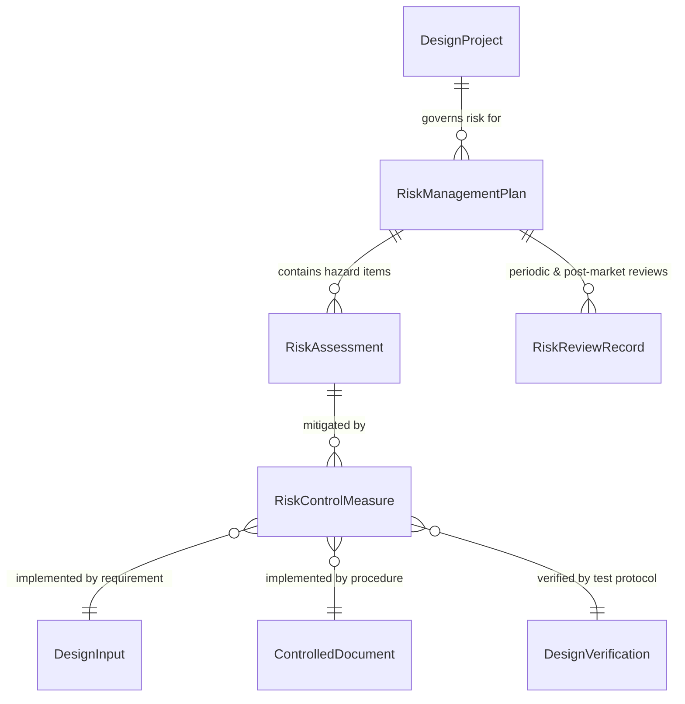

# Research — Sub-module 12.3: Risk Management (ISO 14971 / FMEA) (Module 12 — Quality Management System, `quality`)

## Repo state checked first

- **`LIVE_LINKS` built in Module 12 so far:**
  - `"12.1"` (Document Control & Management) is fully built:
    - `"Document Creation & Authoring": "quality:controlled_document_list"`
    - `"Review & Approval Workflows": "quality:electronic_signature_list"`
    - `"Document Distribution & Obsolescence": "quality:document_acknowledgment_list"`
    - `"Change Request & Revision Control": "quality:document_change_order_list"`
    - `"Archive & Retrieval": "quality:document_archive_vault"`
  - `"12.2"` (Design Controls & Development) is fully built:
    - `"Design Planning & Inputs": "quality:design_project_list"`
    - `"Design Reviews & Verification": "quality:design_review_list"`
    - `"Design Validation & Transfer": "quality:design_verification_list"`
    - `"Design History File (DHF)": "quality:traceability_matrix"`
    - `"Design Changes & Configuration Management": "quality:design_input_list"`
  - **`12.3` is the third sub-module of Module 12.**
- **Sibling models available to FK in `apps/quality/models/`:**
  - `ControlledDocument` (`apps/quality/models/DocumentControl/ControlledDocuments.py`, prefix `QDOC`): Controlled quality SOPs, specifications, inspection procedures, and work instructions linked to risk controls.
  - `DocumentChangeOrder` (`apps/quality/models/DocumentControl/DocumentChangeOrders.py`, prefix `QDCR`): Formal change control orders governing procedural modifications.
  - `ElectronicSignatureRecord` (`apps/quality/models/DocumentControl/ElectronicSignatures.py`, prefix `QSIG`): 21 CFR Part 11 compliant digital signature manifest with cryptographic SHA-256 digest, printed name, timestamp, and signature meaning.
  - `DocumentAcknowledgment` (`apps/quality/models/DocumentControl/DocumentAcknowledgments.py`, prefix `QACK`): Employee read-and-acknowledge sign-offs for safety procedures.
  - `DesignProject` (`apps/quality/models/DesignControls/DesignProjects.py`, prefix `QDPL`): Master design and development plan (DDP) for medical devices / systems; primary parent for product Risk Management Plans.
  - `DesignInput` (`apps/quality/models/DesignControls/DesignInputs.py`, prefix `QINP`): Functional, safety, usability, and regulatory design requirements; can link directly to hazards as originating risk inputs or as mitigating design requirements.
  - `DesignReview` (`apps/quality/models/DesignControls/DesignReviews.py`, prefix `QREV`): Stage-gate reviews with mandatory independent reviewer sign-off.
  - `DesignVerification` (`apps/quality/models/DesignControls/DesignVerifications.py`, prefix `QVER`): Verification test protocols and test executions providing objective evidence that risk control measures are implemented and effective.
- **Base classes in `apps/quality/models/_base.py`:**
  - `TenantOwned`: Multi-tenant foundation (`tenant`, `created_at`, `updated_at`).
  - `TenantNumbered`: Autonumbering base class with `next_number(type(self), self.tenant, self.NUMBER_PREFIX)` and atomic collision retry loop.

### Spine entities verified to EXIST (grep evidence)

| Claim | Evidence | Note |
|---|---|---|
| `core.Tenant` exists | `apps/core/models/Tenant.py:17` → `class Tenant(models.Model)` | Multi-tenant isolation foundation. |
| `core.OrgUnit` exists | `apps/core/models/OrgUnit.py:5` → `class OrgUnit(models.Model)` | Department, R&D unit, plant, or quality group ownership. |
| `core.Party` & `PartyRole` exist | `apps/core/models/Party.py:5`, `PartyRole.py:5` | Unified party spine. |
| `core.AuditLog` exists | `apps/core/models/AuditLog.py:5` + `write_audit_log` helper | Immutable tenant audit logging for risk updates. |
| `core.NumberingScheme` exists | `apps/core/models/NumberingScheme.py:15` | Scheme prefix allocation registry. |
| `accounts.User` exists | `apps/accounts/models.py:52` → `class User(AbstractBaseUser, PermissionsMixin)` | Risk managers, safety engineers, medical reviewers, and approvers. |
| `quality.DesignProject` exists | `apps/quality/models/DesignControls/DesignProjects.py:8` | Connects Risk Management Plans directly into product development lifecycles. |
| `quality.DesignInput` exists | `apps/quality/models/DesignControls/DesignInputs.py:8` | Risk controls implemented as design requirements / specifications. |
| `quality.DesignVerification` exists | `apps/quality/models/DesignControls/DesignVerifications.py:8` | Objective evidence of risk control verification of implementation and effectiveness. |
| `quality.ControlledDocument` exists | `apps/quality/models/DocumentControl/ControlledDocuments.py:8` | Protective procedures, IFU manuals, and training SOPs implementing mitigations. |
| `quality.ElectronicSignatureRecord` exists | `apps/quality/models/DocumentControl/ElectronicSignatures.py:10` | Formal 21 CFR Part 11 sign-off for Risk Management Plans and Reports. |

### Spine entities verified NOT to exist

- **No Risk Management, Hazard Analysis, or FMEA tables exist anywhere in the repo:** Grep across all apps confirms zero existing models for Risk Management Plans, Hazard Analyses, FMEA Failure Modes, Risk Control Measures, or Risk Management Reports.
- *Distinction:* `apps/scm/models/QualityManagement/QualityAudits.py` and `apps/inventory/models/QualityControl/` manage operational floor defect tracking, not regulated medical device / high-reliability risk management under ISO 14971 or IEC 60812 FMEA. Sub-module 12.3 builds this authoritative lifecycle risk management spine.

### Candidate prefix collision check (repo-wide automated verification)

Automated regex scan across all `NUMBER_PREFIX` declarations in `apps/`:
- `QRMP` (Quality Risk Management Plan / File) → **0 collisions** (Completely free)
- `QRSK` (Quality Risk Assessment / Hazard Item) → **0 collisions** (Completely free)
- `QRCM` (Quality Risk Control Measure / Mitigation) → **0 collisions** (Completely free)
- `QRMR` (Quality Risk Management Review / Report) → **0 collisions** (Completely free)

---

## Leaders surveyed (with source links)

1. **Greenlight Guru (Risk Management Software for Medical Devices)** — The premier medical device eQMS natively architected around **ISO 14971:2019**. Replaces static spreadsheets with a living, closed-loop Risk Management File (RMF). Natively maps the complete ISO 14971 event chain: Hazard → Hazardous Situation → Foreseeable Sequence of Events → Harm. Integrates pre-mitigation risk scoring, risk control options hierarchy (inherent safety by design, protective measures, information for safety), verification of implementation and effectiveness, residual risk evaluation, overall residual risk evaluation, and post-market surveillance linkages (complaints, non-conformances, CAPAs).
   - *Source:* https://www.greenlight.guru/risk-management-software · https://www.greenlight.guru/blog/iso-14971-risk-management
2. **MasterControl (Risk Excellence / Risk Management)** — Enterprise life sciences QMS market leader. Provides configurable risk assessment matrices ($3\times3$, $4\times4$, $5\times5$) with custom qualitative/quantitative scoring criteria for severity, probability, and detectability. Automates Risk Priority Number (RPN) calculations and risk acceptability thresholds (Acceptable, ALARP, Unacceptable). Seamlessly bridges product risk assessments to engineering change orders (ECOs), controlled SOPs, and post-market CAPAs.
   - *Source:* https://www.mastercontrol.com/risk-excellence/
3. **Qualio (Risk Management & Design Traceability)** — Modern cloud eQMS tailored for medical device, diagnostics, and biotech innovators. Unifies ISO 14971 risk registers with product development design controls. Features interactive risk evaluation matrices, automated residual risk calculations, benefit-risk analysis documentation for ALARP risks, and bi-directional traceability connecting hazards to mitigating design requirements and verification tests.
   - *Source:* https://www.qualio.com/product/risk-management · https://www.qualio.com/product/design-controls
4. **Jama Connect (Medical Device Risk Management & FMEA)** — Requirements and risk management platform for safety-critical systems. Delivers integrated support for both ISO 14971 top-down hazard analyses and bottom-up FMEAs (DFMEA, PFMEA, Software FMEA). Features Live Traceability™ cross-referencing Failure Modes/Hazards → System Requirements → Risk Control Mitigations → Verification Tests, with instant change impact analysis highlighting risks affected by design changes.
   - *Source:* https://www.jamasoftware.com/solutions/medical-device/ · https://www.jamasoftware.com/solutions/risk-management/
5. **Matrix Requirements / Matrix Req (Medical Device Risk Management)** — Item-based medical device ALM/QMS database. Treats every hazard, failure mode, and mitigation as a first-class traceable entity. Automates live risk matrix calculations, verifies that all risk controls have linked verification tests, flags unmitigated risks, and auto-generates audit-ready Risk Management Files (RMF) and Risk Management Reports (RMR).
   - *Source:* https://www.matrixone.health/products/matrix-req/ · https://www.matrixone.health/standards/iso-14971/
6. **SimplerQMS (Life Science eQMS Risk Management)** — All-in-one validated eQMS supporting ISO 14971:2019, ICH Q9, and EU MDR. Provides pre-configured Risk Assessment and Control (RAC) files, automated periodic risk review workflows, 21 CFR Part 11 electronic signatures, and cross-module linkages to complaints, deviations, and CAPAs for living risk updates.
   - *Source:* https://www.simplerqms.com/risk-management-software/
7. **PTC Arena & Codebeamer (PLM/QMS and ALM Risk & FMEA)** — Enterprise engineering and quality suite. Arena PLM/QMS unifies hardware BOMs and design controls with risk documentation; Codebeamer provides native DFMEA/PFMEA worksheets, Risk Priority Number (RPN) scoring ($S \times O \times D$), and ISO 14971 hazard traceability into software and mechanical components.
   - *Source:* https://www.arenasolutions.com/products/qms/ · https://www.ptc.com/en/products/codebeamer/medical-device
8. **Veeva Vault Quality / MedTech (Risk Management)** — Enterprise cloud MedTech solution unifying Design Controls, Document Management, and Risk Management under ISO 14971:2019. Features pre-mitigation and post-mitigation risk scoring, visual risk matrices, mitigation action assignment and due-date tracking, and closed-loop feedback connecting post-market safety signals to the living risk register.
   - *Source:* https://www.veeva.com/products/medtech/ · https://veevavault.help/en/lr/61223/

---

## Feature catalog (this sub-module only)

### Bullet 1 — Hazard Identification & Analysis (Hazard analysis, fault tree analysis, preliminary hazard lists)

- **Standardized ISO 14971 Hazard Taxonomy** — Classifies hazards into recognized regulatory categories per ISO 14971:2019 Annex C: Energy (electrical, thermal, mechanical, pressure, ionizing/non-ionizing radiation), Biological/Chemical (biocompatibility, toxicity, bioburden, pyrogenicity, chemical residue), Operational/Usability (use error, human factors, ergonomic, labeling/IFU ambiguity), Information/Software (cybersecurity vulnerability, data corruption, algorithmic failure, timing fault), and Environmental (temperature, humidity, shock/vibration, storage breakdown). · seen in: Greenlight Guru, Matrix Req, Veeva Vault · priority: **table-stakes** · spine: new model `RiskAssessment.hazard_category` choices · **buildable now**
- **ISO 14971 Event Chain Modeling** — Enforces the rigorous cause-to-harm sequence mandated by ISO 14971: (1) Intrinsic Hazard → (2) Foreseeable Sequence of Events → (3) Hazardous Situation (the operational circumstance exposing person or property) → (4) Resulting Harm (physical injury, health damage, environmental harm). · seen in: Greenlight Guru, MasterControl, Qualio · priority: **table-stakes** · spine: `RiskAssessment` dedicated fields (`hazard_description`, `hazardous_situation`, `foreseeable_sequence_of_events`, `potential_harm`) · **buildable now**
- **Multi-Method Risk Analysis Architecture** — Supports diverse engineering risk analysis types within a unified framework: ISO 14971 Hazard Analysis (PHA/SHA), Design FMEA (DFMEA), Process FMEA (PFMEA), Software FMEA, and Usability / User Error Risk Analysis (URRA/HE FMEA). · seen in: Jama Connect, Codebeamer, Greenlight Guru · priority: **table-stakes** · spine: `RiskAssessment.analysis_type` choices · **buildable now**
- **FMEA Failure Mode, Cause & Effect Structuring** — For FMEA records, captures the classical failure decomposition: Item/Function, Potential Failure Mode (how it fails), Potential Cause / Mechanism of Failure (root engineering cause), and Potential Effect of Failure (local and system impact). · seen in: Jama Connect, Codebeamer, MasterControl · priority: **table-stakes** · spine: `RiskAssessment` fields (`item_function`, `failure_mode`, `failure_cause`, `failure_effect`) · **buildable now**
- **Design Requirement & Component Traceability** — Connects identified hazards and failure modes directly to design inputs/requirements (`quality.DesignInput`) or target components, establishing originating risk context. · seen in: Greenlight Guru, Qualio, Matrix Req · priority: **table-stakes** · spine: FK `quality.DesignInput` on `RiskAssessment` · **buildable now**
- **Preliminary Hazard List (PHL) & Scoping** — Allows early-stage logging of preliminary hazards during concept phase before detailed quantitative scoring is finalized, flagging items requiring detailed risk assessment. · seen in: Greenlight Guru, SimplerQMS · priority: **common** · spine: `RiskAssessment.lifecycle_status` (`preliminary`, `active`, `mitigated`, `closed`) · **buildable now**

### Bullet 2 — Risk Evaluation & Scoring (Probability/severity matrices, RPN, acceptability thresholds)

- **Configurable Risk Evaluation Matrices ($3\times3$, $4\times4$, $5\times5$)** — Supports standardized probability versus severity matrix dimensions with qualitative and quantitative criteria definitions stored on the Risk Management Plan. · seen in: MasterControl, Greenlight Guru, Qualio, Veeva Vault · priority: **table-stakes** · spine: `RiskManagementPlan.matrix_dimension` choices · **buildable now**
- **Standardized Severity ($S$) Scale** — 5-point severity grading per ISO 14971 / ISO TR 24971: 1 (Negligible — inconvenience/no injury), 2 (Minor — reversible minor injury not requiring medical intervention), 3 (Serious — injury or impairment requiring medical intervention), 4 (Critical — permanent impairment or life-threatening injury), 5 (Catastrophic — patient or user death/fatality). · seen in: All leaders · priority: **table-stakes** · spine: `RiskAssessment.initial_severity` integer (1–5) + choices · **buildable now**
- **Probability of Occurrence of Harm ($P$) Estimation** — 5-point occurrence grading accounting for both probability of hazardous situation ($P_1$) and probability of harm given the situation ($P_2$): 1 (Improbable/Remote — $<10^{-6}$), 2 (Remote/Low — $10^{-6}$ to $10^{-4}$), 3 (Occasional/Medium — $10^{-4}$ to $10^{-2}$), 4 (Probable/High — $10^{-2}$ to $10^{-1}$), 5 (Frequent — $>10^{-1}$). · seen in: Greenlight Guru, Qualio, Matrix Req · priority: **table-stakes** · spine: `RiskAssessment.initial_probability` integer (1–5) + choices · **buildable now**
- **Detection ($D$) Scoring & Risk Priority Number (RPN) for FMEA** — 5-point detection scale: 1 (Almost Certain Detection), 2 (High), 3 (Moderate), 4 (Low), 5 (Very Low / Undetectable). Computes initial $RPN = S \times P \times D$ (scale 1–125 or 1–1000) automatically on save. · seen in: Jama Connect, Codebeamer, MasterControl · priority: **table-stakes** · spine: `RiskAssessment.initial_detectability` + `initial_rpn` property/field · **buildable now**
- **Automated Risk Acceptability Classification (Traffic-Light Thresholding)** — Categorizes initial risk into standard regulatory regions based on matrix coordinates:
  - **Broadly Acceptable (Green)** — Risk is negligible; no further mitigation mandatory unless economically viable.
  - **ALARP / Conditionally Acceptable (Amber)** — As Low As Reasonably Practicable; mitigation required or formal Benefit-Risk Analysis mandatory.
  - **Unacceptable (Red)** — High hazard; device cannot be released without effective risk control measures reducing risk. · seen in: All leaders · priority: **table-stakes** · spine: `RiskAssessment.initial_risk_level` auto-computed property/field · **buildable now**
- **Pre-Mitigation Baseline Freezing** — Preserves the unmitigated initial risk score as an immutable baseline for comparison against post-mitigation residual risk, preventing retrospective score alteration during audits. · seen in: Greenlight Guru, MasterControl, Matrix Req · priority: **table-stakes** · spine: `RiskAssessment` model fields (`initial_severity`, `initial_probability`, `initial_detectability`, `initial_rpn`, `initial_risk_level`) · **buildable now**

### Bullet 3 — Risk Control & Mitigation (Inherent safety, protective measures, info-for-safety hierarchy)

- **Mandatory Risk Control Option Hierarchy (ISO 14971:2019 Clause 7.1)** — Enforces the strict regulatory order of precedence for risk reduction options:
  1. *Inherent safety by design* (eliminate the hazard completely, reduce energy levels, use biocompatible materials, fail-safe architecture).
  2. *Protective measures in the medical device or manufacturing process* (physical barriers, guards, interlocks, pressure relief valves, alarms, redundant sensors).
  3. *Information for safety and training* (labeling, contraindications, warnings in Instructions for Use [IFU], operator training SOPs).
  *(Note: ISO 14971 explicitly prohibits relying on user warnings if inherent safety or physical protective measures are feasible).* · seen in: Greenlight Guru, MasterControl, Qualio, Matrix Req · priority: **table-stakes (regulated requirement)** · spine: **new model `RiskControlMeasure.control_hierarchy` choices** · **buildable now**
- **Mitigation Action Tracking & Ownership** — Assigns each risk control to a responsible engineer (`accounts.User`) with implementation description, target due date, and status lifecycle (`planned` → `in_progress` → `implemented` → `verified` → `ineffective` → `obsolete`). · seen in: All leaders · priority: **table-stakes** · spine: `RiskControlMeasure` fields (`assigned_to`, `status`, `due_date`) · **buildable now**
- **Closed-Loop Implementation Traceability (Design Inputs & SOPs)** — Links the risk control measure directly to the concrete system record where it is implemented:
  - Design-based controls link to `quality.DesignInput` (e.g., engineering requirement specifying electrical insulation thickness or alarm volume).
  - Procedural/manufacturing controls link to `quality.ControlledDocument` (e.g., assembly work instruction WI, cleaning procedure SOP, or IFU manual). · seen in: Greenlight Guru, Qualio, Arena PLM, Veeva Vault · priority: **table-stakes** · spine: FK `quality.DesignInput` + FK `quality.ControlledDocument` on `RiskControlMeasure` · **buildable now**
- **Dual Verification of Controls (Implementation & Effectiveness — ISO 14971 Clause 7.2)** — Requires two distinct verification confirmations before a mitigation is considered complete:
  1. *Verification of Implementation:* Confirms the risk control measure has been built/implemented in the final design/process.
  2. *Verification of Effectiveness:* Objective evidence demonstrating that the control actually reduces the probability of occurrence or severity of harm.
  Links directly to `quality.DesignVerification` test protocol/report. · seen in: Greenlight Guru, Qualio, Matrix Req, SimplerQMS · priority: **table-stakes (regulated requirement)** · spine: `RiskControlMeasure` fields (`implementation_verified`, `effectiveness_verified`, `verification_notes`) + FK `quality.DesignVerification` · **buildable now**
- **Introduction of New Hazards & Cross-Risk Impact Check (ISO 14971 Clause 7.3)** — Mandatory compliance gate: every risk control measure must be evaluated to confirm whether it inadvertently introduces *new* hazards or hazardous situations, or worsens existing ones (e.g., adding an emergency shutoff valve creates a new pinch hazard or false-alarm shutdown risk). · seen in: Greenlight Guru, MasterControl, Matrix Req · priority: **table-stakes (regulated requirement)** · spine: `RiskControlMeasure.introduces_new_hazard` boolean + `new_hazard_details` text field · **buildable now**

### Bullet 4 — Residual Risk Assessment (Post-mitigation evaluation, benefit-risk analysis, acceptance criteria)

- **Post-Mitigation Residual Risk Scoring** — Re-evaluates Severity ($S_{res}$), Probability ($P_{res}$), and Detectability ($D_{res}$) after risk control measures are verified. Re-computes Residual RPN and Residual Risk Level (`broadly_acceptable`, `alarp`, `unacceptable`). · seen in: All leaders · priority: **table-stakes** · spine: `RiskAssessment` fields (`residual_severity`, `residual_probability`, `residual_detectability`, `residual_rpn`, `residual_risk_level`) · **buildable now**
- **Residual Risk Acceptability Determination** — Validates individual residual risk against the pre-defined acceptability threshold in the Risk Management Plan. Unacceptable residual risks must either undergo further mitigation or the device cannot proceed. · seen in: All leaders · priority: **table-stakes** · spine: `RiskAssessment.residual_risk_acceptable` boolean · **buildable now**
- **Formal Clinical Benefit-Risk Analysis (BRA) Documentation (ISO 14971 Clause 7.4)** — If an individual residual risk remains in the ALARP / Conditionally Acceptable zone after all feasible mitigations, a formal clinical Benefit-Risk Analysis must be documented providing medical/clinical evidence justifying that the clinical benefit to the patient outweighs the residual risk. · seen in: Greenlight Guru, Qualio, MasterControl, Veeva Vault · priority: **table-stakes (regulated requirement)** · spine: `RiskAssessment.benefit_risk_justification` text field + `bra_required` boolean · **buildable now**
- **Overall Residual Risk Evaluation (ISO 14971 Clause 8)** — Systematic assessment evaluating whether the combined, cumulative effect of all individual residual risks across the entire medical device is acceptable when weighed against overall clinical benefit. Captures overall risk verdict and clinical rationale. · seen in: Greenlight Guru, Matrix Req, Veeva Vault · priority: **table-stakes** · spine: `RiskManagementPlan.overall_residual_risk_acceptable` boolean + `overall_benefit_risk_summary` text · **buildable now**
- **Informed Residual Risk Disclosure Identification** — Flags residual risks that are significant enough to warrant explicit disclosure to healthcare practitioners and patients in product labeling, user manuals (IFU), or contraindications. · seen in: Greenlight Guru, MasterControl · priority: **common** · spine: `RiskAssessment.disclosed_in_ifu` boolean · **buildable now**

### Bullet 5 — Risk Management File & Reporting (Living risk documents, periodic review triggers, post-market updates)

- **Risk Management Plan (RMP) / File (RMF) Governance (ISO 14971 Clause 4)** — Central master document governing risk management activities for a specific medical device/project: defines scope, product intended use, device classification, responsibilities, risk acceptability policy, and review schedule. · seen in: All leaders · priority: **table-stakes** · spine: **new model `RiskManagementPlan` (`QRMP-#####`)** · **buildable now**
- **Living Document Lifecycle & Revision States** — Lifecycle state machine: `draft` → `in_review` → `active` → `periodic_review` → `superseded` → `archived`. · seen in: MasterControl, Greenlight Guru, SimplerQMS · priority: **table-stakes** · spine: `RiskManagementPlan.status` choices · **buildable now**
- **Risk Management Report (RMR) Generation & Closure (ISO 14971 Clause 9)** — Formal report compiled prior to commercial release certifying that: (1) the Risk Management Plan was executed, (2) all risk controls were implemented and verified effective, (3) overall residual risk is acceptable, and (4) post-production review criteria are active. · seen in: Greenlight Guru, Matrix Req, SimplerQMS · priority: **table-stakes** · spine: **new model `RiskReviewRecord` (`QRMR-#####`)** (`review_type="initial_rmr"`) · **buildable now**
- **Periodic Risk Review Triggers & Cadence Monitoring** — Configurable periodic review frequency (e.g., annual, bi-annual) with calculated `next_review_due_date` and visual overdue warning badges. Triggers formal re-evaluation of the Risk Management File. · seen in: SimplerQMS, Qualio, MasterControl · priority: **table-stakes** · spine: `RiskManagementPlan.periodic_review_frequency_months` + `next_review_due_date` · **buildable now**
- **Post-Market Surveillance (PMS) Closed-Loop Feedback (ISO 14971 Clause 10)** — Structured review workflows recording whether post-market information (customer complaints, non-conformances [Module 12.5], CAPAs [Module 12.4], adverse events) introduces new hazards, increases estimated probabilities, or alters risk acceptability. · seen in: Greenlight Guru, Veeva Vault, MasterControl · priority: **table-stakes (regulated requirement)** · spine: `RiskReviewRecord` (`review_type="post_market_review"`, `pms_sources_reviewed`, `new_hazards_identified`, `risk_profile_changed`) · **buildable now**
- **21 CFR Part 11 Electronic Signature Integration** — Bridges formal approvals of Risk Management Plans and Risk Management Reports directly to cryptographic signature manifests in Sub-module 12.1. · seen in: All leaders · priority: **table-stakes** · spine: FK `quality.ElectronicSignatureRecord` on `RiskManagementPlan` and `RiskReviewRecord` · **buildable now**

### Bullet 6 — Beyond the Bullets: Traceability & Risk Intelligence

- **Interactive Risk Traceability Matrix (Hazard → Control → Verification)** — Full tabular view displaying the live ISO 14971 chain: Hazard / Failure Mode → Initial Risk ($S \times P$) → Risk Control Measure(s) → Implementation Evidence → Verification Test Result → Residual Risk ($S \times P$) → Acceptability Status, with instant filtering and CSV export. · seen in: Greenlight Guru, Qualio, Matrix Req, Jama Connect · priority: **differentiator** · spine: Relational query across `RiskManagementPlan`, `RiskAssessment`, `RiskControlMeasure`, `DesignVerification` · **buildable now**
- **Visual $5\times5$ Risk Heatmap Matrix** — Interactive visual grid plotting the distribution of identified risks across Severity and Probability coordinates before and after mitigation, showing risk migration from Red/Amber zones into Green. · seen in: Greenlight Guru, MasterControl, Qualio · priority: **differentiator** · spine: Template SVG/HTML grid driven by aggregation queries · **buildable now**

---

## Recommended build scope (this pass — 1–4 models)

To fully implement Sub-module 12.3 without over-scoping or creating disconnected tables, we recommend exactly **4 cohesive models** inheriting from `TenantNumbered` / `TenantOwned`:

### 1. `RiskManagementPlan` [NUMBER_PREFIX = "QRMP"]
- **Role:** Master Risk Management Plan (RMP) / Risk Management File (RMF) governing risk analysis for a medical device or product line per ISO 14971 Clause 4.
- **Inherits:** `TenantNumbered` (`number`, `tenant`, timestamps).
- **Key Fields:**
  - `title` (CharField, max_length=255) — e.g. "Infusion Pump Model X Risk Management Plan".
  - `plan_version` (CharField, max_length=16, default="1.0") — Semantic version (e.g. Rev 1.0, 2.0).
  - `status` (CharField, choices) — `draft`, `in_review`, `active`, `periodic_review`, `superseded`, `archived`.
  - `design_project` (FK `quality.DesignProject`, null=True, blank=True, on_delete=SET_NULL, related_name="risk_plans") — Links directly to Design Controls (12.2).
  - `lead_risk_manager` (FK `settings.AUTH_USER_MODEL`, null=True, blank=True, on_delete=SET_NULL, related_name="+") — Designated risk manager.
  - `department` (FK `core.OrgUnit`, null=True, blank=True, on_delete=SET_NULL, related_name="+") — Owning department/unit.
  - `device_classification` (CharField, choices) — `class_i`, `class_ii_a`, `class_ii_b`, `class_iii`, `samd`, `non_medical`.
  - `scope_description` (TextField) — Device description, clinical intended use, and lifecycle boundaries.
  - `matrix_dimension` (CharField, choices, default="5x5") — `3x3`, `4x4`, `5x5`.
  - `risk_acceptability_policy` (TextField) — Documented corporate criteria for risk acceptability and ALARP thresholds.
  - `overall_residual_risk_acceptable` (BooleanField, default=False) — Certification per ISO 14971 Clause 8.
  - `overall_benefit_risk_summary` (TextField, blank=True) — Executive summary of clinical benefit vs. residual risk.
  - `periodic_review_frequency_months` (PositiveSmallIntegerField, default=12) — Standard 12-month review interval.
  - `next_review_due_date` (DateField, null=True, blank=True) — Scheduled review trigger.
  - `approved_signature` (FK `quality.ElectronicSignatureRecord`, null=True, blank=True, on_delete=SET_NULL, related_name="+") — Part 11 signature.
- **Justified by:** Bullets 2 & 5 (RMP, risk acceptability matrix policy, overall residual risk, periodic review triggers).

### 2. `RiskAssessment` [NUMBER_PREFIX = "QRSK"]
- **Role:** Individual Hazard Analysis, Hazardous Situation, or FMEA Failure Mode item per ISO 14971 Clauses 5 & 6 and IEC 60812.
- **Inherits:** `TenantNumbered` (`number`, `tenant`, timestamps).
- **Key Fields:**
  - `plan` (FK `RiskManagementPlan`, on_delete=CASCADE, related_name="assessments") — Parent RMP.
  - `analysis_type` (CharField, choices, default="hazard_analysis") — `hazard_analysis`, `dfmea`, `pfmea`, `software_fmea`, `use_error_urra`.
  - `hazard_category` (CharField, choices) — `energy_electrical`, `energy_thermal`, `energy_mechanical`, `radiation`, `biological_chemical`, `operational_use_error`, `software_cybersecurity`, `environmental`, `other`.
  - `hazard_description` (CharField, max_length=255) — The fundamental source of harm.
  - `hazardous_situation` (TextField) — Operational circumstances exposing person/property to the hazard.
  - `foreseeable_sequence_of_events` (TextField, blank=True) — Causal chain leading from hazard to exposure.
  - `potential_harm` (TextField) — Bodily injury, clinical deterioration, or environmental damage.
  - *FMEA Specifics:* `item_function` (CharField, max_length=255, blank=True), `failure_mode` (CharField, max_length=255, blank=True), `failure_cause` (TextField, blank=True), `failure_effect` (TextField, blank=True).
  - *Pre-Mitigation Risk Scoring:*
    - `initial_severity` (PositiveSmallIntegerField, default=3, validators=[1..5]) — Severity score.
    - `initial_probability` (PositiveSmallIntegerField, default=3, validators=[1..5]) — Probability score.
    - `initial_detectability` (PositiveSmallIntegerField, default=1, validators=[1..5]) — Detection score for FMEA.
    - `initial_rpn` (PositiveIntegerField, default=0, editable=False) — Computed $S \times P \times D$.
    - `initial_risk_level` (CharField, choices, default="unacceptable") — `broadly_acceptable`, `alarp`, `unacceptable`.
  - *Post-Mitigation Residual Risk Scoring:*
    - `residual_severity` (PositiveSmallIntegerField, null=True, blank=True, validators=[1..5]) — Post-mitigation severity.
    - `residual_probability` (PositiveSmallIntegerField, null=True, blank=True, validators=[1..5]) — Post-mitigation probability.
    - `residual_detectability` (PositiveSmallIntegerField, null=True, blank=True, validators=[1..5]) — Post-mitigation detection.
    - `residual_rpn` (PositiveIntegerField, null=True, blank=True, editable=False) — Computed residual RPN.
    - `residual_risk_level` (CharField, choices, blank=True) — `broadly_acceptable`, `alarp`, `unacceptable`.
    - `residual_risk_acceptable` (BooleanField, default=False) — Meets acceptability threshold.
    - `bra_required` (BooleanField, default=False) — Benefit-Risk Analysis required if ALARP.
    - `benefit_risk_justification` (TextField, blank=True) — Documented clinical justification.
    - `disclosed_in_ifu` (BooleanField, default=False) — Residual risk disclosed in Instructions for Use.
  - `design_input` (FK `quality.DesignInput`, null=True, blank=True, on_delete=SET_NULL, related_name="+") — Linked design requirement.
  - `lifecycle_status` (CharField, choices, default="open") — `open`, `mitigation_in_progress`, `mitigated`, `accepted`, `closed`.
- **Justified by:** Bullets 1, 2, and 4 (Hazard Identification, Sequence of Events, Harm, Pre/Post Risk Scoring, RPN, Matrix Thresholding, Benefit-Risk Analysis).

### 3. `RiskControlMeasure` [NUMBER_PREFIX = "QRCM"]
- **Role:** Concrete risk mitigation / control measure implemented to reduce risk per ISO 14971 Clause 7.
- **Inherits:** `TenantNumbered` (`number`, `tenant`, timestamps).
- **Key Fields:**
  - `risk_assessment` (FK `RiskAssessment`, on_delete=CASCADE, related_name="control_measures") — Mitigated hazard/failure mode.
  - `control_hierarchy` (CharField, choices, default="inherent_safety") — ISO 14971 mandatory priority: `inherent_safety`, `protective_measure`, `information_for_safety`.
  - `title` (CharField, max_length=255) — Short descriptive title.
  - `description` (TextField) — Engineering or procedural specification of the mitigation.
  - `assigned_to` (FK `settings.AUTH_USER_MODEL`, null=True, blank=True, on_delete=SET_NULL, related_name="+") — Action owner.
  - `due_date` (DateField, null=True, blank=True) — Implementation target.
  - `status` (CharField, choices, default="planned") — `planned`, `in_progress`, `implemented`, `verified`, `ineffective`, `obsolete`.
  - *Spine Traceability Links:*
    - `design_input` (FK `quality.DesignInput`, null=True, blank=True, on_delete=SET_NULL, related_name="+") — Mitigating requirement.
    - `controlled_document` (FK `quality.ControlledDocument`, null=True, blank=True, on_delete=SET_NULL, related_name="+") — SOP/WI/drawing.
    - `design_verification` (FK `quality.DesignVerification`, null=True, blank=True, on_delete=SET_NULL, related_name="+") — Objective test evidence.
  - *Verification & Safety Gate:*
    - `implementation_verified` (BooleanField, default=False) — Clause 7.2 verification of implementation.
    - `effectiveness_verified` (BooleanField, default=False) — Clause 7.2 verification of effectiveness.
    - `verification_notes` (TextField, blank=True) — Summary of verification results.
    - `introduces_new_hazard` (BooleanField, default=False) — Clause 7.3 new hazard check.
    - `new_hazard_details` (TextField, blank=True) — Description and cross-reference of any new hazard created.
- **Justified by:** Bullet 3 (Risk Control Hierarchy, Closed-Loop Traceability to Design & Docs, Verification of Implementation & Effectiveness, New Hazard Assessment).

### 4. `RiskReviewRecord` [NUMBER_PREFIX = "QRMR"]
- **Role:** Living Risk Management File review, Risk Management Report (RMR), and Post-Market Surveillance (PMS) feedback evaluation per ISO 14971 Clauses 9 & 10.
- **Inherits:** `TenantNumbered` (`number`, `tenant`, timestamps).
- **Key Fields:**
  - `plan` (FK `RiskManagementPlan`, on_delete=CASCADE, related_name="reviews") — Reviewed RMP.
  - `review_title` (CharField, max_length=255) — e.g. "Annual Post-Market Risk Review 2026".
  - `review_type` (CharField, choices, default="periodic_review") — `initial_rmr`, `periodic_review`, `design_change_review`, `post_market_surveillance`, `complaint_trend_trigger`, `ncr_capa_trigger`.
  - `review_date` (DateField) — Date conducted.
  - `review_period_start` (DateField, null=True, blank=True) — Start of monitoring window.
  - `review_period_end` (DateField, null=True, blank=True) — End of monitoring window.
  - `pms_sources_reviewed` (TextField, blank=True) — Complaints, non-conformances, CAPAs, field alerts, scientific literature examined.
  - `new_hazards_identified` (BooleanField, default=False) — Did post-market surveillance reveal previously unrecognized hazards?
  - `risk_profile_changed` (BooleanField, default=False) — Did occurrence frequency or severity increase?
  - `overall_residual_risk_reconfirmed` (BooleanField, default=True) — Reconfirmation that overall residual risk remains acceptable.
  - `findings_summary` (TextField) — Detailed review conclusions and regulatory evaluation.
  - `action_items_required` (TextField, blank=True) — Follow-up DCOs, CAPAs, or design changes triggered.
  - `status` (CharField, choices, default="draft") — `draft`, `under_review`, `approved`, `rejected`.
  - `lead_reviewer` (FK `settings.AUTH_USER_MODEL`, on_delete=PROTECT, related_name="+") — Lead reviewer.
  - `approved_signature` (FK `quality.ElectronicSignatureRecord`, null=True, blank=True, on_delete=SET_NULL, related_name="+") — Part 11 sign-off.
- **Justified by:** Bullet 5 (Living risk documents, periodic review triggers, post-market risk updates, Risk Management Reports).

---

## Belongs to sibling sub-modules (parked, not scoped here)

- **Root Cause Analysis (RCA) & CAPA Actions** — 5 Whys, Ishikawa fishbone diagrams, formal corrective/preventive action workflows → **Parked in Sub-module 12.4 (CAPA)**.
- **Non-Conformance Reporting (NCR) & Material Segregation** — Defect logging, lot quarantine holds, MRB dispositions (scrap/rework/use-as-is) → **Parked in Sub-module 12.5 (Non-Conformance & Deviation Management)**.
- **Quality Audits (Internal & External)** — Audit scheduling, checklist execution, audit findings → **Parked in Sub-module 12.6 (Audit Management)**.
- **Employee Training Qualification** — Training matrix, SOP comprehension quizzes, employee qualification records → **Parked in Sub-module 12.7 (Training & Qualification)**.
- **Enterprise Change Control Board (CCB)** — Multi-department enterprise-wide change control workflows → **Parked in Sub-module 12.11 (Change Control Management)**.
- **Regulatory Submissions & Notified Body Filings** — Compilation of FDA 510(k), PMA, De Novo, or EU MDR Technical Files → **Parked in Sub-module 12.12 (Regulatory Affairs & Submissions)**.

---

## Deferred (later passes / integrations)

- **AI-Powered Hazard Suggestion & IMDRF Coding** — Automatic suggestion of potential hazardous situations using machine learning trained on FDA MAUDE adverse event databases and standard IMDRF codes — *Deferred to Module 12 AI enhancement phase.*
- **Interactive SVG Fault Tree Analysis (FTA) Editor** — Visual drag-and-drop boolean logic tree builder (AND/OR gates) for top-down quantitative reliability modeling — *Deferred; current pass provides structured FMEA and ISO 14971 event chains which satisfy regulatory requirements.*
- **Automated IoT / Telemetry Anomaly Feeds** — Direct streaming of production equipment or connected medical device telemetry into failure probability calculations — *Deferred to Industry 4.0 / IoT module integration.*
- **Direct Regulatory Portal Dispatch (FDA eSubmitter / EUDAMED)** — Automated B2B XML transfer of post-market risk evaluations to regulatory authorities — *Deferred to Sub-module 12.12 Regulatory Submissions.*
