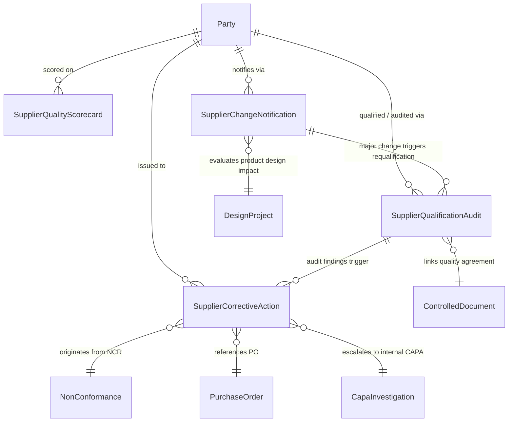

# Research — Sub-module 12.6: Supplier & Vendor Quality Management (Module 12 — Quality Management System, `quality`)

## Repo state checked first

- **`LIVE_LINKS` built in Module 12 so far (`apps/core/navigation.py`):**
  - `"12.1"` (Document Control & Management):
    - `"Document Creation & Authoring": "quality:controlled_document_list"`
    - `"Review & Approval Workflows": "quality:electronic_signature_list"`
    - `"Document Distribution & Obsolescence": "quality:document_acknowledgment_list"`
    - `"Change Request & Revision Control": "quality:document_change_order_list"`
    - `"Archive & Retrieval": "quality:document_archive_vault"`
  - `"12.2"` (Design Controls & Development):
    - `"Design Planning & Inputs": "quality:design_project_list"`
    - `"Design Reviews & Verification": "quality:design_review_list"`
    - `"Design Validation & Transfer": "quality:design_verification_list"`
    - `"Design History File (DHF)": "quality:traceability_matrix"`
    - `"Design Changes & Configuration Management": "quality:design_input_list"`
  - `"12.3"` (Risk Management / ISO 14971):
    - `"Hazard Identification & Analysis": "quality:risk_assessment_list"`
    - `"Risk Evaluation & Scoring": "quality:fmea_matrix"`
    - `"Risk Control & Mitigation": "quality:risk_control_measure_list"`
    - `"Residual Risk Assessment": "quality:risk_traceability_matrix"`
    - `"Risk Management File & Reporting": "quality:risk_management_plan_list"`
  - `"12.4"` (Corrective & Preventive Action / CAPA):
    - `"Issue Detection & Logging": "quality:capa_investigation_list"`
    - `"Root Cause Analysis (RCA)": "quality:root_cause_analysis_list"`
    - `"Action Plan Development": "quality:capa_action_list"`
    - `"CAPA Tracking & Escalation": "quality:capa_effectiveness_review_list"`
    - `"Effectiveness Verification & Closure": "quality:capa_escalation_board"`
  - **`12.6` is the sixth sub-module of Module 12** (Note: 12.5 Non-Conformance & Deviation Management in NavERP.md is an upcoming sibling; operational NCRs were established in SCM 4.9 `scm.NonConformance`).

- **Sibling models available to FK in `apps/quality/models/`:**
  - `ControlledDocument` (`apps/quality/models/DocumentControl/ControlledDocuments.py`, prefix `QDOC`): Standard operating procedures, supplier quality agreements, and incoming inspection specifications.
  - `DocumentChangeOrder` (`apps/quality/models/DocumentControl/DocumentChangeOrders.py`, prefix `QDCR`): Formal change orders triggered by supplier change notifications (SCNs).
  - `ElectronicSignatureRecord` (`apps/quality/models/DocumentControl/ElectronicSignatures.py`, prefix `QSIG`): 21 CFR Part 11 electronic signatures for qualification approvals, SCAR closures, and SCN sign-offs.
  - `DesignProject` (`apps/quality/models/DesignControls/DesignProjects.py`, prefix `QDPL`): Medical device / product design projects referenced when evaluating supplier change impact.
  - `RiskAssessment` (`apps/quality/models/RiskManagement/RiskAssessments.py`, prefix `QRSK`): Formal ISO 14971 product risk files updated when critical supplier components or processes change.
  - `CapaInvestigation` (`apps/quality/models/CapaManagement/CapaInvestigations.py`, prefix `QCAP`): Internal enterprise CAPAs linked or escalated from severe supplier failures.

- **Cross-module spine models available to FK:**
  - `scm.PurchaseOrder` (`apps/scm/models/ProcurementManagement/PurchaseOrders.py`, prefix `PO`): Procurement purchase orders referenced in SCARs.
  - `scm.NonConformance` (`apps/scm/models/QualityManagement/NonConformances.py`, prefix `NCR`): Quality failure records that trigger supplier corrective actions.

- **Base classes in `apps/quality/models/_base.py`:**
  - `TenantOwned`: Multi-tenant isolation (`tenant`, `created_at`, `updated_at`).
  - `TenantNumbered`: Autonumbering base class with `next_number(type(self), self.tenant, self.NUMBER_PREFIX)` and atomic collision retry loop.

### Spine entities verified to EXIST (grep evidence)

| Claim | Evidence | Note |
|---|---|---|
| `core.Tenant` exists | `apps/core/models/Tenant.py:17` -> `class Tenant(models.Model)` | Multi-tenant isolation foundation. |
| `core.Party` & `PartyRole` exist | `apps/core/models/Party.py:5`, `PartyRole.py:5` | Unified party spine for suppliers/vendors (`role="supplier"` or `"vendor"`). |
| `core.OrgUnit` exists | `apps/core/models/OrgUnit.py:5` -> `class OrgUnit(models.Model)` | Department, plant, quality unit, or receiving dock ownership. |
| `accounts.User` exists | `apps/accounts/models.py:52` -> `class User(AbstractBaseUser, PermissionsMixin)` | System users for auditors, quality engineers, SCAR owners, and approvers. |
| `core.AuditLog` exists | `apps/core/models/AuditLog.py:5` + `write_audit_log` helper | Immutable tenant audit logging for AVL status transitions and regulatory audits. |
| `quality.ControlledDocument` exists | `apps/quality/models/DocumentControl/ControlledDocuments.py:8` | Linked supplier quality agreements and audit checklists. |
| `quality.CapaInvestigation` exists | `apps/quality/models/CapaManagement/CapaInvestigations.py:11` | Linked internal CAPA investigations. |
| `quality.RiskAssessment` exists | `apps/quality/models/RiskManagement/RiskAssessments.py:8` | Linked supplier risk evaluations and component FMEAs. |
| `scm.PurchaseOrder` exists | `apps/scm/models/ProcurementManagement/PurchaseOrders.py:11` | Optional reference on SCARs. |
| `scm.NonConformance` exists | `apps/scm/models/QualityManagement/NonConformances.py:33` | Originating non-conformance reference on SCARs. |

### Spine entities verified NOT to exist (or unbuilt in Module 12)

- **Module 5 unbuilt masters:** `Item`, `LotSerial`, `UOM`, `StockMove` are not built yet. Quality models use free-text part identifiers (`affected_item_code`, `affected_item_name`, `affected_lots`) with future migration path to Module 5.
- **Module 12 operational inspection engine:** Sub-module 12.7 Incoming Quality Control (IQC) will build lot-by-lot ANSI/ASQ Z1.4 sampling, inspection execution worksheets, and physical goods receipt dispositions. 12.6 establishes the supplier governance layer (AVL qualification status, dock-to-stock eligibility, CoA mandate, periodic scorecards, SCARs, and SCNs).

### Candidate prefix collision check (repo-wide automated verification)

Automated ripgrep scan across all `NUMBER_PREFIX` declarations in `apps/`:
- `QSQA` (Quality Supplier Qualification & Audit) -> **0 collisions** (Completely free)
- `QSSC` (Quality Supplier Scorecard) -> **0 collisions** (Completely free; disambiguated from SCM's `SCR`)
- `QSCA` (Quality Supplier Corrective Action / SCAR) -> **0 collisions** (Completely free)
- `QSCN` (Quality Supplier Change Notification) -> **0 collisions** (Completely free)

---

## Leaders surveyed (with source links)

1. **MasterControl (Supplier Excellence / Supplier Quality Management)** — Enterprise life sciences eQMS market leader for FDA 21 CFR Part 820.50, ISO 13485:2016 §7.4, and ISO 9001 compliance. Provides a centralized Approved Vendor List (AVL) with automated qualification workflows, risk-based audit scheduling, automated Supplier Corrective Action Requests (SCAR) with cross-functional CAPA linking, controlled supplier deviation workflows, and objective supplier performance scorecards.
   - *Source:* https://www.mastercontrol.com/supplier-quality-management/
2. **ETQ Reliance (Supplier Quality Management - SQM)** — Enterprise quality platform bridging internal quality and external suppliers. Features automated Approved Vendor List (AVL) onboarding, configurable supplier qualification surveys, automated SCAR generation from incoming inspection rejects or audit findings, supplier-initiated change controls, and weighted multi-factor supplier rating scorecards.
   - *Source:* https://www.etq.com/supplier-quality-management/
3. **Sparta Systems / TrackWise Digital (Supplier Quality Management)** — Honeywell life sciences cloud EQMS featuring site-level Approved Supplier List (ASL) tracking, Supplier Initiated Change Requests (SICR/SCN) with cross-functional impact assessments, collaborative SCAR workflows, and automated risk scoring based on audit findings and quality escape frequency.
   - *Source:* https://www.honeywell.com/us/en/press/2021/04/honeywell-launches-trackwise-digital-supplier-quality-management-solution
4. **Veeva Vault (Vault Supplier Quality / Vault QualityOne)** — Cloud-native enterprise pharma and MedTech platform. Features integrated Approved Vendor List (AVL) directories with risk tiering (Under Evaluation, Approved, Conditional/Probationary, Suspended, Disqualified), automated Supplier Change Notification (SCN) intake with formal SCN Impact Assessments, Supplier Non-Conformance (SNCR) / SCAR lifecycle tracking, and comprehensive scorecard KPI aggregation.
   - *Source:* https://www.veeva.com/products/vault-qms/
5. **Greenlight Guru (Medical Device Supplier Management Software)** — Premier medical device quality platform purpose-built for FDA 21 CFR Part 820 / QMSR and ISO 13485:2016 Clause 7.4 purchasing controls. Maintains an audit-ready Approved Supplier List (ASL) linked to critical vs. non-critical component risk classifications, periodic supplier scorecards (evaluating OTD, quality conformance, and open SCARs), qualification questionnaires, and closed-loop SCAR tracking.
   - *Source:* https://www.greenlight.guru/supplier-management-software
6. **ComplianceQuest (Supplier Quality Management / PartnerQuest)** — Native Salesforce-based modern EQMS providing AI-driven supplier risk scoring, multi-tier scorecard frameworks, automated SCAR management linked to incoming inspection defects, and formal Supplier Change Notification (SCN) change control workflows with downstream design impact analysis.
   - *Source:* https://www.compliancequest.com/supplier-quality-management-system/
7. **Qualio (Supplier Management & Vendor Governance)** — Life sciences eQMS providing risk-based supplier onboarding policies, one-click audit-ready Approved Vendor List (AVL) exports, quality agreement linking, and quality event/SCAR tracking directly from the vendor's profile.
   - *Source:* https://www.qualio.com/product/supplier-management
8. **Arena PLM / QMS (PTC) (Supplier Quality & Item Management)** — Complex discrete manufacturing and high-tech quality platform connecting supplier quality directly to BOMs, component revisions, engineering changes (ECOs), incoming quality tracking, and closed-loop supplier corrective actions.
   - *Source:* https://www.arenasolutions.com/products/quality/
9. **QT9 QMS (Supplier Management & SCAR Software)** — Regulated manufacturing QMS (ISO 9001, ISO 13485, AS9100) featuring live Approved Supplier Lists (ASL), automated supplier qualification surveys, SCAR tracking with strict response deadlines, effectiveness verification checkpoints, and real-time supplier scorecards.
   - *Source:* https://www.qt9software.com/supplier-management-software.aspx

---

## Feature catalog (this sub-module only)

### Bullet 1 — Supplier Qualification & Audit (Initial assessment, on-site audits, scorecards, and approved vendor list (AVL) maintenance)

- **Approved Vendor List (AVL / ASL) Status Lifecycle** — Formal regulatory control over which suppliers are legally authorized for procurement: `under_evaluation` (initial due diligence), `approved` (fully qualified for all approved commodities), `conditional` (probationary status due to minor audit findings or new supplier trial), `suspended` (temporary block on new purchase orders due to open SCARs or quality escapes), `disqualified` (formally de-listed / off-boarded). · seen in: All leaders · priority: **table-stakes** · spine: `SupplierQualificationAudit.qualification_status` · **buildable now**
- **Supplier Criticality & Risk Tiering** — Risk-based categorization per ISO 13485 / GAMP: Critical (custom components, sterile barrier packaging, API/active drug ingredients, software, contract sterilizers), Major (key subassemblies, complex electronics, calibrated tooling), Minor (standard catalog parts, off-the-shelf fasteners, packaging consumables), Indirect (services, calibration labs, transport). · seen in: Greenlight Guru, MasterControl, Qualio, Veeva Vault · priority: **table-stakes** · spine: `SupplierQualificationAudit.criticality_tier` · **buildable now**
- **Structured Audit Assessment Types & Methods** — Supports initial qualification audits, periodic re-audits, for-cause investigations (triggered by recurring defects), and certification verifications (ISO 9001, ISO 13485, IATF 16949, AS9100) via desktop surveys, on-site audits, or accredited third-party registrar reviews. · seen in: MasterControl, ETQ Reliance, QT9, TrackWise · priority: **table-stakes** · spine: `SupplierQualificationAudit.assessment_type`, `audit_method` · **buildable now**
- **Audit Findings Severity & Defect Count** — Direct capture of audit non-conformances classified by regulatory severity: `critical_findings`, `major_findings`, `minor_findings`, `observations`. Reaches an objective audit score (0–100%) and overall result (`passed`, `passed_with_capa`, `failed`). · seen in: MasterControl, ETQ Reliance, TrackWise · priority: **table-stakes** · spine: `SupplierQualificationAudit` fields (`score`, `audit_result`, finding counters) · **buildable now**
- **Audit Recertification & Expiry Tracking** — Tracks `qualified_date`, `audit_date`, `next_audit_due_date`, and `certificate_expiry_date` with automated overdue detection and visual indicators for upcoming audits. · seen in: Qualio, QT9, MasterControl · priority: **table-stakes** · spine: `SupplierQualificationAudit` date fields · **buildable now**
- **Quality Agreement & Audit Document Linking** — Links formal bilateral Quality Agreements and supplier audit checklists directly to `quality.ControlledDocument`. · seen in: Qualio, Greenlight Guru, Veeva Vault · priority: **common** · spine: `SupplierQualificationAudit.quality_agreement` (`quality.ControlledDocument`) · **buildable now**

### Bullet 2 — Incoming Inspection & Receiving (Governance & Gating)

- **Dock-to-Stock Certification Eligibility** — Explicit qualification flag authorizing certified suppliers with sustained zero-defect performance to bypass incoming receiving inspection directly into active inventory, drastically reducing dock transit time and inspection overhead. · seen in: ETQ Reliance, MasterControl, Arena QMS · priority: **table-stakes** · spine: `SupplierQualificationAudit.dock_to_stock_eligible` · **buildable now**
- **Skip-Lot Inspection Authorization** — Statistically justified reduced inspection frequency (e.g. 1 in 5 lots) for approved mature suppliers with verified process capability (Cpk > 1.33). · seen in: ETQ Reliance, TrackWise Digital · priority: **common** · spine: `SupplierQualificationAudit.skip_lot_approved` · **buildable now**
- **Mandatory Certificate of Analysis (CoA) Verification Policy** — Flag mandating that every incoming delivery from this supplier must include a validated Certificate of Analysis verifying critical physical/chemical specifications before warehouse receipt can proceed. · seen in: MasterControl, Veeva Vault, ETQ Reliance · priority: **table-stakes** · spine: `SupplierQualificationAudit.requires_coa` · **buildable now**
- **Inspection Protocol Boundary Statement** — Operational lot sampling execution (ANSI/ASQ Z1.4 tables, AQL levels, inspection worksheets, and pass/fail usage decisions) is explicitly managed by **Sub-module 12.7 Incoming Quality Control (IQC)**; 12.6 defines the supplier-level governance rules and certification gates.

### Bullet 3 — Supplier Performance Monitoring (Delivery, quality, and responsiveness scorecards with automatic grading)

- **Disambiguation from Procurement Scorecards** — Unlike SCM 4.2 (`scm.SupplierScorecard`), which evaluates procurement/commercial factors (pricing competitiveness, quote turnaround, contract compliance), QMS 12.6 `SupplierQualityScorecard` evaluates strict regulatory product conformity, quality yields, defect PPM, SCAR responsiveness, and documentation accuracy. · seen in: MasterControl, ETQ, Veeva, Greenlight Guru · priority: **table-stakes** · spine: `SupplierQualityScorecard` (new table, `NUMBER_PREFIX = "QSSC"`) · **buildable now**
- **Multidimensional Quality Scoring Dimensions (0–100 each)** —
  1. `lot_acceptance_rate_score` (% of lots passed at receiving inspection / IQC).
  2. `defect_ppm_score` (Parts Per Million defect rate and shop-floor quality escapes).
  3. `scar_responsiveness_score` (timeliness of SCAR containment, root-cause submission, and corrective action closure).
  4. `audit_compliance_score` (audit rating, severity of findings, and audit finding closure rate).
  5. `documentation_coa_score` (accuracy, completeness, and timeliness of CoAs and regulatory certifications).
  · seen in: All leaders · priority: **table-stakes** · spine: `SupplierQualityScorecard` dimension fields · **buildable now**
- **Automated Weighted Composite Scoring & Letter Grading** — Computes `overall_score` (0–100) via standard QMS weights (Lot Acceptance: 30%, Defect PPM: 25%, SCAR Responsiveness: 20%, Audit: 15%, Documentation: 10%) and automatically assigns standard quality performance grades:
  - `Grade A (Preferred)`: Score ≥ 90 (Eligible for dock-to-stock, preferred sourcing).
  - `Grade B (Approved)`: Score 80–89 (Standard receiving inspection).
  - `Grade C (Conditional / Probation)`: Score 70–79 (Tightened inspection, mandatory improvement plan).
  - `Grade D (Unacceptable / Critical Risk)`: Score < 70 (Triggers immediate SCAR, potential AVL suspension).
  · seen in: ETQ Reliance, QT9, ComplianceQuest · priority: **table-stakes** · spine: `SupplierQualityScorecard.overall_score`, `grade`, `recompute_scores()` · **buildable now**
- **Evaluation Cadence & Review Cycles** — Structured review periods: `monthly`, `quarterly`, `semi_annual`, `annual`, with tracking of `period_start` and `period_end`. · seen in: Greenlight Guru, QT9, Veeva · priority: **table-stakes** · spine: `SupplierQualityScorecard.cadence`, `period_start`, `period_end` · **buildable now**
- **Scorecard Governance & Formal Publication** — Lifecycle state machine: `draft`, `under_review`, `published`, `disputed`. Includes `manual_override` capability with mandatory `override_justification` notes to maintain audit integrity when special circumstances arise. · seen in: MasterControl, ETQ Reliance · priority: **table-stakes** · spine: `SupplierQualityScorecard.status`, `is_manual_override`, `override_justification` · **buildable now**

### Bullet 4 — Supplier CAPA & Development (Supplier-issued corrective actions, improvement plans, and development programs)

- **Formal Supplier Corrective Action Request (SCAR)** — Dedicated, legally binding corrective action contract issued directly to external vendors per ISO 13485:2016 §7.4 / §8.5.2 and 21 CFR 820.100. Disambiguated from internal CAPA (`quality.CapaInvestigation`) and SCM operational action (`scm.CapaAction`). · seen in: All leaders · priority: **table-stakes** · spine: `SupplierCorrectiveAction` (new table, `NUMBER_PREFIX = "QSCA"`) · **buildable now**
- **SCAR Lifecycle State Machine** — Closed-loop progression: `draft` -> `issued` -> `containment_submitted` -> `rca_submitted` -> `action_plan_approved` -> `implemented` -> `effectiveness_verified` -> `closed` (or `rejected`). · seen in: All leaders · priority: **table-stakes** · spine: `SupplierCorrectiveAction.status` · **buildable now**
- **Immediate Containment Actions & Traceability** — Records emergency containment steps taken within 24–48 hours (quarantine of in-transit lots, sorting/re-inspection, purge of inventory, replacement shipments) before detailed RCA is completed. Tracks `containment_action`, `containment_due_date`, `containment_verified_at`. · seen in: MasterControl, QT9, ETQ Reliance · priority: **table-stakes** · spine: `SupplierCorrectiveAction` containment fields · **buildable now**
- **Supplier Root Cause Analysis (5 Whys / Ishikawa 6M)** — Mandates vendor submission of formal root cause investigation details, categorized into standard quality taxonomies (`raw_material_defect`, `process_parameter_drift`, `operator_error`, `tooling_wear`, `packaging_failure`, `sub_tier_supplier`, `test_method_error`). · seen in: QT9, TrackWise, Veeva Vault, ETQ Reliance · priority: **table-stakes** · spine: `SupplierCorrectiveAction.root_cause_summary`, `root_cause_category`, `vendor_investigation_details` · **buildable now**
- **Dual Corrective & Preventive Action Plans** — Captures supplier commitments: Corrective Actions (actions to fix the immediate defective condition) and Preventive Actions (systemic process/tooling changes to ensure defect can never recur). Tracks `implementation_due_date` and `implemented_at`. · seen in: All leaders · priority: **table-stakes** · spine: `SupplierCorrectiveAction.corrective_action`, `preventive_action` · **buildable now**
- **Time-Delayed Effectiveness Verification** — Verification checkpoint where internal quality engineering evaluates objective data (e.g. 3 subsequent lots with zero defects over 90 days) before formal closure. Captures `effectiveness_due_date`, `effectiveness_results`, `is_effective` (boolean), `closed_at`. · seen in: MasterControl, Greenlight Guru, QT9 · priority: **table-stakes** · spine: `SupplierCorrectiveAction` effectiveness fields · **buildable now**
- **Cross-Module Linkage** — Direct linking to originating `scm.NonConformance` [NCR-], `scm.PurchaseOrder` [PO-], and optional escalation to internal `quality.CapaInvestigation` [QCAP-] when vendor failure exposes company-wide patient or product risk. · seen in: Veeva Vault, Greenlight Guru, MasterControl · priority: **common** · spine: `SupplierCorrectiveAction` optional FKs · **buildable now**

### Bullet 5 — Supplier Change Notification (SCN) (Process/material changes, impact assessment, and re-qualification triggers)

- **Formal SCN Intake & Logging** — Tracks supplier-initiated change requests (SICRs) and notifications prior to vendor implementation per ISO 13485:2016 §7.4.2 and FDA 21 CFR 820.50. Captures `scn_reference` (supplier's internal change number), `title`, `description`, `proposed_effective_date`, `first_affected_lot`. · seen in: TrackWise Digital, Veeva Vault, ComplianceQuest · priority: **table-stakes** · spine: `SupplierChangeNotification` (new table, `NUMBER_PREFIX = "QSCN"`) · **buildable now**
- **Change Category & Scope** — Standard change taxonomies: `raw_material` (resin, chemical, alloy change), `manufacturing_process` (molding parameters, assembly sequence, heat treat), `facility_location` (plant relocation, line transfer), `tooling_equipment` (new mold, new CNC machine), `packaging_labeling` (sterile pouch, label redesign), `specification_testing` (revised test method, tightened/loosened tolerance), `sub_tier_supplier` (outsourcing component to another vendor). · seen in: TrackWise Digital, Veeva Vault · priority: **table-stakes** · spine: `SupplierChangeNotification.change_category` · **buildable now**
- **Risk Level & Change Classification** —
  - `Level 1 (Minor)`: Administrative, non-critical drawing clean-up; notification only.
  - `Level 2 (Moderate)`: Equivalent tooling, non-critical process tweak; requires incoming sample testing and internal review.
  - `Level 3 (Major / Critical)`: Material change, site transfer, or anything affecting form, fit, function; requires formal validation, customer notification, and potential regulatory filing.
  · seen in: Veeva Vault, TrackWise Digital, ComplianceQuest · priority: **table-stakes** · spine: `SupplierChangeNotification.risk_level` · **buildable now**
- **Comprehensive Quality & Regulatory Impact Assessment** — Structured impact assessment checklist:
  - `affects_form_fit_function` (boolean)
  - `requires_requalification` (boolean — triggers re-audit or new qualification audit)
  - `requires_design_change` (boolean — triggers link to `quality.DesignProject` or `quality.DocumentChangeOrder`)
  - `requires_regulatory_filing` (boolean — 510(k), PMA supplement, CE technical file update)
  - `requires_customer_notification` (boolean)
  - `samples_required` (boolean)
  - `impact_assessment_notes` (detailed engineering rationale)
  · seen in: TrackWise Digital, Veeva Vault, MasterControl · priority: **table-stakes** · spine: `SupplierChangeNotification` impact fields · **buildable now**
- **Disposition & Approval Workflow** — State progression: `received` -> `under_assessment` -> `samples_pending` -> `approved` -> `conditional_approval` (e.g. approved for 3 pilot lots with 100% inspection) -> `rejected` -> `implemented`. Managed by authorized quality authority with 21 CFR Part 11 sign-off. · seen in: All leaders · priority: **table-stakes** · spine: `SupplierChangeNotification.status`, `disposition`, `approved_by`, `disposition_date` · **buildable now**

### Beyond the Bullets

- **Audit-Ready Export & Approved Vendor List Directory** — Unified list view and filtered directory allowing instant filtering of active approved suppliers by criticality tier, commodity, and qualification status for ISO/FDA audit presentations.
- **Supplier Governance Health Summary Dashboard** — Visual aggregation of active AVL count, pending qualification audits, open SCARs by severity, and average supplier quality scorecard ratings.

---

## Recommended build scope (this pass — 1–4 models)

To fully satisfy NavERP.md 12.6, enforce robust enterprise supplier governance, and integrate seamlessly with both the core spine and Module 12's design/risk/document architecture, exactly **4 models** are recommended for this pass:

### Model 1: `SupplierQualificationAudit` [NUMBER_PREFIX = "QSQA"]
- **Purpose:** Maintains the master Approved Vendor List (AVL) qualification lifecycle, criticality tiering, audit scheduling, execution scoring, and dock-to-stock / CoA inspection gating.
- **Key Fields:**
  - `tenant` (`core.Tenant`, cascading)
  - `number` (`max_length=32`, editable=False, prefix `QSQA-#####`)
  - `supplier` (`core.Party`, on_delete=CASCADE, related_name="quality_qualifications") — supplier counterparty
  - `assessment_type` (`initial_qualification`, `periodic_reaudit`, `for_cause`, `certification_review`, `quality_agreement_review`)
  - `criticality_tier` (`critical`, `major`, `minor`, `indirect`)
  - `audit_method` (`on_site`, `desktop_survey`, `third_party_iso`, `virtual`)
  - `qualification_status` (`under_evaluation`, `approved`, `conditional`, `suspended`, `disqualified`)
  - `scope_commodities` (text: approved materials, services, or part categories)
  - `score` (`DecimalField(max_digits=5, decimal_places=2, null=True, blank=True)`, 0–100%)
  - `audit_result` (`pending`, `passed`, `passed_with_capa`, `failed`, `exempt`)
  - `critical_findings` (`PositiveIntegerField(default=0)`)
  - `major_findings` (`PositiveIntegerField(default=0)`)
  - `minor_findings` (`PositiveIntegerField(default=0)`)
  - `lead_auditor` (`accounts.User`, on_delete=SET_NULL, null=True, blank=True)
  - `audit_date` (`DateField(null=True, blank=True)`)
  - `qualified_date` (`DateField(null=True, blank=True)`)
  - `next_audit_due_date` (`DateField(null=True, blank=True)`)
  - `certificate_expiry_date` (`DateField(null=True, blank=True)`)
  - `dock_to_stock_eligible` (`BooleanField(default=False)`) — bypasses incoming inspection if certified
  - `skip_lot_approved` (`BooleanField(default=False)`) — approved for reduced inspection frequency
  - `requires_coa` (`BooleanField(default=True)`) — Certificate of Analysis mandatory on every shipment
  - `quality_agreement` (`quality.ControlledDocument`, on_delete=SET_NULL, null=True, blank=True)
  - `notes` (`TextField(blank=True)`)
- **Verified FKs:** `core.Tenant`, `core.Party`, `accounts.User`, `quality.ControlledDocument`.

### Model 2: `SupplierQualityScorecard` [NUMBER_PREFIX = "QSSC"]
- **Purpose:** Periodic objective supplier quality performance evaluation and automatic letter grading across 5 weighted quality dimensions.
- **Key Fields:**
  - `tenant` (`core.Tenant`, cascading)
  - `number` (`max_length=32`, editable=False, prefix `QSSC-#####`)
  - `supplier` (`core.Party`, on_delete=CASCADE, related_name="quality_scorecards")
  - `cadence` (`monthly`, `quarterly`, `semi_annual`, `annual`)
  - `period_start` (`DateField`)
  - `period_end` (`DateField`)
  - `status` (`draft`, `under_review`, `published`, `disputed`)
  - `lot_acceptance_rate_score` (`DecimalField`, 0–100, weight 30%)
  - `defect_ppm_score` (`DecimalField`, 0–100, weight 25%)
  - `scar_responsiveness_score` (`DecimalField`, 0–100, weight 20%)
  - `audit_compliance_score` (`DecimalField`, 0–100, weight 15%)
  - `documentation_coa_score` (`DecimalField`, 0–100, weight 10%)
  - `overall_score` (`DecimalField(max_digits=5, decimal_places=2, null=True, blank=True)`, 0–100)
  - `grade` (`grade_a`, `grade_b`, `grade_c`, `grade_d`)
  - `total_lots_received` (`PositiveIntegerField(default=0)`)
  - `lots_rejected` (`PositiveIntegerField(default=0)`)
  - `total_scars_issued` (`PositiveIntegerField(default=0)`)
  - `evaluated_by` (`accounts.User`, on_delete=SET_NULL, null=True, blank=True)
  - `is_manual_override` (`BooleanField(default=False)`)
  - `override_justification` (`TextField(blank=True)`)
  - `evaluation_notes` (`TextField(blank=True)`)
- **Verified FKs:** `core.Tenant`, `core.Party`, `accounts.User`.

### Model 3: `SupplierCorrectiveAction` (SCAR) [NUMBER_PREFIX = "QSCA"]
- **Purpose:** Formal customer-to-vendor Corrective Action Request tracking emergency containment, vendor root cause investigation (5 Whys/Fishbone), preventive action plans, and internal verification of effectiveness.
- **Key Fields:**
  - `tenant` (`core.Tenant`, cascading)
  - `number` (`max_length=32`, editable=False, prefix `QSCA-#####`)
  - `supplier` (`core.Party`, on_delete=CASCADE, related_name="quality_scars")
  - `title` (`CharField(max_length=255)`)
  - `severity` (`critical`, `major`, `minor`)
  - `status` (`draft`, `issued`, `containment_submitted`, `rca_submitted`, `action_plan_approved`, `implemented`, `effectiveness_verified`, `closed`, `cancelled`)
  - `defect_summary` (`TextField`)
  - `affected_item_code` (`CharField(max_length=100, blank=True)`)
  - `affected_item_name` (`CharField(max_length=255, blank=True)`)
  - `affected_lots` (`CharField(max_length=255, blank=True)`)
  - `purchase_order` (`scm.PurchaseOrder`, on_delete=SET_NULL, null=True, blank=True)
  - `non_conformance` (`scm.NonConformance`, on_delete=SET_NULL, null=True, blank=True)
  - `qualification_audit` (`SupplierQualificationAudit`, on_delete=SET_NULL, null=True, blank=True)
  - `internal_capa` (`quality.CapaInvestigation`, on_delete=SET_NULL, null=True, blank=True)
  - `issued_date` (`DateField(null=True, blank=True)`)
  - `response_due_date` (`DateField(null=True, blank=True)`)
  - `issued_by` (`accounts.User`, on_delete=SET_NULL, null=True, blank=True)
  - `containment_action` (`TextField(blank=True)`)
  - `containment_due_date` (`DateField(null=True, blank=True)`)
  - `containment_verified_at` (`DateField(null=True, blank=True)`)
  - `root_cause_summary` (`TextField(blank=True)`)
  - `root_cause_category` (`raw_material`, `process_parameter`, `tooling_equipment`, `operator_training`, `packaging_handling`, `sub_tier_supplier`, `other`)
  - `vendor_investigation_details` (`TextField(blank=True)`)
  - `corrective_action_plan` (`TextField(blank=True)`)
  - `preventive_action_plan` (`TextField(blank=True)`)
  - `implementation_due_date` (`DateField(null=True, blank=True)`)
  - `implemented_at` (`DateField(null=True, blank=True)`)
  - `effectiveness_due_date` (`DateField(null=True, blank=True)`)
  - `effectiveness_method` (`CharField(max_length=255, blank=True)`)
  - `effectiveness_results` (`TextField(blank=True)`)
  - `is_effective` (`BooleanField(null=True, blank=True)`)
  - `verified_by` (`accounts.User`, on_delete=SET_NULL, null=True, blank=True)
  - `closed_at` (`DateField(null=True, blank=True)`)
- **Verified FKs:** `core.Tenant`, `core.Party`, `accounts.User`, `SupplierQualificationAudit`, `scm.PurchaseOrder`, `scm.NonConformance`, `quality.CapaInvestigation`.

### Model 4: `SupplierChangeNotification` (SCN) [NUMBER_PREFIX = "QSCN"]
- **Purpose:** Formal intake, risk assessment, and technical/regulatory impact evaluation of supplier-initiated changes (SICR) to raw materials, processes, manufacturing facilities, or specifications.
- **Key Fields:**
  - `tenant` (`core.Tenant`, cascading)
  - `number` (`max_length=32`, editable=False, prefix `QSCN-#####`)
  - `supplier` (`core.Party`, on_delete=CASCADE, related_name="quality_scns")
  - `title` (`CharField(max_length=255)`)
  - `supplier_scn_number` (`CharField(max_length=100, blank=True)`)
  - `change_category` (`raw_material`, `manufacturing_process`, `facility_location`, `tooling_equipment`, `packaging_labeling`, `specification_testing`, `sub_tier_supplier`, `other`)
  - `risk_level` (`level_1_minor`, `level_2_moderate`, `level_3_major`)
  - `status` (`received`, `under_assessment`, `technical_evaluation`, `samples_pending`, `approved`, `conditional_approval`, `rejected`, `implemented`)
  - `description` (`TextField`)
  - `proposed_effective_date` (`DateField(null=True, blank=True)`)
  - `first_affected_lot` (`CharField(max_length=100, blank=True)`)
  - `affected_item_code` (`CharField(max_length=100, blank=True)`)
  - `affected_item_name` (`CharField(max_length=255, blank=True)`)
  - `affects_form_fit_function` (`BooleanField(default=False)`)
  - `requires_requalification` (`BooleanField(default=False)`)
  - `requires_design_change` (`BooleanField(default=False)`)
  - `requires_regulatory_filing` (`BooleanField(default=False)`)
  - `requires_customer_notification` (`BooleanField(default=False)`)
  - `samples_required` (`BooleanField(default=False)`)
  - `impact_assessment_notes` (`TextField(blank=True)`)
  - `design_project` (`quality.DesignProject`, on_delete=SET_NULL, null=True, blank=True)
  - `requalification_audit` (`SupplierQualificationAudit`, on_delete=SET_NULL, null=True, blank=True)
  - `disposition` (`pending`, `approved`, `conditional_approval`, `rejected`)
  - `disposition_notes` (`TextField(blank=True)`)
  - `disposition_date` (`DateField(null=True, blank=True)`)
  - `approved_by` (`accounts.User`, on_delete=SET_NULL, null=True, blank=True)
  - `evaluated_by` (`accounts.User`, on_delete=SET_NULL, null=True, blank=True)
- **Verified FKs:** `core.Tenant`, `core.Party`, `accounts.User`, `quality.DesignProject`, `SupplierQualificationAudit`.

---

## Belongs to sibling sub-modules (parked, not scoped here)

- **Operational Lot Inspection & ANSI/ASQ Z1.4 Sampling Plans** -> Belongs to **Sub-module 12.7 Incoming Quality Control (IQC)**.
- **Internal Non-Conformance Reports (NCR) & Material Review Board (MRB)** -> Belongs to **Sub-module 12.5 Non-Conformance & Deviation Management** (and existing `scm.NonConformance`).
- **Internal System & Process Audits** -> Belongs to **Sub-module 12.11 Quality Audits**.
- **Commercial Contract Negotiations, Master Service Agreements (MSAs), RFQs, and PO generation** -> Belongs to **Module 4 (SCM 4.1/4.2) & Module 6 (Procurement)**.
- **Warehouse Quarantine Bins, Physical Stock Transfers, and Valuation Ledgers** -> Belongs to **Module 5 (Inventory) & Module 4 (SCM 4.3)**.

---

## Deferred (later passes / integrations)

- **External Supplier Portal Web Access** — Direct supplier login to review SCARs, upload 8D RCA attachments, and acknowledge scorecards without consuming internal user seats. (Deferred to dedicated external collaboration pass).
- **Electronic Data Interchange (EDI 856 / ASN)** — Automated intake of supplier advance shipment notices and digital Certificate of Analysis (eCoA) payloads.
- **Automated Hard PO Block in Procurement** — Direct middleware/signals preventing purchase order placement if a supplier's AVL status in `SupplierQualificationAudit` is `suspended` or `disqualified`. (Integration hook for SCM 4.1 / Procurement).
