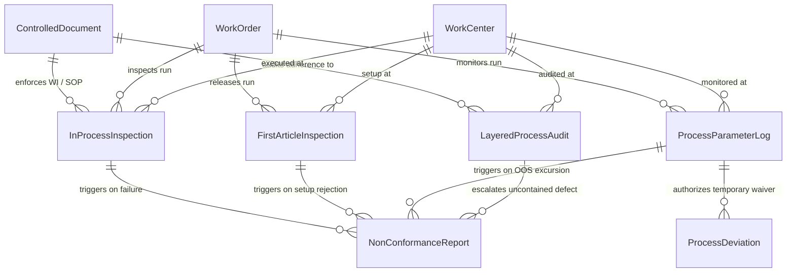

# Research — Sub-module 12.8: In-Process Quality Control (IPQC) (Module 12 — Quality Management System, `quality`)

## Repo state checked first

- **`LIVE_LINKS` built in Module 12 so far (`apps/core/navigation.py`):**
  - `"12.1"` (Document Control & Management):
    - `"Document Creation & Authoring": "quality:controlled_document_list"`
    - `"Review & Approval Workflows": "quality:electronic_signature_list"`
    - `"Document Distribution & Obsolescence": "quality:document_acknowledgment_list"`
    - `"Change Request & Revision Control": "quality:document_change_order_list"`
    - `"Archive & Retrieval": "quality:document_archive_vault"`
  - `"12.2"` (Design Controls & Development):
    - `"Design Planning & Inputs": "quality:design_project_list"`
    - `"Design Reviews & Verification": "quality:design_review_list"`
    - `"Design Validation & Transfer": "quality:design_verification_list"`
    - `"Design History File (DHF)": "quality:traceability_matrix"`
    - `"Design Changes & Configuration Management": "quality:design_input_list"`
  - `"12.3"` (Risk Management / ISO 14971):
    - `"Hazard Identification & Analysis": "quality:risk_assessment_list"`
    - `"Risk Evaluation & Scoring": "quality:fmea_matrix"`
    - `"Risk Control & Mitigation": "quality:risk_control_measure_list"`
    - `"Residual Risk Assessment": "quality:risk_traceability_matrix"`
    - `"Risk Management File & Reporting": "quality:risk_management_plan_list"`
  - `"12.4"` (Corrective & Preventive Action / CAPA):
    - `"Issue Detection & Logging": "quality:capa_investigation_list"`
    - `"Root Cause Analysis (RCA)": "quality:root_cause_analysis_list"`
    - `"Action Plan Development": "quality:capa_action_list"`
    - `"CAPA Tracking & Escalation": "quality:capa_tracking_board"`
    - `"Effectiveness Verification & Closure": "quality:capa_effectiveness_review_list"`
  - `"12.5"` (Non-Conformance & Deviation Management):
    - `"NCR Initiation & Classification": "quality:non_conformance_report_list"`
    - `"Containment & Segregation": "quality:quarantine_containment_list"`
    - `"Disposition & Material Review": "quality:mrb_disposition_list"`
    - `"Impact Assessment & Customer Notification": "quality:process_deviation_list"`
    - `"Trending & Metrics": "quality:ncr_analytics_dashboard"`
  - `"12.6"` (Supplier & Vendor Quality Management):
    - `"Supplier Qualification & Audit": "quality:supplier_qualification_audit_list"`
    - `"Incoming Inspection & Receiving": "quality:avl_directory"`
    - `"Supplier Performance Monitoring": "quality:supplier_quality_scorecard_list"`
    - `"Supplier CAPA & Development": "quality:supplier_corrective_action_list"`
    - `"Supplier Change Notification (SCN)": "quality:supplier_change_notification_list"`

- **Sibling models available to FK in `apps/quality/models/`:**
  - `ControlledDocument` (`apps/quality/models/DocumentControl/ControlledDocuments.py`, prefix `QDOC`): Standard operating procedures (SOPs), digital work instructions, setup inspection criteria, and layered process audit checklists.
  - `NonConformanceReport` (`apps/quality/models/NonConformance/NonConformanceReports.py`, prefix `QNCR`): Internal non-conformance reports triggered when in-process inspections fail, CTQ parameters drift out-of-spec, or audit findings cannot be mitigated immediately.
  - `ProcessDeviation` (`apps/quality/models/NonConformance/ProcessDeviations.py`, prefix `QDEV`): Formal planned or unplanned concessions when manufacturing process parameters or tooling temporarily vary from released specifications.
  - `CapaInvestigation` (`apps/quality/models/CapaManagement/CapaInvestigations.py`, prefix `QCAP`): Enterprise CAPAs linked when systemic shop-floor defects or recurring parameter drift occur.
  - `RiskAssessment` (`apps/quality/models/RiskManagement/RiskAssessments.py`, prefix `QRSK`): Process Failure Mode and Effects Analysis (pFMEA) documents identifying Critical-to-Quality (CTQ) parameters and failure modes.

- **Cross-module spine models available to FK:**
  - `scm.WorkOrder` (`apps/scm/models/Manufacturing/WorkOrders.py`, prefix `WO`): Active production runs and manufacturing orders that in-process inspections, first-off runs, and parameter logs are executed against.
  - `scm.WorkCenter` (`apps/scm/models/Manufacturing/WorkCenters.py`, prefix `WC`): Specific machines, assembly lines, test stations, or work cells hosting inspections and parameter logging.
  - `scm.NonConformance` (`apps/scm/models/QualityManagement/NonConformances.py`, prefix `NCR`): Upstream SCM non-conformance records.

- **Base classes in `apps/quality/models/_base.py`:**
  - `TenantOwned`: Multi-tenant isolation (`tenant`, `created_at`, `updated_at`).
  - `TenantNumbered`: Autonumbering base class with `next_number(type(self), self.tenant, self.NUMBER_PREFIX)` and atomic retry loop.

### Spine entities verified to EXIST (grep evidence)

| Claim | Evidence | Note |
|---|---|---|
| `core.Tenant` exists | `apps/core/models/Tenant.py:17` -> `class Tenant(models.Model)` | Multi-tenant isolation foundation. |
| `core.OrgUnit` exists | `apps/core/models/OrgUnit.py:5` -> `class OrgUnit(models.Model)` | Plant, manufacturing department, line, or quality unit ownership. |
| `core.Party` & `PartyRole` exist | `apps/core/models/Party.py:5`, `PartyRole.py:5` | Unified party spine for external calibration labs or machine operators (`role="employee"`). |
| `accounts.User` exists | `apps/accounts/models.py:52` -> `class User(AbstractBaseUser, PermissionsMixin)` | System users for quality inspectors, machine operators, supervisors, and plant auditors. |
| `core.AuditLog` exists | `apps/core/models/AuditLog.py:5` + `write_audit_log` helper | Immutable tenant audit logging for FAI releases, parameter overrides, and LPA completions. |
| `quality.ControlledDocument` exists | `apps/quality/models/DocumentControl/ControlledDocuments.py:8` | Linked digital work instructions, SOPs, and LPA audit checklists. |
| `quality.NonConformanceReport` exists | `apps/quality/models/NonConformance/NonConformanceReports.py:10` | Non-conformance records generated from failed in-process inspections or out-of-spec parameters. |
| `quality.ProcessDeviation` exists | `apps/quality/models/NonConformance/ProcessDeviations.py:8` | Temporary process deviations/concessions for parameter excursions. |
| `quality.CapaInvestigation` exists | `apps/quality/models/CapaManagement/CapaInvestigations.py:11` | Enterprise CAPA investigations escalated from chronic process failures. |
| `scm.WorkOrder` exists | `apps/scm/models/Manufacturing/WorkOrders.py:26` | Production orders for in-process inspection and parameter tracking. |
| `scm.WorkCenter` exists | `apps/scm/models/Manufacturing/WorkCenters.py:23` | Machines, cells, and assembly lines evaluated during IPQC and LPAs. |

### Spine entities verified NOT to exist (or unbuilt in Module 12 / ERP)

- **Module 5 unbuilt masters:** `Item`, `LotSerial`, `UOM`, `StockMove` are planned for Module 5. Quality models use free-text stand-in fields (`item_code`, `item_name`, `lot_number`, `production_order_number`, `work_center_code`, `operation_step`) with optional nullable FKs to `scm.WorkOrder` / `scm.WorkCenter`, providing complete loose-coupling and a documented future migration path.
- **Module 14 MES:** Standalone advanced MES execution engines (shop-floor dispatch, automated machine telemetry ingestion via OPC-UA/MQTT) are unbuilt. 12.8 delivers the operational QMS data model, statistical parameter control gates, FAI validation protocols, and layered process audit management.

### Candidate prefix collision check (repo-wide automated verification)

Automated ripgrep scan across all `NUMBER_PREFIX` declarations in `apps/`:
- `QIPQ` (Quality In-Process Inspection) -> **0 collisions** (Completely free)
- `QFAI` (Quality First Article Inspection) -> **0 collisions** (Completely free)
- `QPAR` (Quality Process Parameter Log) -> **0 collisions** (Completely free)
- `QLPA` (Quality Layered Process Audit) -> **0 collisions** (Completely free)

---

## Leaders surveyed (with source links)

1. **MasterControl (Manufacturing Excellence & In-Process Quality)** — Enterprise life sciences eQMS & MES market leader (FDA 21 CFR Part 820 / 211, ISO 13485:2016). Delivers Electronic Batch / Device History Records (EBR/eDHR), integrated in-process quality checklists, automated stage-gate releases between manufacturing operations, in-line defect capture with instant non-conformance logging, digital work instruction execution, and out-of-spec deviation management.
   - *Source:* https://www.mastercontrol.com/manufacturing/
2. **ETQ Reliance (In-Process Inspection & Layered Process Audits)** — Comprehensive enterprise QMS platform bridging manufacturing shop floors and regulatory quality. Features in-process inspection worksheets with automated sample size calculation, real-time quality data capture at work centers, Layered Process Audit (LPA) management with multi-tier audit scheduling (supervisors, managers, plant leadership), automated non-conformance generation for recurring shop floor defects, and root-cause escalations.
   - *Source:* https://www.etq.com/blog/layered-process-audits/
3. **EASE (Ease.io) (Layered Process Audits & Manufacturing Checksheets)** — Global market leader in mobile Layered Process Audits (LPA) and digital plant floor verification for automotive (CQI-8 / IATF 16949) and aerospace manufacturing. Features a tiered LPA structure (Tier 1 Team Lead, Tier 2 Supervisor, Tier 3 Quality/Operations Manager, Tier 4 Plant Manager), fast 5-minute audit execution, dynamic question randomization to prevent pencil-whipping, on-the-spot non-conformance mitigation, audit completion and schedule compliance tracking, and closed-loop mitigation verification.
   - *Source:* https://www.ease.io/layered-process-audits/
4. **InfinityQS ProFicient (Real-Time SPC & Process Parameter Control)** — Dedicated enterprise Statistical Process Control (SPC) and real-time manufacturing intelligence platform. Features Critical-to-Quality (CTQ) process parameter monitoring (temperature, pressure, cycle time, torque, dimensions), automated control limit calculation (UCL/LCL) vs engineering specification limits (USL/LSL), real-time X-bar & R, X-bar & S, and Individuals-Moving Range (I-MR) charts, Western Electric / Nelson run rules, automated Out-of-Control (OOC) and Out-of-Spec (OOS) alarms, assignable cause logging, and corrective containment tracking.
   - *Source:* https://www.infinityqs.com/solutions/real-time-spc
5. **InspectionXpert & Net-Inspect (AS9102 / First Article Inspection)** — Industry gold standards for aerospace (AS9102), medical device (ISO 13485), and precision manufacturing First Article Inspection (FAI) and ballooning. Features complete AS9102 Rev C Forms 1, 2, and 3 accountability (Part Number, Product Process, Characteristic Accountability), ballooned drawing characteristic verification, first-off production run approval gates, machine/tooling setup verification, delta FAI tracking (for tool or drawing changes), dimensional tolerance verification, and production run release sign-offs.
   - *Source:* https://www.inspectionxpert.com/first-article-inspection-software and https://www.net-inspect.com/first-article-inspection
6. **Sparta Systems / TrackWise Digital (Manufacturing Quality & In-Process Deviations)** — Cloud-native life sciences and regulated manufacturing QMS by Honeywell. Features real-time shop-floor in-process deviation logging, automated containment holds (stopping work order progress or placing affected WIP on quarantine), integrated impact triage, cross-referencing to production order steps, and closed-loop escalation to MRB or enterprise CAPA.
   - *Source:* https://www.spartasystems.com/trackwise-digital/
7. **Veeva Vault (Vault Quality / In-Process Quality & Batch Release)** — Unified cloud platform for pharmaceutical, biotech, and medical device manufacturing. Features Critical Process Parameter (CPP) and Critical Quality Attribute (CQA) tracking per ICH Q8/Q9/Q10 guidelines, stage-gate in-process sampling protocols, batch manufacturing record exception reviews, and automated release gating preventing finished lot movement before in-process quality milestones are fulfilled.
   - *Source:* https://www.veeva.com/products/vault-qms/
8. **Tulip Interfaces (Digital Work Instructions, Edge Gauging & Step Verification)** — Next-generation frontline operations and digital manufacturing app platform. Features interactive digital work instructions (DWI) with mandatory operator sign-offs, step-by-step verification, connected edge IoT gauging (calipers, micrometers, scales feeding measurements directly into quality tables), mistake-proofing (Poka-Yoke) interlocks, in-line visual inspection verification, and operator accountability.
   - *Source:* https://tulip.co/solutions/quality/
9. **Plex Systems (Rockwell Automation Cloud MES/QMS)** — Integrated cloud MES and smart manufacturing quality management platform for discrete and process manufacturing. Features control plan execution on the shop floor, operator in-process inspection intervals, automated poka-yoke interlocking (disabling machine cycles or preventing work order advance if inspections fail or parameters exceed control limits), scrap/rework tracking at work centers, and integrated first-piece inspection protocols.
   - *Source:* https://www.plex.com/products/quality-management-system

---

## Feature catalog (this sub-module only)

### Bullet 1 — Process Parameter Monitoring (Critical-to-quality (CTQ) parameters, control limits, and real-time SPC)

- **Critical-to-Quality (CTQ) / Critical Process Parameter (CPP) Registry** — Tracks operational manufacturing parameters across distinct physical domains: `temperature` (oven, furnace, melt, mold), `pressure` (hydraulic, pneumatic, injection, vacuum), `speed_feed` (spindle RPM, feed rate, line speed), `torque` (bolt fastening, crimp, drive), `ph_chemical` (plating bath, cleanroom wash, chemical concentration), `humidity` (curing room, dry room, packaging area), `dimensional_thickness` (extrusion gauge, coating thickness, web width), `voltage_current` (welding amperage, dielectric test), `cycle_time` (cure time, dwell time, molding cycle), and `other`. · seen in: InfinityQS, Veeva Vault, Plex, MasterControl · priority: **table-stakes** · spine: `ProcessParameterLog.parameter_category`, `parameter_name`, `unit_of_measure` · **buildable now**
- **Dual Engineering Specifications (USL/LSL) vs Statistical Control Limits (UCL/LCL)** — Maintains rigorous demarcation between engineering/customer specification limits (USL = Upper Spec Limit, LSL = Lower Spec Limit, Nominal Target) and statistical process control limits (UCL = Upper Control Limit, LCL = Lower Control Limit, Process Mean calculated at $\pm 3\sigma$). · seen in: InfinityQS, Plex, ETQ · priority: **table-stakes** · spine: `ProcessParameterLog` limits fields · **buildable now**
- **Excursion Status Classification & Run Rule Evaluation** — Categorizes readings into statistical and tolerance states: `normal` (in control, within spec), `warning_pre_control` (within spec but approaching control boundary or showing statistical run trend), `out_of_control` (OOC - outside 3-sigma control limits but within tolerance), `out_of_spec` (OOS - violating USL or LSL engineering tolerances). · seen in: InfinityQS, MasterControl, Veeva Vault · priority: **table-stakes** · spine: `ProcessParameterLog.excursion_status` · **buildable now**
- **Immediate Containment Action & Excursion Mitigation** — Captures immediate shop-floor containment response when an excursion occurs: `none`, `machine_parameter_adjusted`, `machine_paused`, `wip_quarantined`, `supervisor_escalated`, `ncr_initiated`. · seen in: InfinityQS, TrackWise, Plex · priority: **table-stakes** · spine: `ProcessParameterLog.containment_action`, `containment_notes` · **buildable now**
- **Cross-Module Linkage to NCR & Process Concession** — Direct optional links to `quality.NonConformanceReport` [QNCR-] for out-of-spec scrap/quarantine events, and `quality.ProcessDeviation` [QDEV-] when a temporary parameter waiver or engineering concession is authorized. · seen in: TrackWise Digital, MasterControl · priority: **common** · spine: `ProcessParameterLog.non_conformance`, `process_deviation` · **buildable now**

### Bullet 2 — First Article Inspection (FAI) (First-off approval, dimensional reports, and production readiness verification)

- **First-Off / Setup Approval Workflow** — Mandatory release gate executed prior to mass production run release. Captures setup reason: `new_product_intro`, `machine_setup_change`, `tooling_die_change`, `process_revision`, `material_lot_change`, `drawing_revision`, `periodic_recertification`. · seen in: InspectionXpert, Net-Inspect, Plex, ETQ · priority: **table-stakes** · spine: `FirstArticleInspection.setup_reason`, `status` · **buildable now**
- **Full FAI vs Delta (Partial) FAI Classification** — Distinguishes between comprehensive full first-piece qualification and targeted delta/partial FAIs (e.g., verifying only the 3 dimensions altered by a tooling rework or drawing revision). · seen in: InspectionXpert, Net-Inspect · priority: **table-stakes** · spine: `FirstArticleInspection.fai_type` · **buildable now**
- **AS9102 Rev C / ISO 13485 Forms Accountability** — Tracks standard regulatory First Article Inspection verification checkboxes:
  - Form 1: Part Number Accountability (drawing number, revision, bill of materials match).
  - Form 2: Product Process Accountability (raw materials, heat treat, plating, special processes, functional test specs).
  - Form 3: Characteristic Accountability & Verification (ballooned drawing characteristics, nominals, upper/lower tolerances, actual measurements, and tool identification).
  · seen in: InspectionXpert, Net-Inspect · priority: **table-stakes** · spine: `FirstArticleInspection.as9102_form1_complete`, `as9102_form2_complete`, `as9102_form3_complete` · **buildable now**
- **Quantitative Characteristic Conformance Metrics** — Summarizes physical measurement results: `total_characteristics_inspected`, `characteristics_conforming`, `characteristics_out_of_spec`, `max_deviation_found` (e.g. "+0.003 mm on Bore Dia"). · seen in: InspectionXpert, Net-Inspect, Plex · priority: **table-stakes** · spine: `FirstArticleInspection` characteristic counters · **buildable now**
- **Calibrated Gaging Accountability** — Records specific calibrated measurement devices used during FAI (caliper, micrometer, CMM, height gauge serial numbers) to preserve calibration traceability and comply with ISO 13485 §7.6 / AS9100 §7.1.5. · seen in: InspectionXpert, Plex, MasterControl · priority: **table-stakes** · spine: `FirstArticleInspection.gage_serial_numbers` · **buildable now**
- **Production Run Release Verdict & Authorized Sign-off** — State progression: `draft` -> `in_inspection` -> `approved_run_released` -> `conditional_approval` (limited pilot release, e.g. first 50 pieces with 100% inspection) -> `rejected_setup_hold`. Requires formal electronic authorization with user stamp (`approved_by`, `approved_at`). · seen in: InspectionXpert, Plex, MasterControl · priority: **table-stakes** · spine: `FirstArticleInspection.release_verdict`, `approved_by`, `approved_at` · **buildable now**

### Bullet 3 — In-Line Inspection & Testing (Automated vision inspection, gauging, and functional test integration)

- **In-Line & Stage-Gate Inspection Execution** — Supports routine operational in-process quality evaluations during active production runs. Encompasses key inspection methods: `visual_surface` (burrs, scratches, flash, color, cosmetic flaws), `dimensional_gauging` (caliper, micrometers, plug/ring gauges, drop indicators), `functional_test` (electrical continuity, leak test, pressure decay, tensile pull, torque test), `automated_vision` (AOI, machine vision camera pass/fail, optical sorting), and `in_line_stage_gate` (formal milestone clearance between major work stations). · seen in: MasterControl, Plex, Tulip, ETQ · priority: **table-stakes** · spine: `InProcessInspection.inspection_type`, `stage_gate` · **buildable now**
- **Sample Inspection Quantities & Lot Dispositioning** — Captures inspection batch counts and resulting product dispositions: `batch_quantity`, `sample_size_inspected`, `quantity_passed`, `quantity_rejected`, `quantity_reworked`. Disposition states: `pending`, `pass`, `conditional_pass`, `rework_required`, `reject_scrap`, `quarantine_hold`. · seen in: All leaders · priority: **table-stakes** · spine: `InProcessInspection` quantity and disposition fields · **buildable now**
- **Shop Floor Defect Classification** — Categorizes defects into standard manufacturing taxonomies: `dimensional`, `surface_cosmetic`, `functional_electrical`, `material_flaw`, `assembly_error`, `contamination`, `other`, accompanied by detailed defect descriptions. · seen in: Plex, Tulip, MasterControl, ETQ · priority: **table-stakes** · spine: `InProcessInspection.defect_category`, `defect_description` · **buildable now**
- **Automated Non-Conformance Escalation** — Direct FK linking to `quality.NonConformanceReport` [QNCR-] when rejected quantities or critical defects exceed allowable thresholds, triggering quarantine containment and Material Review Board (MRB) review. · seen in: MasterControl, ETQ, TrackWise · priority: **table-stakes** · spine: `InProcessInspection.non_conformance` · **buildable now**

### Bullet 4 — Work Instruction Adherence (Digital work instructions, step verification, and operator sign-off enforcement)

- **Controlled Document (SOP / WI) Association** — Direct FK linkage to `quality.ControlledDocument` [QDOC-] ensuring operators execute production against the legally effective, released version of the Standard Operating Procedure (SOP), Work Instruction (WI), or Standard Work Sheet. · seen in: MasterControl, Tulip, Plex · priority: **table-stakes** · spine: `InProcessInspection.controlled_document`, `LayeredProcessAudit.controlled_document` · **buildable now**
- **Operation Step & Sequence Verification** — Identifies the exact routing operation step (e.g. `Step 010 - CNC Mill`, `Step 030 - Deburr & Ultrasonic Clean`, `Step 050 - Sub-assembly Torque`) and specific work instruction step reference being executed and verified. · seen in: Tulip, Plex, MasterControl · priority: **table-stakes** · spine: `InProcessInspection.operation_step`, `work_instruction_step` · **buildable now**
- **Mandatory Operator Sign-Off & Mistake-Proofing (Poka-Yoke)** — Enforces digital operator sign-off (`operator_sign_off` boolean and `operator` user FK) confirming that all required tools, safety interlocks, and critical inspection steps for that manufacturing operation were adhered to before the work order advances. · seen in: Tulip, MasterControl, Plex · priority: **table-stakes** · spine: `InProcessInspection.operator_sign_off`, `operator` · **buildable now**

### Bullet 5 — Process Audit & Layered Process Audits (LPA) (Scheduled audits, checklist execution, and immediate corrective action)

- **Four-Tier Layered Process Audit (LPA) Architecture** — Implements the CQI-8 / IATF 16949 multi-layered management audit hierarchy:
  - `Tier 1 (Team Leader / Line Lead)`: Daily shift audits (5 minutes, focused on operator work instruction adherence, basic 5S, and machine settings).
  - `Tier 2 (Area Supervisor / Production Lead)`: Weekly audits (tooling maintenance, calibration labels, containment integrity).
  - `Tier 3 (Quality Engineer / Operations Manager)`: Bi-weekly / Monthly audits (standard work fidelity, gauge R&R verification, scrap containment, poke-yoke verifications).
  - `Tier 4 (Plant Manager / Executive Director)`: Monthly / Quarterly audits (systemic process compliance, executive presence, cross-functional safety and culture).
  · seen in: EASE (Ease.io), ETQ Reliance · priority: **table-stakes** · spine: `LayeredProcessAudit.audit_layer` · **buildable now**
- **Focus Area Categorization** — Categorizes the audit inspection focus into standard manufacturing pillars: `standard_work_wi` (work instruction adherence), `tooling_machine_setup` (correct feeds/speeds/tool offsets), `material_handling_fifo` (part labeling, lot segregation, FIFO flow), `gauging_calibration` (valid calibration stickers, correct gauge used), `environmental_5s` (cleanliness, lighting, ESD protection), `safety_poka_yoke` (guard interlocks, light curtains, emergency stops). · seen in: EASE, ETQ Reliance · priority: **table-stakes** · spine: `LayeredProcessAudit.focus_area` · **buildable now**
- **Rapid Short-Checklist Scoring & Conformance Ratio** — Fast audit execution recording `total_questions_audited`, `questions_conforming`, `questions_non_conforming`, and automated calculation of `compliance_percentage` (0–100%). · seen in: EASE, ETQ Reliance · priority: **table-stakes** · spine: `LayeredProcessAudit` scoring fields · **buildable now**
- **On-the-Spot Corrective Action & Containment** — Flag and structured documentation recording whether non-conformances identified during the audit were mitigated immediately on the shop floor (`on_the_spot_mitigation` boolean, `mitigation_details`) versus requiring escalation to a formal `quality.NonConformanceReport`. · seen in: EASE, ETQ Reliance · priority: **table-stakes** · spine: `LayeredProcessAudit.on_the_spot_mitigation`, `mitigation_details`, `non_conformance` · **buildable now**
- **Auditor Scheduling & Cadence Compliance** — Tracks scheduled dates vs actual execution timestamps (`scheduled_date`, `conducted_at`, `auditor`, `shift`) to measure audit compliance and completion rates. · seen in: EASE, ETQ Reliance · priority: **table-stakes** · spine: `LayeredProcessAudit` date and user fields · **buildable now**

### Beyond the Bullets

- **In-Process Quality Floor Dashboard & Real-Time Excursion Monitor** — High-visibility summary view aggregating active stage-gate inspections, open FAI release gates, real-time parameter excursions (OOC/OOS), and layered process audit compliance across plant work centers.
- **Statistical Run Rule / SPC Chart Visualizer** — Visual trend rendering showing individual parameter readings plotted against UCL, LCL, USL, and LSL with automatic color-coding of warning zones and out-of-spec excursions.

---

## Recommended build scope (this pass — 1–4 models)

To fully satisfy NavERP.md 12.8, enforce strict shop-floor quality gating, and integrate seamlessly with both the core spine and Module 12's document/NCR/deviation architecture, exactly **4 models** are recommended for this pass:

### Model 1: `InProcessInspection` [NUMBER_PREFIX = "QIPQ"]
- **Purpose:** Tracks in-line and stage-gate operational inspection runs, sample evaluations (visual, dimensional, functional, vision), pass/fail/rework dispositioning, defect tallying, and work instruction sign-off.
- **Key Fields:**
  - `tenant` (`core.Tenant`, cascading)
  - `number` (`max_length=32`, editable=False, prefix `QIPQ-#####`)
  - `title` (`CharField(max_length=255)`)
  - `inspection_type` (`visual_surface`, `dimensional_gauging`, `functional_test`, `automated_vision`, `in_line_stage_gate`)
  - `stage_gate` (`CharField(max_length=100)`) — e.g. "Primary Machining", "Sub-Assembly", "Coating", "Final In-Line"
  - `status` (`draft`, `in_progress`, `completed`, `cancelled`)
  - `disposition` (`pending`, `pass`, `conditional_pass`, `rework_required`, `reject_scrap`, `quarantine_hold`)
  - Manufacturing context & stand-in linkage:
    - `production_order_number` (`CharField(max_length=64, blank=True)`)
    - `work_order` (`scm.WorkOrder`, on_delete=SET_NULL, null=True, blank=True, related_name="quality_in_process_inspections")
    - `work_center_code` (`CharField(max_length=64, blank=True)`)
    - `work_center` (`scm.WorkCenter`, on_delete=SET_NULL, null=True, blank=True, related_name="quality_in_process_inspections")
    - `operation_step` (`CharField(max_length=64, blank=True)`) — e.g. "Op 020 - Turning"
    - `item_code` (`CharField(max_length=100, blank=True)`)
    - `item_name` (`CharField(max_length=255, blank=True)`)
    - `lot_number` (`CharField(max_length=100, blank=True)`)
    - `batch_quantity` (`PositiveIntegerField(default=1)`)
  - Sampling & defect metrics:
    - `sample_size_inspected` (`PositiveIntegerField(default=1)`)
    - `quantity_passed` (`PositiveIntegerField(default=0)`)
    - `quantity_rejected` (`PositiveIntegerField(default=0)`)
    - `quantity_reworked` (`PositiveIntegerField(default=0)`)
    - `defect_category` (`dimensional`, `surface_cosmetic`, `functional_electrical`, `material_flaw`, `assembly_error`, `contamination`, `other`)
    - `defect_description` (`TextField(blank=True)`)
  - Work instruction adherence:
    - `controlled_document` (`quality.ControlledDocument`, on_delete=SET_NULL, null=True, blank=True, related_name="in_process_inspections")
    - `work_instruction_step` (`CharField(max_length=100, blank=True)`)
    - `operator_sign_off` (`BooleanField(default=False)`)
    - `operator` (`accounts.User`, on_delete=SET_NULL, null=True, blank=True, related_name="operator_in_process_inspections")
  - Quality accountability:
    - `inspector` (`accounts.User`, on_delete=SET_NULL, null=True, blank=True, related_name="conducted_in_process_inspections")
    - `inspection_date` (`DateField(null=True, blank=True)`)
    - `non_conformance` (`quality.NonConformanceReport`, on_delete=SET_NULL, null=True, blank=True, related_name="in_process_inspections")
    - `notes` (`TextField(blank=True)`)
- **Verified FKs:** `core.Tenant`, `accounts.User`, `quality.ControlledDocument`, `quality.NonConformanceReport`, `scm.WorkOrder` (optional), `scm.WorkCenter` (optional).

### Model 2: `FirstArticleInspection` (FAI) [NUMBER_PREFIX = "QFAI"]
- **Purpose:** Implements AS9102 Rev C / ISO 13485 first-off approval, tooling/machine setup verification, Forms 1–3 accountability, and production run release gating.
- **Key Fields:**
  - `tenant` (`core.Tenant`, cascading)
  - `number` (`max_length=32`, editable=False, prefix `QFAI-#####`)
  - `title` (`CharField(max_length=255)`)
  - `fai_type` (`full_fai`, `delta_partial_fai`)
  - `setup_reason` (`new_product_intro`, `machine_setup_change`, `tooling_die_change`, `process_revision`, `material_lot_change`, `drawing_revision`, `periodic_recertification`)
  - `status` (`draft`, `in_inspection`, `approved_run_released`, `conditional_approval`, `rejected_setup_hold`, `cancelled`)
  - Manufacturing context & stand-in linkage:
    - `production_order_number` (`CharField(max_length=64, blank=True)`)
    - `work_order` (`scm.WorkOrder`, on_delete=SET_NULL, null=True, blank=True, related_name="quality_fais")
    - `work_center_code` (`CharField(max_length=64, blank=True)`)
    - `work_center` (`scm.WorkCenter`, on_delete=SET_NULL, null=True, blank=True, related_name="quality_fais")
    - `machine_tooling_id` (`CharField(max_length=100, blank=True)`)
    - `item_code` (`CharField(max_length=100, blank=True)`)
    - `item_name` (`CharField(max_length=255, blank=True)`)
    - `drawing_number` (`CharField(max_length=100, blank=True)`)
    - `drawing_revision` (`CharField(max_length=32, blank=True)`)
    - `first_piece_lot_number` (`CharField(max_length=100, blank=True)`)
  - AS9102 / ISO 13485 Dimensional Verification metrics:
    - `total_characteristics_inspected` (`PositiveIntegerField(default=0)`)
    - `characteristics_conforming` (`PositiveIntegerField(default=0)`)
    - `characteristics_out_of_spec` (`PositiveIntegerField(default=0)`)
    - `max_deviation_found` (`CharField(max_length=100, blank=True)`)
    - `as9102_form1_complete` (`BooleanField(default=False)`) — Part Number Accountability
    - `as9102_form2_complete` (`BooleanField(default=False)`) — Product Process Accountability
    - `as9102_form3_complete` (`BooleanField(default=False)`) — Characteristic Accountability & Verification
  - Release Gate & Sign-off:
    - `gage_serial_numbers` (`CharField(max_length=255, blank=True)`) — Calibrated instruments used
    - `release_verdict` (`pending`, `released`, `conditional_pilot_release`, `rejected_retool`)
    - `conditional_release_notes` (`TextField(blank=True)`)
    - `non_conformance` (`quality.NonConformanceReport`, on_delete=SET_NULL, null=True, blank=True, related_name="fais")
    - `inspector` (`accounts.User`, on_delete=SET_NULL, null=True, blank=True, related_name="inspected_fais")
    - `approved_by` (`accounts.User`, on_delete=SET_NULL, null=True, blank=True, related_name="approved_fais")
    - `approved_at` (`DateTimeField(null=True, blank=True)`)
    - `notes` (`TextField(blank=True)`)
- **Verified FKs:** `core.Tenant`, `accounts.User`, `quality.NonConformanceReport`, `scm.WorkOrder` (optional), `scm.WorkCenter` (optional).

### Model 3: `ProcessParameterLog` [NUMBER_PREFIX = "QPAR"]
- **Purpose:** Records discrete Critical-to-Quality (CTQ) / Critical Process Parameter (CPP) monitoring measurements during manufacturing, tracking engineering tolerances (USL/LSL) and statistical control limits (UCL/LCL), excursion classification, and containment actions.
- **Key Fields:**
  - `tenant` (`core.Tenant`, cascading)
  - `number` (`max_length=32`, editable=False, prefix `QPAR-#####`)
  - `parameter_name` (`CharField(max_length=150)`)
  - `parameter_category` (`temperature`, `pressure`, `speed_feed`, `torque`, `ph_chemical`, `humidity`, `dimensional_thickness`, `voltage_current`, `cycle_time`, `other`)
  - `unit_of_measure` (`CharField(max_length=32)`) — e.g. "°C", "bar", "RPM", "Nm", "mm", "V", "sec"
  - Manufacturing context & stand-in linkage:
    - `work_center_code` (`CharField(max_length=64, blank=True)`)
    - `work_center` (`scm.WorkCenter`, on_delete=SET_NULL, null=True, blank=True, related_name="quality_parameter_logs")
    - `production_order_number` (`CharField(max_length=64, blank=True)`)
    - `work_order` (`scm.WorkOrder`, on_delete=SET_NULL, null=True, blank=True, related_name="quality_parameter_logs")
    - `operation_step` (`CharField(max_length=64, blank=True)`)
    - `item_code` (`CharField(max_length=100, blank=True)`)
    - `lot_number` (`CharField(max_length=100, blank=True)`)
  - Specifications & Statistical Limits:
    - `target_nominal_value` (`DecimalField(max_digits=12, decimal_places=4)`)
    - `upper_spec_limit` (`DecimalField(max_digits=12, decimal_places=4)`) — USL
    - `lower_spec_limit` (`DecimalField(max_digits=12, decimal_places=4)`) — LSL
    - `upper_control_limit` (`DecimalField(max_digits=12, decimal_places=4, null=True, blank=True)`) — UCL ($\mu + 3\sigma$)
    - `lower_control_limit` (`DecimalField(max_digits=12, decimal_places=4, null=True, blank=True)`) — LCL ($\mu - 3\sigma$)
  - Reading & Excursion Evaluation:
    - `recorded_value` (`DecimalField(max_digits=12, decimal_places=4)`)
    - `recorded_at` (`DateTimeField(default=timezone.now)`)
    - `excursion_status` (`normal`, `warning_pre_control`, `out_of_control`, `out_of_spec`)
    - `logged_by` (`accounts.User`, on_delete=SET_NULL, null=True, blank=True, related_name="logged_parameters")
  - Containment & Quality Linkage:
    - `containment_action` (`none`, `machine_parameter_adjusted`, `machine_paused`, `wip_quarantined`, `supervisor_escalated`, `ncr_initiated`)
    - `containment_notes` (`TextField(blank=True)`)
    - `non_conformance` (`quality.NonConformanceReport`, on_delete=SET_NULL, null=True, blank=True, related_name="parameter_logs")
    - `process_deviation` (`quality.ProcessDeviation`, on_delete=SET_NULL, null=True, blank=True, related_name="parameter_logs")
- **Verified FKs:** `core.Tenant`, `accounts.User`, `quality.NonConformanceReport`, `quality.ProcessDeviation`, `scm.WorkOrder` (optional), `scm.WorkCenter` (optional).

### Model 4: `LayeredProcessAudit` (LPA) [NUMBER_PREFIX = "QLPA"]
- **Purpose:** Structured multi-tier Layered Process Audit (CQI-8 / IATF 16949 / ISO 9001) verifying standard work and work instruction adherence across 4 management levels, tracking short-checklist compliance and on-the-spot mitigations.
- **Key Fields:**
  - `tenant` (`core.Tenant`, cascading)
  - `number` (`max_length=32`, editable=False, prefix `QLPA-#####`)
  - `title` (`CharField(max_length=255)`)
  - `audit_layer` (`tier_1_operator_lead`, `tier_2_supervisor`, `tier_3_quality_manager`, `tier_4_plant_executive`)
  - `focus_area` (`standard_work_wi`, `tooling_machine_setup`, `material_handling_fifo`, `gauging_calibration`, `environmental_5s`, `safety_poka_yoke`)
  - `status` (`scheduled`, `in_progress`, `completed`, `cancelled`)
  - Manufacturing location:
    - `work_center_code` (`CharField(max_length=64, blank=True)`)
    - `work_center` (`scm.WorkCenter`, on_delete=SET_NULL, null=True, blank=True, related_name="quality_lpas")
    - `org_unit` (`core.OrgUnit`, on_delete=SET_NULL, null=True, blank=True, related_name="quality_lpas")
    - `shift` (`CharField(max_length=32, blank=True)`) — e.g. "Shift 1 (Morning)", "Shift 2", "Night"
  - Checklist Execution & Conformance:
    - `total_questions_audited` (`PositiveIntegerField(default=10)`)
    - `questions_conforming` (`PositiveIntegerField(default=10)`)
    - `questions_non_conforming` (`PositiveIntegerField(default=0)`)
    - `compliance_percentage` (`DecimalField(max_digits=5, decimal_places=2, default=Decimal("100.00"))`)
    - `findings_summary` (`TextField(blank=True)`)
  - Work Instruction & On-the-Spot Mitigation:
    - `controlled_document` (`quality.ControlledDocument`, on_delete=SET_NULL, null=True, blank=True, related_name="lpa_audits")
    - `on_the_spot_mitigation` (`BooleanField(default=False)`)
    - `mitigation_details` (`TextField(blank=True)`)
    - `non_conformance` (`quality.NonConformanceReport`, on_delete=SET_NULL, null=True, blank=True, related_name="lpas")
  - Auditor & Schedule:
    - `auditor` (`accounts.User`, on_delete=SET_NULL, null=True, blank=True, related_name="conducted_lpas")
    - `scheduled_date` (`DateField`)
    - `conducted_at` (`DateTimeField(null=True, blank=True)`)
    - `notes` (`TextField(blank=True)`)
- **Verified FKs:** `core.Tenant`, `core.OrgUnit`, `accounts.User`, `quality.ControlledDocument`, `quality.NonConformanceReport`, `scm.WorkCenter` (optional).

---

## Belongs to sibling sub-modules (parked, not scoped here)

- **Incoming Receiving Inspection & ANSI/ASQ Z1.4 Sampling** -> Belongs to **Sub-module 12.7 Incoming Quality Control (IQC)**.
- **Finished Goods Lot Release & Certificates of Conformance (CoC)** -> Belongs to **Sub-module 12.9 Final Quality Control (FQC) / Outgoing Quality Control (OQC)**.
- **Gage R&R Studies and Physical Calibration Schedules** -> Belongs to **Sub-module 12.10 Calibration & Measurement System Analysis (MSA)**.
- **Formal Internal System & Regulatory Audits (ISO 9001 / ISO 13485)** -> Belongs to **Sub-module 12.11 Quality Audits**.
- **Formal Process Capability Studies ($C_p / C_{pk}$) & IQ/OQ/PQ Validation Protocols** -> Belongs to **Sub-module 12.15 Process Validation & Verification**.
- **Shop Floor Material Consumption & Machine Time Booking** -> Belongs to **Module 4 (SCM 4.8 Manufacturing) / Module 14 (MES)**.

---

## Deferred (later passes / integrations)

- **Automated IoT Machine Telemetry Streaming (OPC-UA / MQTT)** — Real-time direct ingestion of machine sensor parameters (thermocouples, pressure transducers, spindle load meters) directly into `ProcessParameterLog` without manual operator entry. (Deferred to Module 14 MES / IoT device driver pass).
- **Direct Edge Gauging USB / Bluetooth HID Interlock** — Native browser WebHID/WebSerial listener capturing caliper/micrometer readings directly into form fields upon foot-pedal press. (Front-end enhancement pass).
- **Automated Machine Stop-Line PLC Interlock** — Hardware relay signal triggering physical machine interlock if an FAI is rejected or parameter excursion exceeds critical tolerance. (Deferred to Industrial Automation integration).
- **Dynamic LPA Question Randomizer** — Daily algorithmic selection of 5 questions per workstation from a 100-question master checklist pool. (Future enhancement to `LayeredProcessAudit`).
