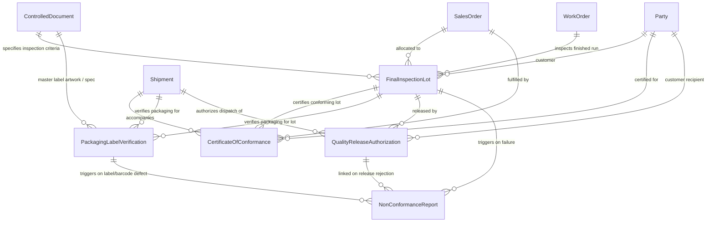

# Research — Sub-module 12.9: Final Quality Control (FQC) / Outgoing Quality Control (OQC) (Module 12 — Quality Management System, `quality`)

## Repo state checked first

- **`LIVE_LINKS` built in Module 12 so far (`apps/core/navigation.py`):**
  - `"12.1"` (Document Control & Management):
    - `"Document Creation & Authoring": "quality:controlled_document_list"`
    - `"Review & Approval Workflows": "quality:electronic_signature_list"`
    - `"Document Distribution & Obsolescence": "quality:document_acknowledgment_list"`
    - `"Change Request & Revision Control": "quality:document_change_order_list"`
    - `"Archive & Retrieval": "quality:document_archive_vault"`
  - `"12.2"` (Design Controls & Development):
    - `"Design Planning & Inputs": "quality:design_project_list"`
    - `"Design Reviews & Verification": "quality:design_review_list"`
    - `"Design Validation & Transfer": "quality:design_verification_list"`
    - `"Design History File (DHF)": "quality:traceability_matrix"`
    - `"Design Changes & Configuration Management": "quality:design_input_list"`
  - `"12.3"` (Risk Management / ISO 14971):
    - `"Hazard Identification & Analysis": "quality:risk_assessment_list"`
    - `"Risk Evaluation & Scoring": "quality:fmea_matrix"`
    - `"Risk Control & Mitigation": "quality:risk_control_measure_list"`
    - `"Residual Risk Assessment": "quality:risk_traceability_matrix"`
    - `"Risk Management File & Reporting": "quality:risk_management_plan_list"`
  - `"12.4"` (Corrective & Preventive Action / CAPA):
    - `"Issue Detection & Logging": "quality:capa_investigation_list"`
    - `"Root Cause Analysis (RCA)": "quality:root_cause_analysis_list"`
    - `"Action Plan Development": "quality:capa_action_list"`
    - `"CAPA Tracking & Escalation": "quality:capa_tracking_board"`
    - `"Effectiveness Verification & Closure": "quality:capa_effectiveness_review_list"`
  - `"12.5"` (Non-Conformance & Deviation Management):
    - `"NCR Initiation & Classification": "quality:non_conformance_report_list"`
    - `"Containment & Segregation": "quality:quarantine_containment_list"`
    - `"Disposition & Material Review": "quality:mrb_disposition_list"`
    - `"Impact Assessment & Customer Notification": "quality:process_deviation_list"`
    - `"Trending & Metrics": "quality:ncr_analytics_dashboard"`
  - `"12.6"` (Supplier & Vendor Quality Management):
    - `"Supplier Qualification & Audit": "quality:supplier_qualification_audit_list"`
    - `"Incoming Inspection & Receiving": "quality:avl_directory"`
    - `"Supplier Performance Monitoring": "quality:supplier_quality_scorecard_list"`
    - `"Supplier CAPA & Development": "quality:supplier_corrective_action_list"`
    - `"Supplier Change Notification (SCN)": "quality:supplier_change_notification_list"`
  - `"12.7"` (Incoming Quality Control / IQC):
    - `"Goods Receipt & Inspection Execution": "quality:incoming_inspection_lot_list"`
    - `"Inspection Planning & Sampling": "quality:incoming_inspection_plan_list"`
    - `"Certificate of Analysis (CoA) Management": "quality:certificate_of_analysis_list"`
    - `"Inspection Data Capture & SPC": "quality:iqc_spc_dashboard"`
    - `"Reject & Return Material Authorization (RMA)": "quality:quality_return_authorization_list"`
  - `"12.8"` (In-Process Quality Control / IPQC):
    - `"Process Parameter Monitoring": "quality:process_parameter_log_list"`
    - `"First Article Inspection (FAI)": "quality:first_article_inspection_list"`
    - `"In-Line Inspection & Testing": "quality:in_process_inspection_list"`
    - `"Work Instruction Adherence": "quality:spc_dashboard"`
    - `"Process Audit & Layered Process Audits (LPA)": "quality:layered_process_audit_list"`

- **Sibling models available to FK in `apps/quality/models/`:**
  - `ControlledDocument` (`apps/quality/models/DocumentControl/ControlledDocuments.py`, prefix `QDOC`): Standard operating procedures (SOPs), finished product acceptance specifications, packaging standards, and release protocols.
  - `NonConformanceReport` (`apps/quality/models/NonConformance/NonConformanceReports.py`, prefix `QNCR`): Internal non-conformance reports triggered when final inspections fail, packaging defects are discovered, or outgoing lots are quarantined.
  - `ProcessDeviation` (`apps/quality/models/NonConformance/ProcessDeviations.py`, prefix `QDEV`): Concessions or customer deviations authorizing shipment of product with minor accepted variations.
  - `CapaInvestigation` (`apps/quality/models/CapaManagement/CapaInvestigations.py`, prefix `QCAP`): Enterprise CAPAs linked when systemic defects or recurring final inspection failures emerge.
  - `IncomingInspectionLot` (`apps/quality/models/IncomingQuality/IncomingInspectionLots.py`, prefix `QIIL`): Sibling incoming receiving lot records.
  - `InProcessInspection` (`apps/quality/models/InProcessQuality/InProcessInspections.py`, prefix `QIPQ`): In-process manufacturing stage-gate inspection records providing upstream genealogy.
  - `FirstArticleInspection` (`apps/quality/models/InProcessQuality/FirstArticleInspections.py`, prefix `QFAI`): First-off production release records.

- **Cross-module spine models available to FK:**
  - `scm.WorkOrder` (`apps/scm/models/Manufacturing/WorkOrders.py`, prefix `WO`): Finished production work orders generating the finished goods lots undergoing final inspection.
  - `scm.SalesOrder` (`apps/scm/models/OrderManagement/SalesOrders.py`, prefix `SO`): Outbound customer sales orders linked to Certificates of Conformance and shipment releases.
  - `scm.Shipment` (`apps/scm/models/TransportationManagement/Shipments.py`, prefix `SHP`): Outbound logistics shipments and carrier movements governed by quality release authorizations.
  - `core.Party` & `PartyRole` (`apps/core/models/Party.py`, `PartyRole.py`): Customer party receiving the finished goods and Certificate of Conformance (`role="customer"`).

- **Base classes in `apps/quality/models/_base.py`:**
  - `TenantOwned`: Multi-tenant isolation (`tenant`, `created_at`, `updated_at`).
  - `TenantNumbered`: Autonumbering base class with `next_number(type(self), self.tenant, self.NUMBER_PREFIX)` and atomic retry loop.

### Spine entities verified to EXIST (grep evidence)

| Claim | Evidence | Note |
|---|---|---|
| `core.Tenant` exists | `apps/core/models/Tenant.py:17` -> `class Tenant(models.Model)` | Multi-tenant isolation foundation. |
| `core.OrgUnit` exists | `apps/core/models/OrgUnit.py:5` -> `class OrgUnit(models.Model)` | Manufacturing plant, warehouse, packaging facility, or quality unit. |
| `core.Party` & `PartyRole` exist | `apps/core/models/Party.py:5`, `PartyRole.py:5` | Unified party spine for customers (`role="customer"`) and carriers (`role="partner"`). |
| `accounts.User` exists | `apps/accounts/models.py:52` -> `class User(AbstractBaseUser, PermissionsMixin)` | Quality inspectors, packaging technicians, QA managers, and authorized release signatories. |
| `core.AuditLog` exists | `apps/core/models/AuditLog.py:5` + `write_audit_log` helper | Immutable tenant audit logging for batch release sign-offs, hold placements, and CoC revocations. |
| `quality.ControlledDocument` exists | `apps/quality/models/DocumentControl/ControlledDocuments.py:8` | Linked final inspection criteria, master packaging artwork, and release SOPs. |
| `quality.NonConformanceReport` exists | `apps/quality/models/NonConformance/NonConformanceReports.py:10` | Non-conformance records generated from failed final inspection lots or rejected packaging runs. |
| `quality.ProcessDeviation` exists | `apps/quality/models/NonConformance/ProcessDeviations.py:8` | Customer concessions and deviations allowing conditional release. |
| `quality.CapaInvestigation` exists | `apps/quality/models/CapaManagement/CapaInvestigations.py:11` | Enterprise CAPA investigations escalated from repeated final inspection failures. |
| `scm.WorkOrder` exists | `apps/scm/models/Manufacturing/WorkOrders.py:26` | Production orders for finished batch/lot final inspection. |
| `scm.SalesOrder` exists | `apps/scm/models/OrderManagement/SalesOrders.py:20` | Customer sales orders tied to outbound lot allocations and Certificates of Conformance. |
| `scm.Shipment` exists | `apps/scm/models/TransportationManagement/Shipments.py:22` | Outbound shipments gated by quality release authorizations. |

### Spine entities verified NOT to exist (or unbuilt in Module 12 / ERP)

- **Module 5 unbuilt masters:** `Item`, `LotSerial`, `StockMove` are planned for Module 5 Inventory. Quality models use free-text stand-in fields (`item_code`, `item_name`, `lot_number`, `serial_number_range`, `customer_part_number`) with optional nullable FKs to `scm.WorkOrder`, `scm.SalesOrder`, and `scm.Shipment`, providing complete loose-coupling and a documented future migration path.
- **Module 14 Advanced MES / Hardware Vision Inspection Systems:** Standalone camera hardware drivers (Cognex/Keyence TCP/IP vision inspection, continuous automated carton grading) are unbuilt. 12.9 delivers the operational QMS data model, AQL acceptance sampling gates, customer Certificate of Conformance management, packaging/barcode verification, and shipment quality release gating.

### Candidate prefix collision check (repo-wide automated verification)

Automated ripgrep scan across all `NUMBER_PREFIX` declarations in `apps/`:
- `QFQC` (Quality Final Quality Control / Inspection Lot) -> **0 collisions** (Completely free)
- `QCOC` (Quality Certificate of Conformance) -> **0 collisions** (Completely free)
- `QPKG` (Quality Packaging & Labeling Verification) -> **0 collisions** (Completely free)
- `QREL` (Quality Release Authorization) -> **0 collisions** (Completely free)

---

## Leaders surveyed (with source links)

1. **MasterControl (Manufacturing Excellence, Lot Disposition & CoA/CoC)** — Enterprise life sciences eQMS & MES market leader (FDA 21 CFR Part 820 / 211 / Part 11, ISO 13485:2016). Delivers "Review by Exception" lot disposition, automated hold-and-release gatekeeping preventing finished batch movement if open quality events exist, electronic batch record (EBR) compilation, integrated Certificate of Conformance (CoC) / Certificate of Analysis (CoA) generation, and customer shipping release sign-offs.
   - *Source:* https://www.mastercontrol.com/manufacturing/
2. **ETQ Reliance (Final Inspection, Finished Goods Release & Customer CoC)** — Enterprise quality and compliance platform by Hexagon. Features dedicated finished goods inspection management with ANSI/ASQ Z1.4 sampling tables, configurable release management workflows with electronic signature sign-offs, automated ERP hold-and-release status synchronization (blocking inventory issue/shipment if quality status is non-released), and customer-tailored Certificate of Conformance generation.
   - *Source:* https://www.etq.com/quality-management-system/
3. **High QA (Inspection Manager 360 & CoC Generator)** — Industry benchmark for precision discrete manufacturing, aerospace (AS9100 / AS9102), and medical devices (ISO 13485). Features complete final inspection data rollup, ballooned drawing characteristic verification, automated generation of customer Certificates of Conformance (CoC), PPAP Level 3 documentation, calibrated tool tracking, and encrypted digital signature authorization.
   - *Source:* https://www.highqa.com/solutions/manufacturing-quality-control/
4. **Plex Systems (Rockwell Automation Cloud QMS / Smart Manufacturing)** — Discrete and automotive manufacturing QMS/MES leader. Features finished goods inspection check-sheets, outbound packaging & labeling verification (1D/2D barcode scanning, serialized container verification, master artwork matching), automated shipping hold interlocks (disabling shipping dock scans if quality holds exist), and closed-loop CoC generation at shipment dispatch.
   - *Source:* https://www.plex.com/products/quality-management-system
5. **Veeva Vault (Veeva Batch Release & Vault QMS)** — Cloud platform for pharmaceutical, biotech, and medical device manufacturing. Features a dedicated *Batch Release* execution engine aggregating LIMS analytical results, manufacturing deviation records, and final inspection checklists; structured disposition states (*Accepted, Conditionally Accepted, Placed on Hold, Rejected*); and automated customer and regulatory release documentation.
   - *Source:* https://www.veeva.com/products/vault-qms/
6. **Sparta Systems / TrackWise Digital (Honeywell)** — Cloud-native enterprise life sciences QMS. Features batch disposition and final release management, formal hold/quarantine enforcement, Material Review Board (MRB) escalation on failed final inspections, and traceability linkage connecting finished lot numbers to outbound sales orders and customer shipments.
   - *Source:* https://www.spartasystems.com/trackwise-digital/
7. **Qualio (Life Sciences & Medical Device eQMS)** — Digital QMS built for ISO 13485 and FDA 21 CFR 820 compliance. Features finished product release workflows, automated Certificate of Conformance authoring, batch release criteria checklists, quarantine and hold management, and Device History Record (DHR) compilation for customer and notified body inspection.
   - *Source:* https://www.qualio.com/
8. **Systech & Antares Vision (Packaging, Labeling Verification & Barcode Serialization)** — Global market leaders in packaging line verification, vision inspection, and serialization (US DSCSA, EU FMD, FDA UDI). Features 1D/2D DataMatrix barcode grading (ISO/IEC 15415/15416 print quality standards), master label artwork verification, serialization checks (uniqueness, duplicate prevention, parent-child carton-to-case aggregation), and shipping carton physical integrity inspection.
   - *Source:* https://www.systechone.com/ and https://www.antaresvisiongroup.com/

---

## Feature catalog (this sub-module only)

### Bullet 1 — Final Inspection Protocols (Visual, dimensional, functional, and packaging inspection checklists)

- **Comprehensive Multi-Discipline Inspection Checklists** — Executes standardized final quality evaluation protocols across four critical quality pillars:
  - `visual_surface`: Cosmetic surface defects, burrs, flashing, scratches, paint/plating uniformity, cleanliness, foreign particulate, and color consistency.
  - `dimensional_metrology`: Critical-to-quality (CTQ) outer envelope dimensions, bore diameters, thread pitches, tolerances, and overall geometry against approved engineering drawings.
  - `functional_testing`: Electrical continuity, dielectric strength, pressure decay/leak test, functional operational sequencing, power-on diagnostics, and tensile/torque performance.
  - `packaging_integrity`: Presence of protective caps/plugs, desiccant pouches, operating manuals, accessories, and proper cushioning.
  · seen in: High QA, ETQ Reliance, Plex, MasterControl · priority: **table-stakes** · spine: `FinalInspectionLot.inspection_type`, `visual_inspection_passed`, `dimensional_inspection_passed`, `functional_testing_passed`, `packaging_inspection_passed` · **buildable now**
- **Controlled Document & Acceptance Specification Association** — Direct FK linking to `quality.ControlledDocument` [QDOC-] ensuring inspectors execute evaluations against the approved, legally effective version of the Final Inspection Standard (FIS) or Product Acceptance Specification. · seen in: MasterControl, Qualio, ETQ · priority: **table-stakes** · spine: `FinalInspectionLot.controlled_document` · **buildable now**
- **Manufacturing Genealogy & Work Order Traceability** — Records finished production order context (`production_order_number`, optional `scm.WorkOrder` [WO-], `item_code`, `item_name`, `lot_number`, `serial_number_range`, and `batch_quantity`) ensuring 100% forward and backward traceability between shop-floor execution and final release. · seen in: Plex, MasterControl, Veeva Vault · priority: **table-stakes** · spine: `FinalInspectionLot` context fields · **buildable now**
- **Defect Tallying & Classification Taxonomy** — Captures defect severity tiers (`defects_critical`, `defects_major`, `defects_minor`) along with total quantities passed, rejected, and reworked, feeding into ANSI/ASQ Z1.4 acceptance calculation. · seen in: All leaders · priority: **table-stakes** · spine: `FinalInspectionLot` counters · **buildable now**
- **Automated Non-Conformance Escalation** — Direct FK linkage to `quality.NonConformanceReport` [QNCR-] created automatically when critical defects exceed zero or lot rejection criteria are triggered, routing the lot into immediate quarantine containment and Material Review Board (MRB) review. · seen in: MasterControl, TrackWise, ETQ · priority: **table-stakes** · spine: `FinalInspectionLot.non_conformance` · **buildable now**

### Bullet 2 — Lot Sampling & Acceptance Testing (Final AQL sampling, batch release criteria, and hold-and-release management)

- **ANSI/ASQ Z1.4 (ISO 2859-1) Final Acceptance Sampling** — Implements standard statistical sampling plans: General Inspection Levels (Level I Reduced, Level II Normal, Level III Tightened) and Special Levels (S-1 through S-4), plus 100% full inspection mode. · seen in: ETQ Reliance, High QA, Plex · priority: **table-stakes** · spine: `FinalInspectionLot.inspection_level` · **buildable now**
- **Rigorous AQL Threshold Evaluation** — Configurable Acceptable Quality Limit (AQL) percentages for Critical ($0.0\%$ / $0.10\%$), Major ($1.0\%$ / $1.5\%$), and Minor ($4.0\%$) defects with automated determination of sample size ($n$) and Accept ($Ac$) / Reject ($Re$) numbers. · seen in: ETQ Reliance, High QA, MasterControl · priority: **table-stakes** · spine: `FinalInspectionLot.aql_critical`, `aql_major`, `aql_minor`, `sample_size_inspected` · **buildable now**
- **Usage Decision Lifecycle** — Discrete disposition verdict states: `pending`, `accepted` (full release), `accepted_with_concession` (approved deviation), `quarantined_hold` (pending investigation/rework), and `rejected_mrb` (scrap or disposition review). · seen in: Veeva Vault, MasterControl, TrackWise · priority: **table-stakes** · spine: `FinalInspectionLot.usage_decision`, `status` · **buildable now**
- **Hold-and-Release Electronic Interlock** — Centralized electronic hold flag (`is_on_hold` boolean, `hold_reason`, `hold_placed_by`, `hold_placed_at`) that prevents stock release or shipping authorization while a hold is active (e.g. pending microbiology/lab results, open customer deviation, packaging rework, or audit finding). · seen in: Veeva Vault, TrackWise, MasterControl, Plex · priority: **table-stakes** · spine: `QualityReleaseAuthorization.is_on_hold`, `hold_reason` · **buildable now**
- **Authorized Quality Stamp & Electronic Sign-off** — Captures inspector and QA manager user stamps (`inspector`, `decision_by`, `decision_at`) verifying adherence to 21 CFR Part 11 / ISO 9001 sign-off accountability. · seen in: All leaders · priority: **table-stakes** · spine: `FinalInspectionLot.inspector`, `decision_by`, `decision_at` · **buildable now**

### Bullet 3 — Certificate of Conformance (CoC) (Automated CoC generation, test result attachment, and customer-specific formats)

- **Automated Customer-Facing CoC Compilation** — Compiles formal legal Declarations of Conformity directly from approved final inspection data, drawing specifications, manufacturing dates, expiration dates, and lot quantities. · seen in: High QA, ETQ Reliance, Plex, Qualio · priority: **table-stakes** · spine: `CertificateOfConformance` · **buildable now**
- **Customer & Industry Certificate Formats** — Pre-configured certificate templates addressing standard industrial and regulatory sectors:
  - `standard_commercial`: ISO 9001 commercial Declaration of Conformance.
  - `aerospace_as9102`: AS9100 / AS9102 characteristic compliance and raw material traceability.
  - `medical_iso13485`: ISO 13485 / FDA 21 CFR 820 Device History Record certification with shelf-life/sterilization statements.
  - `automotive_iatf`: IATF 16949 / PPAP Level 3 warranty statement.
  - `customer_custom`: Customer-specific contractual phrasing, custom drawing revisions, and purchase order clauses.
  · seen in: High QA, Plex, ETQ · priority: **table-stakes** · spine: `CertificateOfConformance.certificate_type` · **buildable now**
- **Cross-Module Customer & Order Traceability** — Direct FK linking to customer `core.Party` (`role="customer"`), `customer_po_number`, outbound sales order (`scm.SalesOrder` [SO-]), and shipment (`scm.Shipment` [SHP-]). · seen in: Plex, ETQ, High QA · priority: **table-stakes** · spine: `CertificateOfConformance.customer`, `customer_po_number`, `sales_order`, `shipment` · **buildable now**
- **Test Results Summary & Material Specification Attachment** — Structured text summary of mechanical, chemical, electrical, or dimensional test findings (`test_results_summary`, `standard_specification_reference`, `country_of_origin`) verifying that delivered units satisfy contractual criteria. · seen in: High QA, MasterControl · priority: **table-stakes** · spine: `CertificateOfConformance.test_results_summary`, `standard_specification_reference` · **buildable now**
- **Digital Sign-off, Life Cycle & Verification Token** — Manages certificate lifecycle: `draft` -> `under_review` -> `certified_issued` -> `revoked_cancelled`. Records authorized quality signatory (`authorized_signatory` user FK, `signatory_title`, `signed_at`) and generates a unique tamper-evident verification code / hash (`qr_verification_code`) for customer audit validation. · seen in: High QA, Qualio, ETQ · priority: **table-stakes** · spine: `CertificateOfConformance.status`, `authorized_signatory`, `signatory_title`, `signed_at`, `qr_verification_code` · **buildable now**

### Bullet 4 — Packaging & Labeling Verification (Barcode/label accuracy, serialization, and shipping carton inspection)

- **Label Data Accuracy & Master Artwork Reconciliation** — Verifies printed packaging labels against approved master labeling specifications (`quality.ControlledDocument` [QDOC-]), confirming exact match of part number, customer part number, revision level, batch/lot code, quantity, and product description. · seen in: Systech, Antares Vision, Plex · priority: **table-stakes** · spine: `PackagingLabelVerification.controlled_document`, `label_artwork_revision`, `label_data_accuracy_verified` · **buildable now**
- **1D / 2D Barcode Scanning & Quality Grading** — Scans and verifies machine-readable packaging symbologies: `code_128`, `datamatrix_2d`, `qr_code`, `gs1_128`, `upc_ean`. Evaluates ISO/IEC 15415/15416 print quality grade: `grade_a`, `grade_b`, `grade_c`, `grade_d`, or `grade_f_failing`. · seen in: Systech, Antares Vision · priority: **table-stakes** · spine: `PackagingLabelVerification.barcode_type`, `barcode_scan_content`, `barcode_grade` · **buildable now**
- **Serialization & Duplicate Prevention Verification** — Enforces serial number range verification, validating that serialized products are formatted correctly (UDI, GS1 Application Identifiers) and that no duplicate or decommissioned serial numbers exist in the shipping carton. · seen in: Systech, Antares Vision, Plex · priority: **table-stakes** · spine: `PackagingLabelVerification.serialization_verified`, `serialized_numbers_sample` · **buildable now**
- **Carton & Shipping Container Physical Integrity** — Structured physical inspection checklist verifying carton condition (`carton_condition_passed` - no crush, puncture, moisture), tamper-evident tape/seals intact (`tamper_evident_seal_intact`), and protective packaging (`cushioning_desiccant_verified`). · seen in: Plex, MasterControl, Systech · priority: **table-stakes** · spine: `PackagingLabelVerification` boolean flags · **buildable now**
- **Packaging Non-Conformance Containment** — Direct FK linking to `quality.NonConformanceReport` [QNCR-] triggered when unreadable barcodes, mislabeled cartons, or damaged shipping containers are detected, placing the packaging run on quarantine. · seen in: Systech, TrackWise, Plex · priority: **table-stakes** · spine: `PackagingLabelVerification.non_conformance` · **buildable now**

### Bullet 5 — Shipment Release & Traceability (Lot-to-shipment linkage, certificate of origin, and export compliance checks)

- **Formal Quality Gatekeeper for Outbound Shipments** — Acts as the definitive quality release authorization before goods can be loaded onto transport carriers (`scm.Shipment` [SHP-]), staged on shipping docks, or released from finished inventory. · seen in: MasterControl, Plex, Veeva Vault · priority: **table-stakes** · spine: `QualityReleaseAuthorization.release_verdict`, `release_category` · **buildable now**
- **Multi-Gate Prerequisite Checklist Verification** — Enforces a strict multi-point release gate:
  - `final_inspection_passed`: Final inspection lot completed and accepted.
  - `no_open_ncrs`: All open NCRs, deviations, or CAPAs resolved or formally waived.
  - `packaging_verified`: Packaging, labeling, and barcode verification passed.
  - `coc_issued`: Certificate of Conformance generated and digitally signed.
  · seen in: MasterControl, Veeva Vault, ETQ Reliance · priority: **table-stakes** · spine: `QualityReleaseAuthorization` boolean prerequisite checks · **buildable now**
- **Export Compliance & Certificate of Origin Checks** — Records statutory export clearance verifications prior to cross-border dispatch: `certificate_of_origin_verified` boolean (NAFTA/USMCA, EUR.1, GSP compliance) and `export_compliance_verified` boolean (ITAR, EAR, Dual-Use, and Denied Parties screening confirmed). · seen in: Plex, TrackWise, SAP GTS integration models · priority: **table-stakes** · spine: `QualityReleaseAuthorization.certificate_of_origin_verified`, `export_compliance_verified` · **buildable now**
- **Tamper-Evident Security Seal Logging** — Records security seal numbers (`tamper_seal_numbers`) applied to shipping containers, freight trailers, or air-cargo crates, ensuring physical chain-of-custody integrity from factory dock to customer delivery. · seen in: Plex, SCM logistics standards · priority: **common** · spine: `QualityReleaseAuthorization.tamper_seal_numbers` · **buildable now**
- **Quality Release Authorization & Electronic Signature** — Captures the formal legal sign-off of the authorized Quality Assurance Director / Release Officer (`release_officer` user FK, `authorized_at`, `conditional_release_justification`), writing immutable records to `core.AuditLog`. · seen in: All leaders · priority: **table-stakes** · spine: `QualityReleaseAuthorization.release_officer`, `authorized_at` · **buildable now**

### Beyond the Bullets

- **Outgoing Quality Command Center & Hold Board** — Operational dashboard providing real-time visibility across pending final inspections, active electronic holds, open CoCs awaiting signature, and ready-to-ship authorized orders.
- **Customer CoC Verification QR Code / Portal Token** — Hash-generated verification link embedded on printed CoCs allowing customers to scan and instantly authenticate the certificate against NavERP's quality ledger.

---

## Recommended build scope (this pass — 1–4 models)

To fully satisfy NavERP.md 12.9, enforce strict final inspection gating, automate customer Certificates of Conformance, verify outbound packaging/barcodes, and gate shipment releases, exactly **4 models** are recommended for this pass:

### Model 1: `FinalInspectionLot` [NUMBER_PREFIX = "QFQC"]
- **Package:** `apps/quality/models/FinalQuality/FinalInspectionLots.py`
- **Purpose:** Operational final quality control inspection orders executed on finished manufacturing lots/batches prior to warehouse storage or customer dispatch. Handles visual, dimensional, functional, and packaging checklists, ANSI/ASQ Z1.4 final AQL sampling, defect classification, and usage decisions.
- **Key Fields:**
  - `tenant` (`core.Tenant`, cascading)
  - `number` (`max_length=32`, editable=False, prefix `QFQC-#####`)
  - `title` (`CharField(max_length=255)`)
  - `inspection_type` (`visual_surface`, `dimensional_metrology`, `functional_testing`, `packaging_integrity`, `comprehensive_fqc`)
  - `status` (`draft`, `in_inspection`, `sampling_complete`, `under_review`, `completed`, `cancelled`)
  - `usage_decision` (`pending`, `accepted`, `accepted_with_concession`, `quarantined_hold`, `rejected_mrb`)
  - Manufacturing context & stand-in linkage:
    - `production_order_number` (`CharField(max_length=64, blank=True)`)
    - `work_order` (`scm.WorkOrder`, on_delete=SET_NULL, null=True, blank=True, related_name="final_inspection_lots")
    - `item_code` (`CharField(max_length=100, db_index=True)`)
    - `item_name` (`CharField(max_length=255)`)
    - `lot_number` (`CharField(max_length=100, db_index=True)`)
    - `serial_number_range` (`CharField(max_length=255, blank=True)`)
    - `customer` (`core.Party`, on_delete=SET_NULL, null=True, blank=True, related_name="final_inspection_lots")
    - `sales_order` (`scm.SalesOrder`, on_delete=SET_NULL, null=True, blank=True, related_name="final_inspection_lots")
    - `batch_quantity` (`PositiveIntegerField(default=1)`)
  - Sampling & Acceptance Metrics (ANSI/ASQ Z1.4 / ISO 2859-1):
    - `inspection_level` (`level_i_reduced`, `level_ii_normal`, `level_iii_tightened`, `special_s1`, `special_s2`, `special_s3`, `special_s4`, `full_100_percent`)
    - `aql_critical` (`DecimalField(max_digits=4, decimal_places=2, default=Decimal("0.00"))`)
    - `aql_major` (`DecimalField(max_digits=4, decimal_places=2, default=Decimal("1.50"))`)
    - `aql_minor` (`DecimalField(max_digits=4, decimal_places=2, default=Decimal("4.00"))`)
    - `sample_size_inspected` (`PositiveIntegerField(default=1)`)
    - `defects_critical` (`PositiveIntegerField(default=0)`)
    - `defects_major` (`PositiveIntegerField(default=0)`)
    - `defects_minor` (`PositiveIntegerField(default=0)`)
    - `quantity_passed` (`PositiveIntegerField(default=0)`)
    - `quantity_rejected` (`PositiveIntegerField(default=0)`)
  - Checklist Verifications:
    - `visual_inspection_passed` (`BooleanField(default=False)`)
    - `dimensional_inspection_passed` (`BooleanField(default=False)`)
    - `functional_testing_passed` (`BooleanField(default=False)`)
    - `packaging_inspection_passed` (`BooleanField(default=False)`)
  - Quality Accountability & Traceability:
    - `controlled_document` (`quality.ControlledDocument`, on_delete=SET_NULL, null=True, blank=True, related_name="final_inspection_lots")
    - `non_conformance` (`quality.NonConformanceReport`, on_delete=SET_NULL, null=True, blank=True, related_name="final_inspection_lots")
    - `inspector` (`accounts.User`, on_delete=SET_NULL, null=True, blank=True, related_name="conducted_final_inspections")
    - `inspection_date` (`DateField(null=True, blank=True)`)
    - `decision_by` (`accounts.User`, on_delete=SET_NULL, null=True, blank=True, related_name="decided_final_inspections")
    - `decision_at` (`DateTimeField(null=True, blank=True)`)
    - `notes` (`TextField(blank=True)`)
- **Verified FKs:** `core.Tenant`, `core.Party`, `accounts.User`, `quality.ControlledDocument`, `quality.NonConformanceReport`, `scm.WorkOrder` (optional), `scm.SalesOrder` (optional).

### Model 2: `CertificateOfConformance` [NUMBER_PREFIX = "QCOC"]
- **Package:** `apps/quality/models/FinalQuality/CertificatesOfConformance.py`
- **Purpose:** Formal customer-facing and regulatory Certificate of Conformance (CoC) / Certificate of Compliance issued for an inspected and accepted finished goods lot/shipment.
- **Key Fields:**
  - `tenant` (`core.Tenant`, cascading)
  - `number` (`max_length=32`, editable=False, prefix `QCOC-#####`)
  - `certificate_title` (`CharField(max_length=255)`)
  - `certificate_type` (`standard_commercial`, `aerospace_as9102`, `medical_iso13485`, `automotive_iatf`, `customer_custom`)
  - `status` (`draft`, `under_review`, `certified_issued`, `revoked_cancelled`)
  - Order & Shipment Traceability:
    - `final_inspection_lot` (`quality.FinalInspectionLot`, on_delete=SET_NULL, null=True, blank=True, related_name="certificates_of_conformance")
    - `customer` (`core.Party`, on_delete=models.CASCADE, related_name="certificates_of_conformance")
    - `customer_po_number` (`CharField(max_length=100, blank=True)`)
    - `sales_order` (`scm.SalesOrder`, on_delete=SET_NULL, null=True, blank=True, related_name="quality_cocs")
    - `shipment` (`scm.Shipment`, on_delete=SET_NULL, null=True, blank=True, related_name="quality_cocs")
  - Item & Lot Specification:
    - `item_code` (`CharField(max_length=100, db_index=True)`)
    - `item_name` (`CharField(max_length=255)`)
    - `customer_part_number` (`CharField(max_length=100, blank=True)`)
    - `lot_number` (`CharField(max_length=100, db_index=True)`)
    - `serial_numbers` (`TextField(blank=True)`)
    - `certified_quantity` (`PositiveIntegerField(default=1)`)
    - `date_of_manufacture` (`DateField(null=True, blank=True)`)
    - `expiration_date` (`DateField(null=True, blank=True)`)
  - Regulatory & Conformance Statement:
    - `standard_specification_reference` (`CharField(max_length=255, blank=True)`)
    - `conformance_statement` (`TextField`)
    - `test_results_summary` (`TextField(blank=True)`)
    - `country_of_origin` (`CharField(max_length=100, blank=True)`)
  - Digital Authorization & Signature:
    - `authorized_signatory` (`accounts.User`, on_delete=SET_NULL, null=True, blank=True, related_name="signed_cocs")
    - `signatory_title` (`CharField(max_length=100, blank=True)`)
    - `signed_at` (`DateTimeField(null=True, blank=True)`)
    - `qr_verification_code` (`CharField(max_length=64, blank=True)`)
    - `notes` (`TextField(blank=True)`)
- **Verified FKs:** `core.Tenant`, `core.Party`, `accounts.User`, `quality.FinalInspectionLot`, `scm.SalesOrder` (optional), `scm.Shipment` (optional).

### Model 3: `PackagingLabelVerification` [NUMBER_PREFIX = "QPKG"]
- **Package:** `apps/quality/models/FinalQuality/PackagingLabelVerifications.py`
- **Purpose:** Outgoing packaging, carton integrity, barcode readability, and labeling verification prior to staging and shipping.
- **Key Fields:**
  - `tenant` (`core.Tenant`, cascading)
  - `number` (`max_length=32`, editable=False, prefix `QPKG-#####`)
  - `title` (`CharField(max_length=255)`)
  - `packaging_type` (`individual_unit_box`, `shipping_carton`, `pallet_overpack`, `custom_crate`, `bulk_container`)
  - `status` (`draft`, `in_progress`, `verified_passed`, `failed_quarantine`, `waived_deviation`)
  - Traceability & Context:
    - `final_inspection_lot` (`quality.FinalInspectionLot`, on_delete=SET_NULL, null=True, blank=True, related_name="packaging_verifications")
    - `shipment` (`scm.Shipment`, on_delete=SET_NULL, null=True, blank=True, related_name="packaging_verifications")
    - `item_code` (`CharField(max_length=100, blank=True)`)
    - `lot_number` (`CharField(max_length=100, blank=True)`)
    - `quantity_packaged` (`PositiveIntegerField(default=1)`)
    - `carton_count` (`PositiveIntegerField(default=1)`)
  - Labeling & Artwork Verification:
    - `controlled_document` (`quality.ControlledDocument`, on_delete=SET_NULL, null=True, blank=True, related_name="packaging_verifications")
    - `label_artwork_revision` (`CharField(max_length=32, blank=True)`)
    - `label_data_accuracy_verified` (`BooleanField(default=False)`)
    - `regulatory_markings_verified` (`BooleanField(default=False)`)
  - Barcode & Serialization Inspection:
    - `barcode_type` (`code_128`, `datamatrix_2d`, `qr_code`, `gs1_128`, `upc_ean`)
    - `barcode_scan_content` (`CharField(max_length=255, blank=True)`)
    - `barcode_grade` (`grade_a`, `grade_b`, `grade_c`, `grade_d`, `grade_f_failing`)
    - `serialization_verified` (`BooleanField(default=False)`)
    - `serialized_numbers_sample` (`TextField(blank=True)`)
  - Container & Physical Integrity:
    - `carton_condition_passed` (`BooleanField(default=False)`)
    - `tamper_evident_seal_intact` (`BooleanField(default=False)`)
    - `cushioning_desiccant_verified` (`BooleanField(default=False)`)
  - Quality Accountability:
    - `non_conformance` (`quality.NonConformanceReport`, on_delete=SET_NULL, null=True, blank=True, related_name="packaging_verifications")
    - `verified_by` (`accounts.User`, on_delete=SET_NULL, null=True, blank=True, related_name="verified_packagings")
    - `verified_at` (`DateTimeField(null=True, blank=True)`)
    - `notes` (`TextField(blank=True)`)
- **Verified FKs:** `core.Tenant`, `accounts.User`, `quality.ControlledDocument`, `quality.FinalInspectionLot`, `quality.NonConformanceReport`, `scm.Shipment` (optional).

### Model 4: `QualityReleaseAuthorization` [NUMBER_PREFIX = "QREL"]
- **Package:** `apps/quality/models/FinalQuality/QualityReleaseAuthorizations.py`
- **Purpose:** Authorized quality gatekeeper governing electronic hold-and-release management, finished goods inventory release, and outbound shipment quality authorization.
- **Key Fields:**
  - `tenant` (`core.Tenant`, cascading)
  - `number` (`max_length=32`, editable=False, prefix `QREL-#####`)
  - `title` (`CharField(max_length=255)`)
  - `release_category` (`finished_goods_inventory_release`, `outbound_shipment_release`, `customer_sample_release`, `transfer_release`)
  - `release_verdict` (`on_hold_quarantine`, `under_review`, `conditionally_released`, `fully_authorized_released`, `rejected_blocked`)
  - Traceability & Linkage:
    - `final_inspection_lot` (`quality.FinalInspectionLot`, on_delete=SET_NULL, null=True, blank=True, related_name="release_authorizations")
    - `certificate_of_conformance` (`quality.CertificateOfConformance`, on_delete=SET_NULL, null=True, blank=True, related_name="release_authorizations")
    - `packaging_verification` (`quality.PackagingLabelVerification`, on_delete=SET_NULL, null=True, blank=True, related_name="release_authorizations")
    - `shipment` (`scm.Shipment`, on_delete=SET_NULL, null=True, blank=True, related_name="quality_releases")
    - `customer` (`core.Party`, on_delete=SET_NULL, null=True, blank=True, related_name="quality_releases")
    - `item_code` (`CharField(max_length=100, db_index=True)`)
    - `lot_number` (`CharField(max_length=100, db_index=True)`)
    - `authorized_quantity` (`PositiveIntegerField(default=1)`)
  - Hold-and-Release Criteria Checks:
    - `is_on_hold` (`BooleanField(default=False)`)
    - `hold_reason` (`CharField(max_length=100, blank=True)`)
    - `final_inspection_passed` (`BooleanField(default=False)`)
    - `no_open_ncrs` (`BooleanField(default=False)`)
    - `packaging_verified` (`BooleanField(default=False)`)
    - `coc_issued` (`BooleanField(default=False)`)
  - Shipment Traceability & Export Compliance:
    - `certificate_of_origin_verified` (`BooleanField(default=False)`)
    - `export_compliance_verified` (`BooleanField(default=False)`)
    - `tamper_seal_numbers` (`CharField(max_length=255, blank=True)`)
  - Sign-off & Audit:
    - `release_officer` (`accounts.User`, on_delete=SET_NULL, null=True, blank=True, related_name="authorized_quality_releases")
    - `authorized_at` (`DateTimeField(null=True, blank=True)`)
    - `conditional_release_justification` (`TextField(blank=True)`)
    - `non_conformance` (`quality.NonConformanceReport`, on_delete=SET_NULL, null=True, blank=True, related_name="quality_releases")
    - `notes` (`TextField(blank=True)`)
- **Verified FKs:** `core.Tenant`, `core.Party`, `accounts.User`, `quality.FinalInspectionLot`, `quality.CertificateOfConformance`, `quality.PackagingLabelVerification`, `quality.NonConformanceReport`, `scm.Shipment` (optional).

---

## Belongs to sibling sub-modules (parked, not scoped here)

- **Incoming Dock Receiving Inspection & Vendor CoA** -> Belongs to **Sub-module 12.7 Incoming Quality Control (IQC)**.
- **In-Process Manufacturing Inspection, FAI & Process Parameters (SPC)** -> Belongs to **Sub-module 12.8 In-Process Quality Control (IPQC)**.
- **Gage R&R Studies and Physical Calibration Schedules** -> Belongs to **Sub-module 12.10 Calibration & Measurement System Analysis (MSA)**.
- **Formal Quality Audits (ISO 9001 / ISO 13485 / Supplier Audits)** -> Belongs to **Sub-module 12.11 Audit Management**.
- **Customer Complaints, RMA Intake & Regulatory Adverse Event Reporting** -> Belongs to **Sub-module 12.13 Customer Complaint Handling**.
- **Physical Logistics Carrier Booking, Freight Invoicing & Load Tendering** -> Belongs to **Module 4 (SCM 4.6 Transportation Management)**.
- **Warehouse Bin Picking, Packing Slips & Stock Movement Posting** -> Belongs to **Module 4 (SCM 4.4 WMS) / Module 5 (Inventory)**.

---

## Deferred (later passes / integrations)

- **Automated High-Speed Machine Vision Camera Stream (Cognex / Keyence)** — Direct TCP/IP or REST ingestion of automated camera 100% carton grading and OCR verification. (Deferred to Module 14 MES / IoT device driver pass).
- **Automated Export Control Screening API (Visual Compliance / Amber Road)** — Real-time denied parties and restricted entities lookup via external trade sanction API. (Deferred to Global Trade Management integration pass).
- **Cryptographic PDF Certificate Watermarking Engine** — Headless PDF generator (WeasyPrint / ReportLab) compiling printable high-resolution Certificates of Conformance with embedded tamper-evident public key signature hashes. (Front-end report generation pass).
- **Automated Carrier Dock Gate Interlock** — Physical warehouse dock door PLC lock preventing dock door opening if shipment has not received an authorized `QualityReleaseAuthorization`. (Industrial Automation integration).
