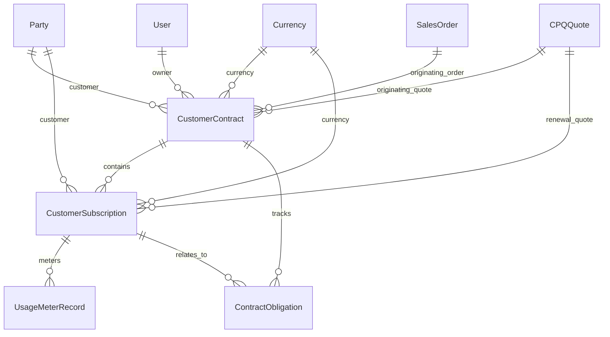

# Research — Sub-module 8.15: Contract & Subscription Management (Module 8 — Sales Management System, sales)

**Sub-module:** `8.15 Contract & Subscription Management` (NavERP.md, Module 8 — Sales Management System)  
**App:** `apps/sales` (existing app — this run EXTENDS it; no scaffold, no `config/` wire-up)  
**Run date:** 2026-10-22  
**Target sub-module:** `8.15`  

---

## 1. Repo state checked first

### 1.1 LIVE_LINKS built so far in Module 8
From `apps/core/navigation.py`:
- Built and active:
  - `8.1` Lead Management (`crm:formsubmission_list`, `sales:lead_score_event_list`, `sales:lead_qualification_list`, etc.)
  - `8.2` Opportunity & Pipeline Management (`sales:opportunity_pipeline_list`, `sales:opportunity_pipeline_visibility`, etc.)
  - `8.3` Contact & Account Management (`sales:account_hierarchy`, `sales:account_classification_list`, `sales:account_plan_list`, etc.)
  - `8.4` Sales Forecasting (`sales:forecast_submission_list`, `sales:forecast_board`, `sales:forecast_attainment`, etc.)
  - `8.5` Quote & Proposal Management / CPQ (`sales:cpq_quote_list`, `sales:quote_approval_queue`, `sales:product_bundle_list`, etc.)
  - `8.6` Order Management (`sales:order_capture_board`, `sales:order_amendment_list`, `sales:revenue_schedule_list`, etc.)
  - `8.7` Territory & Quota Management (`sales:territory_rule_list`, `sales:account_territory_assignment_list`, `sales:quota_plan_list`, etc.)
  - `8.8` Sales Activity & Task Management (`sales:activity_log_list`, `sales:task_template_list`, `sales:sales_plan_cycle_list`, etc.)
  - `8.9` Sales Enablement (`sales:enablement_content_hub`, `sales:sales_playbook_board`, `sales:sales_certification_list`, etc.)
  - `8.10` Incentive Compensation Management (`sales:sales_commission_plan_hub`, `sales:commission_earning_list`, `sales:commission_statement_list`, etc.)
  - `8.11` Customer Success & Account Management (`sales:customer_health_console`, `sales:customer_renewal_pipeline`, `sales:customer_onboarding_hub`, etc.)
  - `8.12` Sales Analytics & Intelligence (`sales:win_loss_console`, `sales:velocity_console`, `sales:funnel_console`, `sales:rep_scorecard_console`, etc.)
  - `8.13` Marketing Alignment & Attribution (`sales:attribution_touchpoint_list`, `sales:mql_handoff_list`, `sales:marketing_attribution_console`, etc.)
  - `8.14` Partner & Channel Management (`sales:partner_profile_list`, `sales:deal_registration_list`, `sales:joint_account_plan_list`, `sales:channel_conflict_list`, `sales:partner_performance_console`).
- **Target Sub-module 8.15 is the next unbuilt sub-module** in Module 8 (`LIVE_LINKS["8.15"]` is currently absent).

### 1.2 Spine entities verified to exist / NOT exist (grep evidence)
Verified via class grep across `apps/core/models/`, `apps/crm/models/`, `apps/accounting/models/`, `apps/scm/models/`, `apps/tenants/models/`, `apps/procurement/models/`, and `apps/sales/models/`:
- `core.Party` (`apps/core/models/Party.py:5`) — **Verified exists.** All client accounts, customers, counterparties, and signers are instances of `Party`.
- `core.Document` (`apps/core/models/Document.py:5`) — **Verified exists.** Used for attaching executed customer contract PDFs, scanned agreement files, amendments, and fulfillment evidence.
- `accounting.Currency` (`apps/accounting/models/GeneralLedger/Currencies.py:6`) — **Verified exists.** Master currency model for all contract values, subscription recurring amounts, and overage rates.
- `accounts.User` (`settings.AUTH_USER_MODEL`) — **Verified exists.** Contract managers, account executives, CSMs, and legal reviewers.
- `sales.CPQQuote` (`CPQ-`, `apps/sales/models/QuoteProposalCPQ/CPQQuotes.py:11`) — **Verified exists.** Originating commercial proposal that converts into a customer contract or subscription, and the target entity for automated renewal quotes.
- `scm.SalesOrder` (`SO-`, `apps/scm/models/OrderManagement/SalesOrders.py:20`) — **Verified exists.** Customer sales order entity that can anchor an ongoing service contract.
- `sales.CustomerRenewal` (`CRN-`, `apps/sales/models/CustomerSuccess/CustomerRenewals.py:30`) — **Verified exists.** Customer success pipeline tracking upcoming contract expirations and account renewal health.
- `crm.DocTemplate` (`TPL-`, `apps/crm/models/DocumentContract/DocTemplates.py:6`) — **Verified exists.** Reusable template library for proposals, NDAs, and standard contracts.
- `crm.ContractDocument` (`CTR-`, `apps/crm/models/DocumentContract/Contracts.py:5`) — **Verified exists.** CRM 1.9 e-signature document wrapper. Does not provide CLM, subscriptions, metered usage, or obligation management.

### 1.3 Ownership rulings & boundaries (L29 / L36 / L37) — what 8.15 must NOT declare
1. **Never declare a duplicate SaaS platform Subscription (L36/L37):** `apps/tenants/models/Subscription.py:5` owns the tenant's own subscription to the NavERP platform (`Tenant.PLAN_CHOICES`, `stripe_subscription_id`, `seats`). Sell-side customer subscription models in 8.15 represent commercial recurring services sold to customer parties and **must be named `CustomerSubscription` (`CSB-`)** to prevent severe class name and mental model collisions.
2. **Never declare a duplicate buy-side Contract master (L36/L37):** `scm.SupplierContract` (`apps/scm/models/SupplierRelationshipManagement/SupplierContracts.py:13`) and `procurement.ContractClause` (`apps/procurement/models/ContractsManagement/Clauses.py:18`) own procurement supplier agreements. Sell-side commercial customer contracts in 8.15 **must be named `CustomerContract` (`CCT-`)**.
3. **Never declare a duplicate Revenue Recognition / ASC 606 ledger (L29/L36):** Module 8.6 owns `RevenueSchedule` (`RVS-`) and `PerformanceObligation` linked to `scm.SalesOrder`. 8.15 tracks commercial delivery commitments, SLAs, and customer contract compliance obligations (`ContractObligation`, `OBL-`), not accounting revenue recognition schedules.
4. **Never declare a duplicate Customer or Account master:** Customer accounts are `core.Party` instances. 8.15 FKs `core.Party` directly.
5. **Never declare a duplicate Quote or Order master:** Initial and renewal proposals reference `sales.CPQQuote` (`CPQ-`); executed orders reference `scm.SalesOrder` (`SO-`).

---

## 2. NavERP.md scope (authoritative)

```markdown
### 8.15 Contract & Subscription Management
- **Contract Authoring & Redlining** — Template libraries, clause management, and collaborative negotiation.
- **Subscription Lifecycle** — Sign-up, upgrade, downgrade, pause, and cancellation workflows.
- **Renewal Automation** — Automated renewal quotes, expiration alerts, and auto-renewal execution.
- **Usage-Based Billing** — Metered billing, overage calculations, and tiered usage tracking.
- **Contract Compliance & Obligations** — SLA monitoring, delivery commitments, and penalty tracking.
```

Five authoritative feature bullets. All five must be fully addressed in the architectural design and feature catalog.

---

## 3. Commercial leaders surveyed

Survey of 9 market-leading Contract Lifecycle Management (CLM), Subscription Billing, and Revenue Cloud platforms:

| # | Product | Positioning | Official Source / Reference | Key Contributions to Catalog |
|---|---|---|---|---|
| 1 | **Salesforce Revenue Cloud (CPQ & Billing)** | Enterprise quote-to-cash, contract lifecycle, and subscription management suite | [salesforce.com/products/revenue-cloud](https://www.salesforce.com/products/revenue-cloud/) | Master contracts with co-terminous subscription lines; automated renewal quotes generation; evergreen vs term subscriptions; mid-term amendments with proration; unified contract asset tracking. |
| 2 | **Zuora (Zuora Billing & Orders)** | Industry-standard enterprise recurring subscription & usage monetization engine | [zuora.com/products/billing](https://www.zuora.com/products/billing/) | Atomic Order Actions framework (Create, Update, Add/Remove Product, Pause/Resume, Renew, Cancel); trigger dates (Contract Effective, Service Activation, Acceptance); unbilled usage tracking; usage billed in arrears. |
| 3 | **Chargebee** | Subscription lifecycle, billing automation, and customer retention platform | [chargebee.com/subscription-management](https://www.chargebee.com/subscription-management/) | Granular pause/resume workflows with immediate vs end-of-term timing; mid-cycle upgrades with proration credits; Entitlements-Based Usage Billing (EBUB); hybrid base + overage charges. |
| 4 | **Stripe Billing** | Developer-first recurring billing, billing meters, and usage-based overage engine | [stripe.com/billing](https://stripe.com/billing) | Billing Meters API; graduated and volume-based pricing tiers; raw usage aggregation (`sum`, `count`, `last`); free included quota tiers with automatic overage calculations; cycle-end invoicing transitions. |
| 5 | **Ironclad CLM** | Enterprise digital contracting, centralized clause library, and obligation tracking | [ironcladapp.com/product/clm](https://ironcladapp.com/product/clm/) | Centralized clause library with standard wording & fallback positions; redline tracking & deviation approvals; contract metadata extraction; milestone & renewal expiration alerts; post-signature obligation management. |
| 6 | **Conga Contracts & Revenue** | End-to-end CLM, contract redlining, renewals, and asset-based ordering | [conga.com/products/contracts](https://conga.com/products/contracts) | Standard legal templates; negotiation & redline versioning; asset-based renewal automation (renew, terminate, co-term, swap, change); SLA obligation tracking; dispute mitigation. |
| 7 | **Maxio (SaaSOptics / Chargify)** | B2B SaaS subscription management, metrics, and complex contract billing | [maxio.com](https://www.maxio.com/) | Contract-driven SaaS subscriptions; MRR/ARR normalization; automated renewal alerts; tiered and volume overage matrices; customer contract compliance. |
| 8 | **Icertis Contract Intelligence (ICI)** | Enterprise contract intelligence, SLA monitoring, and penalty risk mitigation | [icertis.com/contract-intelligence](https://www.icertis.com/contract-intelligence/) | Obligation management engine; deconstructing contract promises into actionable SLA milestones; tracking customer delivery commitments; liquidated damages and SLA penalty exposure calculation. |
| 9 | **DealHub CPQ & Subscription Management** | Unified DealRoom, quote-to-contract generation, and subscription co-terming | [dealhub.io/platform/subscription-management](https://dealhub.io/platform/subscription-management/) | Collaborative negotiation DealRoom; seamless quote-to-contract conversion; co-termed add-ons; automated price uplift upon renewal; proactive churn alerts. |

### Cross-Product Consensus (Industry Standard Best Practices)
1. **Contract as the Legal & Financial Umbrella:** Commercial customer engagements require an overarching legal agreement (`CustomerContract`) defining legal terms, governing law, master start/end dates, total contract value (TCV), and renewal terms.
2. **Subscriptions as Recurring Line Assets:** Under the contract, ongoing services are instantiated as subscriptions (`CustomerSubscription`) with distinct billing cadences (monthly, annual), pricing models (flat fee, per-seat, metered, hybrid), and discrete lifecycles (trialing, active, paused, cancelled, expired).
3. **Standard Order / Lifecycle Actions:** Rather than static rows, subscription systems support standardized lifecycle transitions:
   - *Sign-up / Activation*: Provisioning from accepted CPQ Quote or executed contract.
   - *Upgrades / Add-ons*: Mid-term tier expansion with automated proration.
   - *Pause & Resume*: Temporarily freezing billing and access with defined pause periods.
   - *Cancellation*: Terminating either immediately or scheduled at end-of-current-term with recorded churn reasons.
4. **Automated Renewal Quote Generation:** Modern platforms do not rely on manual rep memory. 30–90 days prior to contract expiration, the system flags the renewal, applies contractual price uplift percentages (e.g., +5%), and automatically drafts a renewal CPQ Quote (`CPQQuote`).
5. **Hybrid Metered & Overage Architecture:** In usage-based models, subscriptions provide an *included allowance* (e.g. 10,000 API requests or 100 GB storage). Incoming usage is aggregated per billing cycle, and any quantity exceeding the allowance is multiplied by the agreed overage rate to generate an overage charge.
6. **Active Obligation & SLA Compliance Tracking:** Post-signature value leakage happens when contractual commitments are forgotten. Enterprise CLMs deconstruct signed contracts into explicit operational obligations (system uptime SLAs, support response times, delivery milestones, audit deliverables) with due dates, fulfillment evidence, and calculated breach penalties/credits.

---

## 4. Deduplicated, prioritised feature catalog

Priority definitions:
- **`table-stakes`**: Baseline capability present across all surveyed enterprise platforms.
- **`common`**: Standard feature present in the majority of mature commercial solutions.
- **`differentiator`**: Advanced capability characteristic of top-tier specialized CLM/billing platforms.

---

### 4.1 Contract Authoring & Redlining

| # | Feature | Description | Seen In | Priority | Spine Mapping | Feasibility |
|---|---|---|---|---|---|---|
| A1 | **Sell-Side Customer Contract Master** | Master commercial agreement container tracking account, contract type, value, start/end dates, governing law, and status. | Salesforce Revenue Cloud, Conga, Ironclad | `table-stakes` | New `CustomerContract` (`CCT-`) + `core.Party` | Buildable now |
| A2 | **Standard Contract Types & Categorization** | Classification by legal framework: Master Services Agreement (MSA), Software Subscription Agreement (SSA), Statement of Work (SOW), Service Level Agreement (SLA), Non-Disclosure Agreement (NDA). | Ironclad, Conga, Icertis | `table-stakes` | `CustomerContract.contract_type` | Buildable now |
| A3 | **Contract Lifecycle States** | Governed progression: `draft` → `internal_review` → `negotiating` → `active` → `amended` → `terminated` → `expired`. | All surveyed leaders | `table-stakes` | `CustomerContract.status` | Buildable now |
| A4 | **Document Template & Attachment Association** | Links contracts to reusable merge templates (`crm.DocTemplate`) and executed signed PDF attachments (`core.Document`). | Salesforce, Ironclad, CRM 1.9 | `table-stakes` | FK to `crm.DocTemplate` and `core.Document` | Buildable now |
| A5 | **Clause Management & Special Terms** | Tracking custom negotiated terms, non-standard liabilities, and deviations from standard legal clauses. | Ironclad, Conga, Icertis | `table-stakes` | `CustomerContract.special_terms` | Buildable now |
| A6 | **Redlining & Collaborative Negotiation Log** | Captures negotiation history, counterparty redline comments, legal review feedback, and external sign-off metadata. | Ironclad, DealHub, Conga | `common` | `CustomerContract.redline_notes` / `signoff_contact` / `signed_at` | Buildable now |
| A7 | **Originating Proposal & Order Linkage** | Direct traceability linking the contract to the originating `sales.CPQQuote` (`CPQ-`) and `scm.SalesOrder` (`SO-`). | Salesforce Revenue Cloud, DealHub | `table-stakes` | FK to `sales.CPQQuote` and `scm.SalesOrder` | Buildable now |
| A8 | **Interactive In-Browser Redlining & Track Changes Engine** | Real-time multi-user document diffing and Word .docx redline parsing inside the browser. | Ironclad, Google Docs | `differentiator` | Third-party WebRTC/DOCX diff engine | Deferred (Integration) |

---

### 4.2 Subscription Lifecycle

| # | Feature | Description | Seen In | Priority | Spine Mapping | Feasibility |
|---|---|---|---|---|---|---|
| S1 | **Sell-Side Customer Subscription Master** | Distinct customer recurring subscription instance (separate from `tenants.Subscription`) tracking plan, cadence, seats, and terms. | Salesforce Revenue Cloud, Zuora, Chargebee, Stripe | `table-stakes` | New `CustomerSubscription` (`CSB-`) | Buildable now |
| S2 | **Flexible Pricing Models** | Supports multiple monetization models: flat recurring fee, per-seat/license, metered usage, and hybrid (base plan + overages). | Zuora, Stripe Billing, Maxio | `table-stakes` | `CustomerSubscription.pricing_model` | Buildable now |
| S3 | **Billing Cadence Configuration** | Supports standard commercial billing intervals: monthly, quarterly, semi-annual, and annual. | Chargebee, Stripe, Zuora | `table-stakes` | `CustomerSubscription.billing_cadence` | Buildable now |
| S4 | **Subscription State Machine** | Governed lifecycle: `trialing` → `active` → `paused` → `past_due` → `cancelled` → `expired`. | Chargebee, Stripe Billing, Zuora | `table-stakes` | `CustomerSubscription.status` | Buildable now |
| S5 | **MRR / ARR Normalization** | Calculates and stores normalized Monthly Recurring Revenue (MRR) and Annual Recurring Revenue (ARR) across varying billing cadences. | Maxio, Zuora, Chargebee | `table-stakes` | `CustomerSubscription.mrr` + derived properties | Buildable now |
| S6 | **Mid-Term Upgrade & Quantity Scaling** | Workflow to increase subscription plan tier or add seats mid-cycle, calculating prorated balance. | Zuora, Chargebee, Salesforce | `table-stakes` | `CustomerSubscription` upgrade action | Buildable now |
| S7 | **Subscription Pause & Resume Workflow** | Allows temporary suspension of services (seasonal pause, vacation, grace period) with recorded pause start and automatic resume dates. | Chargebee, Zuora | `common` | `CustomerSubscription.paused_at` / `resumed_at` | Buildable now |
| S8 | **Structured Cancellation & Churn Tracking** | Workflow capturing cancellation effective timing (immediate vs end-of-term) and structured churn exit reasons. | Chargebee, Maxio, Salesforce | `table-stakes` | `CustomerSubscription.cancelled_at` / `cancellation_reason` | Buildable now |
| S9 | **Automated Gateway Credit Card Tokenization & Charging** | Direct payment gateway charging via saved customer payment methods. | Stripe, Chargebee, Braintree | `common` | Payment Gateway / Accounting integration | Deferred (Integration) |

---

### 4.3 Renewal Automation

| # | Feature | Description | Seen In | Priority | Spine Mapping | Feasibility |
|---|---|---|---|---|---|---|
| R1 | **Contract Expiration Watch & Notice Windows** | Automatic detection of contracts and subscriptions approaching expiration (90, 60, 30 days notice). | Salesforce, DealHub, Maxio | `table-stakes` | Expiration calculation on `CustomerContract` & `CustomerSubscription` | Buildable now |
| R2 | **Auto-Renewal Execution Rules** | Automated renewal execution for contracts with `auto_renew=True`, advancing term dates by contractual renewal months (e.g. 12 months). | Zuora, Salesforce, DealHub | `table-stakes` | `CustomerContract.auto_renew` / `renewal_term_months` | Buildable now |
| R3 | **Contractual Price Uplift Engine** | Automatic application of agreed price escalation percentage upon renewal (e.g. +3% or +5% annual inflation uplift). | Salesforce Revenue Cloud, DealHub, Conga | `common` | `CustomerContract.price_uplift_pct` | Buildable now |
| R4 | **Automated Renewal Quote Generation** | One-click or automated creation of a renewal `sales.CPQQuote` (`CPQ-`) carrying forward active terms and price uplifts. | Salesforce CPQ, Conga, DealHub | `table-stakes` | Action creating `sales.CPQQuote` + FK link | Buildable now |
| R5 | **Renewal Pipeline Management Board** | Consolidated operational view of upcoming renewals, at-risk contracts, renewal quotes, and auto-renew candidates. | Salesforce, DealHub, CustomerSuccess 8.11 | `table-stakes` | Renewal management console / view | Buildable now |
| R6 | **Co-Terming & Alignment Engine** | Automatically aligns mid-contract add-on subscriptions to coterminate with the master contract end date. | Salesforce Revenue Cloud, DealHub | `common` | Term alignment logic against parent `CustomerContract` | Buildable now |

---

### 4.4 Usage-Based Billing

| # | Feature | Description | Seen In | Priority | Spine Mapping | Feasibility |
|---|---|---|---|---|---|---|
| U1 | **Metered Consumption Register** | Periodic record tracking customer usage metrics: API calls, GB storage, compute hours, active users, transactions. | Stripe Billing, Zuora, Chargebee | `table-stakes` | New `UsageMeterRecord` (`UMR-`) | Buildable now |
| U2 | **Included Allowance / Base Quota** | Defines units included for free in the base subscription fee before overages apply. | Stripe Billing, Chargebee, Zuora | `table-stakes` | `UsageMeterRecord.included_allowance` | Buildable now |
| U3 | **Automated Overage Calculation** | Calculates billable overage units `max(0, reported_usage - included_allowance)` and total overage monetary charges. | Stripe Billing, Chargebee, Zuora | `table-stakes` | `UsageMeterRecord.billable_overage_units` / `overage_total_charge` | Buildable now |
| U4 | **Usage Billing Cycles & Billing in Arrears** | Isolates usage consumption by billing period start/end dates, preparing charges for post-period invoicing. | Zuora, Stripe, Maxio | `table-stakes` | `UsageMeterRecord.billing_period_start` / `billing_period_end` | Buildable now |
| U5 | **Usage Record Lifecycle & Invoicing State** | Workflow tracking usage status: `metering` → `calculated` → `invoiced` → `disputed`. | Stripe Billing, Zuora | `table-stakes` | `UsageMeterRecord.status` / `invoiced_at` | Buildable now |
| U6 | **Real-Time Streaming Event Ingestion Pipeline** | High-throughput streaming event bus (Kafka/Kinesis) processing millions of raw event logs per second. | Stripe Meters, Lago, Metronome | `differentiator` | Streaming data pipeline | Deferred (Integration) |

---

### 4.5 Contract Compliance & Obligations

| # | Feature | Description | Seen In | Priority | Spine Mapping | Feasibility |
|---|---|---|---|---|---|---|
| O1 | **Contract Obligation Master** | Structured register tracking contractual commitments, SLAs, deliverables, and regulatory obligations linked to a customer contract. | Icertis, Ironclad, Conga | `table-stakes` | New `ContractObligation` (`OBL-`) | Buildable now |
| O2 | **Obligation Typology** | Categorizes commitments: `sla_uptime`, `sla_response`, `delivery_milestone`, `reporting_compliance`, `warranty_support`, `audit_obligation`. | Icertis, Conga | `table-stakes` | `ContractObligation.obligation_type` | Buildable now |
| O3 | **Target SLA Metrics & Benchmarks** | Measurable benchmark string (e.g., "99.9% Monthly Uptime", "<1hr Critical Incident Response", "Phase 1 Delivery"). | Icertis, Ironclad | `table-stakes` | `ContractObligation.target_metric` | Buildable now |
| O4 | **Fulfillment Status Tracking** | Governed lifecycle: `pending` → `fulfilled` → `at_risk` → `breached` → `waived`. | Icertis, Ironclad | `table-stakes` | `ContractObligation.status` | Buildable now |
| O5 | **Audit Fulfillment Evidence** | Records verification proof (uptime reports, incident tickets, acceptance sign-offs, delivery receipts). | Icertis, Ironclad | `common` | `ContractObligation.fulfillment_evidence` / `fulfilled_at` | Buildable now |
| O6 | **Penalty & Service Credit Tracking** | Tracks contractual penalty terms, calculates assessed service credit or liquidated damages, and manages credit status (`none`, `assessed`, `credited`, `waived`). | Icertis, Conga | `common` | `ContractObligation.penalty_terms` / `penalty_amount` / `penalty_status` | Buildable now |
| O7 | **Automated Uptime Telemetry Ingestion** | Direct integration into Datadog, New Relic, or Prometheus to automatically assess uptime SLAs. | Icertis, Cloud providers | `differentiator` | APM / Observability connector | Deferred (Integration) |

---

## 5. Recommended build scope (1–4 model budget)

To comprehensively satisfy all five NavERP 8.15 feature bullets within the standard 1–4 model budget, Sub-module 8.15 is scoped as **4 tenant-scoped models** plus **1 integrated management console & renewal workbench**, with verified spine reuse across `core.Party`, `core.Document`, `accounting.Currency`, `accounts.User`, `sales.CPQQuote`, `scm.SalesOrder`, and `crm.DocTemplate`:



### 5.1 Model Specifications

| Entity / Model | Class Name | Number Prefix | NavERP 8.15 Feature Bullets Satisfied | Key Fields & Justification |
|---|---|---|---|---|
| **Customer Contracts** | `CustomerContract` | `CCT` | **Contract Authoring & Redlining** & **Renewal Automation** | Tenant FK, `number` (`CCT-`), `account` FK (`core.Party`), `title`, `contract_type` (msa, subscription_agreement, sow, sla, nda, custom), `status` (draft, internal_review, negotiating, active, amended, terminated, expired), `owner` FK (`accounts.User`), `currency` FK (`accounting.Currency`), `total_contract_value`, `annual_contract_value`, `start_date`, `end_date`, `auto_renew`, `renewal_term_months`, `notice_period_days`, `price_uplift_pct`, `governing_law`, `originating_quote` FK (`sales.CPQQuote`), `originating_order` FK (`scm.SalesOrder`), `template` FK (`crm.DocTemplate`), `document` FK (`core.Document`), `special_terms`, `redline_notes`, `signed_at`, `signoff_contact`. |
| **Customer Subscriptions** | `CustomerSubscription` | `CSB` | **Subscription Lifecycle** & **Renewal Automation** | Tenant FK, `number` (`CSB-`), `contract` FK (`CustomerContract`, null/blank), `account` FK (`core.Party`), `subscription_name`, `plan_code`, `status` (trialing, active, paused, past_due, cancelled, expired), `pricing_model` (flat_fee, per_seat, usage_metered, hybrid), `billing_cadence` (monthly, quarterly, semi_annual, annual), `currency` FK (`accounting.Currency`), `quantity`, `unit_price`, `mrr`, `start_date`, `current_term_start`, `current_term_end`, `trial_ends_at`, `paused_at`, `resumed_at`, `cancelled_at`, `cancellation_reason`, `auto_renew`, `renewal_notice_days`, `renewal_quote` FK (`sales.CPQQuote`), `owner` FK (`accounts.User`). *(Cleanly avoids collision with `tenants.Subscription`)*. |
| **Usage Meter Records** | `UsageMeterRecord` | `UMR` | **Usage-Based Billing** | Tenant FK, `number` (`UMR-`), `subscription` FK (`CustomerSubscription`), `meter_name`, `unit_of_measure`, `billing_period_start`, `billing_period_end`, `included_allowance`, `reported_usage`, `billable_overage_units`, `overage_unit_price`, `overage_total_charge`, `status` (metering, calculated, invoiced, disputed), `invoiced_at`, `notes`. |
| **Contract Obligations** | `ContractObligation` | `OBL` | **Contract Compliance & Obligations** | Tenant FK, `number` (`OBL-`), `contract` FK (`CustomerContract`), `subscription` FK (`CustomerSubscription`, null/blank), `title`, `obligation_type` (sla_uptime, sla_response, delivery_milestone, reporting_compliance, warranty_support, audit_obligation), `target_metric`, `due_date`, `status` (pending, fulfilled, at_risk, breached, waived), `fulfilled_at`, `fulfillment_evidence`, `penalty_terms`, `penalty_amount`, `penalty_status` (none, assessed, credited, waived), `assigned_to` FK (`accounts.User`). |
| *(Derived Consoles & Workbenches)* | `contract_subscription_workspace`, `renewal_board`, `usage_metering_workbench`, `contract_compliance_board` | — | **All 5 Bullets** | Executive workspace displaying active contracts, ARR/MRR rollup, 30/60/90-day renewal radar, unbilled usage overages, and SLA compliance/penalty exposure summary. |

### 5.2 Prefix Collision Verification
Repository-wide grep confirms that all proposed prefixes are completely unused across the entire codebase:
- `CCT` (Customer Contract) — **FREE** (0 matches)
- `CSB` (Customer Subscription) — **FREE** (0 matches)
- `UMR` (Usage Meter Record) — **FREE** (0 matches)
- `OBL` (Contract Obligation) — **FREE** (0 matches)

*(Note: `SUB` was also free, but `CSB` was selected for crisp symmetry with `CustomerSubscription` and clear distinction from `tenants.Subscription`).*

---

## 6. Belongs to sibling sub-modules (parked, not scoped here)

1. **Quote Proposal & Bundle Configuration (CPQ)** (`CPQ-`, `BND-`): CPQ quoting, bundle rules, and discount approval ladders belong to Sales 8.5 (`apps/sales/models/QuoteProposalCPQ/`). Initial quotes convert into contracts, and renewal automation generates renewal quotes back into 8.5.
2. **Sales Order Fulfillment & ASC 606 Revenue Recognition** (`SO-`, `RVS-`): Customer order execution belongs to SCM 4.5, and GAAP/IFRS 15 revenue schedules belong to Sales 8.6 (`apps/sales/models/OrderManagement/RevenueSchedules.py`). 8.15 links by FK for contract context.
3. **Customer Health Scoring & CS Renewal Pipelines** (`CRN-`, `CHS-`): High-touch customer success sentiment and QBR reviews belong to Sales 8.11 (`apps/sales/models/CustomerSuccess/`). 8.15 provides the underlying contractual and subscription financial truth.
4. **CRM E-Signature Signer Records** (`CTR-`, `TPL-`): Tokenized public e-signature portals belong to CRM 1.9 (`apps/crm/models/DocumentContract/`). 8.15 leverages `core.Document` and links `crm.DocTemplate`.
5. **Procurement & Supplier Contracts** (`SC-`, `ContractClause`): Buy-side vendor agreements belong to SCM 4.2 / Procurement 6.8 (`scm.SupplierContract`, `procurement.ContractClause`). 8.15 handles sell-side customer contracts.
6. **Platform Multi-Tenant SaaS Subscriptions** (`Subscription`): NavERP tenant account plans, seats, and internal Stripe billing belong to Module 0 `apps/tenants/models/Subscription.py`.

---

## 7. Deferred (later passes / external integrations)

1. **Third-Party E-Signature Webhook Automation (DocuSign / Adobe Sign / HelloSign API)**: Automated token exchange and multi-signer webhook callbacks for legally binding digital signatures. (GAP)
2. **High-Throughput Streaming Event Ingestion Engine**: High-velocity real-time event streaming pipeline (Kafka/Kinesis) for ingesting sub-second metered consumption. (GAP)
3. **Automated Payment Gateway Credit Card Processing**: Automatic recurring credit card / ACH charge execution against customer saved tokens via Stripe Payments or Adyen. (GAP)
4. **AI-Assisted Contract Parser & Third-Party Redline OCR**: Automated LLM extraction of obligations, liability clauses, and redline diffs from unstructured PDF uploads. (GAP)
5. **Automated Cloud Infrastructure Telemetry Ingestion for SLAs**: Automated polling of AWS CloudWatch, Datadog, or Pingdom API to automatically assert uptime percentages and trigger SLA breach credits. (GAP)
